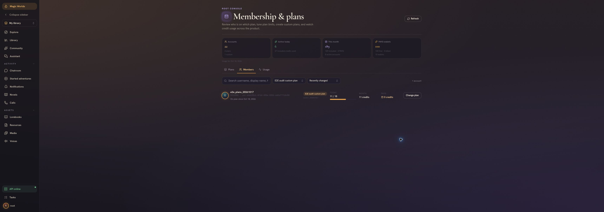

# Plan management and consumer audit

Root can create a custom plan, assign a newly registered consumer, change its allowances, and enforce those allowances without checkout. The live flow passed. The audit is **not clean**: reset/refund accounting can undercount usage, a new consumer can select a persona the backend rejects, and several usage and audit surfaces need correction.

Audited October 17, 2026, America/Mexico_City. The backend usage day was October 18 in UTC. Payments were excluded from acceptance, as requested.

The follow-up [focused review and fix plan](REVIEW_AND_FIX_PLAN.md) maps every finding to a bounded change, protected behavior, regression coverage, and schema/rollback gates. It tightens the monthly-reset comparison and other recommendations without changing the original evidence. No product fixes have been applied.

## Environment and retained test account

| Item | Value |
| --- | --- |
| Frontend | Local development app on `localhost:5173`; production build copied to an independent preview on `localhost:5177` for the final consumer checks |
| Backend | Running BFF on `localhost:8010`, using its real configured auth and database services |
| Frontend base revision | `c65708095272cc2229b5a41aa90d262bb84ac710`, with existing local changes |
| Backend base revision | `d49f1b886227b70e75dc2c2999407a20536523aa`, with existing local changes |
| New consumer | `e2e_plans_20261017`, local user ID `210591`, type `consumer` |
| Custom plan | `audit_20261017`, display name `E2E audit custom plan`, active with one member |
| Final daily credits | 18 included, 11 used, 7 remaining; PAYG wallet 0 |
| Final AI card limit | 1 request, cost 2 credits; one successful generation |
| Final chat limit | 3 requests, cost 3 credits; three successful replies |
| Voice quantity caps | Narration 0 characters; calls 0 seconds |
| Test content | Private character `Mira Audit`, persona `E2E Audit Traveler`, chat `74` |

The account, plan, and synthetic content remain available for inspection. Credentials stay outside the repository in a restricted temporary file. No default plan or existing customer account was edited. Product source was left unchanged; this folder contains the audit and reproductions.

## Live flow results

| Scenario | Result and evidence |
| --- | --- |
| Register a consumer through the browser | Passed, including password confirmation and the approved age and terms checkboxes. No email was needed. |
| Root creates the custom plan | Passed with all nine operation rows, explicit narration/call quantities, and copied Free defaults for the other limits. |
| Root finds and assigns the new consumer | Passed. The consumer saw the custom name, 12 initial credits, and custom limits. [Assignment screenshot](evidence/root-assignment.jpg), [initial profile](evidence/consumer-assigned-profile.json). |
| Consumer cannot manage plans | All seven live root API attempts returned 403: list/get/create/update plans, list members, read overview, and assign a plan. [Authorization results](evidence/consumer-api-authorization.json). |
| AI card generation and custom pricing | Passed. The first generation cost exactly 2 credits and consumed one request. The character was saved and published in the private library. [Profile after AI](evidence/consumer-after-ai.json). |
| AI allowance exhaustion | Passed enforcement. A second complete request returned 402 `PLATFORM_CREDITS_EXHAUSTED` with 7 included credits still available, and made no further debit. The error semantics are finding 6. [Response and counters](evidence/ai-limit-rejection.json). |
| First chat with no persona | Failed. The picker offered the AI character as a persona; the backend returned 422. A manual persona was created to continue the audit. See finding 2. |
| Two live chat replies | Passed after selecting a valid persona. Each cost 3 credits; cumulative usage was 8 including the AI card. Chat history survived reopening the conversation and signing into the production preview. |
| Third chat at the two-request cap | Correctly rejected, with usage unchanged at 8 and 4 credits remaining. The browser showed a generic failure. [Counters](evidence/consumer-after-chat-rejection.json), [UI](evidence/chat-quota-rejection.jpg). |
| Deactivate an occupied plan | Correctly rejected. Root received a message that the one member must be moved first. [Guard screenshot](evidence/occupied-plan-guard.jpg). |
| Root raises allowances and consumer retries | Passed. Root changed 12 credits to 18 and two chat requests to three. Existing consumption stayed at 8. The failed turn's Retry action then succeeded and charged 3, yielding 11 used and 7 remaining. |
| Root and consumer final totals | Agreed at 11 included credits used this day and month, wallet 0. [Root](evidence/root-final-member.jpg), [consumer](evidence/consumer-final-usage.jpg), [final API profile](evidence/consumer-final-profile.json). |
| Narration at zero characters | Passed live enforcement. Play narration answered “Daily voice limit reached. Narration resumes tomorrow.” No narration request or credit debit was recorded. [Screenshot](evidence/narration-zero-cap.jpg). |
| Call setup | Opened and cancelled before microphone access. Call seconds and credit reservations were validated in isolated database tests; an actual microphone/provider call was not part of this audit. |



## Findings

### 1 A refund from before a daily reset can erase later usage

**P1, reproduced against real isolated MySQL.** Reserve a 5-credit operation, perform a root daily reset, then reserve a new 2-credit operation. Refunding the original reservation changes the daily counter from 2 to 0 and the operation counter from 1 to 0, even though the new charge remains reserved and monthly usage remains 2. This grants additional included capacity incorrectly.

`refund_credit_ledger` subtracts the old charge from the current day's counters without checking whether a reset has already removed that charge. See [models.py](/home/andres/PycharmProjects/magic-worlds-api/src/database/mysql/models.py:3525). Track a reset epoch or a ledger boundary and compensate only counters that still include the refunded charge.

[Exact counters](evidence/defect-reset-refund.json), reproduction `test_refund_before_daily_reset_preserves_new_usage` in [the accounting probes](test_accounting_findings.py).

### 2 A new consumer can choose an invalid persona and cannot start chat

**P1, reproduced in the browser and live API.** With only the newly generated AI character in the account, New chat opens a persona picker that selects that character. Start chat enters the conversation screen, but the first message fails. The API returns 422 `persona_id must reference a persona card`. No chat credits are charged.

[personaCandidates](/home/andres/WebstormProjects/magic-worlds/src/utils/characterRoles.ts:30) appends AI characters to valid personas, while [the backend](/home/andres/PycharmProjects/magic-worlds-api/src/routes/user/route_character_chat.py:584) requires role `persona`. Restrict this picker to persona cards and offer an explicit create-persona path when none exist. Validate before entering a conversation that cannot start.

[API response](evidence/chat-start-api.json), [browser failure](evidence/chat-start-failure.jpg).

### 3 Monthly resets give consumers and root different monthly totals

**P2, reproduced against real isolated MySQL; also tracked under MEMBER-01.** After 5 credits of usage and a per-user monthly reset, `/user/me` reports 0 monthly credits. Root's member list and overview continue reporting 5.

The consumer projection filters the ledger using the latest monthly reset. Root's [member and overview queries](/home/andres/PycharmProjects/magic-worlds-api/src/database/mysql/membership_admin_models.py:914) use the calendar ledger without that boundary. Decide whether root needs calendar spend, consumption since reset, or both, and label and test those values consistently. Preserve the original ledger for historical spend.

[Observed totals](evidence/defect-monthly-reset.json), reproduction `test_monthly_reset_has_consistent_root_and_consumer_totals`.

### 4 One action paid from both PAYG buckets is counted twice

**P2, reproduced against real isolated MySQL.** One 5-credit operation paid with 2 free-wallet credits plus 3 billed-wallet credits produces daily request count 1, consumer monthly count 2, and root monthly count 2. The credit charge itself remains correctly 5.

Both [consumer monthly usage](/home/andres/PycharmProjects/magic-worlds-api/src/database/mysql/models.py:4138) and [root monthly usage](/home/andres/PycharmProjects/magic-worlds-api/src/database/mysql/membership_admin_models.py:932) count ledger rows as actions. A single operation may have two rows. Count a stable operation/reservation identity separately from credit-source entries.

[Observed counts](evidence/defect-split-payg-count.json), reproduction `test_split_payg_payment_counts_one_operation`. This fixture seeds wallet balances only in a disposable database; it performs no purchase.

### 5 The consumer BYOK meter rejects a valid backend response

**P2, reproduced on the production build and with the actual response parser.** `/llm/capacity-usage` returns 200 with `novel_assistant` in its feature list. The frontend's [accepted feature set](/home/andres/WebstormProjects/magic-worlds/src/infrastructure/api/llmProfileContract.ts:83) omits that feature and throws `Invalid LLM capacity usage.` The Usage tab consequently displays “BYOK usage is unavailable right now.”

Passing the captured response to the parser fails; removing only `novel_assistant` succeeds. Use one maintained feature contract and include current features in its tests.

[Captured response](evidence/capacity-result.json), [paired parser result](evidence/capacity-contract-probe.json), [repeatable parser probe](check_capacity_contract.mjs).

### 6 Quota exhaustion is presented as an unexplained execution failure

**P2, reproduced live.** A consumer with 4 credits remaining and two chat requests used receives “Chat execution failed.” The UI offers Retry, which remains unsuccessful until the allowance changes. Separately, the exhausted AI request allowance is reported as `PLATFORM_CREDITS_EXHAUSTED` while 7 included credits remain.

The [charge path](/home/andres/PycharmProjects/magic-worlds-api/src/database/mysql/llm_execution_admission.py:574) combines request allowance and credit availability before returning one insufficient-wallet error. The [WebSocket handler](/home/andres/PycharmProjects/magic-worlds-api/src/routes/user/route_chat.py:2728) emits a generic message for quota failures. Return enough information to distinguish operation allowance, included credit budget, PAYG availability, and concurrency. Explain the next available action in the consumer UI.

[AI response](evidence/ai-limit-rejection.json), [chat failure UI](evidence/chat-quota-rejection.jpg). Raising the plan and retrying successfully verified that enforcement, rather than a model failure, caused the rejection.

### 7 Manual assignment has no durable history contract

**P2, confirmed in source; existing MEMBER-01 gap.** Assignment updates `user_membership` and writes actor, reason, previous plan, and new plan to the application logger. The console's reason field says it is kept in the API audit log, but there is no durable assignment-history table or retrieval contract in this path.

See [assignment persistence](/home/andres/PycharmProjects/magic-worlds-api/src/database/mysql/membership_admin_models.py:849). Persist actor, target, previous/new plan, reason, timestamp, and a stable event identity in the assignment transaction, with root access and retention tests. This audit did not treat application log output as a durable event history.

### 8 Consumer pricing and operation labels are inaccurate

**P3, reproduced on the production build.** The wallet says “1 credit per action” for a plan whose live chat and AI prices are 3 and 2. Monthly chat and AI rows show “0 sec audio time” instead of their request counts.

The first statement is [fixed copy](/home/andres/WebstormProjects/magic-worlds/src/app/i18n/locales/en.ts:3187). The [monthly label formatter](/home/andres/WebstormProjects/magic-worlds/src/features/profile/components/UsageSection.tsx:433) chooses audio whenever `billable_seconds` is numeric; the backend supplies numeric zero for non-audio operations too. Show operation-specific costs and select units from the operation's billing semantics.

## Root configuration boundaries

The editor correctly leaves image pricing to image profiles. Voice pricing also has independent rules, but the editor still offers a generic credit-cost input for narration, calls, and previews. Narration passes its calculated quantity cost to `TurnChargeBilling.reserve`; calls debit duration-based credits; the preview meter makes its initial previews free and later misses cost one credit. Those flows do not use the editable plan cost as a general multiplier. Root should be shown the effective pricing source or a read-only unit description for these rows. The hard narration and call quantity caps do take effect.

The nine operation rows are complete, strict API validation rejects incomplete maps and invalid quantities/concurrency, default plans retain their immutability guards, and inactive plans cannot be assigned. Plan assignment and limit edits preserve existing daily consumption. These boundaries were exercised by the database and frontend tests below.

## Automated validation

| Suite | Result |
| --- | --- |
| Frontend membership and profile interactions | 62 passed across 10 files |
| Backend membership routes, administration, PAYG, voice usage, and profile cards | 205 passed |
| Preview, narration, call quota, and call billing meters | 156 passed |
| Real isolated MySQL membership, payer, execution-admission, and narration-charge integration | 18 passed |
| Production typecheck and build | Passed |
| Additional expected-behavior accounting probes | 3 xfailed with strict expectations; each confirms findings 1, 3, or 4 |

The 441 passing tests establish the tested existing behavior. They do not override the three demonstrated accounting failures or the live UI failures. Full outputs are in [evidence](evidence/).

The database runs used MySQL 8.4.11 in a temporary container with networking disabled and memory-backed data. Each test created and dropped a random database through its explicit test socket. Root/consumer identities were supplied by test dependency overrides; plan routes, SQL persistence, quotas, and ledgers were real. No auth, payment, or generation provider was called by those database tests. Live browser generation and chat used the configured real services.

From the frontend repository:

```bash
pnpm exec vitest run --exclude '**/.claude/**' --exclude '**/.codex/**' \
  src/features/admin/membership src/features/profile
pnpm build
node --experimental-strip-types docs/billing/plan-audit-2026-10-17/check_capacity_contract.mjs
```

From the backend repository, with an explicitly isolated MySQL socket:

```bash
LLM_PROFILE_TEST_MYSQL_SOCKET=/path/to/isolated/mysql.sock \
  .venv/bin/python -m pytest -q \
  tests/integration/test_membership_custom_plan_database.py \
  tests/integration/test_membership_payer_database.py \
  tests/integration/test_llm_execution_admission_database.py \
  tests/integration/test_turn_charge_workspace_database.py

PYTHONPATH="$PWD" \
MEMBERSHIP_AUDIT_EVIDENCE_DIR=/tmp/membership-audit-reproduction \
LLM_PROFILE_TEST_MYSQL_SOCKET=/path/to/isolated/mysql.sock \
  .venv/bin/python -m pytest -q -s \
  /home/andres/WebstormProjects/magic-worlds/docs/billing/plan-audit-2026-10-17/test_accounting_findings.py
```

`xfail(strict=True)` preserves the desired assertions while marking the current known failures. Once corrected, an unexpected pass makes the probe fail so the marker must be removed and the regression moved into the normal backend test suite.

## Acceptance boundary

Creating and assigning a custom consumer plan, changing its live limits, charging its configured AI/chat costs, rejecting spent allowances without additional debit, preserving usage on edits, and blocking zero-cap narration all passed. All operation-meter enforcement beyond that live slice was covered by the specified database and unit suites.

Checkout, subscriptions, payment reconciliation, real microphone calls, and live image/music rendering were excluded. A read-only request to the actual `/billing/plans` endpoint returned 502 `Billing catalog response is invalid`, consistent with an unavailable purchase surface; it does not affect this membership acceptance and is not payment certification.

Resolve findings 1 and 2 first, then reconcile monthly/reset and operation counting semantics, restore the BYOK meter, and make quota errors actionable. Retest the listed reproductions after each fix before treating the consumer plan experience as fully validated.
