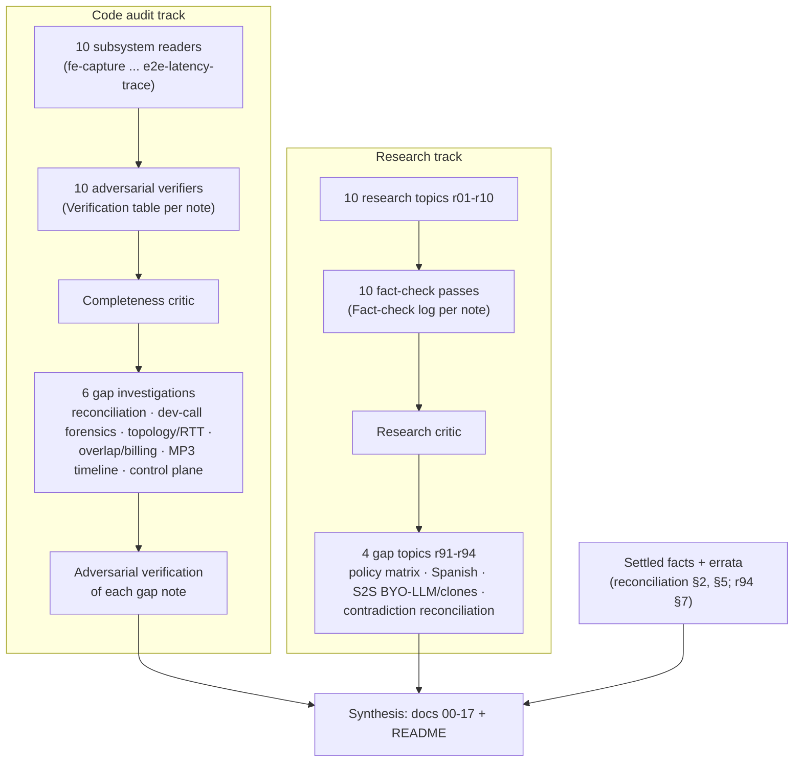

# Methodology, evidence and sources

**Research date:** 2026-10-20. **Scope:** how this report on the Magic Worlds live voice call ("phone a character", English and Spanish) was produced. It covers the audit and research workflow, what was counted, the confidence and severity scheme, the source hierarchy, the limitations, the residual contradictions, an index of all 30 evidence files, and a curated list of key external sources. The code in scope is the frontend (`/home/andres/WebstormProjects/magic-worlds`), the BFF (`/home/andres/PycharmProjects/magic-worlds-api`), api.magic_llm, magic-agents and magic-llm, limited to the voice-call path.

## Summary

- **Two parallel tracks fed this report.**
  - A code audit: 10 subsystem readers, each followed by an adversarial verifier, then a completeness critic and 6 gap investigations. The gap work included read-only dev-DB forensics and measured network RTTs.
  - Web research: 10 topics, each fact-checked against primary sources, then a research critic and 4 gap topics (vendor policy, Spanish, S2S compatibility, contradiction reconciliation).
- **Scale.**
  - 30 evidence files, about 296k words.
  - 209 subsystem finding IDs, reconciled into 126 canonical issues, plus 62 gap-note findings.
  - About 453 fact-check rows over 780 unique URLs from about 201 domains.
- **Adversarial checking changed severities in one direction.**
  - Subsystem notes: 28 of 119 verified IDs (24%) were downgraded and none were upgraded.
  - All passes combined: about 44 downgrades and 1 upgrade across 219 checked items.
  - Readers should discount any unverified high or medium, because about one in four verified ones dropped a level.
- **Precedence of facts.** Settled facts and the reconciliation errata outrank the individual notes. Several notes still carry stale values: an 800 ms hang-over, a 7.5 s segment cap, a "WebSocket upload", and $0.011/min for Gemini Live. Section 8 lists every correction this report applies.
- **One settled fact is corrected here from code.** On the ElevenLabs call lane, the backend streams `mp3_44100_64` (64 kbps), not 128 kbps (`magic-worlds-api/src/services/speech/capabilities.py:65`, `:159`). Only the Fish lane and narration use 128 kbps. Separately, the baseline's "the OpenRouter poll does not apply" keeps its DB evidence, but the code reason the verifier cited belongs to the recovery route, so the mechanism is qualified (E9).
- **The data limits every quantitative conclusion.**
  - Dev data only, with small n: 23 STT samples, 8 calls, 17 assistant replies.
  - No production telemetry or topology.
  - No listening tests and no live S2S trials.
  - Some DB reads were denied.
  - The vendor and legal landscape moves monthly.
- **What to do first:** persist per-turn millisecond timestamps (C13), so every latency claim in [02_turn_lifecycle_and_latency.md](02_turn_lifecycle_and_latency.md) can be re-measured. Then re-run the blocked overlap forensics with approval and get legal review of the policy matrix (recommendations M-01 to M-11).

---

## 1. Purpose and scope

This document explains how much weight each claim in the report deserves, and where it came from. The other documents cite evidence notes by relative link (for example [fe-capture](evidence/audit/fe-capture.md)) and canonical findings by id (for example `C02 (FE-CAPTURE-04)`). This document defines those conventions.

### 1.1 Systems in scope

| Repo | Role in the call | Audited for |
|---|---|---|
| `magic-worlds` (frontend, React 19) | Mic capture, AudioWorklet VAD, WAV build, segment POST, control WebSocket, MSE playback, call UI | Capture, playback/transport, UI |
| `magic-worlds-api` (BFF, FastAPI + MySQL) | Call WebSocket, segment intake, Groq STT, turn engine, moderation, TTS lanes (ElevenLabs, Fish), quotas, billing, storage | Route/transport, STT, turn-taking, LLM dispatch, TTS, observability, safety, cost |
| `api.magic_llm` | OpenAI-compatible agents API that runs the inline `callbot_chat.v2` graph with durable recording | LLM path, pre-provider pipeline, post-stream tail |
| `magic-agents` | Graph runtime used by api.magic_llm | Execution and storage hooks on the LLM path |
| `magic-llm` | Provider client (retries, sessions) | Retry policy, connection reuse |

Out of scope: text chat, adventure play, narration TTS (except where it shares code with calls), billing UI, and non-call admin consoles. api.auth appears only as a per-request hop in the topology measurements.

### 1.2 Baseline the report builds on

The synthesis started from a list of settled facts. These were verified against code and dev data and reconciled across notes. The table below is a pointer, not a full description. [01_current_architecture.md](01_current_architecture.md) and [02_turn_lifecycle_and_latency.md](02_turn_lifecycle_and_latency.md) give the detail.

| Area | Settled baseline | Anchor |
|---|---|---|
| Uplink | 16 kHz mono PCM16 WAV per utterance, sent by multipart HTTP POST. The WebSocket carries only control frames and downlink base64 MP3 inside JSON. | `magic-worlds-api/src/routes/user/route_voice_call.py:1130` |
| Client VAD | RMS AudioWorklet with an adaptive floor. Speech starts after 250 ms (500 ms while the character is audible). The turn ends after 550 ms of silence. 300 ms pre-roll. Segment cap 7.5 s until consent, then 29.5 s. | `src/features/call/components/CallScreen.tsx:114` |
| Server limits | 30 s and 2 MB per segment. The STT timeout is 30 s. The server energy gate is off by default, and there is no neural VAD. | `magic-worlds-api/src/services/voice_orchestration/config.py:42-43`, `:47`; `server_vad.py:31` |
| STT | Groq whisper-large-v3, batch, one attempt, run under `intake_lock`. Dev p50 526 ms, p95 1,002 ms (n = 23). | [gap-finding-reconciliation](evidence/audit/gap-finding-reconciliation.md) §6 |
| LLM | `callbot_chat.v2` through api.magic_llm. About 20 fsync'd commits run before the provider request (p50 about 0.87 s). Post-stream tail 1–2.5 s. Output cap 1,536 tokens. No TTFT deadline, hedge or fallback. | `magic-worlds-api/src/services/llm_features.py:67`; [gap-topology-rtt-measurements](evidence/audit/gap-topology-rtt-measurements.md) |
| TTS | ElevenLabs `eleven_v4_turbo` on the TTD multi-stream WebSocket. Fish `drama-3` / `s2.1-pro` on `/v1/tts/live/with-timestamp`, `latency: 'balanced'`. Sentences split only on ASCII `. ! ?` plus a 160-char cap. | `magic-worlds-api/src/services/speech/capabilities.py:159`; `magic-worlds-api/src/services/speech/providers/fish_audio/timestamp_ws.py:212` |
| Barge-in | 500 ms of voiced audio, suppressed for the first 3 s and when AEC is off. Irreversible. The LLM never sees interruptions. | [be-engine-turntaking](evidence/audit/be-engine-turntaking.md), [fe-capture](evidence/audit/fe-capture.md) |
| End-to-end (EL lane) | Speech end to first audio about 3.2–4.2 s at STT p50 and about 3.6–4.7 s at STT p95 (INFERENCE). One documented sample was about 5.5 s. Hang-over, STT and LLM make up about 80%. | [gap-finding-reconciliation](evidence/audit/gap-finding-reconciliation.md) §7 |

---

## 2. Method

### 2.1 Workflow

Every reader, verifier and investigator was a separate agent. Only the evidence files were shared between them. All code access was read-only. No source file and no evidence file was changed during synthesis.

### 2.2 Code audit: 10 subsystem readers and their verifiers

Each reader owned one subsystem and wrote a note with:

- numbered finding IDs (for example `FE-CAPTURE-04`), each with a header severity;
- FACT / INFERENCE / UNKNOWN labels;
- code citations with line numbers;
- open questions.

A separate verifier then tried to refute every critical, high and medium finding against the code. It recorded a verdict (`confirmed` or `adjusted`) and a corrected severity in a "Verification (adversarial)" table at the end of the note. Low and info findings were not verified.

| Note | Subsystem | IDs | Verified | Downgraded |
|---|---|---|---|---|
| [fe-capture](evidence/audit/fe-capture.md) | Mic → AudioWorklet VAD → WAV → POST | 20 | 12 | 3 |
| [fe-playback-transport](evidence/audit/fe-playback-transport.md) | voiceSocket, frames, MSE playback, state machine | 23 | 10 | 3 |
| [fe-ui](evidence/audit/fe-ui.md) | Call UI/UX | 28 | 11 | 2 |
| [be-route-transport](evidence/audit/be-route-transport.md) | WS route, admission, quota, delivery, shutdown | 19 | 10 | 3 |
| [be-stt](evidence/audit/be-stt.md) | Groq adapter, server VAD, segment states | 21 | 11 | 2 |
| [be-engine-turntaking](evidence/audit/be-engine-turntaking.md) | Turn lifecycle, supersede, barge-in, truncation | 20 | 10 | 2 |
| [be-llm](evidence/audit/be-llm.md) | callbot graph, api.magic_llm, streaming, cancel | 22 | 15 | 0 |
| [be-tts](evidence/audit/be-tts.md) | EL multi-context WS, Fish lane, ledgers | 22 | 12 | 1 |
| [be-observability-safety-cost](evidence/audit/be-observability-safety-cost.md) | Metrics, moderation, self-harm, quotas | 16 | 14 | 6 |
| [e2e-latency-trace](evidence/audit/e2e-latency-trace.md) | Critical path, both lanes | 18 | 14 | 6 |
| **Total** | | **209** | **119** | **28** |

Source: [gap-finding-reconciliation](evidence/audit/gap-finding-reconciliation.md) §2.1 (FACT, computed by script and spot-checked).

### 2.3 Completeness critic and 6 gap investigations

After the first pass, a completeness critic reviewed the 10 notes for unanswered questions, contradictions and claims that only data could settle. That review produced 6 gap investigations. Each ran with its own adversarial verifier. The critic's own output is not in the evidence folder; its result is the set of gap notes.

| Gap note | Question it answers | Method | Findings / verified |
|---|---|---|---|
| [gap-finding-reconciliation](evidence/audit/gap-finding-reconciliation.md) | Which findings are duplicates, what is the right severity, and which statements contradict each other? | Script extraction of 209 headings and 119 verdict rows; rules R1–R4; read-only dev-DB aggregates | 126 canonical issues; self-check 64 items |
| [gap-real-dev-call-forensics](evidence/audit/gap-real-dev-call-forensics.md) | What are the real per-stage timings, and why did 5 segments fail? | Read-only SQL on the BFF `magic_worlds` and api.magic_llm `magic_messages` DBs; 8 dev calls; Fish ledger crash reproduced | 16 / 12 |
| [gap-topology-rtt-measurements](evidence/audit/gap-topology-rtt-measurements.md) | How much do DB, provider and inter-service hops actually cost? | Python and curl probes from the dev host: DB RTT, commits, cold vs pooled TLS, keep-alive, a Nagle A/B test | 12 / 6 |
| [gap-real-call-overlap-history-billing](evidence/audit/gap-real-call-overlap-history-billing.md) | How do overlap, history and billing behave in real calls? | Code reading; **the DB reads were denied**, so its numbers are REPORTED; a script was prepared but not run | 11 / 8 |
| [gap-call-audio-assets-and-mp3-timeline](evidence/audit/gap-call-audio-assets-and-mp3-timeline.md) | Why is stored audio longer than its transcript, and do the server and client agree on the timeline? | Read-only SQL; 17 call MP3s frame-parsed and decoded with ffmpeg; captured Fish packets | 14 / 7 |
| [gap-segment-post-and-control-plane-unknowns](evidence/audit/gap-segment-post-and-control-plane-unknowns.md) | What happens on a POST abort, a pre-ready close, playback rate limits and resends? | Code reading plus a local probe | 9 / 3 |

### 2.4 Web research: 10 topics with fact-check passes

Each research topic note (r01–r10) was written from vendor docs, papers, benchmarks and changelogs. Each ends with a Sources list and a Fact-check log. A separate pass re-fetched the load-bearing claims and marked each one confirmed, corrected or unverified.

The shared WebSearch budget ran out partway through the workflow. Later research and every fact-check pass used direct fetches of known primary URLs: vendor `.md`/`llms.txt` docs, the GitHub API, the arXiv API, Hugging Face and pricing pages. Several notes say this narrows discovery: a release that none of the fetched pages mention could be missed.

| Note | Topic | URLs | Fact-check rows |
|---|---|---|---|
| r01 | Cascaded architecture, latency budgets, frameworks | 97 | 34 |
| r02 | Turn-taking, end-of-turn models, VAD, barge-in | 61 | 27 |
| r03 | Streaming STT (incl. Spanish, hallucinations) | 69 | 32 |
| r04 | Streaming TTS (quality, latency, deprecations) | 92 | 27 |
| r05 | LLM in the voice loop (TTFT, caching, history) | 67 | 33 |
| r06 | Transport and client audio (WebRTC vs WS, AEC, iOS) | 78 | 33 |
| r07 | Speech-to-speech and omni models | 69 | 34 |
| r08 | Evaluation and observability | 67 | 37 |
| r09 | Naturalness, roleplay, regulation | 68 | 35 |
| r10 | Cost, scaling, operations | 63 | 39 |

### 2.5 Research critic and 4 gap topics

A research critic reviewed r01–r10 for missing coverage, contradictions and claims that matter to Magic Worlds but were not settled. It opened four gap topics. For example, r91 states that its gap (G1) was "left open by r03, r04, r05, r07, r08, r09 and r10". The critic's own output is not in the evidence folder.

| Note | Gap | What it settles | URLs | Rows |
|---|---|---|---|---|
| r91 | G1: vendor policy and retention matrix | 18+ fictional roleplay audio vs each vendor's content, retention and clone-consent policy | 74 | 35 |
| r92 | G2: Spanish and bilingual evidence | Spanish TTS, STT and end-of-turn results; code-switching; language-code handling | 61 | 31 |
| r93 | G3: S2S BYO-LLM and clone compatibility | Which S2S products keep the agent graph and the cloned voices | 60 | 28 |
| r94 | G4: contradiction reconciliation | Gemini Live billing, LiveKit defaults, TTFAT planning figures, stale codebase facts, errata | 38 | 28 |

### 2.6 Synthesis rules

The documents 01–17 were written under these rules:

1. **Settled facts win** over any single note, unless a document re-checks the code and explains the change. Section 8 lists the cases: E1 (the ElevenLabs bitrate, corrected) and E9 (the code reason behind the OpenRouter-poll fact, qualified).
2. **Errata are applied literally.**
   - Reconciliation K01, K02, K05, K06, K07, K09, K10, K13, K14, K16, K18 and K19 are applied as written.
   - The strengths in K11, K12 and K16 are qualified.
   - be-engine's 2.5 s lower bound and be-stt's 150–500 ms STT range are never cited.
   - r94 §7 is applied to r01, r02, r03, r05, r07, r08 and r10.
3. **Every Verification table and Fact-check log is respected.** Where a verifier changed a severity or a fact, the corrected value is used.
4. **Vendor facts come only from fact-checked notes and r94.** No new web research was done during synthesis.
5. **Numbers are never invented.** An estimate is labelled, with its basis.

---

## 3. Counts

| Item | Count | Basis |
|---|---|---|
| Evidence files | 30 (16 audit, 14 research) | `evidence/audit`, `evidence/research` |
| Evidence volume | about 296k words (audit about 137k, research about 159k) | `wc -w` |
| Subsystem finding IDs | 209; header severity 1 / 25 / 93 / 75 / 15 (critical / high / medium / low / info) | reconciliation §2.1 |
| Verified subsystem IDs | 119 (80 confirmed, 39 adjusted); 28 downgraded, 0 upgraded | reconciliation §2.1 |
| Final per-ID severity (rule R1) | 0 / 20 / 78 / 96 / 15 | reconciliation §2.1 |
| Canonical issues | 126: 80 clusters holding 163 IDs, plus 46 unverified singles. 83 IDs (40%) are aliases. | reconciliation §0, App. B–C |
| Canonical severity at reconciliation | 0 / 13 / 47 / 59 / 7 | reconciliation §0 |
| Canonical severity after its own verifier | 0 / 11 / 48 / 60 / 7 (C09 and C11 high → medium; C26 medium → low) | INFERENCE (arithmetic on the verifier's changes) |
| Final register used by documents 01–17 | 145 issues: 126 canonical plus N01–N20, less 1 merged single; severity 0 / 15 / 53 / 67 / 10. C09, C20 and C24 (conditional) are high; C11 medium; C26 low; C39 info | [03](03_audit_findings.md) §1.1, §2 |
| Contradictions | 32 (K01–K32), 21 of them material | reconciliation §5 |
| Questions already answered elsewhere | 11 (A01–A11) | reconciliation §4 |
| Gap-note findings (5 notes, own IDs) | 62 (16 + 12 + 11 + 14 + 9) | gap notes |
| Gap-note verification | 36 checked: 18 confirmed, 18 adjusted; 12 downgrades, 1 upgrade | gap-note Verification tables |
| Reconciliation self-verification | 64 checked: 49 confirmed, 15 adjusted, 0 refuted; 4 downgrades | reconciliation, Verification |
| All adversarial checks | 219 items, about 44 downgrades, 1 upgrade | sum of the three rows above |
| Research notes | 14 (10 topics + 4 gaps) | `evidence/research` |
| URL citations | 964 per-note; 780 unique URLs; about 201 domains | regex count over research notes |
| Fact-check rows | about 453 | sum of per-note logs |
| Fact-check rows recording a correction | about 100; about 66 mention "unverified" | keyword count, approximate |
| Dev calls examined | 8 (forensics). The MP3 note covers 7 calls with 17 assistant segments on 2026-10-20, 21:37–22:24 UTC. | gap notes |
| STT latency samples | 23 (0.9–2.1 s clips) | reconciliation §6 |

---

## 4. Labels, severity and confidence

### 4.1 Claim labels

| Label | Meaning in the audit notes | How this report uses it |
|---|---|---|
| **FACT** | The author opened the cited line, or measured it directly on data or files (the query or command is recorded) | Stated plainly, with a code or evidence reference |
| **INFERENCE** | Reasoned from facts, for example a sum of stage estimates or a mechanism traced across files | Stated as inference. The latency totals in [02_turn_lifecycle_and_latency.md](02_turn_lifecycle_and_latency.md) are INFERENCE. |
| **UNKNOWN** | Not determinable from the repos or the dev data | Kept as an open question. It is never filled with an external number. |

Two more labels appear in some evidence:

- **MEASURED** (topology note): treated as FACT, with the sample size stated.
- **REPORTED** (overlap note): numbers relayed from an earlier session that could not be re-read. These are not treated as FACT. See limitation L4.

### 4.2 Severity scale and reconciliation rules

The audit uses five levels: critical, high, medium, low and info. Severity reflects user impact, likelihood in normal calls, and whether a mitigation already exists. Most downgrades came from missed mitigations, for example:

- the 500 ms barge-in minimum;
- the 1,536-token output cap;
- process-local histograms that do exist.

The reconciliation note applied four rules:

| Rule | Content |
|---|---|
| R1, per-ID severity | The verifier's corrected severity if the ID was verified; otherwise the header severity, flagged `not verified` |
| R2, canonical severity | The severity best supported by the combined verified facts. Usually this is the highest verified member severity. It is lower when another verifier refuted the basis of that severity. |
| R3, one owner per ID | Each ID belongs to exactly one canonical issue. The best-verified member supplies the title, category and recommendation. |
| R4, contradictions | Two notes, or a note and its verifier, stating incompatible facts. Each was resolved against code or data, or marked UNKNOWN. |

### 4.3 Observed severity inflation

| Pass | Items verified | Downgraded | Upgraded | Downgrade rate |
|---|---|---|---|---|
| 10 subsystem notes | 119 | 28 | 0 | 24% |
| 5 gap notes | 36 | 12 | 1 | 33% |
| Reconciliation self-check | 64 | 4 | 0 | 6% |
| **All** | **219** | **about 44** | **1** | **about 20%** |

What this pattern means:

- **Inflation is systematic and one-directional.**
  - Only one item went up: GAP-TOPOLOGY-RTT-MEASUREMENTS-04 (the api.magic_llm pre-provider pipeline), from high to critical. Its magnitude had been understated 2–3×.
  - In the subsystem notes, the only critical finding became high, 6 of 25 highs became medium, and 21 of 93 mediums became low.
- **The cross-cutting notes were the least accurate.** `e2e-latency-trace.md` and `be-observability-safety-cost.md` each had 6 of 14 verified IDs downgraded. They restated other subsystems' mechanisms from a distance.
- **`be-llm.md` was the most accurate:** 15 verified, 0 downgrades.
- **Gap notes inflated too.** In dev-call forensics, 5 of 12 checked findings were lowered (03 and 05 high → medium; 06, 10 and 12 → low).
- **Rule for readers (INFERENCE):** a high or medium that no verifier has checked is probably over-rated by about one level in one case out of four.
- **Unverified items.** The 90 unverified low/info IDs are unlikely to be under-rated. Two exceptions should be verified before the backlog is frozen: BE-ENGINE-TURNTAKING-15 (stored audio vs cut transcript) and FE-PLAYBACK-TRANSPORT-12 (a UI stuck "live" on a dead socket).

### 4.4 How findings are cited

- **Canonical issues** are cited by canonical id with one original id in parentheses, for example `C02 (FE-CAPTURE-04)` or `C08 (BE-LLM-02)`. In the evidence, the full form is `GAP-FINDING-RECONCILIATION-C08`. The cluster membership is in reconciliation Appendix B, and the ranked list is in [03_audit_findings.md](03_audit_findings.md).
- **Gap-note findings** keep their own ids, for example `GAP-CALL-AUDIO-ASSETS-AND-MP3-TIMELINE-01`. They were written after the reconciliation and are not merged into C-ids.
- **Contradictions and answered questions** are cited as K-ids and A-ids from reconciliation §4–§5.
- **C08 severity.** The topology verifier rated it critical, and the canonical register keeps it high. This report ranks C08 among the top latency issues and quotes the measured magnitude. It does not re-label the register.

### 4.5 Confidence in external claims

Research notes mark each claim with a source label, and each fact-check row ends confirmed, corrected or unverified. This report carries those marks forward:

- "(vendor-reported)" for numbers a vendor publishes about itself;
- "(unverified)" for anything the fact-check could not confirm from a primary page;
- an explicit date for every external claim. Section 5 gives the hierarchy.

---

## 5. Source hierarchy

| Tier | Kind | Examples | Labels used in the notes | How it is used |
|---|---|---|---|---|
| 1 | Primary documents and our own code and data | Vendor API docs, pricing pages, changelogs, deprecation pages, policy texts, statute and regulator releases, IETF drafts, arXiv papers' own results, bug trackers, the repos, the dev DB | `[doc]`, `[code]`, FACT | Authoritative for what a vendor offers, its prices and its policies, as of the access date |
| 2 | Independent benchmarks | Artificial Analysis (STT, TTS, S2S, LLM providers), Open ASR Leaderboard, aiewf-eval | `[indep]`, `[IND]` | Preferred for cross-vendor quality and latency comparisons |
| 2b | Open benchmarks run by a vendor | LiveKit eot-bench (open data and code, but LiveKit's own models) | `[OPEN-VEND]` | Used with the caveat that the vendor ran it; reproducible |
| 3 | Vendor blogs and vendor-run benchmarks | ElevenLabs latency blog, Krisp turn-prediction blog, AssemblyAI benchmarks, Soniox wiki, ElevenLabs v4 page | `[vendor]`, `[VEND-RUN]`, "(vendor-reported)" | Used for a vendor's own product only, always marked (vendor-reported) |
| 4 | Community and secondary | GitHub issues, forums, trackers (AI Haven), review blogs, law-firm briefs, summaries of 403-blocked pages | `[community]`, `[secondary]`, "(unverified)" | Used only for leads or when nothing primary exists; marked |

Other conventions:

- **Stale sources.** A source dated more than 12 months before the research date (before 2025-10) is marked `[stale]`, `[STALE?]` or "possibly stale". Examples: Sesame CSM (2025-02-27), Talk Arena (2025-02-21) and Google's GenAI Prohibited Use Policy (2024-12-17, which is still the current version).
- **`[est]`** marks a number this workflow computed from listed prices or rates, for example the Gemini Live per-minute cost in r94 §1.4. It is labelled an estimate wherever it appears.
- **Benchmarks are never mixed silently.** These measure different things:
  - TTFA, TTFAT, TTFB and TTFT;
  - V2V (voice-to-voice), with and without network;
  - batch vs streaming WER;
  - read vs conversational speech.

  When the report compares numbers, it states which one is meant. [12_observability_evaluation_and_testing.md](12_observability_evaluation_and_testing.md) defines them, following the IETF mouth-to-ear draft.

---

## 6. How the dev data was measured

| Measurement | How | Resolution and caveats |
|---|---|---|
| STT latency, segment status | `START TRANSACTION READ ONLY` + `SELECT` + rollback on the dev `magic_worlds` DB; scripts `stt_dev_stats.py` and `stt_dev_status.py`, re-run by the verifier | n = 23 clips of 0.9–2.1 s. Groq bills a 10 s minimum, so cost per clip is not proportional to length. |
| Per-turn stage timings | Read-only SQL joining BFF rows with api.magic_llm `tb_execution_event` (`created_at` is `datetime(3)`, millisecond resolution) | BFF columns are `DATETIME` at second resolution (`CURRENT_TIMESTAMP` truncates), so BFF-side stage gaps are known only to within 1 s. TTFT was never measured because `raw_usage` holds zeros. |
| DB and provider RTTs | Python (httpx, aiohttp, aiomysql) and curl probes from the dev host 192.168.1.13 to MySQL 8.1.0 on 192.168.1.90 and to the provider edges; cold vs pooled runs of up to 80 samples; idle keep-alive at 10, 30, 65 and 125 s | Dev LAN only. The `--reload` Nagle stall (about 41 ms per reused connection) inflates dev numbers relative to the production launchers. |
| Delivered vs heard audio | 17 call MP3s from the `.90` test deployment's storage (sshfs mount) plus 6 local ones, frame-parsed with the project's `mp3_frames.py` and decoded with ffmpeg | Server and client share one frame timeline (under 40 ms skew). 12 of 17 replies were truncated; 97.0 s of 283.1 s (34%) was never heard. |
| Fish wire contract | Captured msgpack packets and MP3s under `.dev/fish-call-contract/2026-10-15/` and `.dev/fish-call-application/2026-10-15/` | One capture day |
| Client VAD behaviour | Offline simulation (SIM) of the worklet's state machine in [fe-capture](evidence/audit/fe-capture.md) | Synthetic signals, not real rooms or devices |
| UI at phone width | Storybook check at 375 px in [fe-ui](evidence/audit/fe-ui.md) | Visual only, no device testing |
| Control-plane edge cases | Local probe against a dev backend in [gap-segment-post-and-control-plane-unknowns](evidence/audit/gap-segment-post-and-control-plane-unknowns.md) | One machine |

The forensics and MP3 notes quote only lengths, statuses, flags and timestamps. No transcript or reply text appears in the evidence.

---

## 7. Limitations

| # | Limitation | Effect on conclusions | Where it is handled |
|---|---|---|---|
| L1 | **Dev data only, small n.** 23 STT samples, 8 calls, 17 assistant replies and 19 LLM turns, all from recent dev and test traffic. The MP3 note's 7 calls all fall on 2026-10-20. | Every p50 and p95 is indicative. p95 values from n = 23 are unstable. Tails are probably worse than reported: one documented sample (about 5.5 s from speech end) is above the reconciled range. | All latency numbers carry n. M-02 adds per-turn records. |
| L2 | **Root-only callers.** Dev calls ran as the root user, which bypasses the feature-flag validators (topology note). | Paths that only regular users take, such as feature gates and quotas under flags, are under-exercised. | [13_cost_scaling_and_operations.md](13_cost_scaling_and_operations.md) |
| L3 | **No production telemetry or topology.** The repos define no proxy, TLS terminator, HTTP/2 or region. Each service runs as a single uvicorn process. | Production RTTs, TLS cost, provider-region distance and concurrency behaviour are UNKNOWN. Dev LAN numbers (0.24 ms DB RTT) understate a remote DB. The `--reload` Nagle stall overstates dev hops by about 41 ms each. | M-05 |
| L4 | **Some DB reads were denied.** The permission classifier denied the overlap note's reads of the real call rows and forensic dumps as a "Production Read". | That note rests on code plus REPORTED numbers from an earlier session. A query script exists but was not run. | Its numbers are cited as REPORTED. M-03 |
| L5 | **No timestamps for first token or first audio.** TTFT, first-sentence and first-audible times are not persisted. | The LLM stage is anchored on one transport probe (1,579 ms to first text). The end-to-end total is a sum of stages (INFERENCE), not an end-to-end measurement. | M-02 (C13) |
| L6 | **No listening tests.** Nobody rated voices, prosody, barge-in feel, or Spanish vs English quality. | TTS and naturalness choices rest on external leaderboards (AA Elo, Vapi) and on the literature, not on Magic Worlds' characters, prompts or users. | M-06 |
| L7 | **No live S2S trials.** No Gemini Live, GPT-Live, Eleven Realtime, Grok or Qwen session was run. | S2S latency, cost and voice-clone claims come from docs and AA. The Gemini cost (about $0.16/min over a 10-minute call) is an estimate from published rates. Grok clones in realtime and ElevenLabs clone support in Realtime need a live test. | M-10, [11_speech_to_speech_and_omni_models.md](11_speech_to_speech_and_omni_models.md) |
| L8 | **The search budget ran out, and some pages were blocked.** The shared WebSearch budget was exhausted partway through, so later work used direct fetches only. These returned HTTP 403: openai.com policy, blog and help pages; xAI's news and AUP pages (in r07); ofcom.org.uk; pnas.org; leginfo.legislature.ca.gov. | Some releases may be missed. OpenAI's usage policy was read from a Wayback snapshot of 2026-10-19 and is marked unverified. The enrolled texts of CA SB 243 and SB 1119 were not read; secondary summaries were used. | Marked "(unverified)" where it applies |
| L9 | **The vendor landscape changes fast.** In the four weeks before the research date alone: Eleven Realtime launched (2026-10-20); Fish Drama 3 went GA (2026-10-13); Inworld acquired Ultravox (2026-09-30); Hume announced the sunset of its TTS and EVI APIs (notice 2026-10-02, access ends 2026-11-13); eot-bench v1.1 results appeared in an open PR (2026-10-18). | Any vendor ranking or price is a snapshot as of 2026-10-20. | M-11 |
| L10 | **Policies need legal review.** r91 states that it is not legal advice. Statutes are often read through law-firm summaries. Some effective dates and formal adoption (for example, the EU AI Omnibus) are unverified. | The policy matrix in [14_safety_policy_and_compliance.md](14_safety_policy_and_compliance.md) is a screening tool, not a clearance. | M-07 |
| L11 | **No load or device testing.** No concurrent-call load test was run, and there was no iOS, Android or Bluetooth device matrix. | Concurrency caps and client audio behaviour (AEC, iOS WebKit bugs 326286 and 311451) are documented, not observed. | [09_transport_and_client_audio.md](09_transport_and_client_audio.md), [12_observability_evaluation_and_testing.md](12_observability_evaluation_and_testing.md) |
| L12 | **The critic outputs are not preserved.** The completeness critic and the research critic exist only through the gap notes they spawned. | Gaps the critics saw but did not open cannot be audited. | Concern recorded here |
| L13 | **Language coverage is uneven.** Spanish evidence is mostly batch or read speech (OASR), or vendor-run (AssemblyAI). There is no independent streaming Spanish STT benchmark, and no code-switching data from Magic Worlds users. | Spanish quality claims are weaker than English ones. | [06_speech_to_text.md](06_speech_to_text.md), r92 |

---

## 8. Residual contradictions and errata applied

These are the places where an evidence note, or the settled baseline, says something the report does not repeat. Each row gives the value the report uses and why.

| # | Stale or conflicting statement (where) | Value used in this report | Basis |
|---|---|---|---|
| E1 | ElevenLabs call audio is "MP3 44.1 kHz 128 kbps" (settled baseline; r04; r06 says the EL default is `mp3_44100_128`) | **`mp3_44100_64` (64 kbps CBR) on the EL call lane.** Fish is 128 kbps. Narration is 128 kbps. | Re-verified in code on 2026-10-20: `magic-worlds-api/src/services/speech/capabilities.py:65` sets `STREAM_OUTPUT_FORMAT = "mp3_44100_64"`; the el_v4_turbo row uses it (`:148-151`), and `("call", "standard")` maps to it (`:159`). `:64` sets narration to `mp3_44100_128`. The admin voice catalog defaults to `mp3_44100_128` (`magic-worlds-api/src/models/admin_voice_catalog.py:436`), which is a plausible source of the error (INFERENCE). Fish sends `mp3_bitrate: 128` (`magic-worlds-api/src/services/speech/providers/fish_audio/timestamp_ws.py:212`). The MP3-timeline note's frame parse agrees. |
| E2 | VAD hang-over of 800 ms (be-engine, r03, r92; code comment `src/features/interaction/audio/voiceVadWorklet.ts:23`) | 550 ms. 800 ms is only the worklet fallback, and the 450 ms "strict" mode is unreachable. | K01; `src/features/call/components/CallScreen.tsx:114` |
| E3 | Segment cap of 7.5 s / 8 s (r03, r02; comments `src/features/interaction/audio/voiceVadWorklet.ts:17`, `src/features/interaction/hooks/useVoiceCallController.ts:128`) | 7.5 s only until the server advertises its limit, then 29.5 s. The server allows 30 s and 2 MB. Smart Turn would run on the last 8 s or less. | K02; `magic-worlds-api/src/services/voice_orchestration/config.py:42-43`; r94 §7 |
| E4 | Audio is "uploaded over a WebSocket" (r01, r07) | Multipart HTTP POST to `/character-chats/{id}/voice-segments` | `magic-worlds-api/src/routes/user/route_voice_call.py:1130`; r94 §7 |
| E5 | No LLM retries (some notes) | magic-llm retries 3 times; worst case about 92 s of silence | K05; C07 (BE-LLM-05) |
| E6 | No `max_tokens` | 1,536 output tokens | K06; `magic-worlds-api/src/services/llm_features.py:67` |
| E7 | STT 150–500 ms (be-stt) or 150–900 ms estimates | Dev p50 526 ms, p95 1,002 ms (n = 23) | K19 |
| E8 | End-to-end "typical 2.6–4.0 s" (e2e), "1.9–3.3 s" (r01, a design estimate), "2.5 s lower bound" (be-engine) | About 3.2–4.2 s at STT p50 and about 3.6–4.7 s at STT p95, without contention. Forensics infers about 4–6 s in real calls, because supersede waits (0.7–6.4 s in 4 of 19 turns) and previous-turn persistence (1–5 s) add to it. | Reconciliation §7; forensics §0; MP3-timeline -01 |
| E9 | The provider window includes the OpenRouter usage poll (forensics §0) | No voice run recorded a poll result (19/19 `usage_source=provider`), and the poll runs only after the stream, so it never delays first text. The verifier's code reason (`private_transport=True` forces ProviderOpenAI) is the recovery route's client; on the live platform path, whether the poll runs and fails is UNKNOWN (03 C39) | Topology verifier, correction to -02; re-checked in code for this report |
| E10 | api.magic_llm pre-provider work estimated at 50–600 ms (be-llm, e2e); BFF timestamps said to have 1 s resolution | Measured about 0.75–1.3 s, p50 about 0.87 s, over about 20 fsync'd commits. `tb_execution_event.created_at` is `datetime(3)`. | Forensics; topology verifier (-04 raised to critical) |
| E11 | Gemini Live about $0.011/min and "about 91 concurrent sessions" (r10); $0.15–0.30/min (r07) | About $0.16/min over a 10-minute call at 4 turns/min ($0.07–0.10 with levers) [est] | r94 §1, §7 |
| E12 | LiveKit `min_delay` / `max_delay` of 0.5 / 3.0 s (r01, r08) | 0.3 / 2.5 s with the audio turn detector (the effective default); 0.5 / 3.0 s otherwise | r94 §2 |
| E13 | Groq TTFAT 98 ms (r01) and 4.91 s (r05) | 98 ms is an archived row, not to be used for planning. 4.91 s is high-reasoning and uncached. Plan for 0.45–0.8 s p50 with thinking off and a cached prompt. | r94 §3 |
| E14 | r05 TL;DR #10: moderation check-ahead is needed | Moot. Only sentence 1 waits serially on moderation. | K07 |
| E15 | Eleven Realtime is "cascaded (unverified)" (r07) | Confirmed cascaded by the vendor's own compatibility-guide FAQ | r93 |
| E16 | Upload padding of 0.85 s (overlap note) | Only 200 ms of trailing silence is kept; total padding is about 0.5 s | Overlap verifier |
| E17 | "Assistant speech at 7 chars/s is slow" (reconciliation X06) | Refuted. Untruncated replies run 78–88 ms/char. The long audio comes from long replies (p50 17.6 s), not slow speech. | Reconciliation verifier |
| E18 | Failed segments' `completed_at` shows the failure time (X05) | `completed_at` is stamped by the first terminal status | Reconciliation verifier |
| E19 | Supersede waits are "rare" (E2E-LATENCY-TRACE-07 downgraded to low) | Observed in 4 of 19 real turns, lasting 0.7–6.4 s. The register raises C20 to high ([03](03_audit_findings.md) §1.1). | Forensics §0 |
| E20 | Fish `latency` default: the docs conflict between "balanced" and "normal" (r04) | The code sends `'balanced'` explicitly, so the doc default does not matter | `magic-worlds-api/src/services/speech/providers/fish_audio/timestamp_ws.py:212` |
| E21 | Gemini Live "97+ languages" | 70 to 99, because Google's own pages disagree | r94 §7 |
| E22 | C08 severity: critical (topology verifier) vs high (canonical register) | Kept at high in the register, ranked first among the LLM-path issues, and quoted with the measured magnitude | Section 4.4 |

---

## 9. Evidence index

All paths are relative to `docs/call_realtime/`. Word counts are approximate.

### 9.1 Audit evidence (`evidence/audit/`)

| File | Words | What it contains | Good for |
|---|---|---|---|
| [fe-capture](evidence/audit/fe-capture.md) | 8.3k | Mic constraints, AudioWorklet RMS VAD with adaptive floor, pre-roll, WAV build, segment POST, AEC fallback, offline worklet SIM; 20 IDs | VAD timings, caps, AEC handling; C01 (FE-CAPTURE-03), C02, C03, C05, C15 |
| [fe-playback-transport](evidence/audit/fe-playback-transport.md) | 8.7k | voiceSocket, frame protocol, MSE playback buffer, seq ordering, heartbeat, client state machine; 23 IDs | Downlink path, resume gaps (C11), heartbeat timing (C23), snapshot cancel (C27) |
| [fe-ui](evidence/audit/fe-ui.md) | 6.7k | Call screen states, copy, i18n, accessibility, consent; Storybook at 375 px; 28 IDs | C16 (FE-UI-01); [10_naturalness_and_character_experience.md](10_naturalness_and_character_experience.md); disclosure UI |
| [be-route-transport](evidence/audit/be-route-transport.md) | 8.3k | Call WS route, admission, quota reservation, delivery, config, shutdown order; 19 IDs | Transport and ops: C28–C31, config defaults |
| [be-stt](evidence/audit/be-stt.md) | 7.0k | Groq Whisper adapter, server VAD, segment state machine, STT cost; 21 IDs | C01, C06, C32, C33. Do not cite its 150–500 ms range. |
| [be-engine-turntaking](evidence/audit/be-engine-turntaking.md) | 7.4k | Turn lifecycle, intake lock, supersede, barge-in, truncation, what the LLM sees; 20 IDs | C15, C19–C22, C24 (BE-ENGINE-TURNTAKING-01), C25. Its 800 ms and 2.5 s figures are stale. |
| [be-llm](evidence/audit/be-llm.md) | 10.6k | callbot graph, api.magic_llm pipeline, magic-llm retries, streaming, cancellation, whitespace repro; 22 IDs; most accurate note | C07, C08, C09, C10, C37; LLM-path mechanics |
| [be-tts](evidence/audit/be-tts.md) | 7.3k | EL multi-context/TTD WS, Fish lane, word ledgers, sentence buffer, TTS cost; 22 IDs | C14, C17, C18; TTS lane details |
| [be-observability-safety-cost](evidence/audit/be-observability-safety-cost.md) | 7.4k | Metrics, moderation gate, self-harm detection, quotas, spend circuit; 16 IDs | C04, C12, C13. 6 of 14 downgraded, so use the verified severities. |
| [e2e-latency-trace](evidence/audit/e2e-latency-trace.md) | 6.7k | Stage-by-stage critical path for both lanes, barge-in trace, intent vs code; 18 IDs | Stage list and the Fish-lane path. Use reconciliation §7 for totals. |
| [gap-finding-reconciliation](evidence/audit/gap-finding-reconciliation.md) | 16.6k | 209 → 126 canonical issues, rules R1–R4, K01–K32, A01–A11, dev-DB stats, reconciled latency budget, errata | **Read first.** The canonical register and the errata. |
| [gap-real-dev-call-forensics](evidence/audit/gap-real-dev-call-forensics.md) | 8.8k | Per-turn timings of 8 real dev calls across the BFF and api.magic_llm DBs; failed-segment causes; Fish ledger crash repro; 16 findings | Measured pre-provider overhead, post-stream tail, supersede waits |
| [gap-topology-rtt-measurements](evidence/audit/gap-topology-rtt-measurements.md) | 10.3k | Measured DB RTT and commit costs, cold vs pooled provider TLS, keep-alive, `--reload` Nagle stall, process topology; 12 findings | Connection pooling and DB-chain decisions; magnitudes for C08, C09, C19 |
| [gap-real-call-overlap-history-billing](evidence/audit/gap-real-call-overlap-history-billing.md) | 6.9k | Overlap and talk-over semantics, history of interrupted turns, billing of delivered vs heard audio; DB reads denied; 11 findings | The `voice_turn_end` race (-03, high). Treat its numbers as REPORTED. |
| [gap-call-audio-assets-and-mp3-timeline](evidence/audit/gap-call-audio-assets-and-mp3-timeline.md) | 9.2k | Stored MP3 vs transcript, unheard share, MP3 frame timeline, storage location, persistence blocking the next turn; 14 findings | 34% unheard audio, EL 64 kbps, timeline skew, -01 (high) |
| [gap-segment-post-and-control-plane-unknowns](evidence/audit/gap-segment-post-and-control-plane-unknowns.md) | 7.0k | POST abort, pre-ready close, per-call playback limit, resend behaviour; local probe; 9 findings | Control-plane robustness, the orphaned-turn case |

### 9.2 Research evidence (`evidence/research/`)

| File | Words | What it contains | Good for |
|---|---|---|---|
| [r01](evidence/research/r01-cascaded-architecture.md) | 11.4k | Cascaded architecture, stage budgets, frameworks (Pipecat, LiveKit, others), measured best-in-class pipelines | Target V2V of 0.5–1.0 s p50; framework features. Its 1.9–3.3 s is a design estimate. |
| [r02](evidence/research/r02-turn-taking.md) | 10.1k | End-of-turn models (LiveKit, Smart Turn, Flux, Krisp), VAD (Silero, the RMS window study), barge-in and backchannels | [05_turn_taking_and_interruptions.md](05_turn_taking_and_interruptions.md) |
| [r03](evidence/research/r03-streaming-stt.md) | 11.9k | Streaming STT providers, AA streaming WER, Spanish (OASR), Whisper hallucinations | [06_speech_to_text.md](06_speech_to_text.md). Its TL;DR codebase values are stale (E2, E3). |
| [r04](evidence/research/r04-streaming-tts.md) | 14.1k | Streaming TTS quality (AA Elo), latency (Vapi), vendor features, deprecations, first-chunk policy | [08_text_to_speech.md](08_text_to_speech.md). Its EL 128 kbps is wrong (E1). |
| [r05](evidence/research/r05-llm-for-voice.md) | 12.1k | TTFT and TTFAT by provider, prompt caching, preemptive generation, history and moderation strategies | [07_llm_in_the_voice_loop.md](07_llm_in_the_voice_loop.md). TL;DR #10 is moot (E14). |
| [r06](evidence/research/r06-transport-client-audio.md) | 12.4k | WebRTC vs WebSocket, AEC, jitter buffers, MSE, iOS WebKit bugs, WebTransport | [09_transport_and_client_audio.md](09_transport_and_client_audio.md) |
| [r07](evidence/research/r07-speech-to-speech-omni.md) | 12.3k | S2S and omni landscape, AA S2S index, voice and policy blockers, half-cascade options | [11_speech_to_speech_and_omni_models.md](11_speech_to_speech_and_omni_models.md). Its cost and upload statements are corrected (E4, E11). |
| [r08](evidence/research/r08-eval-observability.md) | 10.7k | V2V and mouth-to-ear definitions, framework metrics, tracing, benchmarks, load testing | [12_observability_evaluation_and_testing.md](12_observability_evaluation_and_testing.md) |
| [r09](evidence/research/r09-naturalness-roleplay.md) | 11.8k | Human turn timing, fillers, backchannels, persona consistency, companion-chatbot regulation | [10_naturalness_and_character_experience.md](10_naturalness_and_character_experience.md), [14_safety_policy_and_compliance.md](14_safety_policy_and_compliance.md) |
| [r10](evidence/research/r10-cost-scaling-ops.md) | 11.8k | Price sheet, worked per-minute cost examples (cascade A about $0.030/min), concurrency caps, failover | [13_cost_scaling_and_operations.md](13_cost_scaling_and_operations.md). Its Gemini figures are superseded (E11). |
| [r91](evidence/research/r91-gap-g1-vendor-policy-retention-matrix.md) | 10.0k | Per-vendor content policy (T0/T1/T2, V1/V2), runtime moderation, retention and ZDR, clone consent, disclosure | Vendor screening for 18+ roleplay audio. Not legal advice. |
| [r92](evidence/research/r92-gap-g2-spanish-bilingual-evidence.md) | 11.9k | Spanish TTS Elo, Spanish end-of-turn (eot-bench ES), vendor-run Spanish WER, Spanglish, `normalize_language_code` | The Spanish sections of 05, 06, 08 and 10. Its 800 ms reference is stale. |
| [r93](evidence/research/r93-gap-g3-s2s-byo-llm-clone-compat.md) | 8.9k | Which S2S products keep a custom LLM graph and cloned voices; Eleven Realtime vs Speech Engine; GPT-Live, Grok, Ultravox | S2S feasibility in [16_target_architectures.md](16_target_architectures.md) |
| [r94](evidence/research/r94-gap-g4-contradictions-reconcile.md) | 9.3k | Gemini Live billing model and cost table, LiveKit defaults, TTFAT semantics, stale codebase facts, errata §7 | **Read before quoting any S2S cost, LiveKit default or TTFAT** |

---

## 10. Key external sources

This is a curated subset of the 780 unique URLs: the sources the other documents lean on most. Dates are publication or last-updated dates where the page shows one. "acc." means the page is undated and was accessed on 2026-10-20. The tier numbers follow section 5. Each topic note's full list and its fact-check log are in the evidence file named in the group heading.

### 10.1 Latency budgets and frameworks (r01, r05, r08, r94)

| # | Source | Date | Tier | Used for |
|---|---|---|---|---|
| 1 | [Voice AI & Voice Agents primer](https://voiceaiandvoiceagents.com/) | updated 2026-06 | 4 (practitioner) | V2V targets; cascade vs S2S in practice |
| 2 | [aiewf-eval README](https://github.com/kwindla/aiewf-eval) and [Groq archive](https://github.com/kwindla/aiewf-eval/blob/main/docs/groq-gpt-oss-120b-archived-2026-10-17.md) | cohorts to 2026-10-19; archive 2026-10-17 | 2 | TTFAT p50/p95 by model; the retired 98 ms row (E13) |
| 3 | [Daily: Benchmarking LLMs for voice agent use cases](https://www.daily.co/blog/benchmarking-llms-for-voice-agent-use-cases/) | 2026-02-02 | 3 | The 700 ms TTFAT readiness line |
| 4 | [Artificial Analysis performance methodology v2.2.0](https://artificialanalysis.ai/methodology/performance-benchmarking) | 2026-03-02 | 2 | What AA's TTFT figures measure |
| 5 | [arXiv 2603.05413v2](https://arxiv.org/abs/2603.05413) (Salesforce AI Research tutorial pipeline) | 2026-03 | 1 | Measured 755 ms TTFA cascade (Deepgram → vLLM → ElevenLabs) |
| 6 | [Soniox: voice agent latency budget](https://soniox.com/wiki/voice-agent-latency-budget) | 2026-07-02 | 3 | Illustrative serial vs overlapped budget |
| 7 | [ElevenLabs: Voice agent latency optimization](https://elevenlabs.io/blog/voice-agent-latency-optimization) | 2026-06-23, upd. 2026-10-09 | 3 | Stage budget, about 680 ms p50 (vendor-reported) |
| 8 | [Pipecat releases](https://github.com/pipecat-ai/pipecat/releases) | v1.9.0 2026-09-11; v1.13.0 2026-10-19 | 1 (OSS) | `LatencyBreakdown` contributions; Smart Turn integration |
| 9 | [LiveKit Agents releases](https://github.com/livekit/agents/releases) | 1.8.8, 2026-10-15 | 1 (OSS) | Framework baseline; GPT-Live and Gemini Live model strings |

### 10.2 Turn-taking and VAD (r02, r92, r94)

| # | Source | Date | Tier | Used for |
|---|---|---|---|---|
| 10 | [LiveKit eot-bench](https://github.com/livekit/eot-bench) and [PR #20](https://github.com/livekit/eot-bench/pull/20) | PR opened 2026-10-18 | 2b | EoT false-cut rates incl. Spanish (v1 6.0% at 600 ms) |
| 11 | [McKinnon et al., arXiv 2601.17270](https://arxiv.org/abs/2601.17270) | 2026-01-24 | 1 | Window size vs accuracy for VADs, incl. energy baselines |
| 12 | [pipecat-ai/smart-turn](https://github.com/pipecat-ai/smart-turn) | v3 2025-09-11; v3.2 2026-01-07 | 1 (OSS) | Audio EoT, 23 languages, at most 8 s input. Vendor-reported v3.2 accuracy: ES 91.53% vs EN 94.71% (fp32), ES 89.57% (CPU int8); 17.3% Spanish false cut-offs @600 ms on eot-bench (r92) |
| 13 | [LiveKit turn handling options](https://docs.livekit.io/reference/agents/turn-handling-options/) and [turn tuning](https://docs.livekit.io/agents/logic/turns/tuning/) | acc. | 1 | Endpointing defaults (E12) |
| 14 | [Krisp: Turn Prediction v3 / Interruption Prediction v1](https://krisp.ai/blog/voice-ai-turn-taking-interruption-prediction/) | "Updated May 2026" | 3 (vendor-run) | Barge-in classifier FPR; English-only interruption model |
| 15 | [Deepgram Flux quickstart](https://developers.deepgram.com/docs/flux/quickstart) | acc. | 1 | STT with built-in turn detection; multilingual GA date unverified |
| 16 | [Silero VAD releases](https://github.com/snakers4/silero-vad/releases) | v6.2.3, 2026-09-23 | 1 (OSS) | Neural VAD option (client or server) |
| 17 | [Arora et al., Talking Turns, arXiv 2503.01174](https://arxiv.org/abs/2503.01174) | 2025-03-03 [stale] | 1 | Turn-taking judgement of audio models |
| 18 | [Lin et al., Full-Duplex-Bench, arXiv 2503.04721](https://arxiv.org/abs/2503.04721) | v3 2025-08-16 | 1 | Pause, backchannel and interruption evaluation |

### 10.3 Speech-to-text (r03, r92)

| # | Source | Date | Tier | Used for |
|---|---|---|---|---|
| 19 | [Artificial Analysis streaming STT](https://artificialanalysis.ai/speech-to-text/streaming) | acc. | 2 | Streaming WER ranking |
| 20 | [Open ASR Leaderboard, Spanish CSV](https://huggingface.co/datasets/hf-audio/multilingual_evals/resolve/main/multilingual_es.csv) | dataset 2026-10-19 | 2 | Spanish WER (batch, read speech only) |
| 21 | [Groq speech-to-text docs](https://console.groq.com/docs/speech-to-text) | acc. | 1 | Current STT: models, price, 10 s minimum |
| 22 | [Barański et al., arXiv 2501.11378](https://arxiv.org/abs/2501.11378) | 2025-01-20 | 1 | Whisper hallucinations on non-speech audio |
| 23 | [OpenAI deprecations](https://developers.openai.com/api/docs/deprecations) | acc. | 1 | whisper-1 shutdown 2027-02-26; tts-1 and gpt-4o-mini-tts shutdown 2027-01-06 |
| 24 | [AssemblyAI benchmarks](https://www.assemblyai.com/benchmarks) | runs 2026-08-18 → 2026-09-23 | 3 (vendor-run) | Realtime Spanish WER (FLEURS-es, CV-es) |

### 10.4 Text-to-speech (r04, r92)

| # | Source | Date | Tier | Used for |
|---|---|---|---|---|
| 25 | [AA TTS Controlled Voice leaderboard](https://artificialanalysis.ai/text-to-speech/leaderboard/controlled-voice) | ES entries to 2026-09-28 | 2 | Spanish Elo: v4 1284, v4 Turbo 1215, Sonic 3.6 1203 |
| 26 | [Vapi Humanness Index](https://humannessindex.vapi.ai/) | standings 2026-10-20; latency trials June 2026 | 2 (platform-run) | First-audio latency incl. network |
| 27 | [ElevenLabs v4](https://elevenlabs.io/v4) | about 2026-09-28 | 3 | v4 Turbo about 150 ms TTFS (vendor-reported) |
| 28 | [ElevenLabs TTD multi-WebSocket API](https://elevenlabs.io/docs/api-reference/text-to-dialogue/ttd-multi-websocket) | acc. | 1 | The current EL call transport |
| 29 | [Fish WebSocket TTS live](https://docs.fish.audio/api-reference/endpoint/websocket/tts-live) | acc. | 1 | The current Fish call transport |
| 30 | [Fish pricing and rate limits](https://docs.fish.audio/developer-guide/models-pricing/pricing-and-rate-limits) | acc. | 1 | Price, concurrency 5/15/50, S1 retires 2026-12-31 |
| 31 | [Fish: Drama 3](https://fish.audio/blog/fish-audio-drama-3) | 2026-10-13 | 3 | Natural-language direction in any language |
| 32 | [Hume voice changelog](https://dev.hume.ai/voice/changelog) | notice 2026-10-02 | 1 | TTS and EVI sunset 2026-11-13 |
| 33 | [Cartesia changelog](https://docs.cartesia.ai/changelog) | acc. | 1 | Sonic 3.6 GA 2026-08-27; Ink-2 timeline |

### 10.5 LLM in the loop (r05, r94)

| # | Source | Date | Tier | Used for |
|---|---|---|---|---|
| 34 | [AA gpt-oss-120B providers](https://artificialanalysis.ai/models/gpt-oss-120b/providers) | cache data 2026-09-26 | 2 | Provider TTFT and cache-hit comparison |
| 35 | [Groq prompt caching](https://console.groq.com/docs/prompt-caching) | acc. | 1 | gpt-oss automatic caching, 50% discount |
| 36 | [OpenAI prompt caching](https://developers.openai.com/api/docs/guides/prompt-caching) | acc. | 1 | Cache minimums at 3–8k-token prompts |
| 37 | [OpenRouter latency and performance](https://openrouter.ai/docs/features/latency-and-performance) | undated | 1 | No published added-latency figure |

### 10.6 Transport and client audio (r06)

| # | Source | Date | Tier | Used for |
|---|---|---|---|---|
| 38 | [OpenAI Realtime conversations](https://developers.openai.com/api/docs/guides/realtime-conversations) | acc. | 1 | Interruption and truncation semantics |
| 39 | [LiveKit: Why WebRTC beats WebSockets](https://livekit.com/blog/why-webrtc-beats-websockets-for-voice-ai-agents) | 2026-03-23 | 3 | TCP head-of-line stalls |
| 40 | [moq.dev: WebRTC is the problem](https://moq.dev/blog/webrtc-is-the-problem) | 2026-05-06 | 4 | Counterpoint on jitter buffers |
| 41 | [webrtcHacks: Chrome neural AEC](https://webrtchacks.com/chrome-neural-echo-cancellation/) | 2026-10-06 | 4 | Browser AEC changes |
| 42 | [WebKit bug 326286](https://bugs.webkit.org/show_bug.cgi?id=326286) and [311451](https://bugs.webkit.org/show_bug.cgi?id=311451) | 2026-10-04 / 2026-04-03 (mod. 2026-10-09 / 2026-10-08) | 1 | iOS crackle with EC on; degraded output with mic open |
| 43 | [WebKit features for Safari 26.4](https://webkit.org/blog/17862/webkit-features-for-safari-26-4/) and [caniuse WebTransport](https://caniuse.com/webtransport) | 2026-03-24 / acc. | 1 | WebTransport availability |

### 10.7 Speech-to-speech and omni (r07, r93, r94)

| # | Source | Date | Tier | Used for |
|---|---|---|---|---|
| 44 | [Artificial Analysis speech-to-speech](https://artificialanalysis.ai/speech-to-speech) | acc. | 2 | S2S index and TTFA |
| 45 | [Gemini Live API best practices](https://ai.google.dev/gemini-api/docs/live-api/best-practices) | 2026-09-15 | 1 | Per-turn billing of accumulated context; 25 tokens/s |
| 46 | [Gemini API pricing](https://ai.google.dev/gemini-api/docs/pricing) | 2026-10-19 | 1 | Live rates behind the about $0.16/min estimate |
| 47 | [OpenAI GPT-Live model](https://developers.openai.com/api/docs/models/gpt-live-1) and [custom voices](https://developers.openai.com/api/docs/guides/custom-voices) | acc. | 1 | GPT-Live features; custom voices limited to English accents |
| 48 | [ElevenLabs: Introducing Eleven Realtime](https://elevenlabs.io/blog/realtime) | 2026-10-20 | 3 | Realtime Mini/Max launch figures (vendor-reported) |
| 49 | [ElevenLabs OpenAI Realtime compatibility guide](https://elevenlabs.io/docs/eleven-agents/guides/openai-realtime-compatibility) | acc. | 1 | FAQ confirming Eleven Realtime is cascaded (E15) |
| 50 | [ElevenLabs Speech Engine API](https://elevenlabs.io/docs/api-reference/speech-engine/create) | acc. | 1 | BYO-LLM path that keeps clones and `turn_v3` |
| 51 | [xAI custom voices](https://docs.x.ai/developers/model-capabilities/audio/custom-voices) | acc. | 1 | Custom voices on the realtime endpoint (needs a live test) |
| 52 | [Alibaba Model Studio realtime (Qwen Omni)](https://www.alibabacloud.com/help/en/model-studio/realtime) | 2026-10-16 | 1 | Qwen realtime capabilities |
| 53 | [Inworld acquires Ultravox](https://inworld.ai/blog/inworld-acquires-ultravox) | 2026-09-30 | 3 | Half-cascade vendor ownership change |

### 10.8 Evaluation and observability (r08)

| # | Source | Date | Tier | Used for |
|---|---|---|---|---|
| 54 | [IETF draft-nygate-ippm-mrl-00](https://datatracker.ietf.org/doc/html/draft-nygate-ippm-mrl-00) | 2026-09-07 | 1 | Mouth-to-ear latency definitions |
| 55 | [LiveKit observability data](https://docs.livekit.io/agents/observability/data) | acc. | 1 | Per-turn metric fields to copy |
| 56 | [Coval: voice load-testing methodology](https://www.coval.ai/blog/voice-load-testing-methodology) | 2026-03-07 | 3 | Ramp, spike and soak profiles |
| 57 | [Talk Arena, arXiv 2502.15919](https://arxiv.org/abs/2502.15919) | 2025-02-21 [stale] | 1 | Static benchmarks vs interactive preference |

### 10.9 Naturalness and regulation (r09)

| # | Source | Date | Tier | Used for |
|---|---|---|---|---|
| 58 | [Maslych et al., CUI '25, arXiv 2507.22352](https://arxiv.org/html/2507.22352v1) | 2025-07-30 | 1 | Delay tolerance (stay under 4 s) and filler effects |
| 59 | [Sesame: Crossing the uncanny valley of voice](https://www.sesame.com/research/crossing_the_uncanny_valley_of_voice) | 2025-02-27 [stale] | 3 | Conversational speech model reference |
| 60 | [MoFo: New York and California AI companion laws](https://www.mofo.com/resources/insights/251120-new-york-and-california-enact-landmark-ai) | 2025-11-20 | 4 (law firm) | NY Art. 47, CA SB 243 duties |
| 61 | [Hunton: Washington AI companion chatbot law](https://www.hunton.com/privacy-and-cybersecurity-law-blog/washington-state-enacts-law-regulating-ai-companion-chatbots-with-private-right-of-action) | 2026-04-06 | 4 (law firm) | WA HB 2225, effective 2027-01-01 |
| 62 | [CA SD18: Governor signs Adam's Law](https://sd18.senate.ca.gov/news/governor-newsom-signs-adams-law) | signed 2026-09-10 | 1 | CA SB 1119 timeline |
| 63 | [EU AI Act Art. 50](https://artificialintelligenceact.eu/article/50/) and [transparency guide](https://artificialintelligenceact.eu/transparency-rules-article-50/) | guide 2026-05-14 | 4 | Disclosure and marking from 2026-08-02 |
| 64 | [FTC 6(b) inquiry into companion chatbots](https://www.ftc.gov/news-events/news/press-releases/2025/09/ftc-launches-inquiry-ai-chatbots-acting-companions) | 2025-09-11 | 1 | US regulatory direction |

### 10.10 Vendor policy and retention (r91)

| # | Source | Date | Tier | Used for |
|---|---|---|---|---|
| 65 | [ElevenLabs use policy](https://elevenlabs.io/use-policy) | 2026-10-09 | 1 | 18+ text and audio rules; clone rules |
| 66 | [Fish Audio Customer Agreement](https://fish.audio/enterprise-terms/) | 2026-08-10 | 1 | "Not obscene, pornographic or unlawful"; ZDR toggle |
| 67 | [AssemblyAI AI Acceptable Use Policy](https://www.assemblyai.com/legal/acceptable-use-policy) | eff. 2026-01-22 | 1 | Bans erotic chats |
| 68 | [OpenAI Model Spec](https://model-spec.openai.com/2026-08-18.html) | 2026-08-18 | 1 | Erotica and gore rule covers audio |
| 69 | [xAI Acceptable Use Policy](https://x.ai/legal/acceptable-use-policy) | eff. 2026-08-14 | 1 | xAI API content rules |
| 70 | [Gemini API usage policies (abuse monitoring)](https://ai.google.dev/gemini-api/docs/usage-policies) | 2026-06-09 | 1 | 55-day retention; scanning for sexual content |

### 10.11 Cost (r10)

| # | Source | Date | Tier | Used for |
|---|---|---|---|---|
| 71 | [OpenAI realtime costs guide](https://developers.openai.com/api/docs/guides/realtime-costs) | acc. | 1 | S2S cost model |
| 72 | [ElevenLabs API pricing](https://elevenlabs.io/pricing/api) | acc. | 1 | TTS and Speech Engine prices |
| 73 | [LiveKit pricing](https://livekit.com/pricing) | acc. | 1 | Hosted framework cost |

---

## 11. Recommendations

These recommendations improve the evidence base itself: measurement, verification and review. The product fixes are in [17_recommendations_and_roadmap.md](17_recommendations_and_roadmap.md). Priorities: P0 = days, no vendor change; P1 = weeks; P2 = a quarter; P3 = experiment or watch.

| ID | Title | Priority | Effort |
|---|---|---|---|
| M-01 | Make the canonical register and errata the backlog's source of truth | P0 | S |
| M-02 | Persist a per-turn latency record with millisecond timestamps (C13) | P0 | M |
| M-03 | Re-run the blocked overlap/billing forensics with owner approval | P0 | S |
| M-04 | Correct the stale code comments that seeded K01 and K02 | P0 | S |
| M-05 | Capture production topology and re-run the RTT probes there | P1 | M |
| M-06 | Run bilingual (EN/ES) listening tests on real character prompts | P1 | M |
| M-07 | Get legal review of the vendor policy matrix and regulation table | P1 | S (engineering) |
| M-08 | Verify the likely under-rated unverified findings | P1 | S |
| M-09 | Build a replayable end-to-end call benchmark harness | P2 | M |
| M-10 | Run measured S2S pilots before any S2S commitment | P2 | M |
| M-11 | Keep a dated vendor and policy watch list | P3 | S |

**M-01 (P0, S): canonical register and errata as the source of truth.**

- **What:** tag every call ticket with its C-id or gap-note id. Apply the errata in section 8. Add a review check that flags the stale values: 800 ms hang-over, 7.5 s or 8 s cap, "WebSocket upload", $0.011/min Gemini, and EL call audio at 128 kbps.
- **Why:** 83 of 209 IDs (40%) were aliases, and four notes repeated the same stale values.
- **Expected impact (estimate):** less duplicated work and fewer wrong premises in design discussions. No direct user effect.
- **Dependencies:** none.
- **Validate:** no open call ticket lacks an id, and a grep of `docs/call_realtime` finds stale values only in the errata table.

**M-02 (P0, M): per-turn latency record.**

- **What:** write one record per turn, with millisecond timestamps for each stage:
  - client VAD end;
  - POST received;
  - STT start and end;
  - LLM request sent;
  - api.magic_llm provider call;
  - first token and first complete sentence;
  - moderation verdict;
  - TTS request and first byte;
  - first chunk sent;
  - client first audible (reported back);
  - barge-in or cancel with `played_ms`.

  Use millisecond columns on the BFF.
- **Why:** TTFT and first audio are never persisted (L5), and BFF timestamps have only second resolution. Every end-to-end number in this report is therefore INFERENCE.
- **Expected impact (estimate):** replaces the 3.2–4.7 s estimate with measured p50 and p95 per lane and per language. It also makes every latency fix in [17_recommendations_and_roadmap.md](17_recommendations_and_roadmap.md) verifiable.
- **Dependencies:** a reader for the client's first-audible mark. Today it is a `performance.mark` that nothing reads (C13).
- **Validate:** every completed turn has all stage fields. Stage sums agree with the client-measured total within the frame-timeline skew already observed (under 40 ms).

**M-03 (P0, S): re-run the overlap/billing forensics.**

- **What:** the owner either approves read-only access or runs the prepared query script personally. The REPORTED values in [gap-real-call-overlap-history-billing](evidence/audit/gap-real-call-overlap-history-billing.md) are then replaced.
- **Why:** this is the only note on talk-over, history and billing semantics, and its numbers could not be re-read (L4).
- **Expected impact (estimate):** confirms or corrects GAP-REAL-CALL-OVERLAP-HISTORY-BILLING-01 to -03. Two of these were already lowered to medium; -03 stays high.
- **Dependencies:** owner approval under the DB access policy.
- **Validate:** no REPORTED label remains in that note.

**M-04 (P0, S): correct the stale comments.**

- **What:** update `src/features/interaction/audio/voiceVadWorklet.ts:17` (server rejects segments over 8 s), `:23` (default about 800 ms) and `src/features/interaction/hooks/useVoiceCallController.ts:128` (old servers reject over 8 s). They should describe the 550 ms hang-over and the advertised 29.5 s cap.
- **Why:** K01 and K02 appear in be-engine, r02, r03 and r92. The comments are the likely origin (INFERENCE).
- **Expected impact (estimate):** fewer contradictions in future audits.
- **Dependencies:** none.
- **Validate:** a grep finds no stale values in comments.

**M-05 (P1, M): production topology and RTTs.**

- **What:** document the production proxy, TLS termination, HTTP version, regions and process counts for the BFF, api.magic_llm and api.auth. Re-run the topology probes from the production hosts: DB RTT, commit p99, cold vs pooled provider TLS, keep-alive.
- **Why:** the repos define none of these (L3). Dev numbers understate a remote DB and overstate reused hops (the Nagle stall).
- **Expected impact (estimate):** decides whether C08 and C19 work should cut commit count or DB distance, and sizes the pooling work for C09.
- **Dependencies:** ops access.
- **Validate:** a completed topology table, plus production p50 and p95 for every per-turn hop.

**M-06 (P1, M): bilingual listening tests.**

- **What:** blind ratings by a panel, on real character prompts, in English and Spanish (including es-MX):
  - the current EL v4 Turbo and Fish lanes against shortlisted voices;
  - turn-taking and barge-in feel, rated on recorded calls.
- **Why:** no listening test was run (L6), and leaderboards do not use Magic Worlds' characters or prompts.
- **Expected impact (estimate):** grounds the TTS choice in [08_text_to_speech.md](08_text_to_speech.md) and the naturalness work in [10_naturalness_and_character_experience.md](10_naturalness_and_character_experience.md).
- **Dependencies:** consent for recordings. M-02 lets ratings be paired with latency.
- **Validate:** per-voice, per-language scores with confidence intervals, and a ranked shortlist.

**M-07 (P1, S engineering + legal time): legal review.**

- **What:** counsel reviews the r91 policy matrix and the r09 regulation table for 18+ roleplay audio, voice clones and the markets served. The review records each policy version and date.
- **Why:**
  - r91 is not legal advice, and several of its sources are secondary or were blocked by 403s (L8, L10).
  - Required moderation on its own refuses calls.
  - The crisis numbers are LEGAL_PENDING.
- **Expected impact (estimate):** removes launch blockers, or confirms them, before any vendor change.
- **Dependencies:** none.
- **Validate:** a signed-off matrix with a verdict per vendor and policy version.

**M-08 (P1, S): verify the likely under-rated findings.**

- **What:** verify BE-ENGINE-TURNTAKING-15 and FE-PLAYBACK-TRANSPORT-12, then spot-check a sample of the other 88 unverified low/info IDs.
- **Why:** none of the 90 low/info IDs was verified, and reconciliation names these two as likely under-rated.
- **Expected impact (estimate):** a backlog with no hidden mediums.
- **Dependencies:** none.
- **Validate:** verdict rows added, and severities updated in the register.

**M-09 (P2, M): replayable call benchmark.**

- **What:** a scripted client plays recorded or synthetic EN and ES utterances, with pauses, noise and interruptions, through the real call path. It measures:
  - V2V by the mouth-to-ear definition;
  - premature endpoints;
  - false barge-ins;
  - concurrency behaviour.
- **Why:** the evidence has only an offline worklet SIM and no load or device testing (L11).
- **Expected impact (estimate):** regression protection for every turn-taking and latency change.
- **Dependencies:** M-02.
- **Validate:** runs on every release and reports p50 and p95 per lane and per language.

**M-10 (P2, M): measured S2S pilots.**

- **What:** scripted 10-minute EN and ES calls on:
  - Gemini Live, logging `usageMetadata`;
  - GPT-Live;
  - Eleven Realtime and Speech Engine;
  - Grok, including clones in realtime.

  Measure TTFA, cost per minute, clone support and policy behaviour.
- **Why:** no live S2S trial was run (L7), and the Gemini cost is an estimate (E11).
- **Expected impact (estimate):** replaces the `[est]` values in [11_speech_to_speech_and_omni_models.md](11_speech_to_speech_and_omni_models.md) and [16_target_architectures.md](16_target_architectures.md) with measurements.
- **Dependencies:** M-07 (policy screen), M-09 (harness).
- **Validate:**
  - measured $/min vs r94's about $0.16/min;
  - TTFA vs AA;
  - clone support: yes or no per vendor.

**M-11 (P3, S): dated watch list.**

- **What:** check the deprecation, changelog and policy pages monthly. Dated items:
  - Fish Drama 3 promo ends 2026-11-12;
  - Hume TTS and EVI end 2026-11-13;
  - Fish S1 retires 2026-12-31;
  - WA HB 2225 and CA SB 1119 take effect 2027-01-01;
  - OpenAI tts-1 and gpt-4o-mini-tts shut down 2027-01-06;
  - whisper-1 and gpt-4o-transcribe shut down 2027-02-26;
  - eot-bench PR #20 (v1.1) is still open.
- **Why:** L9. Several vendor facts in this report will be out of date within a quarter.
- **Expected impact (estimate):** no surprise shutdowns or policy breaches.
- **Dependencies:** none.
- **Validate:** the watch list is updated monthly, and each item has an owner and an action date.

---

## 12. Related documents

[README.md](README.md) · [01_current_architecture.md](01_current_architecture.md) · [02_turn_lifecycle_and_latency.md](02_turn_lifecycle_and_latency.md) · [03_audit_findings.md](03_audit_findings.md) · [04_cascaded_pipeline_sota.md](04_cascaded_pipeline_sota.md) · [05_turn_taking_and_interruptions.md](05_turn_taking_and_interruptions.md) · [06_speech_to_text.md](06_speech_to_text.md) · [07_llm_in_the_voice_loop.md](07_llm_in_the_voice_loop.md) · [08_text_to_speech.md](08_text_to_speech.md) · [09_transport_and_client_audio.md](09_transport_and_client_audio.md) · [10_naturalness_and_character_experience.md](10_naturalness_and_character_experience.md) · [11_speech_to_speech_and_omni_models.md](11_speech_to_speech_and_omni_models.md) · [12_observability_evaluation_and_testing.md](12_observability_evaluation_and_testing.md) · [13_cost_scaling_and_operations.md](13_cost_scaling_and_operations.md) · [14_safety_policy_and_compliance.md](14_safety_policy_and_compliance.md) · [15_gap_analysis.md](15_gap_analysis.md) · [16_target_architectures.md](16_target_architectures.md) · [17_recommendations_and_roadmap.md](17_recommendations_and_roadmap.md)
