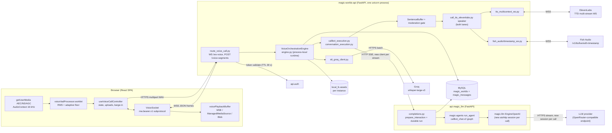
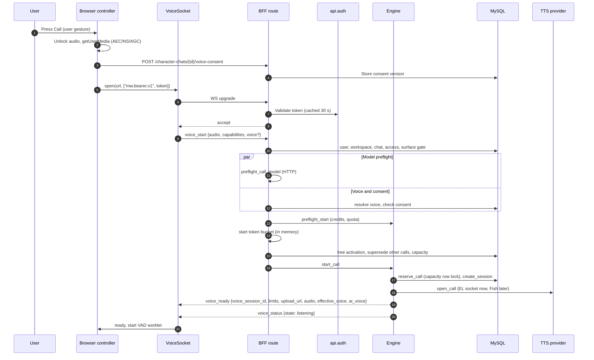
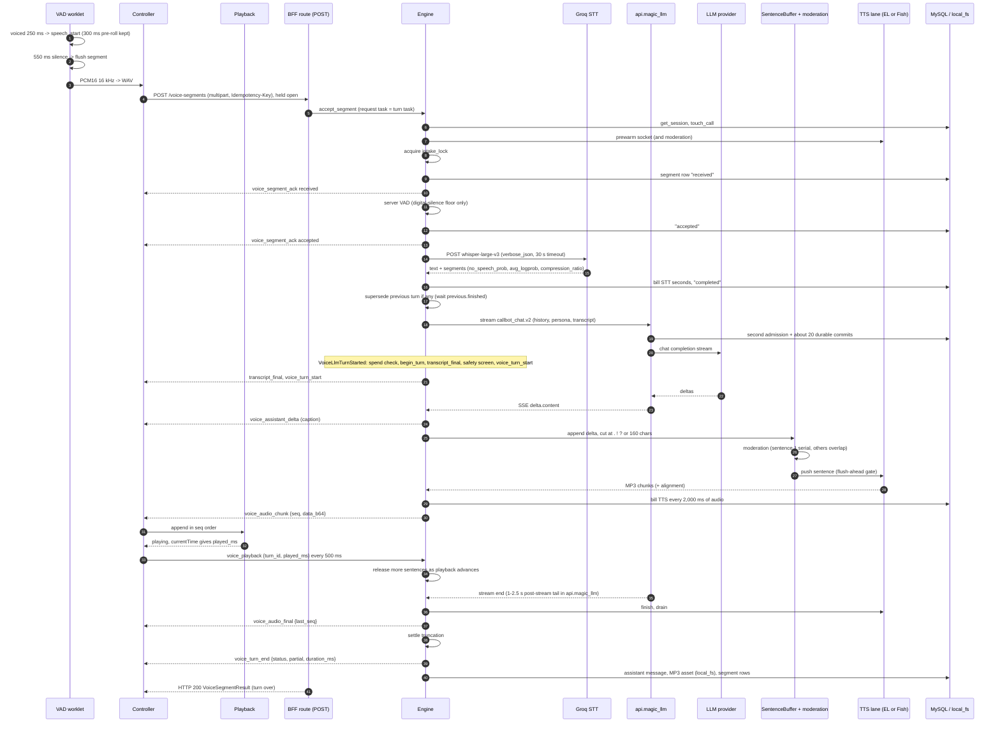
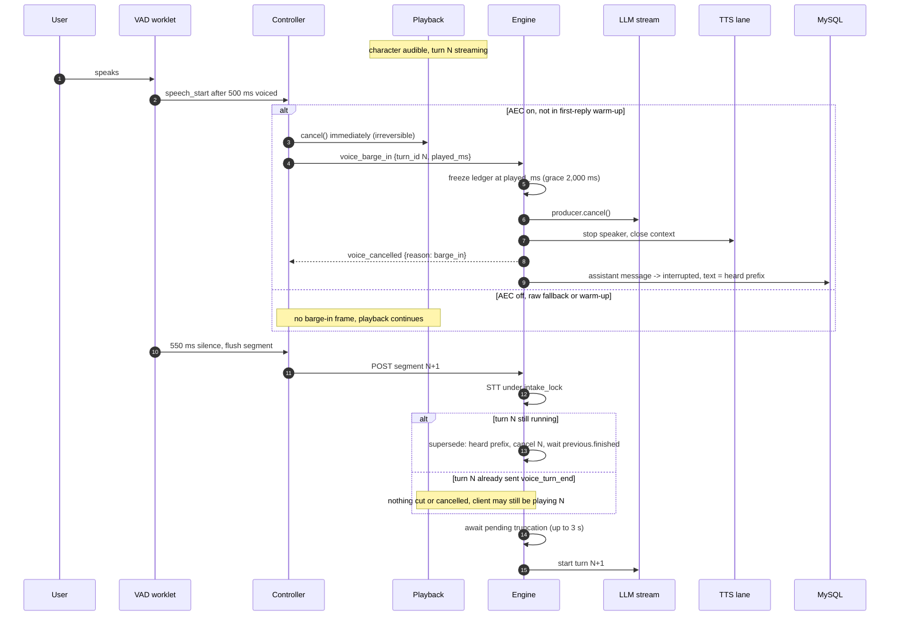
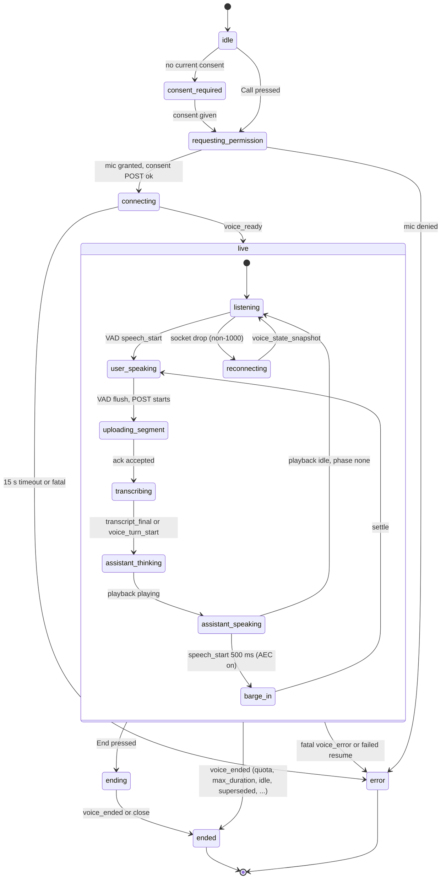
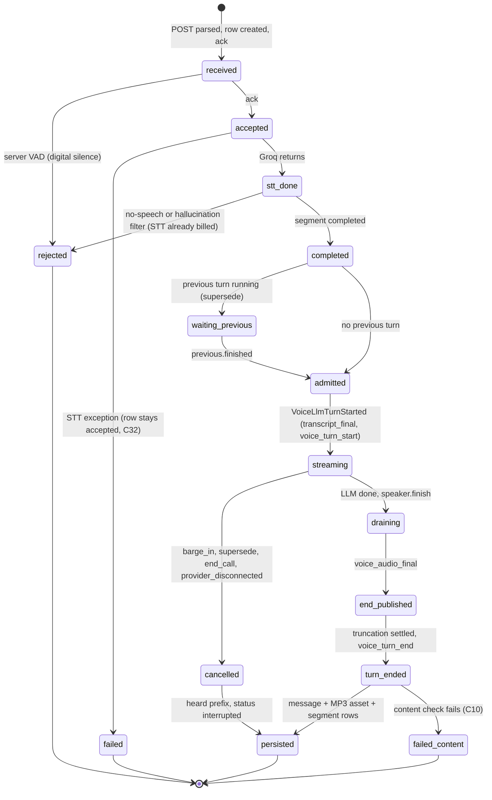

# Current voice call architecture (how it works today)

**Research date:** 2026-10-20. **Scope:** the live voice call ("call a character") as it exists in the code on 2026-10-20: the browser (`src/`), the BFF (`magic-worlds-api`), api.magic_llm with magic-agents/magic-llm, the provider edges (LLM provider, Groq, ElevenLabs, Fish), MySQL and local asset storage. This document describes. Judgement lives in [audit findings](03_audit_findings.md), and fixes live in [recommendations and roadmap](17_recommendations_and_roadmap.md).

## Summary

- **The pipeline is a cascaded, turn-based STT → LLM → TTS chain with two transports.** Each user utterance goes up as one 16 kHz mono PCM16 WAV in a multipart HTTP POST. That POST stays open for the whole turn. A per-call WebSocket carries JSON control frames up and base64 MP3 audio down. Nothing streams audio upward.
- **Endpointing is client-side and energy-only.** An RMS AudioWorklet with an adaptive noise floor ends a turn after 550 ms of silence. The server's energy gate is off by default, so only a digital-silence floor applies there. Groq Whisper's no-speech fields and a hallucination filter are the only noise filters. There is no neural VAD and no semantic end-of-turn.
- **Speech-end to first audible audio is about 3.2-4.2 s at STT p50** (ElevenLabs lane, moderation off, dev). It is about 3.6-4.7 s at STT p95. Three stages make up about 80% of it: the 550 ms hang-over, batch STT (p50 526 ms, p95 1,002 ms, n=23) and the LLM hop. The LLM hop includes about 0.87 s p50 of durable-execution commits in api.magic_llm before the provider is even called.
- **Two TTS lanes share one speaker abstraction.** ElevenLabs `eleven_v4_turbo` runs on the Text-to-Dialogue multi-context WebSocket at `mp3_44100_64`. That is 64 kbps, not the 128 kbps quoted elsewhere; it was re-verified in code. Fish (`drama-3` / `s2.1-pro`) runs on the timestamp WebSocket at 128 kbps. The lane follows the resolved call voice's provider. Fish is off by default.
- **Barge-in is client-driven and irreversible.** 500 ms of voiced energy while the character is audible cancels playback locally and sends `voice_barge_in{turn_id, played_ms}`. The server truncates history to the heard prefix: per sentence on ElevenLabs, per word on Fish. The stored MP3 still holds all the audio that was delivered.
- **All call runtime state is process-local.** That covers the socket, locks, current turn, ledgers, limiter pools, caches and metrics, in a single uvicorn process. Quota reservations and history are in MySQL; assets are on the local filesystem. A deploy closes every call with 1012, and a resume that reaches a different process ends the call.
- **Much is already done well.** Strengths include the TTS socket prewarm during STT, cooperative cancellation up to api.magic_llm, the stale-frame defence, a typed allow-listed protocol, idempotent SHA-checked uploads, atomic cross-worker quota reservation, and no raw audio at rest (section 15).
- **Eight architecture-level recommendations (ARCH-01 to ARCH-08)** target documentation drift, per-turn timing records, connection reuse, protocol tolerance, decoupling the turn from the POST, deploy and resume robustness, and scale-out readiness. Pipeline-level work is in [recommendations and roadmap](17_recommendations_and_roadmap.md).

---

## 1. Conventions

- **Labels.**
  - **FACT**: seen in code, or measured in the dev environment and recorded in the evidence notes.
  - **INFERENCE**: reasoned from facts.
  - **UNKNOWN**: cannot be settled from the repositories or the dev data.
- **Code paths.**
  - Frontend: `src/...:line`.
  - BFF: `magic-worlds-api/src/...:line`.
  - LLM service: `api.magic_llm/src/...:line`.
  - magic-llm and magic-agents are named with their package path where cited.
- **Findings** use canonical reconciliation ids with the original id in parentheses, e.g. C02 (E2E-LATENCY-TRACE-02). Full text, severity and evidence are in [audit findings](03_audit_findings.md). The reconciliation is [gap-finding-reconciliation](evidence/audit/gap-finding-reconciliation.md).
- **Subsystem evidence:** [fe-capture](evidence/audit/fe-capture.md), [fe-playback-transport](evidence/audit/fe-playback-transport.md), [fe-ui](evidence/audit/fe-ui.md), [be-route-transport](evidence/audit/be-route-transport.md), [be-engine-turntaking](evidence/audit/be-engine-turntaking.md), [be-stt](evidence/audit/be-stt.md), [be-llm](evidence/audit/be-llm.md), [be-tts](evidence/audit/be-tts.md), [be-observability-safety-cost](evidence/audit/be-observability-safety-cost.md), [e2e-latency-trace](evidence/audit/e2e-latency-trace.md).
- **Dev numbers** come from a single dev host, one shared LAN MySQL and a small number of root-user calls on 2026-10-19/20. They are directional, not production baselines. Method notes are in [methodology](00_methodology_and_sources.md).

---

## 2. Components and topology

| Component | Runs as | Role in a call | State it holds |
|---|---|---|---|
| Browser capture | AudioWorklet + controller hook | Capture, endpoint, encode WAV, upload, barge-in | Segment queue, turn phase, played_ms |
| Browser playback | One `<audio>` element plus a MediaSource | Decode base64 MP3, play in seq order, report played_ms | Per-turn source buffer, expected seq |
| `route_voice_call.py` | BFF router | WS handshake and admission, segment POST, consent POST, voice-end POST | None beyond the request |
| `engine.py` | BFF singleton (`engine.py:3763-3808`) | Turn orchestration, supersede, barge-in, billing, persistence, watchdog | **All live-call runtime state** |
| `stt_groq_client.py` | BFF, one httpx client per process | Batch transcription | Connection pool (keep-alive 5 s) |
| `callbot_execution.py` + `conversation_execution.py` | BFF | Build history, admit the turn, stream from api.magic_llm | Catalog cache (TTL 60 s) |
| api.magic_llm | Separate FastAPI service | Second admission, durable run, graph execution, provider stream | Run, event and checkpoint rows in `magic_messages` |
| ElevenLabs lane | BFF, one TTD socket per call | Multi-context TTS with char alignment | Context table, reconnect budget |
| Fish lane | BFF, one socket per turn | TTS with word timestamps | Lease, per-turn epoch |
| MySQL | Shared LAN host in dev | Sessions, segments, messages, quota, billing, api.magic_llm runs | Durable |
| local_fs | BFF instance disk | Owned MP3 assets of completed call turns | Per instance |

**Topology (FACT for dev, UNKNOWN for production).** In dev, the BFF (:8010), api.magic_llm (:7000) and api.auth (:5000) each run as one uvicorn `--reload` process with a single worker. MySQL, Redis and Qdrant run on a second LAN host. The browser talks plain HTTP/1.1 and WebSocket to :8010, with no proxy and no TLS ([topology](evidence/audit/gap-topology-rtt-measurements.md) §3). The repos define the production BFF as `python -m src.serve`: `uvicorn.run` with no workers, h11, the websockets implementation, a 5 s keep-alive and no graceful-shutdown timeout (`magic-worlds-api/src/serve.py:28-33`, `Dockerfile:87`). **No reverse proxy, TLS terminator or HTTP/2 layer is defined in any repo.**

**What the BFF does not do (FACT).** The BFF never imports magic-agents or magic-llm. It posts the server-owned graph `callbot_chat.v2` to api.magic_llm over HTTP (`magic-worlds-api/src/agent_graphs/runtime/callbot_chat.v2.json`). The graph is user_input → chat → llm (stream) → end, plus a client node, with prompt variants per model family (anthropic, openai, google, default).

---

## 3. Call setup

### 3.1 Client order (FACT, `src/features/interaction/hooks/useVoiceCallController.ts:995-1090`)

1. **Unlock audio inside the user gesture.** A silent WAV is played on the playback element; this is the iOS autoplay unlock (`src/features/interaction/audio/voicePlaybackBuffer.ts:220-259`).
2. **Open the microphone.** `getUserMedia` with AEC, NS and AGC on (`src/features/interaction/hooks/useMicrophoneCapture.ts:80`). If no live audio appears within the 3 s liveness watchdog, it falls back to raw constraints (`:83-85`).
3. **Ensure a character-chat session exists**, then POST consent. This happens on every start (route `magic-worlds-api/src/routes/user/route_voice_call.py:1084-1112`).
4. **Open the WebSocket.** `new WebSocket(url, ['mw.bearer.v1', token])` (`src/infrastructure/api/voiceSocket.ts:291`) to `/character-chats/{id}/ws-voice?workspace_id=` (route `:1452`). The first frame is `voice_start`. It carries audio and capability hints and an optional voice pick, but **no** `voice_session_id`, because the server mints it.
5. **Wait up to 15 s for `voice_ready`** (`useVoiceCallController.ts:127`). On timeout the client closes with 1000.

### 3.2 Server admission chain (FACT, route `:926-1035`, engine `:735-929`)

Every step below runs **sequentially** before `voice_ready` is sent. The handler does not read the socket while admission runs ([control plane](evidence/audit/gap-segment-post-and-control-plane-unknowns.md) §2.2).

| # | Gate | Failure result |
|---|---|---|
| 1 | Origin check, then subprotocol bearer validation against api.auth (TTL cache 30 s), then `accept` | Close 4403 / 4401 |
| 2 | Handshake: the first frame must be `voice_start` or `voice_resume` (no timeout on this wait) | 4408 |
| 3 | User context, workspace (`new_work` intent), chat ownership | Fatal `voice_error` + 4408 |
| 4 | `_require_call_access` and the surface gate (`magic-worlds-api/src/services/speech/surface_gate.py:138-156`). A model preflight starts as a parallel HTTP task | Fatal error |
| 5 | Voice override, voice resolution, then consent: `voice-v2` for ElevenLabs, `voice-v3` for Fish (`magic-worlds-api/src/services/voice_orchestration/config.py:25-26`). Then the model preflight is awaited | `consent_required` / fatal |
| 6 | `engine.preflight_start`: credits and the quota preflight | `quota` / credits error |
| 7 | Start token bucket: 3 starts per 10 minutes per account, held in memory (`magic-worlds-api/src/services/speech/token_buckets.py:73`) | Rate-limit error |
| 8 | Free-plan activation record; **supersede every other active call of this user**; release orphaned reservations | — |
| 9 | Admission context: reap idle rows, check capacity (per user 1, global 8) | Capacity error |
| 10 | `engine.start_call`: credits, then `quota.reserve_call` in one transaction under the capacity row lock, then `create_session`, then build `voice_ready`, then `open_call` on the TTS provider. That opens the ElevenLabs socket; Fish defers its socket to the first turn. Then register the runtime and the watchdog | Fatal error |
| 11 | Send `voice_ready` and `voice_status{state: listening}` (`engine.py:926-929`) | — |

INFERENCE: this is about 25-35 sequential DB round trips plus the auth hop and the TTS socket handshake, roughly 0.3-1.5 s. The ElevenLabs WS handshake measured 125 ms p50 and Fish about 274 ms p50 in dev ([topology](evidence/audit/gap-topology-rtt-measurements.md) §5.5). The order of the chain is C77 (FE-PLAYBACK-TRANSPORT-20).

### 3.3 What `voice_ready` tells the client (FACT, `magic-worlds-api/src/services/voice_orchestration/delivery.py:297-339`)

The frame carries:

- `voice_session_id` and `server_time_ms`;
- `limits`, including `remaining_daily_seconds` and the max segment duration (30,000 ms);
- `upload_url`;
- the audio format;
- the effective voice and an `ai_voice` disclosure flag.

The client lifts its segment cap from 7,500 ms (pre-consent) to the server maximum minus 500 ms, i.e. 29,500 ms (`useVoiceCallController.ts:129-131, 544-548`). The client reads no quota field from this frame; that gap is C51 (FE-UI-05).

### 3.4 TTS prewarm

- **ElevenLabs (FACT).** The TTD socket opens at call start (`open_call`). Each accepted segment then re-warms it **during STT** (`engine.py:2043-2044`, together with the moderation warm-up). The per-turn context opens when the LLM turn starts, in parallel with the LLM. The socket has a 20 s provider inactivity limit; open contexts get keepalives and a closed socket reopens on demand (`config.py:33-38`).
- **Fish (FACT).** The engine takes a lease through `admission.call_lease`, polling every 5 s. It opens the socket early at `begin_turn` and admits spend per sentence with `extend_stream` under a `FOR UPDATE` lock.
- **Nothing is prewarmed for STT or for the LLM hop.** Groq and the provider are usually on cold TLS: +78 ms (Groq) and +86-95 ms (LLM provider) at p50, about +165 ms per turn. 20% of cold Groq and 16% of cold OpenRouter setups took more than 500 ms, so about 1 turn in 3 stalls for 0.5-1.5 s on the dev network (C09 (BE-LLM-03), high; [topology](evidence/audit/gap-topology-rtt-measurements.md) §5.2-5.4).

---

## 4. One turn, end to end

### 4.1 Sequence

### 4.2 Stage notes

**Capture and endpointing (FACT, `src/features/interaction/audio/voiceVadProcessor.worklet.js`).**

- An RMS gate relative to an adaptive noise floor (`:57-71, 276-277`; constants in section 14). `speech_start` fires after 250 ms voiced, or 500 ms while the character is audible (`:339-342`), with a 300 ms pre-roll.
- **The effective hang-over is 550 ms**, set by the call screen (`src/features/call/components/CallScreen.tsx:114`). The worklet's 800 ms default is only a fallback, and its 450 ms "strict" value cannot be reached (C80 (FE-CAPTURE-18)).
- VAD events are local: no frame is sent to the server (`useVoiceCallController.ts:907-910`). That gap is C67 (FE-CAPTURE-11).
- `handleCapturedSegment` uploads every flushed segment unconditionally (`:920-935`), including segments captured while the character is speaking. This is the echo path of C05 (FE-CAPTURE-01).

**Upload (FACT, `src/infrastructure/api/index.ts:5418-5446`; route `:1130-1223`).**

- The request carries `Idempotency-Key: voice:{vsid}:{seq}:{sha}` and `X-MW-Voice-Contract: 5`, and sets no client timeout.
- The route caps the body at `max_segment_bytes` + 64 KiB, parses the form, then calls `engine.accept_segment`. **That call returns only when the turn is over.**
- After a fetch `TypeError` the client resends once after 300 ms (`useVoiceCallController.ts:154, 597-608`).
- A browser abort after the form was parsed does **not** cancel the turn (FACT, reproduced; [control plane](evidence/audit/gap-segment-post-and-control-plane-unknowns.md) §1). Binding the turn to the POST is C21 (BE-ROUTE-TRANSPORT-07).

**Intake (FACT, `engine.py:2000-2284`).**

- `accept_segment` checks the SHA, caps in-flight segments at 3 per call (429 otherwise, `:83`), warms the TTS socket and moderation, and takes `intake_lock`.
- `_intake_segment` creates the segment row and walks it through `received` → `accepted` → `completed`, sending acks over the WS.
- Server VAD only rejects digital silence (peak below 0.002, `config.py:111-115`). The energy gate (`VOICE_VAD_ENERGY_GATE_ENABLED`) is off.
- STT runs inside the lock (`:2228`). Its seconds are billed before the no-speech check (`:2243-2251`).
- About 13-15 serial DB round trips sit between receipt and LLM dispatch (C19 (BE-ENGINE-TURNTAKING-03)). Measured unit costs put that at about 60-100 ms p50 in dev (INFERENCE, [topology](evidence/audit/gap-topology-rtt-measurements.md) §8).

**STT (FACT, `magic-worlds-api/src/services/voice_orchestration/stt_groq_client.py`).**

- Groq `whisper-large-v3` in batch mode, with `verbose_json`, the call language as a hint, and a prompt of character names up to 200 chars (`:66-98`).
- One attempt with a 30 s timeout. No retry, hedge, breaker or fallback (C06 (BE-STT-02)).
- **No-speech rules.** A transcript is dropped when:
  - every Whisper segment has `no_speech_prob > 0.6` and `avg_logprob < -1.0`; or
  - any segment has `compression_ratio > 2.4`; or
  - it matches known en/es hallucination phrases.
- The language is fixed per call (route `:592-609`; C33 (BE-STT-07)).
- Dev: p50 526 ms, p95 1,002 ms (n=23). 5 of the 23 STT-completed segments were later recorded failed/internal; the cause is UNKNOWN. ([reconciliation](evidence/audit/gap-finding-reconciliation.md) X04/X05.)
- Groq bills a minimum of 10 s per request (vendor-reported), so short utterances cost the floor (C63).

**Supersede check (FACT, `engine.py:2069-2088`).** If a turn is still running, the new segment waits on `previous.finished` with no timeout. The text merges into the new turn only if the previous user message was not yet persisted. See section 5.

**LLM (FACT; [be-llm](evidence/audit/be-llm.md)).**

- *History.* `conversation_execution.py:56-86, 89-239` builds history from the last 100 rows, projected to what was spoken. It then admits the turn in one transaction of about 25-30 SQL statements.
- *Transport.* The BFF opens a **new httpx client per stream** (`magic-worlds-api/src/services/llm_execution_transport.py:276-277, 315-325`). Timeouts are total 120 s, connect 5 s, read 60 s (`magic_llm_config.py:24-28`).
- *api.magic_llm.* It runs `prepare_interaction`, a second admission and a durable run (`api.magic_llm/src/routes/completions.py:991-1065`). In 19 of 19 dev voice runs, `llm_start` was committed at revision 20. Run start → `llm_start` took p50 874 ms (range 747-1,311) **before the provider request**. A further 12 commits after the stream took 1.0-2.5 s ([topology](evidence/audit/gap-topology-rtt-measurements.md), Verification row -04). That is C08 (BE-LLM-02).
- *Provider call.* magic-llm opens a new aiohttp session per call (`magic-llm/magic_llm/engine/engine_openai.py:264`). It makes up to 3 attempts in total on pre-output failures (default `retries=3`), 1 s apart, about 92 s of worst-case silence (C07 (BE-LLM-05)). Platform profiles cannot override this, because the BFF rejects `retries` as a profile option (`magic-worlds-api/src/models/llm_execution.py:20-27`); only BYOK requests get `retries=1` (`api.magic_llm/src/util/request_credentials.py:117`). No voice run recorded an OpenRouter usage-poll result (C39; 19/19 `usage_source=provider`), and the poll would run only after the stream (`engine_openai.py:284`), so it never delays first text. The verifier's code reason (`private_transport=True` forcing `ProviderOpenAI`) is the recovery route's client (`api.magic_llm/src/services/llm_execution.py:285-287`); on the live platform path the `openrouter.ai` base URL selects `ProviderOpenRouter` (`engine_openai.py:39`), so whether the poll runs and fails is UNKNOWN.
- *Contract.* Input 32,768 tokens, output 1,536 tokens, 80 messages, 30 s timeout, `platform_credit_billed=False` (`magic-worlds-api/src/services/llm_features.py:66-68`).
- *Forwarding.* api.magic_llm forwards only `delta.content` (`completions.py:745-751`) and sends a 10 s keepalive (`:80`).
- *Measured first text.* One end-to-end probe took 1,579 ms from request to first text, with minimal history and no BFF admission ([be-llm](evidence/audit/be-llm.md) §9; [e2e](evidence/audit/e2e-latency-trace.md)). Provider TTFT alone is UNKNOWN for the production model, which is also UNKNOWN.

**Turn start (FACT, `engine.py:2571-2606`).** On `VoiceLlmTurnStarted` the engine does the following, in order:

1. awaits the spend check;
2. calls `speaker.begin_turn` (which opens the EL context or the Fish socket);
3. sends `transcript_final`. It comes this late, after BFF admission, rather than right after STT (C64);
4. runs the companion-safety screen;
5. sends `voice_turn_start`.

**Delta loop (FACT, `engine.py:2607-2621`; `llm_turn_runner.py:155-164`).** Each delta is first sent to the client as a caption (`voice_assistant_delta`), then appended to the `SentenceBuffer`, then submitted to the speaker. The runner hands deltas over in lock-step through a queue of size 1, so each delta waits for the UI send (C75). Captions therefore run ahead of the audio (C49 (FE-UI-03)).

**Sentence buffer (FACT, `magic-worlds-api/src/services/voice_orchestration/sentence_buffer.py`).**

- Cuts only at ASCII `.`, `!` and `?` (`:19`) or a 160-char soft cap (`:18`), holding while a parenthesis or pause marker is open (`:25-26`).
- The abbreviation list includes `no` and `am`, so "no." and "am." do not end a sentence (`:11-16`; C17 (E2E-LATENCY-TRACE-06)). ja/zh/yue replies get no boundary until the LLM finishes (C18).

**Moderation (FACT, `magic-worlds-api/src/services/speech/moderation.py:73`).** Each sentence is checked fail-closed with a 300 ms budget. `_push` awaits moderation before the flush-ahead wait, so only sentence 1 pays serially (`call_tts_elevenlabs.py:228-245`). Off in dev; see section 11 and C04.

**Flush-ahead gate (FACT, `magic-worlds-api/src/services/voice_orchestration/call_tts_elevenlabs.py:55-59`).** The first 3 sentences are free. After that a sentence is pushed only while fewer than 3 sentences and less than 8,000 ms of audio are unheard. Heard audio is the last `voice_playback` report, capped at the audio delivered; before any report it is the wall clock since the first chunk minus 500 ms (`call_tts_elevenlabs.py:150-158`). The gate is rechecked every 0.25 s. The 3 free sentences alone can exceed 8 s, and the estimate freezes when reports stop.

**TTS delivery (FACT, `engine.py:2441-2509`).**

- Every chunk becomes one `voice_audio_chunk` JSON text frame: `seq`, `data_b64`, `content_type: audio/mpeg`, `sample_rate`, `channels`, `is_final`, plus `gain_db` / `substitution_reason` when set. There is **no timing field** (C76).
- Billing runs inline every 2,000 ms of audio (`engine.py:117, 2507-2508`; C61, low).
- Stored ElevenLabs call audio was measured as MPEG-1 Layer III, 44.1 kHz mono, 64 kbps CBR. Chunks were 2.3-3.1 KB (290-385 ms of audio), 30-51 chunks per turn ([audio assets](evidence/audit/gap-call-audio-assets-and-mp3-timeline.md) §4).

**Client playback (FACT, `voicePlaybackBuffer.ts`).**

- One `<audio>` element (`:115`). Mode order: MSE, then ManagedMediaSource (2 s stall fallback, `:44`), then Blob groups (`:316-358, 419-436`); the fallbacks are choppier (C48).
- Chunks are `atob`-decoded (`:729-732`) and drained in contiguous seq order (`:360-368`). `playedMs` comes from `currentTime` (`:147-153`), ignoring output latency (part of C25), and is reported every 500 ms.

**Turn end and persistence (FACT, `engine.py:2637-2766`).**

1. `speaker.finish`, then the final billing slice.
2. `voice_audio_final`; the turn is marked `end_published`.
3. Truncation is settled, then `voice_turn_end` is sent.
4. A content check runs (`:2714-2720`). If the reply has leading or trailing whitespace, this check fails the live turn after it was stored completed (C10 (BE-LLM-01), high).
5. `_persist_assistant_call_turn` writes the message and the owned MP3 asset (`:2721-2746, 3469-3588, 4002-4138`).

The POST returns only after all of this. **The previous turn's audio persistence delays the next reply by 1-5 s in dev data** (C20, high; includes AUD-01).

### 4.3 Where the time goes (speech end → first audible, ElevenLabs lane, moderation off)

Sources: [e2e trace](evidence/audit/e2e-latency-trace.md) and [topology](evidence/audit/gap-topology-rtt-measurements.md) §9. These are dev figures; production is UNKNOWN. Per-stage detail is in [turn lifecycle and latency](02_turn_lifecycle_and_latency.md).

| Stage | Dev figure | Label |
|---|---|---|
| Silence hang-over | 550 ms fixed | FACT |
| WAV encode and multipart upload | about 65 ms on LAN (upload 20-150; up to 700 on mobile) | INFERENCE |
| Route preamble and intake rows before STT | DB units about 13-14 ms p50 (25-35 p90); about 60 ms with the route | FACT for the DB units; INFERENCE for the total |
| Groq STT (includes a cold TLS connect on most turns) | p50 526, p95 1,002 ms | FACT (n=23) |
| STT billing, segment completion, BFF LLM prep and admission | about 240 ms; with the intake rows, the measured BFF pre-LLM interval is 208-400 ms (n=15, 1 s DB resolution) | FACT bound; split INFERENCE |
| api.magic_llm admission to run start | 65-137 ms | FACT |
| api.magic_llm durable pre-provider commits | p50 874 ms (747-1,311) | FACT (n=19) |
| Provider connect (cold TLS +86-95 ms) plus TTFT | about 680 ms | INFERENCE: the 1,579 ms probe (dispatch to first text, minimal history, no BFF admission) minus the api.magic_llm stages. Provider TTFT is never persisted |
| First complete sentence | about 350 ms (200-600) | INFERENCE |
| EL first audio, downlink, MSE append and output, leading silence | about 250 + 25 + 100 + 80 ms; one EL first-audio sample of 149 ms | INFERENCE; the sample and the 71-86 ms leading silence are FACT |
| **Total** | **about 3.2-4.2 s at STT p50; about 3.6-4.7 s at STT p95 (central sum about 3.8-3.9 s); one documented sample about 5.5 s** | INFERENCE (reconciled sum of stages); the 5.5 s sample is FACT |

Hang-over, STT and the LLM hop together account for about 80% of the total at the fast end of the range, and about 72% with central values ([02](02_turn_lifecycle_and_latency.md) §4). The server's `user_stop_ttfb_ms` metric (`engine.py:2878-2924`) adds the client-reported `speech_end_lag_ms` (`src/features/interaction/audio/speechEndLag.ts`; capped at 120,000 ms, `engine.py:3857`) to the server time to the first chunk. The client-side first-audible mark (`src/features/interaction/audio/callPlaybackTiming.ts`) is a `performance.mark` that nothing reads (C13).

---

## 5. Barge-in and supersede

### 5.1 Rules (FACT)

- **Trigger.** Barge-in is a client energy `speech_start` while the character is audible. It needs 500 ms of voiced audio (`useVoiceCallController.ts:137, 706`).
  - Auto barge-in is **suppressed** in the first 3 s of the first reply (the AEC warm-up, `:143`), when AEC is off, and on the raw-capture fallback (`maybeAutoBargeIn`, `:676-687`).
  - Segments captured on those paths are still uploaded. Their transcripts supersede the current turn: the echo self-supersede of C05.
- **Client action** (`sendBargeIn`, `:644-673`):
  1. cancel playback at once (`voicePlaybackBuffer.ts:573-617`);
  2. send `voice_barge_in{reason: "barge_in", turn_id, played_ms}`;
  3. hold a 2 s settle window (`:146`).

  There is no duck, pause or resume: the cancel is irreversible (C15 (E2E-LATENCY-TRACE-08)). An interjection shorter than 500 ms said over the character is discarded entirely (C16).
- **Server action** (`engine.py:1299-1684`):
  1. Resolve the target turn (`_barge_in_target`, `:1354-1365`).
  2. Freeze the ledger at `played_ms`, within a 2,000 ms grace window (`:108, :1337-1352`).
  3. Cancel cooperatively (`_cancel_turn`, `:1958-1997`): set `cancel_event`, mark the turn cancelled in delivery, stop the speaker, and cancel the LLM producer, which propagates to the provider socket.
  4. Send `voice_cancelled{reason: barge_in}`.
  5. Rewrite the assistant message to the heard prefix.

  Whether the provider stops billing on cancel is UNKNOWN.
- **Truncation granularity.**
  - On ElevenLabs, `keep_end` keeps every whole sentence whose audio started before `played_ms` (`magic-worlds-api/src/services/voice_orchestration/call_ledger.py:380-392`). This holds even though character alignment is available.
  - On Fish, the cut is per word (`call_word_ledger.py:91-93`).
  - Either way, the history keeps more than was heard, and the LLM sees no marker beyond a generic prompt note (C25).
- **Supersede.** A new user segment arriving while a turn runs supersedes it (`engine.py:2069-2088`). The heard prefix is computed (`_supersede_heard_prefix`, `:1414-1446`), and the new turn waits on `previous.finished` with no timeout (C20).
  - **After `voice_turn_end`**, a superseding segment neither cuts nor cancels the previous reply. The client may still be playing it (C24).
  - A barge-in after completion with nothing heard keeps the full text (C26, low).

Dev data ([real-dev forensics](evidence/audit/gap-real-dev-call-forensics.md), [overlap and history](evidence/audit/gap-real-call-overlap-history-billing.md)):

- 12 of 17 audio turns were interrupted.
- Assistant replies ran p50 17.6 s of audio.
- Supersede waits were 0.7-6.4 s.

The broader design space is covered in [turn-taking and interruptions](05_turn_taking_and_interruptions.md).

---

## 6. WebSocket and HTTP protocol

### 6.1 Client → server WebSocket frames

All models are `extra="forbid", strict=True` (route `:186-262`). An unknown type, an extra field or a malformed frame is **fatal** and closes the socket with 4408. A binary frame raises a `KeyError` that ends as `internal` (C29 (BE-ROUTE-TRANSPORT-06)).

| Frame | Fields | When the client sends it | Server effect |
|---|---|---|---|
| `voice_start` | `voice_session_id?`, `client_call_id?`, `audio`, `capabilities?`, `voice?` | First frame of a new call | Runs the admission chain (section 3.2) |
| `voice_resume` | `voice_session_id`, `last_segment_seq` (0-10,000,000) | First frame after a reconnect, within the 15 s client window | Re-attaches if the runtime is in this process, then sends `voice_state_snapshot`; otherwise ends the call |
| `voice_ping` | `voice_session_id?` | Every 25 s (`voiceSocket.ts:20`) | `touch_call` and `voice_pong` |
| `voice_barge_in` | `reason: "barge_in"`, `turn_id?`, `played_ms?` | Auto barge-in (section 5) | Cancel and truncate the target turn |
| `voice_playback` | `turn_id`, `played_ms` | Every 500 ms while playing | Feeds flush-ahead and the ledger; max 4/s per call, excess silently ignored |
| `voice_end` | `reason: "user"` | User hangs up | `end_call(user)`, 2 s drain |
| `voice_segment_meta` | none | Never sent by the current client | Echoes `voice_status{uploading_segment}` |

### 6.2 Server → client WebSocket frames

The allow-list is `SAFE_VOICE_FRAME_TYPES` (`delivery.py:17-34`); builders are at `delivery.py:297-588`. Text fields pass through `redact_sensitive_text`.

| Frame | Key fields | Sent when | Client use |
|---|---|---|---|
| `voice_ready` | `voice_session_id`, `server_time_ms`, `limits`, `upload_url`, audio, `effective_voice`, `ai_voice` | Admission done | Live; lift the segment cap |
| `voice_state_snapshot` | `state`, `status`, `last_segment_seq`, `last_audio_seq`, `server_time_ms` | After a resume | A `listening` state cancels playback without reporting `played_ms` (C27). `last_audio_seq` is never read (C11) |
| `voice_status` | `state` (one of 16 values, `delivery.py:37-55`) | Phase changes | Ignored by the controller, which derives its own state |
| `voice_segment_ack` | `seq`, `status` (`received`/`accepted`/`rejected`) | Intake steps | `accepted` moves the phase uploading → transcribing (`:773`) |
| `transcript_final` | `seq`, `turn_id`, `text` | LLM turn admitted | Shows the user caption; phase → thinking |
| `voice_turn_start` | `turn_id`, `user_message_id`, `assistant_message_id`, `segment_seq?` | Same moment | Sets the active turn; phase → thinking |
| `voice_assistant_delta` | `turn_id`, `content` | Each LLM delta | Caption (ahead of audio) |
| `voice_audio_chunk` | `turn_id`, `seq`, `data_b64`, `content_type`, `sample_rate`, `channels`, `is_final`, `gain_db?`, `substitution_reason?` | Each TTS chunk | Append to playback; phase → streaming |
| `voice_audio_final` | `turn_id`, `last_seq` | TTS drained | Close the turn's source buffer |
| `voice_turn_end` | `turn_id`, `status`, `partial`, `duration_ms`, `truncated?` | After truncation settles | Clear turn state |
| `voice_cancelled` | `reason` (`barge_in`/`end_call`/`superseded`/`provider_disconnected`) | Turn cancelled | Drop the turn |
| `voice_error` | `category`, `code`, `message`, `fatal` | Errors | Notice, or end if fatal |
| `voice_ended` | `reason` (`user`/`quota`/`superseded`/`disconnected`/`idle_timeout`/`max_duration`/`server_shutdown`/`voice_restricted`) | Call over | Ended screen |
| `voice_pong` | none | Reply to ping | Liveness |

The stale-frame filter (`voiceSocket.ts:448-493`) drops frames whose `turn_id` or `seq` is from an older turn. Binary frames are ignored (`:424`). A privacy guard keeps frame content out of logs (`:69-86`).

### 6.3 HTTP endpoints used by a call

| Method and path | Route lines | Purpose | Notes |
|---|---|---|---|
| `POST /character-chats/{id}/voice-consent` | `:1084-1112` | Record call consent | Sent on every start |
| `POST /character-chats/{id}/voice-segments` | `:1130-1223` | Upload one utterance (WAV) and run its turn | Feature-gated by `require_features("calls")`; held open for the turn; returns `VoiceSegmentResult` (`accepted`, `duplicate`, `rejected`, `no_speech`, …) |
| `POST /character-chats/{id}/voice-end` | `:1246-1282` | End the call over HTTP (`keepalive`) | Not feature-gated; a backup for unload |
| `GET` asset routes (`magic-worlds-api/src/routes/tts.py`) | — | Fetch stored call audio as an authed blob | `local_fs` path, served only by the writing instance |

### 6.4 Close codes

| Code | Sent by | Meaning | Client behaviour |
|---|---|---|---|
| 1000 | Either side | Normal end | Server: the call ends, no grace |
| 4401 | Server | Auth failed at the handshake | Fatal |
| 4403 | Server | Origin rejected | Fatal |
| 4408 | Server | Every other fatal condition, including a protocol violation | Fatal. The copy misleads mid-call (C29) |
| 1012 | uvicorn | Server shutdown, sent before the app can send `voice_ended{server_shutdown}` | Treated as a drop; resume fails on the new process (C30) |
| 4404, 4422 | Never sent | — | Handled by the client anyway (dead code) |

---

## 7. State machines

### 7.1 Client

The visible state is **derived**, not set frame by frame (`deriveVoiceCallState`, `useVoiceCallController.ts:222-239`). Inputs:

- the lifecycle (`disabled`, `idle`, `consent_required`, `requesting_permission`, `connecting`, `live`, `ending`, `ended`, `error`; `:183-192`);
- whether the socket is reconnecting;
- whether a barge-in is in progress;
- whether the user is speaking;
- the playback status;
- the turn phase (`none` → `uploading` → `transcribing` → `thinking` → `streaming`; `:195`).

Precedence: reconnecting > barge_in > assistant_speaking (actual playback) > user_speaking > turn phase.

Turn-phase transitions (FACT):

| Phase | Entered at | Trigger |
|---|---|---|
| `uploading` | `:578` | POST starts |
| `transcribing` | `:773` | First `voice_segment_ack` while uploading |
| `thinking` | `:782`, `:799` | `transcript_final` or `voice_turn_start` |
| `streaming` | `:825` | First `voice_audio_chunk` |
| `none` | `:381`, `:627` | POST settles and no server turn is active |

A resend that returns `duplicate`, or a proxy 5xx/504, clears the phase while the original turn still streams (GAP-SEGMENT-POST-AND-CONTROL-PLANE-UNKNOWNS-05, low).

### 7.2 Server turn

Session-level statuses are `starting`, `active`, `ending`, `ended`, `failed` and `expired` (`delivery.py:58`). The watchdog ticks every 1 s (`engine.py:91, 1823-1863`). The orphan sweeper runs every 60 s (`:92, 3637-3698`).

---

## 8. The two TTS lanes

| | ElevenLabs lane (default) | Fish lane |
|---|---|---|
| Selected when | The resolved call voice's provider is ElevenLabs (`engine.py:780-783`) | The resolved call voice's provider is `fish_audio` **and** `FISH_AUDIO_CALLS_ENABLED` is true (default false, `fish_audio/config.py:87`; true in the dev `.env`) |
| Model | `eleven_v4_turbo` (`capabilities.py` row `el_v4_turbo`) | `drama-3` default, or `s2.1-pro` (`fish_audio/config.py`; `model_features.py:8`) |
| Transport | One Text-to-Dialogue multi-stream-input WS per call, up to 4 live contexts (`tts_multicontext_ws.py:74, 93`) | One `/v1/tts/live/with-timestamp` WS per turn, opened early at `begin_turn` (`timestamp_ws.py`) |
| Output | **`mp3_44100_64`**: 44.1 kHz, 64 kbps (`capabilities.py:65`, call surface mapping) | MP3 44.1 kHz, 128 kbps, `chunk_length` 100, `latency: balanced` (`timestamp_ws.py:212`) |
| Timing data | Sync character alignment (`sync_alignment=true`); `apply_text_normalization=auto` | Word timestamps |
| Ledger | `CallTurnLedger`, char-based; keep is sentence-granular | `WordCallTurnLedger`, word-based (`engine.py:2325-2327`) |
| Watchdogs | Connect 3 s, first audio 3 s, inter-chunk 5 s, completion idle 5 s, slot wait 3 s (`:75-80`) | Only a 90 s turn timeout (C43) |
| Recovery | One reconnect budget per call, reset by a turn that completes with audio. A second failure sets `tts_leg_ended`, and the call is text-only for its remaining life (`:833-843`; `engine.py:2979-2986`; C14 (BE-TTS-06), high) | No replay. A failure ends that turn's audio |
| Limits | 1,200 chars per segment, 2,500 per turn (`capabilities.py`); in-process limiter pool `ttd_session` of 24 | 1,200 chars or 64 units per turn, else a 422 that drops the generated audio (`timestamp_ws.py:28, 192`; C44); concurrency 1; daily budget 1,000,000 micro-USD |
| Spend admission | Spend circuit on TTS characters (section 10) | Per-sentence `extend_stream` under an account-wide `FOR UPDATE` (C66, low) |
| Consent version | `voice-v2` | `voice-v3` |

**Bitrate re-verification (FACT).** Earlier research notes described the ElevenLabs call lane as "MP3 44.1 kHz 128 kbps". The code says otherwise:

- `capabilities.py:64` defines `NARRATION_OUTPUT_FORMAT = mp3_44100_128`, which is for narration.
- `capabilities.py:65` defines `STREAM_OUTPUT_FORMAT = mp3_44100_64`.
- The call surface maps `("call", "standard")` to `("el_v4_turbo", "ttd_ws", STREAM_OUTPUT_FORMAT)`.
- The socket URL carries `output_format=mp3_44100_64`.
- Stored call assets measured 64 kbps CBR ([audio assets](evidence/audit/gap-call-audio-assets-and-mp3-timeline.md) §4).

**128 kbps applies to Fish and to narration, not to ElevenLabs calls.** Vendor options and quality trade-offs are in [text to speech](08_text_to_speech.md).

Both lanes run behind one speaker (`call_tts_elevenlabs.py`, despite the name). `_push` (`:228-264`) awaits moderation, waits on the flush-ahead gate, then calls `push_text`. `_drain` (`:266-292`) forwards audio to delivery. The engine's `VOICE_TTS_QUEUE_MAX_SENTENCES = 4` (`engine.py:85`) is dead: the speaker queue is unbounded (C79).

---

## 9. Truncation ledger and what is stored

### 9.1 Ledgers (FACT)

- **ElevenLabs.** The ledger maps character offsets to audio time from the alignment stream. Without alignment it falls back to 65 ms/char (`call_ledger.py:56`).
  - Untruncated dev replies ran about 78-88 ms/char. The often-quoted "7 chars/s" is refuted ([reconciliation](evidence/audit/gap-finding-reconciliation.md) X06).
  - `keep_end` rounds up to the end of the sentence playing at `played_ms` (`:380-392`).
  - Alignment offsets accumulate per flush with no resync (C42).
- **Fish.** The ledger cuts at the last word whose timestamp precedes `played_ms` (`call_word_ledger.py:91-93`). In dev data it crashed when the markup/emoji cleanup (`engine.py:3596`) changed the text ([real-dev forensics](evidence/audit/gap-real-dev-call-forensics.md)).
- **Timing.** A truncation must arrive within 2,000 ms of grace. The next turn waits up to 3.0 s for a pending truncation write (`engine.py:108-109, 2322`).
- **Shared timeline.** The server's MP3 frame meter and the client's `currentTime` measure the same frame-based timeline (GAP-CALL-AUDIO-ASSETS-AND-MP3-TIMELINE-13). Output latency of the audio device is not subtracted.

### 9.2 Rows and files (FACT)

| Store | Written when | Content |
|---|---|---|
| `voice_session` | Admission; updates through the call; end | Status (`starting` → `active` → `ending` → `ended`/`failed`/`expired`), end reason, `metadata.billing` (`stt_audio_ms`, `tts_audio_ms`, `billed_credits`) |
| `voice_transcript_segment` (user) | Each POST | `received` → `accepted` → `completed`/`rejected`/`cancelled`/`failed`; `stt_summary` (incl. `latency_ms`), `vad_summary`, the audio SHA. **No raw audio** |
| `voice_transcript_segment` (assistant) | Turn persisted | Links the turn to its asset |
| Chat messages | User: stored completed at BFF admission. Assistant: `streaming` → `completed`/`interrupted`/`failed` | A barge-in or supersede rewrites the assistant text to the heard prefix (`magic-worlds-api/src/database/mysql/call_turn_truncation.py`; `conversation_turn_store.py:714-813`) |
| Owned MP3 asset | Only completed turns with audio (`engine.py:3469-3588, 4002-4138`) | **All delivered audio**, served from `local_fs` via `routes/tts.py` |
| api.magic_llm `tb_run`, `tb_execution_event`, checkpoints, `tb_usage_fact` | Every turn | 32 commits and 65 event rows per voice turn; a 48-123 KB checkpoint rewritten per commit |
| Quota tables | Admission and end | `voice_quota_capacity` (lock row), `voice_usage_day`, `voice_quota_reservation` |

**Heard text and stored audio differ.** The transcript keeps the heard prefix while the asset keeps everything delivered. In dev, 12 of 17 assistant turns were truncated and 34.3% of stored call audio was never heard (N06 (AUD-02), medium). A late truncation updates the message but not the segment, asset or sidecar (-03). Audio delivered while the socket was away (`DROPPED`) is billed and stored as heard (C22 (BE-ROUTE-TRANSPORT-08)).

---

## 10. Quotas, billing, admission and the spend circuit

| Mechanism | Where | How it works |
|---|---|---|
| Daily allowance | `config.py:30` | 10 minutes per user per day by default |
| Call cap / idle cap | `config.py:31-32` | 600 s per call; 120 s with no segment activity |
| Concurrency | `config.py:40-41, 48` | 1 call in flight per user; 8 global (max 64), checked against the DB |
| Reservation | `quota.py:268` | `reserve_call` reserves `min(600, remaining)` seconds in one transaction under the `voice_quota_capacity` row lock. This is atomic across workers |
| Consumption | `quota.py:566-576` | A normal end consumes billable audio seconds. The stale sweep (900 s) charges wall clock capped at the reservation. Crash orphans therefore hold and charge reservations (C31 (BE-ROUTE-TRANSPORT-04)) |
| Credits | `engine.py:81, 2243-2251, 2507-2508` | 1 credit per 10 s of STT plus TTS audio, debited via `MembershipModel.debit_operation_credits`, idempotent per slice. STT is billed at intake, even for no-speech results (C62). TTS is billed every 2,000 ms of delivered audio |
| LLM cost | `llm_features.py:66-68` | `platform_credit_billed=False`: callbot tokens are not debited as credits (INFERENCE: the cost is absorbed) |
| Spend circuit | `magic-worlds-api/src/services/speech/spend_circuit.py:63`; `engine.py:2842-2876` | Tracks TTS characters at a list price of 40 micro-USD/char, with levels at 50/80/95/100%. At 100% the call degrades to text with a generic notice (C54). **It covers TTS only** (C58) |
| Start rate | `token_buckets.py:73` | 3 starts per 10 minutes per account, in process memory |
| Abuse | `magic-worlds-api/src/services/speech/abuse.py` | Counts drained characters on cancels; can disable voice (C69) |
| Watchdog ends | `engine.py:1823-1863` | `max_duration`; `quota` (fatal frame first); `idle_timeout`. **No warning frame before any of them** (C51, C52) |

Cost per minute and scaling economics are in [cost, scaling and operations](13_cost_scaling_and_operations.md).

---

## 11. Safety hooks

| Hook | State on 2026-10-20 | Evidence |
|---|---|---|
| Consent | Versioned (`voice-v2` ElevenLabs, `voice-v3` Fish) and re-posted each start | `config.py:25-26`; route `:1084-1112` |
| Surface gate | "Required" moderation alone refuses calls at start | `surface_gate.py:138-156` |
| Per-sentence moderation | Fail-closed, 300 ms, only sentence 1 serial; `check_ahead` unused; off in dev | `moderation.py:73, 79-80`; `moderation_transport.py:117, 122-129` |
| Latent launch blocker | With the classifier routed through api.magic_llm, a 300 ms budget would likely time out and refuse every sentence (INFERENCE) | C04 (BE-OBSERVABILITY-SAFETY-COST-01), high, latent |
| Moderation scope | Gates what is voiced, not the streamed caption text | C12 |
| Companion safety (self-harm) | Lists empty (`pending_signoff`), detection off by default, screen starts after admission, classifier timeout 1,500 ms fail-open. A pause ends the call with `voice_restricted` | `companion_safety.py:299-301, 396`; `companion_safety_lists.py:24-35`; C12 (BE-OBSERVABILITY-SAFETY-COST-02), high |
| Spoken-text contract | Fails the turn on tag-like markup or on leading/trailing whitespace | `transcript_sanitizer.py:131-137`; C10, C38 |
| Crisis UI | `CrisisResourcesPanel` with `LEGAL_PENDING` placeholder numbers; `BreakNudge`; AI-voice badge | `src/features/safety/components/CrisisResourcesPanel.tsx`; `BreakNudge.tsx` |
| Privacy | No raw audio persisted (SHA only); allow-listed logs; FE log guard. The live-call privacy footer understates what is saved (character audio is stored) | `voiceSocket.ts:69-86`; `CallScreen.tsx:637`; C55 |
| Token on the socket | Bearer token in `Sec-WebSocket-Protocol`, validated only at the handshake; resume skips access gates | C78, low |

Policy and compliance analysis is in [safety, policy and compliance](14_safety_policy_and_compliance.md).

---

## 12. Resume, reconnect and deploy

**Client (FACT, `voiceSocket.ts:19-25, 586-600`).**

- The client pings every 25 s and declares the socket dead after 50 s without a frame. The check runs only on the 25 s tick, so detection takes **50-75 s** after the last frame (C23 (FE-PLAYBACK-TRANSPORT-03)).
- On a non-1000 close it reconnects with backoff: 4 s for resume, up to 30 s max. Resume is attempted only within 15 s.
- Control frames (barge-in, playback, end) are dropped, not queued, while reconnecting (C68).

**Server (FACT, `engine.py:940-1041`).**

- A 1000 close ends the call. Any other close starts the 20 s resume grace (`config.py:45`).
- `voice_resume` re-attaches only if this process holds the runtime; otherwise the call ends.
- There is **no audio replay**. Chunks sent while the socket is away are `DROPPED` but still advance `audio_last_seq`.
- The client never reads `last_audio_seq` and never skips the gap, so a resumed mid-reply turn never finishes playing (C11 (FE-PLAYBACK-TRANSPORT-01), medium).
- A `listening` snapshot cancels playback without reporting `played_ms` (C27).
- A failed server send on a live or resumed socket ends the call as `failed/internal` without grace (GAP-SEGMENT-POST-AND-CONTROL-PLANE-UNKNOWNS-03, medium).
- Sends have no timeout and share one lock per socket, so a stalled consumer blocks pongs and audio (C28).

**Deploy (FACT, C30).**

- On shutdown uvicorn closes WebSockets with 1012 **before** the lifespan shutdown runs `voice_engine.shutdown()`. That shutdown releases quota correctly, but its `voice_ended{server_shutdown}` frame can no longer be delivered.
- The client sees 1012 as a drop and tries to resume. The resume lands on a process without the runtime, which ends the call. **Every deploy drops every live call.**
- A crash or SIGKILL leaves reservations held until the sweep: about 10-11 minutes after call start (C31).

**Pre-ready close (FACT).** If the client gives up before `voice_ready`, admission still completes with all its side effects: supersede of other calls, reservation, session row and TTS socket. Depending on timing, the call is then recorded `failed/internal` with an ERROR traceback (GAP-SEGMENT-POST-AND-CONTROL-PLANE-UNKNOWNS-02, -04).

Transport alternatives are in [transport and client audio](09_transport_and_client_audio.md).

---

## 13. Process-local state and scaling assumptions

| Process-local item | Where | Consequence across processes |
|---|---|---|
| Call runtime: socket, `intake_lock`, `current_turn`, ledgers, playback window (4 turns kept), `tts_leg_ended`, spend state | `engine.py` runtime registry | A segment POST or resume must reach the process that holds the call. Otherwise the POST fails and the resume ends the call (C65, low) |
| ElevenLabs socket and its context table; `ttd_session` limiter pool of 24 | `tts_multicontext_ws.py:84` | The provider concurrency cap is enforced per process, not globally |
| Start token bucket (3 per 10 min) | `token_buckets.py:73` | Not shared: N processes allow 3N starts |
| Auth validation cache (30 s), callbot catalog cache (60 s, 256), moderation verdict cache (24 h, 10k) | `auth_adapter.py`; `callbot_execution.py:91-120`; `moderation.py:79-80` | Cold per process |
| Groq httpx client (keep-alive expiry 5 s) | `stt_groq_client.py:139-145` | Effectively cold every turn, since inter-utterance gaps were 10-31 s in dev |
| Metrics: 2,048-event ring buffer and histograms; monitor off by default; no exporter | `magic-worlds-api/src/services/speech/metrics.py` | Lost on restart; per process only (C59) |
| Owned MP3 assets on `local_fs` with a root-relative path | `routes/tts.py` | Another instance returns 404 for the same row (N08 (AUD-05), medium) |

**What is shared (FACT).** Quota reservation and capacity (MySQL row lock), sessions, segments, messages, credits, the Fish lease and spend rows, and api.magic_llm runs.

**Scaling assumption (INFERENCE).** The design assumes **one BFF process**, which is how the repo launches it (`serve.py:28-33`). The chat id is in the URL path of both the WS and the POST, so sticky routing on it is possible. Nothing configures it, and assets would still need shared storage. One event loop carries every call's audio fan-out, base64 encoding, DB awaits and per-turn httpx client construction (2.5-3.3 ms of loop time each, GAP-TOPOLOGY-RTT-MEASUREMENTS-08). Capacity per process is UNKNOWN; no load test exists.

---

## 14. Configuration reference

FE paths are relative to `src/features/interaction/` unless they start with `src/`. BE paths are under `magic-worlds-api/src/services/` unless noted. "const" means a code constant with no env override.

| Setting (env var or constant) | Default | Location | Effect |
|---|---|---|---|
| Silence hang-over (prop) | 550 ms | `src/features/call/components/CallScreen.tsx:114` | End of turn after this much silence |
| Worklet silence fallback / strict | 800 / 450 ms | `audio/voiceVadProcessor.worklet.js:224-226` | Unused in calls / unreachable (C80) |
| Min speech | 250 ms (500 while audible) | `CallScreen.tsx:114`; `hooks/useVoiceCallController.ts:137, 144` | Opens a segment; gates barge-in |
| VAD threshold, multiplier, stay ratio, floor cap | 0.01, 3, 0.8, 0.05 | `worklet.js:57-60, 224` | Energy gate relative to the adaptive floor |
| Floor calibration | 400 ms | `worklet.js:65-71` | Initial noise-floor estimate (not re-run on unmute, C45) |
| Pre-roll / trailing keep | 300 / 200 ms | `worklet.js:44, 48` | Audio kept around the speech span |
| Segment cap | 7,500 ms pre-consent, then server max − 500 (29,500 ms) | `worklet.js:43`; `useVoiceCallController.ts:129-131, 544-548` | Forces a flush |
| `VOICE_READY_TIMEOUT_MS` | 15,000 ms | `useVoiceCallController.ts:127` | Gives up on admission |
| AEC warm-up | 3,000 ms | `useVoiceCallController.ts:143` | No auto barge-in early in the first reply |
| Barge-in settle | 2,000 ms | `useVoiceCallController.ts:146` | Post-barge-in hold |
| Notice TTL | 8,000 ms | `useVoiceCallController.ts:148` | Transient notices |
| Playback report interval | 500 ms | `useVoiceCallController.ts:150` | `voice_playback` cadence |
| Pre-ready upload spacing / resend delay | 120 / 300 ms | `useVoiceCallController.ts:152, 154` | Upload pacing; one resend on `TypeError` |
| Mic liveness watchdog | 3 s | `hooks/useMicrophoneCapture.ts:85` | Falls back to raw capture, permanently (C47) |
| Capture sample rate | 16 kHz | `useMicrophoneCapture.ts:331` | WAV format |
| WS subprotocol | `mw.bearer.v1` | `src/infrastructure/api/voiceSocket.ts:19` | Carries the token |
| Ping / liveness | 25 s / 50 s | `voiceSocket.ts:20-21` | Dead-socket detection takes 50-75 s |
| Reconnect backoff max / resume window / resume backoff | 30 s / 15 s / 4 s | `voiceSocket.ts:22, 24, 25` | Reconnect policy |
| `MANAGED_STALL_MS` | 2,000 ms | `audio/voicePlaybackBuffer.ts:44` | ManagedMediaSource → Blob fallback |
| Upload timeout | none | `src/infrastructure/api/index.ts:5418-5446` | POST held for the whole turn |
| `VOICE_STT_MODEL` / `VOICE_STT_BASE_URL` | `whisper-large-v3` (pinned) / Groq OpenAI-compatible | `voice_orchestration/config.py:19-20, 120-125` | Only Groq Whisper is accepted |
| `VOICE_STT_TIMEOUT_SECONDS` | 30 (0.1-120) | `config.py:47, 49` | Single attempt |
| `VOICE_DAILY_MINUTES_PER_USER` | 10 | `config.py:30` | Daily allowance |
| `VOICE_MAX_CALL_DURATION_SECONDS` | 600 | `config.py:31` | Hard call cap |
| `VOICE_IDLE_TIMEOUT_SECONDS` | 120 | `config.py:32` | Ends silent calls |
| EL socket inactivity / max idle (const) | 20 / 150 s | `config.py:36, 38` | Provider socket lifetime |
| `VOICE_MAX_INFLIGHT_PER_USER` | 1 | `config.py:40` | Calls per user |
| `VOICE_GLOBAL_CONCURRENCY` | 8 (max 64) | `config.py:41, 48` | Calls in total |
| `VOICE_MAX_SEGMENT_DURATION_MS` / `VOICE_MAX_SEGMENT_BYTES` | 30,000 / 2,000,000 | `config.py:42-43` | Segment limits |
| `VOICE_STALE_SESSION_SECONDS` | 900 | `config.py:44` | Stale-session sweep |
| `VOICE_RESUME_GRACE_SECONDS` | 20 (max 300) | `config.py:45-46` | Resume window |
| `VOICE_VAD_ENERGY_GATE_ENABLED` | false | `config.py:111` | Server energy gate off |
| `VOICE_VAD_SILENCE_FLOOR_PEAK` | 0.002 | `config.py:112` | Rejects digital silence only |
| `VOICE_VAD_MIN_RMS` / `_MIN_PEAK` / `_MIN_SPEECH_RATIO` | 0.012 / 0.025 / 0.03 | `config.py:113-115` | Apply only if the gate is on |
| Server VAD min speech, speech-sample threshold, duration tolerance (const) | 250 ms, 0.015, 500 ms | `voice_orchestration/server_vad.py:21, 36-37` | Segment validation |
| `VOICE_CALL_SECONDS_PER_CREDIT` | 10 | `voice_orchestration/engine.py:81` | Billing rate |
| `MAX_INFLIGHT_SEGMENTS_PER_CALL` | 3 | `engine.py:83` | 429 above it |
| `VOICE_TTS_QUEUE_MAX_SENTENCES` | 4 (dead) | `engine.py:85` | Not enforced (C79) |
| `VOICE_TTS_IDLE_FLUSH_SECONDS` | 0.12 | `engine.py:88` | Idle tick that flushes buffered text |
| `VOICE_END_CALL_DRAIN_SECONDS` | 2.0 | `engine.py:90` | Wait for turns on end; longer turns keep running (GAP-SEGMENT-POST-AND-CONTROL-PLANE-UNKNOWNS-08) |
| Watchdog / sweep interval | 1 s / 60 s | `engine.py:91-92` | Limit enforcement, orphan sweep |
| Orphan grace / sweep limit | 60 s / 200 | `engine.py:94-95` | Orphan cleanup |
| Truncation grace / wait | 2,000 ms / 3.0 s | `engine.py:108-109` | Barge-in window; next-turn wait |
| `VOICE_EL_BILLING_INTERVAL_MS` | 2,000 | `engine.py:117` | TTS billing slice |
| `VOICE_PLAYBACK_MAX_FRAMES_PER_SECOND` / turns kept | 4 / 4 | `engine.py:119, 121` | Playback report limit (silent drop) |
| `MAX_SPEECH_END_LAG_MS` | 120,000 | `engine.py:3857` | Clamp on the client lag report |
| Flush-ahead: free sentences, max ahead, max audio ahead, lag, recheck | 3, 3, 8,000 ms, 500 ms, 0.25 s | `voice_orchestration/call_tts_elevenlabs.py:55-59` | TTS pacing |
| Sentence soft cap, paren hold, pause hold | 160, 60, 8 chars | `voice_orchestration/sentence_buffer.py:18, 25-26` | TTS unit boundaries |
| EL: live contexts, connect, first audio, inter-chunk, keepalive, completion idle, slot wait, inactivity | 4, 3 s, 3 s, 5 s, 15 s, 5 s, 3 s, 20 s | `speech/providers/elevenlabs/tts_multicontext_ws.py:74-82` | ElevenLabs watchdogs |
| EL reconnect budget | 1 | `tts_multicontext_ws.py:833-843` | A second failure means text-only (C14) |
| EL call output format | `mp3_44100_64` | `speech/capabilities.py:65` | 64 kbps downlink |
| Segment / turn char caps | 1,200 / 2,500 | `speech/capabilities.py` | Per-request limits |
| `FISH_AUDIO_CALLS_ENABLED` | false | `speech/providers/fish_audio/config.py:87` | Enables the Fish lane |
| Fish model, concurrency, daily budget | `drama-3`, 1, 1,000,000 micro-USD | `fish_audio/config.py` | Fish limits |
| Fish start request | mp3, 44,100, 128 kbps, `chunk_length` 100, `latency` balanced | `fish_audio/timestamp_ws.py:212` | Fish output |
| Fish socket: open timeout, ping, caps | 5 s, 20/20 s, 1,200 chars / 128 chunks | `timestamp_ws.py` | Fish transport |
| Moderation call budget | 0.3 s | `speech/moderation.py:73` | Fail-closed per sentence |
| Moderation cache | 24 h / 10,000 | `moderation.py:79-80` | Verdict reuse |
| Spend list price | 40 micro-USD/char | `speech/spend_circuit.py:63` | Spend circuit basis |
| Callbot contract | in 32,768 / out 1,536 tokens, 80 messages, 30 s | `services/llm_features.py:66-68` | LLM bounds |
| BFF → api.magic_llm timeouts | total 120, connect 5, read 60, write 10, pool 5 s | `services/magic_llm_config.py:24-28` | Transport bounds |
| Callbot catalog cache | 60 s / 256 | `voice_orchestration/callbot_execution.py:91-120` | Profile lookup |
| api.magic_llm SSE keepalive | 10 s | `api.magic_llm/src/routes/completions.py:80` | Stream liveness |
| magic-llm retry | 3 attempts, 1 s delay | `magic_llm/engine/attempt_control.py:278-326` | Worst case about 92 s of silence (C07) |
| Auth validation cache | 30 s | `services/auth_adapter.py` | Handshake and POST auth |
| Start token bucket | 3 per 600 s | `speech/token_buckets.py:73` | Start rate per account |

---

## 15. What is already done well

These strengths are agreed across the audits (reconciliation §8), with their qualifiers. Keep them when changing the pipeline.

1. **TTS prewarm overlaps STT.** The ElevenLabs socket is prewarmed during STT, and the per-turn context opens in parallel with the LLM. The first-TTS-unit path does not pay a handshake.
2. **Prompt cooperative cancellation.** It reaches through api.magic_llm to the provider socket on barge-in, supersede and end. Whether provider billing stops is UNKNOWN.
3. **Heard-prefix history on mid-stream barge-in.** The LLM sees roughly what the user heard, at sentence granularity on ElevenLabs (K12 limits this to the mid-stream path).
4. **Immediate client flush with a stale-frame defence.** Frames are filtered by turn id and seq, so late audio from a cancelled turn cannot play.
5. **Playback-paced flush-ahead.** The gate is fed by `voice_playback` reports, which limits over-synthesis after the first 3 sentences.
6. **A 500 ms interruption minimum plus the AEC warm-up.** This suppresses most false barge-ins from coughs and echo when AEC is on.
7. **Idempotent, SHA-checked uploads** with one resend and a DB-level duplicate check.
8. **A typed, allow-listed protocol** on both sides, with redaction on text fields. Its strictness is also a liability (C29).
9. **Privacy by default.** No raw user audio is persisted (SHA only), and logs are allow-listed.
10. **An end-to-end latency metric exists.** `user_stop_ttfb_ms` has process-local p50/p95. It is not persisted, and its alerts are log lines only.
11. **Quota is atomic across workers.** The reservation takes a capacity row lock, and graceful shutdown releases quota.
12. **A bounded callbot contract** (1,536 output tokens, 30 s), though the cap is about 4 times the roadmap target.

Also sound: the parallel model preflight, the marker-safe sentence buffer, the reply-only graph with per-family prompts, shielded persistence, Fish epoch isolation, the iOS autoplay unlock, derived UI state, and about 130 FE unit tests plus about 60 BE voice test files.

---

## 16. Known issues at a glance

Details, evidence and verification verdicts are in [audit findings](03_audit_findings.md). Only the architecture-relevant ones are listed here.

| Severity | Canonical ids |
|---|---|
| High | C01 batch uplink and STT; C02 no semantic end-of-turn; C03 energy-only VAD; C04 moderation gate (latent); C05 echo self-supersede; C06 STT single-shot; C07 no LLM deadlines; C08 durable pipeline before the provider; C09 cold provider connections; C10 whitespace kills the turn; C12 inert self-harm detection; C14 one TTS reconnect budget; C20 next reply waits for the previous turn's persistence (includes AUD-01); C24 supersede after `voice_turn_end` (conditional); N01 Fish word-ledger crash |
| Medium | C11 resume seq gap; C13 latency not measurable in production; C19 serial DB chain; C21 turn bound to the POST; C22 audio dropped while away is billed; C23 slow dead-socket detection; C25 truncation over-approximates; C27 listening snapshot cancels; C28 no send timeout; C29 strict protocol; C30 deploys drop calls; C31 crash orphans; C58 spend covers TTS only; C59 no exporter; N06 stored audio includes unheard audio (AUD-02); N08 per-instance `local_fs` audio (AUD-05) |
| Low | C61 billing in the drain loop; C64 late `transcript_final`; C65 process-local runtime; C76 base64 MP3 in JSON; C77 serial setup; C78 token in subprotocol; C79 dead queue constant; C80 stale comments |

---

## 17. Recommendations (architecture level)

Priority scale: **P0** = days, no vendor change; **P1** = weeks; **P2** = architectural, a quarter; **P3** = experiment or watch. Impact figures are estimates unless marked otherwise. Pipeline changes (streaming STT, semantic endpointing, LLM deadlines, TTS fallback) belong to [recommendations and roadmap](17_recommendations_and_roadmap.md).

### ARCH-01 (P0): Correct the architecture record and stale comments

- **What.** Fix the drift between the code and its documentation:
  - The ElevenLabs call lane is `mp3_44100_64`.
  - The hang-over is 550 ms; the segment cap is 29.5 s.
  - The 450 ms strict VAD value is unreachable.
  - `VOICE_TTS_QUEUE_MAX_SENTENCES` is dead.
  - The OpenRouter usage poll records nothing on voice runs; confirm in the api.magic_llm logs whether it runs and fails on the live platform path (section 4.2).
  - `config.py:21-24` still says ElevenLabs is the only call provider.

  Then add a short ADR covering the two-transport design (HTTP uplink plus WS downlink).
- **Why.** Engineers and audits reasoned from wrong numbers: the 128 kbps figure, "7 chars/s", 800 ms (C80).
- **Impact.** Fewer wrong decisions downstream (qualitative estimate).
- **Effort.** S. **Dependencies.** None.
- **Validation.** A doc review checklist against this section 14; zero stale constants found by grep.

### ARCH-02 (P0): Persist one timing record per turn

- **What.** Write millisecond-resolution stage timestamps into one row per turn, for example in segment metadata:
  - client speech end (from `speech_end_lag_ms`);
  - POST receipt;
  - STT start and end;
  - BFF admission;
  - api.magic_llm run start and `llm_start`;
  - first delta;
  - first sentence released;
  - first TTS audio;
  - first chunk sent;
  - client first-audible. This needs a new `voice_playback`-style report of the `mw.voice.first_audible` mark.
- **Why.** Production latency cannot be measured today (C13, C59). Today's dev split needed DB forensics at 1 s resolution.
- **Impact.** Makes every later latency change verifiable. No direct latency gain.
- **Effort.** S-M. **Dependencies.** A small protocol addition; the strict schema needs a contract bump (see ARCH-03).
- **Validation.** 100% of completed turns carry all stamps; the p50/p95 of speech-end → first-audible is reported per day.

### ARCH-03 (P0): Make the protocol tolerant and the close codes meaningful

- **What.**
  - Ignore unknown frame types and binary frames, counting them in a metric, instead of failing the call. Keep strict validation for known types.
  - Split 4408 into distinct codes for protocol, admission and internal errors, and route send failures through the resume grace.
- **Why.** C29: one stray field ends a live call. GAP-SEGMENT-POST-AND-CONTROL-PLANE-UNKNOWNS-02/-03: failures are mislabelled `internal`.
- **Impact.** Removes a class of call drops during client/server version skew. The rate is UNKNOWN until ARCH-02 exists.
- **Effort.** S. **Dependencies.** None.
- **Validation.** Calls ending `failed/internal` per 100 calls; a mixed-version test passes.

### ARCH-04 (P0): Reuse connections on the per-turn hops

- **What.**
  - Keep the Groq client alive longer than the inter-utterance gap.
  - Share one httpx client for BFF → api.magic_llm.
  - Share one aiohttp session and connector per provider host inside magic-llm (both the default and the private transport open one per call), with the DNS cache on.
  - Optionally prewarm the Groq connection on `speech_start`. That needs C67's early signal, so it is P1.
- **Why.** C09 and GAP-TOPOLOGY-RTT-MEASUREMENTS-02: cold TLS on most turns.
- **Impact.** About −80 to −165 ms p50 per turn, and removal of 0.5-1.5 s tails on about 1 in 3 turns (estimate from dev measurements).
- **Effort.** S. **Dependencies.** Provider idle keep-alive was measured at 125 s or more (vendor behaviour, may change).
- **Validation.** STT `latency_ms` p50/p95, and api.magic_llm `llm_start` → first token, before and after.

### ARCH-05 (P1): Decouple the turn from the segment POST

- **What.**
  - Return `202 accepted` once the segment row exists and STT is queued. The engine then owns the turn task.
  - The client derives turn state only from WS frames.
  - Persist the previous turn's audio off the critical path, so the next turn does not wait for it.
- **Why.** C21, GAP-SEGMENT-POST-AND-CONTROL-PLANE-UNKNOWNS-01/-05, C20 and GAP-CALL-AUDIO-ASSETS-AND-MP3-TIMELINE-01. Long-held requests break on proxies, a `duplicate` resend clears client state, and persistence delays the next reply 1-5 s in dev.
- **Impact.** Removes 1-5 s of next-reply delay in the affected turns (dev-observed range) and removes proxy-timeout failure modes.
- **Effort.** M. **Dependencies.** ARCH-02 to verify; a contract version bump.
- **Validation.** Next-turn first-audible p95 after an interrupted turn; zero false `VOICE_UPLOAD_FAILED` notices with audio playing.

### ARCH-06 (P1): Survive deploys and drops

- **What.**
  - Add a drain mode: stop admitting calls, send `voice_ended{server_shutdown}`, or better a "reconnect" hint, before uvicorn closes sockets, and set `timeout_graceful_shutdown`.
  - On resume, read `last_audio_seq` and let the client skip the gap and finish the turn.
  - Reap crash-orphaned reservations by heartbeat rather than wall clock.
- **Why.** C30, C11, C27 and C31.
- **Impact.** Deploys stop ending every call. Resumed turns stop hanging. Users are not charged up to 10 minutes for a crash (qualitative).
- **Effort.** M. **Dependencies.** A rolling deploy needs ARCH-07 or a single-process drain window.
- **Validation.** Calls ended `disconnected`/`internal` around deploys; resumed-turn completion rate; reservations older than call age plus 60 s.

### ARCH-07 (P2): Make the call runtime scale-out-safe

- **What.** Choose between (a) sticky routing on the chat id for the WS and the POST, with a documented single-owner invariant, and (b) a shared runtime registry with ownership leases. Move call assets from `local_fs` to shared object storage, and move the start bucket and limiter pools to shared state.
- **Why.** C65 and GAP-CALL-AUDIO-ASSETS-AND-MP3-TIMELINE-05. Every limit except quota is per process today.
- **Impact.** Allows more than one BFF instance without dropped resumes or 404 assets.
- **Effort.** L. **Dependencies.** The production topology (UNKNOWN today) and ARCH-06.
- **Validation.** A two-instance soak test with forced reconnects: zero cross-instance resume failures and zero asset 404s.

### ARCH-08 (P3): Watch the single event loop

- **What.** Add event-loop lag and per-call send-queue depth to metrics. Run a load test to find calls per process before raising `VOICE_GLOBAL_CONCURRENCY` above 8.
- **Why.** All fan-out, base64 encoding and DB awaits share one loop, and sends have no timeout (C28). Capacity is UNKNOWN.
- **Impact.** Sets a known safe concurrency (no estimate possible today).
- **Effort.** S-M. **Dependencies.** ARCH-02.
- **Validation.** Loop lag p99 under load; first-audible p95 versus concurrent calls.

---

## 18. Open questions (UNKNOWN)

- **Production topology.** Proxy, TLS, HTTP/2, region, DB placement, and whether a request-buffering proxy moves the POST abort window.
- **Production model.** The callbot model and its TTFT. Whether provider billing stops on cancel.
- **Echo cancellation.** Real-world AEC effectiveness, and how often calls run with AEC off or on the raw fallback; this drives C05.
- **STT failures.** The root cause of the 5 STT-completed segments later recorded failed/internal.
- **Commit timing.** How api.magic_llm's per-commit time splits between DB time and checkpoint serialization.
- **Simulation numbers.** The fe-capture simulation figures are illustrative only and not field data.
