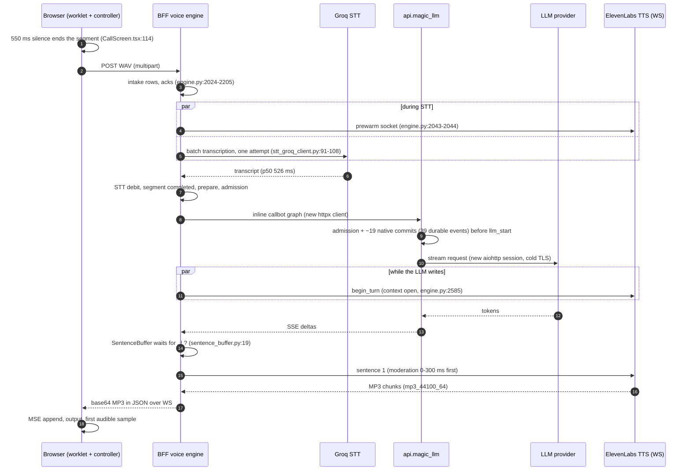
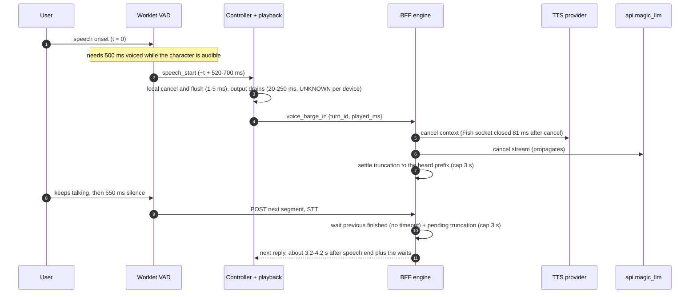

# Turn lifecycle and latency budget (current vs state of the art)

**Research date:** 2026-10-20. **Scope:** one voice-call turn in Magic Worlds, from the user's last voiced sample to the first audible sample of the character's reply, plus the barge-in path and the tails. Covers the browser capture and playback code, the `magic-worlds-api` voice engine (BFF), `api.magic_llm` and the STT, LLM and TTS providers. It reconciles the audit numbers with the dev-call forensics and the topology measurements, and compares them with published budgets.

## Summary

- **Today a reply starts about 3.2-4.2 s after the user stops talking** (ElevenLabs lane, moderation off, LAN dev, STT at p50). The stage sum with central values is about 3.9 s. A documented sample took about 5.5 s. That is 3-5x the published cascaded budgets: Salesforce measured 755 ms, Pipecat's example is 1.044 s, ElevenLabs budgets about 680 ms P50 for its own agents (vendor-reported) and Twilio's mouth-to-ear target is 1,115 ms (vendor). The p50 sits just under the roughly 4 s line where users disengage, and the p95 crosses it.
- **Three stages make up about 80% of the turn.** They are the 550 ms client VAD hang-over, the 526 ms batch Groq STT (p50, 1,002 ms p95) and the `api.magic_llm` hop. Before the provider request even goes out, that hop spends about 0.87-0.9 s p50 on durable recording (measured, n=19). This recording is the largest latency we control. Cold TLS to Groq and to the LLM provider adds about 165 ms p50 to every turn.
- **Some work already overlaps.** The ElevenLabs socket is prewarmed during STT, the TTS context opens while the LLM writes, moderation looks ahead from sentence 2 onward, the MediaSource is prepared at turn start, and flush-ahead streams audio ahead of playback. **Everything before the first sentence runs in series:** hang-over, upload, STT, BFF bookkeeping, `api.magic_llm` recording, provider connect and TTFT, then a full first sentence.
- **Barge-in silences the character fast enough**: about 0.5-0.95 s after the user starts talking (§8), because it waits for 500 ms of voiced speech. **The next reply after an interruption is slow.** The new turn waits for the old turn's persistence and truncation, behind two 3 s caps. Dev data shows 0.7-6.4 s of extra wait in 4 of 19 turns. When no barge-in frame fires, the character can talk over the user for 1.2-3 s.
- **Tails have no product-level bound.** STT is one attempt with a 30 s timeout. The LLM has no TTFT deadline: 30 s per attempt, and up to about 92 s with magic-llm's default of three attempts, which platform profiles use (K05; §9). Fish has only a 90 s turn timeout. None of these paths produces a spoken acknowledgement while the user waits.
- **Realistic path (all estimates).** Fixes that need no vendor change bring the p50 to about 2.3 s: warm connections, a clause-level first chunk, BFF writes and persistence moved off the path, an `api.magic_llm` voice fast lane, and a 300 ms hang-over backed by a turn model. A streaming uplink, streaming STT, held speculation and a fast LLM host bring it to about 1.5 s. A co-located voice worker that streams directly from the provider, with WebRTC and aggressive speculation, brings it to about 0.8-1.0 s.
- **Measure first.** Part of today's budget is inferred. Provider TTFT is never recorded (`ttft = 0` in `raw_usage`). The client first-audible mark never leaves the browser. Production topology, devices and non-root users are untested. LAT-01, a per-turn, millisecond-resolution latency record, comes before any tuning.

---

## 1. How to read this document

Labels:
- **FACT** means measured in dev data or read in code.
- **INFERENCE** means derived from facts plus a stated assumption.
- **UNKNOWN** means no evidence exists yet.

All "saved ms" figures are estimates unless a measurement is cited. Vendor numbers carry "(vendor-reported)". They come only from the fact-checked research notes, and they use different start and end points, so they are not strictly comparable with ours or with each other.

Dev biases apply to every FACT number: a LAN client, the root user (feature-flag validators skipped), uvicorn `--reload` (a dev-only Nagle stall), a saturated shared MySQL, small samples (8 calls, 23 STT requests, 19 LLM turns) and mostly the Fish lane (7 Fish calls, 6 of them with user turns, and 1 ElevenLabs call).

Path key. Backend files without a directory are under `magic-worlds-api/src/services/voice_orchestration/`. Other files carry their full repo-relative path. Finding ids use the canonical C-numbers from [reconciliation](evidence/audit/gap-finding-reconciliation.md), with the original id in parentheses, and use corrected severities. For the system layout, see [current architecture](01_current_architecture.md). For the full finding list, see [audit findings](03_audit_findings.md).

## 2. Definitions

| Term | Meaning in this document | Notes |
|---|---|---|
| **Voice-to-voice (V2V), mouth-to-ear** | From the user's last voiced sample to the first *audible* sample of the reply, both on the user device's clock | Matches "Playout MRL" in [IETF draft-nygate-ippm-mrl-00](https://datatracker.ietf.org/doc/html/draft-nygate-ippm-mrl-00) (2026-09-07). Twilio separates the "mouth-to-ear turn gap" from a "platform turn gap" that leaves out the last-mile network ([Twilio, 2025-11-17](https://www.twilio.com/en-us/blog/developers/best-practices/guide-core-latency-ai-voice-agents)). |
| **TTFA** (time to first audio) | Here it means V2V unless a narrower start point is named | Vendors pick different start points. The codebase metric `user_stop_ttfb_ms = speech_end_lag + route_lead + segment_to_audio` (`engine.py:2909`) is taken on the server when the first chunk is *sent*. It leaves out the downlink, MSE buffering, device output latency and the provider's leading silence. |
| **TTFT** | From the LLM request being sent to the first streamed token of any kind | Hidden reasoning counts toward TTFT. |
| **TTFAT** | From the LLM request being sent to the first *answer* token that can be spoken | The metric used by the aiewf voice benchmark and by [r94](evidence/research/r94-gap-g4-contradictions-reconcile.md). For a voice loop it is the relevant number. |
| **Endpointing delay** (EOU delay) | From the last voiced sample to the moment the system decides the turn is over | Here it is the client hang-over: 550 ms of silence (`src/features/call/components/CallScreen.tsx:114`). Simulated at 549-552 ms ([fe-capture](evidence/audit/fe-capture.md)). |
| **TTFS** | From end of speech to the final transcript | STT finalization latency. |
| **Stop latency** | From the user's speech onset to the agent's audio going silent | Measures how responsive barge-in is. |
| **Serial / overlapped** | A serial stage adds its full duration to V2V. An overlapped stage runs during another stage and adds nothing unless it becomes the longer of the two | |

## 3. The turn as it runs today

The uplink is one 16 kHz mono PCM16 WAV per utterance. It is sent as a multipart HTTP POST to `/character-chats/{id}/voice-segments` (`magic-worlds-api/src/routes/user/route_voice_call.py:1130`). The WebSocket carries only control frames and downlink audio, which is base64 MP3 inside JSON. The POST itself runs the whole turn: the request task is the turn task (`engine.py:2046`).

## 4. Reconciled critical path: speech end to first audible audio

Conditions: ElevenLabs lane, moderation off (as in dev), LAN, STT at p50. "Typical" is the central value used for the sums. The table merges [e2e-latency-trace](evidence/audit/e2e-latency-trace.md) and the reconciled table (§7 of [reconciliation](evidence/audit/gap-finding-reconciliation.md)) with two newer sources: the topology measurements ([topology](evidence/audit/gap-topology-rtt-measurements.md)) and the dev forensics ([forensics](evidence/audit/gap-real-dev-call-forensics.md)).

| # | Stage | Typical ms | Range ms | Label | Code / evidence | Serial or overlapped |
|---|---|---|---|---|---|---|
| 1 | Client VAD hang-over (silence that ends the turn) | 550 | 549-552 (simulated) | FACT | `src/features/call/components/CallScreen.tsx:114`; C02 (FE-CAPTURE-04) | Serial |
| 2 | Worklet to main thread, WAV encode + SHA-256 | 5 | 2-15 | INFERENCE | `src/features/interaction/hooks/useVoiceCallController.ts:564-628` | Serial |
| 3 | Multipart POST upload. A new TCP/TLS connection is opened when the 5 s keep-alive has expired | 60 | 20-150 LAN; up to 700 on mobile | INFERENCE | `route_voice_call.py:1130`; GAP-TOPOLOGY-RTT-MEASUREMENTS-07 | Serial |
| 4 | Route preamble + intake rows (`get_session`, `touch_call`, `find_segment`/`create_segment`, `update accepted`, acks) | 60 | 30-100 | FACT for the DB units (intake + STT billing 30-32 ms p50, 45-60 p90); INFERENCE for the total | `engine.py:2024-2205`; C19 (BE-ENGINE-03); GAP-TOPOLOGY-RTT-MEASUREMENTS-03 | Serial |
| 5 | Groq whisper-large-v3 batch STT inside `intake_lock`, cold TLS included (~+78-80 ms) | 526 | 422-1,481; p95 1,002 | FACT (n=23) | `stt_groq_client.py:91-108`; `engine.py:2051-2061, 2228`; C06 (BE-STT-02) | Serial. ElevenLabs prewarm and moderation warm-up run alongside |
| 6 | STT debit + segment `completed` + `prepare_context` + BFF admission + lock-step hand-off + `started` | 240 | 150-340 | FACT bound: rows 4 + 6 fall inside the measured BFF pre-LLM interval of [208, 400] ms (n=15, 1 s DB resolution) | `engine.py:3389-3455, 2275-2281`; `callbot_execution.py:183-205`; `magic-worlds-api/src/services/conversation_execution.py:110-198`; `llm_turn_runner.py:160-170` | Serial |
| 7 | `api.magic_llm` admission to run started | 100 | 65-137 | FACT | [forensics](evidence/audit/gap-real-dev-call-forensics.md) | Serial |
| 8 | `api.magic_llm` durable recording before the provider request: 19 fsync'd native commits that write 39 durable events, plus checkpoint rewrites of 48-123 KB | 880 | 747-1,311 | FACT (forensics p50 898, n=19; topology p50 874) | `api.magic_llm/src/routes/completions.py:991-1004`; C08; GAP-TOPOLOGY-RTT-MEASUREMENTS-04 (raised to critical); GAP-REAL-DEV-CALL-FORENSICS-04 | Serial |
| 9 | Provider connect (new `aiohttp` session per call, cold TLS +86-95 ms) + TTFT | 680 | TTFT 300-900 typical, 2,000+ worst, plus connect | INFERENCE: one probe gave 1,579 ms from dispatch to first text, minus rows 7-8. Provider TTFT is never persisted | `magic-llm/magic_llm/engine/engine_openai.py:264`; C09 (high); GAP-REAL-DEV-CALL-FORENSICS-07 | Serial |
| 10 | First complete sentence. `SentenceBuffer` cuts only at ASCII `. ! ?` or at a 160-character soft cap | 350 | 200-600 | INFERENCE | `sentence_buffer.py:11-19, 66-88`; C17 (E2E-06), C18 | Serial (overlaps token streaming) |
| 11 | Moderation of sentence 1 (300 ms fail-closed budget) | 0 in dev | 0-300 | FACT (budget); off in dev | `engine.py:3293-3335`; `call_tts_elevenlabs.py:228-265` (K07) | Serial for sentence 1 only |
| 12 | ElevenLabs first audio (context already open) | 250 | 150-350; one sample of 149 | INFERENCE; the sample is FACT | `magic-worlds-api/src/services/speech/providers/elevenlabs/tts_multicontext_ws.py:74-78` | Serial |
| 13 | Downlink: base64 MP3 inside JSON over the WS | 25 | 10-40 | INFERENCE | C76 | Serial |
| 14 | Client MSE append + device output latency | 100 | 50-150; ~400 on Bluetooth | INFERENCE; device values UNKNOWN | `src/features/interaction/audio/voicePlaybackBuffer.ts:155-163` | Serial |
| 15 | Leading silence inside the provider's first audio | 80 | ElevenLabs 71-86; Fish 92-153 | FACT (decoded assets) | GAP-CALL-AUDIO-ASSETS-AND-MP3-TIMELINE-06 (low) | Serial; no metric covers it |
| | **Total, rows 1-14** | **~3,830** | reconciled range 3.2-4.2 s (STT p50) and 3.6-4.7 s (STT p95) | INFERENCE | | |
| | **Total, rows 1-15 (first audible)** | **~3,910** | | INFERENCE | | |

How to read the total:

- **Three stages make up about 80%.** Rows 1, 5 and 7-9 (hang-over, STT, and the whole LLM hop up to the first token) add up to about 2.74 s of the 3.83 s (72%) with this table's central values. The "about 80%" holds at the fast end of the range (about 2.66 s of 3.2-3.3 s). The reconciliation reached the same split from different inputs: 2,658 ms fixed plus 495-1,580 ms variable.
- **The `api.magic_llm` hop is bigger than earlier notes said.** Earlier audit tables put durable recording at 100-600 ms ([be-llm](evidence/audit/be-llm.md) §9). The topology finding's title still says 270-420 ms. The verified measurement is about 0.87-0.9 s p50 before the provider request. After the stream ends there is another 1.0-2.5 s (p50 about 1.75 s) of commits. That tail is not on the first-audio path. It is hidden behind playback and is not awaited on supersede (GAP-REAL-DEV-CALL-FORENSICS-06, lowered to low).
- **The forensics estimate is higher.** The forensics reconstruction put a Haiku turn at about 4.4-5.4 s, but it is mostly a Fish-lane estimate: Fish first audio is 700-1,200 ms, against 150-350 ms for ElevenLabs. It also assumed an OpenRouter usage poll inside the provider window. No voice run recorded a poll result (19/19 runs have `usage_source=provider` and a null `provider_request_id`; TOP-02 verifier), and the poll runs only after the stream ends (`magic-llm/magic_llm/engine/engine_openai.py:284`), so it never delays first text. The code reason the verifier gave (`private_transport=True` forcing `ProviderOpenAI`, `engine_openai.py:69-71`) comes from the recovery route's client (`api.magic_llm/src/services/llm_execution.py:285-287`). On the live platform path the BFF renders `engine: openai` with the `openrouter.ai` base URL (`magic-worlds-api/src/services/magic_llm_catalog.py:45-46`) and rejects `private_transport` as a profile option (`magic-worlds-api/src/models/llm_execution.py:25`), which selects `ProviderOpenRouter` (`engine_openai.py:39`). Whether the poll runs and fails or is skipped is UNKNOWN. So the roughly 1.85 s fixed "provider intercept" the forensics fitted is still unexplained (UNKNOWN). It may hide a slower TTFT than row 9 assumes.
- **r01's 1.9-3.3 s figure is a design estimate, not a measurement of the current system** (K20). Do not cite it as current.
- **Errata applied:**
  - The hang-over is 550 ms, not 800 (K01). 800 is only the worklet fallback.
  - The ElevenLabs call lane streams `mp3_44100_64`, not 128 kbps (`magic-worlds-api/src/services/speech/capabilities.py:64-65`). Fish streams 128 kbps (`timestamp_ws.py:212`).

**Fish lane differences** (used by 7 of the 8 dev calls; enabled in the dev `.env`, off by default in code, K17):
- Socket setup runs during the LLM (`connect_early` at `begin_turn`). The handshake takes about 274 ms, against about 125 ms for ElevenLabs.
- First audio is slower: 700-1,200 ms typical. A native measurement gave 1,686 ms raw, and 927 ms in the engine with fake STT and LLM.
- Fish runs with `latency: 'balanced'` and `chunk_length 100` (`magic-worlds-api/src/services/speech/providers/fish_audio/timestamp_ws.py:212`), and each sentence takes a `FOR UPDATE` spend lock (C66).
- Expect the Fish lane to land about 0.5-0.9 s above the ElevenLabs total (INFERENCE).

## 5. Gantt: today vs a no-vendor-change target vs a best-practice cascade

All three timelines start at the user's last voiced sample (0 ms) and are drawn on the same axis.
- **Today** uses the central values from §4.
- **Target** is the estimated result of the P0 and P1 fixes in §10 (no vendor change).
- **Best practice** is the "typical good" synthesis in [r01](evidence/research/r01-cascaded-architecture.md) §3.2, which totals 1,230 ms and about 800-900 ms with speculation.

```mermaid
gantt
    title Speech end to first audible audio (seconds.milliseconds)
    dateFormat x
    axisFormat %S.%L
    section Today, EL lane
    VAD hang-over 550           :t1, 0, 550
    WAV and POST upload         :t2, 550, 615
    Route and intake rows       :t3, 615, 675
    Groq batch STT 526          :crit, t4, 675, 1201
    EL socket prewarm (overlap) :done, t4b, 675, 800
    BFF debit, prepare, admit   :t5, 1201, 1441
    MLLM admit and recording    :crit, t6, 1441, 2421
    Provider connect and TTFT   :t7, 2421, 3101
    EL context open (overlap)   :done, t7b, 2421, 2560
    First full sentence         :t8, 3101, 3451
    EL first audio              :t9, 3451, 3701
    Downlink and MSE            :t10, 3701, 3826
    Leading silence             :t11, 3826, 3906
    section Target, no vendor change
    Hang-over 300 plus turn model :a1, 0, 300
    WAV and POST upload         :a2, 300, 365
    Route and intake trimmed    :a3, 365, 405
    Groq STT warm connection    :a4, 405, 855
    Admission, debit in parallel :a5, 855, 1015
    MLLM voice fast lane        :a6, 1015, 1215
    Warm provider fast profile  :a7, 1215, 1715
    First clause                :a8, 1715, 1865
    EL first audio              :a9, 1865, 2115
    Downlink and MSE            :a10, 2115, 2240
    Leading silence             :a11, 2240, 2320
    section Best-practice cascade
    Capture, uplink, jitter     :b1, 0, 100
    Endpointing VAD plus model  :b2, 100, 350
    Streaming STT finalization  :b3, 350, 500
    LLM TTFAT                   :b4, 500, 900
    First clause                :b5, 900, 980
    TTS first audio             :b6, 980, 1130
    Downlink and playout        :b7, 1130, 1230
```

The picture shows where the time goes:
- **Today:** the two red bars (batch STT and the `api.magic_llm` hop) plus the hang-over take more time than a complete best-practice turn.
- **Target:** even with every fix that needs no vendor change, the turn stays about 1 s above best practice. The remaining cost is structural. The uplink sends one whole file after the pause, and STT can only start once that file has arrived.

## 6. Side by side with published budgets

| Stage | Magic Worlds today (central) | Pipecat v1.9.0 example ([release notes](https://github.com/pipecat-ai/pipecat/releases/tag/v1.9.0), 2026-09-11, vendor-reported) | Twilio target / upper ([2025-11-17](https://www.twilio.com/en-us/blog/developers/best-practices/guide-core-latency-ai-voice-agents), vendor-reported) | ElevenLabs agent budget P50 / P95 ([blog](https://elevenlabs.io/blog/voice-agent-latency-optimization), 2026-06-23, updated 2026-10-09, vendor-reported) | Salesforce measured P50 ([arXiv 2603.05413v2](https://arxiv.org/abs/2603.05413v2), 2026-03-17, independent) | r01 "typical good" synthesis |
|---|---|---|---|---|---|---|
| Capture, encode, uplink | 65 (WAV + POST) | n/a | n/a | in the next row | n/a | 100 |
| Endpointing | 550 | 200 (VAD `stop_secs`) | n/a | capture + endpointing 120 / 280 | n/a | 250 |
| STT final | 526 (p95 1,002) | 125 (Deepgram) | 350 / 500 | 60 / 150 | 337 (Deepgram, self-hosted run), 402 (cloud run) | 150 |
| Orchestration overhead | ~1,280 (BFF 300 + `api.magic_llm` 980) | 24 (turn completion) | n/a | network 60 / 160 | n/a | n/a |
| LLM TTFT / TTFAT | ~680 (inferred, incl. cold connect) | 336 | 375 / 750 | 250 / 600 | 337 TTFT (vLLM Qwen2.5-7B; cold max 4,327), 457 (GPT-4.1-mini) | 400 |
| First sentence or clause | 350 | inside LLM | n/a | n/a | 143 (sentence detection, streaming run) | 80 |
| TTS first audio | 250 | 359 (Cartesia) | 100 / 250 | 110 / 220 | 219 TTFB (316 in the streaming run) | 150 |
| Downlink + playout | 125 + 80 silence | n/a | n/a | player 80 / 150 | n/a | 100 |
| **Total** | **~3,900** (3.2-4.2 s) | **1,044** | **1,115 / 1,400** mouth-to-ear; platform turn gap 885 / 1,100 | **~680 / ~1,560** | **755** TTFA (vLLM; serial estimate 947) | **~1,230**; 800-900 with speculation |

Other reference points: the [Daily guide](https://voiceaiandvoiceagents.com/) (June 2026, vendor-reported) gives a 1,293 ms WebRTC round trip (STT + endpointing 300, LLM 650, TTS 120), about 500 ms with all models in one GPU cluster, and a 1,500 ms bar. An untuned LiveKit community trace measured 1.83 s, with 0.59 s of endpointing. **Eleven Realtime v1** (Max / Mini) reports 570 / 620 ms TTFA (vendor-reported average on Big Bench Audio, [elevenlabs.io/realtime](https://elevenlabs.io/realtime)). It is internally a cascade, unavailable with a custom LLM, and [r93](evidence/research/r93-gap-g3-s2s-byo-llm-clone-compat.md) treats it as the benchmark for a well-tuned, co-located cascade ([speech-to-speech](11_speech_to_speech_and_omni_models.md)).

**Human turn-taking:**
- Gaps between speakers cluster around 200 ms. Across 10 languages they stay within ±250 ms of the cross-language mean ([Stivers et al. 2009](https://forms.mpi.nl/node/50939)).
- Producing even one word takes about 600 ms, and a sentence about 1,500 ms, so listeners predict where a turn will end ([Levinson & Torreira 2015](https://www.frontiersin.org/articles/10.3389/fpsyg.2015.00731/full)).
- The English mean gap is 242 ms. Half of human responses come within 350 ms (secondary, via [Deepgram, 2026-09-07](https://deepgram.com/learn/voice-ai-latency-why-pauses-read-as-hesitation)).
- In a 54-person study, delay strongly lowered perceived responsiveness and willingness to interact again. The authors recommend staying under 4 s. A spoken filler improved perceived response time at 4.0 s and 6.5 s, while a spinner had no effect ([Maslych et al., CUI '25](https://arxiv.org/html/2507.22352v1)).

[Naturalness](10_naturalness_and_character_experience.md) turns this into practical targets: p50 of about 1 s or less, p95 under 2 s, and a spoken acknowledgement for anything over 4 s.

Interpretation (INFERENCE):
- **Model inference is not the main problem.** Our two biggest gaps against every budget above are the 550 ms hang-over plus 526 ms batch STT (about 1.08 s, against about 180-400 ms for endpointing plus STT in the budgets above) and the 1.28 s orchestration overhead. No published budget has an equivalent of that overhead.
- **The LLM is roughly at par, by inference only.** Our inferred TTFT of about 680 ms (including a cold connect) sits near Daily's 650 and above the 250-400 targets. It cannot be confirmed until TTFT is measured.
- **TTS first audio is already competitive.**

## 7. What is already overlapped, and what is not

These are the consensus strengths in the [reconciliation](evidence/audit/gap-finding-reconciliation.md). Keep them through any refactor.

| Overlap | Where | Effect |
|---|---|---|
| ElevenLabs socket prewarm and moderation warm-up during STT | `engine.py:2043-2044`, `:3270-3275` | Hides the ~125 ms ElevenLabs WS handshake (FACT, p50) |
| ElevenLabs `begin_turn` (context open) while the LLM writes | `engine.py:2585` | Context setup is off the path |
| Fish `connect_early` at `begin_turn` | [e2e trace](evidence/audit/e2e-latency-trace.md), Fish lane F2 | Hides the ~274 ms Fish handshake behind the LLM |
| Spend check started as a task, awaited only on the first LLM event | `engine.py:2343` | Not serial unless it is slower than the LLM |
| Moderation look-ahead | `call_tts_elevenlabs.py:228-265` | `_push` awaits `_prepare` before the flush wait. Only sentence 1 is serial (K07) |
| MediaSource prepared at turn start | `src/features/interaction/audio/voicePlaybackBuffer.ts:155-163` | No MSE setup cost on the first chunk |
| Token, sentence and TTS streaming, with immediate client flush | `engine.py:2565-2569`; `call_tts_elevenlabs.py` | Later sentences synthesize while earlier ones play |
| Flush-ahead: 3 free sentences, then up to 3 unheard sentences or 8 s ahead | `call_tts_elevenlabs.py:55-57, 160-167` | Removes inter-sentence gaps, at the cost of unheard audio (34% of delivered audio in dev) |
| Anthropic prompt-prefix caching on OpenRouter | Live path: a profile provider option (`cache_control`) that the BFF merges into each client's `api_info` (`magic-worlds-api/src/services/llm_execution_transport.py:163`; `magic-worlds-api/src/models/llm_execution.py:15-19`), INFERENCE. The api.magic_llm code that adds it (`api.magic_llm/src/services/llm_execution.py:280-283`) serves the recovery route | 1,694-1,869 cached prompt tokens out of 1,698-1,948 after the first turn (FACT) |
| `api.magic_llm` post-stream tail (1.0-2.5 s) | GAP-REAL-DEV-CALL-FORENSICS-06 (low) | Hidden behind playback, and not awaited on supersede |

What is **not** overlapped, though state-of-the-art stacks overlap it:
- **Endpointing and STT.** STT cannot start until the hang-over has ended and the file has arrived. No partial transcripts exist (C01).
- **The BFF bookkeeping chain.** It runs serially around STT: `touch_call`, then segment rows, the STT debit with a metadata read and write, `update completed` and the admission transaction (C19). The verification notes that the STT debit must still gate audio, because an exhausted debit ends the call. It can run beside admission, but cannot simply be dropped.
- **`api.magic_llm` recording.** It runs before the provider request, in series (C08).
- **The provider connection.** A new `aiohttp` session is opened per call (`magic-llm/magic_llm/engine/engine_openai.py:264`; the private transport also turns off the DNS cache), and a new BFF `httpx` client per stream. Groq's client is persistent, but its 5 s keep-alive expires between utterances, which come 10-31 s apart (C09, K16).
- **The first TTS unit.** It waits for a whole sentence. There is no clause-level first chunk, and the abbreviation list swallows "no." and "am." (C17).
- **Early speech signal.** The client sends no "user started speaking" signal that would let the server warm Groq and the provider during the utterance (C67, low).

## 8. Barge-in timeline

| Step | Time | Label | Evidence |
|---|---|---|---|
| Onset to `speech_start` while the character is audible | ~500-700 ms (simulated ~540) | FACT for the 500 ms minimum, INFERENCE for the total | `BARGE_IN_MIN_SPEECH_MS = 500` (`src/features/interaction/hooks/useVoiceCallController.ts:137, 706`); worklet `:337-342` |
| `speech_start` to local cancel | 1-5 ms | INFERENCE | [fe-capture](evidence/audit/fe-capture.md) §4.1 |
| Local cancel to silence at the speaker | 20-250 ms | UNKNOWN per device | [fe-capture](evidence/audit/fe-capture.md) |
| **Stop latency (onset to silent)** | **~0.52-0.95 s** | INFERENCE | Comparable to LiveKit's 0.5 s minimum interruption duration ([r01](evidence/research/r01-cascaded-architecture.md)). Vendors' "TTS suppression" figures are measured from detection, not from onset |
| Server cancel of TTS and LLM | tens of ms; Fish socket closed in 81 ms | FACT (Fish) | `engine.py:1384-1391, 1958-1994`; `llm_turn_runner.py:195-198` |
| Truncation to the heard prefix | up to 3 s (`VOICE_TRUNCATION_WAIT_SECONDS = 3.0`) | FACT | `engine.py:109, 1644-1667`. Sentence-granular on ElevenLabs (`call_ledger.py:380-392`, D06), word-level on Fish |
| Next reply | normal turn + `previous.finished` wait + `_await_pending_truncation` (cap 3 s) | FACT mechanism | `engine.py:2074, 2321-2322, 1669-1683`; C20 (BE-ENGINE-05) |

Barge-in suppression:
- Auto barge-in is suppressed during the first 3 s after the call's first playback (`AEC_WARMUP_MS`, `useVoiceCallController.ts:143, 685`), when AEC is off, and on the raw-capture fallback.
- The cancel is irreversible. There is no pause-and-resume and no false-interruption recovery (C15).
- Short answers spoken entirely during playback are discarded below 500 ms (C16).

**Supersede waits seen in dev** ([forensics](evidence/audit/gap-real-dev-call-forensics.md) GAP-REAL-DEV-CALL-FORENSICS-05, medium after verification):

| Turn | Extra wait before the next reply | Note |
|---|---|---|
| bcf13a.2 | 5.4-6.4 s | Two 3 s caps can explain about 6 s |
| 1c5bef.4 | 3.9-4.9 s | |
| 890eb3.4 | 1.9-2.9 s | |
| 890eb3.3 | 0.7-1.7 s (≈0.35-1.5 after the 0.2-0.4 s baseline) | |

That is 4 of 19 turns, and 3 of 5 multi-turn calls.

Corrected mechanism: the `api.magic_llm` tail is **not** awaited, because cancel closes the stream. The wait covers cancel-time DB work, the 3 s `_settled_truncation` cap and asset persistence; after `voice_turn_end` it covers the old turn's whole persist (file, asset and `tts_job` rows, segment insert, message link). On the dev RAID5 volume the asset row lands 0-5 s after the file (median 2 s), and in 5 of 13 transitions the next STT finished first (GAP-CALL-AUDIO-ASSETS-AND-MP3-TIMELINE-01, high). Every quick follow-up pays it, not only interruptions (GAP-REAL-CALL-OVERLAP-HISTORY-BILLING-06, medium).

**Unprotected talk-over.** A superseding segment that arrives after `voice_turn_end` neither cuts nor cancels (`engine.py:1426-1434, 1958-1960`). This is C24 (BE-ENGINE-01), confirmed as high in GAP-REAL-CALL-OVERLAP-HISTORY-BILLING-03.
- The window is large because `voice_turn_end` follows *delivery*, not playback, and flush-ahead keeps up to 8 s ahead. Delivered-ahead audio reached 16.5 s at one barge-in.
- An explicit `voice_barge_in` inside the open window still truncates. So the gap applies only when no frame fired: AEC off, raw fallback, the 3 s warm-up, or speech shorter than 500 ms.
- In those cases the character keeps talking over the user for about 1.2-3 s after they stop.
- Any later cut uses `played_ms` from the latest 500 ms report taken at STT completion. That overstates what was heard by 1-3 s (GAP-REAL-CALL-OVERLAP-HISTORY-BILLING-04).
- Interruptions are invisible to the LLM except for a generic prompt note (C25).

See [turn-taking](05_turn_taking_and_interruptions.md) for the fixes.

## 9. Tail risks

| Risk | Worst case | Trigger | Finding (corrected severity) | Fix |
|---|---|---|---|---|
| STT single attempt | 30 s of silence, then failure. `intake_lock` also blocks the call's next segments | Groq slow or unreachable | C06 (BE-STT-02), high; `stt_groq_client.py:91-108`; `config.py:47` | LAT-09 |
| No LLM TTFT or turn deadline | 30 s per attempt (provider read timeout). About 92 s with the library default of 3 attempts and a 1 s delay (K05). The BFF's 60 s read timeout never fires, because `api.magic_llm` sends a keep-alive every 10 s (`api.magic_llm/src/routes/completions.py:80`) | Provider stall before the first token | C07 (BE-LLM-05), high | LAT-08 |
| Retry count on the voice path | 3 attempts with a 1 s delay, about 92 s (K05). Platform profiles reach magic-llm through the graph's client node, which keeps the library default (`magic-llm/magic_llm/engine/base_chat.py:64`; attempt loop `attempt_control.py:278-326`), because the BFF rejects `retries` as a profile option (`magic-worlds-api/src/models/llm_execution.py:20-27`). Only BYOK requests get `retries=1` (`api.magic_llm/src/util/request_credentials.py:117`). The `retries=1` client at `api.magic_llm/src/services/llm_execution.py:287` belongs to the inline-execution recovery route (`inline_execution_recovery.py:266`), not the live voice path | Provider errors or stalls before the first token | Part of C07 (high). Confirm the per-turn attempt count with LAT-01 | LAT-08 |
| Reasoning spikes | +1-5 s on hosted APIs ([r94](evidence/research/r94-gap-g4-contradictions-reconcile.md)). The cap is 1,536 output tokens with no reasoning limit (`magic-worlds-api/src/services/llm_features.py:67`) | A profile with reasoning on | C37, medium | LAT-08, LAT-11 |
| Fish has no first-audio or inter-chunk watchdog | Up to 90 s (`timestamp_ws.py:162-167`) | Fish stall | C43, medium | LAT-10 |
| Fish word ledger crash on markup or emoji | About 5.3 s of silence (the full LLM run), then an error | A sentence that needs cleaning | GAP-REAL-DEV-CALL-FORENSICS-01, high (`call_tts_elevenlabs.py:249`) | LAT-10 |
| Whitespace or tag-like markup rejects a finished reply | The full turn time, then nothing | `' Hello there.'`, `<think>` | C10, high; C38, medium | [LLM doc](07_llm_in_the_voice_loop.md) |
| ElevenLabs reconnect budget of 1 | Second failure ends TTS for the rest of the call | Two socket failures | C14, high | [TTS doc](08_text_to_speech.md) |
| ElevenLabs end-of-turn stall | 22 s, then `failed/internal` (call 890eb3) | Seen once | GAP-REAL-DEV-CALL-FORENSICS-09, medium | LAT-01 diagnosis |
| Previous-turn persistence and truncation | 0.7-6.4 s added before the next reply (dev) | Interruptions, quick follow-ups | C20, GAP-CALL-AUDIO-ASSETS-AND-MP3-TIMELINE-01 (high) | LAT-05 |
| Cold-connection stalls | 0.5-1.5 s in about 1 of 3 turns on this network. On the critical path, 20% of cold Groq and 16% of cold OpenRouter TCP+TLS setups took more than 500 ms (ElevenLabs 4%, Fish 9%), with outliers of 1.1-1.5 s | Keep-alive expired (5 s) | GAP-TOPOLOGY-RTT-MEASUREMENTS-02, high | LAT-02 |
| `api.magic_llm` recording on a saturated DB | 1.23-1.31 s before the provider. Dev MySQL is at its connection limit (`Connection_errors_max_connections` rising) | Load | GAP-TOPOLOGY-RTT-MEASUREMENTS-04 (critical), -06 | LAT-06 |
| Required moderation when the classifier is slow | Each sentence fails closed at 300 ms. "Required" with no classifier refuses calls. Routing the classifier through `api.magic_llm` probably times out | Production config | C04, high, latent launch blocker | [safety doc](14_safety_policy_and_compliance.md) |
| Dead-socket detection | 50-75 s | Silent network drop | C23, medium | [transport doc](09_transport_and_client_audio.md) |
| Fallback playback stall | 2 s (`MANAGED_STALL_MS`) | ManagedMediaSource path | C48, medium | LAT-17 |

None of these paths says anything to the user while they wait. Per Maslych et al., a spoken filler is the only cue that measurably helps at 4 s and above. A spinner does not.

## 10. Latency recoverable per fix

Savings are p50 estimates against the §4 central values, unless a measurement is cited. Confidence describes the size of the saving, not whether the fix is worth doing. "Vendor change" means a new provider contract or a different STT, LLM or TTS vendor. A model or route change through the existing OpenRouter account counts as a profile change.

| Fix | LAT | Stage | Est. p50 saved | Tail effect | Confidence | Vendor change |
|---|---|---|---|---|---|---|
| Warm, pooled Groq and provider connections, plus a warm-up when the user starts speaking | LAT-02 | rows 5, 9 | ~165 ms (measured cold penalties: Groq +78-80, OpenRouter +86-95) | Removes most of the 0.5-1.5 s cold-setup stalls (about 1 in 3 turns on this network) | High for the mechanism, medium for production magnitude | No |
| Clause-level first TTS chunk; fix "no."/"am." and non-ASCII boundaries | LAT-03 | row 10 | 100-300 (central 200). Salesforce measured 143 ms for sentence detection alone | Long first sentences | Medium | No |
| BFF writes off the critical path (debit beside admission, async segment updates, batched intake) | LAT-04 | rows 4, 6 | 50-150 (central 100). The measured DB tax is 60-100 ms p50 | Avoids queuing on a saturated DB | Medium | No |
| Release the next turn at `voice_turn_end`; persist in the background | LAT-05 | overlap turns only | 0 on normal turns; 0.5-5 s on overlapping turns (4 of 19 in dev) | Removes the two stacked 3 s caps from the common path | Medium | No |
| `api.magic_llm` voice fast lane (ephemeral or batched recording, or a direct provider call) | LAT-06 | rows 7-8 | 600-800 (central 780). Measured: 874-898 ms p50 is spent in recording | Removes the 1.2-1.3 s maxima and the DB-saturation tails | Medium-high | No (internal service) |
| Hang-over 550 to 250-300 ms, with Smart Turn v3.2 and a 2.5 s backstop | LAT-07 | row 1 | ~250 | Fewer premature cuts if tuned. The merge path already absorbs breath pauses | Medium | No (open BSD-2 model) |
| Voice LLM profile: non-reasoning, cached prefix, TTFAT-ranked | LAT-11 | row 9 | 50-250 (central 90) | Removes 1-5 s reasoning spikes | Low (TTFT is not measured today) | Profile change |
| LLM TTFT watchdog, turn deadline, spoken filler | LAT-08 | tail | 0 | 30-92 s of silence becomes a filler within about 2 s and a bounded failure | High for the mechanism | No |
| STT deadline plus one hedged retry | LAT-09 | tail | 0 | 30 s becomes about 2-5 s | High for the mechanism | No (Groq again), or yes for a second STT vendor |
| Fish watchdogs and the ledger crash fix | LAT-10 | tail | 0 | 90 s becomes about 3-5 s; avoids silent failed turns | High | No |
| Streaming PCM uplink over the existing WS | LAT-13 | rows 2-4 | 65-150 on LAN; up to about 700 on mobile | No per-utterance TCP/TLS setup | Medium | No |
| Streaming STT with integrated end of turn (replaces hang-over + batch STT) | LAT-14 | rows 1, 5 | 250-550. Pipecat benchmark: Nova-3 median TTFS 247 ms / p95 298; U3.6 Pro 307 / 401 ([stt-benchmark](https://github.com/pipecat-ai/stt-benchmark)) | Removes the 30 s batch tail | Medium | **Yes** |
| Held speculative generation on a provisional end of turn | LAT-15 | rows 1-9 overlap | 150-500. Telnyx: -150 ms median, -350 ms top 5% (vendor-reported). Research: about 0.48-0.5 s for about 28% extra compute | +50-70% LLM calls (Deepgram) | Low-medium | No by itself; best paired with LAT-14 |
| Fast-silicon host for the voice model | LAT-11 (phase 2) | row 9 | 150-300 ([r94](evidence/research/r94-gap-g4-contradictions-reconcile.md): 0.25-0.65 s p50 on fast silicon, against 0.45-0.8 s hosted) | Watch the maxima (Gemma 4 31B max 33.3 s) | Low | Route or provider change |
| Trim the provider's leading silence | LAT-17 | row 15 | 50-100 (verifier estimate) | none | Medium | No |
| Co-located voice worker, direct provider streaming, WebRTC/Opus downlink | LAT-16, LAT-17 | rows 7-9, 13-14 | UNKNOWN until the production topology is measured | Lower jitter | Low | Architecture change |

**Realistic path** (cumulative p50 from the user's last voiced sample to the first audible sample, ElevenLabs lane; every step is an INFERENCE):

| Step | Contents | Est. saved | p50 after the step |
|---|---|---|---|
| Today | §4 central values (reconciled range 3.2-4.2 s) | n/a | **~3.9 s** |
| 1. P0, days, no vendor change | LAT-02 warm connections (-165), LAT-03 clause-first (-200), LAT-04 BFF writes (-100), LAT-05 (overlap turns only) | ~-465 | **~3.4 s** |
| 2. P1, weeks, no vendor change | LAT-06 `api.magic_llm` fast lane (-780), LAT-07 300 ms + turn model (-250), LAT-11 profile (-90) | ~-1,120 | **~2.3 s** (the §5 target) |
| 3. P2, a quarter, STT vendor change | LAT-13 streaming uplink (-65), LAT-14 streaming STT (-250), LAT-15 held speculation (-150), LAT-11 fast host (-150), LAT-17 silence trim (-80), remaining BFF writes (-60) | ~-755 | **~1.5 s** |
| 4. P2/P3, architecture | Direct provider streaming from a co-located worker (-175), warm TTS at about 150 ms (-100), speculation that overlaps endpointing (-250), minimal BFF gate (-50), WebRTC/PCM playout (-50) | ~-625 | **~0.8-1.0 s** |

Step 2 is about as far as the current shape can go: one file per utterance, batch STT, and a BFF that hops through `api.magic_llm` (INFERENCE). Reaching about 1.5 s needs audio streamed to the server and an STT that finalizes on its own end-of-turn signal. Reaching 0.8-1.0 s also needs the LLM call to start before the turn is confirmed, and a co-located process. That is the r01 "typical good with speculation" budget, and the class of ElevenLabs' agent P50 and Eleven Realtime (vendor-reported). See [target architectures](16_target_architectures.md) and [roadmap](17_recommendations_and_roadmap.md).

## 11. What must be measured first

Several current numbers are inferred, so the first job is to make the turn measurable on one clock. Follow the approach in [observability](12_observability_evaluation_and_testing.md) and [r08](evidence/research/r08-eval-observability.md): client single-clock telemetry, plus a weekly synthetic acoustic loopback.

1. **Persist a per-turn `latency_summary`** with millisecond timestamps, readable after restarts. Today the per-stage events (`voice_llm_first_delta`, `voice_tts_first_sentence`, `voice_first_assistant_audio`; `engine.py:2612, 2538, 2910`) exist only as stdout lines and in a process-local reservoir. The BFF tables have 1 s resolution (GAP-REAL-DEV-CALL-FORENSICS-12, lowered to low; C13, medium but scheduled first). Fields: client speech end and upload start/end; segment received and intake done; STT connect (cold or warm) and done; debit done and admitted; `api.magic_llm` admitted, run started, provider request sent, first byte and first content token; first sentence ready, moderation time, TTS text sent, first audio received and first chunk sent; client first chunk, first audible and leading silence; and the waits `previous_finished_wait_ms` and `truncation_wait_ms`.
2. **Send the client's first-audible time to the server.** Today `mw.voice.first_audible` is a `performance.mark` that nothing reads (`src/features/interaction/audio/callPlaybackTiming.ts:2, 28-33`). Map it through `AudioContext.outputLatency` and `getOutputTimestamp`, and collect it on target devices, Bluetooth included.
3. **Record provider TTFT and TTFAT per model.** `raw_usage.ttft` is 0 today, so row 9 and the unexplained 1.85 s provider intercept cannot be split.
4. **Measure production topology**: client to BFF, BFF to `api.magic_llm`, and each service to the Groq, OpenRouter, ElevenLabs and Fish regions. The repos do not define it (GAP-TOPOLOGY-RTT-MEASUREMENTS-10).
5. **Measure with the production launcher**, without `--reload` and `--workers`. Those add about 41 ms to every reused keep-alive request in dev (GAP-TOPOLOGY-RTT-MEASUREMENTS-01).
6. **Test as non-root users.** Feature-flag validators and a second shadow-user upsert add about 12-20 ms per turn (GAP-TOPOLOGY-RTT-MEASUREMENTS-05, low).
7. **Collect ElevenLabs-lane samples at volume.** Dev had one ElevenLabs call.
8. **Track the cold-connect rate per turn**, and split STT time into connect and inference.
9. **Measure stop latency** (onset to silence) on devices, and the barge-in-to-next-reply time.

Report p50, p95 and p99 with mergeable histograms. Report the first turn separately, and split by lane, model and language.

## 12. Recommendations

**LAT-01 (P0): A durable per-turn latency record, with the client first-audible mark.**
- What: the §11 fields, persisted per turn, exported as histograms, with a client `voice_first_audible` frame.
- Why: C13 (BE-OBS-05), GAP-REAL-DEV-CALL-FORENSICS-12, GAP-REAL-CALL-OVERLAP-HISTORY-BILLING-01 (medium). Provider TTFT is never measured, and V2V is never seen on one clock.
- Impact: 0 ms directly. It makes every other estimate testable.
- Effort: M. Depends on: nothing.
- Validation: at least 95% of turns carry a complete breakdown, and the stage sum lands within 50 ms of the client-measured V2V.

**LAT-02 (P0): Keep Groq and LLM-provider connections warm.**
- What: one shared `aiohttp` session per provider host in magic-llm/`api.magic_llm` (today a new session per call; the private transport also disables the DNS cache); a reused BFF `httpx` client; Groq `keepalive_expiry` of 60-120 s (provider edges keep idle connections for at least 125 s); and a cheap warm-up when the client reports that the user started speaking.
- Why: GAP-TOPOLOGY-RTT-MEASUREMENTS-02 (high), C09 (high), K16.
- Impact: about -165 ms p50, and most 0.5-1.5 s stall tails removed (estimate).
- Effort: S. Depends on: the `api.magic_llm` owner for the session change.
- Validation: cold-connect rate below 5% of turns; STT connect p50 below 10 ms.

**LAT-03 (P0): Clause-level first chunk and segmentation fixes.**
- What:
  - Release the first unit at the first comma or clause after about 4-6 words or 40-60 characters ([be-llm](evidence/audit/be-llm.md)). Keep sentence units after that.
  - Remove the "no" and "am" entries from the abbreviation list (`sentence_buffer.py:14`).
  - Add `¿ ¡ … 。 ！ ？` handling.
- Why: C17 (E2E-06), C18.
- Impact: -100 to -300 ms (estimate). Check prosody on ElevenLabs v4 Turbo, because the multi-stream WS buffers about 40 characters unless flushed.
- Effort: S. Depends on: nothing.
- Validation: the gap from `voice_llm_first_delta` to `voice_tts_first_sentence` is below 150 ms p50, with no rise in a listener-rated prosody score.

**LAT-04 (P0): Take non-gating BFF writes off the critical path.**
- What: run the STT debit beside admission (it must still gate audio, because an exhausted debit ends the call); make the segment `completed` update and the intake acknowledgements asynchronous; batch statements that now commit one by one.
- Why: C19 (BE-ENGINE-03), GAP-TOPOLOGY-RTT-MEASUREMENTS-03 (medium).
- Impact: -50 to -150 ms (estimate).
- Effort: S-M.
- Validation: BFF pre-LLM interval below 120 ms p50.

**LAT-05 (P0): Free the next turn at `voice_turn_end`.**
- What: signal "turn over" when `voice_turn_end` is sent; move asset persistence, segment rows, message link and final billing to a background task; have the next turn wait only for the truncation write, with a tighter cap.
- Why: C20 (BE-ENGINE-05), GAP-CALL-AUDIO-ASSETS-AND-MP3-TIMELINE-01 (high), GAP-REAL-CALL-OVERLAP-HISTORY-BILLING-06, GAP-REAL-DEV-CALL-FORENSICS-05.
- Impact: -0.5 to -5 s on overlapping turns (estimate).
- Effort: S-M. Depends on: idempotent background writers.
- Validation: `previous_finished_wait_ms` below 300 ms at p95.

**LAT-06 (P1): A voice fast lane in `api.magic_llm`.**
- What: for callbot runs, either skip per-event fsync'd recording, record in memory and flush once after the stream, or let the BFF call the provider directly with the same graph semantics and post the record afterwards.
- Why: C08, GAP-TOPOLOGY-RTT-MEASUREMENTS-04 (critical), GAP-REAL-DEV-CALL-FORENSICS-04 (high). That is 874-898 ms p50 of commits before the provider request, plus 3-8 MB of binlog per turn.
- Impact: -600 to -800 ms p50 (estimate). This is the largest single item.
- Effort: M-L. Depends on: the `api.magic_llm` owner, and audit and replay requirements.
- Validation: run start to provider request below 100 ms p50 and below 250 ms p95.

**LAT-07 (P1): Shorter hang-over with a turn model.**
- What:
  - The client cuts at 250-300 ms of silence.
  - The server runs an audio turn model on the last 8 s or less of the segment (segments can reach 29.5 s; [r94](evidence/research/r94-gap-g4-contradictions-reconcile.md)). Candidates are Smart Turn v3.2 (BSD-2, 8 MB int8 ONNX, about 12-95 ms on CPU, 23 languages including Spanish) and LiveKit's v1-mini (local CPU, 14 languages including Spanish), which does better in Spanish (below).
  - On "incomplete", hold admission until the continuation arrives or a 2.5 s backstop expires. Reuse the existing merge path.
- Why: C02 (FE-CAPTURE-04, high), C03. [r94](evidence/research/r94-gap-g4-contradictions-reconcile.md) recommends 250-300 ms plus an audio turn model plus a 2.5 s backstop.
- Impact: about -250 ms (estimate). Spanish costs accuracy ([r92](evidence/research/r92-gap-g2-spanish-bilingual-evidence.md)). Smart Turn's own benchmark (vendor-reported) gives the 8 MB int8 build 89.57% in Spanish against 94.26% in English. On LiveKit's eot-bench Spanish split (vendor-run), Smart Turn v3.2 cuts users off falsely 17.3% of the time at 600 ms, against 12.2% for v1-mini. Pick the model on our own Spanish calls.
- Effort: M. Depends on: LAT-01 to measure false cut-offs.
- Validation: endpointing delay p50 at 300 ms or less, with the premature-cut rate no worse than today.

**LAT-08 (P1): Bounded LLM waits.**
- What: a TTFT watchdog at 1.5-2.5 s that triggers an in-character spoken filler and a hedge or second route; a 10-15 s total turn deadline; at most one retry before the first token on the voice route, instead of the library default of 3 attempts (§9); a voice output cap of about 300-400 tokens; reasoning off.
- Why: C07 (BE-LLM-05, high), C37, K05.
- Impact: the worst case drops from 30-92 s to a bounded failure. Perceived latency improves for slow turns (Maslych et al.).
- Effort: S-M.
- Validation: no turn with more than 4 s of silence and no spoken cue; LLM p99 below the deadline.

**LAT-09 (P1): STT deadline and hedge.**
- What: a 3-5 s STT deadline, one hedged retry (started early when connect time is high), and `intake_lock` released around the network call where safe.
- Why: C06 (BE-STT-02, high).
- Impact: the 30 s tail drops to about 2-5 s.
- Cost: Groq bills at least 10 s per request (C63), so each hedge costs at least 10 s of billing.
- Effort: S.
- Validation: STT p99 below 2 s; STT failure rate.

**LAT-10 (P1): Fish lane watchdogs and the ledger crash.**
- What: first-audio and inter-chunk watchdogs matching ElevenLabs (3 s and 5 s), an evaluation of the `latency` setting at `timestamp_ws.py:212`, and a fix for `mark_flushed` running before `push_text` on cleaned text (`call_tts_elevenlabs.py:249`).
- Why: C43, GAP-REAL-DEV-CALL-FORENSICS-01 (high).
- Impact: removes the 90 s tail and the roughly 5.3 s silent failures.
- Effort: S.
- Validation: Fish first-audio p95, and zero ledger errors.

**LAT-11 (P1): Pick the voice model by measured TTFAT.**
- What: rank candidate profiles on our own prompts by TTFAT p50 and p95, with thinking off and the cached prefix (planning rule from [r94](evidence/research/r94-gap-g4-contradictions-reconcile.md): 0.45-0.8 s p50 hosted, 0.25-0.65 s on fast silicon). Phase 2 adds a fast-host route; consider the OpenRouter sticky `session_id` for cache affinity.
- Why: row 9 is inferred.
- Impact: -50 to -300 ms (low confidence).
- Effort: M. Depends on: LAT-01. See [LLM doc](07_llm_in_the_voice_loop.md).
- Validation: TTFAT p95 below 1.0 s on the chosen profile.

**LAT-12 (P1): Make the barge-in path deterministic.**
- What:
  - Cut on a superseding transcript while `_truncation_window_open` is true, even after `voice_turn_end`, and send `voice_cancelled`.
  - Send the speech onset time, mapped to the playback clock, so the cut point is not 1-3 s late.
  - Add a `voice_user_speech_start` frame. LAT-02 reuses it for the warm-up.
- Why: C24 (high, conditional), GAP-REAL-CALL-OVERLAP-HISTORY-BILLING-03 (high) and -04, C25.
- Impact: removes 1.2-3 s of talk-over on unprotected paths.
- Effort: M. See [turn-taking](05_turn_taking_and_interruptions.md).
- Validation: talk-over duration p95 below 300 ms; error between kept and heard characters.

**LAT-13 (P2): Stream the uplink over the existing WebSocket.**
- What: send PCM16 (or Opus) frames while the user speaks, so the turn no longer depends on a multipart POST.
- Why: C01 (high), C21.
- Impact: -65 to -150 ms on LAN and more on mobile. It is the prerequisite for LAT-14 and LAT-15.
- Effort: L. See [transport](09_transport_and_client_audio.md).
- Validation: under 50 ms p50 from speech end to the server holding the final audio.

**LAT-14 (P2, vendor change): Streaming STT with an integrated end of turn.**
- What: evaluate Deepgram Flux Multilingual or Nova-3 and AssemblyAI Universal-3.6 Pro on Spanish and English call audio. Replace hang-over plus batch STT.
- Why: C01. Endpointing plus STT costs about 1.08 s today, against about 180-400 ms in the published budgets (§6).
- Impact: -250 to -550 ms (estimate).
- Effort: L. Depends on: LAT-13. See [speech-to-text](06_speech_to_text.md).
- Validation: TTFS p50 and p95 from end of speech, false-cut rate and WER by language.

**LAT-15 (P2): Held speculative generation.**
- What: start the LLM on a provisional end of turn (eager EoT or a high-confidence turn-model verdict). Hold the audio until the turn is confirmed, and cancel on resume. This needs a cheap cancel in `api.magic_llm` (LAT-06).
- Why: preemptive generation is now standard (LiveKit, Pipecat 1.9, Flux `EagerEndOfTurn`; [r01](evidence/research/r01-cascaded-architecture.md)).
- Impact: -150 to -500 ms. Cost: +50-70% LLM calls.
- Effort: M.
- Validation: speculation hit rate, wasted tokens per turn, V2V p50.

**LAT-16 (P2): Production topology.**
- What: run the production launcher, pin BFF, `api.magic_llm` and provider regions together, and measure. Long term, a co-located voice worker that streams from the provider directly.
- Why: GAP-TOPOLOGY-RTT-MEASUREMENTS-01, -10.
- Impact: UNKNOWN until measured. The dev penalties are about +41 ms per reused request plus cold TLS.
- Effort: M-L. See [cost and operations](13_cost_scaling_and_operations.md).
- Validation: RTT matrix and V2V by region.

**LAT-17 (P3): Downlink polish.**
- What: trim the provider's leading silence from the first chunk (ElevenLabs 71-86 ms, Fish 92-153 ms), evaluate PCM or Opus frames against base64 MP3 in JSON with MSE (C76), and fix the 2 s ManagedMediaSource stall (C48).
- Impact: -50 to -100 ms, and steadier playout.
- Effort: S-M.
- Validation: client "first audible" minus "first chunk received".

**LAT-18 (P3, watch): Keep a ceiling benchmark.**
- What: track Eleven Realtime v1 (570-620 ms vendor-reported, no custom LLM) and the speech-to-speech options as reference points, not replacements. Re-run the latency comparison each quarter.
- Effort: S. See [speech-to-speech](11_speech_to_speech_and_omni_models.md) and [gap analysis](15_gap_analysis.md).

## 13. Evidence and sources

Evidence (this repo):
- [e2e-latency-trace](evidence/audit/e2e-latency-trace.md)
- [gap-finding-reconciliation](evidence/audit/gap-finding-reconciliation.md)
- [gap-topology-rtt-measurements](evidence/audit/gap-topology-rtt-measurements.md)
- [gap-real-dev-call-forensics](evidence/audit/gap-real-dev-call-forensics.md)
- [gap-call-audio-assets-and-mp3-timeline](evidence/audit/gap-call-audio-assets-and-mp3-timeline.md)
- [gap-real-call-overlap-history-billing](evidence/audit/gap-real-call-overlap-history-billing.md)
- [fe-capture](evidence/audit/fe-capture.md)
- [be-llm](evidence/audit/be-llm.md)
- [be-engine-turntaking](evidence/audit/be-engine-turntaking.md)
- [r01 cascaded architecture](evidence/research/r01-cascaded-architecture.md)
- [r02 turn-taking](evidence/research/r02-turn-taking.md)
- [r03 streaming STT](evidence/research/r03-streaming-stt.md)
- [r05 LLM for voice](evidence/research/r05-llm-for-voice.md)
- [r08 evaluation and observability](evidence/research/r08-eval-observability.md)
- [r09 naturalness](evidence/research/r09-naturalness-roleplay.md)
- [r93](evidence/research/r93-gap-g3-s2s-byo-llm-clone-compat.md)
- [r94](evidence/research/r94-gap-g4-contradictions-reconcile.md)

Methodology: [00_methodology_and_sources.md](00_methodology_and_sources.md).

External sources are linked inline where they are cited, with their dates.
