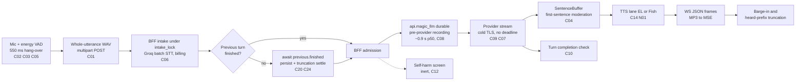
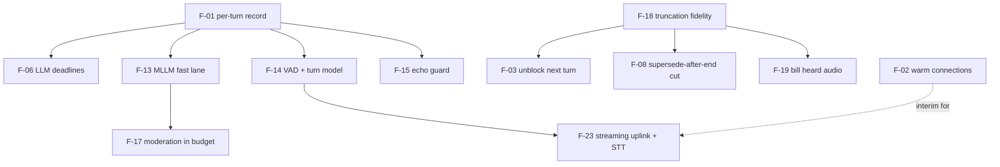

# Audit findings register

**Research date:** 2026-10-20. **Scope:** the verified, de-duplicated register of defects and risks in the Magic Worlds live voice call (SPA, `magic-worlds-api` BFF, `api.magic_llm`, `magic-llm`). It merges the 10 subsystem audit notes, their reconciliation, and five later gap notes into one list with a single severity rubric. Each high issue gets its mechanism, impact and fix. The register also lists strengths, answered and open questions, and errata against the raw evidence.

## Summary

- **145 canonical issues:** 0 critical, 15 high, 53 medium, 67 low, 10 info. They come from 271 raw IDs: 209 subsystem IDs plus 62 IDs from the later gap notes. No issue meets the critical bar (breaks calls, loses data, or opens a security hole) after adversarial verification. One verifier rated the api.magic_llm pre-provider recording "critical" (TOP-04). It is a ~0.9 s latency, which is high under this rubric.
- **Five structural latency problems dominate:**
  - batch HTTP uplink with batch STT (C01);
  - a fixed 550 ms energy endpoint (C02);
  - about 0.9 s p50 of durable DB recording in api.magic_llm before the provider request (C08);
  - cold TLS connections to Groq and the LLM provider on almost every turn: +165 ms p50, with 0.5-1.5 s stalls on roughly 1 turn in 3 on the dev network (C09);
  - interruption replies that wait 0.7-6.4 s for the previous turn's bookkeeping, including an fsync'd MP3 archive write (C20).

  Together with the LLM provider time, these explain the reconciled 3.2-4.2 s from speech end to first audio (see [02](02_turn_lifecycle_and_latency.md)).
- **Correctness failures users feel:**
  - On the Fish lane, any reply sentence that needs markup cleaning crashes the word ledger and silences the whole turn (N01; 2 of 15 Fish turns in dev).
  - Leading or trailing whitespace fails a turn after it is stored (C10).
  - A user talking over a reply after `voice_turn_end` neither stops nor truncates it (C24).
  - Stored audio, transcript, history and billing disagree with what was heard. 34% of stored and billed TTS audio in dev was never played (N06, N07), and late truncations miss the segment row (N05).
- **No voice-grade failure handling:**
  - The LLM has no TTFT deadline, filler or fallback, and blind retries allow about 92 s of silence (C07).
  - STT is one 30 s attempt held under the intake lock (C06).
  - TTS has one reconnect budget, after which the call is text-only for good (C14).
  - Energy-only VAD and the AEC-off upload path let noise and echo open turns (C03, C05).
- **Safety and launch gates:** self-harm detection in calls is inert, and the crisis lines are unsigned `LEGAL_PENDING` drafts (C12). Required moderation, as designed, either refuses calls or times out (C04).
- **Measure first.** No durable per-turn timing or outcome record exists (C13). Dev numbers are distorted in three ways: `uvicorn --reload` disables TCP_NODELAY (+41 ms per reused hop, N09), every test call ran as a root user (N11), and the dev MySQL is saturated (N10).
- **Fast wins (days, no vendor change):** F-01 instrumentation, F-02 warm pooled connections, F-03 unblock the next turn, F-04 Fish ledger fix, F-05 to F-08 contract, deadline, STT and supersede fixes, F-09 short replies. The large items are F-13 (an api.magic_llm voice fast lane), F-14 (a turn model plus neural VAD) and F-23 (a streaming uplink with streaming STT).

---

## 1. How this register was built

**Inputs.** The 10 subsystem notes in [evidence/audit](evidence/audit/) produced 209 finding IDs. [gap-finding-reconciliation](evidence/audit/gap-finding-reconciliation.md) collapsed them into 126 canonical issues: clusters C01-C80, plus 46 unverified singles in its Appendix C. Five later gap notes add 62 IDs that the reconciliation never saw:

- [gap-real-dev-call-forensics](evidence/audit/gap-real-dev-call-forensics.md)
- [gap-topology-rtt-measurements](evidence/audit/gap-topology-rtt-measurements.md)
- [gap-real-call-overlap-history-billing](evidence/audit/gap-real-call-overlap-history-billing.md)
- [gap-call-audio-assets-and-mp3-timeline](evidence/audit/gap-call-audio-assets-and-mp3-timeline.md)
- [gap-segment-post-and-control-plane-unknowns](evidence/audit/gap-segment-post-and-control-plane-unknowns.md)

Each of those IDs was either merged into a C-ID or given a new ID, N01-N20. [Appendix A](#appendix-a-gap-note-id-map) maps every one. The method and source rules are in [00](00_methodology_and_sources.md), the architecture this register refers to is in [01](01_current_architecture.md), and the document index is the [README](README.md).

**Severity rubric.**

| Severity | Meaning |
|---|---|
| critical | Breaks calls, loses data, or opens a security hole. |
| high | A major latency, UX, correctness or compliance problem that users feel. About 1 s of latency is high, not critical. |
| medium | Real but bounded, conditional, or felt only occasionally. |
| low | Minor or latent. |
| info | No defect today, or context only. |

When verifiers disagreed, the severity follows the best-verified mechanism (rule R2 of the reconciliation). Every change against the reconciliation is listed in §1.1.

**Labels.**

- **V:** confirmed by an adversarial verification pass.
- **V-adj:** a verifier corrected the mechanism or the severity.
- **u:** never verified. This covers every subsystem ID rated low or info, and gap-note findings outside the verifier's scope.
- **FACT / INFERENCE / UNKNOWN:** used as in the notes.

All data is from dev, which differs from production in several ways:

- one `uvicorn --reload` process per service;
- MySQL on a LAN host shared with other apps;
- 8 calls on 2026-10-19/20, all made by a `root` user;
- 7 of the 8 calls on the Fish lane.

The overlap gap note could not read the database (the permission classifier denied it), so its call figures are REPORTED. The forensics, topology and audio-asset notes did read the data.

**ID abbreviations.**

| Short form | Full ID prefix |
|---|---|
| Cnn | `GAP-FINDING-RECONCILIATION-Cnn` (canonical cluster) |
| FOR-nn | `GAP-REAL-DEV-CALL-FORENSICS-nn` |
| TOP-nn | `GAP-TOPOLOGY-RTT-MEASUREMENTS-nn` |
| OVL-nn | `GAP-REAL-CALL-OVERLAP-HISTORY-BILLING-nn` |
| AUD-nn | `GAP-CALL-AUDIO-ASSETS-AND-MP3-TIMELINE-nn` |
| SP-nn | `GAP-SEGMENT-POST-AND-CONTROL-PLANE-UNKNOWNS-nn` |
| FE-PB, BE-ROUTE, BE-ENGINE, BE-OBS, E2E | FE-PLAYBACK-TRANSPORT, BE-ROUTE-TRANSPORT, BE-ENGINE-TURNTAKING, BE-OBSERVABILITY-SAFETY-COST, E2E-LATENCY-TRACE |

### 1.1 Severity changes against the reconciliation

| ID | Reconciliation | Here | Reason |
|---|---|---|---|
| C09 cold connections | high (its own verifier lowered it to medium) | **high** | TOP-02 measured the tail (V, high). 20% of cold Groq and 16% of cold OpenRouter TCP+TLS setups took over 500 ms (4-9% for ElevenLabs and Fish), with 1.1-1.5 s outliers. Two cold connects per turn put about 1 turn in 3 into a 0.5-1.5 s stall on this network. The medium rating was based on a 100-300 ms mean alone. |
| C11 resume seq gap | high | **medium** | The reconciliation verifier found that the stall self-heals at the next reply, and that the server snapshot already carries `last_audio_seq`, so the fix is client-side. |
| C20 next turn waits for the previous one | medium | **high** | Real data. AUD-01 (V, high): in 5 of 13 transitions the next user's STT finished before the previous turn's asset row existed (+1 to +5 s). FOR-05 (V-adj): 4 of 19 turns waited 0.7-6.4 s. This hits the reply to an interruption. |
| C24 supersede after `voice_turn_end` | medium | **high (conditional)** | OVL-03 (V, high) confirmed the race. It applies whenever no barge-in frame fires: AEC off, raw fallback, the 3 s warm-up of the first reply, or speech under 500 ms. |
| C26 nothing-heard completion | medium | **low** | The reconciliation verifier found the window narrow. |
| C39 OpenRouter usage poll | medium | **info** | The TOP-02 verifier showed in the DB that no voice run recorded a poll result (19/19 `usage_source=provider`), and the poll runs only after the stream, so it cannot delay first text. Its code reason is on the recovery route; see the C39 row in section 6. |
| C08 durable pipeline | high | **high** | The TOP-04 verifier raised the topology finding to critical. Under this rubric a ~0.9 s latency is high. |
| BE-ENGINE-15 (Appendix C single, low) | low | merged into **N06 (medium)** | AUD-02 (V) measured it in data: 34% of stored audio was never heard. |

## 2. Severity by category

| Category | Critical | High | Medium | Low | Info | Total |
|---|---|---|---|---|---|---|
| latency | 0 | 5 (C01, C04, C08, C09, C20) | 7 | 7 | 2 | 21 |
| robustness | 0 | 5 (C03, C05, C06, C07, C14) | 16 | 11 | 0 | 32 |
| correctness | 0 | 3 (C10, C24, N01) | 10 | 8 | 0 | 21 |
| ux | 0 | 1 (C02) | 9 | 15 | 3 | 28 |
| safety, security and privacy | 0 | 1 (C12) | 2 | 4 | 1 | 8 |
| observability | 0 | 0 | 3 | 4 | 1 | 8 |
| cost | 0 | 0 | 3 | 3 | 0 | 6 |
| scalability | 0 | 0 | 1 | 6 | 0 | 7 |
| audio quality | 0 | 0 | 1 | 6 | 1 | 8 |
| maintainability | 0 | 0 | 1 | 3 | 2 | 6 |
| **Total** | **0** | **15** | **53** | **67** | **10** | **145** |

C13 (latency cannot be measured) is medium because users do not feel it directly. It is still scheduled first (F-01), because no latency fix can be verified without it.

## 3. Where the high issues sit in a turn



The serial chain from speech end to the first provider token is: hang-over, upload, STT, BFF bookkeeping, api.magic_llm recording, then provider time to first token. Nothing overlaps it except the TTS socket prewarm.

## 4. Top issues (high), ranked

Ranking rule (INFERENCE): what costs latency or correctness on every turn comes first, then failure modes that silence or corrupt a call, then safety and launch gates. Recommendation IDs (F-nn) are detailed in [§7](#7-recommendations).

### 4.1 C01: batch uplink and batch STT

- **IDs:** C01 (FE-CAPTURE-03, BE-ROUTE-01, BE-STT-01, E2E-01, FE-PB-06, BE-STT-10).
- **Severity:** high. **Category:** latency. **Verification:** V, in both the subsystem and the reconciliation passes.
- **Evidence:**
  - `src/features/call/components/CallScreen.tsx:114`: `silenceMsToEnd: 550`.
  - `src/features/interaction/hooks/useVoiceCallController.ts:564-628`: the whole segment goes out as one POST after the VAD flush.
  - `magic-worlds-api/src/routes/user/route_voice_call.py:1130`, `:1160-1220`: a multipart WAV.
  - `magic-worlds-api/src/services/voice_orchestration/stt_groq_client.py:36-39`: "not streaming in v1", one `post` per segment.
- **What happens:**
  - The client waits for 550 ms of silence, then builds a 16 kHz PCM16 WAV and POSTs it.
  - The BFF runs its gates and intake bookkeeping, then transcribes the whole clip with Groq `whisper-large-v3`.
  - Nothing starts before the user stops: no partials, no early LLM.
  - The WebSocket carries only control frames and downlink audio.
  - Uploads arrive 10-31 s apart, beyond the server's 5 s keep-alive, so each one opens a new TCP connection, plus TLS in production (TOP-07).
- **Impact:**
  - The 550 ms hang-over, 20-150 ms of upload (700 ms on a mobile uplink) and STT at 526 ms p50 / 1,002 ms p95 (dev, n=23, clips of 0.9-2.1 s) sit in series before the LLM. That is about 1.1-1.7 s of the reconciled 3.2-4.2 s (INFERENCE).
  - Segments can reach 29.5 s, and upload and batch STT grow with length.
  - Groq bills a 10 s minimum per request (C63).
- **Fix:** F-23 (P2: stream audio over the call WebSocket into a streaming STT). Interim: F-02 removes the cold Groq connect inside the 526 ms; F-14 shortens the endpoint. See [06](06_speech_to_text.md), [09](09_transport_and_client_audio.md) and [16](16_target_architectures.md).

### 4.2 C08: api.magic_llm durable recording before the first provider byte

- **IDs:** C08 (BE-LLM-02, BE-LLM-21, FOR-04, TOP-04, FOR-06).
- **Severity:** high. **Category:** latency. **Verification:** V. The mechanism was confirmed by three verifiers. TOP-04 was V-adj: its magnitude was raised 2-3x.
- **Evidence:**
  - `api.magic_llm/src/routes/completions.py:991-1004`.
  - `api.magic_llm/src/db/native_execution.py:264-335`, `:975-1034`: 15-20 statements per native commit, plus a checkpoint `UPDATE`.
  - `magic-agents/magic_agents/execution/llm_storage.py:23-46`.
  - MLLM `tb_execution_event`:
    - `llm_start` is committed at native revision 20 in 19 of 19 voice runs;
    - run start → `llm_start` takes p50 874 ms (747-1,311);
    - admitted → `llm_start` takes p50 898 ms (768-1,233);
    - each turn makes 32 native commits;
    - the checkpoint is 48-123 KB and is rewritten on every commit, under `binlog_row_image=FULL`.
- **What happens:**
  - Before calling the provider, api.magic_llm runs a second admission and snapshots the history.
  - It then commits about 20 durable events, each with a full checkpoint rewrite, at roughly 39-69 ms of wall time per commit.
  - The DB round trip itself is only 0.24 ms, so commit and serialization work dominates.
  - After the stream, 12 more commits take 1.0-2.5 s. This tail delays turn completion, not first audio, because the 120 ms idle flush releases finished sentences first (FOR-06, V-adj to low).
- **Impact:** about 0.9 s p50 on every turn, the largest controllable stage (above the STT p50). A probe measured 1,579 ms to first text on a tiny prompt. The cost grows with history, because the checkpoint carries it.
- **Fix:** F-13 (P1: ephemeral or fast-lane execution for the BFF-owned callbot graph, or a direct provider call with asynchronous recording). See [07](07_llm_in_the_voice_loop.md).

### 4.3 C02: no semantic end-of-turn

- **IDs:** C02 (E2E-02, BE-ENGINE-02, FE-CAPTURE-04).
- **Severity:** high. **Category:** ux. **Verification:** V.
- **Evidence:**
  - `src/features/call/components/CallScreen.tsx:114` (550 / 250).
  - `src/features/interaction/hooks/useVoiceCallController.ts:907-910`: no `voice_vad` frame is sent.
  - `magic-worlds-api/src/services/voice_orchestration/server_vad.py` only validates segments.
  - `magic-worlds-api/src/services/voice_orchestration/engine.py:2075-2087`: a split utterance is merged only if the first user message is not yet stored.
- **What happens:**
  - Every pause over 550 ms ends the turn. A re-simulated 600 ms mid-sentence pause produced two segments ([r94 §4.2](evidence/research/r94-gap-g4-contradictions-reconcile.md)).
  - The fragment triggers a reply, and the rest of the sentence then supersedes it (C20, C24).
  - A complete turn still pays the full 550 ms.
  - The 800 ms worklet fallback and the 450 ms "strict" mode are not in use; the strict mode is unreachable.
- **Impact:** a fixed tax of about 15% of the budget on every turn, plus fragment turns that waste LLM and TTS work and make the character answer half-sentences. By comparison, LiveKit's endpointing defaults are 0.3 s min / 2.5 s max with its audio turn detector, which is the `AgentSession` default (0.5 / 3.0 s otherwise) ([LiveKit turn-handling options](https://docs.livekit.io/reference/agents/turn-handling-options/), rendered 2026-10-20).
- **Fix:** F-14 (P1: a neural VAD plus an audio turn model on the last ≤ 8 s, with a dynamic hang-over). See [05](05_turn_taking_and_interruptions.md).

### 4.4 C09: cold provider connections on every turn

- **IDs:** C09 (BE-LLM-03, BE-STT-04, TOP-02, TOP-07, TOP-08, FOR-07).
- **Severity:** high (re-rated, §1.1). **Category:** latency. **Verification:** V-adj. The mechanism was confirmed twice, and the tail was re-measured by the TOP-02 verifier.
- **Evidence:**
  - `magic-worlds-api/src/services/voice_orchestration/stt_groq_client.py:139-145`: httpx defaults, `keepalive_expiry=5.0`.
  - `magic-worlds-api/src/services/voice_orchestration/engine.py:3792-3795`: `CallbotExecutionService` without a shared client.
  - `magic-worlds-api/src/services/llm_execution_transport.py:276-277`, `:315-325`: a new `httpx.AsyncClient` per stream.
  - `magic-llm/magic_llm/engine/engine_openai.py:264`: a new aiohttp session per streamed call. The private transport (`magic-llm/magic_llm/util/private_http.py:66-68`, used when `private_transport=True`, as in `api.magic_llm/src/services/llm_execution.py:285-287`) also builds a `TCPConnector(use_dns_cache=False)` per call.
- **What happens:**
  - All four provider edges keep idle connections for at least 125 s. The clients drop them first: Groq's after 5 s, and the LLM's on every call.
  - User utterances in dev calls were 10-31 s apart (16 of 16 gaps), so every STT request after the first is cold. The recorded STT latency includes the connect.
- **Impact (MEASURED on the dev network):**
  - The cold penalty is +78-80 ms for Groq and +86-95 ms for the LLM edge, about +165 ms p50 per turn.
  - Cold TCP+TLS exceeded 500 ms in 16-20% of samples, with 1.1-1.5 s outliers (1 s initial RTO).
  - With two cold connects per turn, about 1 turn in 3 stalls for 0.5-1.5 s.
  - Production magnitude is UNKNOWN.
- **Fix:** F-02 (P0, S). See [04](04_cascaded_pipeline_sota.md) and [09](09_transport_and_client_audio.md).

### 4.5 C20: the next turn waits for the previous turn's bookkeeping

- **IDs:** C20 (BE-ENGINE-05, BE-LLM-14, E2E-07, FOR-05, OVL-06, AUD-01).
- **Severity:** high (re-rated, §1.1). **Category:** latency. **Verification:** V. AUD-01 was confirmed high. FOR-05 was V-adj on its mechanism.
- **Evidence:**
  - `magic-worlds-api/src/services/voice_orchestration/engine.py:2066-2074`: `await previous.finished.wait()`, with no timeout.
  - `:2105-2110`: `finished` is set only in the `finally`.
  - `:2690-2755`: the truncation settle (≤ 3 s), the asset persist, the segment insert, the message link and the user-segment update.
  - `:2321-2322` and `:1669-1683`: the new turn then awaits the pending truncation (≤ 3 s).
  - `magic-worlds-api/src/services/tts_generation/storage.py:239-283`: the SHA-256 plus `mkstemp`/`fsync`/`replace` write.
- **What happens:**
  - A superseding segment finishes STT, cancels the old turn, then waits for all of the old turn's post-end work: the truncation settle, the MP3 archive write with fsync (to a RAID5 volume on the `.90` deployment), the job and asset rows, the segment insert and the message link.
  - Only then does it wait for its own pending truncation and start admission.
  - The MLLM tail is **not** awaited: cancelling closes the upstream stream (FOR-05 verifier).
- **Impact (FACT, dev):**
  - 4 of 19 LLM turns waited 0.7-6.4 s. Each figure is overstated by the normal 0.2-0.4 s.
  - In 5 of 13 transitions, the next user's STT finished 1-5 s before the previous asset row existed. The next user message was created in the same second the previous message received its audio link.
  - The reply to an interruption, the most latency-sensitive moment of a call, starts seconds late.
  - Long replies (C37) make overlaps common.
- **Fix:** F-03 (P0, M). See [02](02_turn_lifecycle_and_latency.md) and [05](05_turn_taking_and_interruptions.md).

### 4.6 N01: the Fish word ledger crashes on replies that need markup cleaning

- **IDs:** N01 (FOR-01).
- **Severity:** high. **Category:** correctness. **Verification:** V. The verifier reproduced it with a probe over the real `SentenceBuffer`, `_fish_spoken_text`, `PerformancePlan` and `WordCallTurnLedger`.
- **Evidence:**
  - `magic-worlds-api/src/services/voice_orchestration/engine.py:2382-2390`, `:3596-3616`: an unsafe sentence is swapped for its sanitized text.
  - `magic-worlds-api/src/services/voice_orchestration/call_tts_elevenlabs.py:249`: `mark_flushed` runs before `push_text` at `:251`.
  - `magic-worlds-api/src/services/voice_orchestration/call_word_ledger.py:32-35`: `ValueError("...exact original source geometry")`.
  - `engine.py:2637`, `:3103-3116`.
  - The prompt forbids asterisks (`magic-worlds-api/src/agent_graphs/runtime/callbot_chat.v2.json:18-20`).
- **What happens:**
  - A sentence containing `* _ # ~ [ ] < > | ( )` or emoji is cleaned for Fish, so the plan's logical text no longer equals the ledger's source text.
  - `mark_flushed` raises, and the `_push` task dies silently.
  - Nothing reaches Fish. The error surfaces only at `speaker.finish()`, after the LLM ends, and is recorded as `internal`.
- **Impact:**
  - 2 of 15 Haiku turns in dev hit it (fe6100 s1 and s3). The user heard 5.3-6.4 s of silence and then a generic error.
  - The unheard reply stays in history (N02).
  - It is Fish-lane only: off by default in code (`fish_audio/config.py:87`), but enabled in the dev `.env` and used by 7 of 8 dev calls.
- **Fix:** F-04 (P0, S). See [08](08_text_to_speech.md).

### 4.7 C10: leading or trailing whitespace fails a turn that is already stored

- **IDs:** C10 (BE-LLM-01).
- **Severity:** high. **Category:** correctness. **Verification:** V (reproduced with a probe).
- **Evidence:**
  - `magic-worlds-api/src/services/voice_orchestration/transcript_sanitizer.py:131-137`.
  - `magic-worlds-api/src/services/voice_orchestration/llm_turn_runner.py:180`, `:234`.
  - `magic-worlds-api/src/services/llm_execution_text.py:27-30`, `:142`.
  - `engine.py:2715-2720`.
- **What happens:** deltas are streamed raw, but the completion text is stripped. The runner and the engine both require exact equality, so `' Hello there.'` or `'Hello there.\n'` raises a contract error. The turn fails with `upstream_contract` after the DB has stored a completed reply, and the last unpunctuated sentence is never spoken.
- **Impact:** 0 of 19 dev turns (Haiku and Sonnet) were affected. A model or route that pads its output would fail every turn. This is a latent, all-or-nothing correctness bug that depends on the model.
- **Fix:** F-05 (P0, S). See [07](07_llm_in_the_voice_loop.md).

### 4.8 C07: no LLM deadline, filler or fallback

- **IDs:** C07 (BE-LLM-05, E2E-11).
- **Severity:** high. **Category:** robustness. **Verification:** V-adj. The verifier found magic-llm's retries, which made the worst case worse.
- **Evidence:**
  - `magic-llm/magic_llm/engine/attempt_control.py:257-261`, `:278-326`: retries before any semantic output; 408, 429 and 5xx are not permanent.
  - `magic-llm/magic_llm/engine/base_chat.py:29-31`, `:64`, `:72`: `retries=3`, delay 1.0 s.
  - `magic-worlds-api/src/services/llm_features.py:66-68`: `timeout_seconds=30` per attempt.
  - The only `wait_for` calls in `engine.py` are the truncation, end and watchdog waits.
- **What happens:** no TTFT or turn deadline exists. A stalled provider gets up to 3 attempts of 30 s each plus backoff, with no filler, hedge or fallback profile. Timeouts surface as `provider_submission`, never `llm_timeout`.
- **Impact:** about 92 s of silence in the worst case. In practice users hang up long before, and telemetry cannot tell timeouts apart from other failures.
- **Fix:** F-06 (P0, M). See [07](07_llm_in_the_voice_loop.md).

### 4.9 C06: STT is single-shot, with a 30 s timeout, under the intake lock

- **IDs:** C06 (BE-STT-02, BE-ENGINE-12, E2E-12, BE-ROUTE-10, BE-OBS-16). Related: C32 (FOR-10, SP-07).
- **Severity:** high. **Category:** robustness. **Verification:** V.
- **Evidence:**
  - `magic-worlds-api/src/services/voice_orchestration/stt_groq_client.py:90-109`: one `post`, no retry.
  - `magic-worlds-api/src/services/voice_orchestration/config.py:47`: 30 s, env-tunable up to 120 s.
  - `engine.py:2051-2061`: `intake_lock` is held across intake, which awaits STT at `:2228`.
  - The model is pinned (`config.py:122-124`).
  - The client resends only on a `TypeError` (`useVoiceCallController.ts:597-608`).
- **What happens:** one Groq stall freezes intake for the whole call for up to 30 s. A 502 or 504 loses the utterance. No breaker or fallback model exists. A failed STT leaves the segment row `accepted` for good (C32; 1 of 24 dev segments).
- **Impact:** rare in dev (no timeouts seen), but each occurrence is a multi-second freeze or a lost utterance, and it is invisible in metrics.
- **Fix:** F-07 (P0, S-M). See [06](06_speech_to_text.md).

### 4.10 C24: talk-over after `voice_turn_end` neither stops nor truncates the reply

- **IDs:** C24 (BE-ENGINE-01, OVL-03).
- **Severity:** high, conditional (re-rated, §1.1). **Category:** correctness. **Verification:** V (OVL-03 confirmed high); V-adj (BE-ENGINE-01: condition added).
- **Evidence:**
  - `engine.py:1426-1434`: `_supersede_heard_prefix` returns early on `end_published`.
  - `:1958-1960`: `_cancel_turn` returns False.
  - `:2637`, `:2687`: `end_published` is set (`:2687`) after `speaker.finish()` (`:2637`), which waits for provider delivery, not playback.
  - `call_tts_elevenlabs.py:55-57`, `:160-167`: 3 free sentences, then < 3 unheard and < 8 s ahead.
  - `magic-worlds-api/docs/api_usage/voice.md:287-291` promises a cut "while the reply is still being written or spoken".
  - The only supersede test holds TTS back so the cut lands before the end (`tests/voice/test_mid_stream_barge_in.py:419-450`).
- **When it applies:** only when no `voice_barge_in` frame fires: AEC off, the raw-mic fallback, the 3 s warm-up of the call's first reply, speech under 500 ms, or playback not yet "playing" (`useVoiceCallController.ts:676-687`). A frame sent after the end does truncate (`engine.py:1354-1365`).
- **What happens:** on those paths the outcome depends on a race between N+1's STT completion and N's delivery drain. If N has already published its end, nothing is cancelled or cut. The client keeps playing N until N+1's `voice_turn_start`, all of N's audio is billed, and history stores the full reply as heard.
- **Impact:** the character talks over the user for 1.2-3 s after they stop, and the same behaviour yields different history and billing. EL delivers a 3-sentence reply 1-3 s after the turn starts, so on these paths most talk-over lands on the uncut side (INFERENCE). See the diagram at the end of §4.
- **Fix:** F-08 (P0, S-M). See [05](05_turn_taking_and_interruptions.md).

### 4.11 C05: echo self-supersede on AEC-off paths

- **IDs:** C05 (FE-CAPTURE-01, FE-UI-02, E2E-09, BE-ENGINE-19, FE-CAPTURE-19, OVL-08).
- **Severity:** high, conditional. **Category:** robustness. **Verification:** V.
- **Evidence:**
  - `useVoiceCallController.ts:676-687`: auto barge-in is skipped with AEC off, on the raw fallback, or in the warm-up.
  - `:920-935`: `handleCapturedSegment` uploads every segment.
  - `engine.py:2066-2074`: any non-empty transcript supersedes, and the BFF has no echo filter.
  - The hint copy is wrong: `src/app/i18n/locales/en.ts:6150` says "interrupting by voice is disabled".
- **What happens:** with AEC off, the mic captures the character, the segment is uploaded and transcribed, and the transcript supersedes the reply. The character interrupts itself and then answers its own words. The echo is billed as STT on top of the TTS it repeats.
- **Impact:** UNKNOWN in frequency. Neither the AEC state nor overlap with playback is recorded (OVL-01). The overlap script that scores echo similarity was not run, because DB access was denied (OVL-11).
- **Fix:** F-15 (P1, M). See [05](05_turn_taking_and_interruptions.md) and [09](09_transport_and_client_audio.md).

### 4.12 C03: energy-only VAD on the client, none on the server

- **IDs:** C03 (FE-CAPTURE-02, BE-STT-08).
- **Severity:** high. **Category:** robustness. **Verification:** V-adj. The correction: it is not "energy-only on both sides", because the server has no gate at all.
- **Evidence:**
  - `src/features/interaction/audio/voiceVadProcessor.worklet.js:265-304`: an RMS gate with an adaptive floor.
  - `magic-worlds-api/src/services/voice_orchestration/server_vad.py:25-36`: `vad_energy_gate_enabled=False`, leaving only a `peak < 0.002` floor.
- **What happens:**
  - Noise opens turns, and 500 ms of voiced energy while the character is audible fires an irrevocable barge-in (C15).
  - Non-stationary noise can hold a segment open until the 29.5 s cap, so the character does not answer for up to about 30 s.
  - After the client, only Groq's no-speech heuristics and the hallucination filter remove noise.
- **Impact:** false turns, false interruptions, and billed no-speech STT (C62). Mute and unmute make it worse (C45).
- **Fix:** F-14 (P1). See [05](05_turn_taking_and_interruptions.md).

### 4.13 C14: one TTS reconnect budget, then a text-only call

- **IDs:** C14 (BE-TTS-06).
- **Severity:** high. **Category:** robustness. **Verification:** V-adj (the reset condition was corrected).
- **Evidence:**
  - `magic-worlds-api/src/services/speech/providers/elevenlabs/tts_multicontext_ws.py:833-843`: budget 1.
  - `:944-947`: the budget is reset only by a turn that completes with audio.
  - `:543-547`: a 429 on the handshake.
  - `engine.py:2979-2985`: `tts_leg_ended=True` for the rest of the call.
- **What happens:** two socket failures with no audio-completing turn between them end the voice leg for good. A typical cause is an outage longer than the single immediate, unbacked-off reconnect, or a 429 on the handshake. The user sees a generic, transient-looking notice (C54).
- **Impact:** a few seconds of provider trouble turns the rest of the call into text.
- **Fix:** F-16 (P1, M). See [08](08_text_to_speech.md).

### 4.14 C12: self-harm detection in calls is inert

- **IDs:** C12 (BE-OBS-02). Related: C60.
- **Severity:** high. **Category:** safety. **Verification:** V.
- **Evidence:**
  - `magic-worlds-api/src/services/speech/companion_safety_lists.py:24-35`: `pending_signoff`, and every list is empty.
  - `magic-worlds-api/src/services/speech/companion_safety.py:299-301`: detection is off by default. `:396` returns early, and `:357` builds the detector with no classifier.
  - `engine.py:2571-2596`: the screen starts only after admission, as a detached task.
  - `:2613-2616`: deltas are sent at once.
  - Crisis-line names and numbers are `LEGAL_PENDING` drafts that are never rendered (`src/app/i18n/locales/voiceSafety.ts:5-7`).
- **What happens:** nothing in the call loop can detect suicidal ideation or trigger the existing crisis panel (`CallScreen.tsx:574-581`). Moderation gates only what is voiced, not the streamed text.
- **Impact:** a compliance and safety gap for a companion product. Whether companion-chatbot laws apply needs counsel (see [14](14_safety_policy_and_compliance.md)). Separately, the dormant safety-pause logs and the live abuse-disable logs record labels with `user_id` in plaintext (C60).
- **Fix:** F-12 (P0 before launch; depends on legal). See [14](14_safety_policy_and_compliance.md).

### 4.15 C04: required moderation is a latent launch blocker

- **IDs:** C04 (BE-OBS-01, E2E-03, BE-TTS-01, BE-LLM-15, BE-ENGINE-04).
- **Severity:** high, latent. **Category:** latency and compliance. **Verification:** V-adj. The impact correction is that only sentence 1 is serial, and that `required` alone refuses calls.
- **Evidence:**
  - `magic-worlds-api/src/services/speech/moderation.py:73`: the 0.3 s budget. `:720-734`: a timeout gives `unavailable`.
  - `engine.py:3293-3335`: fail-closed.
  - `call_tts_elevenlabs.py:228-245`: `_push` prepares N+1 before the flush wait, so only sentence 1 pays serially.
  - `magic-worlds-api/src/services/speech/moderation_transport.py:117`, `:122-129`: the classifier defaults to off, and `required` defaults to on.
  - `magic-worlds-api/src/services/speech/surface_gate.py:138-156`.
- **What happens:**
  - Today the cost is 0 ms: dev has the classifier off and moderation optional.
  - With `required=true` alone, the surface gate refuses every call at start.
  - With the classifier on through the durable api.magic_llm path (C08), a 300 ms budget will most likely time out on most sentences. Those sentences are skipped, and the call becomes effectively text-only.
  - The best case adds up to 300 ms to sentence 1.
  - The often-quoted 2,003 ms sample was a preview-surface probe, not a call measurement.
- **Impact:** calls cannot launch with moderation as designed.
- **Fix:** F-17 (P1, launch gate). See [14](14_safety_policy_and_compliance.md) and [07](07_llm_in_the_voice_loop.md).

The talk-over path below shows how C24 and C20 combine when no barge-in frame fires:

```mermaid
sequenceDiagram
  participant U as User
  participant C as Client (AEC off, raw mic or warm-up)
  participant B as BFF engine
  participant S as Disk + MySQL
  Note over B: Reply N streaming; flush-ahead lets 3 sentences or 8 s run ahead of playback
  U->>C: Talks over reply N
  Note over C: No voice_barge_in frame on this path
  C->>B: POST segment N+1 after 550 ms of silence
  B->>B: Groq STT for N+1 under intake_lock
  alt N has not published its end
    B->>B: Cut N at the last playback report and cancel N
  else N already published its end (delivered, still playing)
    Note over B,C: No cancel and no cut. The client keeps playing N
  end
  B->>S: Wait for previous.finished: truncation settle up to 3 s, MP3 fsync, asset rows, link
  S-->>B: Previous turn finished
  B->>B: Await pending truncation (up to 3 s), then admission and LLM for N+1
  B->>C: voice_turn_start N+1 (the client now drops N)
```

## 5. Medium issues

One row per canonical issue. Aliases and verification status are in the first column. Paths are abbreviated after their first full mention in §4: `engine.py`, `delivery.py`, `quota.py`, `call_ledger.py` and `call_tts_elevenlabs.py` are under `magic-worlds-api/src/services/voice_orchestration/`, and `tts_multicontext_ws.py` is under `magic-worlds-api/src/services/speech/providers/elevenlabs/`.

### 5.1 Latency (7)

| ID (aliases; status) | Issue | Evidence | Recommendation |
|---|---|---|---|
| C17 (E2E-06, BE-TTS-03, BE-LLM-11; V) | The first TTS unit waits for a whole sentence. The abbreviation list swallows "no." and "am.", so a reply ending "I said no." gets no boundary there. Spanish forms such as "Sra." are missing. | `magic-worlds-api/src/services/voice_orchestration/sentence_buffer.py:11-16`, `:19` | F-10. See [08](08_text_to_speech.md). |
| C18 (BE-TTS-02; V-adj from high) | Boundaries are ASCII `. ! ?` only. ja/zh/yue replies get no audio until the LLM finishes. Korean is unaffected and Thai only delayed. en/es are unaffected. | `sentence_buffer.py:19` | Add `。！？` before supporting those languages. |
| C19 (BE-ENGINE-03, BE-STT-05, E2E-04, BE-OBS-03, BE-LLM-06, TOP-03; V) | A serial BFF chain of DB writes and STT billing runs between segment receipt and LLM dispatch: about 23-29 transactions and 8 write commits. `autocommit=False` turns every read into a statement plus a `COMMIT`. Measured basis: about 60-80 ms p50 for root users (75-100 ms for others) and 100-140 ms p90. Only about 25 ms of it is network. In dev, the whole BFF pre-LLM interval was 208-400 ms. | `engine.py:2024-2275`; `magic-worlds-api/src/database/mysql/connection.py:208-233`; `magic-worlds-api/src/runtime_config.py:533` | Start admission right after the transcript. Move segment-status, STT-billing and metadata writes to an ordered per-call background writer. Fold the find/create/read-back into one statement, and cache per-call rows (part of F-03). |
| C28 (BE-ROUTE-05, BE-ENGINE-18; V-adj) | The call socket has no send timeout and no slow-consumer policy. The in-call pong queues behind a stalled audio send. How long the server takes to detect a half-open socket while sending is UNKNOWN (K04). | `delivery.py:212-231`; `magic-worlds-api/src/routes/user/route_voice_call.py:1499` | Add a per-send timeout that leads to the socket-drop path (F-20). |
| C34 (BE-LLM-07; V) | The history window trims one message at a time and re-tokenizes the whole list each time (O(n²)). It also shifts the prefix every turn. It binds only past 32k input tokens. | `magic-agents/magic_agents/node_system/utils.py:346-360`; `magic-worlds-api/src/services/llm_features.py:66-68` | Window by message count with a stable prefix, and summarize old turns. See [07](07_llm_in_the_voice_loop.md). |
| C37 (BE-LLM-10, FOR-08; V) | The callbot model has no latency guardrail, and its output cap is 1,536 tokens against the roadmap's 300-400. Dev replies ran p50 289 characters, with 17.6 s of audio (max 24.2 s). Users cut 12 of 17 audio turns (9-94% kept). The prompt asks for "one to three short sentences" (`callbot_chat.v2.json:18`). Borderline high: it feeds C20, C24, N06 and N07. | `llm_features.py:66-68` | F-09. See [10](10_naturalness_and_character_experience.md). |
| N09 (TOP-01; V) | `uvicorn --reload` and `--workers` bind the listener with `proto=0`, so asyncio never sets TCP_NODELAY. Every reused keep-alive request then waits about 41 ms for a delayed ACK. All three dev services run with `--reload`. The production launchers are unaffected, but `--workers N` would bring the stall back. | uvicorn `config.py:513`, `main.py:574-578`. A/B: 0.08-0.25 ms vs 41.0-42.1 ms per reused request | F-11 |

### 5.2 Robustness (16)

| ID (aliases; status) | Issue | Evidence | Recommendation |
|---|---|---|---|
| C11 (FE-PB-01; V-adj from high) | After a mid-reply resume, chunks sent while the socket was away advance `audio_last_seq` but never arrive. The client accepts only the next expected seq, so playback stalls until the next reply. | `delivery.py:264-267`; `engine.py:2470-2490`; `src/features/interaction/audio/voicePlaybackBuffer.ts:175-176`, `:361-364`. The snapshot already carries `last_audio_seq` (`engine.py:993-1004`). | F-21 |
| C21 (BE-ENGINE-06, BE-ROUTE-07, FE-CAPTURE-10, E2E-18, SP-01, SP-05, SP-06; V) | A turn lives as long as its segment POST. An aborted POST neither cancels nor reports the turn: h11 never cancels the task (reproduced with a probe). A resend returns `duplicate{reason: completed}` with no turn id, and the client's `finally` then clears its turn state mid-turn. A proxy 504 shows a false `VOICE_UPLOAD_FAILED`, a 429 `busy` is not retried, and a pre-form abort logs an ERROR traceback. | `engine.py:2046`, `:2090-2103`; `useVoiceCallController.ts:597-608`, `:619-628`; `route_voice_call.py:1159`, `:1222` | Short term: settle client turn state from WS frames, treat `duplicate` as in progress, and catch `ClientDisconnect`. Structural: F-23. |
| C23 (FE-PB-03; V-adj from high) | The client takes 50-75 s after the last inbound frame to detect a dead socket (25-75 s after a silent drop). That is longer than the 20 s server grace and the 15 s client resume window. | `src/infrastructure/api/voiceSocket.ts:20-21`, `:586-600` | F-20 |
| C29 (BE-ROUTE-06, FE-PB-18; V) | The protocol is strict: any unknown, extra-field, binary or malformed client frame ends a live call. | `route_voice_call.py:135-272`, `:320-330` | Ignore and count unknown frames, and keep strict checks only for security-relevant fields. |
| C30 (BE-ROUTE-03; V) | Every deploy, and every dev `--reload`, drops every live call. uvicorn fails the sockets with 1012 before the lifespan shutdown can notify the clients, and no graceful-shutdown timeout is set. | uvicorn `websockets_impl.py:148-154`; `magic-worlds-api/src/main.py:1383-1386` | F-25. See [13](13_cost_scaling_and_operations.md). |
| C32 (BE-STT-03, FOR-10, SP-07; V) | An STT exception leaves the segment `accepted` for good, with no event or metric. A later resend of the same seq becomes a silent `duplicate`. Seen once in dev (1c5bef s1): the user repeated the greeting. The user does get a generic upload-failed notice (FOR-10 verifier). | `engine.py:2205`, `:2228`; `useVoiceCallController.ts:614-618` | F-07 |
| C38 (BE-LLM-13, BE-ENGINE-13; V-adj) | The fail-closed spoken-text contract kills the turn on tag-like markup (`<think>…</think>`, `<b>no</b>`). Plain `a < b` passes. | `magic-worlds-api/src/services/voice_orchestration/transcript_sanitizer.py` (verifier probe) | F-05 |
| C41 (BE-TTS-05; V) | A provider stall after `close_context` is released as a normal completion after 5 s, which also resets the reconnect budget. | `tts_multicontext_ws.py:946-947`, `:983-996` | F-16 |
| C42 (BE-TTS-09; V) | EL alignment offsets assume an exact `len+1` echo per flush, with no resync. They can also fall back to `normalizedAlignment`, whose character counts may differ. Real drift is unverified. | `tts_multicontext_ws.py:713-722` | Resync offsets per flush from the text sent, and add a drift test. |
| C43 (BE-TTS-11, E2E-14; V) | The Fish lane has no first-audio or inter-chunk watchdog, only a 90 s per-turn timeout. Its latency mode is `'balanced'`. | `magic-worlds-api/src/services/speech/providers/fish_audio/timestamp_ws.py:162-167`, `:204`, `:212` | Add a first-audio watchdog of a few seconds with a reconnect. Test latency modes (F-26). See [08](08_text_to_speech.md). |
| C44 (BE-TTS-13; V) | A Fish reply over 1,200 characters or 64 units aborts generation and drops the audio already generated. Never triggered in dev (max reply 637). | `magic-worlds-api/src/services/speech/providers/fish_audio/streaming.py:106-112`; `timestamp_ws.py:28`, `:192` | F-09 makes it unreachable. Roll over to a new request instead of failing. |
| C45 (FE-CAPTURE-06; V) | Mute only disables the track. The worklet then sees zeros, the noise floor decays, and unmute or new noise produces fake speech turns. Calibration is never re-run. | `src/features/interaction/hooks/useMicrophoneCapture.ts:571-580`; `voiceVadProcessor.worklet.js:298-304` | Freeze the floor while muted and recalibrate on unmute. F-14. |
| C46 (FE-CAPTURE-07; V) | Only the track's `ended` event is observed: there is no `mute`, `devicechange` or `statechange` listener. Failures become self-clearing notices. | `useMicrophoneCapture.ts:521`; `useVoiceCallController.ts:980-988` | Listen for those events and show a persistent mic-problem state with an action. |
| C47 (FE-CAPTURE-08; V) | The mic liveness watchdog can misclassify a live stream as dead. The raw (AEC-off) fallback then stays on for the whole session, which feeds C05. | `useMicrophoneCapture.ts:421`, `:430-435`, `:559-566` | Time-limit the fallback, re-probe the AEC constraints, and record the fallback (F-01). |
| N04 (SP-02 V, SP-03 V-adj, FOR-09 V-adj) | A send failure on the call socket ends the call as `failed/internal`, with no resume grace. A failed `voice_ready` or snapshot send leaves Starlette in `DISCONNECTED`, so the next `receive_json` raises `RuntimeError`. A failed pong or segment-meta send raises `VoiceDeliveryDisconnected` into the generic `except`. Abandoning a call before `voice_ready` is stored as `failed/internal`, while the metric says `disconnected`. The only dev EL call (890eb3) ended this way after a 22 s stall at the end of a turn. Its exception class is UNKNOWN. | `route_voice_call.py:1496-1499`, `:1530-1535`, `:1544-1548`, `:1588-1598`, `:1605-1628`; `delivery.py:162`, `:212-231`; `engine.py:983-1003`, `:1043-1068`, `:1188-1195` | F-20 |
| N10 (TOP-06; V-adj; dev only) | The shared dev MySQL is saturated and tuned for durability. `max_connections=151` has been reached, and connection refusals kept rising during the audit (24 to 29). The buffer pool is 128 MiB, with `sync_binlog=1`, `innodb_flush_log_at_trx_commit=1` and a ROW/FULL binlog. With about 28 write commits before the provider call, about 95% of turns have at least one commit above p90. Production is UNKNOWN. | `performance_schema` reads, [gap-topology-rtt-measurements](evidence/audit/gap-topology-rtt-measurements.md) §4.2 | Dedicated DB headroom for the voice path, and production commit latency recorded (F-01, F-25). |

### 5.3 Correctness and history (10)

| ID (aliases; status) | Issue | Evidence | Recommendation |
|---|---|---|---|
| C22 (BE-ROUTE-08, FE-PB-02, BE-ENGINE-08, BE-TTS-17, AUD-11; V) | Audio produced while the socket is away is `DROPPED`, yet it is billed, stored and treated as heard. Uploads are not held during a reconnect, and resume has no replay. The exposure is bounded because the flush gate freezes at the last playback report (K09): at most 3 free sentences plus up to 8 s. | `engine.py:2486-2497`; `delivery.py:264-267` | F-19 (do not bill `DROPPED`) and F-21 |
| C25 (BE-TTS-08, BE-ENGINE-09, FE-PB-13, OVL-04, OVL-05, AUD-14; V/V-adj) | The kept text over-approximates what was heard, and the LLM never sees the interruption. EL cuts by sentence (the documented D06 item 3 policy) although per-character alignment is already parsed; in dev, message 550 kept about 70 unheard characters (about 5.5 s). A supersede reads `played_ms` when N+1's STT completes, 1-3 s after the user started talking. `currentTime` ignores output latency. History has no per-message marker, only a generic system-prompt note. A mid-stream cancel with nothing heard drops the reply row, which leaves consecutive user messages. Fish's word ledger is accurate (74-91 ms per kept character). | `call_ledger.py:277-295`, `:380-392`; `engine.py:1435-1437`; `magic-worlds-api/src/services/conversation_execution.py:56-86`; `callbot_chat.v2.json:18-20`, `:37` | F-18. See [05](05_turn_taking_and_interruptions.md). |
| C27 (FE-PB-04; V) | A `listening` snapshot after resume cancels a reply the user is still hearing, without reporting `played_ms`. | `useVoiceCallController.ts:746-759` | Send a barge-in frame with `played_ms`, or let the buffer drain. |
| C31 (BE-ROUTE-04, BE-OBS-11; V-adj) | A reservation orphaned by a crash is charged by wall clock, up to the full reservation of `min(600 s, remaining)`, 10-11 min after call start. Until then it blocks the user's own new calls. The full charge is avoided if the client resumes into the restarted process within 15 s. | `quota.py:268`, `:566-576`; `engine.py:965-977` | On the sweeper path, charge `metadata.billing.billable_audio_seconds` (F-19). |
| C33 (BE-STT-07; V) | The STT language hint is fixed for the whole call from the last assistant turn's language. The detected language is never used. | `route_voice_call.py:555-612`; `engine.py:2228-2230` | Per-segment detection or an en/es bilingual mode. See [06](06_speech_to_text.md). |
| C36 (BE-LLM-09; V) | Lorebook activation scans only the current, possibly misheard, utterance. | `magic-worlds-api/src/services/lorebook_loader.py:242-249` | Scan the last few turns. |
| C40 (BE-TTS-04; V) | A TTS socket restart drops the unplayed tail of a closing context and still reports the turn complete. | `tts_multicontext_ws.py:845-862`, `:937-947`; `call_tts_elevenlabs.py:279-282` | F-16 |
| N02 (FOR-02; V) | When a turn fails, its unheard reply stays `completed` at full length and enters the next prompt. In dev, replies of 283 and 637 characters with markup were stored although 0 and about 2 chunks were heard. The next plan's history includes the 283-character reply, which may reinforce the forbidden markup (INFERENCE). | `engine.py:3103-3163` (`_fail_turn` updates only the user segment); `conversation_execution.py:65-86` | F-18 |
| N05 (AUD-03 V-adj, OVL-07 V, FOR-15 u) | A truncation that lands after the asset was persisted updates only `adventure_message`. The segment transcript keeps the full text. This happened in 4 of 17 dev turns (4 of 12 truncations), each one the first reply of its call. Call history and chat then show different text. | `magic-worlds-api/src/database/mysql/call_turn_truncation.py:149-172`; `engine.py:1337-1352`, `:2721-2745` | F-18 |
| N06 (AUD-02 V, BE-ENGINE-15 u) | The stored call audio holds every delivered byte, while the transcript holds only the heard prefix. In dev, 12 of 17 turns were truncated, their assets were 1.08-3.21 times the played audio, and 97.0 of 283.1 s (34%) was never heard. History replays 0.6-16.5 s of speech that nobody heard, and shows the delivered length as the clip duration. | `engine.py:2489-2496`, `:2714`, `:2722-2726`, `:3520-3555`; `route_voice_call.py:1284-1314` | F-18 |

### 5.4 UX (9)

| ID (aliases; status) | Issue | Evidence | Recommendation |
|---|---|---|---|
| C15 (E2E-08, FE-CAPTURE-05, FE-PB-07, BE-ENGINE-07, BE-STT-21, BE-LLM-22; V) | Barge-in is immediate and irrevocable after 500 ms of voiced energy. There is no duck, no pause-then-confirm and no resume, and the LLM generation is discarded. LiveKit's defaults resume after a false interruption: `false_interruption_timeout` 2.0 s, `resume_false_interruption` True ([turn-handling options](https://docs.livekit.io/reference/agents/turn-handling-options/), rendered 2026-10-20). | `useVoiceCallController.ts:132-137`, `:644-673`, `:706` | Pause-then-confirm with resume, after F-14 reduces false triggers. See [05](05_turn_taking_and_interruptions.md). |
| C16 (FE-UI-01; V-adj from high) | Short interjections said entirely over the character are discarded, because the 500 ms interruption minimum also gates segment capture. | `useVoiceCallController.ts:706`; `voiceVadProcessor.worklet.js:394` | Capture at 250 ms and classify interruption vs backchannel separately (F-14). |
| C49 (FE-UI-03, FE-PB-16; V) | Captions run ahead of the audio: deltas are shown at LLM speed, and no alignment is forwarded. | `useVoiceCallController.ts:944-948` | Forward the alignment. Server and client share one frame timeline (AUD-13). |
| C50 (FE-UI-04; V) | On mobile, a fixed 188 px portrait hides the captions. | `CallScreen.tsx:473` | Make the stage responsive. |
| C51 (FE-UI-05; V) | No warning comes before a quota end, and "Call again" is a dead end afterwards. | verifier row in [fe-ui](evidence/audit/fe-ui.md) | Read `remaining_daily_seconds` and warn ahead of time. |
| C52 (FE-UI-06, BE-ROUTE-13, FE-PB-14; V-adj) | `max_duration` and quota ends cut the character mid-word with no warning, and implicit cuts report nothing heard. Idle ends do not cut mid-word. | `useVoiceCallController.ts:889-892`, `:901-905` | Warn first, then end after the current sentence. |
| C53 (FE-UI-07; V) | There is no greeting and no ringback: the user must speak first, into silence. | `CallScreen.tsx`; grep finds no greeting in `voice_orchestration` | A character greeting at `voice_ready`. See [10](10_naturalness_and_character_experience.md). |
| C54 (FE-UI-09; V) | Text-only degradation, from the spend circuit or from C14's leg end, is shown as a transient generic error. | `engine.py:2857-2873`, `:2979-2985` | A persistent "voice unavailable" state (F-16). |
| C56 (FE-UI-11, FOR-11; V) | Any navigation silently ends the call. On unmount the client closes the socket with code 1000 before sending `voice_end`, so the end is stored as `disconnected`. 2 of the 3 dev `disconnected` ends were likely navigation. | `useVoiceCallController.ts:1201-1212`; `voiceSocket.ts:255-266`; `engine.py:1012-1033` | A minimized call or a leave prompt. Send `voice_end{navigation}` first (F-20). |

### 5.5 Observability, cost, safety, scalability and other (11)

| ID (aliases; status) | Issue | Evidence | Recommendation |
|---|---|---|---|
| C13 (10 subsystem IDs, FOR-12, FOR-13, OVL-01, OVL-10, AUD-12; V-adj) | Most turn stages leave no durable per-turn record. STT latency is the only stage persisted (`stt_summary.latency_ms`). The gaps:<br>- The client first-audible mark is a `performance.mark` that nothing reads.<br>- The `voice_llm_first_delta` and `voice_first_assistant_audio` events exist only as log lines and process-local histograms.<br>- Provider TTFT is never recorded: `raw_usage.ttft` is 0.0 in 19 of 19 runs.<br>- BFF timestamps have 1 s resolution, and the assistant segment is always `completed`.<br>- The cancel reason, `played_ms` at cancel, skipped truncations and AEC state are not stored.<br>- `last_heartbeat_at` is really the last billing write. | `src/features/interaction/audio/callPlaybackTiming.ts:2`, `:28-33`; `magic-worlds-api/src/services/speech/metrics.py:4`; `engine.py:3526`; `magic-worlds-api/src/database/mysql/models.py:7754-7830` | F-01. See [12](12_observability_evaluation_and_testing.md). |
| C59 (BE-OBS-08; V) | There is no metrics exporter, and the monitor is off by default. Alerts are log lines only (the "RB-1 page alert" pages nobody), and the spend gauge has no producer. | `metrics.py:4`, `:1604`, `:1649-1660`, `:1711` | An exporter, plus paging on first-audio p95 and failure rates. See [12](12_observability_evaluation_and_testing.md). |
| N03 (FOR-03; V-adj from high) | 3 of 23 dev segments that completed STT, in 2 of 8 calls, failed `internal` before LLM admission. No plan, message or event row exists for them. Only `error_category` is stored, and logs go to stdout. The root cause is UNKNOWN. | `magic-worlds-api/src/services/voice_orchestration/callbot_execution.py:79-85`, `:177-254`; `engine.py:3103-3116`; `main.py:288-298` | F-22 |
| C35 (BE-LLM-08; V-adj) | The lorebook is appended to the system message on every utterance. When keyword lorebooks change the activated set, this breaks provider prefix caching. Without lorebooks the prefix is static: in dev, every turn after the first had 1,694-1,869 of 1,698-1,948 prompt tokens cached. | verifier row in [be-llm](evidence/audit/be-llm.md) | Move dynamic lore after the stable prefix. See [07](07_llm_in_the_voice_loop.md). |
| C58 (BE-OBS-10, FOR-16; V) | Spend control and cost accounting cover TTS only. There is no per-call cost record, and the usage of timed-out moderation calls is not recorded. 9 of 15 Fish attempts ended `uncertain`, because cancels skip `attempt.finish()`. | `spend_circuit.py:1-15`; `fish_audio/streaming.py:174-225` | A per-call COGS ledger. See [13](13_cost_scaling_and_operations.md). |
| N07 (OVL-02 V-adj, AUD-04 V, OVL-09 u) | Billing counts delivered audio, not heard audio, against a budget the UI presents as call time:<br>- 34% of billed TTS seconds in dev were never played (`tts_audio_ms` equals the sum of the assets).<br>- The gate's 3 free sentences let delivery run up to 16.5 s ahead of playback (message 515).<br>- STT is billed on the whole file, which carries about 0.5 s of padding (300 ms pre-roll plus 200 ms of trailing silence), and on no-speech and echo segments.<br>- The sweeper path charges wall seconds instead.<br>Billing delivered audio is a documented policy. The defects are the unit mismatch and the waste. | `engine.py:1855-1860`, `:2345-2362`, `:2494-2508`; `quota.py:268`, `:401-404`; `call_tts_elevenlabs.py:55-57`, `:160-167` | F-09 (gate) and F-19 (billing rule; needs a product decision). See [13](13_cost_scaling_and_operations.md). |
| C55 (FE-UI-10; V) | The live-call privacy footer says "Only transcript text and metadata are saved", but the engine persists the character's audio. The corrected copy is stuck in draft. | `CallScreen.tsx:637`; `src/app/i18n/locales/en.ts:6155`; `engine.py:3469-3510` | Ship the corrected copy. See [14](14_safety_policy_and_compliance.md). |
| C60 (BE-OBS-13; V) | Self-harm risk labels and abuse disables are logged in plaintext with `user_id`. The safety-pause logs are dormant while C12 holds; the abuse logs are live. | `magic-worlds-api/src/services/speech/companion_safety.py:446-483`; `magic-worlds-api/src/services/speech/abuse.py:194-203` | Pseudonymize, and send these logs to a restricted sink (F-12). |
| N08 (AUD-05 V, AUD-09 u) | Call audio is stored on per-instance `local_fs` with only a root-relative path, while the DB is shared. Any other instance (a replica, a dev BFF on the shared DB, a migrated host) serves 404 for it. The same 404 covers "missing" and "not yours", and the UI offers a retry that can never succeed. In dev, all 17 assets exist only on the `.90` deployment. | `magic-worlds-api/src/services/tts_generation/storage.py:23-33`, `:129-146`; `magic-worlds-api/src/routes/tts.py:78-92`, `:110-128` | F-24 |
| C48 (FE-PB-09, E2E-16; V-adj) | The fallback playback paths are choppy or slow: gaps between Blob groups, and a 2 s ManagedMediaSource stall. | `voicePlaybackBuffer.ts:44`, `:420` | Measure per browser. See [09](09_transport_and_client_audio.md). |
| C57 (FE-PB-22; V) | Playback and transport tests run only in jsdom with mocks. The risky paths (seq gap, snapshot, barge-in during reconnect) are untested. | `tests/browser/` has no call playback test | Browser tests for resume, barge-in and supersede after end. See [12](12_observability_evaluation_and_testing.md). |

## 6. Low and info issues

These are compact on purpose. Low clusters with a verified member keep their verifier's status. Every Appendix C single is unverified (u). Fix references point to §7 where one applies.

### 6.1 Low clusters and new low findings (29)

| ID (aliases; status) | Cat. | Issue | Evidence | Fix |
|---|---|---|---|---|
| C26 (BE-LLM-12; V) | correctness | A barge-in after completion with nothing heard keeps the full unheard reply in history, unlike the mid-stream path. The window is narrow. | [be-llm](evidence/audit/be-llm.md) BE-LLM-12 | F-18 |
| C61 (BE-TTS-07 V, BE-OBS-04 V, BE-ROUTE-09 V-adj, BE-ENGINE-16 u; contested) | latency | Billing DB writes (debit plus a metadata rewrite) are awaited inside the TTS drain loop. Up to 8 s of lead hides them. The real critical-path write is STT billing (C19). | `engine.py:2345-2362`, `:2494-2508` | Background writer (F-03) |
| C62 (BE-ENGINE-10, BE-STT-17, FOR-14, SP-08; u) | cost | Charges are made for:<br>- no-speech and rejected segments (STT is billed before the `no_speech` rejection);<br>- STT that finishes after the call ends;<br>- calls with zero assistant audio caused by an internal error;<br>- turns that outlive `end_call`'s 2 s drain. | `engine.py:2243-2252` (OVL-02 verifier) | F-19 |
| C63 (E2E-17, FE-CAPTURE-12 V-adj, BE-STT-12) | cost | Groq's 10 s per-request billing floor is multiplied by one request per segment and by premature cuts. The verifier's figure is about $0.0003 per request, still to be re-checked. | [fe-capture](evidence/audit/fe-capture.md) verifier `:466` | F-14, F-23 |
| C64 (BE-STT-11, E2E-05; V-adj) | ux | `transcript_final` is sent only after BFF admission (K08), not right after STT. | [be-stt](evidence/audit/be-stt.md) `:392` | Send it right after STT |
| C65 (BE-ROUTE-02 V-adj, E2E-15 u) | scalability | Call runtime is process-local. A resume routed to another process ends the call. Sticky routing on the chat id in the URL is feasible. | [be-route-transport](evidence/audit/be-route-transport.md) `:868` | F-25 |
| C66 (BE-TTS-12 V, BE-OBS-14 V-adj, E2E-13 V-adj; contested) | scalability | Fish per-sentence spend admission takes an account-wide `FOR UPDATE` lock and a daily `SUM`. Fish is off by default, and `FISH_AUDIO_CONCURRENCY=1` binds first. | [be-tts](evidence/audit/be-tts.md) BE-TTS-12 | A per-call spend lease |
| C67 (FE-CAPTURE-11; V-adj) | latency | The server gets no early "user is speaking" signal, so warm-ups wait for the segment. Both existing warm-ups already overlap STT; the Groq connection is the missing one. | [fe-capture](evidence/audit/fe-capture.md) `:465` | A speech-start frame (F-02) |
| C68 (FE-PB-08; V-adj) | correctness | Control frames (barge-in, playback, end) are dropped, not queued, while the socket reconnects. A following segment usually repairs the cut. | [fe-playback-transport](evidence/audit/fe-playback-transport.md) `:535` | F-21 |
| C69 (BE-OBS-12 V-adj, BE-ENGINE-14 u) | ux | Abuse scoring counts drained characters on every cancel, including `end_call` and natural barge-in. A live call survives an abuse disable. | [be-observability-safety-cost](evidence/audit/be-observability-safety-cost.md) `:688` | Score abusive cancels only |
| C70 (BE-OBS-06; V-adj) | observability | The observability sanitizer drops fields that are not allow-listed, without a trace. | `be-observability-safety-cost.md:682` | Count dropped fields |
| C71 (BE-OBS-07; V-adj) | observability | `extra=` log fields are never printed, events are logged as dict reprs, and durations use the wall clock. | `be-observability-safety-cost.md:683` | Structured logs (F-01) |
| C72 (BE-OBS-09; V-adj) | observability | No `traceparent` or `X-Request-Id` crosses services on the voice path. | `be-observability-safety-cost.md:685` | F-01 |
| C73 (FE-UI-08; V-adj) | ux | The status line exposes pipeline internals, and nothing shows "thinking" during upload and STT. | [fe-ui](evidence/audit/fe-ui.md) `:619` | A thinking cue |
| C74 (BE-STT-06; V-adj) | correctness | A `compression_ratio` above 2.4 rejects the whole transcript. It takes about 9-12 repetitions, mostly tail loops, which are more likely on segments of up to 29.5 s (K02). | `be-stt.md:387` | Trim the loop instead of rejecting |
| C75 (BE-LLM-20, BE-TTS-19; u) | latency | Lock-step hand-off: each LLM delta waits for the UI WebSocket send before reaching the sentence buffer. | [be-llm](evidence/audit/be-llm.md) `:605` | A queue between the two |
| C76 (BE-ROUTE-18, BE-TTS-16, FE-PB-15; u) | audio quality | Downlink audio is base64 MP3 inside JSON text frames (+33% bytes), with no timing metadata. | `be-tts.md:254` | Binary frames. See [09](09_transport_and_client_audio.md). |
| C77 (FE-PB-20, FE-UI-18, BE-ROUTE-11, FE-CAPTURE-15; u) | latency | Call setup is serial end to end: mic, consent POST, WS open, `voice_start`, DB gates, `voice_ready`. | four notes; [gap-finding-reconciliation](evidence/audit/gap-finding-reconciliation.md) §3.2 | Run setup steps in parallel, plus a greeting (C53) |
| C78 (FE-PB-19, BE-ROUTE-17; u) | security | The access token rides in `Sec-WebSocket-Protocol` and is validated only at the handshake. Resume skips the access gates. | `be-route-transport.md:770` | Re-validate on resume; a short-lived socket ticket |
| C79 (BE-TTS-20, BE-ENGINE-20; u) | maintainability | `VOICE_TTS_QUEUE_MAX_SENTENCES` is dead, the speaker queue is unbounded, plus small TTS nits. | `be-tts.md:273` | Enforce or delete |
| C80 (FE-CAPTURE-18, BE-STT-20, BE-ROUTE-19; u) | maintainability | Stale comments and dead config: the 8 s segment comment, the unreachable strict VAD, doc drift. | `fe-capture.md:346` | Clean up |
| N11 (TOP-05; V-adj from medium) | latency | Non-root users pay extra per turn: a feature-flag validator before every transaction (2 `FOR SHARE` reads) and a shadow-user upsert (p99 25 ms, max 1.44 s). Estimated at about +12-15 ms per turn plus 4-5 ms fixed (INFERENCE). All 8 dev calls ran as root. | `route_voice_call.py:1130`; `enforcement.py:16-56`; `transaction_hooks.py:30-32` | F-11; validate the flag once per call |
| N12 (TOP-09; u) | robustness | DB pools are small (maxsize 10), have no acquire timeout and are not kept warm. The api.magic_llm worker held 0 MySQL connections despite `minsize=2`. | `magic-worlds-api/src/database/mysql/connection.py:149-152`, `:195` | F-25 |
| N13 (TOP-10; u) | scalability | No repo defines the production topology: no proxy, TLS or HTTP/2 config. `FORWARDED_ALLOW_IPS` assumes a proxy that does not exist, dev connects to the DB as `root`, and `timeout_graceful_shutdown=None`. | [gap-topology-rtt-measurements](evidence/audit/gap-topology-rtt-measurements.md) §TOP-10 | F-25 |
| N14 (AUD-06; V-adj from medium) | audio quality | Silences are neither measured nor trimmed. Fish onset is 105-140 ms, its trailing silence 298-726 ms, and 15-17% of the audio is quiet (verifier re-measure). The first-audio mark is the first chunk, not first speech. The verifier puts the gain from trimming at about 50-100 ms. | `engine.py:2457-2470` | F-26 |
| N15 (AUD-07; V-adj from medium) | robustness | The orphan sweep looks for `$.tts_segments.*.assets[*].asset_id`, but calls write a flat `asset_id` (sweep path 0/17, flat path 17/17). Latent: no current path deletes the asset. | `voice_orphan_sweep.py:313-327`; `engine.py:3540-3556` | Add the flat path and a test (F-24) |
| N16 (AUD-08; u) | security/privacy | The call purge's fallback filters `j.operation = 'call_character_tts'`, a value that never occurs: that string is the `source`. An unlinked call asset survives deletion. | `magic-worlds-api/src/database/mysql/models.py:22719-22765`; `engine.py:4086-4100` | Filter on `source`, and add a test |
| N17 (AUD-10; u) | robustness | `mp3_frames.py` does not recognise Xing, Info or VBRI frames or LAME padding. Latent: no current stream has one. | `mp3_frames.py:88-119`, `:168-177` | Detect the tag, and add a fixture test |
| N18 (SP-04; u) | cost | An abandoned call start still runs full admission. It burns a start token (3 per 10 min), records a Free activation, supersedes the user's other live calls, reserves quota and opens a TTS socket. | `route_voice_call.py:880-916`, `:1474-1493` | Watch for disconnects during admission and refund the token (F-20) |

### 6.2 Unverified singles from the subsystem notes (38 low)

The line references point at each finding's heading in its note.

| ID | Cat. | Issue | Fix |
|---|---|---|---|
| FE-CAPTURE-13 ([fe-capture:320](evidence/audit/fe-capture.md)) | ux | Speech in the first 400 ms of any capture (re)start is learned as noise. | Calibrate on silence only (F-14) |
| FE-CAPTURE-14 (`:326`) | ux | Mute does not discard an utterance in progress. | Drop the open segment on mute |
| FE-CAPTURE-16 (`:336`) | audio quality | The in-worklet resampler has a wide transition band. | A proper low-pass filter |
| FE-CAPTURE-17 (`:341`) | robustness | Only channel 0 is read, and no `channelCount` constraint is set. | Downmix, plus the constraint |
| FE-PB-10 ([fe-playback-transport:368](evidence/audit/fe-playback-transport.md)) | audio quality | The MSE path has no jitter or prebuffer policy and no underrun handling. | A prebuffer policy. See [09](09_transport_and_client_audio.md). |
| FE-PB-11 (`:376`) | robustness | `openSocket` replaces a live or connecting socket without closing it. | Close it first |
| FE-PB-12 (`:384`) | robustness | Closures that skip `connecting` leave the UI "live" on a dead call. | F-20 |
| FE-PB-17 (`:424`) | audio quality | iOS audio-session and gain specifics are unhandled. | Device tests |
| FE-PB-21 (`:458`) | maintainability | Small state that is unbounded or long-lived. | Bound it |
| FE-UI-12 ([fe-ui:392](evidence/audit/fe-ui.md)) | ux | Accessibility gaps in the live surface. | An a11y pass |
| FE-UI-13 (`:405`) | ux | The interrupt control causes layout shift and is unavailable while "Thinking". | Reserve its space |
| FE-UI-14 (`:413`) | ux | Mute is not reflected in the status or the hint. | Show it |
| FE-UI-15 (`:419`) | ux | Replies blocked by autoplay are labelled "Speaking". | Detect and prompt |
| FE-UI-16 (`:426`) | correctness | The client merge heuristic can overwrite a real user line. | Key lines by turn id |
| FE-UI-17 (`:438`) | ux | A full consent modal appears before every new call. | Remember consent per policy version |
| FE-UI-20 (`:464`) | ux | No device selection, Media Session or network-quality cue. | Add them |
| FE-UI-21 (`:472`) | correctness | "Call again" silently does nothing when setup is blocked. | Show the reason (C51) |
| FE-UI-22 (`:480`) | ux | Calls the user ends never show the end panel. | Show it |
| FE-UI-23 (`:488`) | ux | The speaking visual is synthetic, and the user's level is hidden while the character talks. | Drive it from real levels |
| FE-UI-24 (`:495`) | correctness | Interim states of an interrupted line. | Settle lines from WS frames |
| FE-UI-25 (`:504`) | robustness | App audio (the playlist) is not paused at call start. | Pause it |
| BE-ROUTE-12 ([be-route-transport:694](evidence/audit/be-route-transport.md)) | security | No handshake timeout and no per-user socket cap, and the frame size limit is far above need. | Add the limits |
| BE-ROUTE-14 (`:723`) | scalability | A global capacity ceiling, a single lock row, and rate-limit state kept in memory. | F-25 |
| BE-ROUTE-15 (`:738`) | robustness | Supersede runs before the new call can actually start. | Supersede after ready (N18) |
| BE-STT-13 ([be-stt:289](evidence/audit/be-stt.md)) | audio quality | The vocabulary prompt is thin and static. | Add character and world names |
| BE-STT-14 (`:295`) | scalability | No queue or backoff between Groq rate limits and call concurrency. | F-07 |
| BE-STT-15 (`:301`) | correctness | Prompt read-back detection only matches the whole prompt. | Fuzzy matching |
| BE-STT-16 (`:307`) | robustness | The strict response contract turns benign provider changes into lost utterances. | Tolerant parsing |
| BE-STT-18 (`:319`) | security | The STT base URL accepts plain http, and the session id leaks into the uploaded filename. | Require https; use an opaque name |
| BE-STT-19 (`:324`) | latency | WAV statistics run synchronously on the event loop. | Move them off the loop |
| BE-ENGINE-11 ([be-engine-turntaking:570](evidence/audit/be-engine-turntaking.md)) | robustness | Segments are not ordered by `seq`. | Order them in intake |
| BE-LLM-17 ([be-llm:575](evidence/audit/be-llm.md)) | correctness | The provider's `finish_reason` is masked as `stop`. | Pass it through (F-01) |
| BE-LLM-18 (`:583`) | ux | The prompt lacks call-language binding and first-sentence brevity, and uses legacy cue markup. | F-09 |
| BE-LLM-19 (`:597`) | latency | Sync DB calls on the api.magic_llm event loop add jitter to every concurrent stream. | F-13 |
| BE-TTS-10 ([be-tts:224](evidence/audit/be-tts.md)) | ux | The first-audio timeout gives up sentences only locally, so late audio still plays after the "delayed" notice. | F-16 |
| BE-TTS-14 (`:244`) | robustness | The EL socket has no WS ping and no keep-alive between turns, so half-open sockets surface as a 3 s first-audio timeout. | Ping between turns (F-16) |
| BE-TTS-15 (`:249`) | scalability | The EL session limiter is per process, and each call holds a slot for its whole duration. | F-25 |
| BE-OBS-15 ([be-observability-safety-cost:587](evidence/audit/be-observability-safety-cost.md)) | observability | Moderation metrics are coarse and mislabelled. | F-01 |

### 6.3 Info (10)

| ID (status) | Cat. | Note |
|---|---|---|
| C39 (BE-LLM-04; re-rated from medium) | latency | No voice run recorded an OpenRouter usage-poll result: 19/19 record `usage_source=provider` with a null `provider_request_id` (TOP-02 verifier). The poll runs only after the stream (`magic-llm/magic_llm/engine/engine_openai.py:284`), so it cannot delay first text. Re-check for this register: the verifier's code reason (`private_transport=True` forcing `ProviderOpenAI`, `api.magic_llm/src/services/llm_execution.py:285-287`) is the recovery route's client. The live platform path renders `engine: openai` with the `openrouter.ai` base URL, which selects `ProviderOpenRouter` (`engine_openai.py:39`), so a poll that runs and fails after the stream is not ruled out (UNKNOWN; check the api.magic_llm logs for "OpenRouter usage polling failed"). |
| BE-TTS-22 ([be-tts:281](evidence/audit/be-tts.md); u) | latency | Text normalization runs twice: the local en/es expansion plus the provider's `auto`. |
| FE-UI-26 ([fe-ui:511](evidence/audit/fe-ui.md); u) | ux | Internal error codes are shown to end users. |
| FE-UI-27 (`:515`; u) | ux | History rows lack interruption markers and end reasons. See F-18. |
| FE-UI-28 (`:520`; u) | ux | The circular mask clips the avatar's "live" dot. |
| FE-CAPTURE-20 ([fe-capture:360](evidence/audit/fe-capture.md); u) | security/privacy | Notes on the uplink's privacy posture. Raw audio is not persisted (§8). |
| N20 (SP-09; u) | observability | The 4/s `voice_playback` limit is per call and drops excess frames silently, with no metric. The client sends 2/s. |
| BE-TTS-21 ([be-tts:277](evidence/audit/be-tts.md); u) | audio quality | The voice's emotion and tag prefix is not applied on the EL call lane. |
| FE-PB-23 ([fe-playback-transport:477](evidence/audit/fe-playback-transport.md); u) | maintainability | Minor protocol leftovers. |
| N19 (TOP-11; u) | maintainability | Dev drifts from the pins: api.magic_llm runs uvicorn 0.47.0 against a pinned 0.53.0, and Python 3.13/3.14 against 3.12 in Docker. Measure latency with the container image (F-11). |

## 7. Recommendations

Priorities:

- **P0:** do now; days; no vendor change.
- **P1:** next; weeks.
- **P2:** architectural; about a quarter.
- **P3:** experiment or watch.

Effort: S is up to a few days, M one to three weeks, L more than that (INFERENCE). Every expected impact is an **estimate** taken from the dev measurements cited, not a production figure. [17](17_recommendations_and_roadmap.md) sequences these into a roadmap, and [15](15_gap_analysis.md) compares them with the state of the art.

### 7.1 P0: do now

**F-01. Per-turn timing and outcome record.** Fixes C13, C59, C71, C72 and BE-OBS-15, and feeds N03.

- **What:**
  - One durable record per turn, with ms-resolution marks for:
    - client speech end, sent with the segment;
    - upload received;
    - STT connect versus inference;
    - BFF pre-LLM DB time;
    - api.magic_llm `llm_start`;
    - provider TTFT;
    - first sentence pushed;
    - first audio sent;
    - the client first-audible mark (from `callPlaybackTiming.ts`).
  - Outcome fields: cancel reason, `played_ms` at end or cancel, truncation applied or skipped, AEC or raw-fallback state, error class.
  - A metrics exporter, paging on first-audio p95, and `traceparent` across the BFF and api.magic_llm.
- **Why:** today STT latency is the only stage persisted. Every other number in this register had to be reconstructed by hand.
- **Expected impact:** none on latency by itself. It makes F-02 to F-26 verifiable.
- **Effort:** M. **Depends on:** nothing.
- **Validation:** the share of dev turns with a complete record (aim for all of them); a first-audio p50/p95 per lane.

**F-02. Warm pooled connections.** Fixes C09 (TOP-02, TOP-07, TOP-08, FOR-07) and C67.

- **What:**
  - Keep a Groq keep-alive longer than the 10-31 s utterance gap, or prewarm the connection on a speech-start frame from the client.
  - Use one shared HTTP client per process for BFF → api.magic_llm, instead of a new `httpx.AsyncClient` per stream.
  - In magic-llm, reuse one session and connector per provider host for both the default client (`util/http.py`) and `private_http`, with the DNS cache on.
  - Raise `timeout_keep_alive` on the internal services.
- **Why:** the clients, not the providers, drop the idle connections (§4.4).
- **Expected impact (estimate, dev network):** about −165 ms p50 per turn, and the 0.5-1.5 s connect stall that hits about 1 turn in 3 is removed. It also removes a 2.5-3.3 ms event-loop block per turn.
- **Effort:** S. **Depends on:** a cross-repo change in magic-llm.
- **Validation:** the share of turns that open a new TLS session (near 0 after the first turn); the STT connect share; STT p95.

**F-03. Unblock the next turn.** Fixes C20, C19 and C61.

- **What:**
  - A superseding turn waits only for the old producer's cancel and the truncation decision (bounded), not for `previous.finished`.
  - The MP3 write, asset and segment rows, message link, STT billing and segment-metadata writes move to an ordered per-call background writer.
  - Fold the find, create and read-back calls into fewer statements, and cache per-call rows.
- **Why:** the reply to an interruption should not queue behind archive I/O.
- **Expected impact (estimate):** removes the 0.7-6.4 s waits seen in 4 of 19 dev turns, and part of the 60-80 ms p50 BFF DB tax.
- **Effort:** M. **Depends on:** the F-18 write order.
- **Validation:** time from N+1's STT completion to N+1's admission, which should fall to the no-overlap baseline (0.2-0.4 s in dev).

**F-04. Fish ledger fix.** Fixes N01.

- **What:**
  - Build the word ledger from the same sanitized text that is sent to Fish.
  - Move `mark_flushed` under error handling, so a failure there degrades to sentence-level truncation.
  - Surface `_push` task failures at once.
- **Why:** markup or emoji in a reply silences the whole turn.
- **Expected impact:** removes the failure seen in 2 of 15 dev Fish turns.
- **Effort:** S. **Depends on:** nothing.
- **Validation:** `internal` failures on the Fish lane; a regression test with `*`, `( )` and emoji.

**F-05. Spoken-text contract.** Fixes C10 and C38.

- **What:**
  - Compare stripped text in `llm_turn_runner` and the engine.
  - Have the sanitizer strip `<think>` blocks and tag-like markup instead of failing.
  - Never fail a turn after its reply has been stored.
- **Why:** a latent all-or-nothing failure that depends on the model.
- **Expected impact:** none on today's models (0 of 19 dev turns affected); it protects against model and route changes.
- **Effort:** S. **Depends on:** nothing.
- **Validation:** `upstream_contract` failures; probe tests with padded and `<think>` output.

**F-06. LLM deadlines.** Fixes C07.

- **What:**
  - A TTFT deadline and a whole-turn deadline in the BFF.
  - On a TTFT miss: a short in-character filler, and a hedge to a fallback profile.
  - Limit magic-llm retries on the voice route to at most one fast retry before the first token. Platform profiles cannot set `retries` today (`magic-worlds-api/src/models/llm_execution.py:20-27`), so this needs a voice-route option or an api.magic_llm change; only BYOK requests already get `retries=1` (`api.magic_llm/src/util/request_credentials.py:117`).
  - Label timeouts `llm_timeout`.
- **Why:** about 92 s of possible silence today.
- **Expected impact:** the worst-case silence becomes the deadline.
- **Effort:** M. **Depends on:** F-01, to set the deadline from the measured TTFT p95.
- **Validation:** p99 and maximum time to first audio; the `llm_timeout` count.

**F-07. STT failure handling.** Fixes C06, C32 and BE-STT-14.

- **What:**
  - Stop holding `intake_lock` across the Groq call.
  - A voice-grade timeout, with one retry or hedge.
  - On an exception, mark the segment `failed` and emit an event, so a resend can retry it.
  - A breaker, and a fallback model.
- **Why:** one stall freezes intake for up to 30 s, and a failure is silent.
- **Expected impact:** no call-wide freeze; none of the silent losses seen in 1 of 24 dev segments.
- **Effort:** S-M. **Depends on:** nothing.
- **Validation:** segments stuck in `accepted` (0); STT retry and failure counts.

**F-08. Supersede-after-end cut.** Fixes C24.

- **What:**
  - After `end_published`, a superseding segment still stops client playback and applies a heard-prefix truncation from the latest playback report.
  - On paths with AEC off or in the warm-up, the client treats a new segment during playback as a soft stop.
- **Why:** today it is a race on `voice_turn_end`, not on what was heard.
- **Expected impact:** ends the 1.2-3 s talk-over on those paths, and history and billing become consistent for the same behaviour.
- **Effort:** S-M. **Depends on:** F-18 for the segment and asset update; F-15 for the echo case.
- **Validation:** the share of overlaps that get a cut; talk-over duration from the F-01 records.

**F-09. Short replies and a duration-based flush-ahead.** Fixes C37, C44 and BE-LLM-18, and reduces N06, N07, C20 and C24.

- **What:**
  - Lower the callbot `max_output_tokens` from 1,536 to a runaway backstop of 300-400 tokens (the roadmap value, K06; LAT-08 in [02](02_turn_lifecycle_and_latency.md)). That sits above the dev maximum of 274 completion tokens. The forensics' 90-120 would truncate the median reply (completion tokens p50 130, max 274; FOR-08). A tighter cap of about 200 ([07](07_llm_in_the_voice_loop.md) LLM-04) needs thinking confirmed off and an end-at-the-last-full-sentence rule on `finish_reason=length`.
  - Get brevity from the prompt: one or two short sentences instead of today's "one to three" (`callbot_chat.v2.json:18`).
  - Bind the call language in the prompt.
  - Replace "3 free sentences" with a limit on seconds of audio ahead of playback.
- **Why:**
  - Dev replies had a p50 of 17.6 s of audio, and 12 of 17 were cut by the user.
  - 34% of billed TTS was never heard.
- **Expected impact (estimate):** fewer overlaps and less unheard synthesis. The size is UNKNOWN until measured.
- **Effort:** S. **Depends on:** nothing.
- **Validation:** reply audio p50 (17.6 s in dev); the unheard share of billed TTS (34%); the truncation rate (12/17).

**F-10. SentenceBuffer fixes.** Fixes C17 and C18.

- **What:**
  - Drop "no." and "am." from the abbreviation list, or resolve them by context.
  - Add the Spanish forms, and `。！？`.
  - Consider a clause-level boundary for the first unit only.
- **Why:** the first TTS unit waits for a whole sentence.
- **Expected impact:** earlier first audio on long first sentences. The size is UNKNOWN; measure it with F-01.
- **Effort:** S. **Depends on:** nothing.
- **Validation:** the length of the first unit; first delta → first TTS push.

**F-11. Measure like production.** Fixes N09, N10, N11 and N19.

- **What:**
  - Test with a non-root account.
  - Run without `--reload`, or with TCP_NODELAY.
  - Use a DB with headroom and production durability settings.
  - Rebuild the dev venvs from the pins, or measure the container image.
- **Why:** dev numbers carry about 41 ms per reused hop and the saturated-DB tails, and they miss the non-root validators.
- **Expected impact:** dev and staging numbers become comparable.
- **Effort:** S. **Depends on:** nothing.
- **Validation:** the same scripted call gives matching stage times in dev and staging.

**F-12. Self-harm path, before launch.** Fixes C12 and C60.

- **What:**
  - Get legal sign-off on the lists and on the `LEGAL_PENDING` crisis lines.
  - Enable detection with a classifier on the user transcript before admission, and wire it to the existing crisis panel.
  - Pseudonymize the safety and abuse logs, and send them to a restricted sink.
- **Why:** a companion product with inert detection.
- **Expected impact:** a compliance gate cleared.
- **Effort:** M. **Depends on:** counsel ([14](14_safety_policy_and_compliance.md)).
- **Validation:** scripted red-team prompts reach the crisis panel; no plaintext labels with `user_id` in the logs.

### 7.2 P1: next

| ID | What | Why (issues) | Expected impact (estimate) | Effort | Depends on | Validation metric |
|---|---|---|---|---|---|---|
| F-13 | An api.magic_llm fast lane for the BFF-owned callbot graph. Options: ephemeral execution, one batched commit before the provider call with the checkpoint written once afterwards, or a direct streaming provider call with asynchronous recording. | C08, FOR-06, BE-LLM-19 | Most of the ~0.9 s p50 (874 ms) before the provider request, and a shorter 1.0-2.5 s post-stream tail | L | F-01; the api.magic_llm owners | Run start → provider request p50/p95 (874 ms in dev); commits before the first provider byte (19 in dev) |
| F-14 | A neural VAD plus an audio turn model (for example Pipecat Smart Turn v3.2 on the last ≤ 8 s) with a dynamic hang-over. Backchannel vs interruption classification, a noise floor frozen while muted, and short interjections captured at 250 ms. | C02, C03, C15, C16, C45, C63, FE-CAPTURE-13 | A shorter endpoint than the fixed 550 ms on complete turns, and fewer fragment turns and false barge-ins. Size UNKNOWN until A/B tested. | L | F-01 | Endpoint delay p50; rate of fragment turns; rate of false barge-ins |
| F-15 | An echo guard: drop transcripts that fuzzy-match recent assistant text; half-duplex or ducking when AEC is off; record the AEC state; time-limit the raw fallback; fix the hint copy. | C05, C47, OVL-08 | No more self-supersede on AEC-off paths. Frequency today is UNKNOWN. | M | F-01 | Echo matches per call; raw-fallback rate |
| F-16 | TTS leg recovery: a per-turn reconnect budget with backoff, first-audio and inter-chunk watchdogs on both lanes, voice restored after a later success, no lost closing-context tail, a post-close stall treated as an error, a persistent "voice unavailable" state, and a WS ping between turns. | C14, C40, C41, C43, C54, BE-TTS-10, BE-TTS-14 | Brief provider trouble no longer ends voice for the rest of the call | M | — | `tts_leg_ended` per call; recovered reconnects |
| F-17 | Moderation within budget: decide the launch policy; run the classifier off the durable path (in process, or a direct call), overlapped with sentence 1; make sure `required` without a classifier cannot refuse every call. | C04 | Calls can launch with moderation. The best case per the code adds at most 300 ms to sentence 1. | M | F-13 or another non-durable path; policy ([14](14_safety_policy_and_compliance.md)) | Moderation p50/p95 against 300 ms; `unavailable` rate |
| F-18 | Truncation and history fidelity:<br>- cut EL at the word with the alignment already parsed;<br>- discount output latency;<br>- add an interruption marker to history;<br>- update the segment, asset transcript and sidecar on late cuts;<br>- do not keep failed-turn replies as heard;<br>- handle nothing-heard after completion;<br>- trim stored audio to what was heard, or flag it. | C25, C26, N02, N05, N06, FE-UI-27 | History, captions and replay match what was heard (34% of stored audio unheard in dev) | M | — | Kept minus heard characters per turn; message vs segment mismatches (0) |
| F-19 | Bill heard audio (product decision): TTS billed on `played_ms`, nothing for `DROPPED`, STT billed only on speech, and sweeper charges on billable seconds. | N07, C22, C31, C62 | Billed seconds close the 34% gap to heard seconds (dev) | M | Product; F-18 | Billed ÷ heard seconds per call |
| F-20 | Socket lifecycle and end reasons:<br>- a per-send timeout;<br>- a send failure enters resume grace;<br>- the pong does not wait behind audio;<br>- the client detects a dead socket inside the 20 s grace;<br>- `voice_end{navigation}` before close;<br>- a disconnect watcher during admission;<br>- a pre-ready close recorded as `disconnected`. | C23, C28, N04, C56, N18, FE-PB-12 | Fewer false `failed/internal` ends; dead peers detected inside the grace | M | — | End-reason mix; time to detect a dropped peer (test) |
| F-21 | On resume, the client adopts the snapshot's `last_audio_seq`, or the server replays from a client-reported seq. Queue control frames during a reconnect. | C11, C22, C68 | No playback stall after a mid-reply resume | S | — | Stalls after resume in browser tests |
| F-22 | Diagnosable `internal` failures: persist the exception class and a short message per failed segment, turn and call; keep logs in a durable sink; correlate with the MLLM run id. | N03, N04 | The 3 pre-admission failures and the 890eb3 end become explainable | S | F-01 | Share of `internal` failures with a recorded class |

### 7.3 P2: architectural

| ID | What | Why (issues) | Expected impact (estimate) | Effort | Depends on | Validation metric |
|---|---|---|---|---|---|---|
| F-23 | A streaming uplink with streaming STT. Stream PCM or Opus frames over the call WebSocket into a streaming STT with partials and endpointing, start the LLM speculatively on stable partials, and retire the multipart POST. See [06](06_speech_to_text.md), [09](09_transport_and_client_audio.md) and [16](16_target_architectures.md). | C01, C21, C63 | Upload and most of batch STT (526 ms p50 / 1,002 ms p95 in dev) leave the serial path. The size depends on the vendor. | L | F-01, F-14, a vendor choice | Speech end → final transcript p50/p95 |
| F-24 | Object storage for call audio, with a shared storage key. Fix the orphan-sweep JSON path and the purge filter, and log missing files distinctly. | N08, N15, N16 | Any instance can serve any asset | M | — | 404s for existing asset rows |
| F-25 | Deploy and topology hygiene:<br>- graceful shutdown with call draining;<br>- a documented production topology;<br>- keep-alive of about 75-120 s on internal services (TOP-07);<br>- sized DB pools with an acquire timeout and warm `minsize`;<br>- a least-privilege DB user;<br>- sticky routing for resume;<br>- process-independent limiters. | C30, C65, N12, N13, BE-ROUTE-14, BE-TTS-15 | Deploys stop dropping every call, and the system can scale out | M-L | — | Calls dropped per deploy (all of them today); pool-wait p95 |

### 7.4 P3: experiment or watch

| ID | What | Why (issues) | Expected impact (estimate) | Effort | Depends on | Validation metric |
|---|---|---|---|---|---|---|
| F-26 | A/B the Fish `latency` mode (the code uses `'balanced'`; Fish's documentation disagrees on the available modes, see [08](08_text_to_speech.md)) and `chunk_length`. Trim leading and trailing silence per generation, and measure first-speech onset rather than first chunk. | C43, N14 | About 50-100 ms from onset trimming (verifier figure). The effect of the latency mode is UNKNOWN. | S | F-01 | First-speech onset p50 per lane |



## 8. Strengths confirmed by the audit

| # | Strength | Confirmed by | Qualifier |
|---|---|---|---|
| S1 | The EL socket is prewarmed during STT, and a per-turn context opens in parallel with the LLM. The EL (125 ms) and Fish (about 274 ms) handshakes normally overlap STT and the LLM. | 5 subsystem notes; TOP | Fish opens at admission, not during STT (K17) |
| S2 | Cancellation reaches api.magic_llm's provider call promptly. | be-llm, be-engine | Whether the provider stops is UNKNOWN (A01) |
| S3 | A mid-stream barge-in truncates to the heard prefix. Fish's word ledger is accurate (74-91 ms per kept character). | 6 notes; AUD-14 | Not after `voice_turn_end` (C24); EL keeps whole sentences (C25) |
| S4 | The client flushes at once and defends against stale frames by turn id and seq. | fe-playback, fe-ui, e2e | — |
| S5 | A flush-ahead gate paced by real playback reports bounds TTS spend. | be-tts, be-engine, e2e | The 3 free sentences still allow up to 16.5 s ahead (N07) |
| S6 | A 500 ms minimum interruption while audio is audible, plus an AEC warm-up. | fe-capture, fe-playback, fe-ui | Irrevocable once fired (C15) |
| S7 | Uploads are idempotent and SHA-checked, with exactly one safe resend. | 4 notes | A resend's `duplicate` clears client turn state (C21) |
| S8 | The protocol is typed and allow-listed on both sides. | fe-playback, be-route | Strictness also ends calls (C29) |
| S9 | No raw audio is persisted (only its SHA), and logs are allow-listed. | be-stt, be-obs, fe-playback | Assistant audio is persisted, and the footer says otherwise (C55) |
| S10 | A `user_stop_ttfb_ms` metric design with p50/p95 histograms. | 5 notes | Not persisted, no client mark, alerts are log lines (C13, K10) |
| S11 | Atomic cross-worker quota reservation, and a graceful release that uses billed seconds. | be-route, be-obs | The crash path charges wall clock (C31) |
| S12 | A bounded callbot contract: system profile only and a 30 s attempt timeout. Call turns do not debit chat credits (A05). | be-llm | The 1,536-token cap is about 4 times the roadmap target (K06) |
| S13 | Server meter and client clock share one frame timeline, with under 40 ms of skew. No per-sentence encoder priming and no Xing frame were found. | AUD-13 | Barge-in detection lag remains |
| S14 | The production launchers set TCP_NODELAY (0.07 ms per reused request). The LAN DB answers in 0.24 ms per statement. Providers support HTTP/2 and TLS 1.3, and keep idle connections for at least 125 s. | TOP | Dev `--reload` loses TCP_NODELAY (N09) |
| S15 | Durability is real: fsync on every commit plus `sync_binlog=1` mean no turn is lost on a crash. | TOP | That durability is what costs C08 and C19 |
| S16 | The segment body is read only after every admission gate. Pure-ASGI middlewares avoid `BaseHTTPMiddleware` cancellation pitfalls. | SP | — |
| S17 | Without lorebooks the prompt prefix is stable: after the first turn, 1,694-1,869 of 1,698-1,948 prompt tokens were cached. | FOR, be-llm verifier | Keyword lorebooks break the cache (C35) |

## 9. Open questions already answered

| # | Question | Answer | Still open |
|---|---|---|---|
| A01 | Does a barge-in or supersede cancel the LLM upstream? | Yes, as far as api.magic_llm's provider call. | Provider-side stop and billing |
| A02 | With AEC off, does the client upload during playback? | Yes, every segment (C05). | AEC quality per platform |
| A03 | Does the client drop queued chunks on a local barge-in? | Yes, immediately. | Control frames wait behind audio (C28) |
| A04 | Is the `voice_playback` limit per turn or per call? | Per call: a 4/s window with silent drops (N20). | — |
| A05 | Do call turns debit chat credits? | No (`platform_credit_billed=False`). | — |
| A06 | Does the 4-sentence TTS queue block the LLM? | No such limit exists; the constant is dead (C79). | Memory on very long replies |
| A07 | Does the BFF send meaningful `voice_status` frames? | Only `listening` and `uploading_segment`. | — |
| A08 | What are real STT latencies? | Dev: p50 526, p95 1,002, max 1,481 ms (n = 23, clips of 0.9-2.1 s). Recorded `latency_ms` includes the connect. | Production region, long clips, p99 |
| A09 | Is moderation required, and is the classifier on? | Dev: classifier off, moderation optional. The code default for `required` is true. | Production setting and classifier latency |
| A10, A11 | Production process topology and proxy? | The container runs a single uvicorn process. The test build is served over HTTPS (INFERENCE). | Replicas, proxy timeouts, HTTP version |
| A12 | Is a turn cancelled when its segment POST is aborted? | No. h11 never cancels the task, and the turn runs orphaned (C21). | — |
| A13 | Does a close before `voice_ready` orphan the reservation? | No, but the call is recorded `failed/internal`, and the whole admission runs anyway (N04, N18). | — |
| A14 | Does a resend yield `duplicate` while the original runs? | Yes, usually with no `turn_id` (C21). | — |
| A15 | What does `tts_summary.duration_ms` measure, and how fast do the voices speak? | The whole-frame MP3 duration of all delivered audio. Untruncated replies run at 78-88 ms per character (X06, AUD-13). | — |
| A16 | What are the chunk sizes, cadence and bitrate? | EL: 64 kbps CBR (see §11), chunks of 2.3-3.1 KB (290-385 ms of audio), 30-51 chunks per turn. Fish: 128 kbps CBR. | — |
| A17 | Does the OpenRouter usage poll delay voice turns? | Not first audio. No voice run recorded a poll result, and the poll runs only after the stream (C39). | Whether a failing poll lengthens the post-stream tail on the platform path |
| A18 | Does api.magic_llm's event log have ms resolution? | Yes. `tb_execution_event.created_at` is `datetime(3)`. That made the 874 ms p50 measurable (TOP-04 verifier). | BFF segment timestamps are still 1 s |
| A19 | What caused the 5 dev `failed/internal` segments? | 2 were the Fish ledger crash (N01). 3 failed before admission (N03). | The root cause of N03 |
| A20 | Do current models emit leading or trailing whitespace? | Not in 0 of 19 dev turns (Haiku, Sonnet). | Other models and routes |
| A21 | Does the Fish lane prewarm? | Yes, at LLM admission, not during STT (K17). | — |

## 10. Remaining open questions

1. **Production model and TTFT.** Which callbot model, provider route and `reasoning_effort` run in production, and their TTFT p50/p95. `raw_usage.ttft` is 0.0 in 19 of 19 runs, so nothing records TTFT today (C13).
2. **Production topology.** Replicas, proxy read and idle timeouts, HTTP/2, the placement of api.magic_llm, api.auth and MySQL, and their RTTs (N13).
3. **DB commit cost.** Production commit latency for both databases. Within the 39-69 ms per api.magic_llm commit, the split between Python serialization and DB time is UNKNOWN (TOP-04 verifier). This sizes F-13.
4. **Moderation.** The production setting, and classifier p50/p95 against the 300 ms budget (C04).
5. **Provider stop.** Whether OpenRouter and the provider stop generating and billing on disconnect.
6. **Echo.** Browser AEC effectiveness per platform, and the raw-fallback rate. The echo-similarity script was never run (OVL-11). This sizes C05.
7. **Device timings.** Per-stage p50/p95 on target devices, including the client first-audible mark (F-01).
8. **Failure causes.** The root cause of N03, and the exception class behind the 890eb3 end (N04).
9. **Half-open sockets.** How long the server takes to detect a half-open socket while sending audio (K04; needs a dropped-peer test).
10. **SSE buffering.** Whether dev's `SSE_BUFFER_INTERVAL_MS=300` applies on the callbot route (an SP observation, unverified).
11. **Groq.** The tier and rate limits under call concurrency.
12. **Fish latency modes.** Which modes exist and what they do, given that Fish's documents conflict (F-26).
13. **Product and legal:**
    - per-call consent display;
    - whether companion-chatbot laws apply;
    - transcript and audio retention;
    - whether billing should use heard or delivered seconds (F-19);
    - half-duplex on AEC-off devices;
    - calls surviving navigation.
14. **Languages.** The mix outside en/es, which sizes C18 and C33.
15. **Resume grace.** Whether 20 s is enough for mobile network handoffs.

## 11. Errata

Apply these to sibling documents and when citing evidence:

1. **The EL call bitrate is 64 kbps, not 128.** This contradicts research notes r04/r06, so it was re-checked in code:
   - `magic-worlds-api/src/services/speech/capabilities.py:65` sets `STREAM_OUTPUT_FORMAT = "mp3_44100_64"`;
   - `:159` maps `("call","standard")` to `("el_v4_turbo","ttd_ws",STREAM_OUTPUT_FORMAT)`;
   - `tts_multicontext_ws.py:242` sends `profile.output_format`;
   - real chunks are 208/209 B per 26.122 ms frame ([gap-call-audio-assets-and-mp3-timeline](evidence/audit/gap-call-audio-assets-and-mp3-timeline.md) §0).

   Only Fish (128 kbps) and narration (`mp3_44100_128`, `:64`) use 128 kbps.
2. **Reconciliation contradictions K01-K21 apply literally:**
   - the hang-over is 550 ms;
   - the segment cap is 29.5 s;
   - client dead-socket detection takes 50-75 s;
   - magic-llm retries give about 92 s of worst-case silence;
   - the output cap is 1,536 tokens;
   - moderation of sentence N+1 already overlaps sentence N;
   - `transcript_final` follows BFF admission;
   - the flush gate freezes while the socket is away;
   - RB-1 is a log line;
   - the dead queue constant;
   - the crash window is 10-11 min;
   - one EL TTFB sample (149 ms);
   - Groq connections expire between turns;
   - Fish prewarm exists;
   - the 500 ms barge-in minimum;
   - measured STT.

   The "billing", "stored reply = heard" and "persistent Groq client" strengths are qualified as in §8.
3. **Do not cite** be-engine's 2.5 s lower bound or be-stt's 150-500 ms STT range. The reconciled speech-end-to-first-audio range is 3.2-4.2 s ([02](02_turn_lifecycle_and_latency.md)).
4. **The OpenRouter usage poll is off the first-audio path.** This supersedes BE-LLM-04's 0.2-1 s impact. The TOP-02 verifier showed in the DB that no voice run recorded a poll result. Its code reason (`private_transport=True`) belongs to the recovery route, not the live platform path, so whether a failing poll still sits inside `llm_start`→`llm_end` after the stream (the FOR-07 verifier's remark) is UNKNOWN (C39).
5. **TOP-04 magnitude:**
   - "~16 commits, 270-420 ms" becomes 19 commits before `llm_start` (revision 20), with a p50 of 874 ms.
   - The post-stream tail is 1.0-2.5 s, not 250-350 ms.
   - `tb_execution_event.created_at` is `datetime(3)`, so TOP-12's "1 s resolution" holds only for the BFF segment timestamps.
6. **Cold-stall rate:** about 1 turn in 3, not 1 in 4 (TOP-02 verifier).
7. **X05:** `completed_at` is stamped by the first terminal status. "Failed within about 1 s of creation" measures STT time, not the failure.
8. **X06:** "slow, about 7 chars/s" is refuted. Truncated rows pair a heard-prefix transcript with the full audio. Untruncated replies run 78-88 ms per character, so C25's "2×" inference does not hold.
9. **FOR-05:** the superseding turn waits for the previous turn's BFF post-end work, not the MLLM tail, which the cancel closes.
10. **FOR-06:** the post-stream tail delays turn completion, not first audio (low).
11. **FOR-10:** the user does see a generic upload-failed notice; the failure is silent server-side.
12. **AUD-06:** "up to 1 s of dead air before the turn feels yielded" is not supported, because barge-in is allowed during playback. The trimming gain is about 50-100 ms.
13. **AUD-07:** latent. No current path deletes the asset.
14. **Downgrades:** OVL-01 and OVL-02 drop from high to medium, and SP-01 and SP-03 drop to low. The overlap note's call figures are REPORTED, because DB access was denied.
15. **r01 and r07:** segments are uploaded by multipart HTTP POST (`/character-chats/{id}/voice-segments`), not over a WebSocket. The WebSocket carries control frames and downlink audio ([r94](evidence/research/r94-gap-g4-contradictions-reconcile.md) §7).
16. **LiveKit defaults:** 0.3 / 2.5 s with the audio turn detector, which is the `AgentSession` default; 0.5 / 3.0 s otherwise (r94 §2).
17. **Two STT samples:** the reconciliation's n = 23 (p50 526, p95 1,002 ms) and TOP-12's n = 21 (p50 520, p90 about 868 ms) come from different windows. This register uses 526 / 1,002 ms.

## Appendix A. Gap-note ID map

| Note | IDs merged into canonical issues | New IDs | Answers or context, not findings |
|---|---|---|---|
| [gap-real-dev-call-forensics](evidence/audit/gap-real-dev-call-forensics.md) (16) | FOR-04 → C08<br>FOR-05 → C20<br>FOR-06 → C08<br>FOR-07 → C09<br>FOR-08 → C37<br>FOR-10 → C32<br>FOR-11 → C56<br>FOR-12 → C13<br>FOR-13 → C13<br>FOR-14 → C62<br>FOR-16 → C58 | FOR-01 → N01<br>FOR-02 → N02<br>FOR-03 → N03<br>FOR-09 → N04<br>FOR-15 → N05 | — |
| [gap-topology-rtt-measurements](evidence/audit/gap-topology-rtt-measurements.md) (12) | TOP-02 → C09<br>TOP-03 → C19<br>TOP-04 → C08<br>TOP-07 → C09<br>TOP-08 → C09 | TOP-01 → N09<br>TOP-05 → N11<br>TOP-06 → N10<br>TOP-09 → N12<br>TOP-10 → N13<br>TOP-11 → N19 | TOP-12 (A08, A18) |
| [gap-real-call-overlap-history-billing](evidence/audit/gap-real-call-overlap-history-billing.md) (11) | OVL-01 → C13<br>OVL-03 → C24<br>OVL-04 → C25<br>OVL-05 → C25<br>OVL-06 → C20<br>OVL-08 → C05<br>OVL-10 → C13 | OVL-02 → N07<br>OVL-07 → N05<br>OVL-09 → N07 | OVL-11 (data not executed; §10 item 6) |
| [gap-call-audio-assets-and-mp3-timeline](evidence/audit/gap-call-audio-assets-and-mp3-timeline.md) (14) | AUD-01 → C20<br>AUD-11 → C22<br>AUD-12 → C13<br>AUD-14 → C25 | AUD-02 → N06<br>AUD-03 → N05<br>AUD-04 → N07<br>AUD-05 → N08<br>AUD-06 → N14<br>AUD-07 → N15<br>AUD-08 → N16<br>AUD-09 → N08<br>AUD-10 → N17 | AUD-13 (A15, A16, S13) |
| [gap-segment-post-and-control-plane-unknowns](evidence/audit/gap-segment-post-and-control-plane-unknowns.md) (9) | SP-01 → C21<br>SP-05 → C21<br>SP-06 → C21<br>SP-07 → C32<br>SP-08 → C62 | SP-02 → N04<br>SP-03 → N04<br>SP-04 → N18<br>SP-09 → N20 | Q1-Q4 (A12-A14, A04) |

In total, 62 gap-note IDs: 32 merged into C-IDs, 27 carried by N01-N20, and 3 treated as answers. Each N-ID's verification status is given where the issue is listed (§4.6, §5, §6). The 209 subsystem IDs map to C01-C80 and the Appendix C singles exactly as in the reconciliation's [Appendix A](evidence/audit/gap-finding-reconciliation.md#appendix-a-per-id-reconciliation-209-ids). The one exception is BE-ENGINE-15, which this register folds into N06.
