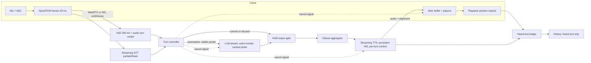

# Cascaded STT→LLM→TTS pipelines: state of the art, frameworks and latency engineering

**Research date:** 2026-10-20. **Scope:** What best-in-class cascaded (STT → LLM → TTS) realtime voice agents achieve and how it was measured; the principles, frameworks and platforms behind those numbers; research on speculative generation; a stage-by-stage comparison with the Magic Worlds call pipeline (browser → magic-worlds-api BFF → api.magic_llm → provider, Groq Whisper STT, ElevenLabs/Fish TTS); build vs adopt; CAS- recommendations. Component detail lives in [05_turn_taking_and_interruptions.md](05_turn_taking_and_interruptions.md), [06_speech_to_text.md](06_speech_to_text.md), [07_llm_in_the_voice_loop.md](07_llm_in_the_voice_loop.md), [08_text_to_speech.md](08_text_to_speech.md), [09_transport_and_client_audio.md](09_transport_and_client_audio.md) and [11_speech_to_speech_and_omni_models.md](11_speech_to_speech_and_omni_models.md).

## Summary

- **Best-in-class cascades measure about 0.75–1.05 s TTFA on cloud APIs and about 1.2–1.3 s full V2V p50** once endpointing and the media path are included (Daily reference 1,293 ms; r01 synthesis about 1,230 ms, or 0.8–0.9 s with speculation). Everything co-located on GPUs reaches about 0.5 s, and a managed, internally cascaded product about 0.6 s (Eleven Realtime, vendor-reported). The strongest independent measurement (755 ms TTFA, Salesforce) starts at the transcript; most vendor numbers omit endpointing or the client network; tails are where cascades fail (one documented call: 800 ms median, 2,500 ms p99).
- **Magic Worlds takes about 3.2–4.2 s from speech end to first audible reply** (EL lane, moderation off; 3.6–4.7 s at STT p95; INFERENCE from the reconciled budget; one documented sample about 5.5 s). About 80% sits in three serial stages: the fixed 550 ms hang-over, C02 (E2E-LATENCY-TRACE-02); batch upload plus batch STT, C01 (FE-CAPTURE-03); and the LLM hop, about 1.58 s to first text, C08 (BE-LLM-02) and C09 (BE-LLM-03).
- **The largest controllable cost is the api.magic_llm durable pipeline:** 874 ms p50 (747–1,311) of commits before the provider is called, every turn (GAP-TOPOLOGY-RTT-MEASUREMENTS-04). It exceeds the STT p50, and no framework adoption removes it.
- **Magic Worlds already follows several best practices**: sentence streaming into TTS, EL socket prewarm during STT, TTS context opened in parallel with the LLM, playback-gated flush-ahead, heard-prefix truncation, working prefix caching. It lacks streaming capture and STT, a turn model, held speculation, pooled connections, one cancel primitive and per-turn latency attribution.
- **Frameworks:** Pipecat (BSD-2, v1.13.0) and LiveKit Agents (Apache-2.0, 1.8.8) are the reference implementations; TEN is viable but Agora-centric; Vocode is dormant. Vapi, Retell and Bland are telephony-first and wrap or replace the agent graph. ElevenLabs Speech Engine and the Deepgram Voice Agent API are managed cascades that keep a bring-your-own LLM; Eleven Realtime has the latency but no custom LLM.
- **Build vs adopt:** keep the custom orchestrator and borrow eight framework patterns. Run a timeboxed Pipecat worker spike behind the same client contract only after per-turn measurement (CAS-01) and the api.magic_llm fast path (CAS-08) exist; otherwise it measures our backend, not the framework.
- **Expected outcome [est]:** P0 and P1 work with batch STT kept brings the EL lane to about 2.2–2.5 s p50 (about 2.2 s with held speculation, about 2.5 s without; §8). The industry bar of 1.5 s or less needs P2: streaming uplink and STT, a turn model, speculation over partials.

Labels: **FACT** = code or measured data in the evidence; **INFERENCE** = reasoned from facts; **UNKNOWN** = not established; **[est]** = arithmetic from cited inputs. Vendor numbers carry (vendor-reported) or (unverified) as the fact-check notes direct.

---

## 1. How to read latency numbers

Most disagreement about "how fast" a voice agent is comes from which interval is being measured. The evidence uses these terms ([r08](evidence/research/r08-eval-observability.md), [r01](evidence/research/r01-cascaded-architecture.md)):

| Term | Interval | Who reports it this way |
|---|---|---|
| **V2V / mouth-to-ear** | From the end of the user's last voiced sample to the first audible reply sample, on the user endpoint's clock | Daily guide; the IETF draft `draft-nygate-ippm-mrl-00` ([IETF, 2026-09-07](https://datatracker.ietf.org/doc/html/draft-nygate-ippm-mrl-00)), an individual draft that has not been adopted |
| **TTFA** | From a pipeline-internal start (often the STT final) to the first TTS audio byte | Salesforce tutorial; Eleven Realtime landing page |
| **TTFT / TTFAT** | From the LLM request to the first token, or to the first *answer* token after any reasoning | aiewf-eval; provider docs |
| **EOU delay** | From the end of speech to the endpoint decision | LiveKit metrics (`end_of_turn_delay`) |
| **Server-measured "latency"** | From the user-stop timestamp at the server to the start of the agent response at the server | Retell ([docs](https://docs.retellai.com/reliability/check-estimated-latency.md), retrieved 2026-10-20). Vapi's dashboard total leaves out endpointing and transport ([docs](https://docs.vapi.ai/customization/voice-pipeline-configuration.md), retrieved 2026-10-20) |

Per [r08](evidence/research/r08-eval-observability.md): report p50/p95/p99 of per-turn V2V totals (never averages or sums of component medians), report the first turn separately, and track within-call jitter.

Magic Worlds today cannot produce V2V. The client's first-audible mark is a `performance.mark` with no reader, there is no metrics exporter, and TTFT is never persisted (C13 (BE-OBSERVABILITY-SAFETY-COST-05), C59 (BE-OBSERVABILITY-SAFETY-COST-08), GAP-REAL-DEV-CALL-FORENSICS-07; FACT). Every Magic Worlds total in this document is therefore a reconstruction ([gap-finding-reconciliation §7](evidence/audit/gap-finding-reconciliation.md)).

## 2. What best-in-class achieves

### 2.1 Published and measured figures

| Source (date) | Measured what | p50 | Tail | Boundary and caveats | Label |
|---|---|---|---|---|---|
| Salesforce AI Research, [arXiv 2603.05413v2](https://arxiv.org/abs/2603.05413v2) (2026-03-17) | Streaming TTFA, self-hosted Qwen2.5-7B on vLLM/H200, Deepgram STT, ElevenLabs TTS | **755 ms** (LLM 296 + sentence detection 143 + TTS 316) | Cold-start TTFT max 4,327 ms (about 13× warm) | The decomposition starts at the transcript. STT final was separately 337 ms p50 (402 ms with cloud GPT-4.1-mini). Overlap beat the 947/958 ms serial estimates by about 200 ms | Independent, measured |
| Pipecat v1.9.0 `LatencyBreakdown` example ([release](https://github.com/pipecat-ai/pipecat/releases/tag/v1.9.0), 2026-09-11) | User stop to bot speech, by contribution | **1.044 s** (VAD stop 0.200, Deepgram 0.125, OpenAI LLM 0.336, turn completion 0.024, Cartesia TTS 0.359) | — | One example. Excludes the client media path | Vendor-reported |
| Daily "Voice AI & Voice Agents" guide ([site](https://voiceaiandvoiceagents.com/), updated June 2026) | Full round trip, macOS client over WebRTC | **1,293 ms**, of which about 200 ms is media path. About 500 ms when all models share one GPU cluster | — | Illustrative. Sets 1,500 ms as the bar not to cross | Vendor-reported |
| Modal + Pipecat, open weights (Parakeet / Qwen3-4B / Kokoro) ([blog](https://modal.com/blog/low-latency-voice-bot), 2025-11-04) | V2V with client and GPUs in the same region | **about 1 s** median | — | Segmented STT beat the open-weights streaming STT they tried | Vendor/independent |
| LiveKit community trace ([thread](https://community.livekit.io/t/eot-value-leads-to-around-30-of-e2e-latency-tried-reducing-min-max-endpointint-in-turn-delay-plugin-but-no-luck/1450), 2026) | Untuned production deployment | **about 1.83 s** (EOU 0.59, STT 0.53, TTFT 0.85, TTS 0.38) | — | Endpointing is about 30% of the total | Anecdotal |
| Retell ([docs](https://docs.retellai.com/reliability/check-estimated-latency.md), retrieved 2026-10-20) | Server-side user stop to response start | "as low as 600 ms". The docs' example call: 800 ms median | **2,500 ms p99** in that example | Excludes the client network | Vendor-reported |
| Twilio ([blog](https://www.twilio.com/en-us/blog/developers/best-practices/guide-core-latency-ai-voice-agents), 2025-11-17) | ConversationRelay internal; mouth-to-ear target | Internal **491 ms**; target 1,115 ms | Internal p95 **713 ms**; target upper bound 1,400 ms | Internal figure excludes the LLM you bring | Vendor-reported |
| Eleven Realtime v1 ([r93](evidence/research/r93-gap-g3-s2s-byo-llm-clone-compat.md), fetched 2026-10-20) | TTFA, average on Big Bench Audio (credited to Artificial Analysis) | **570 ms** Max / **620 ms** Mini | — | Internally cascaded: the vendor FAQ says "not fused". No custom LLM | Vendor-reported |
| Bland ([docs index](https://docs.bland.ai/llms.txt), retrieved 2026-10-20) | Platform claim | "sub-400 ms" | — | No methodology | (unverified) |

Quality bands: Daily treats 1,500 ms V2V as the bar not to cross and 500 ms as the human norm. Hamming's January 2026 TTFA bands (under 300 excellent, 300–800 good, 800–1,500 acceptable, over 1,500 breakdown) disagree with its own later post, so treat them as rough ([r08](evidence/research/r08-eval-observability.md)). Voice-Light's 758 ms median with speculation is in §5.

### 2.2 A synthesized best-in-class budget

[r01 §3.2](evidence/research/r01-cascaded-architecture.md) builds a p50 budget [est] from the sources above:

| Stage | Aggressive (ms) | Typical good (ms) | What it takes |
|---|---|---|---|
| Capture, encode, uplink, jitter | 60 | 100 | WebRTC/Opus, nearby edge |
| Endpointing (VAD + turn model) | 150 | 250 | 200 ms VAD trigger plus an audio turn model |
| STT finalization after end of speech | 50 | 150 | Streaming partials, or a warm fast batch STT on a short segment |
| LLM TTFAT | 150 | 400 | Small non-reasoning model, cached prefix, co-located, warm connection |
| First-clause aggregation | 20 | 80 | Flush at the first clause, not the full sentence |
| TTS TTFB | 75 | 150 | Flash/turbo-class streaming TTS on a persistent WebSocket |
| Downlink, jitter, playout | 50 | 100 | Small jitter buffer; PCM/Opus rather than a container that needs prebuffering |
| **Total V2V** | **about 555** | **about 1,230**, or about 800–900 with speculation overlapping endpointing | |

Conclusions for planning:
- **About 1.2 s p50 is the realistic target for a cloud-API cascade without speculation, and about 0.8–0.9 s with it** [est].
- The LLM line depends on the model. [r94 §3.4](evidence/research/r94-gap-g4-contradictions-reconcile.md) gives a planning rule [est]: mainstream hosted APIs with thinking off and a cached 3–8k prefix land at about 0.45–0.8 s p50 and 0.8–1.4 s p95. Fast silicon or dedicated open models land at about 0.25–0.65 s p50.
- The archived Groq "98 ms" aiewf row must not be used for planning (r94 errata).

## 3. Reference architecture

A best-in-class cascade is a set of streaming stages connected by queues, with three supporting services:
- a turn-taking controller that owns endpointing and barge-in;
- a cancel bus that every stage obeys;
- a heard-text ledger that decides what enters history.

Magic Worlds differs structurally in four places (FACT, details in §8): audio leaves the client only after the endpoint, as one WAV per utterance; STT is batch; the LLM call passes through a durable-execution service; cancellation is several per-stage mechanisms rather than one signal. The turn lifecycle is drawn in [02_turn_lifecycle_and_latency.md](02_turn_lifecycle_and_latency.md).

## 4. The principles

Each principle gives the practice, the evidence, where Magic Worlds stands, and canonical ids from [03_audit_findings.md](03_audit_findings.md).

### 4.1 Stream every stage

**Practice.** Audio frames flow to the server continuously, STT emits partials and finals, the LLM streams tokens, TTS streams over a persistent socket, and the client plays frames as they arrive. Daily recommends WebRTC for client media and WebSocket only between servers ([r01 §4.6](evidence/research/r01-cascaded-architecture.md)).

**Magic Worlds.** The LLM and downlink stream; the uplink and STT do not (FACT). The client POSTs a 16 kHz PCM16 WAV per utterance as multipart to `/character-chats/{id}/voice-segments` (`magic-worlds-api/src/routes/user/route_voice_call.py:1130`), and Groq whisper-large-v3 transcribes it whole: C01 (FE-CAPTURE-03, BE-ROUTE-TRANSPORT-01), ranked first among the high issues ([reconciliation §3.1](evidence/audit/gap-finding-reconciliation.md)). The downlink is base64 MP3 in JSON text frames, C76 (BE-ROUTE-TRANSPORT-18); the EL call lane encodes `mp3_44100_64` (`magic-worlds-api/src/services/speech/capabilities.py:65,159`).

### 4.2 Overlap stages

**Practice.** No stage waits for the previous one to finish: the LLM starts on the final (or a stable partial), TTS starts on the first clause, and connections open while upstream work runs. In the Salesforce measurement overlap beat the serial estimate by about 200 ms.

**Magic Worlds.** The output side overlaps well (FACT, [e2e §11](evidence/audit/e2e-latency-trace.md)): the EL socket and moderation are warmed during STT (`magic-worlds-api/src/services/voice_orchestration/engine.py:2043-2044`), the TTS context opens in parallel with the LLM, and sentence N+1 is moderated while N plays (only sentence 1 is serial, K07). The input side is fully serial: hang-over → upload → STT → about 13–15 BFF DB round trips with STT billing and admission (about 60–100 ms p50 DB tax, GAP-TOPOLOGY-RTT-MEASUREMENTS-03) → api.magic_llm commits → provider, C19 (BE-ENGINE-TURNTAKING-03). `transcript_final` reaches the client only after admission, C64 (BE-STT-11), and each LLM delta waits for the UI WebSocket send, C75 (BE-LLM-20, low).

### 4.3 Never wait for full sentences

**Practice.** Start TTS at the first clause once enough words exist. ElevenLabs Agents start at "enough words and a comma"; the Text-to-Dialogue WebSocket uses a threshold of about 40 characters or 8 words with `flush: true` as the escape; the stream-input default `chunk_length_schedule` [120,160,250,290] is a first-chunk trap without a flush ([r01 §4.5](evidence/research/r01-cascaded-architecture.md), fact-check row 10). Later chunks can be sentence-sized.

**Magic Worlds.** The SentenceBuffer cuts only on `.`, `!`, `?` and a 160-character soft cap, and its abbreviation list holds `no` and `am`, so "no." and "am." do not end a sentence (`magic-worlds-api/src/services/voice_orchestration/sentence_buffer.py:11-19`; C17 (E2E-LATENCY-TRACE-06)). The budget allows 200–600 ms for the first sentence (INFERENCE) against 20–80 ms for a first clause.

### 4.4 Speculative or preemptive generation with held output

**Practice.** Start the LLM before the turn is confirmed, hold its output, release on commit, discard if the transcript changes ([r01 §4.8](evidence/research/r01-cascaded-architecture.md), [r05 §8](evidence/research/r05-llm-for-voice.md)):

| Implementation | Trigger | Hold / discard rule | Reported effect | Default |
|---|---|---|---|---|
| LiveKit preemptive generation | STT preflight or stable partial | Discarded if context or tools change; skipped above `max_speech_duration` 10 s; `max_retries` 3 | "doesn't always reduce latency" (docs) | On; `preemptive_tts` off |
| Pipecat 1.9 eager end of turn | Eager EOT event | Held; discarded when the final fails NormalizedMatch | — | Opt-in |
| Deepgram Flux EagerEndOfTurn ([docs](https://developers.deepgram.com/docs/flux/voice-agent-eager-eot.md), retrieved 2026-10-20) | Eager EOT, TurnResumed cancels | App holds | "the last 100–200 ms"; +50–70% LLM calls (vendor-reported). Telnyx: -150 ms median, -350 ms top 5% ([notes](https://telnyx.com/release-notes/automatic-eager-end-of-turn-deepgram-flux)) | Opt-in |
| ElevenLabs `speculative_turn` | Silence before full confidence | Managed | "May increase LLM costs" | Off |

Design rules ([r05 §8](evidence/research/r05-llm-for-voice.md)): speculate on the LLM only; key on a normalized transcript hash; never persist or bill a speculative turn; cap retries; skip long utterances; rely on prefix caching.

**Magic Worlds.** No speculation (FACT), and batch STT gives no partials. The form that fits batch STT (INFERENCE, r05): cut a provisional segment at about 200–300 ms of silence, fire STT and the LLM with output held, confirm at 550 ms, and discard and merge if the user resumes. The server already merges a superseded fragment with its continuation while the fragment's user message is not yet persisted (`magic-worlds-api/src/services/voice_orchestration/engine.py:2075-2088`; the trade-off is described in the comment at `src/features/call/components/CallScreen.tsx:111-113`), so speculation can reuse that path.

### 4.5 Prewarm and pool connections

**Practice.** One persistent keep-alive connection per provider per worker or session, warmed at session start, refreshed before idle expiry, never a TLS handshake on the turn path ([r01 §4.9](evidence/research/r01-cascaded-architecture.md)). Cold start inflated TTFT about 13× in the Salesforce data.

**Magic Worlds.** Partial, C09 (BE-LLM-03, BE-STT-04; high in the register, re-rated from the reconciliation verifier's medium on the measured tails). FACT ([gap-topology](evidence/audit/gap-topology-rtt-measurements.md)): the BFF builds `CallbotExecutionService` without a client (`magic-worlds-api/src/services/voice_orchestration/engine.py:3792-3795`), so each stream opens a new `httpx.AsyncClient`; magic-llm opens a new HTTP session per provider call (the default `AsyncHttpClient` on the live path; the private client, which also disables the DNS cache, only on recovery and custom-provider BYOK; see [07 §2.5](07_llm_in_the_voice_loop.md)); the Groq client is per process (`magic-worlds-api/src/services/voice_orchestration/stt_groq_client.py:139-145`) but httpx's 5 s keep-alive is shorter than the 10–31 s turn gap, and STT is never prewarmed. Result: about +165 ms p50 of cold TLS and 0.5–1.5 s stalls in about 1 turn in 3 on the dev network (GAP-TOPOLOGY-RTT-MEASUREMENTS-02, high). Provider edges hold idle connections for at least 125 s, so longer keep-alives would work.

### 4.6 Co-locate regions

**Practice.** Worker, STT, LLM gateway and TTS in one region near the media edge; each cross-region hop taxes every turn (r01 anti-pattern 8).

**Magic Worlds.** UNKNOWN for production: no repo defines a proxy, TLS termination or HTTP/2, and provider regions are not recorded ([gap-topology §3.2](evidence/audit/gap-topology-rtt-measurements.md)). Dev drift inflates dev numbers: `--reload` loses TCP_NODELAY (about 41 ms per reused request, GAP-TOPOLOGY-RTT-MEASUREMENTS-01) and api.magic_llm runs with `SSE_BUFFER_INTERVAL_MS=300`.

### 4.7 One cancel signal that every stage obeys

**Practice.** One per-turn cancellation primitive reaches playback, TTS, the LLM, tools and speculation: Pipecat SystemFrames, LiveKit speech handles, Cloudflare `context.signal`. Barge-in policy sits on top: pause-then-confirm, false-interruption resume (LiveKit `false_interruption_timeout` 2.0 s), backchannel filters.

**Magic Worlds.** The client cancels locally and sends `voice_barge_in{turn_id, played_ms}`; the server closes the EL context and cancels the turn task. Cancel reaches the provider socket; whether the provider stops is UNKNOWN ([be-llm §10](evidence/audit/be-llm.md)). The policy is immediate and irrevocable, C15 (E2E-LATENCY-TRACE-08): 500 ms of voiced energy (`src/features/interaction/hooks/useVoiceCallController.ts:137,706`), suppressed for the first 3 s of the first reply (`src/features/interaction/hooks/useVoiceCallController.ts:143,685`) and with AEC off, where uploads still supersede the reply, C05 (FE-CAPTURE-01). A segment after `voice_turn_end` cancels nothing, C24 (BE-ENGINE-TURNTAKING-01). Context close, task cancel, supersede and truncation coexist without one owning state machine (INFERENCE).

### 4.8 Commit only heard text

**Practice.** A heard-text ledger from TTS alignment and playback position decides history: Twilio `interrupt` returns `utteranceUntilInterrupt`/`durationUntilInterruptMs`, Pipecat syncs `TTSTextFrame`s to playback, Ultravox aligns by character, Voice-Light treats browser playback acks as history. Signal the interruption in the late dynamic block, not inside the assistant text ([r05 §10](evidence/research/r05-llm-for-voice.md)).

**Magic Worlds.** A genuine strength: `played_ms` plus the character or word ledger truncates the stored reply (FACT). Gaps: EL truncation is sentence-granular and over-keeps, C25 (BE-TTS-08), GAP-CALL-AUDIO-ASSETS-AND-MP3-TIMELINE-14; history has no per-turn interruption note (GAP-REAL-CALL-OVERLAP-HISTORY-BILLING-05); the Fish word ledger crashes on turns needing markup or emoji cleaning (GAP-REAL-DEV-CALL-FORENSICS-01, high).

### 4.9 Keep the first turn fast

**Practice.** Speak first with a pre-rendered greeting, capture audio before the agent is ready (LiveKit instant connect), pre-generate constrained lines per character, warm every socket before the user can speak, and report the first turn separately.

**Magic Worlds.** No greeting or ringback, C53 (FE-UI-07); serial call setup, C77 (FE-PLAYBACK-TRANSPORT-20, low); the first user turn pays every cold connection (FACT). Replies are also long for voice: delivered reply audio p50 17.6 s, 12 of 17 replies interrupted (GAP-REAL-DEV-CALL-FORENSICS-08), 34% of delivered audio unheard (GAP-CALL-AUDIO-ASSETS-AND-MP3-TIMELINE-04). FACT, small n.

## 5. Research techniques

| Work | Idea | Reported result | Boundary / caveat | Fit for Magic Worlds |
|---|---|---|---|---|
| **PredGen** ([arXiv 2506.15556](https://arxiv.org/abs/2506.15556), 2025-06-18, rev. 2025-10-08) | Input-time speculative decoding: generate candidate responses while the user is still speaking | About 2× lower latency | Simulated | Needs streaming partials. Not applicable until STT streams |
| **Endpoint Anticipation** ([arXiv 2606.13450](https://arxiv.org/abs/2606.13450), June 2026, Interspeech 2026) | A speech model forecasts the end of turn up to 2.56 s ahead; LLM and TTS run on partial context and are released on confirmation | -505 ms average with Unmute; +28.4% speculative compute | Research system | P3 experiment after held speculation exists |
| **RelayS2S** ([arXiv 2603.23346v2](https://arxiv.org/abs/2603.23346v2), 2026-09-09, EMNLP 2026 Findings) | A duplex S2S model drafts a short spoken prefix; a verifier commits it; the cascade continues | Synthetic P90 first chunk 1,006 → 81 ms. Real voice P90 823 → 655 ms, average -479 ms, 99% of cascade text quality | Fallback 8.1% synthetic / 29.3% real; inappropriate prefixes about 4.8% / 17.5%. **Excludes turn detection, TTS and network.** Back end GPT-4.1, now deprecated | Conflicts with character voice: the prefix comes from another model's voice. P3 at most |
| **Voice-Light** ([arXiv 2609.20995](https://arxiv.org/abs/2609.20995), 2026-09-17) | Private speculative candidates, invalidated by any lexical change; reversible playback; browser acks are the history | 758 ms median final-VAD to first server audio | 36 turns, case study; trigger detail (unverified) | The history model matches what Magic Worlds already does with `played_ms` |
| **Talker-Reasoner** ([arXiv 2410.08328](https://arxiv.org/abs/2410.08328), 2024, possibly stale) and **KAME** ([arXiv 2510.02327](https://arxiv.org/abs/2510.02327), ICASSP 2026) | A fast talker converses; a slow reasoner plans and updates state, or its text is injected into the talker in real time | KAME approaches cascade correctness at front-end latency | Foundational; no voice-latency numbers in the evidence | A "thinker" can update a scene or memory block after each turn without breaking the cache prefix ([r05 §9.3](evidence/research/r05-llm-for-voice.md)) |
| **Speculative tool execution** ([arXiv 2610.07641](https://arxiv.org/abs/2610.07641), Oct 2026) | Predict tool calls from partial ASR and run them early | Median time to first audio 5.79 → 4.60 s | On-device | The call graph has no tools today |

Main reading (INFERENCE):
- The research frontier is about hiding endpointing and LLM latency behind speculation.
- Every technique assumes the system already streams audio and text, and already has a cheap cancel.
- The two published "real" gains are about 0.5 s (RelayS2S -479 ms on average, Endpoint Anticipation -505 ms). Each is measured on a pipeline that is already sub-second.
- Magic Worlds would gain more from removing its serial waits first (§8).

## 6. Frameworks and platforms

Sources: [r01 §5](evidence/research/r01-cascaded-architecture.md), [r10 §2](evidence/research/r10-cost-scaling-ops.md), [r93](evidence/research/r93-gap-g3-s2s-byo-llm-clone-compat.md), [r94](evidence/research/r94-gap-g4-contradictions-reconcile.md), retrieved 2026-10-20 unless dated. "Not verified" means no primary price in the evidence. Fit judges whether the option keeps the server-owned `callbot_chat.v2` graph in api.magic_llm and user-created EL and Fish character voices.

| Name | Architecture traits | Latency claims | Price | Fit for Magic Worlds |
|---|---|---|---|---|
| **Pipecat** (Daily; OSS Python, BSD-2; v1.13.0, 2026-10-19; about 16.7k stars) | Frame pipeline. SystemFrame interruptions. Smart Turn v3.2 (about 8M params, 23 languages including Spanish, 10–100 ms on CPU). LLM turn-completion tagging. Eager EOT with held responses. `UserBotLatencyObserver` contributions. 100+ service integrations. WebRTC, WebSocket and telephony transports | Example breakdown 1.044 s (v1.9.0, vendor-reported). About 500 ms in one GPU cluster (Daily guide) | OSS free. Pipecat Cloud $0.01 per active session-minute; Daily WebRTC $0.001/min ([pricing](https://www.daily.co/pricing/pipecat-cloud)) | **High as a pattern source and spike candidate.** A custom LLM service can call api.magic_llm. ElevenLabs and Fish have services. Python fits the backend |
| **LiveKit Agents** (OSS Python/Node, Apache-2.0; 1.8.8, 2026-10-15; about 14.9k stars) | SFU-based WebRTC and SIP. Audio TurnDetector (v1 Cloud / v1-mini self-hosted, 14 languages). Endpointing 0.3/2.5 s with the audio detector (the default), 0.5/3.0 s otherwise. Preemptive generation on by default. Adaptive interruption and false-interruption resume. Instant connect. Async tools. OTel traces. `FallbackAdapter` (no TTS fallback once audio is pushed) | No headline figure. Community untuned trace 1.83 s (anecdotal) | OSS free. LiveKit Cloud $0.01 per agent-session-minute; WebRTC $0.0004–0.0005/min ([r10](evidence/research/r10-cost-scaling-ops.md)) | **High** if Magic Worlds moves to WebRTC. Adopting it means an SFU (Cloud or self-hosted) and a worker model, a larger change than Pipecat-over-WebSocket |
| **TEN Framework** (Agora; OSS graph runtime; 0.11.73, 2026-09-22) | Graph runtime with extensions. TEN VAD and TEN Turn Detection (">98% accuracy", vendor-reported). Agora RTC, WebSocket, SIP | None in evidence | OSS. The TEN VAD license carries Agora-specific conditions | **Low–medium.** Agora-centric; smaller community; license review needed |
| **Vocode** | OSS Python | n/a | n/a | **None.** Dormant: last push 2024-11-15 |
| **Vapi** | Managed orchestration. Start/stop speaking plans. Pluggable smart endpointing (LiveKit, Vapi, Flux, AssemblyAI). `waitSeconds` default 0.4 s. GPT-Live support | Dashboard total excludes endpointing and transport | Not verified | **Low.** Telephony-first. The agent graph would sit behind a custom-LLM endpoint. Adds a vendor hop |
| **Retell** | Managed. Custom LLM over WebSocket with `response_id` discard semantics. Per-call P50–P99. Fast tier | "as low as 600 ms", server-measured; example 800 ms median / 2,500 ms p99 (vendor-reported) | Not verified | **Low.** Same as Vapi. Its `response_id` discard contract is worth copying |
| **Bland** | Managed; owns telephony, STT, LLM and TTS; self-hosted option | "sub-400 ms" (unverified, no methodology) | Not verified | **None.** Replaces the LLM and the voices |
| **ElevenLabs Agents** | Managed cascade: proprietary `turn_v3`, eagerness modes, `speculative_turn` (off by default), first audio at "enough words and a comma", soft-timeout fillers (3.0 s recommended), LLM cascading, custom LLM | No published end-to-end figure in evidence | Not verified in this set | **Medium.** Custom LLM is possible, but the agent owns the loop |
| **ElevenLabs Speech Engine** | Managed cascade. ElevenLabs STT, turn-taking and TTS; **your server provides the LLM** over a WebSocket to a public `wss` endpoint. `tts.voice_id` accepts your clones; default `eleven_v4_turbo`. `turn_v3`, `speculative_turn`, `cascade_timeout_seconds` 2–15 (default 4). `send_response` speaks exact text | **No published latency** | $0.08/min plus your LLM; conversations capped at 40 min ([r93](evidence/research/r93-gap-g3-s2s-byo-llm-clone-compat.md)) | **Medium–high, P3 bake-off.** Keeps the agent graph and EL clones. Loses Fish voices and our own turn-taking. Inverted connectivity; 40-minute cap |
| **Eleven Realtime v1 Mini/Max** | Managed and internally cascaded ("not fused"). WebSocket only. Rolling out per workspace | 570 ms Max / 620 ms Mini TTFA (vendor-reported) | $0.08/connected min plus tokens: about $0.084/min Mini, about $0.102/min Max (vendor estimates) | **Low.** No custom LLM, so it cannot run `callbot_chat.v2`. Useful as proof that a tuned cascade reaches about 0.6 s |
| **Deepgram Voice Agent API** | One WebSocket for STT, LLM and TTS. Flux turn model with EagerEndOfTurn. BYO LLM and TTS. Billed on connection time | No headline figure in evidence | $0.075/min standard; BYO-LLM $0.065; BYO LLM+TTS $0.050 ([pricing](https://deepgram.com/pricing)) | **Medium.** With BYO LLM and TTS it is in effect managed streaming STT plus turn-taking. Compare against doc 06 options |
| **Twilio ConversationRelay** | Managed STT/TTS around your LLM WebSocket. Token streaming (`last`, `interruptible`, `preemptible`). `interrupt` returns heard text. Co-located with media edges | Internal p50 491 / p95 713 ms (vendor-reported, 2025-11-17) | Not verified | **Low.** PSTN/SIP-oriented. Its heard-text contract is the pattern to copy |
| **Cloudflare `@cloudflare/voice`** | Agents SDK mixin on Durable Objects. **Experimental** (2026-04-15). WebSocket-native: 16 kHz PCM up, MP3 per sentence down. `context.signal` abort on interrupt | None published | Workers pricing; Realtime SFU $0.05/GB egress ([r06](evidence/research/r06-transport-client-audio.md)) | **Low as a platform.** Its transport shape is close to ours, which confirms the shape is viable. Experimental |
| **Ultravox** (Inworld since 2026-09-30) | Half-cascade: audio-in LLM, no ASR, external streaming TTS (BYO ElevenLabs voice). Hosted models only; MIT open weights | 0.864 s median in a Pipecat-run benchmark (2026-01; vendor-published, not re-verified) | $0.05/min including LLM, plus your TTS | **Low.** Replaces the agent graph. Ownership churn |
| **OpenAI Agents SDK VoicePipeline** (chained mode) | STT → workflow → TTS with `AudioInput`/`StreamedAudioInput` | None | SDK free; model costs | **Low.** "No built-in interruption handling" for streamed input ([docs](https://openai.github.io/openai-agents-python/voice/pipeline/)). Less than we already have |

Adjacent managed cascades: Inworld Realtime API (STT + chosen LLM + TTS; BYO endpoint and clones unverified), AssemblyAI Voice Agent API ($0.075/min), Cartesia agents ($0.06/min) ([r93 §7](evidence/research/r93-gap-g3-s2s-byo-llm-clone-compat.md), [r10](evidence/research/r10-cost-scaling-ops.md)).

### 6.1 Patterns to copy regardless of framework

From [r01 §5](evidence/research/r01-cascaded-architecture.md), mapped to Magic Worlds status:

| # | Pattern | Magic Worlds today | CAS |
|---|---|---|---|
| 1 | One cancel primitive that every stage obeys | Several per-stage mechanisms; race after `voice_turn_end` (C24) | CAS-15 |
| 2 | A heard-text ledger from alignment and playback | Present; sentence-granular on EL (C25) | CAS-15 |
| 3 | Endpointing separate from STT, as a pluggable chain: VAD → turn model → LLM tag → max timeout | Fixed 550 ms energy silence only (C02, C03) | CAS-10 |
| 4 | Per-turn latency attribution | Log lines and in-process histograms; no client V2V (C13) | CAS-01 |
| 5 | Held speculation | None | CAS-09 |
| 6 | Persistent per-session provider sockets; one TTS context per turn | EL yes; LLM and STT hops no (C09) | CAS-02 |
| 7 | Fallbacks, fillers, never an unclosed turn | No LLM deadline or filler (C07); one TTS reconnect (C14) | CAS-06, CAS-11, CAS-13 |
| 8 | Scripted evals with latency budgets in CI | None for calls ([12_observability_evaluation_and_testing.md](12_observability_evaluation_and_testing.md)) | CAS-01 |

## 7. Anti-patterns, and where Magic Worlds stands

The 15 anti-patterns are from [r01 §7](evidence/research/r01-cascaded-architecture.md). The status column is FACT unless marked.

| # | Anti-pattern | Magic Worlds | Evidence |
|---|---|---|---|
| 1 | Serial stages | **Present on the input side.** Hang-over → upload → STT → DB chain → MLLM commits → provider | C01, C19, C08 |
| 2 | Long fixed silence as the only endpointer | **Present.** 550 ms RMS silence (`src/features/call/components/CallScreen.tsx:114`); no turn model; server gate off (`magic-worlds-api/src/services/voice_orchestration/config.py:111`) | C02, C03 |
| 3 | Waiting for a full sentence or a large buffer before TTS | **Present.** `.!?` plus a 160-character soft cap | C17 |
| 4 | Reasoning models or prompts over 8k on the loop | **Partly.** No reasoning guardrail; output cap 1,536 tokens (`magic-worlds-api/src/services/llm_features.py:66-68`); input budget 32,768 tokens. Prefix caching works (1,694–1,869 cached tokens in dev) | C37; [forensics](evidence/audit/gap-real-dev-call-forensics.md) |
| 5 | Breaking the cache prefix | **Conditional.** Keyword lorebooks change the system prefix when the activated set changes; token-budget trimming shifts it once history exceeds 32k tokens | C35, C34 |
| 6 | Synchronous moderation before generation | **Latent.** A 300 ms fail-closed gate (`magic-worlds-api/src/services/speech/moderation.py:73`) on sentence 1 only; off in dev. "Required" with no classifier refuses calls up front | C04 |
| 7 | New connection per turn | **Present** on BFF→MLLM, MLLM→provider and Groq after 5 s idle | C09, GAP-TOPOLOGY-RTT-MEASUREMENTS-02 |
| 8 | Cross-region hops | **UNKNOWN** for production | §4.6 |
| 9 | Buffering processors | **Present.** Durable commits before the provider call (874 ms p50); lock-step UI send per delta; dev `SSE_BUFFER_INTERVAL_MS=300` | C08, C75 |
| 10 | Browser media over WebSocket/TCP on lossy mobile | **Present.** Downlink is base64 MP3 in JSON over WS; uplink is an HTTP POST | C76; [09](09_transport_and_client_audio.md) |
| 11 | Container formats that need client prebuffering | **Present.** MSE per turn; fallback paths stall up to 2 s | C48 |
| 12 | Uncancellable stages | **Partly.** Cancel reaches the provider socket; provider stop UNKNOWN; post-end supersede race | C24; [be-llm §10](evidence/audit/be-llm.md) |
| 13 | Treating a dashboard total as user experience | **Related risk.** The only total is an in-process server metric (`user_stop_ttfb_ms`); it cannot see client playout or the leading silence in each reply (EL 71–86 ms, Fish 92–153 ms in the Oct-20 assets, about 37–53 ms of it codec delay) | C13, GAP-CALL-AUDIO-ASSETS-AND-MP3-TIMELINE-06 |
| 14 | Optimizing p50 only | **Risk.** magic-llm makes up to 3 attempts (default `retries=3`) with no TTFT deadline (worst case about 92 s of silence); STT 30 s single attempt under `intake_lock` | C07, C06 |
| 15 | Blocking work with no filler | **Present.** No filler, greeting or soft timeout | C07, C53 |

## 8. Stage-by-stage comparison with Magic Worlds

The Magic Worlds column covers the EL lane with moderation off, as in dev. Stage times come from the reconciled budget ([reconciliation §7](evidence/audit/gap-finding-reconciliation.md)); its labels apply. The best-in-class column uses the "typical good" figures from §2.2.

| Stage | Magic Worlds today | Best-in-class (typical) | Gap and cause | Findings |
|---|---|---|---|---|
| Endpointing | 550 ms fixed RMS silence; speech start after 250 ms (500 ms while the character is audible); 300 ms pre-roll; no neural VAD. FACT | About 250 ms (VAD plus audio turn model); LiveKit 0.3 s minimum and 2.5 s maximum | About 300 ms, plus fragment turns on every pause over 550 ms | C02 (E2E-LATENCY-TRACE-02), C03 (FE-CAPTURE-02) |
| Uplink | One WAV per utterance, POSTed after the endpoint: about 20–150 ms (700 ms on a mobile uplink). INFERENCE | Frames streamed during speech: about 100 ms, mostly overlapped | The whole upload is serial | C01 (FE-CAPTURE-03) |
| STT | Groq whisper-large-v3 batch: **526 ms p50 / 1,002 ms p95** (dev, n=23). 30 s single attempt under `intake_lock`. FACT | About 150 ms finalization after end of speech | About 400–850 ms | C01, C06 (BE-STT-02) |
| BFF pre-LLM | About 13–15 serial DB round trips, STT debit, admission: 60–100 ms DB tax p50. `transcript_final` sent after admission | Bookkeeping off the critical path | About 60–150 ms, plus the delayed transcript UI | C19 (BE-ENGINE-TURNTAKING-03), C64 (BE-STT-11) |
| Connections | New httpx client per turn; new aiohttp session per call; Groq keep-alive 5 s: +165 ms p50, stalls of 0.5–1.5 s in about 1 turn in 3 (dev network). FACT | Warm, persistent sockets | About 165 ms p50 plus tail stalls | C09 (BE-LLM-03), GAP-TOPOLOGY-RTT-MEASUREMENTS-02 |
| LLM service overhead | api.magic_llm run start → `llm_start` commit: **874 ms p50** (747–1,311), 19 commits. Post-stream tail 1.0–2.5 s. FACT (dev) | About 0: the worker calls the provider directly | About 0.85 s | C08 (BE-LLM-02), GAP-TOPOLOGY-RTT-MEASUREMENTS-04 |
| LLM TTFAT | Never persisted. The probe measured 1,579 ms to first text for the whole hop. Assigning the remainder after the 874 ms to dispatch plus provider is INFERENCE | 400 ms; hosted thinking-off 0.45–0.8 s p50 | UNKNOWN; no deadline or hedge | C07 (BE-LLM-05), GAP-REAL-DEV-CALL-FORENSICS-07 |
| Text aggregation | `.!?` plus a 160-character cap: 200–600 ms. INFERENCE | 80 ms (first clause) | About 150–500 ms | C17 (E2E-LATENCY-TRACE-06) |
| Moderation | 0 ms in dev; 300 ms fail-closed on sentence 1 when required | Parallel or post-hoc on text | Up to 300 ms at launch | C04 (BE-OBSERVABILITY-SAFETY-COST-01) |
| TTS first audio | EL `eleven_v4_turbo` on the TTD WS, prewarmed: 150–350 ms (one sample 149 ms). Fish `latency: 'balanced'`, 128 kbps, no first-audio watchdog | 150 ms | Small on EL. Fish: one 927 ms sample with fake STT/LLM ([e2e §12](evidence/audit/e2e-latency-trace.md)) | C43 (BE-TTS-11) |
| Downlink and playout | Base64 MP3 in JSON over WS; MSE append 50–150 ms; leading silence (EL 71–86 ms, Fish 92–153 ms; trimmable gain about 50–100 ms) not counted in the first-audio metric | 100 ms; PCM/Opus over WebRTC | About 50–200 ms | C76, C48, GAP-CALL-AUDIO-ASSETS-AND-MP3-TIMELINE-06 |
| Next-turn readiness | Waits for previous-turn cleanup: persistence 1–5 s, supersede waits 0.7–6.4 s. FACT (dev) | None | Seconds on affected turns | C20, GAP-CALL-AUDIO-ASSETS-AND-MP3-TIMELINE-01, GAP-REAL-DEV-CALL-FORENSICS-05 |
| **Total, speech end to first audio** | **About 3.2–4.2 s** (STT p50) / **3.6–4.7 s** (STT p95). INFERENCE | **About 1.2 s** (0.8–0.9 s with speculation) [est] | **About 2–3 s** | |

Using the midpoints of the reconciled ranges, the current turn and an estimated post-P1 turn compare as follows [est]. Times are in ms from speech end.

```mermaid
gantt
  title Speech end to first audio, EL lane (midpoints, ms)
  dateFormat x
  axisFormat %S.%L
  section Today (about 3.7 s)
  Hang-over 550            :t1, 0, 550
  WAV upload and route     :t2, 550, 700
  Groq STT 526             :t3, 700, 1226
  BFF chain and admission  :t4, 1226, 1350
  MLLM commits 874         :t5, 1350, 2224
  Dispatch and provider    :t6, 2224, 2929
  First sentence           :t7, 2929, 3329
  EL first audio           :t8, 3329, 3579
  Downlink and MSE         :t9, 3579, 3700
  section After P0+P1 (about 2.2 s est)
  Provisional cut 250      :p1, 0, 250
  Upload                   :p2, 250, 400
  Groq STT 526             :p3, 400, 926
  BFF lean                 :p4, 926, 986
  MLLM fast path           :p5, 986, 1136
  Provider, warm           :p6, 1136, 1736
  First clause             :p7, 1736, 1886
  EL first audio           :p8, 1886, 2086
  Downlink                 :p9, 2086, 2186
```

How the post-P1 row is built [est]:
- **Hang-over:** a provisional cut at 250 ms starts STT and the LLM speculatively, with the commit still at 550 ms (CAS-09). Without speculation, add about 300 ms, for about 2.5 s.
- **LLM service:** api.magic_llm drops to 150 ms or less before the provider (CAS-08).
- **Provider:** about 600 ms, from the 705 ms probe remainder minus the cold-TLS share (CAS-02).
- **First clause:** 150 ms (CAS-03).
- **Unchanged:** the batch STT stays at 526 ms.

Reaching the 1.2–1.5 s band also needs P2 work: streaming STT finalization of about 100–150 ms instead of the upload plus 526 ms (CAS-14), and a faster provider. Arithmetic: 300 + 150 + 60 + 150 + (450–800) + 100 + 200 + 100 ≈ 1.5–1.9 s; with a 0.25–0.45 s fast-silicon TTFAT, about 1.3–1.5 s [est].

**Strengths to keep** (FACT, [e2e §11](evidence/audit/e2e-latency-trace.md)): EL socket prewarm and per-turn multi-context; flush-ahead gated by playback reports (`magic-worlds-api/src/services/voice_orchestration/call_tts_elevenlabs.py:55-59`); the heard-prefix ledger; idempotent uploads; the 300 ms pre-roll with an adaptive floor; Fish epoch isolation; existing `voice_*` telemetry and the `user_stop_ttfb_ms` metric. Flush-ahead has one weakness: the three "free" sentences (`FLUSH_AHEAD_FREE_SENTENCES=3`) are not bounded by `MAX_AUDIO_AHEAD_MS=8_000`, and audio up to 16.5 s ahead was observed (GAP-CALL-AUDIO-ASSETS-AND-MP3-TIMELINE-04).

**Bitrate note (re-verified in code; it overrides the "128 kbps" sometimes quoted for EL):** the EL call lane encodes **64 kbps** (`STREAM_OUTPUT_FORMAT = "mp3_44100_64"`, `magic-worlds-api/src/services/speech/capabilities.py:65`, used at `:159`); 128 kbps is Fish (`magic-worlds-api/src/services/speech/providers/fish_audio/timestamp_ws.py:212`) and EL narration (`NARRATION_OUTPUT_FORMAT`, `:64`).

## 9. Build vs adopt

| Criterion | A. Keep the custom orchestrator, borrow patterns | B. Pipecat worker behind the same contract | C. LiveKit Agents worker + SFU | D. Managed cascade (Speech Engine) |
|---|---|---|---|---|
| Keeps `callbot_chat.v2` in api.magic_llm | Yes | Yes (custom LLM service) | Yes (custom LLM node) | Yes (your server streams text) |
| Keeps EL and Fish character voices | Yes | Yes, through existing services (Fish alignment to verify) | Yes, through plugins | EL only; Fish dropped |
| Removes C08 (874 ms of MLLM commits) | No; needs CAS-08 | No; needs CAS-08 | No; needs CAS-08 | No; needs CAS-08 |
| Removes C01 (batch STT) | Needs CAS-14 | Yes if paired with streaming STT and audio streaming | Yes (WebRTC plus streaming STT) | Yes |
| Turn model and speculation | Build (Smart Turn v3.2 is OSS) | Built in (Smart Turn, eager EOT) | Built in (TurnDetector, preemptive) | Built in (`turn_v3`, `speculative_turn`) |
| Cancel primitive and heard ledger | Build (CAS-15) | Built in | Built in (LLM-side leak reports exist) | Managed |
| Billing, quotas, moderation, persistence, resume | Existing | Re-wire as frame processors | Re-wire | Partly lost; 40-minute cap |
| Client change | None | None if the `voice_*` WS contract is kept; larger for WebRTC | Large (LiveKit client SDK, SFU) | Inverted connectivity |
| Risk | Rebuilding framework features by hand | A second runtime to operate | New infrastructure | Vendor lock-in; no latency published |

**Recommendation: A now, B as a gated experiment** (INFERENCE).
- **Most of the gap is outside any framework's reach.** The api.magic_llm pre-provider pipeline (about 0.87 s) and the batch uplink plus STT (about 0.7 s at midpoint) live in our services or need a client change. The EL output path already does what a framework would.
- **Borrow the patterns cheaply:** a turn-model chain (Smart Turn v3.2 supports Spanish), held speculation keyed on a transcript hash, one cancel token, a per-turn latency observer, per-stage fallbacks (CAS-01, -09, -10, -13, -15).
- **Run the Pipecat spike (CAS-17) after CAS-01 and CAS-08**, keeping the `voice_*` contract and api.magic_llm, on the same harness as the tuned custom path. Adopt only for a material V2V p50/p95 win or for removing a bug class (C24-style races, the C14 reconnect budget). LiveKit (C) becomes the better candidate if [09_transport_and_client_audio.md](09_transport_and_client_audio.md) chooses WebRTC with an SFU.
- **Treat D as a benchmark, not a migration (CAS-18).** Target architectures are compared in [16_target_architectures.md](16_target_architectures.md).

## 10. Recommendations

P0 = days, no vendor change. P1 = weeks. P2 = a quarter, architectural. P3 = experiment. Impacts are estimates unless marked.

| ID | Pri | What | Why | Expected impact | Effort | Depends on | Validate by |
|---|---|---|---|---|---|---|---|
| **CAS-01** | P0 | Persist one record per turn with every stage timestamp: endpoint, upload received, STT done, admission, MLLM run start, `llm_start`, first token, first sentence, TTS first byte, client first-audible from the playback clock. Report p50/p95/p99, first turn separately | C13 (BE-OBSERVABILITY-SAFETY-COST-05), C59 (BE-OBSERVABILITY-SAFETY-COST-08), GAP-REAL-DEV-CALL-FORENSICS-12. Nothing else can be validated without it | No direct latency gain. Turns every later item into a measured delta | M | — | A loopback probe ([12](12_observability_evaluation_and_testing.md)) agrees with the record within about 50 ms |
| **CAS-02** | P0 | Pool and prewarm every per-turn hop: a shared BFF→MLLM client; a persistent magic-llm session with a DNS cache; Groq keep-alive above the turn gap (provider edges keep at least 125 s) or a ping at speech start; warm STT next to the EL and moderation warms | C09 (BE-LLM-03, high), GAP-TOPOLOGY-RTT-MEASUREMENTS-02/-07, C67 (FE-CAPTURE-11) | About -165 ms p50, and removes 0.5–1.5 s stalls in about 1 turn in 3 (dev measurement; production UNKNOWN) | S | — | CAS-01 connect-time fields; cold-connect count per call near 0 |
| **CAS-03** | P0 | Send the first TTS unit at the first clause boundary (comma, semicolon, dash) once about 8 words or 40 characters exist; use `flush` on EL. Remove `no` and `am` from the abbreviations; add Spanish ones | C17 (E2E-LATENCY-TRACE-06) | -100 to -400 ms to first audio (the stage is 200–600 ms) | S | — | First-sentence-to-TTS delta in CAS-01; listening test for clause prosody |
| **CAS-04** | P0 | Take previous-turn work off the next turn: persist audio assets in a background task; bound `previous.finished.wait()` (`magic-worlds-api/src/services/voice_orchestration/engine.py:2068-2074`); compute the truncation in memory and dispatch the next LLM before the write commits | C20 (BE-ENGINE-TURNTAKING-05), GAP-CALL-AUDIO-ASSETS-AND-MP3-TIMELINE-01, GAP-REAL-DEV-CALL-FORENSICS-05, GAP-REAL-CALL-OVERLAP-HISTORY-BILLING-06 | Removes 1–5 s (persistence) and most of the 0.7–6.4 s supersede waits on affected turns (FACT magnitudes) | M | — | Supersede-wait histogram; history equals the heard prefix |
| **CAS-05** | P0 | Send `transcript_final` right after STT. Move the STT debit and the segment `completed` writes after LLM dispatch (outbox or task). Start admission in parallel with STT where safe | C19 (BE-ENGINE-TURNTAKING-03), C64 (BE-STT-11), GAP-TOPOLOGY-RTT-MEASUREMENTS-03 | -60 to -100 ms p50; the transcript appears earlier | S–M | CAS-01 | STT-done → MLLM-request delta |
| **CAS-06** | P0 | Deadlines on the voice path: STT timeout of a few seconds with one hedged retry; an LLM TTFT deadline (for example the provider's p90) that triggers a filler and one retry; cap magic-llm voice retries at 1; always close the turn in `finally` | C07 (BE-LLM-05), C06 (BE-STT-02) | Tail: worst case drops from about 92 s of silence (LLM) and 30 s (STT) to a few seconds | S | — (filler from CAS-11 once it exists) | Fault injection (stalled Groq, stalled provider) in CI |
| **CAS-07** | P0 | Shorten voice replies: callbot `max_output_tokens` about 150–250 (r05) instead of 1,536 (`magic-worlds-api/src/services/llm_features.py:67`), plus a 1–3 sentence prompt rule. Make the three "free" sentences respect the 8 s ahead cap | C37 (BE-LLM-10), GAP-REAL-DEV-CALL-FORENSICS-08, GAP-CALL-AUDIO-ASSETS-AND-MP3-TIMELINE-04 | Less unheard audio (34% today), lower TTS spend, shorter post-stream tail; first audio unchanged | S | — | Reply-length p50, interrupted share, unheard-audio share |
| **CAS-08** | P1 | Add a voice fast path in api.magic_llm: one admission; no pre-provider checkpoint rewrite; record durable events after the stream starts or asynchronously; keep idempotency through a request key | C08 (BE-LLM-02), GAP-TOPOLOGY-RTT-MEASUREMENTS-04 (critical after verification), GAP-REAL-DEV-CALL-FORENSICS-04/-06 | About -0.7 s p50 (874 ms measured, target 150 ms or less) | M–L | api.magic_llm owners; durability semantics | Run start → `llm_start` p50 in `tb_execution_event` |
| **CAS-09** | P1 | Held speculation on batch STT: a provisional cut at about 250 ms of silence runs STT and the LLM with output held; commit at the endpoint; discard on resume or a transcript-hash change; never persist or bill a speculative turn | r05 §8 adaptation; LiveKit, Pipecat, Deepgram practice | Up to -300 ms on committed turns; extra LLM calls (Deepgram reports +50–70% for eager EOT, vendor-reported) | M | CAS-01, CAS-08 (cheap reruns) | Hit rate, wasted calls, V2V delta |
| **CAS-10** | P1 | Audio turn model plus 250–300 ms silence, with a 2.5 s backstop (Smart Turn v3.2 or LiveKit v1-mini); add a neural VAD. Design is in [05](05_turn_taking_and_interruptions.md) | C02 (E2E-LATENCY-TRACE-02), C03 (FE-CAPTURE-02) | About -250 ms p50 and fewer fragment turns | M | CAS-01 | Premature-cut rate and V2V on a Spanish/English test set |
| **CAS-11** | P1 | A pre-rendered greeting per character and voice. Non-lexical, in-character cues (breath, "mm") when predicted first audio exceeds about 1.2 s; never on the greeting; kept out of history | C53 (FE-UI-07), C07; r05 §9.1 | Perceived first-turn latency near zero; masks tail waits | M | CAS-06 | First-turn V2V; user ratings |
| **CAS-12** | P1 | A call-lane LLM bake-off from the production region (thinking off, cached 3–8k prefix). Prompt layout: static first, volatile last; lorebook kept out of the system prefix | C35 (BE-LLM-08), C34 (BE-LLM-07); r94 §3.4 | Provider TTFAT of 0.45–0.8 s p50 hosted, 0.25–0.65 s fast silicon (r94 planning rule) | M | CAS-01, CAS-02 | TTFAT p50/p95 and cached-token share per candidate |
| **CAS-13** | P1 | Per-stage fallback chains: a second STT provider behind a breaker; an LLM fallback profile; re-open the TTS leg (or fall back) instead of ending voice for the rest of the call after a second socket failure; a Fish first-audio watchdog | C06, C14 (BE-TTS-06), C43 (BE-TTS-11) | Fewer call-ending failures; bounded tails | M | CAS-06 | Chaos tests; failed-turn rate |
| **CAS-14** | P2 | Stream the uplink (frames during speech) and adopt streaming STT with partials; then speculate on stable partials. Choices in [06](06_speech_to_text.md) and [09](09_transport_and_client_audio.md) | C01 (FE-CAPTURE-03, BE-ROUTE-TRANSPORT-01) | -0.5 to -0.9 s (upload plus 526 ms STT replaced by about 100–150 ms of finalization) | L | CAS-01, CAS-10 | V2V p50/p95 against the batch path, A/B |
| **CAS-15** | P2 | One per-turn cancel token and turn state machine owning supersede, barge-in, truncation and speculation. Word-level heard ledger on EL. Pause-then-confirm barge-in with false-interruption resume. A per-turn interruption note in the late prompt block | C15 (E2E-LATENCY-TRACE-08), C24 (BE-ENGINE-TURNTAKING-01), C25 (BE-TTS-08), C05 (FE-CAPTURE-01) | Correctness; fewer wasted LLM and TTS calls | L | CAS-04 | Overlap-race test suite; history audits |
| **CAS-16** | P2 | Decide production co-location (BFF, api.magic_llm and provider regions in one place; TLS and keep-alive at the proxy) and the downlink transport (PCM/Opus, WebRTC edge) | Anti-patterns 7, 8, 10 and 11; C76, C48; §4.6 UNKNOWN | UNKNOWN until measured; removes per-hop RTT and jitter | M–L | CAS-01 | Per-hop RTT from the production region |
| **CAS-17** | P3 | A 2–3 week Pipecat worker spike behind the `voice_*` contract, calling api.magic_llm and EL | §9 | Decision data | M | CAS-01, CAS-08 | Same-harness V2V p50/p95 against the tuned custom path |
| **CAS-18** | P3 | An ElevenLabs Speech Engine bake-off with `callbot_chat.v2` as the BYO LLM | §6; r93 | Decision data. Cost about $0.08/min plus LLM, against about $0.030/min all-in for today's cascade A (r10) | M | CAS-01 | V2V, 40-minute cap handling, voice parity |

Ordering (INFERENCE):
- CAS-01 first.
- CAS-02, CAS-03, CAS-05 and CAS-07 are near-free and can ship together.
- CAS-08 is the single largest latency win.
- Endpointing and speculation (CAS-09 and CAS-10) come next, then streaming STT (CAS-14).
- The roadmap merge is in [17_recommendations_and_roadmap.md](17_recommendations_and_roadmap.md).

## 11. Open questions

1. What is production TTFT, and where is the provider window's roughly 1.85 s fixed intercept going (GAP-REAL-DEV-CALL-FORENSICS-07)? UNKNOWN until CAS-01 exists.
2. What is the production topology? This covers proxy, TLS, HTTP/2 and the region of each provider endpoint. UNKNOWN.
3. Does a cancelled turn stop provider generation and spend upstream ([be-llm §10](evidence/audit/be-llm.md))? UNKNOWN.
4. How much of the 874 ms is Python checkpoint serialization rather than DB time? UNKNOWN. This affects the CAS-08 design.
5. Does Fish `latency: normal/low` cut first audio for drama-3? UNKNOWN; see [08](08_text_to_speech.md).
6. Speech Engine has no published latency and an unstated silence discount (r93 open items).
