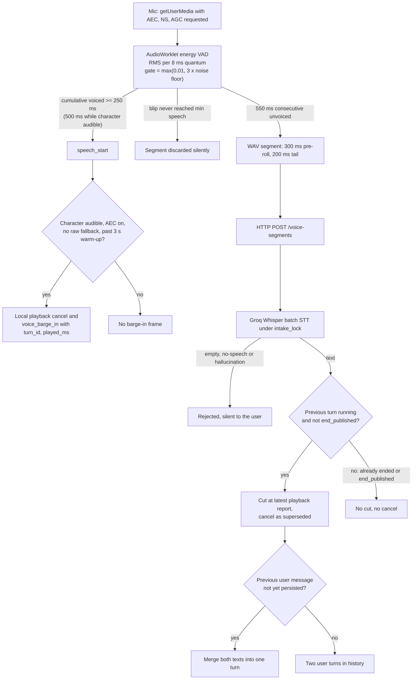
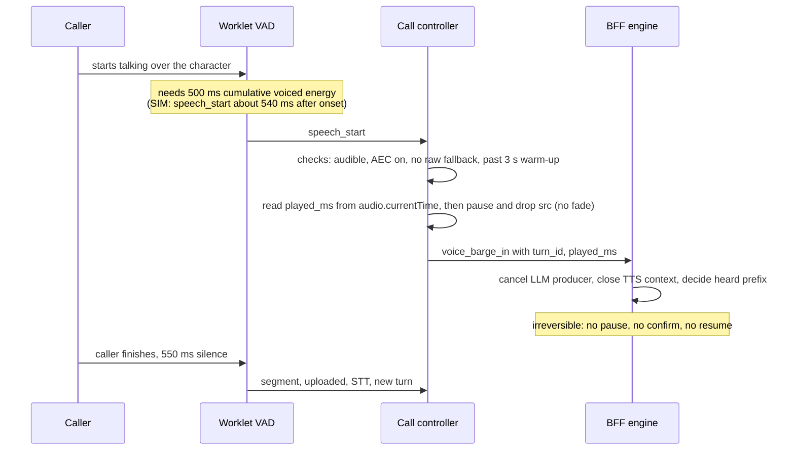
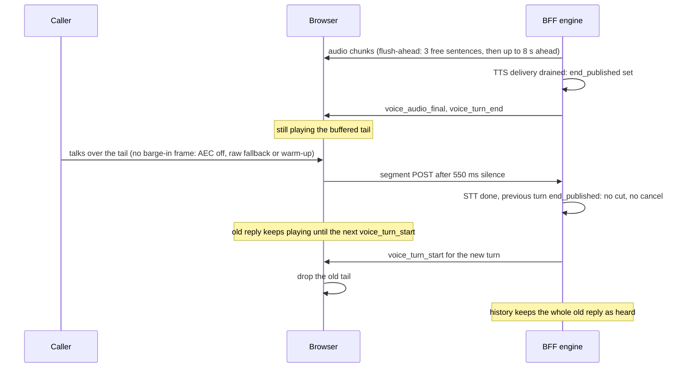
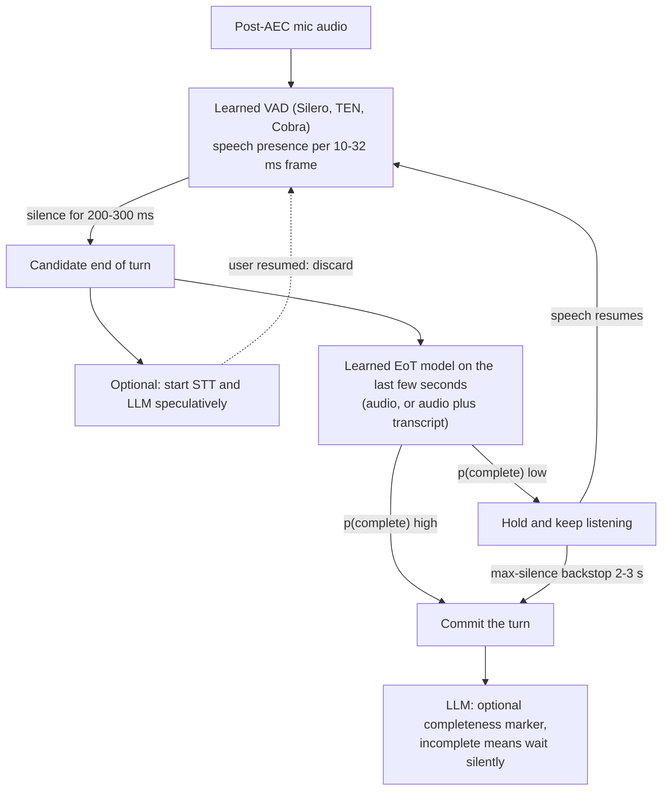
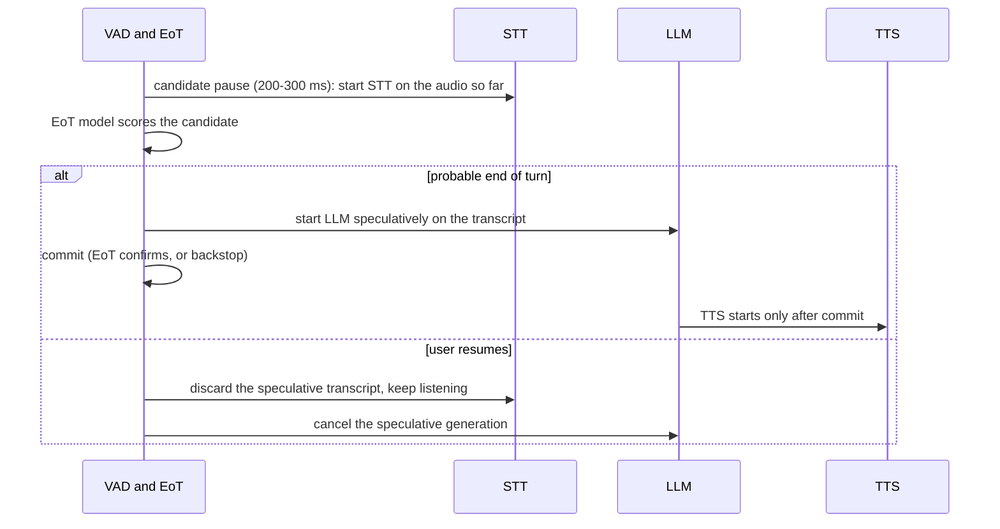
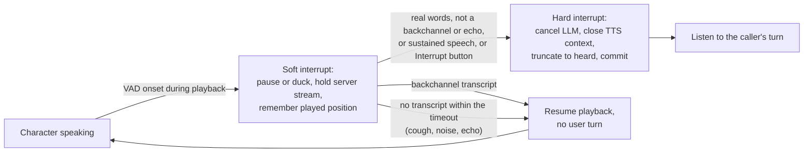
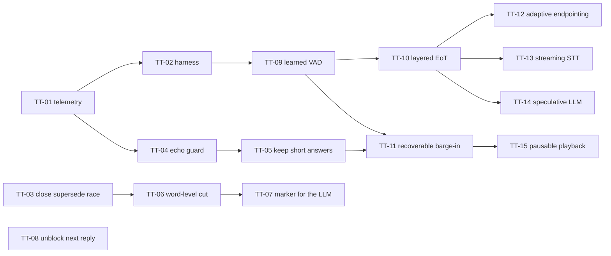

# Turn-taking: VAD, end-of-turn detection, barge-in and interruptions

**Research date:** 2026-10-20. **Scope:** how the Magic Worlds live call decides that the caller is speaking, that the caller has finished, and that the caller wants the floor back while the character talks; what happens to an interrupted reply and to the LLM's view of it; the 2025-2026 state of the art for each layer (learned VAD, learned end-of-turn, adaptive endpointing, barge-in vs backchannel, false-interruption recovery, echo, truncation to heard words, interruption context, speculative turn handling), with English and Spanish results; and a prioritized plan that includes a turn-taking evaluation harness. The cascaded STT → LLM → TTS pipeline is the primary lens. Speech-to-speech turn handling is summarized here and covered in [11_speech_to_speech_and_omni_models.md](11_speech_to_speech_and_omni_models.md).

## Summary

- **Every turn decision is made in the browser by an RMS energy gate.** Speech starts after 250 ms of cumulative voiced energy and the turn ends after a fixed 550 ms of silence (`src/features/call/components/CallScreen.tsx:114`). No learned VAD runs anywhere (the server energy gate is off by default) and there is no end-of-turn model. On LiveKit's eot-bench a silence-only policy is the worst entry: in Spanish it produces 24.5% false cut-offs at a 600 ms budget and needs 1,200 ms of dead air to get down to 5%. Learned detectors do much better: LiveKit v1 gets 6.0% and 642 ms, LiveKit v1-mini 12.2% and 926 ms, Smart Turn v3.2 17.3% and 980 ms ([r92](evidence/research/r92-gap-g2-spanish-bilingual-evidence.md); vendor-run benchmark).
- **Barge-in is 500 ms of cumulative voiced energy followed by an immediate, irreversible cancel.** Nothing tells a backchannel, a cough or the character's own echo apart from a real interruption, and a cut reply can never resume. Short answers ("sí", "stop", "wait") spoken over the character are discarded and never reach STT. On Krisp's vendor-run test set, VAD-only barge-in fires on about 66% of backchannels. Current best practice is to duck or pause, confirm, and resume on a false alarm (LiveKit's default false-interruption timeout is 2.0 s).
- **Overlap handling has a correctness hole.** Sometimes no barge-in frame fires: AEC is off, the raw-mic fallback is active, or the user speaks in the first 3 s of the call's first reply. In those cases a superseding segment that arrives after the old turn has published its end neither cuts nor cancels the old reply. The character keeps talking for about 1.2-3 s after the user stops (mechanism estimate), and history stores the whole reply as heard. With AEC off, the character's own voice can supersede its reply (C05, C24, GAP-REAL-CALL-OVERLAP-HISTORY-BILLING-03).
- **The LLM's picture of an interruption is coarse.** On ElevenLabs the cut is sentence-granular even though per-character alignment exists; in one real call about 70 unheard characters were stored as said. The cut point is measured late: when the VAD fires (about 0.5 s after the user starts talking), or at STT completion on the supersede path. The history carries no per-message interruption marker. A reply with nothing heard either vanishes, leaving two user messages in a row, or stays whole (C25, C26).
- **Dev data (small n, dev only):** 12 of 17 audio replies were cut to the heard prefix. Replies ran a median 17.6 s of audio. Four of 19 LLM turns waited 0.7-6.4 s for the previous turn's teardown before their own LLM call began, which makes the reply to an interruption the slowest reply in the call.
- **Spanish:** every serious learned detector supports Spanish, but the rankings change. LiveKit v1-mini beats Smart Turn v3.2. Smart Turn's int8 build loses more in Spanish (6.95% false positives vs 4.54% for fp32). Deepgram Flux Multilingual is the best STT-integrated Spanish end-of-turn detector. Krisp's interruption model is English-only. eot-bench drops turns with pauses longer than 5 s and is task-oriented, so roleplay needs its own EN/ES data.
- **Plan (details in §6):**
  - **P0** (days, no vendor change): turn-taking telemetry and an offline harness; close the post-end supersede race; an echo guard; keep short answers spoken over the character; word-level truncation with an interruption marker for the LLM; stop the reply to an interruption from waiting on bookkeeping.
  - **P1:** a learned VAD on both sides; a layered end-of-turn design (a 250-300 ms candidate pause, then LiveKit v1-mini or Smart Turn fp32, then a ~2.5 s backstop) with speculative STT; two-stage, resumable barge-in with EN/ES backchannel handling.
  - **P2:** streaming STT with turn signals, a speculative LLM, and a pausable playback path with sample-accurate position.
  - **P3:** watch for LiveKit v1.1-mini, interruption classifiers and agent backchannels.

---

## 1. Why turn-taking is a first-order problem here

Human conversation sets a hard bar. Gaps between speakers cluster around 200 ms, while producing even one word takes about 600 ms, so listeners predict where a turn will end rather than wait for silence ([Levinson & Torreira, 2015](https://www.frontiersin.org/articles/10.3389/fpsyg.2015.00731/full), foundational). Users start to notice gaps of about 1-2 s, and the experience degrades sharply past about 4 s ([Maslych et al., CUI '25](https://arxiv.org/html/2507.22352v1); via [r09](evidence/research/r09-naturalness-roleplay.md)).

Magic Worlds' reconciled speech-end → first-audio time is about 3.2-4.2 s at STT p50 (EL lane, moderation off). The fixed 550 ms hang-over is the first serial stage. Together with STT and the LLM hop it makes up about 80% of the total ([reconciliation §7](evidence/audit/gap-finding-reconciliation.md); [02_turn_lifecycle_and_latency.md](02_turn_lifecycle_and_latency.md)).

Turn-taking errors also cost more than latency:

| Error | What the caller experiences | Today's mechanism |
|---|---|---|
| **False cut-off** (turn ended inside a pause) | The character answers half a sentence and is then cut off by the rest of it | Fixed 550 ms silence; merge only before admission |
| **Late end of turn** | Dead air on every turn | Constant 550 ms. Noise can hold a segment open up to 29.5 s |
| **False barge-in** | The character stops mid-sentence for a cough, an "ajá" or a TV, and never resumes | 500 ms of energy → irreversible cancel |
| **Missed interruption** | The character talks over "no, wait" | Speech under 500 ms during playback is discarded |
| **Echo self-interruption** | The character answers its own words | With AEC off, segments still upload and supersede |
| **Wrong memory of the interruption** | The character repeats itself or refers to things the caller never heard | Sentence-granular cut, measured late, no marker |

---

## 2. How Magic Worlds does it today

### 2.1 The pipeline in one picture

All of this is FACT from code ([fe-capture](evidence/audit/fe-capture.md) §2; [be-engine-turntaking](evidence/audit/be-engine-turntaking.md) §2, §5). Uplink audio is never streamed. The voice WebSocket carries only control frames and downlink MP3. The server learns that the caller is speaking only when a finished segment arrives. The client deliberately sends no `voice_vad` frame (`src/features/interaction/hooks/useVoiceCallController.ts:907-910`).

### 2.2 Speech detection: an adaptive RMS gate

| Parameter | Production value | Code |
|---|---|---|
| Decision unit | RMS of one 128-sample render quantum (8 ms at 16 kHz), no smoothing window | `src/features/interaction/audio/voiceVadProcessor.worklet.js:276-277` |
| Gate | `max(speechThreshold 0.01, 3 × noise floor)`, floor capped at 0.05 (max gate 0.15); hysteresis 0.8 while in speech | same; fallback defaults at `:224-225` |
| Noise floor | EMA: rises 1 s while idle, creeps 4 s in speech, falls 200 ms on any dip; 400 ms calibration in which nothing counts as voiced | [fe-capture](evidence/audit/fe-capture.md) §2.4 |
| Onset (`speech_start`) | **Cumulative** voiced samples ≥ `minSpeechMs` (250 ms; 500 ms while the character is audible) | `voiceVadProcessor.worklet.js:339`; `useVoiceCallController.ts:137, 706` |
| Pre-roll / tail | 300 ms pre-roll; trailing silence trimmed to 200 ms | [fe-capture](evidence/audit/fe-capture.md) §3 |
| Max segment | 7.5 s until consent, then 29.5 s; server cap 30 s and 2 MB | [r94 §4.1](evidence/research/r94-gap-g4-contradictions-reconcile.md) |
| Server "VAD" | Format validator. Energy gate **off** by default; only a digital-silence floor (peak < 0.002) and a 250 ms minimum | `magic-worlds-api/src/services/voice_orchestration/server_vad.py:31` |
| After the client | Only Groq/Whisper no-speech heuristics and the hallucination phrase filter remove noise | `magic-worlds-api/src/services/voice_orchestration/stt_groq_client.py:278-310` (per [be-stt](evidence/audit/be-stt.md)) |

What this gate does on non-speech, from an offline run of the unmodified worklet (SIM; treat as illustrative, per reconciliation K21):

- Distant TV babble at 0.01 RMS with nobody talking fired `speech_start` after about 1.5-1.8 s, and the segment was still open 10-12 s later.
- Babble after a real turn held a segment open for 22-25 s.
- Keyboard-like clicks fired `speech_start` after about 4 s and never closed.
- A steady fan, then mute, then unmute produced a fake 2.8-3 s "speech" segment (C45).
- Speech that starts inside the first 400 ms of capture produced no segment at all (FE-CAPTURE-13).

The independent Google study matches this picture: peak MCC is 0.11 for RMS, 0.41 for WebRTC VAD and 0.72 for Silero. The authors say RMS "underperforms random guessing for most of its range" ([arXiv 2601.17270](https://arxiv.org/abs/2601.17270), 2026-01-24). This is C03 (FE-CAPTURE-02), high.

### 2.3 End of turn: a fixed 550 ms silence

- The turn ends after 550 consecutive milliseconds of sub-gate quanta, and any single voiced quantum resets the count (`voiceVadProcessor.worklet.js:352-353`). The value is set at `CallScreen.tsx:114`. The worklet's own default of 800 ms is only a fallback, and the 450 ms "strict" mode is unreachable ([r94 §4.1](evidence/research/r94-gap-g4-contradictions-reconcile.md)).
- The code comment admits the trade-off. It says a breath pause "still works: the server supersedes the cut turn and merges its text with the continuation while that turn is not yet admitted" (`CallScreen.tsx:111-113`).
- In practice the merge window is tiny. Admission persists the user message within tens of milliseconds after STT. After that, the first fragment is a full turn: admitted, sent to the LLM and possibly spoken. The continuation supersedes it, and history keeps two user messages (`magic-worlds-api/src/services/voice_orchestration/engine.py:2075-2088`; C02, high).
- SIM: a 600 ms pause in the middle of a sentence produced two segments ([fe-capture](evidence/audit/fe-capture.md) §9).
- A complete "yes" also waits the full 550 ms. There is no shorter path for a turn that is obviously complete.
- There is no hold. A caller who resumes while the character is still "thinking" cannot stop the pending reply: an unpublished turn is never a barge-in target (`engine.py:1354-1365`). The client compensates by cancelling the reply the moment it becomes audible if the caller is mid-utterance (`useVoiceCallController.ts:708`). By then the LLM work has already been spent.

**Cost side effects:**

- Every fragment is one Groq request, and Groq bills a 10 s minimum per request (C63, low).
- Every premature turn is a wasted LLM call and possibly wasted TTS audio.

### 2.4 Barge-in

- **Trigger:** `speech_start` while playback is audibly `playing` (`useVoiceCallController.ts:676-687`). It is suppressed in two cases: with AEC off or on the raw fallback, and within 3 s of the call's **first** audible reply (`AEC_WARMUP_MS`, `:143`, `:685`; the warm-up ref is set once per call at `:705`).
- **Threshold:** while the character is audible, `minSpeechMs` is raised to 500 ms (`:706`). This matches LiveKit's default minimum interruption duration ([r08](evidence/research/r08-eval-observability.md)). It filters short coughs. A backchannel, a laugh or echo that lasts 500 ms or more still cuts the reply (reconciliation K18).
- **Action:** `sendBargeIn` reads `played_ms`, cancels local playback at once and sends `voice_barge_in` (`:644-673`). The server cancels the LLM producer and closes the TTS context immediately (`engine.py:1384-1391`). Nothing confirms the interruption, nothing resumes the reply, and nothing tells a backchannel apart. This is C15 (FE-CAPTURE-05, BE-ENGINE-TURNTAKING-07, FE-PLAYBACK-TRANSPORT-07), medium.
- **Short answers are lost.** Raising `minSpeechMs` to 500 ms also gates segment *capture*. A segment that never reaches its minimum is discarded (`voiceVadProcessor.worklet.js:394`). So "no", "sí", "stop" or "wait", typically 200-450 ms of voicing, spoken entirely during playback neither interrupt the character nor reach STT. This is C16 (FE-UI-01), medium.
- **Manual fallback:** the Interrupt button always works.
- **Reconnect edge cases:**
  - Control frames are dropped while the socket reconnects (C68, low).
  - A `listening` snapshot after a resume cancels a reply the user is still hearing, without reporting `played_ms` (C27, medium).

### 2.5 Echo and the AEC-off path

- **Capture:** the mic requests `echoCancellation: true` (`src/features/interaction/hooks/useMicrophoneCapture.ts:80`). If the 3 s liveness watchdog sees a dead stream, capture restarts with raw constraints (AEC, NS and AGC off). That fallback is **permanent for the session** (C47, medium).
- **What the browser reports:** `getSettings().echoCancellation === true` says only that AEC was requested, not that it works.
- **Playback path:** replies play through one `HTMLAudioElement` fed by MediaSource, not through WebRTC. Whether each browser uses that output as its echo reference is UNKNOWN per platform (FE-CAPTURE-19).
  - Research says it is covered on Firefox and Safari, and on desktop Chrome where "Chrome-wide AEC" is active. That is a feature-flag default, not a guarantee. Edge is uncertain, and no API can detect AEC coverage ([r06 §4.2](evidence/research/r06-transport-client-audio.md)).
- **The gap:** with AEC off, the client skips auto barge-in. But `handleCapturedSegment` still uploads every segment (`useVoiceCallController.ts:920-935`), and the server supersedes on any non-empty transcript with no echo or self-transcript filter (`engine.py:2066-2074`). The character's own voice can therefore be transcribed and supersede its own reply. That is C05, high but conditional on the AEC-off share, which is UNKNOWN.
- **The copy is wrong.** The AEC-off hint says "interrupting by voice is disabled" (`src/app/i18n/locales/en.ts:6150`). In fact voice interruption still happens through supersede, only later.
- **The warm-up does not help here.** It blocks only the barge-in *frame*. Residual echo above the gate for 500 ms or more is still uploaded.

### 2.6 The supersede race after `voice_turn_end`

When no barge-in frame fired, the only interruption path is a superseding segment. That path depends on a race the caller cannot see.

- **The race:** `_supersede_heard_prefix` and `_cancel_turn` both return early once the previous turn is `end_published` (`engine.py:1426-1433`, `:1958-1960`). `end_published` is set when TTS *delivery* drains, not when playback ends. With flush-ahead, that can be up to about 8 s of audio before playback ends, and more when three long "free" sentences go out at once.
- **What the caller hears:** the character keeps talking for about 1.2-3 s after the caller stops (550 ms hang-over plus upload, STT, wait and admission), and the stored reply keeps its full text ([overlap](evidence/audit/gap-real-call-overlap-history-billing.md) §10).
- **The API doc says otherwise.** It promises a cut "while the reply is still being written or spoken" (`magic-worlds-api/docs/api_usage/voice.md:287-291`).
- **The cut point is late even when it applies.** On the supersede path, `played_ms` is the latest 500 ms playback report at the moment the *new segment's STT completes*. That overstates what was heard by about 1-3 s (GAP-REAL-CALL-OVERLAP-HISTORY-BILLING-04).
- **Severity:** high, conditional in the register ([03](03_audit_findings.md) §1.1). The reconciliation had rated C24 (BE-ENGINE-TURNTAKING-01) medium, because it needs the no-barge-in-frame conditions. The overlap note's verifier kept GAP-REAL-CALL-OVERLAP-HISTORY-BILLING-03 at high: whether a talk-over is cut depends on STT timing, not on what was heard. Dev rows show the next user segment's STT finishing 1-5 s before the previous reply's audio asset was persisted (GAP-CALL-AUDIO-ASSETS-AND-MP3-TIMELINE-01, verifier data). That is consistent with overlap starting while the reply was still running (INFERENCE).

### 2.7 Truncation and what the LLM sees

**Heard-prefix policy.** On a mid-stream barge-in, `KeepHeardPrefixPolicy` stores the heard prefix as `completed` (`magic-worlds-api/src/services/voice_orchestration/call_ledger.py:97-129`).

**Cut granularity by lane:**

| Lane | Cut rule | Evidence |
|---|---|---|
| ElevenLabs | End of the last *sentence* whose audio started before `played_ms` (`call_ledger.py:380-392`), although per-character alignment is parsed (`:277-294`). This is the documented D06 policy. | Real call, message 550: 190 characters kept for 9,070 ms played (48 ms per character against about 78-88 for untruncated replies). About 70 characters, roughly 5.5 s of unheard speech, were stored as said ([mp3 timeline](evidence/audit/gap-call-audio-assets-and-mp3-timeline.md), finding 14) |
| Fish | Word-level, from the provider's word timeline on `/v1/tts/live/with-timestamp` (`magic-worlds-api/src/services/voice_orchestration/call_word_ledger.py:91-93`) | Precise: 74-91 played ms per kept character. But the Fish word ledger **crashes** on any turn whose sentence needs markup or emoji cleanup: 2 of 15 Haiku turns in dev (GAP-REAL-DEV-CALL-FORENSICS-01, high) |

**Played position.**

- `played_ms` is `audio.currentTime` on the media element. It does not subtract output latency (`src/features/interaction/audio/voicePlaybackBuffer.ts:147-153`; FE-PLAYBACK-TRANSPORT-13).
- The dominant error, though, is detection lag. `played_ms` is read when the VAD fires, several hundred milliseconds after the caller started talking ([mp3 timeline](evidence/audit/gap-call-audio-assets-and-mp3-timeline.md) §4).
- The server MP3 meter and the client clock share one frame timeline, so the timeline itself is not the problem.

**What reaches the model.** `build_conversation_messages` keeps only `completed` rows with non-empty content and renders content only (`magic-worlds-api/src/services/conversation_execution.py:56-86`). Therefore:

| Case | History the next turn sees | Problem | Finding |
|---|---|---|---|
| Cut applied | `… U A(kept) U` | No marker that the reply was cut. On EL the kept part is sentence-granular and measured late | C25 (BE-ENGINE-TURNTAKING-09, BE-TTS-08), medium |
| Barge-in after completion, nothing heard | `… U A(full) U` | Model believes an unheard reply was heard | C26 (BE-LLM-12), low |
| Mid-stream cancel, nothing heard | `… U U` | Row stored `interrupted` with empty content and dropped. Two consecutive user messages, no cue the character had started | GAP-REAL-CALL-OVERLAP-HISTORY-BILLING-05, medium |
| Supersede after end | `… U A(full) U` | The tail the caller talked over counts as heard | C24 / -03 |
| Failed turn (e.g. Fish ledger crash) | `… U A(full) U` | Unheard reply stored `completed` and fed to the next prompt | GAP-REAL-DEV-CALL-FORENSICS-02, medium |
| Echo | `… U A U(echo of A)` | Character answers its own words | C05 |

**The prompt rules.** The only interruption cue is a generic rule in every callbot prompt variant (`magic-worlds-api/src/agent_graphs/runtime/callbot_chat.v2.json:18-20, 37`). One variant reads: "Your earlier lines may stop where the caller interrupted you; respond to what they said next rather than repeating yourself."

The prompt also says that "mm-hm", "yeah" and "okay" mean the caller is listening, "so carry on briefly". That rule only helps if the character was *not* stopped, and today a 500 ms backchannel does stop it. The examples are English only. Spanish backchannels ("ajá", "sí", "vale", "claro", "ya") are not named. The phrasing is FACT; the impact is INFERENCE.

A late cut also leaves stores inconsistent:

- A post-end barge-in cut updates only the message, not the segment or asset transcript (GAP-REAL-CALL-OVERLAP-HISTORY-BILLING-07).
- In 4 dev turns the asset transcript kept the full reply.
- Stored call audio keeps the unheard tail (GAP-CALL-AUDIO-ASSETS-AND-MP3-TIMELINE-02).

### 2.8 Latency of the reply to an interruption

- The new turn awaits `previous.finished` with no timeout (`engine.py:2074`).
- `finished` is set only after the previous turn's cancel-time DB work, `_settled_truncation` (up to 3 s), owned-MP3 persistence and segment updates.
- The new turn then awaits any pending truncation write, up to 3 s more (`engine.py:2322`; C20, high).
- In dev, 4 of 19 LLM turns waited 0.7-6.4 s this way (GAP-REAL-DEV-CALL-FORENSICS-05). Its verifier rated it medium and noted the figures may be overstated by about 0.2-0.4 s each.
- In 5 of 13 turn transitions (plus 2 same-second ties), the previous turn's asset row appeared 1-5 s after the next segment's STT had finished (GAP-CALL-AUDIO-ASSETS-AND-MP3-TIMELINE-01, high; the verifier corrected the note's "6 of 13" and found that part of the wait is the cancel and truncation settle, not only fsync and DB).

The reply to an interruption, the one the caller is most sensitive to, is the one that waits longest.

### 2.9 Dev data on overlap (FACT for the dev DB, small n)

| Measure | Value | Source |
|---|---|---|
| Audio replies cut to the heard prefix | 12 of 17; kept 9-94% | [dev forensics](evidence/audit/gap-real-dev-call-forensics.md) §4.5 |
| Assistant reply audio | p50 17.6 s, max 24.2 s; 16 of 17 at 7.8 s or more | [reconciliation §6](evidence/audit/gap-finding-reconciliation.md) |
| Billed TTS ms never played | 97,003 of 283,087 ms (34.3%) | [mp3 timeline](evidence/audit/gap-call-audio-assets-and-mp3-timeline.md), verified |
| User clips | p50 1,312 ms, max 2,092 ms | [reconciliation §6](evidence/audit/gap-finding-reconciliation.md) |
| Turns that paid a supersede wait | 4 of 19, waiting 0.7-6.4 s | [dev forensics](evidence/audit/gap-real-dev-call-forensics.md) §4.4 |

Reading (INFERENCE): replies are about three times longer than the "one to three short sentences" the prompt asks for. So nearly every turn is an overlap turn, and the quality of barge-in, truncation and supersede decides how most turns feel. Shorter replies are an LLM-side fix ([07_llm_in_the_voice_loop.md](07_llm_in_the_voice_loop.md)). They reduce, but do not remove, the need for the fixes here.

The dev sample cannot show echo or false barge-ins. Nothing records AEC state, cancel reason, the barge-in onset or truncation-skipped outcomes (GAP-REAL-CALL-OVERLAP-HISTORY-BILLING-01, medium).

### 2.10 Strengths to keep

- **Audio-thread DSP.** The worklet does its processing on the audio render thread, with a 300 ms pre-roll, a 200 ms tail trim, an adaptive floor with hysteresis, and a tested resampler ([fe-capture](evidence/audit/fe-capture.md) §6).
- **Interruption hygiene in the right direction.** The minimum interruption duration is raised while the character speaks, there is an AEC warm-up, auto barge-in is disabled without AEC, and the manual Interrupt button always works.
- **Truncate-to-heard exists end to end.** `played_ms` is read before the local cancel. The cut lands before the next turn reads history, and the update is idempotent and latest-only. Truncation is word-level on Fish.
- **Cancellation is prompt.** The LLM producer and the TTS context are cancelled at once, and late chunks are dropped by turn id and seq.
- **Pacing and repair.** The flush-ahead gate is paced by real playback reports. The supersede merge repairs some split utterances.
- **The team already knows the gaps.** The roadmap lists streaming STT with semantic end-of-turn, a neural VAD such as Silero, and pause-then-confirm barge-in as backlog (`docs/voice_refactor/00_current_status_and_roadmap.md:83, 95`).

---

## 3. Findings that bear on turn-taking

Canonical ids are from [gap-finding-reconciliation](evidence/audit/gap-finding-reconciliation.md); later gap-note ids are their own. Severity is the register value from [03_audit_findings.md](03_audit_findings.md), which lists in §1.1 where it differs from the reconciliation.

| Id (original) | Finding | Severity |
|---|---|---|
| C02 (FE-CAPTURE-04, BE-ENGINE-TURNTAKING-02, E2E-LATENCY-TRACE-02) | No semantic end-of-turn: a fixed 550 ms energy-silence endpoint; pauses create fragment turns | high |
| C03 (FE-CAPTURE-02, BE-STT-08) | No neural VAD anywhere: noise opens turns, fires barge-in and holds segments open up to 29.5 s | high |
| C05 (FE-CAPTURE-01, FE-UI-02, E2E-LATENCY-TRACE-09, BE-ENGINE-TURNTAKING-19, FE-CAPTURE-19) | Echo self-supersede on AEC-off, raw-fallback or warm-up paths; wrong hint copy; no server echo guard | high, conditional |
| GAP-REAL-CALL-OVERLAP-HISTORY-BILLING-03 / C24 (BE-ENGINE-TURNTAKING-01) | Whether a talk-over is cut depends on a race with `end_published`, not on what was heard | high, conditional (medium at reconciliation) |
| GAP-CALL-AUDIO-ASSETS-AND-MP3-TIMELINE-01 | The previous turn's audio persistence delays the reply to an interruption by 1-5 s | high |
| GAP-REAL-DEV-CALL-FORENSICS-01 | The Fish word ledger crashes on turns that need markup or emoji cleanup (the only word-level truncation lane) | high |
| C15 (FE-CAPTURE-05, FE-PLAYBACK-TRANSPORT-07, BE-ENGINE-TURNTAKING-07, E2E-LATENCY-TRACE-08, BE-LLM-22) | Barge-in is immediate and irrevocable; no confirm or resume; generation discarded | medium |
| C16 (FE-UI-01) | Short interjections spoken over the character are discarded (the 500 ms threshold also gates capture) | medium |
| C25 (BE-ENGINE-TURNTAKING-09, BE-TTS-08, FE-PLAYBACK-TRANSPORT-13) | Truncation over-approximates what was heard; the interruption is invisible to the LLM | medium |
| C20 (BE-ENGINE-TURNTAKING-05, BE-LLM-14, E2E-LATENCY-TRACE-07) and GAP-REAL-DEV-CALL-FORENSICS-05 | The next turn waits, unbounded, for the previous turn's teardown (0.7-6.4 s in dev) | high (medium at reconciliation) |
| GAP-REAL-CALL-OVERLAP-HISTORY-BILLING-04, -05, -07, -08 | Supersede cut measured at STT completion; history shapes without a marker (UU, unheard reply kept); late cut not propagated; no echo evidence or guard, and echo billed twice | medium |
| GAP-REAL-DEV-CALL-FORENSICS-02 | A failed turn's unheard reply is stored `completed` and fed to the next prompt | medium |
| C27 (FE-PLAYBACK-TRANSPORT-04) | A `listening` snapshot after resume cancels an audible reply without `played_ms` | medium |
| C45 (FE-CAPTURE-06), C47 (FE-CAPTURE-08) | Mute and unmute produce fake speech turns; the raw (AEC-off) fallback is permanent | medium |
| GAP-REAL-CALL-OVERLAP-HISTORY-BILLING-01 | Stored records cannot tell an interrupted reply from a fully heard one | medium |
| C26 (BE-LLM-12) | A barge-in after completion with nothing heard keeps the full reply | low (verifier-lowered) |
| C67 (FE-CAPTURE-11) | No early "user is speaking" signal to the server | low |
| C68 (FE-PLAYBACK-TRANSPORT-08) | Barge-in and playback frames are dropped while reconnecting | low |
| C63 (FE-CAPTURE-12) | Premature cuts multiply Groq requests (10 s billing floor) | low |
| FE-CAPTURE-13 | Speech in the first 400 ms of any capture restart is learned as noise | low |
| C80 (FE-CAPTURE-18) | Stale VAD comments (8 s and ~800 ms) and unreachable "strict" mode | low |

---

## 4. State of the art (2025-2026)

Unless noted, figures come from the turn-taking research note [r02](evidence/research/r02-turn-taking.md), the Spanish evidence note [r92](evidence/research/r92-gap-g2-spanish-bilingual-evidence.md) and the reconciliation note [r94](evidence/research/r94-gap-g4-contradictions-reconcile.md). Each was fact-checked against primary sources on 2026-10-20. Vendor-run results are labelled.

### 4.1 The established design: layers, not one threshold

The established practice ([r02 §8](evidence/research/r02-turn-taking.md)):

1. **Stack the layers.** A learned VAD with a short hang-over of 200-300 ms proposes a candidate. A learned end-of-turn (EoT) model decides between "complete" and "hold". A hard max-silence backstop of 2-3 s caps the wait. Optionally, an LLM completeness marker adds a semantic check.
2. **Tune per language at operating points.** Pick a false cut-off budget, such as 5%, and minimize latency at that budget. Do not tune a single silence threshold.
3. **Keep the VAD stop short and let the EoT model own the wait.** Pipecat sets VAD `stop_secs` to 0.2 s when Smart Turn is on. LiveKit uses VAD silence of at least 0.25 s plus its detector.
4. **Do not stack delays.** If the STT does its own EoT, set the framework's `min_delay` to 0 (LiveKit). Do not add a platform wait on top of semantic EoT (AssemblyAI).

r94 converts this into a concrete target: about 250-300 ms of silence plus an audio turn model, with a maximum wait of about 2.5 s. One point is still open: whether LiveKit's VAD silence and `min_delay` add up in practice. The way to settle it is to measure `end_of_turn_delay` ([r94](evidence/research/r94-gap-g4-contradictions-reconcile.md)).

**Framework defaults worth copying:**

| Stack | Turn defaults |
|---|---|
| LiveKit Agents (SDK 1.8.x) | The audio turn detector (v1 on Cloud, v1-mini self-hosted) is the effective `AgentSession` default, with `min_delay` 0.3 s and `max_delay` 2.5 s. The text or generic detector uses 0.5 s / 3.0 s. Dynamic endpointing uses an EMA with α=0.9 inside [min, max]. `preemptive_generation` is on (LLM early, `preemptive_tts=False`, skips utterances over 10 s, 3 retries). On a Build plan, v1 falls back to v1-mini ([turn handling options](https://docs.livekit.io/reference/agents/turn-handling-options/); [r94 §2](evidence/research/r94-gap-g4-contradictions-reconcile.md)) |
| Pipecat | `LocalSmartTurnAnalyzerV3` is the default since v0.0.102. VAD `stop_secs` is 0.2 s and `SmartTurnParams.stop_secs` is a 3.0 s backstop. `FilterIncompleteUserTurnStrategies` uses ● complete / ◐ incomplete-short / ○ incomplete-long, with re-prompts at 5 s and 10 s ([Pipecat docs](https://docs.pipecat.ai/api-reference/server/utilities/turn-management/filter-incomplete-turns), accessed 2026-10-20) |
| AssemblyAI streaming | Presets (confidence / min silence / max silence): aggressive 0.4 / 160 / 400 ms, balanced 0.4 / 400 / 1,280 ms, conservative 0.7 / 800 / 3,600 ms. U-3.6 Pro uses `mode`. `UpdateConfiguration` changes take effect mid-stream ([AssemblyAI, 2026-09-30](https://www.assemblyai.com/blog/turn-detection-endpointing-voice-agent)) |
| Deepgram Flux | `eot_threshold` 0.7 (range 0.5-1.0). `eager_eot_threshold` 0.3-0.9, unset by default. `eot_timeout_ms` 5,000. `EagerEndOfTurn` fires 150-250 ms before `EndOfTurn` ([Flux configuration](https://developers.deepgram.com/docs/flux/configuration); [launch blog, 2025-10-01](https://deepgram.com/learn/introducing-flux-conversational-speech-recognition)) |
| OpenAI Realtime | `server_vad`: threshold 0.5, prefix 300 ms, silence 500 ms. `semantic_vad` eagerness low / medium / high waits up to 8 / 4 / 2 s ([realtime VAD guide](https://developers.openai.com/api/docs/guides/realtime-vad), accessed 2026-10-20) |

### 4.2 Learned VAD

| VAD | Size / compute | Accuracy evidence | Browser | Licence |
|---|---|---|---|---|
| **Silero v6.x** (v6.0 2025-08-26 … v6.2.3 2026-09-23, latest) | About 2 MB ONNX; 512-sample (32 ms) frames at 16 kHz; "<1 ms per chunk" on one CPU thread (vendor) | v6.0 makes 16% fewer errors on noisy real-life data than v5 (vendor). Independent Google study: MCC 0.72 vs WebRTC 0.41 vs RMS 0.11 ([arXiv 2601.17270](https://arxiv.org/abs/2601.17270), 2026-01-24) | `@ricky0123/vad-web` ships v5 and v6 ONNX on onnxruntime-web 1.22, with pre-speech padding, positive and negative thresholds and a redemption (hang-over) period ([repo](https://github.com/ricky0123/vad)) | MIT |
| **TEN VAD** | About 277 KB WASM; 10 or 16 ms hop; RTF 0.0086 vs Silero 0.0127 (vendor) | Third-party rerun at threshold 0.5: precision/recall 0.942/0.915, Silero 0.938/0.938 ([wavekat-vad](https://docs.rs/wavekat-vad)) | Official WASM and JS | Apache-2.0 plus an Agora non-compete condition ([LICENSE](https://huggingface.co/TEN-framework/ten-vad/blob/main/LICENSE)). **Needs legal review** |
| WebRTC VAD | Tiny GMM | MCC 0.41 (Google); 50% TPR at 5% FPR (Picovoice, vendor-run) | JS ports | BSD |
| Picovoice Cobra | Proprietary | 98.9% TPR at 5% FPR vs Silero 87.7% (vendor-run, [Picovoice, updated 2026-01-23](https://picovoice.ai/blog/best-voice-activity-detection-vad/)) | WASM SDK | Commercial |
| RMS gate (today) | Free | MCC 0.11 | — | — |

**Design points that apply to MW:**

- **What the VAD is for.** Use the VAD as a speech-*presence* detector, never as the turn decision.
- **Smoothing.** In the Google study, hysteresis helped WebRTC VAD (0.41 → 0.47 MCC) but not Silero (0.72 → 0.71) or RMS (0.11 → 0.10). Long averaging windows *reduce* AUC.
- **Input.** The VAD must see the post-AEC (processed) track.
- **Two tiers.** A client VAD gates uploads and gives instant UI and barge-in feedback. A server VAD/EoT on the received audio is authoritative. Gemini Live calls this "hybrid VAD" ([Live guide](https://ai.google.dev/gemini-api/docs/live-guide)). MW's upload-per-utterance architecture already has this two-tier shape: the client decides when to upload, and the server sees every finished segment.

### 4.3 Why a fixed silence threshold fails, with numbers

[eot-bench](https://github.com/livekit/eot-bench) (2026) is the only public multi-model, multi-language EoT benchmark. LiveKit runs it, and LiveKit's own model tops it, so treat it as **vendor-run**. The benchmark is open: the data is `livekit/eot-bench-data` (14 languages) and anyone can submit an entry.

**What it measures:**

- **FC@300 / FC@600:** the share of hold pauses wrongly called "end of turn" when the detector is given 300 ms or 600 ms.
- **Latency@5% / @10%:** the dead air needed to keep false cut-offs at or below 5% or 10%.

**Caveats:**

- The data is task-oriented.
- It drops turns that contain any pause longer than 5 s.
- The dataset licence is stated two ways: CC-BY-4.0 on the Hugging Face card, Apache-2.0 on GitHub.
- The Spanish split has 400 turns and 1,236 spans (400 end-of-turn, 836 hold).

| Policy | EN FC@300 / FC@600 | EN latency @5% / @10% | ES FC@300 / FC@600 | ES latency @5% / @10% |
|---|---|---|---|---|
| **VAD silence only (MW's policy class)** | 55.6% / 21.7% | 1,600 / 1,000 ms | 58.9% / 24.5% | 1,200 / 1,000 ms |
| LiveKit v1 | 9.9% / 4.5% | 543 / 295 ms | 15.5% / 6.0% | 642 / 438 ms |
| LiveKit v1-mini | 27.8% / 12.1% | 1,070 / 698 ms | 26.0% / 12.2% | 926 / 667 ms |
| Smart Turn v3.2 (GPU fp32) | 35.2% / 14.8% | 1,051 / 739 ms | 38.7% / 17.3% | 980 / 769 ms |
| Deepgram Flux (ES: `flux-general-multi`, no hint) | 12.9% / 9.9% | 1,151 / 548 ms | 16.4% / 8.7% | 820 / 536 ms |

Full tables are in §4.4 and §4.5.

**What this means for MW (INFERENCE).**

- **False cut-offs.** MW's 550 ms sits just inside the 600 ms budget, and its energy gate is weaker than the benchmark's VAD baseline (Google MCC 0.11 vs Silero 0.72). So MW's false cut-off rate on pause-heavy speech is probably at least the baseline's 21.7% (EN) or 24.5% (ES), and likely higher. MW has never measured it, and the harness in §7 exists to measure it.
- **Latency.** Getting the baseline to 5% false cut-offs costs 1,200-1,600 ms of dead air on every turn, which is more than double today's 550 ms.
- **The trade-off.** No silence value is both fast and safe. A learned model reaches the same 5% budget 560 ms (v1), 274 ms (v1-mini) or 220 ms (Smart Turn) sooner in Spanish.

### 4.4 Learned end-of-turn models: numbers and licences (English)

| Model | Kind | Languages | FC@300 / FC@600 | Lat@5% / @10% | Runs | Licence / price |
|---|---|---|---|---|---|---|
| **LiveKit Turn Detector v1** (2026-06-17) | Fused: audio encoder + adapter into a fine-tuned LLM + acoustic branch | 14 incl. es | 9.9% / 4.5% | 543 / 295 ms | LiveKit Inference only | Free on LiveKit Cloud; self-hosted gets 7,500 dev requests/month, then billed |
| **LiveKit v1-mini** | Audio model, local | 14 incl. es | 27.8% / 12.1% | 1,070 / 698 ms | Local CPU; Agents ≥1.6.1 (Py) / 1.4.7 (TS) | Code Apache-2.0; weights under the "LiveKit Model License" |
| **Smart Turn v3.2** (Daily/Pipecat, [2026-01-07](https://www.daily.co/blog/smart-turn-v3-2-handling-noisy-environments-and-short-responses/)) | Audio only; Whisper-tiny encoder, about 8M params; ≤8 s input | 23 | 35.2% / 14.8% | 1,051 ms @5% | CPU int8 (8 MB) 12.6 ms (c7a.2xlarge) to 94.8 ms (t3.medium); GPU 3-7 ms | **BSD-2**, free |
| **Deepgram Flux** | STT-integrated EoT | EN; `flux-general-multi` 10 incl. es | 12.9% / 9.9% | 1,151 / 548 ms | Vendor STT | Per-minute STT |
| **AssemblyAI** Universal-Streaming | STT-integrated | Multilingual variants | 49.4% / 14.6% | 1,049 ms @5% | Vendor STT | Per-minute STT |
| **Soniox** stt-rt-preview | STT-integrated | Multilingual | — / 5.5% | 647 / 512 ms | Vendor STT | Per-minute STT |
| ultraVAD ([2025-09-09](https://ultravox.ai/blog/context-aware-audio-native-endpointing-how-we-built-ultravad)) | Context-aware audio LLM (Llama-8B), uses the agent's last question | 26 | 27.7% / 11.9% | 899 ms @5% | GPU | Open weights, licence unverified |
| turn-1-mini | Audio | EN only | 22.6% / 9.6% | 849 / 581 ms | Local | Apache-2.0; self-scored |
| OpenAI "GPT Realtime 2" (`semantic_vad` auto) | Built into S2S | Multilingual | — | 1,143 / 755 ms | Vendor | Per-token |

**Other entries:**

- English-only eot-bench entries: JoinIn Baton (12.3% / 4.8%, 577 ms) and Cartesia Ink 2 (1,056 ms @5%).
- **Krisp Turn Prediction v3** is not on eot-bench. Krisp's own test reports balanced accuracy 88.05 / AUC 94.58, and 0.69 of turn shifts detected within 200 ms at FPR 0.10. On the same test Smart Turn scores 77.4% balanced accuracy. Krisp TP v3 has about 9M params (30 MB), covers 12+ languages including Spanish, and ships in the commercial VIVA SDK. All of this is Krisp-run ([Krisp blog, "Updated May 2026"](https://krisp.ai/blog/voice-ai-turn-taking-interruption-prediction/)).
- Smart Turn v3.2 was retrained for noisy audio and short answers and reports 40% fewer short-utterance errors (vendor).

**Not usable for Spanish:**

- NVIDIA Parakeet-EOU (EN only, p50 160 ms);
- Kyutai STT (EN/FR);
- turn-1-mini.

Speechmatics Melia 1 expects the client to run EoT. LiveKit's older *text* turn model is "slated for removal" in Agents 2.0, which has not shipped (SDK 1.8.x).

### 4.5 Spanish

eot-bench ES (validation, `min_silence_100ms`; [r92](evidence/research/r92-gap-g2-spanish-bilingual-evidence.md); EN in parentheses where it differs):

| Model | FC@300 | FC@600 | Lat@5% | Lat@10% | AUC |
|---|---|---|---|---|---|
| LiveKit v1 | 15.5% (9.9) | 6.0% (4.5) | 642 (543) ms | 438 (295) ms | 0.943 (0.969) |
| Deepgram `flux-general-multi`, no `language_hint` | 16.4% (12.9) | 8.7% (9.9) | 820 (1,151) ms | 536 (548) ms | 0.930 |
| Soniox stt-rt-preview | — | 11.4% (5.5) | 800 (647) ms | 611 (512) ms | 0.852 |
| LiveKit v1-mini (local-inference 0.2.5, last 1.2 s) | 26.0% (27.8) | 12.2% (12.1) | 926 (1,070) ms | 667 (698) ms | 0.885 (0.890) |
| Smart Turn v3.2 GPU fp32 | 38.7% (35.2) | 17.3% (14.8) | 980 (1,051) ms | 769 (739) ms | 0.776 (0.845) |
| ultraVAD | 41.6% (27.7) | 17.6% (11.9) | 986 (899) ms | 764 ms | — |
| AssemblyAI universal-streaming-multilingual | 52.5% (49.4) | 18.3% (14.6) | 1,031 (1,049) ms | 792 ms | 0.856 |
| OpenAI GPT Realtime 2 | — | — | 1,044 (1,143) ms | 755 ms | — |
| VAD baseline | 58.9% (55.6) | 24.5% (21.7) | 1,200 (1,600) ms | 1,000 ms | — |

**Spanish-specific results:**

- **Rankings change in Spanish.**
  - v1-mini is about as good in Spanish as in English and beats Smart Turn v3.2 there, while Smart Turn slips (AUC 0.845 → 0.776).
  - Flux-multi is the best STT-integrated Spanish EoT. But its Spanish WER is about twice the leaders' (7.8% vs 4.1% on FLEURS-es, competitor-run).
  - AssemblyAI U-3.6 Pro, the accuracy pick for Spanish STT ([06_speech_to_text.md](06_speech_to_text.md)), has **no Spanish EoT result**.
  - Soniox's EoT gets worse in Spanish.
- **Smart Turn quantization hurts Spanish more.** On Daily's own benchmark (vendor), Spanish fp32 scores 91.53% accuracy with 4.54% false positives and 3.93% false negatives. The int8 build scores 89.57% with 6.95% false positives. English scores 94.71%. Spanish ranks 18th of 23 languages. The often-quoted 91.97% is the older v3.0 figure.
- **LiveKit needs the language.** It selects per-language thresholds from the STT-reported language and **defaults to English without STT**. MW would have to pass the call language to the detector explicitly (r92).
- **Silence alone is mixed in Spanish.** The VAD baseline has more false cut-offs in Spanish at both budgets (24.5% vs 21.7% at 600 ms) but needs less dead air at 5% (1,200 vs 1,600 ms).
- **Pending results.** eot-bench PR #20 (2026-10-18, unmerged) reports v1.1 ES at 16.4% / 6.0% / 608 / 389 ms and v1.1-mini ES at 19.2% / 7.3% / 746 / 507 ms. v1.1-mini is not installable until a `livekit-local-inference` release ships it. Other open PRs include a zero-shot DuplexJev entry (ES 13.6% @600) and a Smart Turn fine-tune (haan).

### 4.6 Adaptive, context-aware endpointing and short answers

- **Dynamic hang-over.**
  - LiveKit `endpointing.mode="dynamic"` adapts the delay inside [min_delay, max_delay] from per-session pause statistics, using an EMA with α=0.9. It suits slow speakers and roleplayers who think aloud.
  - r94's synthesis gives the target shape: about 200-300 ms when the turn model says the turn is complete, and 800-1,500 ms when it says incomplete.
- **Context-aware holds.**
  - Lengthen the hold right after the agent asks for something said in chunks, such as a number, a name, a list or a story.
  - AssemblyAI recommends raising `min_turn_silence` (for example to 1,000 ms) with a mid-stream `UpdateConfiguration`, then restoring the preset.
  - ultraVAD conditions on the agent's last question ("My number is 408…" vs "My area code is 408.").
  - In roleplay, the equivalent is "the character just asked the caller to describe, decide or tell a story". That is INFERENCE; nobody has measured it for roleplay.
- **An LLM completeness gate.** The main LLM emits a completeness marker as its first token and waits silently if the turn is incomplete. It costs about one token of latency. It complements an acoustic model and does not replace one, because a false "complete" still talks over the user.
- **Short answers.** "Yes", "no" and "ok" are a known failure mode for word-count gates and for STT that never finalizes them. LiveKit recommends a `transcription_timeout` (about 5 s) that asks the user to repeat, and warns that `min_words` can swallow short answers ([LiveKit, 2026-08-24](https://livekit.com/blog/short-utterances)). Smart Turn v3.2 was retrained for short answers.
- **A roleplay-specific gap.** eot-bench excludes pauses longer than 5 s. Callers improvising a scene pause longer and more often (INFERENCE). The backstop length and the hold policy for long thinking pauses must therefore be tuned on MW's own data (§7).

### 4.7 Speculative turn handling

**Published patterns:**

- Deepgram's `EagerEndOfTurn` / `TurnResumed` events. Eager mode "can increase LLM API calls by 50-70%" ([Flux quickstart](https://developers.deepgram.com/docs/flux/quickstart)).
- LiveKit's `preemptive_generation`: LLM early, TTS only after the turn is confirmed, skips utterances over 10 s.
- Pipecat's `EagerUserTurnStopStrategy`, with a 5 s `speculation_timeout`.
- ultraVAD runs speculatively about 500 ms before TTS.

**For a cost-sensitive product:** speculate the LLM, not the TTS, and only when the EoT probability is high.

**For MW's batch architecture:** the cheapest speculation is *STT* on the candidate pause. The STT audit estimates about 300 ms off p50 if a segment is sent at about 200-250 ms of silence ([be-stt](evidence/audit/be-stt.md); estimate). Groq bills a 10 s minimum per request, so every discarded speculative transcript costs a full billing floor (C63; INFERENCE on the size of the effect).

### 4.8 Barge-in versus backchannel

| Method | What it does | Published numbers |
|---|---|---|
| VAD only (MW today, plus a duration floor) | Any speech while the agent talks stops it | Krisp test set: **66.3% false positives on backchannels**, mean interruption time (MIT) 0.375 s; 32% false positives on laughter, cough and sneeze (vendor-run) |
| Minimum duration | Speech must last N ms | LiveKit default `min_duration` 0.5 s. A practitioner measured +120 ms on their own path. They cite third-party (Future AGI) research saying a guard of about 200 ms cuts false barge-ins by 60-80% ([Imoto, 2026-06-30](https://dev.to/kenimo49/barge-in-is-the-voice-agent-feature-nobody-benchmarks-i-added-it-and-lost-120ms-4o7m), anecdotal) |
| Minimum words (STT partials) | Interrupt after N recognized words | Krisp test, 3 words: 3.6% false positives, balanced accuracy 0.948, but **MIT 1.53 s** (vendor-run). Needs streaming STT |
| Krisp Interruption Prediction v1 | 6M-param audio classifier, 40 ms frames | Threshold 0.4: 5.9% false positives, MIT 0.833 s, balanced accuracy 0.906. Threshold 0.7: 2.7%, 1.085 s (vendor-run). **English only** |
| LiveKit adaptive interruption ([2026-03-19](https://livekit.com/blog/adaptive-interruption-handling)) | Audio classifier on overlap audio after VAD fires | 86% precision / 100% recall at 500 ms of overlap; rejects 51% of VAD barge-ins; faster than VAD in 64% of true barge-ins; ≤30 ms inference; median 216 ms of audio (vendor-reported). Language-agnostic ("may do better on English"). Self-hosted agents opt in with `mode="adaptive"` on LiveKit Inference (40k dev requests/month) and fall back to VAD otherwise. Not compatible with Gemini Live |

**Design rules from these sources:**

- **Separate "the user started speaking" from "the user wants the floor".** A backchannel should not stop the agent, and it should not become a user turn: LiveKit drops a confirmed backchannel before the LLM.
  - English backchannels: "mm-hm", "yeah", "okay".
  - Spanish backchannels: "ajá", "sí", "vale", "claro", "ya".
  - MW's prompt says "carry on briefly" for a backchannel. That only does anything after the reply was already stopped, which is the worst of both outcomes ([r02 §5.1](evidence/research/r02-turn-taking.md)).
- **Boundary cooldowns.** Near the start and end of an agent turn, a short utterance is usually a real answer or correction. LiveKit uses `backchannel_boundary=(1.0, 1.0)` s, during which plain VAD rules apply.
- **Score latency and accuracy together.** One practitioner proposes "minimum latency to reach 90% barge-in accuracy" as a single metric. Most benchmarks report only response latency.
- **What the research says.** Systems "can interrupt too aggressively" and "rarely backchannel" ([Talking Turns, ICLR 2025](https://arxiv.org/abs/2503.01174), 2025-03-03). [Full-Duplex-Bench](https://arxiv.org/abs/2503.04721) scores pause handling, backchanneling, smooth turn-taking and user interruption.

### 4.9 Recovering from a false interruption

**LiveKit's defaults** ([2026-06-30](https://livekit.com/blog/turn-detection-and-interruption-handling)):

- `false_interruption_timeout` = 2.0 s;
- `resume_false_interruption` = True;
- `min_duration` = 0.5 s;
- `min_words` = 0.

If VAD stopped the agent but no transcript arrives (a cough, noise), the agent **resumes where it left off**. Recovery needs two things that MW lacks today: the client must be able to *pause* rather than flush, and the server must not yet have cancelled the LLM and TTS.

**Duck or pause?**

- A practitioner suggests ducking by about −24 dB rather than cutting (Imoto, anecdotal).
- On iOS, the media element's volume may be ignored (FE-PLAYBACK-TRANSPORT-17, INFERENCE), so pausing is the safer primitive there.
- On noisy lines, repeated pause/resume cycles cause audible stutter. LiveKit pairs recovery with adaptive detection or higher thresholds.

**Constraint for MW (FACT for the constant, INFERENCE for the effect).** The ElevenLabs multi-context socket has a 5 s inter-chunk timeout (`INTER_CHUNK_TIMEOUT_S`, `magic-worlds-api/src/services/speech/providers/elevenlabs/tts_multicontext_ws.py:77`, per [be-engine-turntaking](evidence/audit/be-engine-turntaking.md)). A server-side hold must either finish within that window or keep the context alive. Holding the client buffer while the server keeps producing is simpler, because flush-ahead already runs several seconds ahead.

### 4.10 Echo

**Browser AEC behaviour** ([r06 §4](evidence/research/r06-transport-client-audio.md)):

- **The standard.** The W3C spec now defines `echoCancellation: "all"` (cancel all system playout) and `"remote-only"`. `true` must cancel at least remote audio and *should* cancel as much as `"all"` ([mediacapture-main](https://w3c.github.io/mediacapture-main/)).
- **Chrome.** Chrome's entry for these modes is still "Proposed", with a stale M141 target. There is no evidence they shipped by October 2026 ([chromestatus](https://chromestatus.com/feature/5585747985563648), read 2026-10-20).
  - Desktop Chrome's "Chrome-wide AEC" (since about M111) uses Chrome's own output as the reference. It is a feature-flag default, not a guarantee, and Edge may lack it.
  - No API reports whether AEC covers a given output.
- **Other platforms.** Firefox and Safari are reported to cancel all browser output. Mobile platforms route capture through platform voice processing.
- **Chrome's neural residual echo estimator** cut WER from 0.500 to 0.235 overall in a webrtcHacks test, but only from 0.600 to 0.545 in the 0-15 dB ERLE bucket. Hard echo conditions remain hard ([webrtcHacks, 2026-10-06](https://webrtchacks.com/chrome-neural-echo-cancellation/)).
- **iOS.** WebKit bug 326286 (filed 2026-10-04) reports crackle whenever an `echoCancellation: true` track is open on iOS 27.

**Secondary mitigations** (r02 §5.3):

- an AEC warm-up (MW has one);
- a higher onset threshold while the agent speaks (MW has one);
- disabling auto barge-in without AEC (MW has this);
- **self-echo transcript filtering**: drop overlap transcripts that fuzzy-match the text being spoken at that moment;
- an interruption classifier trained on overlap audio;
- a headphones hint.

The overlap audit drafted similarity thresholds for classifying a superseding transcript against the reply it overlapped ([overlap](evidence/audit/gap-real-call-overlap-history-billing.md), finding 08):

| Score | Classification |
|---|---|
| 4-gram containment ≥ 0.6, or LCS fraction ≥ 0.5 | likely echo |
| ≥ 0.3 | possible echo |
| fewer than 3 tokens | too short to judge |

These thresholds are a proposed starting point. They are not validated.

### 4.11 Truncating to the words actually heard

**How the main stacks do it:**

- **OpenAI Realtime.** Over WebSocket, the client stops playback and sends `conversation.item.truncate` with `audio_end_ms`. Over WebRTC or SIP the server tracks playout and truncates automatically ([realtime conversations](https://developers.openai.com/api/docs/guides/realtime-conversations), accessed 2026-10-20).
- **Gemini Live** discards unsent generation and flags `interrupted`. Only *sent* audio stays in history, and sent is not played.
- **Pipecat** commits only `TTSTextFrame`s that the transport played ([interruptions](https://docs.pipecat.ai/pipecat/fundamentals/interruptions.md)).

**ElevenLabs alignment.** EL audio messages carry `alignment` with `chars`, `charStartTimesMs` and `charDurationsMs`, **relative to each chunk**.

- Accumulate chunk offsets, then cut at the last character whose start is before the played position.
- Prefer raw `alignment` over `normalizedAlignment`, which can contain overlapping restarts ([Pipecat EL source](https://reference-server.pipecat.ai/en/latest/_modules/pipecat/services/elevenlabs/tts.html)).
- MW already accumulates per-character acknowledgements (`call_ledger.py:277-294`). The reconciliation flags that it uses a cumulative `char_offset` with no resync and can fall back to `normalizedAlignment` (C42, medium; real drift unverified).

**Measuring the played position.**

- Measure it at the output, subtracting output latency. `AudioContext.outputLatency` is Baseline 2025 (Chrome/Edge 102+, Firefox 70+, Safari/iOS 18.4+).
- A PCM AudioWorklet ring buffer gives a sample-exact count. A WebRTC remote track lets the server compute it ([r06 §6](evidence/research/r06-transport-client-audio.md); [09_transport_and_client_audio.md](09_transport_and_client_audio.md)).
- Bluetooth output adds 100-300 ms of device latency (unverified range).

**Where the cut belongs.** Measurement accuracy is one question; the other is where the cut belongs. For a voice barge-in, the defensible heard position is the playback position at the caller's **speech onset**, not when the detector fired. Anything after onset was spoken over and probably not taken in. This is a design choice (INFERENCE), not a published standard. It matters here because MW's detection lag (about 0.5 s, plus up to 1-3 s on the supersede path) is larger than any output-latency error.

### 4.12 Telling the LLM about the interruption

**Established practice.** OpenAI, Pipecat and LiveKit all store only the *heard* text as the assistant message.

**Recommended beyond that** (r02 §6.2; recommendation, not a standard):

- **Mark the interruption explicitly** in a context note that is not spoken, so the character can react ("Sorry, go on…") instead of repeating itself or continuing a sentence the caller never heard. Most frameworks keep an `interrupted` flag but do not put it into the prompt.
- **Optionally keep the unheard remainder** as hidden "what I was about to say", so the character can pick up after a false or short interruption.
- **Do not create a user message for a backchannel.** Process a correction ("no, wait—") immediately after the truncated assistant message.

**Two MW-specific constraints:**

- The spoken-text validator rejects tag-like `<…>` structure (C38). The marker must therefore live in a system or context message, not inside assistant content, and must not use angle-bracket tags.
- Prompt examples should include Spanish backchannels.

### 4.13 Speech-to-speech stacks (summary)

Built-in S2S turn detection sits mid-pack on eot-bench: "GPT Realtime 2" needs 1,143 ms EN / 1,044 ms ES at 5%. `gpt-realtime-2.1` claims better interruption handling but has no EoT numbers.

**Built-in turn handling:**

- **Gemini Live.** `silenceDurationMs` defaults to about 800 ms; Google recommends 500-800 ms. Manual activity mode lets an external VAD drive turns.
- **GPT-Live-1** (GA 2026-09-10) is natively full-duplex. A spoken interruption there does not cancel backend work.

**Independent Conversational Dynamics scores** (Artificial Analysis, a Full-Duplex-Bench v1/v1.5 subset):

| Model | Score |
|---|---|
| GPT-Live-1 | 94.9-97.3% |
| Grok Voice 3.0 | 97.0% |
| Gemini 3.8 Live | 96.1% |
| GPT-Realtime-2.1 High | 95.7% |

Eleven Realtime v1 reports 94.1% (Max) and 95.8% (Mini) on Full-Duplex-Bench (vendor) ([r07](evidence/research/r07-speech-to-speech-omni.md)).

**External EoT.** Audio-only detectors (LiveKit's audio model, Smart Turn) can drive an S2S model once its built-in detection is off. The same external EoT layer would then serve both lanes. Details are in [11_speech_to_speech_and_omni_models.md](11_speech_to_speech_and_omni_models.md).

### 4.14 Agent backchannels (emerging, not yet established)

Having the *character* say "mm-hm" or "ajá" while the caller talks is the clearest remaining naturalness gap ([r09](evidence/research/r09-naturalness-roleplay.md)).

**Where it stands:**

- **Cascade-compatible.** RESPOND ([arXiv 2603.21682](https://arxiv.org/abs/2603.21682), 2026-03) runs on streaming ASR plus incremental semantics.
- **Full-duplex.** A "backchannel head" on full-duplex models produced backchannels rated on par with human ones ([Züfle et al., arXiv 2609.29418](https://arxiv.org/abs/2609.29418), 2026-09-24).
- **Timing evidence.** A small ACM SAP 2026 poster (n=35, summary only) found feedback during the user's speech "partly distracting". Badly timed backchannels are worse than none.

**For MW:**

- This needs a streaming uplink and pre-rendered clips in each character's voice. It belongs in P3.
- Delay-gated in-character *fillers* after the user finishes are the established, cheaper relative. Natural fillers improved perceived response time at 4.0 s and 6.5 s delays, while artificial cues did not (Maslych CUI '25, n=54). See [10_naturalness_and_character_experience.md](10_naturalness_and_character_experience.md).

---

## 5. Current design versus best practice

| Aspect | Magic Worlds today | Best practice (2026) | Rec |
|---|---|---|---|
| Speech detector | RMS gate per 8 ms quantum with an adaptive floor (MCC-class 0.11) | Learned VAD (Silero v6 / TEN / Cobra) on the post-AEC track | TT-09 |
| Onset rule | Cumulative voiced ≥ 250 ms (500 ms during playback) | Contiguous speech probability with hysteresis, plus pre-speech padding | TT-09 |
| End-of-turn decision | Fixed 550 ms silence | Candidate pause of 200-300 ms, then a learned EoT model, then a 2-3 s backstop | TT-10 |
| Hold on incomplete turns | None; merge only before admission (tens of ms) | Hold while p(complete) is low; resumed speech cancels any speculation | TT-10 |
| Language tuning | None; one constant for EN and ES | Per-language operating points; pass the language to the detector | TT-10, TT-12 |
| Adaptivity | None | Per-speaker EMA hang-over; context-aware holds after open questions | TT-12 |
| Server authority | Format validator; energy gate off; Whisper no-speech heuristics only | Server learned VAD and EoT on the received audio | TT-09, TT-10 |
| Early "user speaking" signal | None (`voice_vad` deliberately not sent) | Onset event drives warm-ups, speculation and soft interrupts | TT-01, TT-11 |
| Speculation | TTS prewarm during STT only | Speculative STT and LLM at the candidate pause; TTS on commit | TT-10, TT-14 |
| Barge-in trigger | 500 ms cumulative energy, immediate | Classifier or words-based confirmation with boundary cooldowns | TT-11, TT-17 |
| Backchannels | Cut the reply, then the prompt says "carry on" | Not interrupting; not a user turn; EN and ES lexicon | TT-07, TT-11 |
| False-interruption recovery | None; generation discarded | Pause or duck, then confirm or resume (LiveKit: 2.0 s) | TT-11 |
| Short answers during playback | Discarded below 500 ms, never reach STT | Captured and transcribed; interrupt decision is separate | TT-05 |
| Echo | Browser AEC requested; no server guard; raw fallback permanent | AEC verified per platform; self-echo transcript filter; half-duplex fallback | TT-04 |
| AEC-off mode | Auto barge-in off, but uploads still supersede (late cut) | Explicit half-duplex or push-to-talk; honest copy | TT-04 |
| Truncation granularity | EL: sentence; Fish: word (crashes on markup turns) | Word or character from TTS alignment | TT-06 |
| Played position | `audio.currentTime` at detector fire; latest report at STT completion on supersede | Output-corrected position at speech onset; sample-exact with PCM or WebRTC | TT-03, TT-06, TT-15 |
| Post-end talk-over | No cut or cancel once `end_published` | Cut whenever the caller talked over audible audio | TT-03 |
| LLM context | Heard text only; no marker; UU and full-unheard cases | Heard text plus a non-spoken interruption note; backchannels never become turns | TT-07 |
| Reply to an interruption | Waits for previous-turn bookkeeping (0.7-6.4 s in dev) | Bounded wait only for the history-critical write | TT-08 |
| Metrics | No turn-taking metrics; no durable interruption record | False cut-off, latency at budget, false and missed barge-in, stop latency, heard ratio | TT-01, TT-02 |

---

## 6. Recommendations

Priorities follow the report convention:

| Priority | Meaning |
|---|---|
| P0 | Do now. Days of work, no vendor change |
| P1 | Next. Weeks of work |
| P2 | Architectural. About a quarter |
| P3 | Experiment or watch |

Impact figures are labelled estimates unless they quote a measurement. The order below is also the suggested dependency order.

### P0: do now

#### TT-01 (P0): Turn-taking telemetry and a durable per-turn interruption record

- **What.**
  - **Client** (rides existing frames, or one new low-rate frame):
    - speech onset and end times on the call clock;
    - barge-in detect → local stop latency;
    - the playback position at onset and at detection;
    - `aec_state` (requested, reported, raw fallback);
    - milliseconds captured while the character was audible.
  - **Server**, persisted per assistant turn:
    - `cancel_reason` and the `played_ms` source (barge-in, playback report, delivered);
    - `delivered_ms`;
    - the truncation outcome (applied / skipped / nothing heard), with `kept_chars` and total chars;
    - supersede and truncation wait times.
  - **Derived, per call:** interruption rate, resume rate (after TT-11) and consecutive-user-message count.
- **Why.**
  - Today no record can tell an interrupted reply from a heard one (GAP-REAL-CALL-OVERLAP-HISTORY-BILLING-01).
  - Client-perceived latency is not measurable (C13, medium).
  - The AEC-off share that sets C05's real severity is UNKNOWN.
- **Expected impact.** None directly. It is the enabler for every other TT item and turns several UNKNOWNs into numbers.
- **Effort:** M. **Dependencies:** none. Coordinate field names with [12_observability_evaluation_and_testing.md](12_observability_evaluation_and_testing.md).
- **How to validate.** Each dev call yields one row per turn with every field set. Recomputing the dev forensics (12 of 17 cut, keep 9-94%) from the new fields matches the DB.

#### TT-02 (P0): Offline turn-taking harness (EN and ES)

- **What.** Replay recorded audio through the **unmodified** worklet in Node, the pattern the capture audit already used ([fe-capture](evidence/audit/fe-capture.md) §9), and later through each candidate VAD/EoT stack. Score each run against labels. Design in §7.
- **Why.**
  - Turn-taking changes are trade-offs. Every candidate threshold moves false cut-offs against latency, and false barge-ins against stop latency.
  - The repo has 55 voice test files but no recorded-audio corpus ([r08](evidence/research/r08-eval-observability.md)).
  - The capture SIMs are illustrative only (K21).
- **Expected impact.** It makes TT-09 through TT-12 decidable. Without it, threshold changes are guesses.
- **Effort:** M. **Dependencies:** none. Consented roleplay recordings need a consent and retention decision ([14_safety_policy_and_compliance.md](14_safety_policy_and_compliance.md)).
- **How to validate.** The current worklet's FC@600 and latency@5% on eot-bench-data en and es are reported and reproducible to within run-to-run noise.

#### TT-03 (P0): Close the post-end supersede race and cut at the caller's speech onset

- **What.**
  - When a superseding segment arrives and the previous turn's truncation window is still open, decide the cut even if `end_published` is set. The window helper is `_truncation_window_open`, `engine.py:1337-1352`. Then send `voice_cancelled{reason: superseded, truncated: true}` so the client drops the tail at once.
  - Compute the heard position from the segment's speech onset mapped onto the playback clock (onset time minus playback start), not from the latest report at STT completion.
  - Apply late cuts to the segment and asset transcripts as well as the message.
- **Why.**
  - C24 (BE-ENGINE-TURNTAKING-01), high (conditional), confirmed by GAP-REAL-CALL-OVERLAP-HISTORY-BILLING-03: whether a talk-over is cut depends on STT timing.
  - GAP-REAL-CALL-OVERLAP-HISTORY-BILLING-04: the supersede cut is 1-3 s late.
  - GAP-REAL-CALL-OVERLAP-HISTORY-BILLING-07: late cuts are not propagated.
  - `magic-worlds-api/docs/api_usage/voice.md:287-291` already promises this behaviour.
- **Expected impact.**
  - Removes the about 1.2-3 s of character talk-over after the caller stops on the no-barge-in paths. This is the overlap note's mechanism estimate.
  - History stops claiming that talked-over tails were heard.
- **Effort:** S-M. **Dependencies:** TT-01 to confirm the effect. The client needs to send the onset time with the segment, which is a small multipart field.
- **How to validate.** Add a unit test for "segment after `voice_turn_end` while the window is open → cut and cancel". In the harness and in dev calls, "talk-over after caller stop" falls to near zero, and the cut position is at or before onset + 300 ms.

#### TT-04 (P0): Echo guard and an honest AEC-off mode

- **What.**
  - **Tag segments.** Mark each segment captured while the character was audible, with the AEC state.
  - **Server guard.** When AEC is off, on raw fallback, or inside the warm-up, score the transcript against the text being spoken at that moment (thresholds from §4.10, to be tuned in TT-02). Likely echo: reject with no supersede and no STT billing to the user. Possible echo: require a non-echo continuation.
  - **Half-duplex fallback.** When AEC is off or on raw fallback, make the call explicitly half-duplex: no uploads while the character is audible, the Interrupt button stays, a headphones hint is shown.
  - **Fix the copy** at `en.ts:6150` and its Spanish twin.
  - **Raw fallback.** Retry processed constraints before falling back to raw, and do not keep raw for the whole session (C47).
- **Why.**
  - C05 (FE-CAPTURE-01, FE-UI-02, E2E-LATENCY-TRACE-09), high and conditional.
  - GAP-REAL-CALL-OVERLAP-HISTORY-BILLING-08: echo has no guard and is billed twice.
  - Coverage of MSE playback by browser AEC is UNKNOWN per platform (FE-CAPTURE-19).
- **Expected impact.** Removes self-interruption on the affected paths. The size of the affected population is UNKNOWN until TT-01 reports the AEC state.
- **Effort:** S-M. **Dependencies:** TT-01 (AEC state), TT-02 (echo fixtures).
- **How to validate.** Echo fixtures (character audio played through speakers into an AEC-off mic) produce zero supersedes. Real overlaps with speech still supersede, measured as the false-reject rate on the overlap fixtures.

#### TT-05 (P0): Keep short answers spoken over the character

- **What.** Separate the two jobs of `minSpeechMs`. Keep 250 ms as the *segment capture* minimum at all times. Use 500 ms (or the TT-11 logic) only to decide whether to *trigger barge-in*. A short utterance during playback is uploaded and transcribed. Its handling is then the server's decision: backchannel, echo or a real answer.
- **Why.** C16 (FE-UI-01), medium: "no", "sí", "stop" and "wait" (about 200-450 ms voiced) said entirely during playback are discarded today.
- **Expected impact.** Short answers stop being lost. More segments during playback mean more STT calls (Groq 10 s floor, C63), so this ships with TT-04's echo guard.
- **Effort:** S. **Dependencies:** TT-04.
- **How to validate.** Harness fixture: "no" and "sí" spoken over playback are transcribed in both languages, with no increase in echo supersedes.

#### TT-06 (P0): Word-level ElevenLabs truncation and a corrected played position

- **What.**
  - Cut EL turns at the last character (snapped back to the word boundary) whose alignment start precedes the heard position, instead of the last sentence. The per-character data is already parsed (`call_ledger.py:277-294`).
  - Prefer raw `alignment` over `normalizedAlignment`, and resync `char_offset` per context (C42).
  - On the client, subtract an output-latency estimate (`AudioContext.outputLatency` from a shared context when available) from `currentTime`.
  - For voice barge-in, report the position at speech onset (the worklet already knows how many voiced samples preceded `speech_start`).
  - Fix the Fish word-ledger crash on markup or emoji turns. It is the existing word-level lane.
- **Why.**
  - C25 (BE-ENGINE-TURNTAKING-09, BE-TTS-08, FE-PLAYBACK-TRANSPORT-13), medium.
  - GAP-CALL-AUDIO-ASSETS-AND-MP3-TIMELINE-14: about 70 unheard characters stored in one real call.
  - GAP-REAL-DEV-CALL-FORENSICS-01 (high): the Fish crash.
  - Changing the D06 sentence policy is a product decision. The heard-prefix rule stays; only its granularity changes.
- **Expected impact.** Kept text matches what was heard to within a word plus detection error. The character stops referring to lines the caller never heard (INFERENCE).
- **Effort:** S-M. **Dependencies:** TT-03 for the onset-based position on the supersede path.
- **How to validate.** For cut EL turns, played ms per kept character moves from about 48 (the message-550 example) into the untruncated band of about 78-88 ms/char. Fish turns with markup no longer fail.

#### TT-07 (P0): Make interruptions visible to the LLM

- **What.**
  - When building history, attach a short non-spoken note to each interrupted assistant turn, for example "(The caller cut you off here.)". Put it in a separate system or context message adjacent to the turn, not inside assistant content, and without angle-bracket tags because of the C38 validator.
  - Mid-stream cancel with nothing heard: insert a stub note ("You had started to answer but the caller spoke over you") instead of dropping the row and producing two user messages in a row.
  - Barge-in after completion with nothing heard: treat it like the mid-stream case (C26).
  - Failed turns: store only the heard prefix, or nothing, and never the full unheard reply as `completed`.
  - Add Spanish backchannels ("ajá", "sí", "vale", "claro") to the prompt rule. Change its wording to "if you were not stopped" once TT-11 exists.
- **Why.**
  - C25 and C26.
  - BE-ENGINE-TURNTAKING-09.
  - GAP-REAL-CALL-OVERLAP-HISTORY-BILLING-05: UU history and no marker.
  - GAP-REAL-DEV-CALL-FORENSICS-02: a failed turn's unheard reply is stored `completed`.
  - The current generic rule (`callbot_chat.v2.json:18-20, 37`) cannot say *which* line was cut.
- **Expected impact.** Fewer repeated lines and fewer non sequiturs after interruptions (INFERENCE, to be measured as repeat-yourself rate, §7).
- **Effort:** S. **Dependencies:** TT-01 (persisted truncation outcome); best after TT-06.
- **How to validate.** Unit tests on `build_conversation_messages` for each case in the §2.7 table. A judged A/B on the repeat-yourself rate after interruptions.

#### TT-08 (P0): Stop the reply to an interruption from waiting on bookkeeping

- **What.**
  - The new turn waits only for the history-critical write: the truncated assistant text, with a bounded timeout of about 200-300 ms.
  - Owned-MP3 persistence, asset rows, segment updates and billing move to an ordered per-call background task.
  - Replace the unbounded `previous.finished.wait()` with that bounded wait.
- **Why.**
  - C20 (BE-ENGINE-TURNTAKING-05, BE-LLM-14), high.
  - GAP-REAL-DEV-CALL-FORENSICS-05: 4 of 19 turns waited 0.7-6.4 s; the verifier notes this may be overstated by about 0.2-0.4 s.
  - GAP-CALL-AUDIO-ASSETS-AND-MP3-TIMELINE-01, high: 1-5 s.
- **Expected impact.** Removes up to the measured 0.7-6.4 s from replies to interruptions (dev measurement). It does not affect uninterrupted turns.
- **Effort:** M. **Dependencies:** none, though it interacts with TT-03's late-cut propagation. Also see [02_turn_lifecycle_and_latency.md](02_turn_lifecycle_and_latency.md).
- **How to validate.** In dev calls, the time from STT completion to LLM start on superseding turns is at most the bounded wait. Turn ordering in the DB is unchanged.

### P1: next (weeks)

#### TT-09 (P1): Learned VAD on both sides

- **What.**
  - **Client.** Run Silero v6 via `@ricky0123/vad-web` (onnxruntime-web) in a worker fed by the existing worklet. Use contiguous speech probability with hysteresis for onset, not cumulative energy. Keep the RMS path only as the level meter and as a fallback where WASM fails.
  - **Server.** Run Silero on every segment. Reject segments with less than about 200 ms of detected speech before STT, and do not bill them. Trim leading and trailing non-speech.
  - **Alternative.** TEN VAD only after legal review of the Agora clause.
- **Why.**
  - C03 (FE-CAPTURE-02, BE-STT-08), high. The SIMs show TV, babble, clicks and mute/unmute opening or holding segments.
  - Independent MCC is 0.72 for Silero vs 0.11 for RMS.
- **Expected impact.**
  - Fewer fake turns and phantom barge-ins, and fewer noise-held segments (direction from the Google study; magnitude unmeasured).
  - Fewer Groq floor-billed requests (C63).
  - Silero is not a turn model, so false cut-offs inside pauses are TT-10's job.
- **Effort:** M. **Dependencies:** TT-02 for noise and echo fixtures. Bundle size and mobile CPU need checking.
- **How to validate.** Harness: false onsets per minute on babble, TV, click and fan fixtures; noise-held segment duration; no regression in onset latency on speech. Production: share of segments rejected by STT no-speech heuristics.

#### TT-10 (P1): Layered learned end-of-turn on the current segment architecture

- **What.**
  - **Candidate pause.** Lower the client candidate pause to about 250-300 ms. On the candidate, upload the segment speculatively; the server starts STT at once.
  - **EoT model.** The server runs an audio EoT model on the **last ≤8 s** of the segment (segments reach 29.5 s):
    - LiveKit v1-mini, the better Spanish result, after licence and packaging review, with the call language passed explicitly; or
    - Smart Turn v3.2 **fp32**, BSD-2. Avoid int8 for Spanish.
  - **Hold.** If the model says incomplete, hold up to a backstop of about 2.5 s while the client keeps listening.
  - **Resume.** A new `speech_resumed` frame, or the next segment, cancels the speculative STT/LLM and merges the audio or text before admission.
  - **Optional.** An LLM completeness marker as a third layer.
  - **Constraint.** Do not stack waits. The client's candidate pause is the only VAD hang-over, and the model owns the rest.
- **Why.** C02 (E2E-LATENCY-TRACE-02, BE-ENGINE-TURNTAKING-02, FE-CAPTURE-04), high. The eot-bench numbers in §4.3-4.5.
- **Expected impact.** Directional, from eot-bench ES, not measured on MW:

  | Measure | Silence baseline | v1-mini | Smart Turn fp32 |
  |---|---|---|---|
  | Latency at 5% false cut-offs | 1,200 ms | 926 ms | 980 ms |
  | FC@600 | 24.5% | 12.2% | 17.3% |

  - Complete short turns could commit sooner than today's 550 ms.
  - Speculative STT at the candidate pause is estimated to save about 300 ms off p50 (be-stt estimate).
- **Effort:** M-L. **Dependencies:** TT-02 (to pick the model and thresholds per language), TT-09 (a learned candidate), TT-01.
- **How to validate.**
  - Harness: FC@300/600 and latency@5% per language against the current baseline.
  - Production A/B per call: speech-end → first-audio p50 and p95, fragment-turn rate, consecutive-user-message rate.
  - Measure the end-to-end hold to settle r94's "do the delays stack" question.

#### TT-11 (P1): Two-stage, recoverable barge-in with EN/ES backchannel handling

- **What.**
  - **Soft stage.** On a learned-VAD onset during audible playback, *pause* the client (pause rather than duck on iOS) and send `voice_interrupt_suspected{turn_id, played_ms_at_onset}`. The server holds the stream without cancelling and keeps buffering within the EL 5 s inter-chunk limit.
  - **Confirm.** Go hard (cancel, truncate at onset, commit) on any of:
    - a transcript that is neither a backchannel nor echo;
    - about 700 ms or more of continuous learned-VAD speech (a starting value to tune in TT-02);
    - the Interrupt button.
  - **Resume.** Resume after about 1.5-2 s if the transcript is a backchannel, is empty, or is rejected as no-speech or echo. A backchannel never becomes a user turn.
  - **Boundary cooldown.** Apply about 1 s at the start and end of each reply, where short utterances count as real answers.
  - **Spanish.** Krisp IP v1 is English-only, so the Spanish path is lexicon plus learned VAD duration until TT-17 reports.
- **Why.**
  - C15 (FE-CAPTURE-05, FE-PLAYBACK-TRANSPORT-07, BE-ENGINE-TURNTAKING-07, E2E-LATENCY-TRACE-08, BE-LLM-22), medium.
  - C16.
  - VAD-only barge-in fires on about 66% of backchannels (vendor-run).
  - LiveKit's default recovery is 2.0 s.
  - In dev, nearly every reply was interrupted (12 of 17), so false cuts are frequent wherever they occur (INFERENCE).
- **Expected impact.** Coughs, laughs and "ajá" stop killing replies. The generation and TTS spend on false barge-ins is recovered. The cost is about 0.2-0.7 s more before a *confirmed* hard cut, which is acceptable because playback is already paused at onset (design estimate).
- **Effort:** M-L. **Dependencies:** TT-05, TT-09, TT-01. TT-15 makes the pause precise.
- **How to validate.** Harness: false barge-in rate on backchannel, cough and laughter fixtures (EN/ES); missed-interruption rate; onset → audio-paused latency (target ≤200-300 ms per r02). Production: resumes per call, and interruption-then-silence events.

#### TT-12 (P1): Adaptive, context-aware endpointing and short-utterance handling

- **What.**
  - **Per-speaker hang-over.** Keep an EMA of each caller's pause lengths, clamped to [0.3, 3] s (LiveKit's dynamic mode), to set the hold.
  - **Per-language thresholds** from TT-02.
  - **Context-aware holds.** Lengthen the hold for a turn or two after the character asks an open question, requests a story or decision, or asks for a number or a name. The signal can come from the reply text.
  - **Transcription timeout.** If a short utterance yields no transcript within about 5 s, have the character ask the caller to repeat, in character.
- **Why.** §4.6. Roleplay callers think aloud, and eot-bench's under-5 s pause filter means the benchmark cannot settle this.
- **Expected impact.** Fewer cut-offs on slow or narrative speakers without slowing fast ones (INFERENCE; measure).
- **Effort:** M. **Dependencies:** TT-10.
- **How to validate.** Per-speaker false cut-off rate and latency on the roleplay fixtures. A/B on fragment-turn rate per call.

### P2: architectural (about a quarter)

#### TT-13 (P2): Streaming uplink and streaming STT with turn signals

- **What.** Stream mic audio over the call socket, or a WebRTC track, to a streaming STT with native turn events. Candidates for Spanish:
  - Flux-multi: the best STT-integrated ES EoT, but about 2× the ES WER of the leaders.
  - AssemblyAI U-3.6 Pro: the accuracy pick, but its ES EoT is untested.
  - Soniox: its EoT degrades in ES.

  Keep an external audio EoT (TT-10) as the arbiter if the STT's own EoT is weak in Spanish. Streaming STT enables word-count barge-in rules, early partials and agent backchannels.
- **Why.** The batch per-utterance architecture caps how early any turn signal can reach the server (C67). See [06_speech_to_text.md](06_speech_to_text.md) and [09_transport_and_client_audio.md](09_transport_and_client_audio.md).
- **Expected impact.** Removes upload and batch STT from the critical path. Size depends on the vendor; see 06.
- **Effort:** L. **Dependencies:** TT-10 (EoT arbitration), TT-01/02 (comparisons).
- **How to validate.** Harness on the same EN/ES fixtures: WER, FC@600, latency@5%. Production A/B on speech-end → first audio.

#### TT-14 (P2): Speculative LLM on probable end of turn

- **What.** Start the LLM when the EoT probability passes a high "eager" threshold. Start TTS only on commit. Discard on resume.
- **Why.** §4.7. This is the largest remaining serial stage after STT ([02_turn_lifecycle_and_latency.md](02_turn_lifecycle_and_latency.md)).
- **Expected impact.** Saves part of the EoT hold from every committed turn. Deepgram reports +50-70% LLM calls with eager mode (vendor), so the cost must be measured.
- **Effort:** L. **Dependencies:**
  - TT-10.
  - The commit-heavy pre-provider path (C08) and per-request clients (C09), because a cancelled speculative call must be cheap. See [07_llm_in_the_voice_loop.md](07_llm_in_the_voice_loop.md).
- **How to validate.** Speculation hit rate, extra LLM calls per committed turn, and the change in speech-end → first-text latency.

#### TT-15 (P2): Pausable, sample-accurate playback path

- **What.** Move playback to a PCM AudioWorklet ring buffer, or to a WebRTC remote track, as designed in [09_transport_and_client_audio.md](09_transport_and_client_audio.md). Pause and resume become sample-exact, and `played_ms` = frames consumed minus output latency.
- **Why.** The single `<audio>` + MSE element has coarse `currentTime` and no fade (FE-PLAYBACK-TRANSPORT-13). Clean soft interrupts (TT-11) and exact truncation (TT-06) are limited by it.
- **Expected impact.** Truncation error drops to output-latency uncertainty. Clean resume after a false interruption.
- **Effort:** L. **Dependencies:** an AEC-coverage check for Web Audio output (r06: needs Chrome-wide AEC or a loopback).
- **How to validate.** Loopback test: reported played position vs a recorded speaker output, within tens of ms.

### P3: experiment or watch

#### TT-16 (P3): Watch LiveKit v1.1-mini and Smart Turn fine-tunes

- **What.** Re-run the TT-02 harness when `livekit-local-inference` ships v1.1-mini, or when Smart Turn ships a version with better Spanish.
- **Why.** Unmerged eot-bench PR #20 reports v1.1-mini ES at 7.3% @600 and 746 ms @5%, against 12.2% and 926 ms for v1-mini.
- **Expected impact.** A possible further about 180 ms at the same budget in Spanish (from unmerged vendor numbers).
- **Effort:** S per re-run. **Dependencies:** TT-02, TT-10.
- **How to validate.** Harness deltas.

#### TT-17 (P3): Interruption-classifier experiment

- **What.** Compare on EN/ES overlap fixtures:
  - (a) lexicon plus learned-VAD duration (TT-11 default);
  - (b) a 3-word rule on streaming partials (after TT-13);
  - (c) LiveKit adaptive interruption via LiveKit Inference (multilingual, metered);
  - (d) Krisp IP for English only.
- **Why.** §4.8. Vendor numbers are strong but vendor-run, and only LiveKit's model claims to be language-agnostic.
- **Expected impact.** Picks the barge-in confirmer with measured false-positive and latency trade-offs.
- **Effort:** M. **Dependencies:** TT-02, TT-11.
- **How to validate.** False positives on backchannel and non-verbal fixtures, and mean interruption time, per language.

#### TT-18 (P3): Agent backchannels and S2S lanes driven by the same external EoT

- **What.**
  - Prototype delay-gated character backchannels from pre-rendered clips in the character's voice, gated on streaming partials (after TT-13).
  - For any S2S lane ([11_speech_to_speech_and_omni_models.md](11_speech_to_speech_and_omni_models.md)), disable built-in turn detection, or use `semantic_vad` at low/auto or Gemini at 500-800 ms, and drive commits from the TT-10 EoT layer so both lanes behave the same.
- **Why.** §4.13-4.14. The research is promising, but badly timed backchannels are worse than none.
- **Expected impact.** UNKNOWN; naturalness. Must be judged with users.
- **Effort:** M-L. **Dependencies:** TT-10, TT-13.
- **How to validate.** Blind preference tests and FDB-style pause and backchannel scores on MW fixtures.

---

## 7. Turn-taking evaluation harness (design for TT-02)

### 7.1 Data

| Set | Use | Notes |
|---|---|---|
| `livekit/eot-bench-data` en and es | End-of-turn decisions on labelled hold and end pauses | Comparable to the public leaderboard. Licence stated as CC-BY-4.0 on Hugging Face and Apache-2.0 on GitHub; resolve before redistribution. Task-oriented; no pauses over 5 s |
| MW roleplay fixtures, EN and ES (consented recordings or scripted actors) | Roleplay pauses, including long thinking pauses over 5 s; disfluencies; narrative turns; code-switching | Needs a consent and retention policy. FDB-v3 shows disfluency fixtures matter ([r08](evidence/research/r08-eval-observability.md)) |
| Overlap fixtures | Barge-in vs backchannel | Character audio, plus a second track with real interruptions, "mm-hm/yeah/okay", "ajá/sí/vale/claro", laughs and coughs, at labelled offsets |
| Echo fixtures | Self-interruption | Character audio played through laptop and phone speakers into the mic, with AEC on and off (raw constraints), per target browser |
| Noise fixtures | False onsets and held segments | TV and babble, keyboard clicks, a fan with mute/unmute, music. The capture audit's SIM signals are the seed |

### 7.2 Runs

- **Offline (CI-able).**
  - Feed fixtures at real-time rate through the unmodified worklet, using the fe-capture §9 harness pattern.
  - Feed them through the candidate client VAD (TT-09) and the server EoT models (TT-10).
  - Feed them through the server's segment acceptance and history builder with STT stubbed, so supersede, merge and truncation logic is covered too.
- **Browser (nightly or manual).** Play fixtures through real speakers on the target browsers and devices to measure AEC coverage of the MSE path, which is UNKNOWN today.
- **Online.**
  - A/B tests assign by call, not by turn ([r08](evidence/research/r08-eval-observability.md)).
  - The primary metric is speech-end → first-audio p50.
  - Guardrails: false cut-off proxies, false barge-ins, interruption rate and call length.

### 7.3 Metrics

| Metric | Definition | Source of truth |
|---|---|---|
| FC@300 / FC@600 | Share of labelled hold pauses committed as end of turn within 300 or 600 ms | eot-bench labels; roleplay labels |
| Latency@5% / @10% | Dead air needed to keep false cut-offs at or below 5% or 10% | Same |
| Response latency | Speech end → first audible audio, p50 and p95 | TT-01 client marks |
| Fragment-turn rate | Share of user turns superseded or merged within N s of admission | TT-01 server rows |
| False onset rate | `speech_start` events per minute on non-speech fixtures | Harness |
| Noise-held segment time | Seconds a segment stays open with no speech | Harness |
| False barge-in rate | Share of non-interrupting overlaps (backchannel, cough, echo) that stop or pause the character | Overlap and echo fixtures; production resumes |
| Missed interruption rate | Share of real interruptions that do not stop the character within 1 s | Overlap fixtures |
| Barge-in stop latency | Caller onset → character audio paused. Target ≤200-300 ms (r02) | Harness; TT-01 |
| Talk-over after caller stop | Character audio that plays after the caller's speech end on overlap turns | Harness; TT-01 |
| Heard ratio accuracy | Kept characters vs characters played up to onset; for EL, played ms per kept character | TT-01 rows vs audio |
| Consecutive-user rate | Share of LLM calls whose history ends in two user messages | History builder |
| Repeat-yourself rate | Share of post-interruption replies that repeat unheard or already-heard content | LLM judge on transcripts |
| Resumes per call | False-interruption recoveries (after TT-11) | TT-01 |

### 7.4 Gates (proposed starting points, per language)

- Never ship a turn-taking change that raises FC@600 or false barge-ins on any language split, unless it is an explicit, documented trade.
- A learned EoT ships only if it beats the current worklet on both FC@600 and latency@5% for **both** EN and ES on eot-bench-data and on the roleplay fixtures.
- A barge-in change ships only if it lowers the false barge-in rate on backchannels in both languages without raising missed interruptions or stop latency above the target.

---

## 8. Open questions and UNKNOWNs

| Question | Why it matters | How to close |
|---|---|---|
| How often is AEC off, or the raw fallback active, in production? | Sets the real severity of C05 and C24 | TT-01 `aec_state` |
| Does each target browser's AEC cancel MSE `<audio>` playback, especially Edge and mobile speakerphone? | Decides whether echo fixtures pass with AEC "on" | Browser runs (§7.2); r06 open item |
| Browser inference cost of Smart Turn or v1-mini, if the EoT model moved client-side | Recommendation TT-10 keeps it server-side partly for this reason | Benchmark on low-end Android and iOS |
| v1-mini licence and packaging outside LiveKit Agents | Gates the better Spanish option | Legal review; packaging spike |
| Do candidate pause, model hold and backstop add up (r94 open point)? | Stacked waits erase the gains | Measure `end_of_turn_delay`-style timing in TT-10 |
| Pause distributions in roleplay calls, including pauses over 5 s | eot-bench excludes them; backstop and hold policy depend on them | Roleplay fixtures; TT-01 production histograms |
| EL alignment drift over long multi-context turns (C42) | Limits TT-06 accuracy | Compare alignment-derived cut vs audio on long turns |
| Share of real overlaps that are echo vs speech | The overlap note's classifier script exists but its real-row run was not readable | Run the script on consented dev data after TT-01 |
| Real false cut-off rate of the 550 ms RMS policy | §4.3 gives only a lower-bound inference from the benchmark VAD baseline | TT-02 first run |

---

## 9. Sources

Primary external sources are linked inline with dates. Fact-check logs are at the end of [r02](evidence/research/r02-turn-taking.md), [r92](evidence/research/r92-gap-g2-spanish-bilingual-evidence.md), [r94](evidence/research/r94-gap-g4-contradictions-reconcile.md), [r06](evidence/research/r06-transport-client-audio.md), [r07](evidence/research/r07-speech-to-speech-omni.md), [r08](evidence/research/r08-eval-observability.md) and [r09](evidence/research/r09-naturalness-roleplay.md).

Code and data evidence:

- Capture: [fe-capture](evidence/audit/fe-capture.md).
- Playback: [fe-playback-transport](evidence/audit/fe-playback-transport.md).
- UI: [fe-ui](evidence/audit/fe-ui.md).
- Turn lifecycle: [be-engine-turntaking](evidence/audit/be-engine-turntaking.md).
- LLM: [be-llm](evidence/audit/be-llm.md).
- STT: [be-stt](evidence/audit/be-stt.md).
- Latency trace: [e2e-latency-trace](evidence/audit/e2e-latency-trace.md).
- Canonical ids and errata: [gap-finding-reconciliation](evidence/audit/gap-finding-reconciliation.md).
- Dev data:
  - [gap-real-dev-call-forensics](evidence/audit/gap-real-dev-call-forensics.md)
  - [gap-real-call-overlap-history-billing](evidence/audit/gap-real-call-overlap-history-billing.md)
  - [gap-call-audio-assets-and-mp3-timeline](evidence/audit/gap-call-audio-assets-and-mp3-timeline.md)

**Errata applied in this document:**

- End of turn is 550 ms, not 800 (K01).
- Segments reach 29.5 s, not 8 s (K02).
- The 500 ms barge-in minimum exists (K18).
- Capture SIM numbers are illustrative (K21).
- The server energy gate is off by default; the E2E-09 verifier's "server RMS and peak gates" mitigation does not apply.
- Playback is `HTMLAudioElement` + MSE, not Web Audio.
- Fish truncation in MW is word-level via `/v1/tts/live/with-timestamp`, although r02 describes the generic Fish WS as timestamp-free.
- The C25 "65 ms/char is 2×" claim is refuted.
