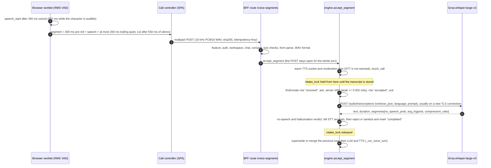
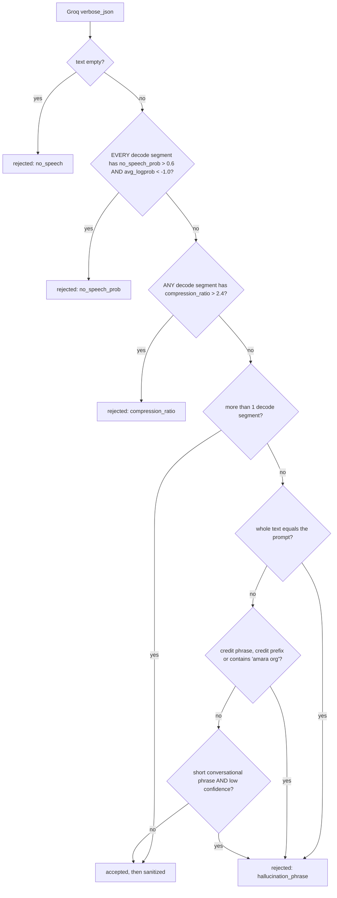
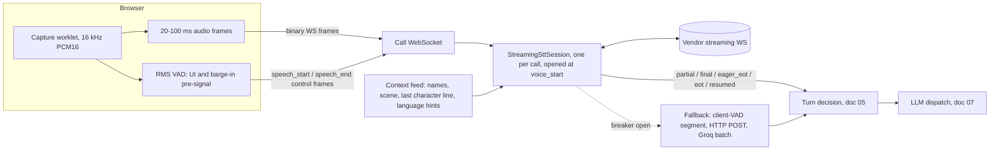

# Speech-to-text for realtime calls

**Research date:** 2026-10-20. **Scope:** the speech-to-text (STT) leg of the Magic Worlds voice call: how the current Groq `whisper-large-v3` batch path works and fails, what it costs in latency and money, how batch-per-utterance compares with streaming STT, the October 2026 provider landscape (hosted and open), Whisper hallucination control, vocabulary biasing for invented names, Spanish and EN/ES code-switching, and a staged plan: quick wins on the current path, then a streaming migration decided by an in-house bake-off. Turn-end detection is covered in [05_turn_taking_and_interruptions.md](05_turn_taking_and_interruptions.md) and transport in [09_transport_and_client_audio.md](09_transport_and_client_audio.md). This document covers them only where they decide the STT choice.

## Summary

- **Today (FACT).** Each utterance is a 16 kHz mono PCM16 WAV. The browser energy VAD cuts it after 550 ms of silence and the SPA uploads it by multipart HTTP POST. The BFF transcribes it with one Groq `whisper-large-v3` request: `verbose_json`, a forced call language, a names-only prompt, and a 30 s timeout. There is no retry, hedge, breaker or fallback, and the request runs under a per-call `intake_lock`. Measured dev STT latency is **526 ms p50 / 1,002 ms p95** (n = 23, clips 0.9-2.1 s). That figure includes a fresh TLS connection on almost every turn, because the httpx pool expires after 5 s and users speak 10-31 s apart.
- **Accuracy is not why to move.** On read Spanish, whisper-large-v3 scores 3.35% WER against about 2.3-2.5% for the leaders ([Open ASR Leaderboard](https://huggingface.co/spaces/hf-audio/open_asr_leaderboard), es CSV modified 2026-10-19). The reasons to move are these:
  - Latency: streaming finals arrive 50-300 ms after the endpoint, and nothing is uploaded after speech ends.
  - Partials and STT-integrated turn detection.
  - Non-speech robustness. Whisper hallucinated on 40.3% of non-speech inputs in an ICASSP 2025 study, and Magic Worlds has no neural VAD anywhere.
  - Groq's 10 s minimum bill per request. Dev clips have a p50 of 1.3 s.
- **Quick wins need no vendor change (P0, days).**
  - Keep-alive plus prewarm: about −80 ms p50, and most 0.5-1.5 s connect stalls disappear.
  - A bounded STT deadline, hedge and fallback, with failure bookkeeping. This fixes C06 and the orphan `accepted` rows (C32).
  - A Silero VAD gate and a suffix-aware, bilingual hallucination filter.
  - A user-derived language hint and a lore-term prompt.
  - Stop charging users for no-speech segments.
  - Turn on Groq ZDR.
  - Add STT metrics.
- **The 2026 frontier of streaming STT is fast, cheap and accurate in English.** On [Artificial Analysis](https://artificialanalysis.ai/speech-to-text/streaming) (extracted 2026-10-20), final WER is 2.5-3.6%, at $0.12-0.54 per audio hour. The [Pipecat benchmark](https://github.com/pipecat-ai/stt-benchmark) (Sept 2026) puts semantic WER at 0.8-1.1% and median time-to-final at about 250-400 ms. Both independent benchmarks are English-only. Spanish streaming numbers exist only as a competitor-run table.
- **Policy narrows the field for an 18+ product.**
  - AssemblyAI's AUP bans "erotic chats".
  - Deepgram retains and trains on audio unless `mip_opt_out=true` is sent.
  - ElevenLabs Scribe zero retention is Enterprise-only, and Scribe requires a capture notice plus 5-year consent records.
  - Soniox stores nothing in real time, never trains, and has no sexual-content clause.
  - Groq is permissive and offers self-serve ZDR.
- **Shortlist for a bake-off:**
  - **Soniox stt-rt-v5**: best value, an 8k-token context window, and the best result on real Spanglish.
  - **Deepgram Flux-multi**: the best Spanish end-of-turn detection among STT-integrated options, but Spanish WER is about 2× the leaders.
  - **ElevenLabs Scribe v2 Realtime**: single vendor with the current TTS.

  Keep Groq batch as the fallback. English rankings flip in Spanish, so decide on in-house bilingual roleplay audio.
- **Migration plan (P2):**
  1. Replace the declared-but-thin `RealtimeSpeechToTextProvider` seam with an event-based streaming session.
  2. Stream 20-100 ms frames over the call WebSocket.
  3. Run shadow mode first.
  4. Then make the streaming final the transcript source.
  5. Then use STT turn signals for eager LLM starts and word-confirmed barge-in.

  Estimated saving on the STT leg alone: about 0.3-0.6 s at p50 and more at p95. The larger gain comes when semantic end-of-turn shortens the 550 ms hang-over.

---

## 1. How STT works today

### 1.1 The path, end to end



Sources: [be-stt](evidence/audit/be-stt.md) §2, [fe-capture](evidence/audit/fe-capture.md), reconciliation K01/K02 in [gap-finding-reconciliation](evidence/audit/gap-finding-reconciliation.md). The architecture as a whole is in [01_current_architecture.md](01_current_architecture.md).

### 1.2 Audio format and segmentation (FACT)

| Item | Value | Where |
|---|---|---|
| Container and codec | RIFF WAV, PCM s16le, 16,000 Hz, mono (256 kbit/s; 32 KB per audio second). It is the only accepted format, because WebM/Opus was removed | `magic-worlds-api/src/services/voice_orchestration/stt.py:14-16`; `magic-worlds-api/src/routes/user/route_voice_call.py:1180-1186`; `magic-worlds-api/src/services/voice_orchestration/server_vad.py:319-322` |
| Uplink | Multipart HTTP POST to `/character-chats/{id}/voice-segments`, sent after the segment closes. The voice WebSocket carries no client audio | `route_voice_call.py:1130`; `src/infrastructure/api/index.ts:5420-5445` |
| End of turn | 550 ms of silence. 800 ms is only the worklet fallback, and 450 ms "strict" is unreachable | `src/features/call/components/CallScreen.tsx:114`; `src/features/interaction/audio/voiceVadProcessor.worklet.js:225` |
| Pre-roll / trailing quiet kept | 300 ms / at most 200 ms | `voiceVadProcessor.worklet.js:44, 48` |
| Minimum speech | 250 ms, or 500 ms while the character is audible | `CallScreen.tsx:114`; `src/features/interaction/hooks/useVoiceCallController.ts:137, 706` |
| Segment cap | 7.5 s until consent and ready, then server limit − 500 ms = 29.5 s | `useVoiceCallController.ts:129, 131, 546-547` |
| Server caps | 30,000 ms and 2,000,000 bytes; declared duration within 500 ms of the samples | `magic-worlds-api/src/services/voice_orchestration/config.py:42-43`; `server_vad.py:285-286` |
| Server "VAD" | Energy gate **off** by default. Only `peak < 0.002` (digital silence) is rejected | `config.py:111-112`; `server_vad.py:222-247` |
| Browser capture | `echoCancellation`, `noiseSuppression` and `autoGainControl` all true, with a raw fallback that turns all three off | `src/features/interaction/hooks/useMicrophoneCapture.ts:80, 83` (per [fe-capture](evidence/audit/fe-capture.md) §2.1) |

The format suits Whisper. Groq downsamples to 16 kHz mono anyway and says WAV gives the lowest latency ([Groq STT docs](https://console.groq.com/docs/speech-to-text), fetched 2026-10-20). The pre-roll and the trimmed trailing quiet limit clipped onsets and end-of-clip hallucinations ([be-stt](evidence/audit/be-stt.md) strength 10). The cost of the format is the upload, which is uncompressed and happens only after speech ends: 20-150 ms on a LAN and about 700 ms on a mobile uplink (INFERENCE, reconciliation §7, row 3). The 29.5 s cap matters: noise can hold a segment open until the cut (C03), and a long segment means a long upload and a long decode, neither of which has been measured (K02).

### 1.3 The Groq request (FACT, `magic-worlds-api/src/services/voice_orchestration/stt_groq_client.py`)

- **Model pinned in three places.** `whisper-large-v3` is the only allowed value (`config.py:20, 120-125`; re-checked at `stt_groq_client.py:59-64`). Switching to turbo needs a code change.
- **Multipart fields** (`stt_groq_client.py:66-84`):
  - `model`;
  - `response_format=verbose_json`;
  - `timestamp_granularities[]=segment`;
  - `language`, when a valid hint exists;
  - `prompt`, when it is 1-200 characters after whitespace collapse;
  - the WAV file, named `voice-{voice_session_id}-{seq}.wav`.
  - No `temperature` is sent (provider default 0), and no word timestamps are requested.
- **HTTP client** (`:139-145`): one lazily created `httpx.AsyncClient` per process, with library defaults: `keepalive_expiry=5.0` s, no HTTP/2, no warm-up.
- **Timeout** (`:548-556`): with the 30 s default, connect is 5 s, read 30 s, write 30 s and pool 5 s. There is no overall deadline. The default is env-tunable from 0.1 to 120 s (`config.py:47-49`).
- **One attempt.** `TimeoutException` maps to `stt_timeout`, other transport errors to `provider_submission`, 429 to `stt_rate_limited` with `Retry-After`, and 5xx or other 4xx to `provider_submission` (`:99-108`, `:517-545`). Timeouts and connection errors are not logged by the adapter.
- **Measured latency.** `latency_ms` wraps the whole `post` (`:89-109`), so it includes connection setup.
- **Strict response parsing** (`:340-415`). Every decode segment must carry `avg_logprob`, `compression_ratio` and `no_speech_prob`. If any is missing, the reply is a contract failure (BE-STT-16).

### 1.4 Language forcing (FACT)

- **Resolution.** The call language is resolved once at call start, in this order (`magic-worlds-api/src/services/speech/resolver.py:734-745`; `route_voice_call.py:592-609`):
  1. **turn language**, the language of the chat's newest completed *assistant* message, skipping call turns (`magic-worlds-api/src/database/mysql/turn_language.py:22-50`);
  2. the voice's language;
  3. the user's preferred language;
  4. none.
- **The same value becomes `stt_language`** and is sent on every segment for the whole call (`magic-worlds-api/src/services/voice_orchestration/engine.py:2224-2230`).
- **Normalization.** `normalize_language_code` keeps the primary subtag and accepts any 2-3-letter code (`magic-worlds-api/src/services/speech/types.py:129-139`). Groq expects ISO-639-1.
- **The detected language is ignored.** Groq returns `language`, and the code parses it into `SttTranscript.language`, but nothing reads it (C33, BE-STT-07).
- **Why it matters.** The hint describes the *character's* last language, not the caller's. Pinning a language helps short clips, because Whisper's language ID is unreliable on them ([r03](evidence/research/r03-streaming-stt.md) §4). But a caller who speaks a different language from the character's last reply is transcribed under the wrong forced language. With Whisper this typically yields a translation or garbled text (INFERENCE, known Whisper behaviour; not measured here). See §6.

### 1.5 Vocabulary prompt (FACT)

- **Content.** `call_stt_prompt(character.name, persona.name)` produces, for example, `"Lyra Emberwick, Aria."`. It is deduplicated case-insensitively and fixed at call start (`magic-worlds-api/src/services/voice_orchestration/stt.py:21-41`; `route_voice_call.py:701-711`).
- **Over-length prompts are dropped, not truncated.** Anything over 200 characters is discarded (`stt.py:22, 41`), although Whisper allows 224 tokens.
- **Gaps.** There are no world, place, faction or item names. Nothing changes when the scene changes (BE-STT-13). See §5.

### 1.6 No-speech and hallucination filter (FACT, `stt_groq_client.py:218-317`)



- **Decode thresholds.** The thresholds are Whisper's own defaults: `no_speech_prob > 0.6 AND avg_logprob < -1.0`, and `compression_ratio > 2.4` (`:223-225`).
- **Compression ratio rejects instead of retrying.** Whisper itself retries a high-ratio decode at a higher temperature. Here the transcript is rejected, as the code comment at `:220-222` admits.
  - The verifier showed that a trip needs about 9-12 repetitions. For example, "Sí, sí, sí." has a ratio of only 0.83.
  - So the realistic risk is a tail loop discarding a real utterance (C74, BE-STT-06, low).
  - That risk grows with the 29.5 s cap (K02).
- **Phrase lists.** Phrase checks run only when the reply has a single decode segment, and they match the **whole** transcript (`:278-300`).
  - Credit phrases cover English and Spanish, including "gracias por ver" and "suscríbete" (`:234-251`).
  - Credit prefixes include "subtítulos realizados por" and "subtitulado por" (`:252-262`).
  - Short conversational phrases ("you", "thank you", "gracias", "bye") are dropped only at low confidence: `no_speech_prob ≥ 0.3` or `avg_logprob ≤ -0.5` (`:263-275`).
  - Matching ignores case, accents and punctuation (`:313-317`).
- **Rejections are silent.** A rejected transcript carries no text, and only the reason is logged. The client treats `no_speech` as silent (`src/features/interaction/hooks/useVoiceCallController.ts:179`), so the user gets no "didn't catch that".
- **Billing runs before the verdict.** STT is billed before the no-speech check (`engine.py:2243-2252`), so rejected noise is charged to the user (C62).

### 1.7 Serialization and bookkeeping around STT (FACT)

- **`intake_lock` serializes intake per call.** The lock is held across row creation, server VAD, the Groq request, STT billing and the `completed` update (`engine.py:2051-2061`, `:2124-2284`).
  - A stalled STT therefore queues every later segment of the call.
  - The fourth in-flight segment gets HTTP 429 `busy` (`MAX_INFLIGHT_SEGMENTS_PER_CALL = 3`, `engine.py:83`).
- **DB cost around STT is small.** Using measured unit costs, it is about 13-14 ms before STT and about 17-18 ms after it, at p50 ([gap-topology-rtt-measurements](evidence/audit/gap-topology-rtt-measurements.md) §8.1). The serial DB chain (C19) matters more for the LLM dispatch than for STT ([07_llm_in_the_voice_loop.md](07_llm_in_the_voice_loop.md)).
- **Synchronous WAV statistics.** `_pcm16_stats` takes about 1.1 ms per audio second on the event loop (BE-STT-19). That is under 35 ms even for a 30 s segment.

### 1.8 Connection reuse (FACT and MEASURED)

| Fact | Evidence |
|---|---|
| The Groq client is process-wide, but its pooled connections expire after 5 s idle (httpx default) | `stt_groq_client.py:139-145`; `httpx/_config.py:178` |
| No STT prewarm exists. Only the TTS socket and the moderation plan are warmed during intake | `engine.py:2043-2044` |
| Gaps between user utterances in real dev calls were 10-31 s (16 of 16 on 2026-10-20) | [gap-topology-rtt-measurements](evidence/audit/gap-topology-rtt-measurements.md) §1, verifier |
| Cold vs pooled penalty to `api.groq.com`: **+80 ms p50** (re-measured +78). TCP+TLS took more than 500 ms in 16 of 80 samples, with 1.1-1.5 s outliers (1 s initial-RTO retransmits) | same, §5.2-5.3 |
| Groq's edge keeps idle connections for at least 125 s. The 5 s client expiry is the only reason connections go cold | same, §5.4 |

So almost every STT request after a call's first one opens a new TLS connection (GAP-TOPOLOGY-RTT-MEASUREMENTS-02, high; C09 (BE-STT-04), which the reconciliation verifier rated medium and the register in [03](03_audit_findings.md) rates high). The measured 526 ms p50 already includes that cost.

### 1.9 Billing (FACT unless marked)

| Who pays | Rule | Effect |
|---|---|---|
| **Operator → Groq** | $0.111 per audio hour, with a **10 s minimum per request**. Turbo is $0.04/h, with the same minimum ([Groq STT docs](https://console.groq.com/docs/speech-to-text), fetched 2026-10-20) | A floor of about $0.0003 per request. Dev clips have a p50 of 1.3 s, so each is billed about 7.6× its length (INFERENCE: 10 / 1.312). At 4-8 segments per call-minute that is about **$0.0012-0.0025 per call-minute** ([be-stt](evidence/audit/be-stt.md) §7). That is small next to TTS, which is about $0.028/min on the ElevenLabs lane ([r10](evidence/research/r10-cost-scaling-ops.md) §3) |
| **User → Magic Worlds** | STT seconds are Groq's `duration` of the uploaded WAV. They count toward 1 credit per 10 s of STT + TTS audio (`engine.py:81, 2243-2251`) | Charged before the no-speech verdict, so noise and hallucination rejections cost the user (C62). Each segment carries about 0.5 s of padding: 300 ms pre-roll plus at most 200 ms trailing quiet. GAP-REAL-CALL-OVERLAP-HISTORY-BILLING-02 (verifier-corrected from 0.85 s, medium). The user is not charged the 10 s floor |
| Late STT | An STT that finishes after `end_call` still bills, after the quota was settled (BE-STT-17, C62) | Small, reconciliation anomaly |

Rate limits are a separate concern.

- **Documented limits.** Groq's docs show 20 RPM, 2K requests/day and 7.2K audio-seconds/hour for Whisper. The table is unlabeled, described as "base limits for the Developer plan" ([Groq rate limits](https://console.groq.com/docs/rate-limits), fetched 2026-10-20).
- **What they support.** At about 4 utterances per call-minute, 20 RPM supports only about 5 concurrent calls, against a default `VOICE_GLOBAL_CONCURRENCY` of 8 (`config.py:41`).
- **Unknown.** Whether the audio-seconds limit counts the 10 s floor is UNKNOWN (BE-STT-14; [r10](evidence/research/r10-cost-scaling-ops.md) §6). The org's real tier must be read in the console.

### 1.10 Measured performance (dev, small n)

| Measure | Value | Source |
|---|---|---|
| STT `latency_ms`, Groq `whisper-large-v3` | min 422, **p50 526**, p90 847, **p95 1,002**, max 1,481, mean 606 ms (n = 23) | X04 in [gap-finding-reconciliation](evidence/audit/gap-finding-reconciliation.md) §6 and verifier |
| Clip length | p50 1,312 ms, max 2,092 ms. All clips were 3 s or shorter | same |
| Groq inference share | About 15-30 ms for a 3-5 s clip at about 189× real time (INFERENCE). Most of the 526 ms is network, connection setup, upload and queueing | [be-stt](evidence/audit/be-stt.md) §6 |
| Warm request on a reused Groq connection (`/models`, curl) | 103-124 ms TTFB, one at 265 | [gap-topology-rtt-measurements](evidence/audit/gap-topology-rtt-measurements.md) §5.2 |
| STT inside the reconciled speech-end-to-first-audio total (EL lane, moderation off) | 3.2-4.2 s at STT p50, 3.6-4.7 s at STT p95. Hang-over, STT and the LLM hop make up about 80% of the total | reconciliation §7; [02_turn_lifecycle_and_latency.md](02_turn_lifecycle_and_latency.md) |
| Outcomes of 24 user segments | 17 completed, 5 `failed/internal`, 1 cancelled, 1 stuck `accepted` | [gap-real-dev-call-forensics](evidence/audit/gap-real-dev-call-forensics.md) §3 |

The 5 `failed/internal` segments are **not STT failures**. STT completed for all five.

- **Two** died in the Fish word ledger on markup cleanup (GAP-REAL-DEV-CALL-FORENSICS-01).
- **Three** failed before LLM admission with an unknown non-orchestration exception (GAP-REAL-DEV-CALL-FORENSICS-03).

The one stuck `accepted` row *is* an STT failure (C32 / BE-STT-03; GAP-REAL-DEV-CALL-FORENSICS-10, verifier-rated low). The next segment arrived 18 s later and was admitted, so that STT failed fast, not on the 30 s timeout. The user saw a non-fatal "upload failed" notice and repeated the greeting (INFERENCE from the transcript length class).

### 1.11 Failure modes (canonical findings)

| Canonical (original) | Severity | What happens | Evidence |
|---|---|---|---|
| **C01** (BE-STT-01, BE-STT-10, FE-CAPTURE-03) | high | STT cannot start until the hang-over and the full upload finish. There are no partials and no streaming | `stt_groq_client.py:36-39`; `magic-worlds-api/src/services/speech/interfaces.py:88-98` |
| **C06** (BE-STT-02, BE-ENGINE-TURNTAKING-12, E2E-LATENCY-TRACE-12, BE-ROUTE-TRANSPORT-10) | high | A Groq stall gives up to 30 s of silence, and every later segment of the call queues behind `intake_lock`. The client resends only on a network `TypeError`, never on 502/504. A resend with the same `seq` returns `duplicate` from the stored row, so even a correct retry cannot recover the utterance | `config.py:47`; `stt_groq_client.py:548-556`; `engine.py:2051`; `useVoiceCallController.ts:597-608` |
| **C32** (BE-STT-03) | medium | An STT exception leaves the row `accepted` forever, with no event and no metric. One such row is in the dev DB | `engine.py:2205, 2228`; [gap-real-dev-call-forensics](evidence/audit/gap-real-dev-call-forensics.md) §5.4 |
| **C09** (BE-STT-04), GAP-TOPOLOGY-RTT-MEASUREMENTS-02 | high | A cold TLS connection on almost every turn: +80 ms p50 for Groq, with 0.5-1.5 s tails | §1.8 |
| **C03** (BE-STT-08, FE-CAPTURE-02) | high | No neural VAD runs anywhere. Every client false trigger becomes a billed Groq request and a hallucination risk | `config.py:111`; `server_vad.py:222-247` |
| **C05** (FE-CAPTURE-01 and others) | high, conditional | With AEC off, on the raw fallback or in the 3 s warm-up, the character's own audio is uploaded. Any non-empty transcript supersedes the reply, and there is no server echo filter | [05_turn_taking_and_interruptions.md](05_turn_taking_and_interruptions.md) |
| **C33** (BE-STT-07) | medium | The language is forced from the character's last language for the whole call. The detected language is unused, and codes outside Whisper's list would return HTTP 400 on every segment | §1.4 |
| **C13** (BE-STT-09) | medium | No STT histogram, error counter, 429 share or no-speech rate. `voice_stt_completed` and `voice_segment_rejected` are logged but never aggregated. Per-segment `stt_summary.latency_ms` is persisted, and that is how X04 was measured | `magic-worlds-api/src/services/speech/metrics.py:756-769` |
| **C74** (BE-STT-06) | low | `compression_ratio > 2.4` on any segment rejects the whole transcript | §1.6 |
| **C62**, **C63** (BE-STT-17, BE-STT-12, FE-CAPTURE-12) | low | Users are charged for no-speech and late STT. The 10 s floor is amplified by one request per segment | §1.9 |
| **C64** (BE-STT-11) | low | `transcript_final` is sent at BFF admission, not right after STT. It still reaches the UI before LLM TTFT | `engine.py:2571-2595` |
| BE-STT-13, -14, -15, -16, -18, -19 (singles, unverified, low) | low | Thin prompt; rate limits; prompt read-back matched only as a whole; strict response contract; `http` base URL accepted and the session id in the filename; synchronous WAV statistics | [be-stt](evidence/audit/be-stt.md) §8 |
| **C15** (BE-STT-21, info alias) | medium | The STT verdict cannot stop a false barge-in. The cough has already cut the reply before the STT result says "no speech" | [05_turn_taking_and_interruptions.md](05_turn_taking_and_interruptions.md) |

The complete register is in [03_audit_findings.md](03_audit_findings.md).

### 1.12 What is done well (keep it in any redesign)

- **A clean provider seam.** The `SegmentSpeechToTextProvider` protocol and the `build_stt_client` factory already exist (`stt.py:109-141`), and a realtime protocol is already declared (`interfaces.py:95-98`).
- **Layered hallucination defence.** It includes bilingual credit lines, confidence-gated conversational phrases and prompt read-back detection, and it has extensive unit tests.
- **Privacy by construction.** Raw audio is never persisted or logged, the provider request id is hashed, and secrets are redacted.
- **Idempotent intake.** A SHA-256 check and an idempotency key protect intake, and STT billing has its own idempotency key.
- **Prewarm overlap.** The TTS socket and the moderation plan warm while STT runs.
- **Rich per-segment telemetry.** `stt_summary` already stores `latency_ms`, `no_speech_prob`, `avg_logprob` and `compression_ratio`.

---

## 2. Batch per utterance vs streaming

### 2.1 Trade-offs

| Dimension | Batch per utterance (today) | Streaming STT |
|---|---|---|
| Latency after the endpoint | Upload, then the full request, in series. Dev: 526 ms p50 / 1,002 ms p95 for STT alone | The final is ready 50-300 ms after a forced endpoint (AA 54-192 ms for frontier models; Pipecat TTFS medians 247-307 ms) |
| Partials | None | Live captions, eager LLM starts, word-confirmed barge-in |
| Turn detection | Only the client energy VAD with a fixed 550 ms silence | Built-in semantic or acoustic end-of-turn: Flux, Soniox `<end>`, AssemblyAI, Cartesia Ink-2, Scribe `turn_prediction` |
| Long turns | A pause over 550 ms splits a turn. Noise can hold a segment open to 29.5 s | One stream per call. Turn boundaries come from the STT and the turn model |
| Accuracy | Full bidirectional context; whisper-large-v3 es 3.35% (OASR, read speech) | Typically 1-3 points worse than batch on the *same* model ([Coval](https://www.coval.ai/blog/best-speech-to-text-providers-in-2026-independent-benchmarks-and-how-to-choose/), 2026-06-04, secondary). Frontier streaming models still match or beat Whisper batch |
| Non-speech hallucination | High risk: Whisper's language-model prior free-runs over noise | Lower for transducer/CTC models. LLM-decoder STTs (gpt-*, Voxtral) can still hallucinate ([r03](evidence/research/r03-streaming-stt.md) §6.2) |
| Billing unit | Per request, with a 10 s minimum (Groq) | Per streamed audio second (Soniox, Deepgram) or per **session time including idle** (AssemblyAI) |
| Engineering | Stateless HTTP. Retries and fallbacks are trivial | A long-lived WebSocket per call: reconnect and resume, ordering, partial revisions, concurrency caps, and a different event model per vendor |
| Portability | High (OpenAI-compatible endpoint) | Low. An adapter layer is mandatory |

### 2.2 Where the time goes (estimates, typical turn)

```mermaid
gantt
    title Speech end to transcript ready (ms, estimates; dev STT p50)
    dateFormat x
    axisFormat %S.%L
    section Today (batch)
    Hang-over 550 ms                 :a1, 0, 550
    Upload, route, intake (~130)     :a2, 550, 680
    Groq STT p50 526 (incl. cold TLS):a3, 680, 1206
    STT billing and row (~25)        :a4, 1206, 1231
    section Streaming, same 550 ms endpoint
    Hang-over 550 ms                 :b1, 0, 550
    Finalize (~250)                  :b2, 550, 800
    section Streaming plus semantic end-of-turn
    Endpoint on complete utterance (~300) :c1, 0, 300
    Finalize (~250)                  :c2, 300, 550
```



- **Today.** The rows add the measured hang-over and STT p50 to inferred upload, route and bookkeeping times (reconciliation §7; topology §8.1). At STT p95, the batch row ends near 1.7 s.
- **Streaming.** The ~250 ms "finalize" is the Pipecat median class for frontier vendors. Pipecat counts it from a VAD stop already 200 ms after speech end, so it is a conservative stand-in for a forced finalize.
- **Semantic end-of-turn.** The ~300 ms endpoint for a complete utterance follows the dynamic hang-over proposed in [r94](evidence/research/r94-gap-g4-contradictions-reconcile.md) §4.2, item 5. That decision belongs to [05_turn_taking_and_interruptions.md](05_turn_taking_and_interruptions.md).
- **Bottom line.** The STT leg alone is worth about 0.3-0.6 s at p50 and about 0.7-1.3 s at p95 (INFERENCE). Most of the remaining gap to state of the art is the endpoint and the LLM hop ([02_turn_lifecycle_and_latency.md](02_turn_lifecycle_and_latency.md)).

### 2.3 Hybrid patterns used in production

These come from [r03](evidence/research/r03-streaming-stt.md) §6.2.

1. **Streaming for the turn, batch for the record.** The streaming final drives the live turn. An asynchronous batch re-transcription (Groq turbo at $0.04/h, or Soniox async at $0.10/h) feeds stored history, memory and moderation, if a bake-off shows an accuracy gap.
2. **Streaming primary, batch fallback.** When the vendor WebSocket fails, fall back to the current client-VAD and Groq path. That is today's code, kept warm as a fallback.
3. **Client-VAD-gated stream.** Send audio only from `speech_start` minus the pre-roll until N seconds after the endpoint, with keep-alives in between. This cuts per-second cost, but STT-side barge-in confirmation then cannot run while the character speaks.

---

## 3. Provider landscape (October 2026)

All vendor facts in this section come from the fact-checked notes [r03](evidence/research/r03-streaming-stt.md), [r92](evidence/research/r92-gap-g2-spanish-bilingual-evidence.md), [r91](evidence/research/r91-gap-g1-vendor-policy-retention-matrix.md) and [r10](evidence/research/r10-cost-scaling-ops.md). Their primary sources are linked inline, with dates.

### 3.1 How to read the numbers

- **[Artificial Analysis AA-WER Streaming](https://artificialanalysis.ai/speech-to-text/streaming)** (live page; values extracted 2026-10-20) is independent.
  - The audio set is about 8 h of English: AgentTalk 50%, VoxPopuli 25% and Earnings22 25%.
  - "Time to final" runs from the Silero-detected end of speech to transcript availability. It is **not** the vendor's turn decision. Deepgram Flux shows 21 ms there, while its own end-of-turn decision is about 260 ms (vendor-reported).
- **[Pipecat STT benchmark](https://github.com/pipecat-ai/stt-benchmark)** (README, Sept 2026; method in [Daily, 2026-02-13](https://www.daily.co/blog/benchmarking-stt-for-voice-agents/)) is also independent.
  - It streams 1,000 English turns as 16 kHz PCM from one US location.
  - TTFS runs from a 200 ms Silero stop to the last final.
  - Semantic WER is LLM-judged. Differences under about 0.25 pp among the leaders are inside the 95% CI.
  - Flux is excluded, because turn detection was disabled where possible.
- **Neither benchmark has Spanish.** The only broad independent Spanish data is batch, on read speech: the [Open ASR Leaderboard es track](https://huggingface.co/datasets/hf-audio/multilingual_evals/resolve/main/multilingual_es.csv) (modified 2026-10-19). Spanish *streaming* WER exists only as a table that AssemblyAI ran on competitors ([assemblyai.com/benchmarks](https://www.assemblyai.com/benchmarks), runs 2026-08-25 to 2026-09-23). It is labelled [VEND-RUN] below.
- **Rules for comparing.**
  - Never compare a batch number with a streaming number.
  - Never extrapolate English rankings to Spanish ([r92](evidence/research/r92-gap-g2-spanish-bilingual-evidence.md) §2.3 shows a real ranking flip).
  - Vendor latency claims can be 2-5× off. Gladia advertises about 270 ms finals (vendor-reported); AA measured 1.52 s.

### 3.2 Hosted streaming STT: latency, accuracy, price (independent, English)

| Model (vendor) | AA final WER / first-partial WER | AA time to final (to first partial) | Pipecat semantic WER / TTFS median / p95 | List price per audio hour | Turn features |
|---|---|---|---|---|---|
| **Soniox stt-rt-v5** (released 2026-06-16) | 4.50% / 4.71% | **54 ms** (47) | 1.11% / 260 / 305 ms | **$0.12** (context billed at $4 per 1M tokens) | Semantic `<end>` endpoint, tunable (`endpoint_latency_adjustment_level`, `endpoint_sensitivity`, `max_endpoint_delay_ms` 500-3,000), manual finalize |
| **AssemblyAI Universal-3.6 Pro RT** (min latency) | 3.57% / 3.57% | 192 ms (188) | **0.89%** / 307 / 401 ms | $0.45, billed on **session time, idle included** | Punctuation-based turns after `min_turn_silence`; `ForceEndpoint`; `mode` presets |
| **Deepgram Nova-3 RT** | 6.59% / 6.59% | 66 ms (64) | 1.32% / **247 / 298 ms** | $0.29 mono, $0.35 multi (promotional) | n/a in evidence |
| **Deepgram Flux** (EN; `flux-general-multi` for 10 languages incl. es) | 7.39% / 7.39% (EN) | 21 ms transcript; about 260 ms end-of-turn (vendor-reported) | excluded | $0.39 EN (promotional), $0.47 multi | `EagerEndOfTurn` / `TurnResumed` / `EndOfTurn`; `Configure` mid-stream; eager end-of-turn raises LLM calls by 50-70% (vendor-reported) |
| **ElevenLabs Scribe v2 Realtime** | 3.59% / 3.59% | 141 ms (134) | 3.05% / 281 / 348 ms | $0.39 (+$0.08 keyterms) | `commit_strategy` manual / vad / `turn_prediction` |
| **Speechmatics Agent STT (Linden 1)** (2026-09-17) | 4.42% / 4.58% | 157 ms (128) | 1.11% / 369 / 438 ms | $0.30 list (about $0.16 at volume) | Pause-based; "smart turn" coming soon |
| **Cartesia Ink-2** | 3.36% semantic endpoints / 4.02% external endpoints | 431 ms / 67 ms | 1.14% / 299 / 328 ms (p99 1,584 ms in the Aug snapshot) | About $0.24 (AA-normalized; Cartesia's own figures conflict, unverified) | `turn.start/update/eager_end/resume/end` |
| **Microsoft MAI-Transcribe-2-Streaming** (2026-10-01) | **2.51%** / 2.52% | 128 ms (122) | not listed | $0.54 intro price through end of 2026 | Not documented in the sources checked |
| **Google Gemini 3.5 Transcribe Live** | 4.00% / 5.77% | 395 ms (250) | 1.93% / 458 / 532 ms | About $0.54 (blended about $0.009/min) | Not documented in evidence |
| **OpenAI gpt-live-transcribe** | 3.92% / 6.35% | **812 ms** (256) | not listed | **$1.02** | None: client VAD plus `input_audio_buffer.commit`; 24 kHz PCM input |
| **OpenAI gpt-realtime-whisper** | 4.89% / 7.31% | 688 ms (206) | 2.41% / 740 / 878 ms | $1.02 | Not in the current realtime-transcription guide |
| **Gladia Solaria-1 RT** | 7.82% / 9.14% | **1,523 ms** (431) | not listed | €0.68 self-serve | Auto language detection, custom vocabulary |
| **Groq whisper-large-v3** (batch, current) | n/a (batch) | n/a: endpoint + upload + **526 ms p50 / 1,002 ms p95** (dev) | not listed | $0.111, 10 s minimum per request | None |
| Groq whisper-large-v3-turbo (batch) | AA batch AA-WER 4.62% | n/a | not listed | $0.04, 10 s minimum | None |

Sources:

- AA and Pipecat rows: [r03](evidence/research/r03-streaming-stt.md) §2, fact-check rows 1 and 3.
- Deepgram: [pricing](https://deepgram.com/pricing) and the [Flux quickstart](https://developers.deepgram.com/docs/flux/quickstart), both accessed 2026-10-20.
- AssemblyAI: [pricing](https://www.assemblyai.com/pricing) and the [U3 Pro streaming API](https://www.assemblyai.com/docs/api-reference/streaming-api/universal-3-pro-streaming).
- Soniox: [pricing](https://soniox.com/pricing) and [models](https://soniox.com/docs/stt/models).
- ElevenLabs: [realtime STT API](https://elevenlabs.io/docs/api-reference/speech-to-text/v-1-speech-to-text-realtime) and [API pricing](https://elevenlabs.io/pricing/api).
- OpenAI: [realtime transcription guide](https://developers.openai.com/api/docs/guides/realtime-transcription) and [pricing](https://developers.openai.com/api/docs/pricing).
- Speechmatics: [Linden 1 launch](https://www.speechmatics.com/company/articles-and-news/meet-agent-stt-powered-by-linden-1-fast-accurate-speech-recognition), 2026-09-17.
- Cartesia: [changelog](https://docs.cartesia.ai/changelog).
- MAI: [TechCity Authority](https://www.techcityauthority.com/2026/10/microsoft-ai-streaming-transcription-model.html), 2026-10.
- Groq: [STT docs](https://console.groq.com/docs/speech-to-text) and [AA batch STT](https://artificialanalysis.ai/speech-to-text).
- Gemini blended price: [r10](evidence/research/r10-cost-scaling-ops.md) §3.

Reading:

- **Frontier.** The two independent benchmarks agree on a low-latency, high-accuracy frontier: AssemblyAI U3.x Pro, Soniox, Speechmatics Linden, Cartesia Ink-2 and Deepgram Nova-3. They also agree that OpenAI, Google Chirp/Gemini, Azure and AWS are 2-5× slower to final ([r03](evidence/research/r03-streaming-stt.md) §2.2).
- **First-partial stability.** When first-partial WER equals final WER, the model commits only stable words. That holds for AssemblyAI, Scribe, Deepgram, Zoom and Inworld. Such partials are safe to speculate on. Large gaps make speculation wasteful: Qwen3 ASR Flash is at 19.9% first-partial vs 3.7% final.
- **Deepgram's English accuracy now trails** (Nova-3 6.6%, Flux 7.4% on AA). Its latency, tail and turn features still lead. Its Pipecat p95 of 298 ms is the best hosted tail.
- **OpenAI streaming transcription** is accurate but the slowest to final and the most expensive. It only makes sense inside an OpenAI-centric stack. Deprecation note: OpenAI deprecated `whisper-1`, `gpt-4o-transcribe` and `gpt-4o-mini-transcribe` on 2026-08-26, with shutdown on **2027-02-26** ([deprecations](https://developers.openai.com/api/docs/deprecations)). Any fallback plan that names those models is already expiring. This includes the `gpt-4o-mini-transcribe` fallback proposed in [r10](evidence/research/r10-cost-scaling-ops.md) §7 and §13.
- **Other 2026 entrants worth one line.**
  - xAI Grok Voice Transcribe 2.0: AA 2.73%, but 1.3 s median TTFS in Pipecat.
  - Meta Muse Voice Transcribe: best Pipecat semantic WER at 0.80%, but 1.29 s p95, and commercial terms are unclear.
  - Inworld STT 1 Realtime: AA 4.18% / 71 ms at about $0.08/h.
  - Fish `transcribe-stream-1`: preview, $0.36 per session-hour, and it shares the TTS concurrency pool.

### 3.3 Spanish and EN/ES code-switching

| Model | OASR batch es avg WER (sibling) [IND] | Streaming FLEURS-es / CV-es WER [VEND-RUN] | Real Spanglish "Miami 10 h" (spliced EN↔ES) [VEND-RUN] | Spanish end-of-turn, eot-bench es: FC@600 ms / latency@5% FC [OPEN-VEND] | Code-switching mechanism |
|---|---|---|---|---|---|
| **Groq whisper-large-v3** (current) | **3.35** (FLEURS 2.30); turbo 3.85 | not run | not run. Whisper-family GPT-4o-transcribe scored **61.27% (39.66%)** | Current approach is close to the "VAD only" baseline: **24.5% / 1,200 ms** | One `language` per request, fixed per call |
| **Soniox** | async-v5 3.37 | 5.0 / 6.0 | **21.93%** (12.12%), best of all | 11.4% / 800 ms; only 75.8% of turn ends detected (run on `stt-rt-preview` before v5 GA) | Per-token language labels; `language_hints`; "single language strongly recommended" for restriction |
| **AssemblyAI U3.6 Pro RT** | U3.5 Pro 2.52; U3 Pro 2.49 | 4.1 / **3.2** | 24.28% (**9.59%**) | Not tested. The older `universal-streaming-multilingual` scored 18.3% / 1,031 ms | Native mid-sentence switching, 32 languages |
| **Deepgram Flux-multi / Nova-3** | not in the track | Flux **7.8 / 7.8**; Nova-3 8.9 / 8.4 | Nova-3 Multi 29.91% (16.66%); Flux-multi not run | **Flux-multi 8.7% / 820 ms**, 98.5% detected (no `language_hint`) | `language_hint`, replaceable mid-stream via `Configure` |
| **ElevenLabs Scribe v2 RT** | scribe_v2 2.32 | 4.6 / 5.8 | 27.09% (14.27%) | not run | `language_code` + `secondary_languages`. Code-switching undocumented, and "smart language detection" is listed for batch only |
| OpenAI | gpt-transcribe 2.74 | GPT-4o-transcribe 4.3 / 8.9; GPT Realtime 5.7 / 6.9 | GPT-4o-transcribe 61.27% (39.66%) | GPT Realtime 2 semantic VAD: latency@5% 1,044 ms | `languages` array |
| Google Gemini | not listed | Gemini 3.5 Live **3.8** / 4.0 | Gemini 3.5 Transcribe Live 40.69% (14.40%) | not run | not documented |
| Speechmatics | enhanced 2.74 | Enhanced 4.7 / **2.5** | 36.04% (33.75%), probably run without its bilingual pack | not run | `language: es` + `domain: bilingual-en` |
| Gladia | not listed | 6.7 / 7.8 | 34.49% (18.39%) | not run | Auto language detection |
| Cartesia | not listed | Ink-Whisper 9.0 / 10.4. Ink-2 has had Spanish since Sept 2026, with no numbers | not run | not run | not documented |
| Nemotron 3.5 ASR Streaming (open) | 5.43 | FLEURS-es 4.87 / 4.39 / 4.11% at 80 ms / 320 ms / 1.12 s chunks (vendor-reported) | not run | not run | `target_lang=auto`; es-US and es-ES locales |
| Voxtral Mini 4B Realtime (open) | 4.18 | FLEURS-es 3.31% at 480 ms delay (vendor-reported); hosted "Voxtral Mini" 4.8 / 5.7 [VEND-RUN] | not run | not run | not documented |

Sources:

- [r92](evidence/research/r92-gap-g2-spanish-bilingual-evidence.md) §2.2, §3.1-3.4 and fact-check rows 5-14.
- eot-bench: [livekit/eot-bench](https://github.com/livekit/eot-bench), es results committed by 2026-09-14. It is LiveKit's harness and data, independent of the other vendors.
- AssemblyAI tables: [assemblyai.com/benchmarks](https://www.assemblyai.com/benchmarks).

Reading for Magic Worlds:

- **Read Spanish is easy for everyone (2-5%). Real Spanglish is hard for everyone (22-61%).** Leaderboard numbers will understate errors on emotional roleplay speech with invented names.
- **Turn detection and accuracy point to different vendors in Spanish.**
  - Flux-multi has the best Spanish end-of-turn of the STT-integrated options, but about 2× the leaders' Spanish WER, in a competitor-run table. A May 2026 community thread also reports Spanish misrecognitions ([discussion #1605](https://github.com/orgs/deepgram/discussions/1605)).
  - Soniox loses its English end-of-turn lead in Spanish, but leads on real Spanglish.
  - AssemblyAI U3.6 Pro leads on accuracy, but its Spanish end-of-turn is untested, and its policy excludes it from 18+ lanes (§3.5).
- **Whisper-family models are weak on code-switching.** GPT-4o-transcribe scored 39.7% and 61.3%. Inference: forced-`es` whisper-large-v3 is unlikely to do better on mixed turns (not measured).

### 3.4 Vocabulary, context and mid-call updates

| Vendor | Mechanism | Capacity | Update mid-call | Notes |
|---|---|---|---|---|
| Groq Whisper (today) | `prompt` (style and spelling prior) | 224 tokens (the code caps at 200 characters and drops longer prompts) | Per request | Over silence, the model can read the prompt back. The code checks only a whole-prompt match |
| **Soniox** | `context`: `general` key-values, `text` free-form, `terms`, `translation_terms` | **8,000 tokens** (about 10,000 characters) | Not stated in the sources checked; per session | `terms` is explicitly meant to fix the spelling of difficult names |
| AssemblyAI U3.x Pro | `keyterms_prompt`, `prompt`, **`agent_context`** (the agent's last TTS line) | 100 keyterms; 1,750 characters each for prompt and agent_context (whether prompt and keyterms combine is unverified) | Yes, `UpdateConfiguration` | `agent_context` is the "last character line as a prior" pattern |
| Deepgram Nova-3 / Flux | `keyterm` | 500-token hard cap ("up to 100" is guidance; 20-50 recommended); +$0.08/h | Yes, `Configure` (Nova-3 mid-stream since 2026-10-02; acknowledged since 2026-10-19) | **Malformed terms silently boost nothing.** Keyterms on `flux-general-multi` are unconfirmed |
| ElevenLabs Scribe v2 RT | `keyterms`; `previous_text` | **50 terms of 20 characters or fewer**; `previous_text` only with the first chunk | Not documented | +$0.08/h |
| Speechmatics Linden 1 | Custom vocabulary | 1,000 words | not checked | |
| OpenAI realtime transcription | `prompt` + non-binding `keywords` | Each keyword one line, no `<` or `>` (otherwise `session.update` is rejected) | `session.update` | |
| Cartesia Ink-2 | Keyterm prompting (since July 2026) | Limits not checked | not checked | |
| NVIDIA NeMo (open) | GPU-PB phrase boosting at decode time | n/a | n/a | Streaming support not documented (verify) |

Sources: [r03](evidence/research/r03-streaming-stt.md) §3 and §0 item 5, with vendor docs linked there (all accessed 2026-10-20).

### 3.5 Policy and retention fit for 18+ fiction (STT role)

"Allowed" means the vendor's published text does not prohibit it. Every vendor keeps discretionary catch-alls, so a written confirmation is still needed for the explicit (T2) lane ([r91](evidence/research/r91-gap-g1-vendor-policy-retention-matrix.md), not legal advice). Full analysis is in [14_safety_policy_and_compliance.md](14_safety_policy_and_compliance.md).

| Vendor (policy version) | Explicit adult fiction (T2) in transcribed audio | Retention and training default | Zero retention | Other duties |
|---|---|---|---|---|
| **Groq** (AUP eff. 2025-10-15) | **A\***: bans only *illegal* sexual content; vague "offensive" catch-all; "violence" listed (?) | Not retained by default; reliability and abuse logs up to 30 days; US GCP | **Self-serve** (Data Controls) | Exception process available |
| **Soniox** (ToS 2026-06-29) | **A**: no sexual-content clause | Real-time content **not stored, never used for training**; the Async API stores files up to 30 days | By design for real time | Does not verify voice-clone consent (relevant only to its TTS) |
| **AssemblyAI** (AI AUP eff. 2026-01-22) | **P**: §2.11 bans uses that depict sex acts or "engage in erotic chats" | Training on some files unless opted out | Only if opted out of training | Exclude from any lane that can reach T2 |
| **Deepgram** (Terms 2026-08-06) | **?**: sole-discretion "harmful or objectionable" catch-all | **Retains and trains by default** (MIP) | `mip_opt_out=true` **on every request** | Usage metadata kept 90 days; users must be 18+ |
| **ElevenLabs Scribe v2 RT** (Use policy and STT Terms 2026-10-09) | **A\***: §6 hard lines (visual explicit content, incest/bestiality/necrophilia erotica, NCII) do not cover transcribing adult speech | Retention plus training unless opted out (non-Enterprise) | **Enterprise-only** (`enable_logging=false`) | **A real-time capture notice must come before speech is captured; keep notice and consent records ≥5 years** |
| OpenAI | UNKNOWN for transcription. The Model Spec bans *producing* erotica (System level); the Usage Policies do not ban consensual adult content | `/v1/realtime` 30-day abuse logs; `/v1/audio/transcriptions` none | By approval | Model deprecations (above) |
| Google Gemini | **?**: the policy bans sexually explicit content "for gratification", and abuse scanning names it. Whether transcription counts is not stated | Paid tier logs 55 days | None on the Developer API | |
| Cartesia (AUP rev. 2025-07-23) | **?**: "objectionable" catch-all | May train unless opted out (form) | Enterprise-only (TTS/STT inference) | |
| Inworld (AUP 2025-06-11) | **?**: the minors clause bans tools "inappropriate for minors", including sexually explicit content | Licence to improve services | Enterprise / Enterprise-Trial | |
| Fish `transcribe-stream-1` | **P** by INFERENCE: Customer Materials, which include Inputs, must not be obscene or pornographic (Customer Agreement 2026-08-10) | ZDR toggle for eligible services | Toggle | |
| Speechmatics, Gladia, Microsoft | not checked (UNKNOWN) | | | Azure profanity defaults to `masked` and must be set to `raw` for fiction ([REST short audio](https://learn.microsoft.com/en-us/azure/ai-services/speech-service/rest-speech-to-text-short), 2026-06-05) |

Consequences:

- Groq, the current vendor, is policy-compatible, and its ZDR is one toggle away (STT-09).
- Among streaming candidates, **Soniox** has the cleanest posture.
- **Deepgram** is usable only with `mip_opt_out=true` on every connection.
- **Scribe** requires a product change: a pre-capture notice and 5-year consent records.
- **AssemblyAI** is ruled out for any call that can reach T2, even though it leads on accuracy. That includes benchmarking it on consented T2 call audio. Restrict its bake-off arm to T0/T1 material.

### 3.6 Open and self-hosted streaming models

| Model | Languages | Latency knob | Accuracy evidence | License | Fit |
|---|---|---|---|---|---|
| **NVIDIA Nemotron Speech Streaming EN 0.6B** (2026-03-13) | en | Chunks of 80 / 160 / 560 / 1,120 ms | AA 5.36% at 1,120 ms, 5.96% at 560 ms. Pipecat 1.90% semantic, **221 / 238 ms p95** (best tail of all), scored by the older judge | NVIDIA Open Model License | English only |
| **NVIDIA Nemotron 3.5 ASR Streaming 0.6B** (2026-06-04) | 40 locales incl. es-US and es-ES; auto language ID | 80 ms-1.12 s | FLEURS-es 4.1-4.9% (vendor-reported); OASR es 5.43; Pipecat 4.54% (older judge), 236 / 253 ms | OpenMDW-1.1 (commercial OK) | Best open bilingual streaming option. Pair it with a VAD and a turn model |
| **Mistral Voxtral Mini 4B Realtime 2602** (Feb 2026) | 13 incl. es | Delay 80 ms-2.4 s (default 480) | FLEURS-es 3.31% at 480 ms (vendor-reported); OASR es 4.18; Pipecat 4.49%, 525 / 973 ms | **Apache 2.0** | Single GPU ≥16 GB, vLLM Realtime API. The successor (Voxtral Mini Transcribe Realtime 3) is hosted-only |
| **Kyutai STT** (mid-2025, stale?) | 1B: en/fr (0.5 s delay plus semantic VAD); 2.6B: en | Fixed | No WER on the README; commercial spin-off Gradium is 3.81% on Pipecat | CC-BY-4.0 | **No Spanish** |
| **Moonshine** (Moonshine Voice) | Includes es (unverified) | n/a | Vendor claims to beat Whisper Large V3 (unverified) | MIT (legacy non-English models excepted) | On-device (CPU, WASM, mobile). Browser CPU budget and Spanish quality are unproven |
| NVIDIA Parakeet TDT 0.6B v3 (2025-08, stale?) | 25 EU incl. es | Chunked only | OASR es 3.71; FLEURS-es 3.45% | CC-BY-4.0 | A strong *batch-per-utterance* replacement for Whisper on a GPU. Not true streaming |
| Whisper-streaming / SimulStreaming / WhisperLive | 99 | Re-decode policies | n/a | MIT | Still seconds of lag. Not competitive for agents |

Sources: [r03](evidence/research/r03-streaming-stt.md) §5 and fact-check rows 20-22 and 27-28.

When self-hosting pays:

- **Cost.** Self-hosted STT on 2× L4 (about $628/month) breaks even at about 314k call-minutes per month against Soniox, and about 510k against Groq batch ([r10](evidence/research/r10-cost-scaling-ops.md) §4.3).
- **Other reasons.** Below that volume, self-hosting is justified only by a privacy or zero-retention requirement, or by a need for tail-latency control.

### 3.7 Shortlist for Magic Worlds

| Rank | Candidate | Why | Main risk to test |
|---|---|---|---|
| 1 | **Soniox stt-rt-v5** | Cheapest frontier option ($0.12/h); fastest finals (54 ms AA); 1.11% Pipecat semantic WER; 8k-token context for names and lore; best on real Spanglish; no retention or training; no content clause | Spanish end-of-turn (11.4% false cut-offs at 600 ms on a pre-v5 alias); FLEURS-es 5.0% (competitor-run) |
| 2 | **Deepgram Flux-multi** | Best Spanish STT-integrated end-of-turn (8.7% / 820 ms); eager end-of-turn and `TurnResumed` events; best hosted tail (Nova-3 p95 298 ms) | Spanish WER about 2× leaders; keyterms on multi unconfirmed; must send `mip_opt_out=true`; "objectionable" catch-all |
| 3 | **ElevenLabs Scribe v2 RT** | Same vendor as the current TTS (one contract and one moderation relationship); AA 3.59% / 141 ms; `turn_prediction` | Weaker Pipecat semantic WER (3.05%); only 50 short keyterms; capture notice and 5-year records; ZRM Enterprise-only |
| Reference | AssemblyAI U3.6 Pro RT | Accuracy and code-switching reference; `agent_context` | Policy-excluded for T2; session-time billing |
| Watch | MAI-Transcribe-2-Streaming, Speechmatics Linden 2, Cartesia Ink-2 (only if Cartesia TTS is adopted) | Accuracy (MAI 2.51%) or roadmap | Policy unchecked; Spanish streaming accuracy unpublished; turn features undocumented |
| Baseline / fallback | Groq whisper-large-v3 (and turbo) | Policy-compatible, stateless, already integrated | Latency, hallucination on non-speech, 10 s floor |

---

## 4. Whisper hallucinations: evidence and mitigations

**Evidence.**

- **Barański et al.** ("Investigation of Whisper ASR Hallucinations Induced by Non-Speech Audio", ICASSP 2025, [arXiv 2501.11378](https://arxiv.org/abs/2501.11378), 2025-01-20) tested large-v3 at temperature 0 in English.
  - **40.3%** of 301k non-speech inferences produced hallucinations, and 9.1% of those were loops.
  - The top phrases were "thank you" (24.8%) and "thanks for watching" (10.3%).
  - In a second experiment, real Common Voice speech was padded with 1-30 s of non-speech noise. WER was:

    | Pre-processing | WER |
    |---|---|
    | None | 104.8% |
    | WebRTC VAD | 68.3% |
    | **Silero VAD** | **8.0%** |
    | Silero + delooping + "bag of hallucinations" | **6.5%** |

  - That the energy VADs Magic Worlds uses behave like the GMM-based WebRTC VAD here is an inference, not a tested result ([r03](evidence/research/r03-streaming-stt.md) fact-check row 23).
- **Koenecke et al.** ("Careless Whisper", FAccT 2024, [arXiv 2402.08021](https://arxiv.org/abs/2402.08021), stale but foundational).
  - About **1%** of transcriptions contained whole hallucinated phrases, and **38%** of those were harmful (violence, false associations).
  - Hallucinations were more common with long pauses.
  - For a companion app, a hallucinated violent or sexual phrase can trip moderation or reach the LLM as if the user had said it ([14_safety_policy_and_compliance.md](14_safety_policy_and_compliance.md)).
- **Spanish phrases** (openai/whisper [discussion #928](https://github.com/openai/whisper/discussions/928), 2023-02-06, stale but the training bias persists).
  - Several "Amara.org" subtitle-credit variants. The current filter catches all of them through the `amara org` rule.
  - "Más información www.alimmenta.com" and "www.mooji.org". These are **not** covered.
  - No Spanish-specific hallucination-rate study was found ([r92](evidence/research/r92-gap-g2-spanish-bilingual-evidence.md) §3.5).

**Mitigation checklist against the current code:**

| # | Mitigation | Status | Gap and evidence |
|---|---|---|---|
| 1 | Neural VAD gate before Whisper (Silero: under 1 ms per 30+ ms chunk on one CPU thread, MIT, [repo](https://github.com/snakers4/silero-vad)) | **Missing** | Client and server are energy-only, and the server energy gate is off (C03) |
| 2 | Whisper decode thresholds | Present | The `all`-segments rule for no-speech is conservative. The compression ratio uses `any` and rejects instead of retrying (C74) |
| 3 | Bilingual bag of hallucinations | Partial | Whole-transcript match only, single decode segment only. Hallucinated **suffixes and prefixes** on real speech ("… Thank you.", "… Subtítulos realizados por …") pass. Two #928 phrases are missing. Drops are not logged per language |
| 4 | Delooping (collapse repeated n-grams) | Partial | High-ratio transcripts are dropped whole rather than collapsed |
| 5 | Prompt hygiene: names and terms, never sentences | Present | Partial read-back ("Lyra Emberwick." from "Lyra Emberwick, Aria.") is accepted as speech (BE-STT-15) |
| 6 | Trim long leading and trailing non-speech | Partial | 300 ms pre-roll and at most 200 ms trailing quiet are good. Noise inside a segment is never trimmed |
| 7 | Minimum speech duration and voiced ratio | Partial | Client minimum is 250 ms of *energy*. The server checks declared duration ≥ 250 ms but not speech content |
| 8 | Treat a low-confidence transcript during character playback as echo or noise | **Missing** | No server echo guard; any non-empty transcript supersedes the reply (C05) |
| 9 | Temperature fallback on a failed decode | Missing | No `temperature` is sent. Whether Groq applies Whisper's fallback server-side is UNKNOWN. Groq's segment `temperature` field is parsed when present (`stt_groq_client.py:440-441`), so logging it would answer the question |
| 10 | Structural fix: a streaming transducer or CTC model with no free-running language-model prior | Not started | Streaming migration (§7.4) |

---

## 5. Names and lore: vocabulary biasing

Roleplay audio is full of words that no ASR language model has seen: character names, invented places, factions, spells and items. For this product, the **entity error rate matters more than raw WER** ([r08](evidence/research/r08-eval-observability.md) §1.3). A misheard name reaches the LLM as a different word, and the character then "forgets" its own world.

**Today (FACT, §1.5).** The prompt holds only the character and persona names. It is fixed at call start and dropped whole above 200 characters. When the client splits one utterance (a 550 ms pause, or the 7.5 s cap before consent), the second piece is transcribed with no context from the first, and the texts are joined afterwards ([be-stt](evidence/audit/be-stt.md) BE-STT-13).

**Proposal for the Whisper path (STT-08).**

- **Build one ranked call vocabulary.** Sources, in rank order:
  1. the character name and its aliases;
  2. the persona name;
  3. the world name;
  4. proper nouns from the lorebook entries active in the current scene;
  5. proper nouns from the character card.

  Include both the English and the Spanish spelling when they differ ([r03](evidence/research/r03-streaming-stt.md) §10, P0 item 5).
- **Keep Whisper's format.** Use capitalized names separated by commas and ending in a period, with no sentences and no instructions. This is what `call_stt_prompt` already does.
- **Budget by tokens, drop by rank.** Fill up to Groq's 224-token limit, measured with the Whisper tokenizer offline. Drop the lowest-ranked names, never the whole prompt. Invented names tokenize into many pieces, so a character-count proxy is unsafe (INFERENCE).
- **Refresh per scene, not per call.** Groq takes a prompt on every request, so a per-turn prompt costs nothing. Recompute it when lorebook activation changes.
- **Never put the previous transcript or the character's last line in the Whisper prompt.** The sources conflict here. BE-STT-13 proposes the tail of the previous segment's transcript, which is Whisper's documented continuity technique. [r03](evidence/research/r03-streaming-stt.md) §7 item 5 warns against feeding prior text, because it causes `condition_on_previous_text`-style loops. This document sides with r03 for the live path:
  - Read-back detection matches only the whole prompt (BE-STT-15).
  - A sentence-like prompt gives the decoder plausible text to emit over noise.
  - The split-utterance problem belongs to segmentation: fewer splits, and the 29.5 s cap after consent. See [05_turn_taking_and_interruptions.md](05_turn_taking_and_interruptions.md).
- **Harden read-back detection as the list grows.** A longer list raises the chance that a noise segment reads back one name. Treat a transcript whose tokens are a subset of the prompt's tokens as read-back when confidence is low (BE-STT-15's rule: `no_speech_prob ≥ 0.3` or `avg_logprob ≤ -0.5`).

**On streaming vendors**, render the same ranked list through a per-vendor adapter. Capacities are in §3.4.

| Vendor | Names | Scene context | Last character line | Update mid-call |
|---|---|---|---|---|
| Soniox | `context.terms` | `context.text` (a short scene summary), `general` key-values | In `context.text` | Not stated in the sources checked; reopen or set per session |
| Deepgram Nova-3 / Flux | `keyterm`, 20-50 recommended, 500-token hard cap; validate syntax, because malformed terms silently boost nothing | None | None | `Configure`. Keyterms on `flux-general-multi` are unconfirmed |
| ElevenLabs Scribe v2 RT | `keyterms`: the top 50 only, each 20 characters or fewer | None | `previous_text`, first chunk only | Not documented |
| AssemblyAI (reference arm only) | `keyterms_prompt` | `prompt` | **`agent_context`**, made for this pattern | `UpdateConfiguration` |

Pitfalls ([r03](evidence/research/r03-streaming-stt.md) §8d):

- Do not stuff common words or long phrases into keyterms.
- Boosting can insert names into noise or near-homophones (INFERENCE). The bake-off must count false entity insertions as well as misses (§7.5).

**Post-correction.** Fuzzy or LLM matching of entity spellings against the lorebook adds latency. Use it only for stored transcripts, memory and history, never on the live turn ([r03](evidence/research/r03-streaming-stt.md) §8c). On the live turn, the LLM already holds the lorebook and can usually resolve a near-miss spelling (INFERENCE, untested).

---

## 6. Language forcing, code-switching and regional Spanish

### 6.1 The language hint on the Whisper path (STT-07)

**Problem (FACT, §1.4; C33).** The forced language is the *character's* last reply language. It is fixed for the call. The detected language is discarded. Any 2-3-letter code passes normalization, even one Groq would reject.

**Proposal:**

1. **Derive the hint from the caller.** Use this order:
   - the language of the caller's own recent confident transcripts;
   - the caller's UI or preferred language;
   - the call language.
2. **Allow-list the codes.** Send `language` only for languages the product supports (`en`, `es` today). Otherwise omit it. Whisper then auto-detects, which is better than a guaranteed HTTP 400 on every segment.
3. **Switch with hysteresis.** Change the forced hint only after **two consecutive confident segments** in the other language (proposal). Whisper's language ID is unreliable on short clips ([r03](evidence/research/r03-streaming-stt.md) §4). Dev clips have a p50 of 1.3 s, so one clip must never flip the call.
4. **Re-run unforced on low confidence.** When a forced transcript fails the confidence checks, run one unforced request and keep the better-scoring result. This adds one Groq round trip (526 ms p50) to the affected turns only, plus a 10 s-floor charge.
   - INFERENCE: when `language` is forced, Groq's returned `language` probably echoes the hint, so only an unforced request can detect a switch.
   - UNKNOWN until STT-01 logs hint vs returned language.
5. **Log hint, returned language and drop reason per segment** (STT-01). [r92](evidence/research/r92-gap-g2-spanish-bilingual-evidence.md) §10 found no published rate of wrong-language output for Spanish. Only Magic Worlds traffic can give one.

### 6.2 Code-switching

- **Whisper takes one `language` per request.** Whisper-family models score 39.7-61.3% WER on code-switching sets (GPT-4o-transcribe on AssemblyAI's tables [VEND-RUN], §3.3). Forced-`es` whisper-large-v3 is unlikely to do better (INFERENCE, not measured). Hint switching (§6.1) helps callers who change language *between* turns. Nothing on the batch path helps *within* a turn.
- **Real Spanglish is hard for every vendor: 21.9-61.3% WER** on the spliced Miami set [VEND-RUN]. Soniox is best at 21.93%, and AssemblyAI is best on the "mixed" subset at 9.59%.
- **Streaming options for bilingual callers** ([r92](evidence/research/r92-gap-g2-spanish-bilingual-evidence.md) §3.4, docs retrieved 2026-10-20):
  - Soniox `language_hints: ["es","en"]`, with per-token language labels. Soniox itself says a single language is "strongly recommended" and that more languages "reduce robustness" ([language restrictions](https://soniox.com/docs/stt/concepts/language-restrictions.mdx)).
  - Deepgram `flux-general-multi` `language_hint: ["en","es"]`, replaceable mid-stream with `Configure` ([language prompting](https://developers.deepgram.com/docs/flux/language-prompting)). eot-bench ran Flux-multi *without* a hint. Whether a hint helps is untested.
  - Speechmatics `es` + `domain: "bilingual-en"`. Realtime availability is not stated.
  - AssemblyAI U3.6 Pro: native mid-sentence switching, but policy-excluded for T2 (§3.5).
- **Policy for the model side.** Keep LLM replies in one language per turn ([r92](evidence/research/r92-gap-g2-spanish-bilingual-evidence.md) §9 item 8). Pin the STT language for monolingual callers, and use two-language hints only for callers who actually switch.
- **The turn detector must know the language too.** LiveKit falls back to English thresholds without an STT language. Flux takes `language_hint` ([r92](evidence/research/r92-gap-g2-spanish-bilingual-evidence.md) §2.5 and §8a). See [05_turn_taking_and_interruptions.md](05_turn_taking_and_interruptions.md).

### 6.3 Regional Spanish

- **STT region matters little.** Most vendors take only `es`. Deepgram Nova-3 adds `es-419`, and Nemotron 3.5 lists `es-US` and `es-ES` ([r92](evidence/research/r92-gap-g2-spanish-bilingual-evidence.md) §4).
- **Where region does matter for STT:** the output normalization of numbers, currency and dates (es-ES "1.000,5" vs es-MX "1,000.5"), because the STT text feeds the LLM.
- **Rule.** Carry the full BCP-47 locale (es-MX, es-419, es-ES, es-US) in the call runtime. Pass the primary subtag to STT and the full locale to TTS and text normalization. Region in TTS is a high priority, because Cartesia and Inworld map a bare `es` to Spain. See [08_text_to_speech.md](08_text_to_speech.md).
- **Test every variety.** The bake-off corpus must cover es-MX, es-ES and es-US speakers. Leaderboard Spanish is read speech of unspecified variety.

---

## 7. Recommendations

Priorities:

- **P0**: days, no vendor change.
- **P1**: weeks.
- **P2**: a quarter, architectural.
- **P3**: watch.

Every impact figure is an estimate unless it is marked as measured. Effort is S, M or L.

### 7.1 P0: fix the current path

**STT-01 · P0 · S: instrument the STT leg** (C13, BE-STT-09)

- *What.* Record and aggregate these per segment:
  - connection-setup time separately from request time;
  - Groq `latency_ms`;
  - actual vs billed audio seconds (the 10 s floor);
  - the outcome and the no-speech reason;
  - the decode metrics, including the segment `temperature`, which answers whether Groq applies Whisper's temperature fallback (§4, row 9);
  - the language hint vs the returned language;
  - the 429 share and the rate-limit headers.

  Emit p50/p95/p99 histograms by language. Add a span from the client's `speech_end` time to the transcript. Log adapter timeouts and connection errors, which are not logged today.
- *Why.* The only STT latency data today is X04: n = 23, read from per-row JSON. No change in this list can be judged without this.
- *Impact.* None directly. Every other item depends on it.
- *Validate.* One dev call reproduces the X04 distribution on the dashboard.

**STT-02 · P0 · S: keep the Groq connection warm** (C09; GAP-TOPOLOGY-RTT-MEASUREMENTS-02)

- *What.*
  - Set httpx `keepalive_expiry` to about 120 s, which is below the ≥125 s idle window at Groq's edge.
  - Prewarm a connection at `voice_start`.
  - Prewarm again when the caller starts speaking. The server already accepts a `voice_segment_meta` frame (`magic-worlds-api/src/routes/user/route_voice_call.py:248-251, 1544-1548`) and answers it only with an `uploading_segment` status. The SPA never sends it: its client frame union has no such type (`src/shared/types/voice.types.ts:112-138`). Sending it on client `speech_start` gives the server at least the 550 ms hang-over, and about 1 s for a typical dev clip, to open TLS before the upload lands (INFERENCE).
  - HTTP/2 is optional. It does not fix idle expiry on its own.
- *Impact (estimate).*
  - About −80 ms at p50, which is the measured cold-vs-pooled penalty.
  - Most of the 0.5-1.5 s connect tails go away: 16 of 80 cold connects took more than 500 ms. So the p95 should fall more than the p50 (INFERENCE).
- *Depends.* STT-01, to see the connect time.
- *Validate.* Connect time is near zero after the first turn, and STT p95 is compared before and after on the replay harness (STT-13).

**STT-03 · P0 · M: bound, hedge and fall back** (C06)

- *What.* Replace the single 30 s attempt with these, each a proposal to tune from STT-01 data:
  - **A per-attempt timeout near the measured p99** for the clip-length class. About 2-3 s is a starting point for clips under 10 s.
  - **A hedged second request** if the first has not answered by the p90. That is 847 ms on dev data; take whichever answers first.
  - **A total deadline**, after which the segment fails visibly (STT-04).
  - **A circuit breaker** on consecutive failures or 429s.
  - **A cross-vendor batch fallback** while the breaker is open. The fallback must be policy-compatible (§3.5). Candidates:
    - ElevenLabs Scribe batch: A\*, but retention applies outside Enterprise, along with the capture-notice duty.
    - Soniox async: A, but it stores files for up to 30 days.

    Both have UNKNOWN batch latency. Do **not** use OpenAI `whisper-1` or `gpt-4o(-mini)-transcribe`, which shut down on 2027-02-26.
- *Why.* Today one Groq stall means up to 30 s of silence, and the call's later segments queue behind `intake_lock`.
- *Impact (estimate).*
  - The worst case drops from 30 s to the total deadline.
  - Hedging pulls the p95 toward the p90. It costs about 10% more requests, each billed at the 10 s floor of about $0.0003 (INFERENCE).
- *Depends.* STT-01; STT-04, so a failed segment can be recovered; STT-14, because hedges use rate-limit budget.
- *Validate.* Fault injection with a fake Groq client that adds delay or fails, then p95 on replay.

**STT-04 · P0 · S-M: make STT failures visible and recoverable** (C32, C06, BE-STT-16)

- *What.*
  - On any STT exception, mark the row `failed` with a reason, and emit an event and a counter.
  - Send the client a frame that plays a short "didn't catch that" cue.
  - Let a same-`seq` resend retry a `failed` row. Today it returns `duplicate`.
  - Make the client resend on 502/504 as well as on network errors (`src/features/interaction/hooks/useVoiceCallController.ts:597-608`).
  - When a decode metric is missing, treat it as unknown and skip the heuristics. Make `x_groq.id` optional, and alert on contract drift rather than failing the turn (BE-STT-16).
  - Add fake-client failure tests.
- *Impact.* No more orphan `accepted` rows. A lost utterance becomes a prompt to repeat instead of silence.
- *Validate.* Tests pass, and the dev DB holds no `accepted` row older than the deadline.

**STT-05 · P0 · M: Silero VAD gate and trim** (C03)

- *What.* Run Silero VAD (ONNX, MIT) on every uploaded segment, off the event loop (BE-STT-19 shows CPU work there blocks other calls). There are two modes:
  - **Gate before Groq.** This costs under 1 ms per 30 ms frame, so under about 45 ms for a 1.3 s clip (INFERENCE upper bound). It also saves the 10 s-floor charge on noise.
  - **Veto in parallel.** Start Groq at once and drop the transcript if Silero finds less than about 250 ms of voiced audio. This adds no latency, but noise is still paid for.

  Also trim non-speech beyond the pre-roll. Later, move Silero to the browser for barge-in ([05_turn_taking_and_interruptions.md](05_turn_taking_and_interruptions.md)).
- *Why.* Whisper hallucinated on 40.3% of non-speech inputs. On padded speech, WER was 68.3% behind WebRTC VAD and 8.0% behind Silero (§4).
- *Impact (estimate).* Fewer hallucinated user turns and fewer billed noise segments. The size for Magic Worlds is UNKNOWN until STT-01 counts no-speech drops.
- *Risk.* Silero may miss whispered speech (INFERENCE), so include whispers in the fixtures.
- *Validate.*
  - False transcripts on noise, echo and cough fixtures, before and after.
  - No loss on whispers or on short "sí" and "no".

**STT-06 · P0 · S-M: upgrade the hallucination filter** (C74, BE-STT-15, C05)

- *What.*
  - Strip known hallucinated **prefixes and suffixes** from otherwise real transcripts ("… Thank you.", "… Subtítulos realizados por …").
  - Add the two missing #928 phrases and a bare-URL rule.
  - Add partial read-back detection (§5).
  - On `compression_ratio > 2.4`, collapse repeated n-grams, or retry once at a higher temperature as Whisper itself does, instead of rejecting the whole transcript.
  - While the character is audible, compare the transcript with the text being spoken, and require higher confidence when they are similar (echo guard).
  - Log drops by reason and language.
- *Impact (estimate).* Fewer false replies and fewer lost real utterances. The size is UNKNOWN.
- *Validate.* Unit tests per rule, plus fixture replay.

**STT-07 · P0 · S-M: caller-derived language hint** (C33; §6.1)

- *What.* Derive the hint from the caller, apply an allow-list, use two-segment hysteresis, and run an unforced re-run on low confidence.
- *Impact.* Correct transcripts for callers who speak a different language from the character's last reply. The size is UNKNOWN until hint vs returned language is logged.
- *Validate.* Bilingual fixtures in which the caller's language differs from the character's.

**STT-08 · P0 · S-M: lore vocabulary prompt** (BE-STT-13; §5)

- *What.* A ranked, bilingual, token-budgeted list of names and lore terms, refreshed per scene. Never sentences.
- *Impact.* Better entity accuracy. Measure it, together with false entity insertions; neither is sized today.
- *Depends.* STT-06 (partial read-back).
- *Validate.* Entity accuracy on lore-name fixtures, with and without the list.

**STT-09 · P0 · S: privacy hygiene on Groq** (BE-STT-18; [r91](evidence/research/r91-gap-g1-vendor-policy-retention-matrix.md))

- *What.*
  - Turn on Groq ZDR in Data Controls. This removes the reliability and abuse logs that are kept for up to 30 days.
  - Require `https` for the STT base URL unless an explicit dev flag is set.
  - Send a neutral filename instead of `voice-{voice_session_id}-{seq}.wav`.
- *Impact.* Explicit audio is no longer retained, and the session-id leak is closed.
- *Validate.* Record the console setting; a config test rejects `http`.

**STT-10 · P0 · S: bill users fairly** (C62, C63, BE-STT-17; GAP-REAL-CALL-OVERLAP-HISTORY-BILLING-02)

- *What.*
  - Charge STT seconds only for accepted transcripts, never for `no_speech` rejections, hedges or fallback duplicates.
  - Cancel in-flight STT on `end_call`, and skip billing once the call is ending.
  - Track operator-billed seconds (10 s floor) separately from user-billed seconds.
  - Whether the roughly 0.5 s of padding per segment is billable is a product decision.

  See [13_cost_scaling_and_operations.md](13_cost_scaling_and_operations.md).
- *Impact.* Users stop paying for noise, and the operator sees the true unit cost.
- *Validate.* Ledger tests on fixtures.

### 7.2 P1: weeks

**STT-11 · P1 · M: tentative early STT** (proposal, INFERENCE)

- *What.*
  1. After about 250 ms of silence, the client uploads the segment marked *tentative*. The server transcribes it but does not admit a turn.
  2. At the turn decision (550 ms today), the client confirms, and the server admits the transcript that is already done.
  3. If the caller resumes speaking, the server drops the tentative result unbilled, and the merged segment follows.
- *Impact (estimate).*
  - Hides up to about 300 ms of STT time behind the hang-over. Today's chain is 550 ms + about 130 ms upload/intake + 526 ms STT.
  - Costs one extra Groq request, at the 10 s floor and against the RPM limit, for every resume inside the window. The resume rate is UNKNOWN; client logs of silences between 250 and 550 ms would measure it.
- *Depends.* STT-01, STT-10 and STT-14. It overlaps the turn-end work in [05_turn_taking_and_interruptions.md](05_turn_taking_and_interruptions.md), and STT-16 supersedes it.
- *Validate.* On replay, compare speech-end-to-transcript p50 and the share of wasted requests.

**STT-12 · P1 · M: compressed uplink, only if needed**

- *What.* Replace the 256 kb/s PCM WAV with a lossless or Opus encoding, but only if [09_transport_and_client_audio.md](09_transport_and_client_audio.md) shows that upload time matters on mobile uplinks.
- *Trade-off.* Groq recommends WAV for the lowest latency, so compression trades upload time for server decode time. Groq's support for each format was not checked in the evidence.
- *Validate.* Upload time in ms by network type.

**STT-13 · P1 · M: bilingual corpus and replay harness**

- *What.* Build the §7.5 corpus with consent. Replay it nightly through the real client segmenter (headless Chrome with a fake microphone) and the server VAD and STT. Assert:
  - WER/CER;
  - entity accuracy;
  - false transcripts on noise;
  - stage latency.

  Pin the fixtures by SHA-256 ([r08](evidence/research/r08-eval-observability.md) §4.2).
- *Impact.* This is the validation harness for every other item, and the bake-off's base.

**STT-14 · P1 · S-M: rate-limit awareness** (BE-STT-14)

- *What.*
  - Confirm the org's Groq tier.
  - Read the `x-ratelimit-*` headers into a per-process token bucket that queues briefly, then fails over.
  - Alert on the 429 share.
  - Cap `VOICE_GLOBAL_CONCURRENCY` at what the tier supports. At 20 RPM that is about 5 concurrent calls (§1.9).
- *Impact.* Stops a silent cliff when concurrency rises.

**STT-15 · P1 · S: send `transcript_final` right after STT** (C64)

- *What.* Send the transcript to the UI the moment STT accepts it, not at BFF admission. This is also where the STT-04 cue fires.
- *Impact.* Earlier "you were heard" feedback. The gap is UNKNOWN but small.

### 7.3 P2 and P3: streaming and beyond

**STT-16 · P2 · L: migrate to streaming STT.** The plan is in §7.4.

- *Impact (estimate).* The STT leg saves about 0.3-0.6 s at p50 and 0.7-1.3 s at p95 (§2.2).
- *Depends.* STT-01, STT-13, the bake-off (§7.5), and a consent and vendor-notice update ([14_safety_policy_and_compliance.md](14_safety_policy_and_compliance.md)).

**STT-17 · P2 · L: use streaming turn signals.**

- *What.*
  - Start the LLM on an eager end-of-turn, and hold its output until the turn is confirmed.
  - Confirm barge-in only once real words arrive (C15).
  - Show live captions from partials.
  - After each reply, push the character's last line and the scene terms as context.
- *Impact.*
  - A semantic end-of-turn can shorten the 550 ms hang-over (sized in [05_turn_taking_and_interruptions.md](05_turn_taking_and_interruptions.md)).
  - Eager end-of-turn raises LLM calls by 50-70% (vendor-reported, Deepgram). See [07_llm_in_the_voice_loop.md](07_llm_in_the_voice_loop.md).

**STT-18 · P2 · M: two-pass transcripts, only if the bake-off shows a gap.** If the streaming final is worse on entities, re-transcribe asynchronously for stored history, memory and moderation:

- Groq turbo at $0.04/h;
- or Soniox async at $0.10/h, which retains files for 30 days.

Never use the second pass for the live turn.

**STT-19 · P3 · L: self-host only for a reason.**

- *Candidates.* Nemotron 3.5 ASR Streaming, or Voxtral Mini 4B Realtime (Apache 2.0).
- *When.* Only if a zero-retention requirement rules out every hosted vendor, or volume passes about 314k call-minutes per month against Soniox (§3.6).

**STT-20 · P3 · S: watch list**, reviewed quarterly:

- MAI-Transcribe-2-Streaming: policy, Spanish streaming numbers and turn features.
- Flux-multi: keyterms, and its Spanish result with `language_hint`.
- A Soniox stt-rt-v5 re-run on eot-bench `es`.
- LiveKit v1.1-mini (eot-bench PR #20).
- Speechmatics Linden 2 and its "smart turn".
- The OpenAI transcription shutdown on 2027-02-26.

### 7.4 Streaming migration plan (STT-16)

**Target shape.**



**The seam.** The declared `RealtimeSpeechToTextProvider.open_stream(*, language) -> AsyncIterator[str]` (`magic-worlds-api/src/services/speech/interfaces.py`) has none of what streaming needs:

- no audio input;
- no context;
- no forced finalize;
- no difference between partial and final;
- no turn events.

Replace it with an event-based session. The following is a proposal, not existing code:

```python
@dataclass(frozen=True)
class SttContext:
    terms: tuple[str, ...]           # ranked names and lore terms (§5)
    scene_text: str | None           # short scene summary
    agent_context: str | None        # the character's last line
    language_hints: tuple[str, ...]  # ("es",) or ("es", "en")

SttEvent = Partial | Final | EagerEndOfTurn | EndOfTurn | TurnResumed | SttError

class StreamingSttSession(Protocol):
    async def push_audio(self, pcm16: bytes, *, seq: int, captured_at_ms: int) -> None: ...
    async def update_context(self, context: SttContext) -> None: ...
    async def finalize(self) -> None: ...   # client speech_end, barge-in, call end
    def events(self) -> AsyncIterator[SttEvent]: ...
    async def close(self) -> None: ...
```

Wrap today's Groq path in the same event model, emitting one `Final` and one `EndOfTurn` per uploaded segment. The turn engine then consumes one event stream whether streaming or the fallback is active.

**Vendor mapping** (from §3.2-§3.4; message names marked "not checked" must be read from each API reference):

| Event | Soniox stt-rt-v5 | Deepgram Flux(-multi) | ElevenLabs Scribe v2 RT | Groq batch adapter |
|---|---|---|---|---|
| Partial | Non-final tokens | Interim transcript (name not checked) | Partial transcript (name not checked) | None |
| Final | Final tokens | Transcript at `EndOfTurn` | Committed transcript (`commit_strategy`) | The transcript |
| EagerEndOfTurn | None documented | `EagerEndOfTurn` | None documented | None |
| EndOfTurn | Semantic `<end>` endpoint; `max_endpoint_delay_ms` 500-3,000 | `EndOfTurn` | `turn_prediction` commit | Client VAD, 550 ms |
| TurnResumed | None documented | `TurnResumed` | None documented | None |
| Force final | Manual finalize | Not checked | `commit_strategy: manual` | n/a |
| Context update | `context` at session start; mid-session update not stated | `Configure` (keyterms, `language_hint`) | `previous_text`, first chunk only | Prompt per request |

**Uplink.**

- **Today the socket carries no audio, on purpose.**
  - The server's frame map lists only strict JSON control models (`magic-worlds-api/src/routes/user/route_voice_call.py:254-262`).
  - The SPA's `VoiceSocket` refuses any frame carrying `data_b64` with `unsupported_media` (`src/infrastructure/api/voiceSocket.test.ts:446-458`).

  Both guards must change deliberately, behind a flag.
- **Frame format.** Add binary frames of 20-100 ms of PCM16 with a sequence header. Deepgram recommends 80 ms, and AssemblyAI 50-1,000 ms ([r03](evidence/research/r03-streaming-stt.md) §8a).
- **Pacing.** Send at real-time pace, never faster: AssemblyAI warns that faster input produces inconsistent turns ([r03](evidence/research/r03-streaming-stt.md) §8d).
- **Codec.** Start with PCM at 256 kb/s. Move to Opus (via WebCodecs) only if [09_transport_and_client_audio.md](09_transport_and_client_audio.md) shows bandwidth matters. Deepgram and AssemblyAI accept Opus; otherwise decode to PCM on the server.
- **Backpressure** (proposal). If the socket's send buffer grows, switch the call to the fallback path rather than queue seconds of audio.

**Continuous or gated streaming.**

- **Continuous** (the whole call, with keep-alives during silence):
  - It is the only mode that can confirm a barge-in while the character speaks (C15), and that can apply semantic end-of-turn from the first word.
  - Cost per 10-minute call at list price, assuming every streamed second is billed (INFERENCE arithmetic; confirm each vendor's billing basis):

    | Vendor | Cost per 10-minute call |
    |---|---|
    | Soniox | about $0.02 |
    | Scribe v2 RT | about $0.065 (+$0.013 with keyterms) |
    | Flux-multi | about $0.078 |
    | Groq today (§1.9) | about $0.012-0.025 |

  - AssemblyAI bills session time, idle included.
- **Gated**, where the client VAD opens the stream at `speech_start` minus the pre-roll:
  - Cheaper on per-second vendors.
  - Inherits every client-VAD miss, and loses STT-side barge-in confirmation.
- **Recommendation.** Stream continuously with a per-second vendor. Keep the character's own voice out of transcripts in three ways:
  - browser AEC;
  - word-confirmed barge-in;
  - the echo-similarity check from STT-06.

  See [05_turn_taking_and_interruptions.md](05_turn_taking_and_interruptions.md).

**Lifecycle.**

- Open the vendor session at `voice_start`, so it is warm before the first word, and close it at `voice_end`.
- Send vendor keep-alives during long silences.
- On a vendor socket drop, reconnect once and replay a short ring buffer: the current utterance since `speech_start` (proposal). If that fails, open the breaker and finish the call on the HTTP segment and Groq path. The client therefore keeps cutting local segments through phases A and B.
- Respect concurrency caps ([r03](evidence/research/r03-streaming-stt.md) §8d). Soniox's caps are UNKNOWN.

  | Vendor | Cap |
  |---|---|
  | Deepgram | 150 streams on pay-as-you-go |
  | AssemblyAI | 100 new streams per minute |
  | Gladia | 30 sessions on self-serve |

**Phases** (every phase sits behind a per-call feature flag, so rollback is a flag flip):

| Phase | Change | User-visible effect | Exit criteria (proposed) |
|---|---|---|---|
| **A. Shadow** | Stream audio to the bake-off winner in parallel. Groq stays the transcript source. Log both | None. Prerequisites: an updated capture notice and consent, because a second processor hears the audio; a no-retention configuration; `mip_opt_out=true` if Deepgram | On live traffic, the streaming final matches or beats Groq on WER and entity accuracy in both languages. Reconnect and cap behaviour is acceptable |
| **B. Transcript source** | The streaming final drives the turn. The client VAD still ends the turn and calls `finalize` on `speech_end`. Groq is the fallback | The STT leg shrinks: about 0.3-0.6 s at p50 and 0.7-1.3 s at p95 (§2.2, estimate) | Measured speech-end-to-transcript p95 beats the Groq path. The fallback rate is low |
| **C. Turn signals** | The vendor end-of-turn decides, or co-decides, the turn end. Eager end-of-turn starts a held LLM. Barge-in is word-confirmed. Captions show partials | A shorter hang-over; fewer false barge-ins | False cut-off and dead-air rates per language meet the targets in [05_turn_taking_and_interruptions.md](05_turn_taking_and_interruptions.md) |
| **D. Cleanup** | Take the per-utterance HTTP upload and `intake_lock` off the happy path. Keep them for the fallback | None | Fallback drills pass |

### 7.5 Bake-off design (gates STT-16)

**Gate 0: policy.** Admit only vendors that pass §3.5 for the material's content tier.

- AssemblyAI may be run only on T0/T1 audio.
- Deepgram must send `mip_opt_out=true`.
- Get written vendor confirmation before any T2 lane.

**Corpus** (proposal; [r92](evidence/research/r92-gap-g2-spanish-bilingual-evidence.md) §9 item 9, [r03](evidence/research/r03-streaming-stt.md) §10):

- **300-500 consented call utterances**, about 50/50 English and Spanish. Speakers cover es-MX, es-ES and es-US, plus Spanglish turns.
- **Content:**
  - lore names taken from real cards;
  - whispers, laughter and emotional delivery;
  - short replies ("sí", "no", "ajá");
  - background noise;
  - the character's voice leaking from speakers;
  - "thinking" pauses longer than 5 s.
- **Two added sets:**
  - noise-only clips;
  - the LiveKit eot-bench `es` split (400 turns). Its license conflicts: CC-BY-4.0 on the HF card, Apache-2.0 in the README. Clarify it before use.
- **References.** Human reference transcripts with entity tags.

**Harness.**

- Stream at real-time pace from the production region, as 16 kHz PCM in 20-100 ms frames.
- Configure each vendor as well as its docs allow: language hints, and the STT-08 vocabulary rendered per vendor.
- Measure TTFS from a shared Silero end-of-speech anchor, as AA and Pipecat do.
- Run the Groq path with the P0 fixes through the same harness as the baseline.

**Metrics.**

| Metric | Why |
|---|---|
| WER, and CER for short turns, after a Spanish normalizer (accents, numerals, ¿¡) | The baseline accuracy measure ([r08](evidence/research/r08-eval-observability.md) §1.3) |
| Semantic WER (LLM-judged) | Comparable with Pipecat; ignores formatting noise |
| Entity accuracy and false entity insertions | The roleplay-specific failure (§5) |
| First-partial WER vs final WER | Whether partials are safe to speculate on |
| TTFS p50/p95/p99 from the shared anchor | The latency the caller feels |
| False cut-offs at 600 ms; latency at 5% false cut-offs, per language | eot-bench metrics for STT-integrated turn detection |
| Hallucinated words on noise-only and echo clips | §4 |
| False barge-ins while character audio plays | C15 |
| Language-ID accuracy on Spanglish | §6 |
| Cost per 10-minute call, caps, reconnect behaviour | Operations ([13_cost_scaling_and_operations.md](13_cost_scaling_and_operations.md)) |

**Decision rule** (proposal):

1. Drop any vendor that fails Gate 0.
2. Drop any vendor that is worse than the Groq + P0 baseline on Spanish entity accuracy or on noise hallucination.
3. Among the rest, pick the lowest TTFS p95 whose WER sits within the bootstrap 95% CI of the best, per language.
4. Never pool the languages.
5. Treat differences inside the CI as ties. With about 150-250 utterances per language, expect wide CIs (INFERENCE). Break ties on policy posture, then cost, then vendor consolidation (Scribe shares the TTS vendor).

### 7.6 Recommendation summary

| ID | Title | Priority | Effort | Expected impact (estimate unless measured) |
|---|---|---|---|---|
| STT-01 | Instrument the STT leg | P0 | S | Enables every other decision |
| STT-02 | Keep-alive 120 s and prewarm on `voice_start` / `speech_start` | P0 | S | About −80 ms p50 (measured delta); most 0.5-1.5 s connect tails removed |
| STT-03 | Per-attempt timeout, hedge at p90, total deadline, breaker, policy-compatible fallback | P0 | M | Worst case 30 s → deadline; p95 pulled toward p90 |
| STT-04 | Failure bookkeeping, "didn't catch that" cue, retryable `seq`, tolerant contract | P0 | S-M | No orphan `accepted` rows; lost utterances become repeats |
| STT-05 | Silero VAD gate and trim | P0 | M | Fewer hallucinated turns and billed noise (size UNKNOWN) |
| STT-06 | Prefix/suffix, read-back, delooping and echo rules in the filter | P0 | S-M | Fewer false replies and lost utterances (size UNKNOWN) |
| STT-07 | Caller-derived, allow-listed language hint with hysteresis | P0 | S-M | Correct language for mismatched callers |
| STT-08 | Ranked bilingual lore vocabulary prompt | P0 | S-M | Better entity accuracy (to measure) |
| STT-09 | Groq ZDR, https-only, neutral filename | P0 | S | No retained explicit audio; no id leak |
| STT-10 | No user charge for no-speech, late or duplicate STT | P0 | S | Fair billing; true unit cost |
| STT-11 | Tentative early STT at about 250 ms of silence | P1 | M | Up to about 300 ms hidden; extra requests on resumes |
| STT-12 | Compressed uplink, only if mobile data warrants it | P1 | M | Shorter uploads on slow links |
| STT-13 | Bilingual corpus and nightly replay harness | P1 | M | Validation base for everything |
| STT-14 | Rate-limit awareness and concurrency cap | P1 | S-M | No silent 429 cliff |
| STT-15 | `transcript_final` right after STT | P1 | S | Earlier "heard you" feedback |
| STT-16 | Streaming STT migration (shadow → source → signals) | P2 | L | About 0.3-0.6 s p50 and 0.7-1.3 s p95 on the STT leg |
| STT-17 | Eager end-of-turn, word-confirmed barge-in, captions, context updates | P2 | L | Shorter hang-over, fewer false barge-ins; +50-70% LLM calls |
| STT-18 | Two-pass transcripts, if the bake-off shows a gap | P2 | M | Better stored history at no live-latency cost |
| STT-19 | Self-host only for privacy or above about 314k min/month | P3 | L | Cost or retention control at scale |
| STT-20 | Quarterly watch list | P3 | S | Catch vendor and model changes early |

---

## 8. Open questions

- **Does Groq apply Whisper's temperature fallback?** Logging the segment `temperature` (STT-01) answers it.
- **Does Groq's audio-seconds limit count the 10 s floor, and what is the org's tier?** Both are UNKNOWN (BE-STT-14).
- **When `language` is forced, does Groq's returned `language` just echo it?** INFERENCE says yes; unverified.
- **How long do long clips take?** STT latency for clips up to 29.5 s is unmeasured. All 23 dev clips were 3 s or shorter.
- **What caused the 3 pre-admission `failed/internal` segments?** The cause is unknown (GAP-REAL-DEV-CALL-FORENSICS-03). STT completed for them, but they sit on the same intake path.
- **How accurate is streaming Spanish, measured independently?** Only competitor-run numbers exist. Soniox's eot-bench `es` run used a pre-v5 alias. Flux-multi was run without `language_hint`, and its keyterm support is unconfirmed.
- **What is the T2 policy status of OpenAI and Google transcription?** It is UNKNOWN. Speechmatics, Gladia and Microsoft were not checked.
- **How fast are the policy-compatible batch fallbacks** (Scribe batch, Soniox async)? Their latency is UNKNOWN.
- **Unverified vendor claims.** Cartesia's price and Moonshine's Spanish quality are unverified.
- **Does Silero keep whispered speech?** Untested on Magic Worlds audio.
- **How often does Whisper hallucinate or output the wrong language on Spanish non-speech** in Magic Worlds traffic? No published rate exists ([r92](evidence/research/r92-gap-g2-spanish-bilingual-evidence.md) §10).

---

## Sources

**Internal evidence** (this repository, `docs/call_realtime/evidence/`):

- Audits:
  - [be-stt](evidence/audit/be-stt.md)
  - [fe-capture](evidence/audit/fe-capture.md)
  - [be-engine-turntaking](evidence/audit/be-engine-turntaking.md)
  - [e2e-latency-trace](evidence/audit/e2e-latency-trace.md)
  - [gap-finding-reconciliation](evidence/audit/gap-finding-reconciliation.md)
  - [gap-topology-rtt-measurements](evidence/audit/gap-topology-rtt-measurements.md)
  - [gap-real-dev-call-forensics](evidence/audit/gap-real-dev-call-forensics.md)
  - [gap-real-call-overlap-history-billing](evidence/audit/gap-real-call-overlap-history-billing.md)
- Research notes:
  - [r03 streaming STT](evidence/research/r03-streaming-stt.md)
  - [r08 eval and observability](evidence/research/r08-eval-observability.md)
  - [r10 cost and ops](evidence/research/r10-cost-scaling-ops.md)
  - [r91 policy and retention](evidence/research/r91-gap-g1-vendor-policy-retention-matrix.md)
  - [r92 Spanish and bilingual](evidence/research/r92-gap-g2-spanish-bilingual-evidence.md)
  - [r94 reconciliation](evidence/research/r94-gap-g4-contradictions-reconcile.md)

**External** (primary sources, as cited in those notes):

- Benchmarks:
  - Artificial Analysis, [AA-WER Streaming](https://artificialanalysis.ai/speech-to-text/streaming) (extracted 2026-10-20) and [batch STT](https://artificialanalysis.ai/speech-to-text) (accessed 2026-10-20).
  - Pipecat, [stt-benchmark](https://github.com/pipecat-ai/stt-benchmark) (README, Sept 2026); Daily, [Benchmarking STT for voice agents](https://www.daily.co/blog/benchmarking-stt-for-voice-agents/) (2026-02-13).
  - Hugging Face, [Open ASR Leaderboard](https://huggingface.co/spaces/hf-audio/open_asr_leaderboard) and the [es CSV](https://huggingface.co/datasets/hf-audio/multilingual_evals/resolve/main/multilingual_es.csv) (modified 2026-10-19).
  - AssemblyAI, [benchmarks](https://www.assemblyai.com/benchmarks) (runs 2026-08-25 to 2026-09-23; vendor-run on competitors).
  - LiveKit, [eot-bench](https://github.com/livekit/eot-bench) (es results by 2026-09-14).
- Groq: [speech-to-text](https://console.groq.com/docs/speech-to-text) and [rate limits](https://console.groq.com/docs/rate-limits) (fetched 2026-10-20).
- Soniox:
  - [pricing](https://soniox.com/pricing);
  - [models](https://soniox.com/docs/stt/models);
  - [language restrictions](https://soniox.com/docs/stt/concepts/language-restrictions.mdx).

  All accessed 2026-10-20.
- Deepgram:
  - [pricing](https://deepgram.com/pricing);
  - [Flux quickstart](https://developers.deepgram.com/docs/flux/quickstart);
  - [Flux language prompting](https://developers.deepgram.com/docs/flux/language-prompting);
  - [keyterm](https://developers.deepgram.com/docs/keyterm);
  - [models and languages](https://developers.deepgram.com/docs/models-languages-overview);
  - community [discussion #1605](https://github.com/orgs/deepgram/discussions/1605) (May 2026).

  The docs pages were accessed 2026-10-20.
- AssemblyAI: [U3 Pro streaming API](https://www.assemblyai.com/docs/api-reference/streaming-api/universal-3-pro-streaming), [multilingual streaming](https://www.assemblyai.com/docs/streaming/multilingual-transcription) and [pricing](https://www.assemblyai.com/pricing) (accessed 2026-10-20).
- ElevenLabs: [realtime STT API](https://elevenlabs.io/docs/api-reference/speech-to-text/v-1-speech-to-text-realtime) and [API pricing](https://elevenlabs.io/pricing/api) (accessed 2026-10-20).
- OpenAI: [realtime transcription](https://developers.openai.com/api/docs/guides/realtime-transcription), [pricing](https://developers.openai.com/api/docs/pricing) and [deprecations](https://developers.openai.com/api/docs/deprecations) (accessed 2026-10-20).
- Others:
  - Speechmatics, [Linden 1 launch](https://www.speechmatics.com/company/articles-and-news/meet-agent-stt-powered-by-linden-1-fast-accurate-speech-recognition) (2026-09-17).
  - Cartesia, [changelog](https://docs.cartesia.ai/changelog).
  - Microsoft, [Azure REST short audio](https://learn.microsoft.com/en-us/azure/ai-services/speech-service/rest-speech-to-text-short) (2026-06-05).
- Open models: [Nemotron 3.5 ASR Streaming](https://huggingface.co/nvidia/nemotron-3.5-asr-streaming-0.6b) (2026-06-04) and [Voxtral Mini 4B Realtime](https://huggingface.co/mistralai/Voxtral-Mini-4B-Realtime-2602) (Feb 2026).
- Hallucination research:
  - Barański et al., [arXiv 2501.11378](https://arxiv.org/abs/2501.11378) (ICASSP 2025, 2025-01-20).
  - Koenecke et al., [arXiv 2402.08021](https://arxiv.org/abs/2402.08021) (FAccT 2024).
  - openai/whisper [discussion #928](https://github.com/openai/whisper/discussions/928) (2023-02-06).
  - [Silero VAD](https://github.com/snakers4/silero-vad).
