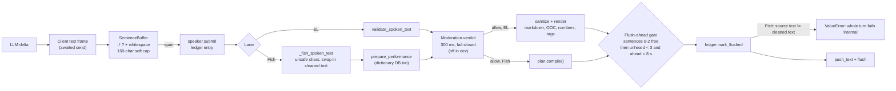
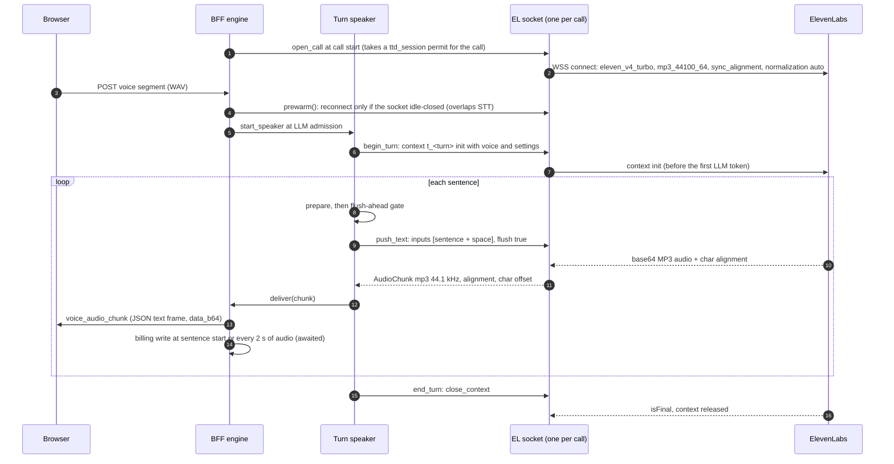

# Streaming text-to-speech and character voices

**Research date:** 2026-10-20. **Scope:** how the Magic Worlds call path turns LLM text into character speech today (the ElevenLabs `eleven_v4_turbo` lane and the Fish `drama-3` / `s2.1-pro` lane: sentence buffering, normalization, provider sockets, alignment, pacing, failure handling, output format, cost), the October 2026 streaming-TTS landscape for expressive cloned voices in English and Spanish, the techniques that matter for a realtime cascaded call, and prioritized recommendations (prefix `TTS-`).

## Summary

- **The TTS leg is not the main latency problem, but it is where most of the call's correctness bugs live.** In the reconciled EL-lane budget (speech end to first audible audio, about 3.2-4.2 s at STT p50), the TTS-owned stages (first-sentence wait, provider first chunk, leading silence) are roughly 0.5-1.0 s; hang-over, STT and the LLM hop are about 80% ([reconciliation §7](evidence/audit/gap-finding-reconciliation.md)). The defects that hurt users are on the TTS side: the Fish word ledger kills every turn whose sentence needs markup cleanup (GAP-REAL-DEV-CALL-FORENSICS-01), a second EL socket failure makes the rest of the call text-only (C14), and 34% of synthesized and billed audio in the dev sample was never heard (GAP-CALL-AUDIO-ASSETS-AND-MP3-TIMELINE-04).
- **The EL lane is architecturally close to best practice.** It uses one prewarmed socket per call, one provider context per turn opened before the first LLM token, explicit flushes per sentence, character alignment and playback-paced synthesis. The gaps are in the details: a sentence-only first chunk (C17), a fragile alignment offset model (C42), sentence-granular truncation (C25), silent tail loss on reconnect or stall (C40, C41) and MP3 inside base64 JSON (C76).
- **The Fish lane is a dev-flagged lane with production-grade risks.** It has no first-audio or inter-chunk watchdog (only a 90 s turn timeout, C43), it aborts replies over 1,200 characters (C44), it uses `latency: 'balanced'`, it takes DB row locks per sentence (C66), and Fish's Customer Agreement (2026-08-10) prohibits obscene or pornographic inputs and outputs ([r91](evidence/research/r91-gap-g1-vendor-policy-retention-matrix.md)). Drama 3's list price rises to $50 per 1M characters after the launch promo ends on 2026-11-12, more than Eleven v4 Turbo's $40 ([r04 §3.3](evidence/research/r04-streaming-tts.md)).
- **Bitrate note (re-verified in code on 2026-10-20; it overrides the "128 kbps" sometimes quoted for EL).** The ElevenLabs call socket requests `mp3_44100_64` (64 kbps), not 128 kbps. Only the Fish lane runs at 128 kbps (FACT, `magic-worlds-api/src/services/speech/capabilities.py:65`, `:159`; stored EL call assets decode as 64 kbps CBR per [gap-call-audio-assets §4.2](evidence/audit/gap-call-audio-assets-and-mp3-timeline.md)).
- **Landscape (October 2026).** Eleven v4 Turbo leads Artificial Analysis' English board (Elo 1333) at $40/1M characters, with vendor-reported ~150 ms time to first speech and no independent latency measurement yet. Cartesia Sonic 3.6 (1289) and Inworld TTS-2 (1265) are the strongest alternatives. The fastest independently measured models are Cartesia Sonic 3.5 (128 ms) and Fish S2.1-Pro (141 ms) ([Vapi index](https://humannessindex.vapi.ai/), June 2026 trials, network included).
- **Spanish changes the picture.** On AA's Spanish cloned-voice board, Eleven v4 (1284) beats v4 Turbo (1215) by about a 60% preference. Sonic 3.6 (1203) is level with v4 Turbo. Fish S2.1-Pro and Drama 3 are not rated in Spanish, and the only rated Fish model (S2 Pro, 1005) loses about 77% of the time to v4 Turbo ([r92 §5](evidence/research/r92-gap-g2-spanish-bilingual-evidence.md)). The call path strips `es-MX` to `es`, and Eleven v4 deliberately drops a clone's accent across languages.
- **Recommended order.** P0 (days): fix the Fish ledger crash, stop speaking emotes, fix sentence boundaries and add a clause-level first chunk, add Fish watchdogs, make the EL reconnect budget windowed, bound look-ahead by duration from sentence 0, instrument TTS stages, re-cost Drama 3 and keep T2 content off Fish. P1 (weeks): word-level EL truncation with a drift guard, a sample-exact output format, connection hygiene, greeting and backchannel caching, Spanish locale and model checks, clone consent and lifecycle. P2: voice-twin provider fallback and lorebook pronunciation. P3: a measured bake-off (Sonic 3.6, Inworld TTS-2, Gemini 3.8 Flash TTS, Fish latency modes).

---

## 1. How call TTS works today

Sibling context: the end-to-end call architecture is in [01_current_architecture.md](01_current_architecture.md), the turn timeline in [02_turn_lifecycle_and_latency.md](02_turn_lifecycle_and_latency.md), and the browser playback side in [09_transport_and_client_audio.md](09_transport_and_client_audio.md). Unless marked otherwise, everything in this section is FACT from [be-tts](evidence/audit/be-tts.md), verified in its adversarial section, and spot-checked in code on 2026-10-20.

### 1.1 The shared text path (both lanes)

Both lanes share one per-turn speaker class, `ElevenLabsTurnSpeaker` (`magic-worlds-api/src/services/voice_orchestration/call_tts_elevenlabs.py`), with a pusher task and a drainer task. Only the provider transport and the ledger differ.

Key steps, in order:

1. **Delta to client first.** Each `VoiceAssistantDelta` is sent to the browser as a caption text frame and awaited before it reaches the sentence buffer (`magic-worlds-api/src/services/voice_orchestration/engine.py:2613-2621`). The LLM runner hands over one event at a time, so a slow client socket slows sentence detection (C75, low).
2. **Sentence buffering.** `SentenceBuffer` emits a span at `.`, `!` or `?` followed by whitespace (`magic-worlds-api/src/services/voice_orchestration/sentence_buffer.py:19`), or at a 160-character soft cap cut at a space (`:18`). It holds open `(cue` and `<#pause` markers for up to 60 and 8 characters (`:25-26`) and handles decimals, ellipses and initials. A 120 ms idle tick releases a buffered span that already ends in sentence punctuation (`engine.py:88`; `sentence_buffer.py:103-113`). There is **no clause-level first chunk** (C17).
3. **`prepare`** runs per sentence before the flush gate (`engine.py:2364-2431`): the fail-closed spoken-text contract, then (Fish only) `_fish_spoken_text` and the performance plan, then the per-sentence moderation verdict (300 ms budget, fail-closed, `engine.py:2393`; `magic-worlds-api/src/services/speech/moderation.py:73`), then sanitize and render (EL) or `plan.compile()` (Fish). Because the pusher prepares sentence N+1 while N plays, only sentence 1 pays moderation serially (K07). Moderation is off in dev; with `required` on and the classifier routed through api.magic_llm, it is a latent launch blocker (C04; see [14_safety_policy_and_compliance.md](14_safety_policy_and_compliance.md)).
4. **Flush-ahead gate.** Sentences 0-2 flush immediately. From sentence 3 on, a sentence waits while 3 or more flushed sentences are unheard or 8,000 ms or more of audio is ahead of playback. The gate re-checks on playback reports, on audio and every 250 ms, and uses a 500 ms lag on the wall-clock estimate when no report exists (`call_tts_elevenlabs.py:55-59`, `:150-167`). It freezes at the last client report when the socket is away (K09).
5. **Ledger then push.** `ledger.mark_flushed` runs **before** `push_text` and outside the provider-error `try` (`call_tts_elevenlabs.py:249`, `:251`). That ordering is what turns the Fish geometry check into a turn-killing exception (§1.3).

### 1.2 ElevenLabs lane (default): `eleven_v4_turbo` over the Text-to-Dialogue multi-context socket

| Item | Value | Where |
|---|---|---|
| Endpoint and model | `/v1/text-to-dialogue/multi-stream-input`, `model_id=eleven_v4_turbo` | `magic-worlds-api/src/services/speech/providers/elevenlabs/tts_multicontext_ws.py:93`, `:237-248`; `capabilities.py:148-151` |
| Output format | **`mp3_44100_64`** (44.1 kHz, 64 kbps, mono) | `capabilities.py:65`, `:159` |
| Alignment | `sync_alignment=true`; original `alignment` preferred, else `normalizedAlignment` | `tts_multicontext_ws.py:714-722` |
| Text normalization | `apply_text_normalization=auto` plus local en/es number expansion (double normalization, BE-TTS-22, info) | `tts_multicontext_ws.py:94` |
| Language | `language_code=<primary subtag>` when the call language is known | `tts_multicontext_ws.py:237-248` |
| Voice settings sent | `stability`, `similarity_boost` only; no speed; no emotion prefix tag (BE-TTS-21) | `capabilities.py:140`; `engine.py:2418-2419` |
| Contexts | one `t_<turn_id>` per turn, never reused; at most 4 unreleased; a 5th waits, and a wait over 3 s triggers a reconnect | `tts_multicontext_ws.py:74`, `:80` |
| Watchdogs | connect 3 s, first audio 3 s, inter-chunk 5 s (skipped for `closing` contexts after first audio), keep-alive after 15 s idle per open context, completion-idle release 5 s, provider inactivity fixed at 20 s | `tts_multicontext_ws.py:75-82` |
| WS ping | none (`ping_interval=None`) | `tts_multicontext_ws.py:522-527` |
| Reconnect | 1 per call, reset only when a turn completes with audio; unacked sentences of `open`/`init_pending` contexts are replayed; a 2nd failure ends the voice leg for the rest of the call | `tts_multicontext_ws.py:833-843`, `:946-947`; `engine.py:2980-2986` |
| Session limiter | `ttd_session` pool sized like the Flash pool (default 24), **in-process**, held for the call's lifetime | `tts_multicontext_ws.py:266`; `magic-worlds-api/src/services/speech/limiter.py:159` |
| Billing | spend metered at text send (40 µUSD per character); user credit metered on delivered MP3 frames and written inside the drain loop | `engine.py:2433-2439`, `:2507-2508` |

What the lane gets right (FACT, [be-tts §7](evidence/audit/be-tts.md)): the socket opens at call start (`engine.py:883`) and is re-warmed during STT (`engine.py:2043-2044`); the context is initialized at LLM admission, so it is ready before the first token (`engine.py:2585`); barge-in sends `voice_cancelled` to the client first, then `close_context`, and drops late frames for dead contexts (`tts_multicontext_ws.py:390-406`, `:698-704`); handshake, in-band and close errors are classified; voice-scoped errors can switch to a substitute voice; and the adapter has 40+ test cases.

Known weaknesses, with canonical ids from [the reconciliation](evidence/audit/gap-finding-reconciliation.md):

- **C14 (BE-TTS-06), high.** One reconnect budget, with no backoff, no cross-provider fallback and no re-open on a later turn. Idle non-1000 closes and handshake 429 retries also spend it. A brief provider incident therefore turns a paid call into text-only until the user calls again. Verifier correction: the budget resets when a turn *completes with audio*, so two failures end the leg only when no turn completes with audio between them.
- **C40 (BE-TTS-04), medium.** A socket restart releases `closing` contexts without replay and reports the turn complete. The exposed window is the provider's generation tail, from `close_context` until `isFinal` (verifier correction); unacked sentences are lost, and the stored text still claims they were spoken.
- **C41 (BE-TTS-05), medium.** A stall after `close_context` is released as a normal completion after 5 s of silence, and the release resets the reconnect budget.
- **C42 (BE-TTS-09), medium.** `char_offset` accumulates received alignment characters and assumes the provider echoes exactly `len(sentence) + 1` per flush. Nothing compares `alignment.chars` with the sent text. Audio tags such as `[laughs]` can reach the provider, and Pipecat reports that v3/v4 tags show up in alignment ([r04 §3.1](evidence/research/r04-streaming-tts.md)), so drift is plausible. Real drift is unverified.
- **C25 (BE-TTS-08), medium.** Barge-in truncation keeps through the end of the last sentence whose audio *started* (`magic-worlds-api/src/services/voice_orchestration/call_ledger.py:380-392`), although per-character timing exists (`:277-294`). This is the documented D06 rule. Real data: message 550 kept 190 characters for 9,070 ms played (48 ms per character against about 78 ms untruncated), so about 70 unheard characters (about 5.5 s of speech) were stored as said (GAP-CALL-AUDIO-ASSETS-AND-MP3-TIMELINE-14).
- **BE-TTS-14 (low, unverified).** No WS ping and no keep-alive between turns. A NAT that silently drops the idle flow leaves `_conn` non-null, and the next turn waits for the 3 s first-audio timeout plus a reconnect. The topology probe found 2 `CLOSE-WAIT` sockets to `api.elevenlabs.io` on the dev BFF ([gap-topology §3](evidence/audit/gap-topology-rtt-measurements.md)).
- **BE-TTS-15 (low, unverified).** The `ttd_session` limiter is per process while ElevenLabs holds a dialogue-pool session for the whole lifetime of each TTD connection ([r04 §3.1](evidence/research/r04-streaming-tts.md), vendor docs). N workers × 24 can exceed the account's pool, which surfaces as handshake 429s that spend the reconnect budget.
- **BE-TTS-10 (low, unverified).** After the budget is spent, a first-audio timeout gives up sentences locally while late audio can still play after the "delayed" notice.

### 1.3 Fish lane: `drama-3` (default) or `s2.1-pro` over `/v1/tts/live/with-timestamp`

The Fish lane is off by default in code (`FISH_AUDIO_CALLS_ENABLED`, `magic-worlds-api/src/services/speech/providers/fish_audio/config.py:36-42`) but enabled in the dev `.env` (K17). All but one of the dev calls in the forensic sample ran it ([gap-real-dev-call-forensics §3](evidence/audit/gap-real-dev-call-forensics.md)). The default model is `drama-3` (`config.py:7`; `magic-worlds-api/src/services/speech/model_features.py:8-10`). `s2.1-pro` is selectable per voice recipe.

| Item | Value | Where |
|---|---|---|
| Endpoint | `wss://api.fish.audio/v1/tts/live/with-timestamp` (msgpack). Fish's public protocol reference and streaming guide do not document `/with-timestamp` ([r04 §3.3](evidence/research/r04-streaming-tts.md)) | `.../fish_audio/timestamp_ws.py:25` |
| Start request | `format: mp3`, `sample_rate: 44100`, `mp3_bitrate: 128`, `chunk_length: 100`, `latency: 'balanced'`. No `language`, `normalize`, `min_chunk_length` or `condition_on_previous_chunks`, so provider defaults apply | `timestamp_ws.py:206-212` |
| Per-sentence send | msgpack `text` (unit + space), then `flush`; `stop` after the last unit | `timestamp_ws.py:187-202` |
| Caps | 1,200 characters and 64 units per generation; 128 chunks; 20 MB; 90 s turn timeout | `timestamp_ws.py:26-31`, `:162-167`, `:190-196`; `streaming.py:107-110` |
| Watchdogs | **none** besides the 90 s turn timeout and WS ping 20 s / 20 s | `timestamp_ws.py:162-167`, `:209` |
| Connect | at `begin_turn` (LLM admission) with `connect_early`, so the handshake overlaps LLM TTFT; no call-level or STT-time prewarm | `streaming.py:52-54`, `:180-193` |
| Admission | DB lease per turn: an account-row `SELECT … FOR UPDATE`, a count of active leases and a daily `SUM`; then `extend_stream` per sentence with the same lock, before the text is sent; `FISH_AUDIO_CONCURRENCY=1` by default; a full slot polls every 100 ms for up to 5 s; the 120 s lease is never renewed | `.../fish_audio/admission.py:58-95`, `:103-142`, `:149-161`; `config.py:41` |
| Audio | provider packets are not frame-aligned; the engine forwards whole MP3 frames only and fails on any frame that is not 44.1 kHz mono 128 kbps | `.../fish_audio/stream_mp3.py:13-38` |
| Timing and truncation | word-level revisable timestamps (`RevisableWordTimeline`); truncation cuts at the last word that ended before `played_ms` | `call_word_ledger.py:91-97`; `word_timing.py:207-220` |
| Errors | no replay, no voice replacement; any error stops this turn's audio while the text continues; the leg ends only on config, billing or voice-scoped errors | `streaming.py:141-143`; `engine.py:2947-2964` |

Findings:

- **GAP-REAL-DEV-CALL-FORENSICS-01, high (reproduced).** When a sentence contains any character in `[*_#~\[\]<>|`()]` or an emoji (`engine.py:3593`), `_fish_spoken_text` replaces it with the sanitizer's cleaned `moderation_text`, and the compiled plan's `logical_text` becomes that cleaned text. `WordCallTurnLedger.mark_flushed` then raises `ValueError('Call word timing requires exact original source geometry')` because the cleaned text no longer equals the source span (`call_word_ledger.py:32-35`). The `_push` task dies silently, `speak_later` keeps accepting spans, and the error only surfaces at `speaker.finish()` after the LLM stream ends; `_fail_turn` records `internal` (`engine.py:3103-3116`). In dev, 2 of 15 Haiku replies used asterisk actions despite the prompt forbidding them, and both turns failed: fe6100 s1 was silent for the whole 5.3 s LLM run and then showed an error. The failed reply also stays `completed` in history (GAP-REAL-DEV-CALL-FORENSICS-02), which may reinforce the markup style.
- **C43 (BE-TTS-11, E2E-LATENCY-TRACE-14), medium.** A stalled Fish generation can leave the caller in silence for up to 90 s, and the 90 s window also counts time the flush gate holds text back.
- **C44 (BE-TTS-13), medium.** A reply over 1,200 characters or 64 units raises a 422 mid-reply; the speaker cancels the generation and drops up to 8 queued chunks of already generated audio. The callbot cap is 1,536 output tokens, so this can trigger, although dev replies maxed at 637 characters.
- **C66 (BE-TTS-12), low, contested.** The per-sentence DB admission costs 5-50+ ms per sentence and serializes every Fish call on one account row. Concurrency 1 is the binding limit today.
- **Measured latency is poor but thinly sampled.** One native probe got first audio at 1,686 ms (raw socket, connect included), and the engine path with fake STT and LLM got 927 ms ([e2e-latency-trace F6](evidence/audit/e2e-latency-trace.md)). The authenticated Fish handshake is at least 274 ms p50 ([gap-topology §5.5](evidence/audit/gap-topology-rtt-measurements.md)). For comparison, Vapi measured Fish S2.1-Pro at a 141 ms median first audio over the network ([r04 §2.2](evidence/research/r04-streaming-tts.md)). Drama 3's API latency is not published.

### 1.4 Pacing: the flush-ahead gate in practice

The gate is the right idea: bound synthesis ahead of playback so a barge-in wastes and bills little. Its "3 free sentences" rule undoes the bound for long sentences and fast providers:

- Fish synthesized one captured 6.95 s reply in about 830 ms, roughly 8.4x real time (INFERENCE from one capture, [gap-call-audio-assets §4.2](evidence/audit/gap-call-audio-assets-and-mp3-timeline.md)).
- Dev assistant replies carry p50 17.6 s of audio (n=17), and 12 of 17 audio turns were interrupted.
- At barge-in, delivered-minus-played reached 16.5 s (message 515), 10.9 s and 10.8 s. Across the 17 turns, **97.0 s of 283.1 s of delivered and billed TTS audio (34.3%) was never heard** (GAP-CALL-AUDIO-ASSETS-AND-MP3-TIMELINE-02 and -04).

The stored call asset keeps all delivered audio, so call history replays speech that is in neither the transcript nor the LLM's history (GAP-...-02). A late truncation updates only the message, not the segment (GAP-...-03). Billing also covers audio dropped while the socket was away (C22, BE-TTS-17).

### 1.5 Normalization, emotes and Spanish

- **Sanitizer** (`magic-worlds-api/src/services/speech/text_pipeline.py`, steps 1-10 in its docstring): it strips `<think>` and chat wrappers and rejects other HTML-like tags, tokenizes markup v1 (`<#x#>` pauses and D27 interjections such as `(laughs)`), strips markdown and pictographs, drops OOC blocks, and unwraps every remaining `[…]` while **keeping its words**. It expands residual digits for en/es, moderates, translates markup v1 per profile (on EL: `(laughs)` → `[laughs]`, pauses → `[short pause]`/`[long pause]`; `text_pipeline.py:420-436`; `emotion_map.py:73-82`), and hashes the final text (`normalized_text_sha256`).
- **Emotes are spoken.** `*smiles softly*` becomes the words "smiles softly" (`text_pipeline.py:200-201`, star-emphasis keeps its content), and a bracketed stage direction like `[whispers]` becomes the spoken word "whispers". The callbot prompt forbids asterisk actions and markdown (`magic-worlds-api/src/agent_graphs/runtime/callbot_chat.v2.json:18-20`, `:37`), but the model does not always comply (2/15 in dev). On Fish the same input crashes the turn (above). BE-TTS-20 records the "keep the words" fallback as deliberate.
- **Numbers.** `number_words.py` expands en/es digits deterministically, including Spanish gender agreement ("21 puertas" → "veintiuna puertas", "veintiún años") and es-ES thousands separators ("1.250 monedas"). This is ahead of most stacks; ElevenLabs itself recommends normalizing upstream ([r04 §3.1](evidence/research/r04-streaming-tts.md)).
- **Locale.** `normalize_language_code` keeps only the primary subtag ("es-MX" → "es"; `magic-worlds-api/src/services/speech/types.py:129-139`). The call language is fixed once per call. EL gets `language_code=es`, whose effect on the TTD socket is undocumented ([r92 §4.2](evidence/research/r92-gap-g2-spanish-bilingual-evidence.md)). Fish gets no `language` (auto-detect).
- **Sentence boundaries in Spanish (C17).** The abbreviation list includes `no` and `am` (`sentence_buffer.py:11-16`), so "Creo que no. Vamos ya." and "No. I won't go there." are held as one unit. `sr` is present but `sra`, `srta`, `dra`, `ud`, `uds` are not, so "La Sra." is emitted alone. Opening `¿`/`¡` need no boundary handling, but `…` (U+2026) and `3,5` decimals are not specially handled ([r04 §5.2](evidence/research/r04-streaming-tts.md)).
- **Non-Latin scripts (C18, medium).** Full-width `。！？` are not boundaries, so ja/zh/yue replies get no audio until the LLM finishes. Korean is unaffected, and Thai is only delayed by the soft cap (verifier correction). The product languages, en and es, are unaffected.

### 1.6 Output format and delivery

- **EL:** `mp3_44100_64`. Real-call chunks average 2.3-3.1 KB (290-385 ms of audio), 30-51 per turn. **Fish:** MP3 44.1 kHz 128 kbps; provider packets of 7-24 KB (0.42-1.5 s) re-framed into whole frames; real-call chunks 8.3-15.6 KB (0.52-0.97 s), 15-29 per turn, with a 418 ms first chunk (FACT, [gap-call-audio-assets §0, §4.2](evidence/audit/gap-call-audio-assets-and-mp3-timeline.md)).
- Each provider chunk becomes one `voice_audio_chunk` JSON text frame with `data_b64` (+33% bytes). The contract is MP3-only (`magic-worlds-api/src/services/voice_orchestration/delivery.py:67-69`). The browser builds one `MediaSource` per turn at `voice_turn_start` and appends in sequence mode (`src/features/interaction/audio/voicePlaybackBuffer.ts:155-163`, `:316-355`; `addSourceBuffer('audio/mpeg')` at `:348` leaves `mode` at the MSE default for MPEG audio, `sequence`; append at `:390-392`). iPhone uses ManagedMediaSource with a 2 s stall fallback to Blob groups (`:553-564`).
- Each turn is one continuous MP3 stream: no Xing/Info/LAME header frames and no mid-stream ID3, so there is no per-sentence codec priming. The server frame meter and the client `currentTime` share one frame timeline, with under 40 ms skew (GAP-CALL-AUDIO-ASSETS-AND-MP3-TIMELINE-13).
- **Silence in the audio.** Speech onset follows the first sample by 92-153 ms on Fish drama-3 and 71-86 ms on EL. Inter-sentence gaps reach 1.3 s on Fish and 0.5 s on EL, and 14-26% (Fish) and 9-18% (EL) of the audio is quiet. About 37-53 ms of the onset is codec delay; the server's first-audio metric marks the first chunk, not first speech (GAP-...-06, downgraded to low: trimming gains about 50-100 ms, and trailing silence does not delay the user's turn).
- **Why the "128 kbps" quoted in some notes is wrong for EL.** `provider_capabilities.py:15` advertises `mp3_44100_128` for ElevenLabs (the narration format), and several research notes ([r04 §7](evidence/research/r04-streaming-tts.md), [r06 §0](evidence/research/r06-transport-client-audio.md), [r10 §13](evidence/research/r10-cost-scaling-ops.md)) repeated it. The call surface map resolves `("call","standard")` to `STREAM_OUTPUT_FORMAT = "mp3_44100_64"` (`capabilities.py:65`, `:159`), `stream_url` uses `profile.output_format` (`tts_multicontext_ws.py:237-248`), and all stored EL call assets decode as 64 kbps CBR.

### 1.7 Strengths to keep

1. Prewarmed call-level EL socket and early per-turn context (consensus strength 1 in the reconciliation).
2. One context per turn with context-level cancel and dead-frame dropping.
3. A playback-paced flush-ahead gate (consensus strength 5), which only needs a tighter bound.
4. Character alignment on EL and word timestamps on Fish, on a frame-exact shared timeline.
5. Deterministic en/es number expansion with Spanish gender agreement, a fail-closed tag allow-list and no text in logs.
6. Exact, slice-proof MP3 metering (`mp3_frames.py`), and a fail-closed Fish frame envelope.

---

## 2. Where TTS sits in the latency budget

The reconciled budget, EL lane, moderation off, STT p50 ([reconciliation §7](evidence/audit/gap-finding-reconciliation.md)). Bars use representative mid-range values. Only the hang-over, STT p50, the 1,579 ms LLM probe and the 149 ms EL sample are measured; the rest are estimates.

```mermaid
gantt
  title Speech end to first audible audio, EL lane (representative, about 3.75 s)
  dateFormat x
  axisFormat %S.%L
  section Upstream
  VAD hang-over 550 ms (FACT)            :a1, 0, 550
  Upload, route, intake ~150 ms          :a2, 550, 700
  Groq STT p50 526 ms (FACT, dev)        :a3, 700, 1226
  BFF admission ~100 ms                  :a4, 1226, 1326
  LLM hop to first text ~1579 ms (probe) :a5, 1326, 2905
  section TTS-owned
  First sentence completes 200-600 ms    :b1, 2905, 3305
  EL first chunk 150-350 ms              :b2, 3305, 3555
  section Client
  Downlink and MSE start 60-190 ms       :c1, 3555, 3675
  Leading silence in audio 71-86 ms      :c2, 3675, 3755
```

| TTS-owned stage | Today | Lever | Evidence |
|---|---|---|---|
| Wait for the first sentence | 200-600 ms (estimate; ~100-200 ms for a typical sentence at the dev Haiku rate of ~239 tok/s, longer on slower models) | Clause-level first chunk (TTS-04) | [e2e-latency-trace](evidence/audit/e2e-latency-trace.md); [forensics §4.1](evidence/audit/gap-real-dev-call-forensics.md) |
| Moderation of sentence 1 | 0 in dev; up to 300 ms if required and fast enough, otherwise the sentence is muted | Faster first-sentence check (see [14](14_safety_policy_and_compliance.md)) | C04, K07 |
| EL send to first chunk | 149 ms (one sample); 150-350 ms estimated | Region pinning, format, keep-alive | K15 |
| Fish send to first chunk | 927 ms (engine probe) / 1,686 ms (raw, incl. connect) | `latency` mode test, prewarm, watchdog | e2e F6 |
| Leading silence and codec delay | 71-86 ms (EL), 92-153 ms (Fish) | PCM/Opus; trim leading silence | GAP-...-06 |
| Billing write in the drain loop | 0 on the first chunk; 5-60 ms per later bill | Move off the hot path (TTS-21) | C61 (low, contested) |
| Half-open socket (failure) | +3,000 ms first-audio timeout + reconnect | WS ping, probe on prewarm (TTS-13) | BE-TTS-14 |

**Reading:** removing every TTS-owned delay saves at most about 0.3-0.7 s on a 3.2-4.2 s turn (INFERENCE). The larger TTS-side wins are in tail and failure behaviour (3 s timeouts, 90 s Fish stalls, permanent text-only legs), in pacing and waste, and in correctness. The structural latency fixes (streaming STT, semantic end-of-turn, the api.magic_llm fast path) are covered in [02](02_turn_lifecycle_and_latency.md), [05](05_turn_taking_and_interruptions.md), [06](06_speech_to_text.md) and [07](07_llm_in_the_voice_loop.md).

---

## 3. TTS findings register

Severity is the reconciled canonical severity. Full register: [03_audit_findings.md](03_audit_findings.md).

| Id | Severity | Finding | Status of evidence |
|---|---|---|---|
| GAP-REAL-DEV-CALL-FORENSICS-01 | high | Fish word ledger raises on every cleaned sentence; the whole turn is silent, then `internal` | Reproduced; 2 dev turns |
| C14 (BE-TTS-06) | high | One EL reconnect budget; 2nd failure makes the call text-only; no fallback | Verified (mechanism corrected) |
| C04 (BE-TTS-01 and others) | high, latent | Required per-sentence moderation: 300 ms fail-closed gate; would mute sentences via api.magic_llm | Verified; off in dev |
| GAP-CALL-AUDIO-ASSETS-AND-MP3-TIMELINE-04 | medium | "3 free sentences" over-synthesis: 34% of billed TTS audio unheard; up to 16.5 s ahead | Dev data, n=17 |
| GAP-CALL-AUDIO-ASSETS-AND-MP3-TIMELINE-02 / -03 | medium | Stored audio holds the unheard tail; late truncation not propagated to the segment | Dev data |
| C17 (BE-TTS-03, E2E-06, BE-LLM-11) | medium | No clause-level first chunk; `no`/`am` abbreviations; Spanish abbreviations missing | Verified, reproduced |
| C18 (BE-TTS-02) | medium | ASCII-only boundaries: ja/zh/yue wait for the whole reply | Verified (ko unaffected) |
| C25 (BE-TTS-08) | medium | EL truncation is sentence-granular although char alignment exists (D06 policy) | Verified; ~70 chars over-kept in msg 550 |
| C40 (BE-TTS-04) | medium | Reconnect drops unacked tail of a `closing` context, reports complete | Verified (window corrected) |
| C41 (BE-TTS-05) | medium | Stall after `close_context` released as completion after 5 s; resets budget | Verified |
| C42 (BE-TTS-09) | medium | Alignment offsets assume an exact `len+1` echo; no resync | Mechanism verified; drift unverified |
| C43 (BE-TTS-11, E2E-14) | medium | Fish: no first-audio or inter-chunk watchdog; 90 s turn timeout; `balanced` mode | Verified |
| C44 (BE-TTS-13) | medium | Fish: >1,200 chars or >64 units aborts and drops generated audio | Verified; untriggered in dev |
| C22 (incl. BE-TTS-17) | medium | Audio produced while the socket is away is billed and stored as heard | Verified |
| C49 (FE-UI-03) | medium | Captions run ahead of the audio; alignment not forwarded to the client | Verified |
| C53 (FE-UI-07) | medium | No greeting: the user speaks first into silence | Verified |
| GAP-CALL-AUDIO-ASSETS-AND-MP3-TIMELINE-06 | low | Unmeasured, untrimmed provider silence; first-audio metric marks the chunk, not speech | Verified (downgraded) |
| C61 (BE-TTS-07) | low, contested | Billing DB writes awaited inside the drain loop | Verified |
| C66 (BE-TTS-12) | low, contested | Fish per-sentence admission with an account-wide row lock | Verified |
| C75 (BE-TTS-19) | low | Lock-step LLM hand-off behind the client text send | Unverified |
| C76 (BE-TTS-16) | low | MP3 base64 in JSON text frames | Unverified |
| C79 (BE-TTS-20) | low | Dead `VOICE_TTS_QUEUE_MAX_SENTENCES`, unbounded speaker queue, asterisk words kept | Unverified |
| BE-TTS-10 / -14 / -15 | low | Local give-up with late audio; no WS ping; per-process TTD limiter | Unverified singles |
| BE-TTS-21 / -22 | info | No emotion prefix on EL; double normalization | Unverified singles |

---

## 4. State of the art, October 2026

All vendor facts below come from the fact-checked research notes ([r04](evidence/research/r04-streaming-tts.md), [r92](evidence/research/r92-gap-g2-spanish-bilingual-evidence.md), [r91](evidence/research/r91-gap-g1-vendor-policy-retention-matrix.md), [r10](evidence/research/r10-cost-scaling-ops.md), [r93](evidence/research/r93-gap-g3-s2s-byo-llm-clone-compat.md)), all accessed 2026-10-20.

### 4.1 Quality, latency and price

Sources: [AA Provider Voice leaderboard](https://artificialanalysis.ai/text-to-speech/leaderboard) (English, stock voices, accessed 2026-10-20); [AA Controlled Voice, Spanish board](https://artificialanalysis.ai/text-to-speech/leaderboard/controlled-voice) (native-speaker raters, cloned voices); [Vapi Humanness Index](https://humannessindex.vapi.ai/) (median first audio over 50 live streaming trials, June 2026, network included, region unstated). Vendor latency figures are **vendor-reported** and usually server-side, excluding the network.

| Model | AA Elo EN | AA Elo ES (cloned) | Measured first audio (Vapi) | Vendor latency claim | List price | Notes |
|---|---|---|---|---|---|---|
| **ElevenLabs v4 Turbo** (current EL lane) | **1333** | 1215 | not in index | ~100 ms inference, ~150 ms time to first speech ([elevenlabs.io/v4](https://elevenlabs.io/v4), ~2026-09-28) | $40/1M chars | One sample in repo: 149 ms (K15) |
| ElevenLabs v4 | 1328 | **1284** | n/a | n/a | $80/1M | "Most emotive"; ES leader |
| ElevenLabs v3 Conversational | 1212 | 1125 | n/a | ~280 ms | $40/1M (EL; AA lists $50) | Previous generation |
| ElevenLabs Flash v2.5 | 1077 | 1035 | 226 ms (Flash v2) | ~75 ms | $40/1M (EL page; AA/Vapi list $50) | No audio tags; weak numbers |
| Cartesia Sonic 3.6 | 1289 | 1203 (Entertainment 1189 vs v4 Turbo 1155; CIs overlap) | 128 ms (Sonic 3.5) | "sub-90 ms" | ~$37-50/1M (credits) | ElevenLabs' own test put Sonic 3.6 at 262 ms (competitor-measured) |
| Inworld Realtime TTS-2 | 1265 | 1123 | 288 ms | 100 ms P90 server ([docs](https://docs.inworld.ai/tts/tts-models)); "<100 ms P99" (launch PR) | $25/1M on-demand → $12.50 (Growth) | Launched ~2026-09-02 |
| Inworld TTS-2 Flash | 1217 | 1083 | n/a | 20 ms P90 server | $7-15/1M | Non-verbal tags only, no steering |
| Fish Drama 3 | 1247 (AA label "Preview") | not rated (EN cloned 1059) | not in index | 88.9 ms median TTFA self-hosted, 1× H200 (HF card) | **$50/1M chars list; $10 promo to 2026-11-12** (AA lists $15) | Current default Fish call model |
| Fish S2.1-Pro | 1188 | not rated (EN cloned 1010; S2 Pro ES 1005) | **141 ms** | n/a | $15/1M UTF-8 bytes | Best measured latency/price balance in the Vapi table |
| Gemini 3.8 Flash TTS | 1278 | 1099 | not in index | undocumented | $9/1M audio tokens (≈$0.0135/min) until 2026-12-31, then doubles | Latency for streamed text unproven |
| Gemini 3.8 Flash-Lite TTS | 1250 | 1112 | n/a | undocumented | ≈$0.009/min, doubles 2027-01-01 | |
| MiniMax Speech 2.8 HD / Turbo | 1173 / 1154 | 1100 / 1074 | 325 ms (2.8) | n/a | $100 / $60 per 1M (AA) | WS details not re-verified |
| Speechify Simba 3.2 | 1245 | n/a (Simba 3.0: 1080) | 428 ms | n/a | $6.6/1M (AA; Vapi table lists $10) | Humanness 97 but slow |
| Alibaba Qwen-Audio-3.1-TTS-Plus | 1299 | not rated | n/a | n/a | $19.3/1M (AA) | Not in the international catalog (unverified availability) |
| Rime Coda / Mist v3 | 1056 / (Mist V2 904) | n/a | n/a | Coda <100 ms model + 25-50 ms RTT; Mist v3 ~37 ms P50 | $50/1M (AA, Coda) | One language per voice; no documented cloning |
| Deepgram Aura-2 / Flux TTS | n/a / 1051 | n/a | n/a | n/a | $30/1M / $45/1M | 17 Spanish voices; no cloning |

### 4.2 Capabilities, formats and policy

| Model | Text-in streaming and continuity | Expressive control | Cloning | Timestamps | Streaming output formats | Policy for 18+ fiction ([r91](evidence/research/r91-gap-g1-vendor-policy-retention-matrix.md)) |
|---|---|---|---|---|---|---|
| ElevenLabs v4 / v4 Turbo | TTD WS (multi-context, max 5 contexts); server waits ~40 chars and 8 words unless flushed; context inactivity fixed at 20 s; each open TTD connection holds a dialogue-pool session for its lifetime | Audio tags (`[laughs]`, `[whispers]`, `[long pause]`); no SSML `<break>` in v4 | IVC (~10 s), PVC; **pre-v4 clones must be retrained for v4**; verified consent for every clone | Char alignment (snake_case on TTD) | MP3, PCM, µ-law (r04); `opus_48000_*` listed for ElevenLabs generally ([r06 §6](evidence/research/r06-transport-client-audio.md)); TTD support for PCM/Opus untested | A\*: bans *visual* explicit acts and some erotic categories, and "harmful emotional dependency"; get written confirmation; watermarks all audio |
| Cartesia Sonic 3.6 | WS `context_id` + `continue`; `max_buffer_delay_ms` default 3,000 | Contextual; 5-emotion enum, speed, volume | IVC, PVC (new PVCs train on all eligible models since Sept 2026); keeps clone accent across languages | Word + phoneme | **PCM, µ-law, A-law only on WS** | ?: "objectionable" catch-all; trains unless opted out; ZDR Enterprise |
| Fish S2.1-Pro / Drama 3 | `/v1/tts/live` (msgpack) with `flush`; `condition_on_previous_chunks` default true; no per-context cancel | Free-form `[cues]`; Drama 3 natural-language direction in any language | Reference audio; customer warrants consent, no verification | `/with-timestamp` (undocumented) | MP3, WAV, PCM, **Opus (24-64 kbps)** | **P**: Customer Agreement 2026-08-10 bans obscene or pornographic inputs and outputs; ZDR toggle available |
| Inworld TTS-2 | WS contexts | English-only steering instructions persisting until `[reset]`; any unknown bracket text is treated as an instruction | IVC 3-30 s, PVC beta | Phoneme/viseme | n/a in notes | ?: minors clause names sexually explicit content and mature themes; ZDR Enterprise |
| Gemini 3.8 Flash TTS | Output streaming only; no documented text-in streaming for TTS | Style prompt + inline tags (keep tags in English for non-English text) | Voice replication with a verbatim consent recording and speaker verification (200 voices/project) | n/a | PCM 24 kHz, µ-law, A-law | **P** (Google prohibited-use policy) |
| MiniMax 2.8 | WS `task_continue`; `continuous_sound` | 7 emotions, `(laughs)` interjections, `<#x#>` pauses | Yes | Word subtitles | mp3, pcm, flac, wav, µ-law, opus | **P** |

### 4.3 Spanish

From [r92 §5-6](evidence/research/r92-gap-g2-spanish-bilingual-evidence.md) (AA Spanish Controlled Voice data, independent):

- **ElevenLabs is the safest Spanish choice for cloned voices.** 4 of the top 6 Spanish models are ElevenLabs. But **v4 Turbo pays a Spanish-only penalty**: −69 Elo against v4 (about a 60% preference; CIs do not overlap), while the two tie at 1157 on AA's English Controlled Voice (cloned) board. Their stock-voice English Elo in §4.1 (1333 / 1328) comes from a different board.
- **Sonic 3.6 matches v4 Turbo overall** (1203 vs 1215; CIs 1184-1222 and 1194-1236 overlap) and edges it in the Entertainment category, the closest proxy for roleplay (CIs overlap).
- **Fish has no Spanish evidence for the models Magic Worlds uses.** S2 Pro sits at the anchor level (1005) and loses about 77% of the time to v4 Turbo. On the English cloned-voice board Drama 3 is about 100 Elo behind v4 Turbo, so there is no reason to expect it to close the Spanish gap (INFERENCE in r92).
- **Locale defaults.** Cartesia and Inworld resolve bare `es` to Spain Spanish. Eleven v4 labels its Spanish "Spanish (LatAm)" and takes the accent from the voice. Fish auto-detects.
- **Cross-lingual clone accents.** Eleven v4/v4 Turbo deliberately drop the reference accent ("a deliberate change … not a bug"); Inworld TTS-2 drops it unless steered; Cartesia Sonic 3.6 and Eleven Multilingual v2 keep it. Pick per character, not per product.
- **Tags in Spanish.** Gemini and Inworld say to keep tags or steering in English. Drama 3 accepts direction in any language. ElevenLabs does not document tag behaviour on non-English text.
- **Billing.** Fish bills UTF-8 bytes for S2.1-Pro, so accented Spanish costs a few percent more.

### 4.4 Open-weight options

| Model | License | Spanish | Cloning | Notes |
|---|---|---|---|---|
| Fish Drama 3 (35B MoE, ~3B active; int4 variant) | Fish Audio Community License v1.0: free below US$500k trailing revenue; **"Hosted Services" always need a license** | 83 languages | Yes | #1 open weights on AA (1247); legal read needed before self-hosting |
| Fish S2-Pro | Research license; commercial needs a deal | Tier 2 | Yes | ~100 ms TTFA on H200 (vendor) |
| Chatterbox (Resemble): Multilingual V3 500M, Latam and Spain Spanish packs, Turbo 350M | MIT | Yes | ~10 s reference | Perth watermark on all output; AA 1024 (open) / 1109 (hosted HD) |
| Kokoro 82M v1.0 | Apache-2.0 | 8 languages | **No** | AA 1065; a cheap stock-voice fallback **[possibly stale, Jan 2025]** |
| Orpheus 3B | Apache-2.0 | English (+ research previews) | Zero-shot | ~100-200 ms (vendor); no updates since mid-2025 **[possibly stale]** |
| Kyutai TTS 1.6B en/fr | CC-BY 4.0 | No | Pre-computed embeddings only | True text streaming (starts after a few words) |
| Ming-3.0-tts (Ant Group) | n/a in notes | n/a | n/a | AA 1188; #1 open weights on Controlled Voice |
| IndexTTS-2.5, Higgs Audio v3, VibeVoice-Realtime 0.5B | bilibili license / non-commercial / research-only | es (IndexTTS-2.5) / 100+ / experimental | Yes / zero-shot / n/a | Not commercially usable as-is |

Self-hosting economics: an Orpheus-class TTS on an H100 at about $2.75/h serves about 48 calls; a 2-GPU N+1 floor breaks even against v4 Turbo at about 145k call-minutes per month on GPU cost alone, or about 435k with 0.5 FTE of ops ([r10 §4.3](evidence/research/r10-cost-scaling-ops.md), estimates). The binding constraint is a commercially licensed, Spanish-capable, clone-capable model, not cost.

### 4.5 Dated changes that affect Magic Worlds

| Date | Change | Exposure | Source |
|---|---|---|---|
| after 2026-10-20 | Cartesia `sonic-2`, `sonic-turbo` sunset | None (not used) | r04 §3.2 |
| **2026-11-12** | Fish Drama 3 $10 promo ends; list $50/1M chars from 2026-11-13 | **Direct**: default Fish call model | [fish.audio/blog/fish-audio-drama-3](https://fish.audio/blog/fish-audio-drama-3), 2026-10-13 |
| 2026-11-13 | Hume TTS and EVI APIs shut down; account data deleted | None found in code (FACT: no `hume` reference) | [Hume changelog](https://dev.hume.ai/voice/changelog), notice 2026-10-02 |
| 2026-12-31 | Fish S1 retires (routed to S2.1-Pro) | None (code allows only `drama-3`, `s2.1-pro`; `model_features.py:8`) | r04 §3.3 |
| 2027-01-01 | Gemini 3.8 Flash / Flash-Lite TTS prices double | Only if adopted | r04 §3.9 |
| 2027-01-06 | OpenAI `tts-1`, `tts-1-hd`, `gpt-4o-mini-tts` shut down | None | [OpenAI deprecations](https://developers.openai.com/api/docs/deprecations) |
| ongoing | ElevenLabs Turbo v2/v2.5 deprecated; pre-v4 IVC/PVC must be retrained for v4 | Any clone created before v4 (UNKNOWN count) | [ElevenLabs models](https://elevenlabs.io/docs/overview/models), [v4](https://elevenlabs.io/v4) |
| ongoing | ElevenLabs TTD multi-context API reference still says `model_id` must start with `eleven_v3`; guides say v3 or v4 | Doc drift; Pipecat's `ElevenLabsDialogueTTSService` defaults to `eleven_v4_turbo` on this endpoint | r04 §3.1 |

### 4.6 How to read vendor numbers

- Independent measurements ran 1.3-3x above vendor TTFB in r04's comparison (for example Inworld 100 ms P90 server vs 288 ms measured; Cartesia "sub-90 ms" vs 128 ms). Budget **+100-200 ms** over vendor TTFB for network, TLS/WS framing and first-chunk buffering.
- The Vapi feed has no entry for v4 Turbo, Sonic 3.6, Drama 3 or Gemini, so the current top models have **no independent latency number**.
- AA's English board uses stock voices; it says nothing about clone similarity, Spanish or streamed input. Its #1 changed at least four times in 2026. Use it as a shortlist.

---

## 5. Techniques: best practice versus Magic Worlds

| Practice | State of the art | Magic Worlds today | Gap and recommendation |
|---|---|---|---|
| Persistent, prewarmed TTS socket | One socket per call, opened at call start or during STT; one context per turn | EL: yes. Fish: per turn at LLM admission | Fish prewarm at STT time; EL WS ping (TTS-13) |
| Small first chunk, then sentences | First clause after ~25-40 chars / 4-8 words with an explicit flush; whole sentences after ([r04 §5.2](evidence/research/r04-streaming-tts.md)) | Whole first sentence (up to 160 chars) | TTS-04 |
| One buffering layer | The app aggregates and flushes, or the provider buffers, not both | App sentence buffer + explicit flush per sentence on both providers: already single-layer | Keep; only the first-chunk size changes |
| Language- and markup-aware boundaries | Spanish abbreviations, `…`, `3,5`, full-width terminators, unclosed tags | ASCII `.!?`; `no`/`am` swallowed | TTS-03 |
| Prosody continuity | One context per turn (EL), `condition_on_previous_chunks` (Fish) | Yes on both | Keep; test Fish flush granularity (TTS-24) |
| Context-level cancel on barge-in | EL `close_context`, Cartesia `cancel` | EL yes; Fish cancels the generation | Fine |
| Truncate history to what was heard | Word timestamps (Pipecat, LiveKit), `conversation.item.truncate(audio_end_ms)` (OpenAI) | Fish word-level; EL sentence-level; stored audio untrimmed | TTS-11, TTS-22 |
| Bounded look-ahead | A few seconds ahead of the playback cursor | 3 free sentences + 8 s; 16.5 s observed | TTS-08 |
| Low-latency, sample-exact output | PCM into an AudioWorklet ring buffer, or Opus via WebCodecs; native sample rate | MP3 in base64 JSON into MSE | TTS-12 |
| Upstream normalization | Deterministic, per locale, spoken-form prompts | en/es digits with gender agreement, plus provider `auto` | TTS-17 |
| Pronunciation | Lorebook-derived replacement map before TTS, provider-agnostic | Fish user dictionaries only; nothing on EL; no lorebook map | TTS-20 |
| Emotes and tags matched to the model | Drop, translate via an allow-list, or let the LLM emit native tags under a schema; strip tags from alignment-derived history | Emote words spoken (EL); crash (Fish); markup v1 interjections mapped | TTS-02 |
| Cached greetings and fillers | Per (voice, model, settings, normalized text hash) | No greeting (C53); no cache | TTS-15 |
| Clone portability and consent | Keep consented source audio and transcript per voice; plan re-clone per model generation; operator-run consent recording | Not audited; EL v4 retrain requirement unknown exposure | TTS-18 |
| Provider fallback with voice twins | Pre-cloned twin on a second provider (dual consent) or a disclosed stock fallback; no fallback once audio for the segment was pushed (LiveKit `FallbackAdapter` 1.8.x) | None; leg ends after the 2nd failure | TTS-07 (P0 budget), TTS-19 (P2 twins) |
| Stage metrics | TTFT, first text sent, TTS first byte, first audio played (client), gaps, chars billed vs heard | Server `user_stop_ttfb_ms` (first chunk to socket), in-process only; client mark has no reader | TTS-05 |

Notes on the techniques that need more than a table row:

**First chunk.** The TTD server would otherwise wait for ~40 characters and 8 words, but `flush: true` forces generation, and the code already flushes every sentence. A clause-sized first chunk therefore works on TTD without protocol changes. Keep later units at sentence granularity for prosody. Expected gain (estimate): at the dev Haiku rate (~239 tok/s, about 4 chars per token), cutting a 100-160-character first sentence at a 30-40-character clause saves about 60-130 ms; at Sonnet's ~98 tok/s, about 150-310 ms. Risk: a very short fragment can sound clipped (INFERENCE), so require a clause boundary rather than a fixed length.

**Output format.** A correction to r04's claim that PCM "cuts bytes 2-4x": PCM16 at 16-24 kHz is 256-384 kbps raw (341-512 kbps as base64), which is **4-8x more** than the current 64 kbps EL MP3. PCM's benefit is no decode delay, no MSE start-up buffering, no 2 s ManagedMediaSource stall fallback on iPhone and a sample-exact "played" count. Opus at 24-32 kbps is 2-4x *smaller* than 64-128 kbps MP3 and also sample-exact, but needs WebCodecs `AudioDecoder` (Safari/iOS 26.0+, Chrome 94+, Firefox 130+ per [r06 §6](evidence/research/r06-transport-client-audio.md); MDN still marks it "Limited availability") or a WASM decoder. Fish offers Opus on its live WS, Cartesia offers PCM only, and EL's TTD support for PCM/Opus needs a test. Transport design belongs to [09_transport_and_client_audio.md](09_transport_and_client_audio.md).

**Alignment for truncation and captions.** EL character alignment and Fish word timestamps already sit on the same frame timeline as the client clock (GAP-CALL-AUDIO-ASSETS-AND-MP3-TIMELINE-13). Two uses are missing: cutting EL turns at the word (C25) and driving captions from alignment instead of LLM deltas (C49, [10_naturalness_and_character_experience.md](10_naturalness_and_character_experience.md)). Both need a drift guard first (C42), and tags must be stripped from any alignment-derived text before it enters history.

**Tags matched to the model.** The dialects differ: EL v4 `[laughs]` (no `<break>`), Fish free-form `[whispers sweetly]`, Inworld English `[instructions]` that persist until `[reset]`, MiniMax `(laughs)` and `<#0.5#>`, Gemini English inline tags. Unknown bracket text is spoken, or on Inworld treated as an instruction; tags count as billed characters and appear in alignment ([r04 §5.6](evidence/research/r04-streaming-tts.md)). Markup v1 with a per-provider translation table (D27) is the right abstraction; what is missing is a rule for free-form emotes.

**Voice twins and fallback.** A cloned character voice exists on one provider, so failover changes the voice. Options in order of quality: clone each character on two providers with consent covering both; fall back to a designated similar stock voice and say so; degrade to text ([r10 §7](evidence/research/r10-cost-scaling-ops.md)). Hedging the first sentence across two providers cuts tail latency but costs ~2x on about 15% of characters and only works when both hold the same voice (r10, estimate).

**Concurrency.** ElevenLabs plan concurrency for Flash/Turbo-class models is Pro 20, Scale and Business 30; on the classic WS only active generation counts. The TTD socket instead holds a dialogue-pool session for its whole lifetime, and that pool's size per plan is UNKNOWN ([r04 §8](evidence/research/r04-streaming-tts.md), [r10 §6](evidence/research/r10-cost-scaling-ops.md)). Fish allows 5/15/50 concurrent requests by cumulative prepaid spend, shared with ASR, with 429 and no `Retry-After`; whether an open live WS counts as one request is unverified. Admission should check provider headroom, not only `VOICE_GLOBAL_CONCURRENCY`.

---

## 6. Cost of the TTS leg

| Lane | Price basis | Per minute of delivered assistant audio (estimate) | Notes |
|---|---|---|---|
| EL v4 Turbo | $40/1M chars | ≈ $0.027-0.031 | Uses the dev untruncated rate of 78-88 ms per character (≈ 680-770 chars/min, [gap-call-audio-assets §2](evidence/audit/gap-call-audio-assets-and-mp3-timeline.md)); r04's 15 chars/s gives $0.036 |
| EL v4 (non-Turbo) | $80/1M | ≈ $0.054-0.062 | Spanish quality leader |
| Fish Drama 3 | $10/1M promo → **$50/1M** list | ≈ $0.007-0.008 → **≈ $0.034-0.039** | Price set by env `FISH_AUDIO_PRICE_PER_MILLION_USD_MICROS` (`config.py:68`) |
| Fish S2.1-Pro | $15/1M UTF-8 bytes | ≈ $0.010-0.012 (+ a few % for Spanish) | Code default S2 price `fish-s2.1-pro-2026-10` |
| Cartesia Sonic 3.6 | ~$37-50/1M | ≈ $0.025-0.039 | |
| Inworld TTS-2 | $12.50-25/1M | ≈ $0.009-0.019 | |

- **Waste multiplies the bill.** With 34% of delivered audio unheard in the dev sample, the cost per *heard* minute of v4 Turbo is about $0.041-0.047 (INFERENCE, small n). Capping look-ahead at 1-2 sentences ahead of the cursor keeps waste near 10% (r10 estimate) and is the largest TTS cost lever after reply length.
- **Reply length is the other lever.** Dev LLM replies ran 84-637 characters (p50 289) against a prompt asking for 1-3 short sentences; the 1,536-token cap never binds ([07_llm_in_the_voice_loop.md](07_llm_in_the_voice_loop.md)). r10 estimates capping spoken output at about 150-250 characters per turn cuts TTS cost by 20-40%.
- At call level, r10 puts TTS at about 85-90% of the per-minute bill of the current EL lane (about $0.030 per call-minute in its reference model). Full cost model: [13_cost_scaling_and_operations.md](13_cost_scaling_and_operations.md).

---

## 7. Recommendations

Effort: S = days, M = 1-3 weeks, L = more than a month. Impact figures are estimates unless marked measured. The cross-cutting roadmap is in [17_recommendations_and_roadmap.md](17_recommendations_and_roadmap.md).

### P0: do now (days, no vendor change)

**TTS-01. Fix the Fish word-ledger crash.**
- What: make `source_text == logical_text` before ledger registration. Either sanitize at the `SentenceBuffer` boundary for the Fish lane, or build the word ledger from the cleaned text, or map the cleaned plan back to source offsets. Short-term: catch the geometry `ValueError` in `_push` and fall back to char-level timing; fail fast when the `_push` task dies (check `task.done()` in `speak_later`); apply heard-prefix truncation in `_fail_turn` so a failed reply does not enter history as `completed`.
- Why: GAP-REAL-DEV-CALL-FORENSICS-01 (high, reproduced) and -02; 2 of 15 Haiku turns failed in dev.
- Impact: removes whole-turn silence (5.3-6.4 s measured in the two dev turns) followed by an error on every turn with markup or emoji.
- Effort: S. Depends: none.
- Validate: a composed engine test (Fish lane plus `*leans closer*`); `failed/internal` rate per Fish turn → 0.

**TTS-02. Stop speaking emotes; decide the stage-direction policy per lane.**
- What: for the speech surface, drop `*…*`, `_…_` and bracketed stage directions instead of keeping their words (BE-TTS-20), except an allow-list mapped to provider tags (EL `[laughs]`, `[sighs]`, `[whispers]`; Fish cues). Do it in one place before the ledger, so both lanes see the same text. Strip tags from any alignment-derived text before it reaches history.
- Why: `text_pipeline.py:200-201` speaks "smiles softly"; the model ignores the prompt ban in some replies; [r04 §5.6](evidence/research/r04-streaming-tts.md).
- Impact: quality; also removes the Fish crash trigger.
- Effort: S. Depends: TTS-01 (shared code path).
- Validate: a regression corpus of roleplay replies (en/es) asserting the rendered text; listening spot-checks.

**TTS-03. Fix sentence boundaries.**
- What: remove `no` and `am` from `_ABBREVIATIONS` or require a following lower-case word; add `sra`, `srta`, `dra`, `ud`, `uds`, `pág`; treat `…` (U+2026) like `...`; keep `3,5` intact; add `。！？` and a character-count fallback for scripts without spaces.
- Why: C17 and C18 (reproduced by the verifier).
- Impact: fewer merged or split units in Spanish, better prosody; ja/zh first audio no longer waits for the whole reply.
- Effort: S. Depends: none.
- Validate: extend `tests/voice/test_sentence_buffer.py` with en/es/ja cases.

**TTS-04. Clause-level first chunk.**
- What: for the first unit of each turn only, emit at the first `,` `;` `:` `—` `…` after about 25-40 characters or 4-8 words, with `flush: true` (already sent per unit). Keep sentence units afterwards.
- Why: C17; [r04 §5.2](evidence/research/r04-streaming-tts.md).
- Impact: about 60-130 ms earlier first audio at the dev Haiku rate, 150-310 ms on slower models (estimate, §5).
- Effort: S. Depends: TTS-05 to measure.
- Validate: p50/p95 of LLM-first-delta → first-unit-flushed and → client first audible, A/B on/off; blind listening check for clipped openings.

**TTS-05. Instrument the TTS stages, client to provider.**
- What: per turn, record `tts_provider_ttfb_ms` (first `push_text` → first audio), moderation time of sentence 1, socket connect and prewarm time, first speech onset (energy threshold on decoded frames), client first-audible time (`callPlaybackTiming` mark sent back), inter-chunk gaps and underruns, chars sent vs chars heard, alignment drift. Key by provider, model, voice type (IVC/PVC), language and region; persist a per-turn row.
- Why: C13 (scheduled first in the reconciliation), BE-TTS-18, GAP-...-06 and -12. Only single samples exist (EL 149 ms; Fish 927/1,686 ms).
- Impact: enabler for every other item; no direct latency change.
- Effort: M. Depends: the per-turn latency record in [12_observability_evaluation_and_testing.md](12_observability_evaluation_and_testing.md).
- Validate: dashboards show p50/p95 per stage for both lanes.

**TTS-06. Fish watchdogs.**
- What: add a first-audio timer (about 2-3 s after the first `flush`) and an inter-chunk timer in the Fish transport; make the 90 s cap relative to the last text sent, not to connect.
- Why: C43.
- Impact: worst-case stall drops from 90 s to about 3 s before the "voice delayed" path (estimate).
- Effort: S. Depends: none.
- Validate: fault-injection test with a fake Fish server that stops sending; `tts_timeout` count.

**TTS-07. Make EL failures recoverable within a call.**
- What: replace the single reconnect budget with a windowed budget with backoff (for example 3 per 60 s); do not spend it on idle closes; allow a fresh socket on a later turn after a cooldown instead of setting `tts_leg_ended` for good; at completion-idle release, treat a context with unacked sentences as a stall (error plus replay), and apply the inter-chunk timer to `closing` contexts that still have unacked text.
- Why: C14 (high), C41.
- Impact: a short provider incident costs one turn of audio instead of the rest of the call.
- Effort: S-M. Depends: none.
- Validate: chaos test (drop the socket twice in one call); per-call `tts_leg_ended` rate and reconnects per call.

**TTS-08. Bound look-ahead by audio duration from sentence 0.**
- What: keep one free sentence for first audio, then allow at most about 3-4 s of audio ahead of the reported playback position (estimated from char rate until alignment arrives), instead of 3 free sentences plus 8 s.
- Why: GAP-CALL-AUDIO-ASSETS-AND-MP3-TIMELINE-04: 34% of delivered audio unheard; up to 16.5 s ahead. Both providers synthesize faster than real time (Fish about 8x, INFERENCE), so a few seconds of lead is enough.
- Impact: unheard audio and its spend drop toward the ~10% r10 associates with a 1-2-sentence cap (estimate); shorter stored tails.
- Effort: S. Depends: TTS-05 for underrun monitoring.
- Validate: delivered-minus-played at barge-in (p50/p95), unheard share, underrun count.

**TTS-09. Re-cost Drama 3 before 2026-11-12.**
- What: set `FISH_AUDIO_PRICE_PER_MILLION_USD_MICROS` to the $50/1M list price from 2026-11-13; default call voices to `s2.1-pro` unless an A/B shows Drama 3 is worth about 3.3x the price; keep Drama 3 for premium characters.
- Why: [r04 §3.3](evidence/research/r04-streaming-tts.md) (fact-check correction); `config.py:68`, `model_features.py:10`.
- Impact: avoids a silent ~5x unit-cost rise on the default Fish lane.
- Effort: S. Depends: product decision on tiers ([13](13_cost_scaling_and_operations.md)).
- Validate: spend ledger per model after 2026-11-13.

**TTS-10. Keep explicit (T2) and graphic (V2) content off Fish; turn on retention controls.**
- What: route 18+ explicit personas to the EL lane only (or deny Fish for those characters); turn on Fish's ZDR toggle and ElevenLabs' "Data use" training opt-out; ask ElevenLabs for written confirmation of the 18+ fictional-audio use case.
- Why: Fish Customer Agreement (2026-08-10) §6.2 bans obscene or pornographic inputs and outputs, with suspension for breach; ElevenLabs is A\* ([r91 §2.3](evidence/research/r91-gap-g1-vendor-policy-retention-matrix.md)).
- Impact: removes a contractual breach and suspension risk.
- Effort: S. Depends: content tiers in [14](14_safety_policy_and_compliance.md).
- Validate: audit that no T2 persona can resolve to a Fish voice; vendor settings screenshots in the ops log.

### P1: next (weeks)

**TTS-11. Word-level EL truncation, with an alignment drift guard first.**
- What: re-anchor `char_offset` per sentence by matching `alignment.chars` against the sent text (as the Fish timeline does) and emit an `alignment_drift_chars` metric; then cut EL turns at the last word whose end is at or before `played_ms`, append an interruption marker, and record it for the LLM. This changes the D06 rule.
- Why: C42, C25; message 550 over-kept about 70 characters.
- Impact: history matches what was heard; better replies after interruptions ([05](05_turn_taking_and_interruptions.md)).
- Effort: M. Depends: a live spike with tags and numbers to pin the TTD alignment contract.
- Validate: played-ms per kept character on EL truncated turns converges to the untruncated rate (~78 ms/char).

**TTS-12. A lighter, sample-exact call audio format.**
- What: interim (S): drop Fish to a lower bitrate or Opus where the client can decode it. Target (M-L): PCM 16/24 kHz or Opus in **binary** WS frames into an AudioWorklet ring buffer, with MP3/MSE as the fallback; widen the `OutputFormat` contract (`types.py:25`, `delivery.py:67-69`); test which formats the EL TTD socket accepts.
- Why: C76, BE-TTS-16, C48 (iPhone 2 s stall fallback); [r06 §6](evidence/research/r06-transport-client-audio.md).
- Impact: removes MP3 codec delay (~37 ms) and opaque MSE start-up; sample-exact truncation; Opus also cuts bytes 2-4x. Total first-audio gain estimated at tens of ms to ~150 ms; unmeasured until TTS-05.
- Effort: M-L. Depends: [09](09_transport_and_client_audio.md) transport decision.
- Validate: client first-audible p50/p95 and underruns per browser; truncation error vs ground truth.

**TTS-13. Connection hygiene and capacity.**
- What: enable WS ping on the EL socket (about 10 s) or ping during `prewarm()`; open the Fish socket at STT time; replace the in-process `ttd_session` limiter with a shared semaphore and an admission-time "busy" check; confirm the ElevenLabs dialogue-pool limit and Fish's WS concurrency accounting with the vendors.
- Why: BE-TTS-14, BE-TTS-15; Fish handshake ≥ 274 ms; `CLOSE-WAIT` sockets seen in dev.
- Impact: removes the 3 s half-open penalty; avoids 429-driven leg failures at scale.
- Effort: M. Depends: TTS-07.
- Validate: handshake time off the critical path in TTS-05 data; zero 429s at target concurrency in a load test.

**TTS-14. Replay `closing` contexts on reconnect.**
- What: treat `closing` contexts with unacked sentences like `open` ones: re-init, replay, re-send `close_context`; at minimum emit `tts_stream_interrupted` and truncate the stored text to what was acked.
- Why: C40.
- Impact: no silent tail loss on reconnect.
- Effort: M. Depends: TTS-07.
- Validate: the existing `test_elevenlabs_multicontext_ws.py` case for `CLOSING` changes to expect replay.

**TTS-15. Cache greetings, backchannels and system lines per voice.**
- What: pre-render a per-character greeting and a small en/es set of fillers and system lines ("one moment", "I can't hear you", "time is almost up"), keyed by `(provider, model, voice_id, settings, language, normalized_text_sha256, output_format)`; invalidate on voice retrain or settings change; play the greeting on connect.
- Why: C53 (no greeting); [r04 §5.9](evidence/research/r04-streaming-tts.md), [r10 §9](evidence/research/r10-cost-scaling-ops.md).
- Impact: turn 0 starts instantly; a slow-LLM filler becomes possible ([07](07_llm_in_the_voice_loop.md)). A filler in the wrong register breaks immersion, so keep sets small and per character.
- Effort: M. Depends: TTS-12 if the format changes; provider terms allow storing output (paid tiers normally do).
- Validate: time from `voice_ready` to first audible audio; user-speaks-first rate.

**TTS-16. Spanish voice quality and locale.**
- What: carry the full BCP-47 locale (es-MX, es-419, es-ES, es-US) in the call runtime and pass only the primary subtag to STT; test what `language_code` does on the TTD socket; A/B `eleven_v4` against `eleven_v4_turbo` for Spanish calls, including TTD latency; run a blind es-MX/es-ES A/B of Drama 3 and S2.1-Pro against EL on Magic Worlds clones before routing Spanish calls to Fish; test English tag words inside Spanish text on v4 Turbo; expose "accent may change in another language" for clones used cross-lingually.
- Why: [r92 §5-6, §9](evidence/research/r92-gap-g2-spanish-bilingual-evidence.md); `types.py:129-139`.
- Impact: quality: v4 vs v4 Turbo is a ~60% preference in Spanish (independent); Fish Spanish quality is unknown.
- Effort: M. Depends: TTS-05.
- Validate: internal preference test with native es-MX and es-ES raters; TTFA per model.

**TTS-17. Normalization settings.**
- What: measure `apply_text_normalization=off` vs `auto` on EL for en/es (local expansion already runs); set Fish `language` explicitly from the call locale; make dates and decimals locale-aware (es-ES "1.000,5" vs es-MX "1,000.5").
- Why: BE-TTS-22; [r04 §5.5](evidence/research/r04-streaming-tts.md).
- Impact: small latency gain if `off` is faster (unmeasured); fewer misread numbers.
- Effort: S. Depends: TTS-05.
- Validate: TTFB by setting; a number-reading test set.

**TTS-18. Clone lifecycle and consent owned by Magic Worlds.**
- What: for every user-supplied character voice, record a verbatim consent statement in EN or ES from the same speaker, run a speaker-match check, collect an 18+ attestation, block public figures and minors, and keep the consent audio, sample and transcript (r91 suggests 5 years, matching the ElevenLabs Agents/STT record duty); keep a provider-neutral voice record; audit which clones predate v4 and need retraining.
- Why: ElevenLabs v4 requires verified consent for every clone and retraining of pre-v4 clones; Fish, Cartesia and Inworld rely on customer warranties ([r91](evidence/research/r91-gap-g1-vendor-policy-retention-matrix.md), [r04 §5.11](evidence/research/r04-streaming-tts.md)).
- Impact: compliance; makes re-provisioning and twins (TTS-19) possible.
- Effort: M. Depends: [14](14_safety_policy_and_compliance.md).
- Validate: every active clone has a consent record and source audio.

### P2: architectural (a quarter)

**TTS-19. Provider fallback with voice twins.**
- What: a fallback adapter behind the existing breakers: on a call-scoped TTS failure, continue on the character's twin voice at a second provider (cloned with dual consent), or on a disclosed stock voice; never fall back mid-segment once audio was pushed (LiveKit 1.8.x semantics).
- Why: C14; [r10 §7](evidence/research/r10-cost-scaling-ops.md).
- Impact: a provider outage becomes a voice change instead of text-only.
- Effort: L. Depends: TTS-07, TTS-18; a second provider that passes the policy check (TTS-23).
- Validate: chaos test with the primary provider blocked; fallback rate and listener acceptance.

**TTS-20. Lorebook-driven pronunciation map.**
- What: generate replacement rules for character, place and spell names from lorebooks (`Aelyth` → `AY-lith`) and apply them before TTS on both lanes, provider-agnostically, before alignment so offsets stay consistent.
- Why: [r04 §5.10](evidence/research/r04-streaming-tts.md); today only the Fish lane resolves user dictionaries (`magic-worlds-api/src/services/speech/performance.py:9-15`). Pipecat moved away from ElevenLabs dictionaries because they break word tracking.
- Impact: quality on proper nouns.
- Effort: M. Depends: TTS-11 if the replacement changes text geometry.
- Validate: a name-pronunciation listening set per character.

**TTS-21. Take billing and Fish admission off the audio hot path.**
- What: move metering to a per-call background task fed by a queue, with an in-memory remaining-credit check; reserve Fish budget in blocks (for example 400 characters) and move counters to Redis or atomic increments; stop billing `DROPPED` chunks.
- Why: C61 and C66 (both low, contested), C22.
- Impact: removes 5-60 ms stalls per bill and per Fish sentence; fairer billing.
- Effort: M. Depends: none.
- Validate: drain-loop stall histogram; Fish per-sentence admission time.

**TTS-22. Store what was heard.**
- What: persist the asset only after the truncation window closes; trim the stored MP3 (or PCM) to the heard end at a frame boundary, or store `heard_ms` and stop playback there; apply late truncations to the message, the segment and the sidecar in one transaction.
- Why: GAP-CALL-AUDIO-ASSETS-AND-MP3-TIMELINE-02 and -03.
- Impact: history replay matches transcript and LLM context.
- Effort: M. Depends: TTS-11.
- Validate: stored duration vs `played_ms` on truncated turns.

### P3: experiments and watch

**TTS-23. A measured TTS bake-off from the backend region.**
- What: same character lines in en and es, cloned voices, streamed input, TTFA measured end to end: Eleven v4 Turbo and v4 (TTD), Cartesia Sonic 3.6, Inworld TTS-2, Fish S2.1-Pro and Drama 3 with `latency` `low`/`balanced`/`normal`, and Gemini 3.8 Flash TTS (latency unproven). Include a policy read for each candidate before production use. Re-run quarterly.
- Why: no independent latency exists for the current top models; vendor claims run 1.3-3x low; the Fish docs conflict on which `latency` mode is fastest.
- Impact: evidence for TTS-16, TTS-19 and tiering.
- Effort: M. Depends: TTS-05.
- Validate: a p50/p95 TTFA and preference table per model and language.

**TTS-24. Fish flush granularity and pacing.**
- What: test multi-sentence flushes, or letting `chunk_length` drive generation, against one flush per sentence, and measure inter-sentence gaps (up to 1.3 s today) and onset.
- Why: GAP-CALL-AUDIO-ASSETS-AND-MP3-TIMELINE-06; Fish's guide says to use `FlushEvent` for deliberate breaks.
- Impact: pacing; users asked the character to "speak faster" in both dev sessions (anecdotal).
- Effort: S. Depends: TTS-05.
- Validate: quiet share and longest internal gap per reply.

**TTS-25. Watch list.**
- Word-level text-in streaming models (Kyutai DSM, SpeakStream, Dia2) that remove sentence buffering; natural-language direction (Drama 3, Inworld steering); per-voice accent sets (Cartesia) and ElevenLabs' announced accent toggle; Drama 3 self-hosting only after a legal read of the FACL "Hosted Services" clause; Chatterbox Multilingual (MIT, watermarked) or Kokoro as a stock-voice fallback tier; speech-to-speech options in [11_speech_to_speech_and_omni_models.md](11_speech_to_speech_and_omni_models.md), where no S2S product keeps both the agent graph and per-character clones ([r93](evidence/research/r93-gap-g3-s2s-byo-llm-clone-compat.md)).

---

## 8. Open questions and unknowns

1. Real `eleven_v4_turbo` TTD first-audio p50/p95 from the deployment region (one 149 ms sample only), and whether `apply_text_normalization=off` or a lower bitrate changes it.
2. Does the TTD alignment include the trailing space, audio-tag characters or collapsed whitespace (C42)? Does `isFinal` always follow `close_context` (C41)?
3. Which output formats the TTD multi-context socket accepts for v4 Turbo (PCM, Opus).
4. The ElevenLabs dialogue-pool limit per plan, and how Fish counts an open live WS against its 5/15/50 limit.
5. Drama 3 latency on the live WS, and whether `/with-timestamp` is a supported surface for `drama-3`.
6. Are the ElevenLabs mid-stream digital-zero runs (33-277 ms) per-flush padding? What causes Fish's 0.5-1.3 s inter-sentence gaps?
7. How many existing ElevenLabs clones were created before v4 and need retraining.
8. Spanish preference for Drama 3 and S2.1-Pro (not on AA's Spanish board yet), and whether v4 Turbo honours English tags inside Spanish text.
9. Production moderation setting and classifier latency against the 300 ms budget (C04).

---

## Evidence used

- Audit: [be-tts](evidence/audit/be-tts.md), [gap-call-audio-assets-and-mp3-timeline](evidence/audit/gap-call-audio-assets-and-mp3-timeline.md), [gap-real-dev-call-forensics](evidence/audit/gap-real-dev-call-forensics.md), [gap-finding-reconciliation](evidence/audit/gap-finding-reconciliation.md), [gap-topology-rtt-measurements](evidence/audit/gap-topology-rtt-measurements.md), [e2e-latency-trace](evidence/audit/e2e-latency-trace.md), [fe-playback-transport](evidence/audit/fe-playback-transport.md), [fe-ui](evidence/audit/fe-ui.md).
- Research: [r04 streaming TTS](evidence/research/r04-streaming-tts.md), [r92 Spanish](evidence/research/r92-gap-g2-spanish-bilingual-evidence.md), [r91 policy and consent](evidence/research/r91-gap-g1-vendor-policy-retention-matrix.md), [r10 cost and concurrency](evidence/research/r10-cost-scaling-ops.md), [r06 transport](evidence/research/r06-transport-client-audio.md), [r93 S2S and clones](evidence/research/r93-gap-g3-s2s-byo-llm-clone-compat.md), [r94 reconciliation](evidence/research/r94-gap-g4-contradictions-reconcile.md).
- Code re-checked on 2026-10-20: `magic-worlds-api/src/services/speech/capabilities.py:65`, `:140-163`; `provider_capabilities.py:15`, `:34`; `providers/elevenlabs/tts_multicontext_ws.py:73-94`, `:237-248`; `providers/fish_audio/timestamp_ws.py:25-31`, `:206-212`; `providers/fish_audio/config.py:7`, `:36-47`, `:103-113`; `model_features.py:8-10`; `voice_orchestration/sentence_buffer.py:11-26`; `voice_orchestration/call_tts_elevenlabs.py:55-59`; `voice_orchestration/engine.py:85`, `:88`, `:117`, `:2364-2431`, `:3593`; `speech/text_pipeline.py` (docstring steps 1-10, markup translation); `speech/number_words.py:1-37`; `speech/types.py:25-28`, `:129-139`; `voice_orchestration/delivery.py:60-72`, `:115-124`; `speech/performance.py:9-15`.
