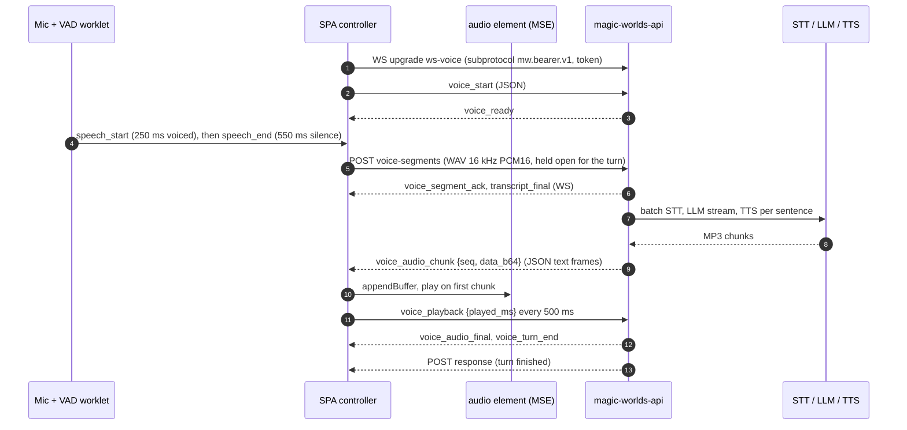
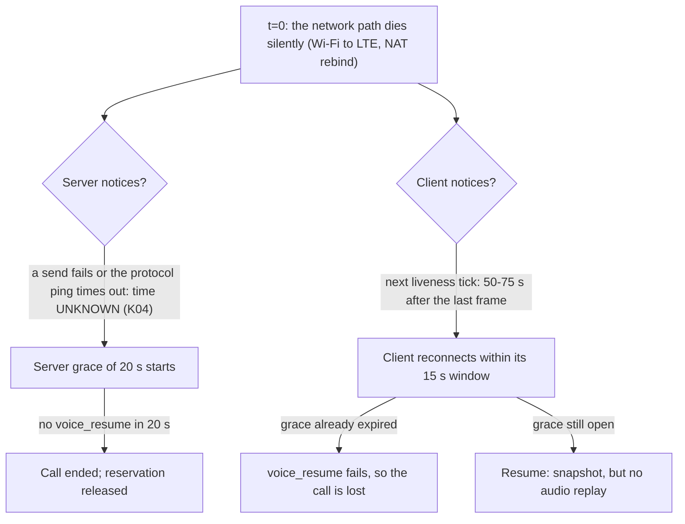
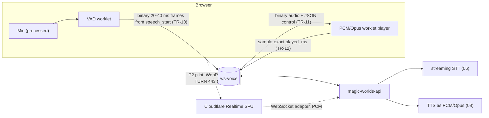

# Transport and client audio

**Research date:** 2026-10-20. **Scope:** how call audio and control frames move between the browser and `magic-worlds-api` (HTTP segment uplink, `ws-voice` WebSocket, liveness, resume, deploys, process placement); how the SPA captures the microphone and plays the character's voice; and how both compare with the October 2026 state of the art (WebRTC, WebSocket, WebTransport/MoQ, Opus loss tools, TURN, browser AEC, noise suppression, AudioWorklet playback, placement, reconnection). STT, LLM and TTS internals are in [06](06_speech_to_text.md), [07](07_llm_in_the_voice_loop.md) and [08](08_text_to_speech.md). Endpointing and barge-in policy are in [05](05_turn_taking_and_interruptions.md), and the full latency budget is in [02](02_turn_lifecycle_and_latency.md).

## Summary

- **Two channels (FACT).** Each user utterance is a 16 kHz mono PCM16 WAV sent as a multipart POST to `/character-chats/{id}/voice-segments`, and the POST stays open for the whole turn. A WebSocket (`ws-voice`) carries JSON control frames and the reply as base64 MP3 inside JSON text frames. Nothing goes upstream while the user speaks (C01).
- **Latency is not the main transport problem (INFERENCE).** Transport and client audio add about 80-355 ms to speech-end-to-first-audio on a good network, and up to about 1.2 s on a slow mobile uplink with Bluetooth output, against a 3.2-4.7 s total. The structural cost is that the batch uplink rules out streaming STT and an early "user is speaking" signal.
- **Robustness is the weak side (FACT).** The client needs 50-75 s to notice a dead socket, against a 15 s resume window and 20 s server grace (C23). A mid-reply resume loses the rest of the reply to a sequence gap (C11). Any unknown, extra-field or binary client frame ends the call (C29). With no send timeout, audio blocks control frames and keepalive (C28). Deploys drop live calls with 1012 (C30), and call state is process-local (C65).
- **Capture is a sound baseline with gaps (FACT).** Processed constraints, a 3 s liveness watchdog, a 16 kHz context and a `play-and-record` iOS session are in place. The raw AEC-off fallback is permanent (C47), only track `ended` is observed (C46), and with AEC off or in the 3 s warm-up, segments still upload during playback and can supersede the reply (C05).
- **Playback is simple and coarse (FACT).** One `<audio>` element is fed by MSE, ManagedMediaSource or Blob groups. It starts on the first chunk with no pre-roll or underrun policy. `played_ms` comes from `currentTime` without output latency and is reported every 500 ms (C25, C48).
- **State of the art.** WebRTC is the 2026 consensus for browser voice: Opus, NetEQ, loss concealment, ICE restart, and a received track that serves as the AEC reference. There is credible dissent for well-built WebSocket pipelines. AEC covers non-WebRTC playback only where the browser cancels all its own output (reportedly Firefox and Safari, and desktop Chrome with Chrome-wide AEC). Edge and iOS have open problems.
- **Recommendation.** P0 (days, no vendor): harden the WebSocket (liveness, tolerant protocol, resume gap, failure classes, telemetry, keep-alive). P1: stream the uplink, send binary downlink frames, and play PCM through an AudioWorklet with sample-exact `played_ms`. P2: pilot a WebRTC media plane gated on P0 telemetry, with the Cloudflare Realtime SFU WebSocket adapter first and LiveKit second. Money is not the constraint: transport costs about $0.00006-0.00011/min today ([13 §2.2](13_cost_scaling_and_operations.md)), and managed WebRTC lists from about $0.00001/min (Cloudflare egress) to about $0.011/min (Pipecat Cloud plus Daily).
- **Correction (re-verified in code).** The ElevenLabs call lane is `mp3_44100_64`, not 128 kbps. 128 kbps is the Fish call lane and narration (§1.3).

## 1. Today's transport

### 1.1 Shape of a call

The design is simple (one idempotent request per utterance, one socket per call, validated JSON frames). The costs: no timed media streaming, TCP head-of-line blocking on all audio, and a control plane that fails hard on anything unexpected.

### 1.2 Uplink: one WAV per utterance over HTTP

**Client side (FACT).**

- The VAD worklet (`src/features/interaction/audio/voiceVadProcessor.worklet.js`) is an RMS gate with an adaptive floor: `speech_start` after 250 ms voiced (500 ms while the reply is audible), end after 550 ms of silence (`src/features/call/components/CallScreen.tsx:114`), 300 ms pre-roll, segments capped at 7.5 s and then 29.5 s after consent.
- The main thread builds the WAV and a SHA-256 (`src/features/interaction/audio/voiceVadWorklet.ts`). `uploadSegment` (`src/features/interaction/hooks/useVoiceCallController.ts:564-628`) posts it through `src/infrastructure/api/index.ts:5418-5446`: FormData with `Idempotency-Key: voice:{vsid}:{seq}:{sha}` and `X-MW-Voice-Contract: 5`, no request timeout, one resend after 300 ms on `TypeError` only, at most 3 in flight (429 `busy` beyond that, not retried; C21).
- No VAD frame reaches the server (`useVoiceCallController.ts:907-910`), so the server learns the user spoke only when the WAV arrives (C67).

**Server side (FACT).**

- The route is `magic-worlds-api/src/routes/user/route_voice_call.py:1130`, gated by `require_features("calls")`. It caps a segment at 30 s and 2 MB.
- `accept_segment` runs the whole turn inside the POST (`magic-worlds-api/src/services/voice_orchestration/engine.py:2090-2103`), so the turn's lifetime is tied to an HTTP request (C21).

**What this costs.**

- **Upload is on the critical path (INFERENCE).** The bytes leave only after the 550 ms hang-over: 20-150 ms, about 700 ms on a mobile uplink ([gap-finding-reconciliation §7](evidence/audit/gap-finding-reconciliation.md), stage 3). PCM16 at 16 kHz is 32 kB/s, so the 0.9-2.1 s dev clips are 29-67 kB and a capped 7.5 s segment is 240 kB (arithmetic).
- **A cold connection per utterance (FACT).** The 5 s server keep-alive is shorter than the 10-31 s between utterances, so almost every POST opens a new TCP connection, plus TLS in production ([GAP-TOPOLOGY-RTT-MEASUREMENTS-07](evidence/audit/gap-topology-rtt-measurements.md), low).
- **Turn and request lifetimes are coupled (FACT).** A client or proxy disconnect does not cancel the turn (GAP-SEGMENT-POST-AND-CONTROL-PLANE-UNKNOWNS-01, low after verification). A `duplicate` or 5xx/504 answer clears client turn state while the turn runs on (-05, low). Production proxy read timeouts are UNKNOWN (GAP-TOPOLOGY-RTT-MEASUREMENTS-10).
- **No streaming STT is possible (FACT).** This is the root of C01 ([06](06_speech_to_text.md)).

**What works (FACT).** The design is idempotent and content-hashed, carries a contract header, survives any HTTP proxy on 443, and never keeps raw audio on the client (FE-CAPTURE-20).

### 1.3 Control and downlink WebSocket

- **Connection (FACT).** `{ws}/character-chats/{id}/ws-voice?workspace_id=` (`src/infrastructure/api/voiceSocket.ts:288`), with the token in the subprotocol list `['mw.bearer.v1', token]` (`:291`). The server checks it once at the handshake, and a resume skips the access gates (C78, low).
- **Client frames** (`src/shared/types/voice.types.ts:112-138`): `voice_start` (encoding `audio/wav;codec=pcm_s16le`, 16,000 Hz, capabilities `media_source_mp3` and `audio_worklet`), `voice_resume {last_segment_seq}`, `voice_barge_in {turn_id, played_ms}`, `voice_playback {turn_id, played_ms}` at most every 500 ms, `voice_end {reason:'user'}` and `voice_ping`.
- **Server frames** (`:164-250`): `voice_ready`, `voice_state_snapshot {last_segment_seq, last_audio_seq}`, `voice_status`, `voice_segment_ack`, `transcript_final`, `voice_turn_start`, `voice_assistant_delta`, `voice_audio_chunk {seq, content_type:'audio/mpeg', data_b64}`, `voice_audio_final`, `voice_turn_end`, `voice_cancelled`, `voice_error`, `voice_ended` and `voice_pong`.
- **Audio on the wire (FACT).** It is base64 inside JSON (`magic-worlds-api/src/services/voice_orchestration/delivery.py:464`), with uvicorn's per-message-deflate on, and carries a `seq` but no media timestamp or duration (C76). The client drops binary frames (`voiceSocket.ts:424`). On the server, a binary frame raises a `KeyError` that ends the call as `internal` ([be-route-transport](evidence/audit/be-route-transport.md); C29).

| Stream | Codec today | Bit rate | On the wire | Chunking (dev) |
|---|---|---|---|---|
| Uplink (per utterance) | WAV PCM16, 16 kHz mono | 256 kbps | multipart POST after speech end | 1 file per segment |
| Downlink, ElevenLabs lane | MP3 44.1 kHz | **64 kbps** CBR | base64 JSON, about 85 kbps plus envelope | 2.3-3.1 kB per chunk (290-385 ms); 30-51 chunks per turn |
| Downlink, Fish lane | MP3 44.1 kHz | 128 kbps | base64 JSON, about 171 kbps plus envelope | 8.3-15.6 kB (0.52-0.97 s); first chunk 418 ms |
| Reference: Opus voice | Opus | 20-32 kbps | binary (WebRTC RTP or WS) | 20 ms frames |

Sources: [gap-call-audio-assets-and-mp3-timeline](evidence/audit/gap-call-audio-assets-and-mp3-timeline.md) §1.1, [r06](evidence/research/r06-transport-client-audio.md) §4; base64 is ×4/3 (arithmetic).

**Correction: the ElevenLabs bit rate (re-verified in code on 2026-10-20).** The audit's working fact list and research notes r04/r06 describe the ElevenLabs call lane as "MP3 44.1 kHz 128 kbps". The code says `STREAM_OUTPUT_FORMAT = "mp3_44100_64"` (`magic-worlds-api/src/services/speech/capabilities.py:65`), and the `("call","standard")` lane maps to `("el_v4_turbo","ttd_ws", STREAM_OUTPUT_FORMAT)` (`:159`). 128 kbps appears in three other places: the narration format (`:64`), the admin catalogue default (`admin_voice_catalog.py:436`) and the Fish call start request (`magic-worlds-api/src/services/speech/providers/fish_audio/timestamp_ws.py:212`). The measured ElevenLabs chunks, 2.3 kB per 290 ms (about 63 kbps), agree with the code.

### 1.4 Liveness, resume and the window mismatch

All values are FACT unless marked UNKNOWN.

| Timer | Value | Where |
|---|---|---|
| Client app ping (`voice_ping`) | 25 s | `src/infrastructure/api/voiceSocket.ts:20` |
| Client liveness timeout | 50 s, checked only on the 25 s tick, so detection takes 50-75 s after the last inbound frame | `:21`, `:586-600` (K03) |
| Client resume window | 15 s ("must stay below" the 20 s server grace) | `:24` |
| Resume backoff / pre-ready reconnect | 500 ms → 4 s / 1 s → 30 s | `voiceSocket.ts` constants |
| Server resume grace | 20 s (max 300 s) | `magic-worlds-api/src/services/voice_orchestration/config.py:45-46` |
| uvicorn protocol ping | 20 s interval, 20 s timeout | uvicorn defaults, not overridden (`magic-worlds-api/src/serve.py:28-33`) |
| Server detection of a half-open socket while sending | UNKNOWN; the app pong queues behind audio | K04 |
| HTTP keep-alive (server) | 5 s | uvicorn default |
| Graceful shutdown timeout | none | `serve.py:28-33` |

**The window mismatch (FACT, C23).** On a clean close the browser fires `close` at once, the 15 s window fits inside the 20 s grace, and resume works. On a silent drop mid-reply, the client plays out its buffer (up to about 8 s ahead) and notices only 50-75 s later. If the server noticed first, its grace has long expired. No `online`, `offline` or `visibilitychange` trigger shortens this (FE-PLAYBACK-TRANSPORT-03).

**Resume semantics (FACT).**

- The snapshot already carries `last_audio_seq`, but the SPA never reads it.
- The server does not replay. Chunks produced while the socket was away are `DROPPED`, yet billed and stored as delivered (C22; GAP-CALL-AUDIO-ASSETS-AND-MP3-TIMELINE-11).
- The buffer drains only contiguous `seq` values (`src/features/interaction/audio/voicePlaybackBuffer.ts:360-368`), so the rest of that reply is lost. The state recovers at the next turn (C11, medium after verification).
- A `listening` snapshot cancels a reply still being heard, without `played_ms` (C27).
- Control frames are dropped, not queued, during a reconnect (C68).
- Uploads are not held: the hold clause at `useVoiceCallController.ts:564-568` applies only when the lifecycle is not `live` (C22).

**Failure classification (FACT).**

- Any socket-loop exception becomes `[VOICE_INTERNAL]`, then `_end_failed_socket_call(category="internal")`, then close 4408 (`magic-worlds-api/src/routes/user/route_voice_call.py:1588-1598`).
- A send failure on a resumed or live socket ends the call without grace (GAP-SEGMENT-POST-AND-CONTROL-PLANE-UNKNOWNS-03, low). One dev ElevenLabs call was stored `failed/internal` after a 22 s end-of-turn stall (GAP-REAL-DEV-CALL-FORENSICS-09, medium).
- Unmount closes with 1000 and no `voice_end`, so navigation is stored as `disconnected`; 3 of 8 dev calls ended `disconnected`, 2 of them likely navigation (INFERENCE; GAP-REAL-DEV-CALL-FORENSICS-11, medium). A close before `voice_ready` is stored as `failed/internal` (GAP-SEGMENT-POST-AND-CONTROL-PLANE-UNKNOWNS-02, medium).
- In dev, 5 of 23 segments that reached STT ended `failed/internal` (small n; [gap-finding-reconciliation §6](evidence/audit/gap-finding-reconciliation.md)). The cause is UNKNOWN; the generic `internal` bucket hides whether it is transport.

### 1.5 Strict protocol (C29)

Every client frame model is `extra="forbid", strict=True` (`route_voice_call.py:135-272`). An unknown `type` or a `ValidationError` raises a fatal `VoiceOrchestrationError` (`:320-330`), so the live call ends with 4408.

**Consequence (INFERENCE).** Every client protocol change must reach the server first, and version skew in either direction kills calls. That includes the telemetry and `voice_end{reason:'navigation'}` frames proposed below, so TR-03 is a prerequisite for most other recommendations.

### 1.6 Send path and head-of-line blocking (C28)

`send_frame` holds a per-socket lock around `websocket.send_json(...)` with no timeout (`magic-worlds-api/src/services/voice_orchestration/delivery.py:212-231`).

- **No pacing.** Audio goes out as fast as TTS produces it, up to the flush-ahead gate of about 8 s or 3 sentences ahead of reported playback (`call_tts_elevenlabs.py:14-21`).
- **A slow client stalls everything.** Once its TCP window fills, the 64 KiB write high-water mark makes every later send wait, including `voice_cancelled` and the in-call `voice_pong` (`route_voice_call.py:1499`). The verifier judged a stall of over 40 s possible; half-open detection while sending is UNKNOWN (K04).
- **Head-of-line blocking is inherent to TCP (FACT).** One lost segment delays every later byte, so loss becomes delay rather than concealment.

### 1.7 Deploys, processes and placement

- **Process model (FACT).** One uvicorn process (`magic-worlds-api/src/serve.py:28-33`): h11, legacy websockets, ping 20/20, per-message-deflate on, keep-alive 5 s, `ws_max_size` 16 MiB, no handshake or graceful timeout. Calls live in an in-memory `_calls` map (`engine.py:556-557, 703`). The dev `--reload`/`--workers` launchers lack `TCP_NODELAY` (+41 ms per reused request; GAP-TOPOLOGY-RTT-MEASUREMENTS-01, medium). Production launchers and WebSocket frames are unaffected.
- **Deploys (FACT, C30).** uvicorn sends 1012 to every socket before the lifespan shutdown can send `server_shutdown`. `_NORMAL_CLOSE_CODES = frozenset({1000})` (`engine.py:100`), so 1012 enters grace. The client then resumes against a new process that has no record of the call, and the call ends (`engine.py:966-978`). After a crash, the quota reservation stays orphaned for about 10-11 min (C31).
- **Scale-out (FACT, C65, K28).** More than one process needs sticky routing. The chat id is in the URL path of both the socket and the POST, so this is feasible.
- **Topology (FACT, GAP-TOPOLOGY-RTT-MEASUREMENTS-10).** The repos define no production proxy, TLS terminator, HTTP version or region, and `FORWARDED_ALLOW_IPS=127.0.0.1`. In dev the browser hits the BFF directly over HTTP/1.1 and WS on `:8010`. Upstream cold TLS to Groq and OpenRouter costs about +165 ms p50 per turn (GAP-TOPOLOGY-RTT-MEASUREMENTS-02, high; C09), which is covered in [06](06_speech_to_text.md) and [07](07_llm_in_the_voice_loop.md).

## 2. Capture

### 2.1 Pipeline

| Step | Today | Reference |
|---|---|---|
| Audio session (iOS/Safari) | `navigator.audioSession.type = 'play-and-record'` before `getUserMedia`, restored on stop | `src/features/interaction/hooks/useMicrophoneCapture.ts:471-481`, `:282-290` |
| Constraints | Processed `{echoCancellation, noiseSuppression, autoGainControl: true}`; a raw variant exists for silent Linux+Chrome APM streams | `:80`, `:83` |
| Context | `AudioContext` at 16 kHz, created after `getUserMedia`; device-rate fallback on Firefox ≤147; `addModule` on every start | `:331-346` |
| Graph | source → VAD worklet → Gain(0) → destination; channel 0 only; 33-tap Hamming FIR resampler | [fe-capture](evidence/audit/fe-capture.md); FE-CAPTURE-17 |
| Liveness watchdog | after 3 s, `dead = maxObservedLevel === 0 \|\| track.muted` switches to raw constraints, **for the rest of the session** | `:85`, `:408-439`, `:421` (C47) |
| Track events | only `ended`; no `mute`/`unmute`, no `devicechange`, no context or session `statechange` | `:521` (C46) |
| Mute | `mute()` disables the track; the VAD floor decays on zeros and is not recalibrated on unmute | `:571-580` (C45) |
| Privacy | no raw audio stored on the client | FE-CAPTURE-20 |

**AEC, warm-up and gating (FACT, C05, high but conditional).** Automatic barge-in is skipped when AEC is off, on the raw fallback, and in the first 3 s of the first reply (`src/features/interaction/hooks/useVoiceCallController.ts:676-687`, `:143`). Segment upload is not gated (`:920-935`), and the server supersedes the reply on any non-empty transcript (`magic-worlds-api/src/services/voice_orchestration/engine.py:2066-2074`), so residual echo can become a "user turn" that cuts the character off. The hint copy is wrong in that mode (`src/app/i18n/locales/en.ts:6150`). How often production calls run with AEC off is UNKNOWN. Whether the processed path cancels the `<audio>` output on each browser is unverified (FE-CAPTURE-19; see §4.4).

**iOS audio session (FACT; correction).** FE-PLAYBACK-TRANSPORT-17 says the code makes "no navigator.audioSession use". That is wrong: capture sets `play-and-record` (`useMicrophoneCapture.ts:471-481`), so r06's P0 "set `play-and-record`" is already done. The real gaps: no audio-session `statechange` or interruption listener (phone call, Siri, backgrounding), and `audio.volume` gain is ignored on iOS.

**Capture setup is serial (FACT, C77, low).** The steps run one after another: mic, consent POST, WebSocket open, `voice_start`, DB gates, `voice_ready`. Call setup takes 0.3-1.5 s (INFERENCE, [be-route-transport](evidence/audit/be-route-transport.md)).

### 2.2 Assessment

Processed constraints, rate handling, the liveness check and the session category match SOTA advice ([r06](evidence/research/r06-transport-client-audio.md) §5). The gaps: a watchdog misfire drops the session to raw, AEC-off capture for good, with no retry and no telemetry, and mid-call failures surface as self-clearing notices (C46). Behaviour on Edge, Android over Bluetooth HFP and iOS 26.2+ (§4.5) is untested on devices.

## 3. Playback

**Pipeline (FACT, [fe-playback-transport](evidence/audit/fe-playback-transport.md)).**

- One `<audio>` element is fed by the first path that works: MSE `audio/mpeg`, then `ManagedMediaSource` (the only MSE on iPhone) with a 2 s stall detector (`src/features/interaction/audio/voicePlaybackBuffer.ts:44`), then Blob groups split on MP3 frame boundaries (`:786-801`). It is prewarmed at `voice_turn_start` and unlocked by a silent WAV inside the user gesture.
- **Start and jitter policy.** Playback starts on the first chunk. There is no pre-roll target, no `waiting` or `stalled` listener and no underrun accounting (FE-PLAYBACK-TRANSPORT-10, low). Chunks are accepted strictly in `seq` order. The fallbacks add a 2 s MMS stall or audible Blob-group gaps (C48), unmeasured per browser.
- **Played position.** `playedMs = playedBeforeGroupMs + audio.currentTime` (`voicePlaybackBuffer.ts:147-153`), with no output-latency correction (FE-PLAYBACK-TRANSPORT-13, part of C25). It is reported every 500 ms and inside `voice_barge_in`, so a supersede between reports is precise only to ±500 ms (GAP-SEGMENT-POST-AND-CONTROL-PLANE-UNKNOWNS-09). Server and client share one frame-based MP3 timeline with under 40 ms skew (GAP-CALL-AUDIO-ASSETS-AND-MP3-TIMELINE-13). The truncation error therefore comes from output latency (Bluetooth 100-300 ms, unverified range), the report cadence and the ElevenLabs sentence-granular keep (C25), not from codec drift.
- **Other behaviour.** Cancel pauses and removes `src` with no fade. Captions run ahead of audio (C49). Limit ends cut mid-word (C52). The first-audible `performance.mark` is never read (C13). Tests are jsdom mocks only (C57).
- **Dev data (small n).** Median reply audio is 17.6 s. 12 of 17 replies were interrupted. 34% of delivered audio was never heard. Accurate `played_ms` therefore matters on most turns, for the history ([10](10_naturalness_and_character_experience.md)) and for billing ([13](13_cost_scaling_and_operations.md)).

**Where the time goes (INFERENCE, [gap-finding-reconciliation §7](evidence/audit/gap-finding-reconciliation.md)).**

| Stage | Range |
|---|---|
| WAV build / upload / downlink + base64 / MSE append + output | 2-15 / 20-150 (700 mobile) / 10-40 / 50-150 (400 Bluetooth) ms |
| **Transport and client audio, total** | **about 80-355 ms typical; about 1.2 s worst** |

This is the Summary figure. The bigger client-side term is the 550 ms hang-over, which is a turn-taking issue (C02, [05](05_turn_taking_and_interruptions.md)).

## 4. State of the art (October 2026)

External facts come from [r06](evidence/research/r06-transport-client-audio.md) (some from [r01](evidence/research/r01-cascaded-architecture.md) and [r10](evidence/research/r10-cost-scaling-ops.md)), with the dates recorded there.

### 4.1 Transport choice

| Dimension | WebSocket as used today | WebSocket done right | WebRTC | WebTransport + WebCodecs | MoQ |
|---|---|---|---|---|---|
| What it is | JSON, base64 MP3 down, POST up | binary, streamed uplink, worklet player | UDP/SRTP, Opus, NetEQ, PLC | QUIC, own codec and jitter buffer | media over QUIC relays |
| Loss and jitter | TCP retransmit, so loss becomes delay; head-of-line blocking | same | concealed, not waited for; jitter buffer about 20-200 ms | no head-of-line blocking across streams; you build the jitter buffer | QUIC; Pipecat's client uses an 80 ms jitter buffer |
| AEC reference | `<audio>` element; depends on the browser (§4.4) | Web Audio; needs Chrome-wide AEC or a loopback | the received track is the reference in every browser | as WebSocket done right | as WebSocket done right |
| Played position | `currentTime`, reported every 500 ms | sample-exact | server-side: sent minus jitter-buffer delay minus output latency (`getStats`) | sample-exact | sample-exact |
| Setup cost | TCP + TLS + upgrade | same | about 8 RTT per Curley; OpenAI's WARP trims it | QUIC, 1 RTT | QUIC, 1 RTT |
| Restrictive networks | 443/TCP passes | same | needs TURN on 443 TCP/TLS | UDP 443; Safari can fall back to HTTP/2 over TCP | relay, with a raced WebSocket fallback |
| Browser support | universal | AudioWorklet universal; SharedArrayBuffer needs COOP/COEP | universal | Baseline since Safari 26.4 (2026-03-24) | IETF draft-22 (2026-10-01) |
| Fit with the FastAPI BFF | native | native | needs an SFU, a gateway or aiortc | needs an HTTP/3 server, which is not in the stack | needs a relay |

- **Consensus.** OpenAI, Google (through partners), Pipecat/Daily, LiveKit and Cloudflare recommend WebRTC for the browser leg and WebSocket server-to-server. Most of them sell WebRTC infrastructure, but OpenAI's own docs also recommend WebRTC for browser and mobile clients for "more consistent performance" ([realtime-webrtc guide](https://developers.openai.com/api/docs/guides/realtime-webrtc), accessed 2026-10-20). With WebRTC, OpenAI's server tracks playout and truncates itself. Over a WebSocket, the client stops playback and sends `conversation.item.truncate {audio_end_ms}` ([realtime-conversations](https://developers.openai.com/api/docs/guides/realtime-conversations), accessed 2026-10-20), which is Magic Worlds' `played_ms` design.
- **Dissent.** Luke Curley ([moq.dev, 2026-05-06](https://moq.dev/blog/webrtc-is-the-problem)) argues that WebRTC setup costs about 8 RTTs, that NetEQ's buffer is too small for LLM audio produced faster than realtime (so the sender must pace), and that a WebSocket is a fine start. Helix ([2025-12-11](https://blog.helix.ml/p/we-killed-webrtc-and-nobody-noticed)) left WebRTC for WebSocket + WebCodecs because of 443-only firewalls (one customer saw about 80% connection success), and later reported abandoning that approach.
- **Peer designs.** Gemini Live is natively WSS, with PCM16 at 16 kHz in and 24 kHz out, and has no first-party WebRTC endpoint. The docs list partners (LiveKit, Pipecat, Fishjam, Stream, Voximplant, Agora, Firebase) that support it "over WebRTC or WebSockets" without saying which uses which ([Live API](https://ai.google.dev/gemini-api/docs/live-api), 2026-10-06; [r06](evidence/research/r06-transport-client-audio.md) fact-check #9). Cloudflare's experimental `@cloudflare/voice` (2026-04-15) sends 16 kHz PCM up and MP3 per sentence down over a WebSocket. Daily's reference budget gives about 200 ms of a 1,293 ms voice-to-voice total to the WebRTC media path (vendor-reported; both in [r01](evidence/research/r01-cascaded-architecture.md)).
- **Reading (INFERENCE).** On good networks a well-built WebSocket pipeline is acceptable, and Magic Worlds' latency problem lies elsewhere (C01, C02, C08). WebRTC pays off under mobile loss and jitter, network changes and echo on browsers without Chrome-wide AEC. TR-01 has to show how often those occur before a migration is justified.

### 4.2 Codecs and loss

- **Opus.** BlogGeek ([c. June 2026](https://bloggeek.me/voice-ai/)) recommends mono Opus at about 32 kbps, no DTX when a server VAD is used, noise suppression before the VAD, and browser AEC. It treats base64 PCM over a WebSocket as a pragmatic shortcut rather than a design.
- **In-band FEC (LBRR) is weak.** In one test it cut concealment only from 20% to 18% ([webrtcHacks, 2020-08-20](https://webrtchacks.com/red-improving-audio-quality-with-redundancy/), stale).
- **RED (RFC 2198) is strong.** With distance 2, concealment fell from 18% to 0.7% at 20% loss, and from 60% to 18% at 60% loss (same source, stale). The libwebrtc field-trial registry shows it off by default; an "on since M96" claim is (unverified). Check the SDP for `red/48000/2`.
- **DRED** is `draft-ietf-mlcodec-opus-dred-07` (2026-08-04) and is not in libwebrtc. Watch only.
- **None of these apply over TCP (FACT).** For Magic Worlds the bit rate is not the issue. Timing, head-of-line blocking and the absence of concealment are.

### 4.3 TURN and connectivity

With WebRTC, TURN is mandatory: offer `turn:…:443?transport=tcp` and `turns:…:443` with short-lived credentials, and test with `iceTransportPolicy: "relay"`. On UDP-blocking networks effectively every session relays ([Metered, 2026-07-16](https://dev.to/alakkadshaw/turn-for-ai-voice-agents-why-agent-traffic-is-almost-100-relay-3meo), vendor). A "5-15% fail without TURN" figure is (unverified). Today's design already passes 443-only networks, so keep a WebSocket fallback in any WebRTC rollout.

### 4.4 Browser AEC reality

| Playback path and browser | Is the character's voice cancelled from the mic? | Notes |
|---|---|---|
| WebRTC remote track, any browser | yes | The robust option ([r06](evidence/research/r06-transport-client-audio.md) §5) |
| `<audio>` or Web Audio on Chrome desktop with Chrome-wide AEC | yes | Since about M111. A feature-flag default, not guaranteed; no API detects it ([Zoom dev forum, 2026-08](https://devforum.zoom.us/t/issupportchromewideaec-sniffs-browser-name-version-breaking-echo-cancellation-on-microsoft-edge/145288)) |
| Same, on Microsoft Edge | possibly not | The Zoom forum thread reports Edge cancels only what Edge itself plays and lacks the neural model. **Test on Edge.** |
| Firefox | reported yes (all browser output) | Daily's guide describes Firefox's AEC as weak ([r01](evidence/research/r01-cascaded-architecture.md)) |
| Safari macOS / iOS | reported yes (all browser output) | Safari 26.4 improved macOS multi-mic EC; iOS bugs in §4.5 |

- **Chrome's neural residual-echo estimator** ([webrtcHacks, 2026-10-06](https://webrtchacks.com/chrome-neural-echo-cancellation/)) is a 425 KB TFLite model, on by default in Chrome desktop. In their test it cut double-talk WER from 0.500 to 0.235 (worst bucket 0.600 to 0.545). Edge, Electron, Firefox and Safari do not get it.
- **`echoCancellation: "all" | "remote-only"`** is specified ([MDN, 2026-10-08](https://developer.mozilla.org/en-US/docs/Web/API/MediaTrackConstraints/echoCancellation)). Chrome shipping is unconfirmed, so feature-detect it through `getSettings()`.
- **Workarounds, most to least robust:** the agent's audio as a WebRTC remote track; a local `RTCPeerConnection` loopback (worklet → `MediaStreamAudioDestinationNode` → peer pair → `<audio>`); an HTMLMediaElement (today); a server-side echo guard (gate uploads during playback, or drop a transcript that matches recent assistant text).

### 4.5 iOS and Android quirks

- **WebKit [326286](https://bugs.webkit.org/show_bug.cgi?id=326286)** (filed 2026-10-04; NEW, P2/Major, unassigned on 2026-10-09). On iOS 26.2 to 27, output crackles whenever a `getUserMedia` track with `echoCancellation: true` is open. It affects both Web Audio and `<audio>` output, so it hits today's player and a worklet player alike. A native app without voice processing is clean.
- **WebKit [311451](https://bugs.webkit.org/show_bug.cgi?id=311451)** (filed 2026-04-03; NEW, modified 2026-10-08). With the mic open, output drops to a lower sample rate and goes mono. Turning EC off does not help.
- **WebKit [262759](https://bugs.webkit.org/show_bug.cgi?id=262759)** (WONTFIX). `play-and-record` lowers the output volume.
- **Apple availability.** ManagedMediaSource on macOS 17.0+ and iOS 17.1+; it appends only while `streaming === true`, hence Magic Worlds' 2 s stall fallback. WebCodecs `AudioDecoder` on 26.0+, WebTransport on 26.4+, `outputLatency` on 18.4+.
- **Android.** Bluetooth HFP routing changes output quality while the mic is open. Chrome 88 heavy timer throttling exempts pages with a live track or audio in the last 30 s, so the 25 s heartbeat survives in the background.

### 4.6 Noise suppression

| Model | Algorithmic latency | Notes |
|---|---|---|
| Browser NS (WebRTC APM) | in the capture path | Keep it on; do not stack a second model on top ([LiveKit docs](https://docs.livekit.io/home/cloud/noise-cancellation/), vendor) |
| RNNoise | about 10 ms | BSD; WASM and C; cheap on a server CPU |
| DeepFilterNet 3 | about 40 ms | stronger and heavier |
| Krisp VIVA (2.0 launched 2026-05) | about 15-25 ms (vendor-reported) | commercial; its WER-improvement claim is (unverified) |
| ai-coustics | about 30 ms (unverified) | commercial |

**Reading (INFERENCE).** Noise defeats the energy VAD (C03). A model helps most on the server, before VAD and STT, once audio arrives as a stream; a client WASM model would stack on browser NS.

### 4.7 Playback: AudioWorklet ring buffer and sample-exact position

- **Structure.** A worklet renders 128-frame quanta from a lock-free SPSC ring buffer on a SharedArrayBuffer, with decoding and resampling in a Worker. SharedArrayBuffer needs cross-origin isolation (COOP `same-origin` plus COEP `require-corp` or `credentialless`), which can break OAuth popups and embeds; the SPA has a Google sign-in callback. The fallback is a `MessagePort` carrying 20-40 ms batches.
- **Jitter policy.** Pre-roll 40-120 ms. On an underrun, output silence and grow the target by 40 ms, up to 250 ms. Insert real silence between sentences. Flush with a 5-10 ms fade.
- **Played position.** `heardMs = (framesConsumed − prerollSilenceFrames) / sampleRate × 1000 − outputLatency × 1000`. `outputLatency` works in Chrome/Edge 102+, Firefox 70+ and Safari/iOS 18.4+ (Baseline 2025). `getOutputTimestamp()` maps context time to `performance.now()`. `AudioContext.playbackStats` (WICG) reports glitch counters; feature-detect it.

**Formats.**

| Format | Status |
|---|---|
| ElevenLabs PCM | `pcm_8000…48000`; `pcm_44100` needs a Pro plan. Whether the Text-to-Dialogue multi-stream socket used by the call lane accepts PCM is UNKNOWN. |
| Fish formats | (unverified) |
| Opus + WebCodecs `AudioDecoder` | Chrome 94+, Firefox 130+, Safari/iOS 26.0+. ElevenLabs offers `opus_48000_{32..192}`; the container may be Ogg (unverified). |
| MP3 through `decodeAudioData` per chunk | Avoid: priming and padding cause clicks unless chunks split on frame boundaries |

**AEC caveat.** On Chromium without Chrome-wide AEC (Edge), Web Audio output needs the §4.4 loopback.

### 4.8 Binary frames and a streamed uplink

- **Binary frames.** Base64 adds 33% plus a JSON parse per chunk. Binary audio frames need only a small header (turn, seq, sample offset, duration), and the offset gives captions an alignment anchor (C49). Control stays in JSON. Per-message-deflate gains nothing on already-compressed MP3 or Opus (INFERENCE).
- **Streamed uplink.** Send 20-40 ms frames from `speech_start`, pre-roll included, and close the segment with a control frame. The server then has the audio when the VAD ends. The upload leaves the critical path, the server gets an early "user is speaking" signal (C67), the turn no longer lives inside an HTTP request (C21), and streaming STT becomes possible ([06](06_speech_to_text.md)).
- **Pacing.** LLM-driven TTS runs faster than realtime. Over WebRTC the sender must pace (Curley). Over a WebSocket, a bounded lead keeps a cancel cheap and keeps control frames out from behind seconds of audio.

### 4.9 Region placement

- **Vendor-reported.** Daily gives a first-hop P50 of 13 ms across about 75 PoPs, and says an extra server-to-agent hop without mesh routing adds 10-100 ms. Cloudflare covers 330+ cities. LiveKit puts Singapore↔US-East at about 150 ms in theory and 230-280 ms in practice.
- **Guidance** ([r10](evidence/research/r10-cost-scaling-ops.md) §8). Keep the orchestrator next to the providers; a single US-East region is usual (typical RTTs for this stack are unverified). Improve the last mile for Spain and Latin America with an edge, not by moving the backend. The dev WAN ping was 37.9 ms ([gap-topology-rtt-measurements](evidence/audit/gap-topology-rtt-measurements.md)). Production RTTs are UNKNOWN.

### 4.10 Reconnection, replay and drain

- **Detection.** Use a fast application ping with a two-miss timeout, plus `online`, `offline` and `visibilitychange` triggers. WebRTC adds ICE restart and QUIC adds connection migration.
- **Replay.** The server keeps a short per-turn ring of sent frames and replays from the client's last received `seq`. The client skips a gap after a timer. Resume tokens are single-use ([r10](evidence/research/r10-cost-scaling-ops.md) §11).
- **Drain on deploy** ([r10](evidence/research/r10-cost-scaling-ops.md) §5). Stop admitting calls, send a `migrate` or shutdown notice, and allow at least the max call length plus margin (about 13 min; LiveKit suggests 10+ min, with a 1 h `drain_timeout` default). Autoscale on active calls, and route by an owner lookup or consistent hashing.

## 5. Findings register

Each finding maps to the SOTA practice in §4 and to a recommendation in §7. Severities follow [gap-finding-reconciliation](evidence/audit/gap-finding-reconciliation.md), including its Verification section. Gap-note findings keep their own IDs.

| ID | Sev. | Finding (short) | TR |
|---|---|---|---|
| C01 (FE-CAPTURE-03) | high | Whole-utterance WAV over HTTP after the hang-over; no streaming | TR-10 |
| C05 (FE-CAPTURE-01) | high, conditional | Echo self-supersede when AEC is off, raw or warming up | TR-05, TR-12 |
| C11 (FE-PLAYBACK-TRANSPORT-01) | medium | Resume mid-reply leaves a seq gap; `last_audio_seq` never read | TR-04, TR-08 |
| C13 | medium | No client first-audible, stall or transport telemetry | TR-01 |
| C21 | medium | Turn lifetime bound to the POST | TR-10 |
| C22 | medium | Away audio billed, not replayed; uploads not held | TR-04, TR-08 |
| C23 (FE-PLAYBACK-TRANSPORT-03) | medium | Detection 50-75 s vs 15/20 s windows | TR-02 |
| C25 (FE-PLAYBACK-TRANSPORT-13) | medium | `played_ms` ignores output latency; sentence-granular cut | TR-12 |
| C27 (FE-PLAYBACK-TRANSPORT-04) | medium | Listening snapshot cancels a reply still being heard | TR-04 |
| C28 | medium | No send timeout; FIFO; pong behind audio | TR-07 |
| C29 | medium | Unknown, extra or binary frame ends the call | TR-03 |
| C30 | medium | Deploys drop calls with 1012 | TR-09 |
| C31 | medium | Crash-orphaned reservations for 10-11 min | TR-09 |
| C45 | medium | Mute or noise mid-call fakes speech turns | TR-13 |
| C46 | medium | Only track `ended` observed | TR-13 |
| C47 | medium | Watchdog misfires; raw fallback permanent | TR-13 |
| C48 (FE-PLAYBACK-TRANSPORT-09) | medium | ManagedMediaSource stall and Blob-gap fallbacks | TR-12 |
| C49 | medium | Captions ahead of audio | TR-11 |
| C52 | medium | Limit ends cut mid-word, report nothing heard | TR-12 |
| C57 | medium | Transport and playback tests are jsdom mocks only | TR-01 |
| GAP-SEGMENT-POST-AND-CONTROL-PLANE-UNKNOWNS-02 | medium | Pre-ready close stored as `failed/internal` | TR-03 |
| GAP-REAL-DEV-CALL-FORENSICS-09 | medium | Send failure after a 22 s stall stored as `internal` | TR-03 |
| GAP-REAL-DEV-CALL-FORENSICS-11 | medium | Unmount closes 1000 without `voice_end` | TR-03 |
| GAP-TOPOLOGY-RTT-MEASUREMENTS-01 | medium | Dev launchers lack `TCP_NODELAY` (+41 ms) | TR-06 |
| GAP-SEGMENT-POST-AND-CONTROL-PLANE-UNKNOWNS-01, -03, -05 | low | Orphaned turn; no grace on send failure; duplicate clears state | TR-03, TR-10 |
| C65 (BE-ROUTE-TRANSPORT-02) | low | Process-local state; misrouted resume ends the call | TR-09, TR-15 |
| C67 | low | No early "user is speaking" signal | TR-10 |
| C68 (FE-PLAYBACK-TRANSPORT-08) | low | Control frames dropped while reconnecting | TR-04 |
| C76 | low | Base64 MP3 in JSON, no timing | TR-11 |
| C77 | low | Serial call setup | TR-06 |
| C78 | low | Token in subprotocol, checked once | TR-03 |
| GAP-TOPOLOGY-RTT-MEASUREMENTS-07 | low | 5 s keep-alive; every upload opens a new connection | TR-06 |
| GAP-TOPOLOGY-RTT-MEASUREMENTS-10 | low | Production topology undefined | TR-06, TR-15 |
| GAP-CALL-AUDIO-ASSETS-AND-MP3-TIMELINE-11 | low | Away audio billed and not replayed | TR-08 |
| FE-PLAYBACK-TRANSPORT-10 | low | No jitter or pre-roll policy | TR-12 |

## 6. Options for Magic Worlds

| Option | What changes | Fixes | Leaves open | Vendor cost (list, 2026-10) | Effort | Fit |
|---|---|---|---|---|---|---|
| **A. WebSocket done right** | streamed binary uplink, binary downlink, PCM/Opus worklet player, P0 hardening | upload term of C01, C21, C25, C48, C67, C76, most robustness findings | TCP head-of-line blocking (loss becomes delay); Edge AEC needs the loopback; iOS bugs | none; bandwidth about $0.00006-0.00011/min today, about $0.0003/min (2.3-4.5× more bytes) with a 24 kHz PCM downlink (INFERENCE; [16](16_target_architectures.md)) | M-L (weeks) | Next step; no new infrastructure |
| **B. Cloudflare Realtime SFU + WebSocket adapter** | browser speaks WebRTC to Cloudflare's edge; the SFU bridges audio to the BFF over a WebSocket as PCM | loss and jitter, AEC through the remote track, TURN, edge first hop (330+ cities), ICE restart | adapter PCM rate underspecified ("original sample rate"); signalling through Cloudflare's API | SFU/TURN egress $0.05/GB after 1,000 GB/mo free (shared); ingest free, including from a WebSocket endpoint ([pricing](https://developers.cloudflare.com/realtime/sfu/platform/pricing/), 2026-09-22) | M-L | Least invasive WebRTC path for a FastAPI WebSocket backend |
| **C. LiveKit (Cloud or OSS)** | browser joins a room; the BFF or a LiveKit Agents worker joins as a participant | as B, plus mature SDKs and turn-detection models (see [05](05_turn_taking_and_interruptions.md)) | call orchestration moves to a participant model; Python agent workers | Cloud Ship $50/mo with 150,000 WebRTC-min, then $0.0005/min; agent hosting $0.01/min if used ([pricing](https://livekit.com/pricing), 2026-10-20); OSS: servers + TURN | L | Strong if its turn detection is adopted too |
| **D. Pipecat SmallWebRTC in the BFF** | aiortc peer connection in the Python process | loss handling and AEC for 1:1 | Pipecat advises against it for distributed users or more than a handful of concurrent sessions; UDP ports; TURN to run; CPU on the single event loop (INFERENCE) | free + TURN | M-L | Prototype only |
| **E. Daily / Pipecat Cloud** | hosted Pipecat pipeline on Daily's transport (about 75 PoPs) | everything in B, plus hosted orchestration | moves the pipeline out of `magic-worlds-api`; lock-in | $0.01/session-min hosting + Daily WebRTC $0.001/min (wording ambiguous) | L | Only for a full re-platform |
| **F. WebTransport / MoQ** | QUIC to the BFF or a relay | head-of-line blocking; 1-RTT setup; migration | own jitter buffer and AEC; HTTP/3 server; MoQ still a draft | n/a | L | Watch (P3) |

**Cost arithmetic (INFERENCE, from list prices; production egress pricing is UNKNOWN).**

- **Today.** A full minute of character audio sent as base64 MP3 is about 0.64 MB on the wire on the ElevenLabs lane (64 kbps) and about 1.28 MB on the Fish lane (128 kbps), or about $0.00006/min and $0.00011/min at r10's $0.09/GB ([13 §2.2](13_cost_scaling_and_operations.md)). r10's lower figure of about $0.00005/min assumed 128 kbps on every lane, no base64 overhead and about 0.5 MB per call-minute ([r10](evidence/research/r10-cost-scaling-ops.md)). A 24 kHz PCM16 downlink would be 384 kbps.
- **Option B.** Opus to the client at about 32 kbps is about 0.24 MB/min, or about $0.000012/min after the free tier. If the adapter's PCM leg to the BFF is billed as egress, 16 kHz PCM16 adds 1.92 MB/min (about $0.0001/min), and 48 kHz adds 5.76 MB/min (about $0.0003/min; 1,000 GB then covers about 2,900 call-hours).
- **Option C.** A 1:1 call is probably two participant-minutes per minute, about $0.001/min beyond the included minutes. How a self-hosted agent is counted is (unverified).
- **Conclusion.** Transport stays far below STT, LLM and TTS spend ([13](13_cost_scaling_and_operations.md)). The decision turns on effort, risk and AEC/iOS behaviour, not money.

**Path.** Option A is the base. Option B is the preferred WebRTC pilot because the BFF keeps a WebSocket interface: the work from TR-10 and TR-12 carries over, and the SFU replaces only the browser leg.

**When to move to WebRTC (TR-16).** Set thresholds after two weeks of TR-01 baseline data rather than inventing them now. Watch mobile reconnects and playback stalls per call-minute, echo self-supersede on Edge or AEC-off calls after TR-05, and the share of users with a high RTT to the BFF.

## 7. Recommendations

The impact figures are estimates, labelled INFERENCE unless they are arithmetic.

| ID | P | Effort | What | Why | Expected impact (estimate) | Depends on | Validation metric |
|---|---|---|---|---|---|---|---|
| **TR-01** | P0 | M | **Client transport and playback telemetry.** Per turn: first `playing` after the first append, stalls (`waiting`), playback path (MSE/MMS/Blob), `getSettings()` AEC and NS, raw-fallback flag, `outputLatency`, upload bytes and ms, reconnects with cause. Batch to an HTTP endpoint at call end, or a WS frame after TR-03. Add browser tests with network shaping. | C13, C57 | Turns the questions in §8 into data; no direct latency change | TR-03 if sent over WS | at least 95% of turns carry a complete client timeline, split by browser and OS |
| **TR-02** | P0 | S | **Liveness.** Check every 5 s and ping every 5-10 s; treat two missed pongs (about 10-20 s) as a dead socket. Probe or reconnect on `online`, `offline` and `visibilitychange`. Raise the server grace to at least 30 s and keep the client window just below it. | C23 | Detection drops from 50-75 s to about 10-20 s (by construction); more mid-reply drops resume | TR-07 for full effect (pong queues behind audio) | lab: cut the network mid-reply and measure time-to-resume; production resume success rate |
| **TR-03** | P0 | S | **Tolerant protocol and honest failure classes.** Log and count unknown types and extra fields instead of failing; ignore binary frames until TR-10; add `protocol_version` to `voice_start`. Send failures go to `socket_disconnected(1006)` with grace; a pre-ready close is stored as abandoned. Accept `voice_end{reason:'navigation'}` and send it on unmount. Distinct mid-call close codes; re-check access on resume (C78). | C29, GAP-SEGMENT-POST-AND-CONTROL-PLANE-UNKNOWNS-02/-03, GAP-REAL-DEV-CALL-FORENSICS-09/-11 | Removes deploy-skew call kills; `failed/internal` regains meaning | deploy the server before the client | mid-call 4408 for non-protocol causes near 0; `disconnected` split from navigation |
| **TR-04** | P0 | M | **Client resume correctness.** Read `last_audio_seq` from the snapshot and skip gaps; a gap timer lets a buffered later `seq` win after a short wait. On a `listening` snapshot, report `played_ms` instead of cancelling audio still playing. Queue control frames during a reconnect (latest wins) and hold uploads until resumed. | C11, C27, C68, C22 | The rest of a reply ends cleanly instead of hanging; history matches what was heard more often | none | resume browser tests; turns ending with an unfilled gap reach 0 |
| **TR-05** | P0 | S | **Echo guard where AEC is not verified** (raw fallback, `echoCancellation` not reported true, warm-up). Do not upload while the reply is audible (half-duplex), or require a stronger barge-in. Fix the hint copy. Server side: drop a transcript matching recent assistant text ([05](05_turn_taking_and_interruptions.md)). | C05, C47 | Ends self-supersede in AEC-off calls; costs barge-in there | TR-01 to size it | self-supersede events per call (transcript close to the assistant's text) reach 0 |
| **TR-06** | P0 | S | **Connection and setup hygiene.** Set keep-alive above the 10-31 s speaking gap, at the BFF and at any proxy. Set `timeout_graceful_shutdown`. Set WS options explicitly. Fix dev `TCP_NODELAY`. Document the production edge (proxy, TLS, HTTP version, read timeouts above the maximum turn). Overlap mic, consent and WS open. | GAP-TOPOLOGY-RTT-MEASUREMENTS-07/-01/-10, C77 | Removes a TCP (+TLS) handshake from most uploads (size UNKNOWN until production RTT is known); faster setup | none | share of POSTs on a reused connection; call setup p50 |
| **TR-07** | P1 | M | **Send deadline and priorities.** Add a 1-2 s per-send timeout that marks the socket slow, then disconnected with grace. Add a priority lane so `voice_cancelled`, `voice_pong` and state frames bypass queued audio. Pace audio to a bounded lead over the reported playback, tuned with TR-01 underrun data. | C28, K04 | Cancel and keepalive stop waiting behind seconds of audio; bounded half-open detection | TR-03 | control-frame queue delay p95; time-to-cancel p95 |
| **TR-08** | P1 | M | **Server replay.** Keep the current turn's sent chunks. On resume, replay from the client's last received `seq` + 1. Do not count away audio as delivered until it is replayed. | C11, C22, GAP-CALL-AUDIO-ASSETS-AND-MP3-TIMELINE-11 | Resume continues the reply; billing matches delivery | TR-04 | replayed turns; billed vs delivered ms |
| **TR-09** | P1 | M | **Graceful deploy drain.** Stop admitting calls. Send a shutdown/migrate notice before uvicorn closes the sockets. Keep old instances up for the maximum call (600 s) plus margin. Route sticky on the chat id when there is more than one instance. | C30, C31, C65 | Deploys stop dropping calls | TR-06; the deploy platform | calls dropped per deploy reach 0 |
| **TR-10** | P1 | M | **Streamed uplink on the existing socket.** Send binary PCM16 frames of 20-40 ms from `speech_start`, pre-roll included, followed by a `segment_end` control frame. The server assembles them and later feeds streaming STT. The session, not the POST, owns the turn. Keep the POST as a fallback. | C01, C21, C67 | Takes the upload (20-150 ms, about 700 on mobile) off the critical path; enables streaming STT ([06](06_speech_to_text.md)) and early warm-up | TR-03, TR-07 | speech-end to STT-start p50/p95, split mobile vs desktop |
| **TR-11** | P1 | S | **Binary downlink frames.** Add a header (turn, `seq`, sample offset, duration), keep control in JSON, and stop deflating audio (disable per-message-deflate or skip it for audio frames). | C76, C49 | 25% fewer downlink bytes than base64 (arithmetic); an anchor for caption alignment | TR-03 | bytes per audio-second; caption lead over audio |
| **TR-12** | P1 | L | **AudioWorklet player.** PCM, or Opus through WebCodecs, into a ring buffer; pre-roll 40-120 ms growing to 250 ms after underruns; silence between sentences; 5-10 ms fade on cancel and limit ends; `played_ms` = consumed frames minus `outputLatency`. Loopback AEC path on Chromium where Chrome-wide AEC is not assured (Edge). MSE stays as the fallback. | C25, C48, C52, FE-PLAYBACK-TRANSPORT-10, C05 | Removes the 2 s MMS stall and the Blob gaps; truncation error falls from ±500 ms plus output latency to near sample-exact | TR-11; TTS PCM/Opus support (UNKNOWN for the ElevenLabs TTD socket, see [08](08_text_to_speech.md)); a COOP/COEP check | underruns per minute; `played_ms` error against a loopback reference; echo self-trigger on Edge |
| **TR-13** | P1 | S | **Mic resilience.** Listen for track `mute`/`unmute`, `AudioContext` and `audioSession` `statechange`, and `devicechange`. Recalibrate the VAD floor after unmute. On a watchdog trip, retry processed constraints with a fresh context before going raw, and re-probe later. Report each fallback. | C45, C46, C47 | Fewer fake turns; fewer permanent AEC-off sessions | TR-01 | raw-fallback rate; recovered mic failures |
| **TR-14** | P1 | S | **Device test plan.** Cover iOS 26.x/27 (326286, 311451, MMS stall, interruptions), Android over Bluetooth, and Edge AEC. Offer an optional "headphones mode" with EC off on iOS. File or upvote the WebKit bugs with a repro. | §4.4-4.5 | Known platform risk becomes measured risk | TR-01 | matrix pass rate; crackle reports |
| **TR-15** | P2 | L | **Externalized call state and placement.** Use an owner lookup (Redis) for resume across processes and route consistently on the chat id. Co-locate the BFF with the providers. Measure RTT from Spain and Latin America. | C65, GAP-TOPOLOGY-RTT-MEASUREMENTS-10 | Multiple instances; resume survives a restart | TR-09 | cross-instance resume success; RTT p50/p95 by country |
| **TR-16** | P2 | L | **WebRTC media-plane pilot.** Try the Cloudflare Realtime SFU with its WS adapter first and LiveKit second. Run TURN on 443, keep the WS fallback, and decide go/no-go on the TR-01 triggers (§6). | C05, C23, loss and jitter | Concealment instead of delay under loss; AEC-correct playback; an edge first hop | TR-01, TR-03, TR-10 | A/B on mobile: stalls, reconnects, self-supersede, first-audio p95 |
| **TR-17** | P2 | M | **Server-side noise suppression** before VAD and STT, starting with RNNoise. Keep browser NS on and do not stack models. | C03 | Fewer noise-triggered turns (size UNKNOWN) | TR-10; the eval set from [05](05_turn_taking_and_interruptions.md) and [06](06_speech_to_text.md) | false `speech_start` per minute; WER on a noisy set |
| **TR-18** | P3 | S | **Watch list.** WebTransport + WebCodecs, MoQ (draft-22), WARP (the SNAP origin trial in Chrome 151-156), DRED, `echoCancellation:"all"`, `playbackStats`, and fixes for WebKit 326286 and 311451. | none | none until adopted | none | quarterly review |

**Order.** TR-03 ships first on the server, because it makes later client changes safe. TR-01, TR-02, TR-04, TR-05 and TR-06 follow in parallel, then TR-07, TR-10/TR-11 and TR-12. TR-16 starts only with TR-01 data in hand. Roadmap view: [17](17_recommendations_and_roadmap.md) and [16](16_target_architectures.md).

## 8. Open questions

1. **Production edge (UNKNOWN):** proxy, TLS, HTTP version, read and idle timeouts, and how they treat a POST held open for a turn and a 1012 on deploy (GAP-TOPOLOGY-RTT-MEASUREMENTS-10).
2. **AEC in practice (UNKNOWN):** the production rate of raw fallback or AEC-off, the Edge share, and whether Edge cancels `<audio>` playback (C05, C47, FE-CAPTURE-19).
3. **Half-open detection while sending (UNKNOWN, K04).**
4. **Cloudflare adapter (UNKNOWN):** its PCM rate, and whether its egress to the BFF is billed.
5. **TTS formats:** PCM or Opus on the ElevenLabs Text-to-Dialogue multi-stream socket is UNKNOWN; Fish formats are (unverified).
6. **Vendor billing:** how LiveKit counts a self-hosted agent, and what Daily's WebRTC price wording means.
7. **RED default in current Chrome (unverified).**
8. **RTT (UNKNOWN):** for users in Spain and Latin America, and the providers' serving regions.
9. **iOS 26.2+ behaviour of the current player on devices (UNKNOWN)** (326286, 311451).
10. **COOP/COEP compatibility (UNKNOWN)** with the Google sign-in callback and embeds.

## 9. Evidence and cross-links

**Audit notes.**

- [fe-capture](evidence/audit/fe-capture.md)
- [fe-playback-transport](evidence/audit/fe-playback-transport.md)
- [be-route-transport](evidence/audit/be-route-transport.md)
- [gap-finding-reconciliation](evidence/audit/gap-finding-reconciliation.md) (§2, §5, §7, Appendix B and Verification)
- [gap-segment-post-and-control-plane-unknowns](evidence/audit/gap-segment-post-and-control-plane-unknowns.md)
- [gap-topology-rtt-measurements](evidence/audit/gap-topology-rtt-measurements.md)
- [gap-call-audio-assets-and-mp3-timeline](evidence/audit/gap-call-audio-assets-and-mp3-timeline.md)
- [gap-real-dev-call-forensics](evidence/audit/gap-real-dev-call-forensics.md)

**Research notes.**

- [r06 transport and client audio](evidence/research/r06-transport-client-audio.md) (primary)
- [r01 cascaded architecture](evidence/research/r01-cascaded-architecture.md). Its "segment uploaded over a WebSocket" is superseded by §1.2.
- [r10 cost, scaling and operations](evidence/research/r10-cost-scaling-ops.md)
- [r94 contradictions reconcile](evidence/research/r94-gap-g4-contradictions-reconcile.md)

**Code re-verified for this document (read-only):** `src/infrastructure/api/voiceSocket.ts:20-24, 288, 291, 424, 586-600`; `src/features/interaction/audio/voicePlaybackBuffer.ts:44, 147-153`; `src/features/interaction/hooks/useMicrophoneCapture.ts:80-85, 471-481, 521`; `src/features/call/components/CallScreen.tsx:114`; `src/shared/types/voice.types.ts:112-138`; `magic-worlds-api/src/serve.py:28-33`; `magic-worlds-api/src/services/voice_orchestration/delivery.py:212-231, 464`; `magic-worlds-api/src/services/voice_orchestration/engine.py:100`; `magic-worlds-api/src/routes/user/route_voice_call.py:1130, 1588-1598`; `magic-worlds-api/src/services/speech/capabilities.py:64-65, 159`; `magic-worlds-api/src/services/speech/providers/fish_audio/timestamp_ws.py:206-213`.

**Sibling documents:** [00](00_methodology_and_sources.md), [01](01_current_architecture.md), [03](03_audit_findings.md), [04](04_cascaded_pipeline_sota.md), [11](11_speech_to_speech_and_omni_models.md) (native WebRTC/WSS speech-to-speech transports), [12](12_observability_evaluation_and_testing.md) (TR-01), [14](14_safety_policy_and_compliance.md), [15](15_gap_analysis.md), [16](16_target_architectures.md), [17](17_recommendations_and_roadmap.md).
