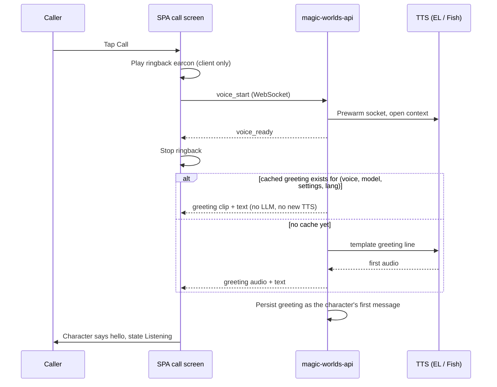
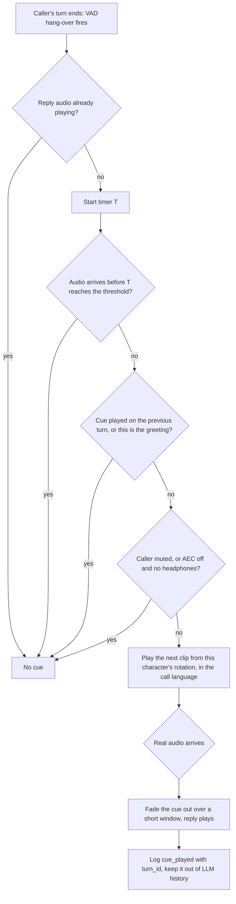
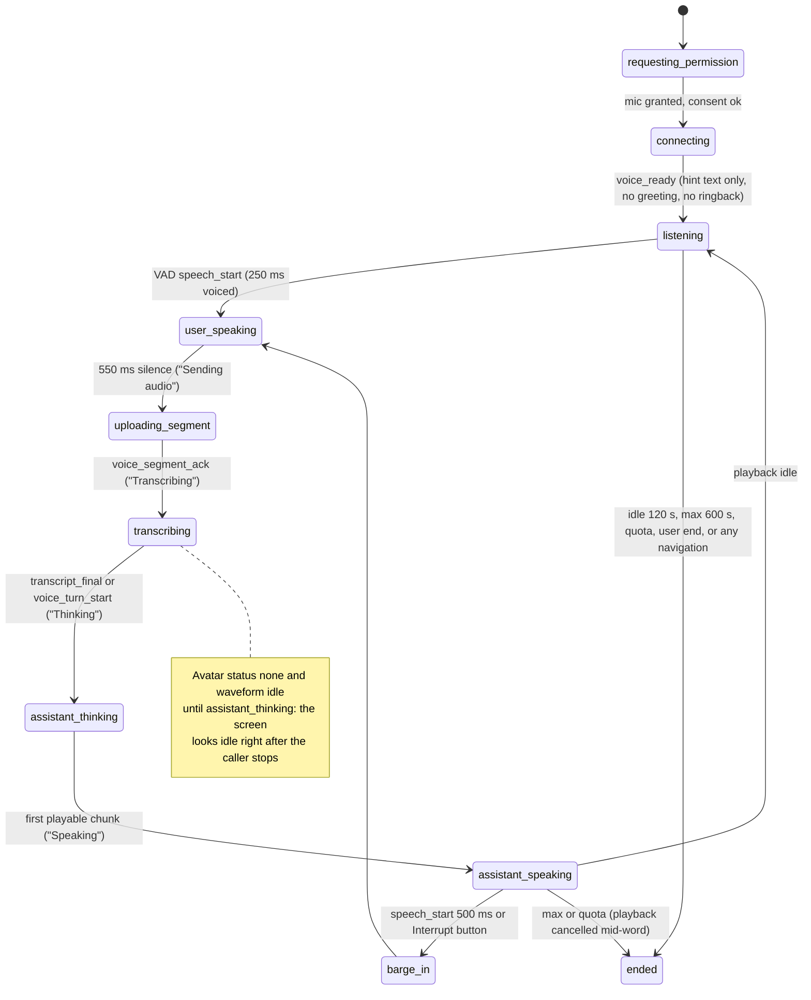

# Conversational naturalness and the character call experience

**Research date:** 2026-10-20. **Scope:** what makes a live voice call with a fictional character feel natural: turn timing, fillers, backchannels, prosody, turn length, silence, interruption, goodbyes and memory. Also covered: how companion and roleplay products run calls; character-specific craft for the Magic Worlds cascade (ElevenLabs `eleven_v4_turbo` and Fish lanes, English and Spanish); the call UX the SPA ships today; and recommendations NAT-01 to NAT-16. Latency mechanics live in [02_turn_lifecycle_and_latency.md](02_turn_lifecycle_and_latency.md), barge-in mechanics in [05_turn_taking_and_interruptions.md](05_turn_taking_and_interruptions.md), the LLM prompt and output budget in [07_llm_in_the_voice_loop.md](07_llm_in_the_voice_loop.md), TTS in [08_text_to_speech.md](08_text_to_speech.md) and companion law in [14_safety_policy_and_compliance.md](14_safety_policy_and_compliance.md).

## Summary

- **The character answers late and talks too long.** Speech end to first audible audio is about 3.2-4.2 s on the EL lane (3.6-4.7 s at STT p95), against a human modal gap of about 200 ms and a research tolerance line of 4 s. Dev replies ran p50 **17.6 s** of audio, and callers cut 12 of 17. Shorter replies are the cheapest lever: a prompt change plus a backstop cap, no vendor change (NAT-01).
- **Nothing covers the wait.** No ringback, no greeting, no filler: the caller speaks first into silence, C53 (FE-UI-07). The status steps through "Sending audio / Transcribing / Thinking" while the avatar looks idle, C73 (FE-UI-08). Maslych et al. (CUI '25) found spoken fillers improve perceived response time at 4 s and 6.5 s, and a spinner with sound does not (NAT-02, NAT-03, NAT-04).
- **Interruption is sound at the core but loses short replies.** Barge-in truncates by `played_ms` and history keeps only what was heard. But a short "yes"/"sí" said over the character never reaches STT, C16 (FE-UI-01); a longer "mm-hm" cancels the reply for good; and the LLM is not told *this* turn was cut, C25 (NAT-11).
- **Expressive control is mostly off, and stray emotes crash Fish turns.** The EL lane applies no emotion tag prefix, and interjections are off by default (forced off for Fish). Haiku still wrote asterisks in 2 of 15 replies, which on Fish crashes the word ledger: 5-6 s of silence, then an error (GAP-REAL-DEV-CALL-FORENSICS-01, high). Convert emotes in the stream and add a per-character tag palette per provider (NAT-09).
- **Most "Call" buttons start a character with amnesia.** The Calls page and gallery create a fresh chat with no history; only "Call again" and calls placed from an existing chat carry context. There is no post-call memory or incognito mode. Companion products treat cross-mode memory as table stakes, and memory brings regulatory scope (NAT-12).
- **Call ends are abrupt or silent.** No warning before the 120 s idle end or a quota end, mid-word cuts on max duration and quota, navigation hangs up, and the privacy footer understates what is stored: C51, C52, C55, C56 (NAT-06, NAT-07, NAT-13).
- **Accent and Spanish need a policy.** Eleven v4 drops the reference accent across languages by design, the backend strips locales to `es`, and Fish S2.1 Pro / Drama 3 have no independent Spanish rating (NAT-10).
- **Naturalness is unmeasured.** There is no client first-audible mark, kept-fraction KPI or idle/goodbye metric (NAT-15). The dev data is 8 calls (7 with stored audio) on one character card, so every impact figure here is an estimate.

---

## 1. What makes a voice conversation feel natural

### 1.1 Turn gaps and latency tolerance

| Finding | Number | Source (date) |
|---|---|---|
| Human modal gap and planning cost | Gaps cluster around 200 ms. Producing one word takes about 600 ms, so listeners *predict* where turns end | [Levinson & Torreira, Front. Psychol.](https://www.frontiersin.org/articles/10.3389/fpsyg.2015.00731/full) (2015-06-12) |
| Cross-language universality | 10 languages: mean gaps vary only within ±250 ms of the cross-language mean | [Stivers et al., PNAS](https://forms.mpi.nl/node/50939) (2009) |
| English mean gap | 242 ms (Hoogland et al. 2023) | Secondary, via [Deepgram](https://deepgram.com/learn/voice-ai-latency-why-pauses-read-as-hesitation) (2026-09-07) |
| Social meaning of pauses | Longer pauses make the responder seem less knowledgeable and less confident (2024, *Interaction Studies*) | Secondary, same Deepgram post |
| LLM agent tolerance (n=54, VR, within-subjects) | Delays of 1.5 / 4.0 / 6.5 s. Delay had a large effect on perceived response time (ηp²=0.42) and lowered engagement and perceived competence. The authors recommend **under 4 s**. 57% picked a low-latency agent as favourite; 61% picked a high-latency agent as least favourite | [Maslych et al., CUI '25](https://arxiv.org/html/2507.22352v1) (2025-07) |
| Tuned cascade vs hosted omni model | 755 ms time to first audio for a cascade vs about 702 ms for Qwen3-Omni | [Qiu et al., arXiv 2603.05413](https://arxiv.org/abs/2603.05413) (2026-03) |
| S2S products, end of speech to first speech | EVI 3 about 1.2 s, Sesame about 1.0 s, Gemini Live about 1.5 s, GPT-4o Realtime about 2.6 s (vendor-reported, 2025, stale) | [Hume EVI 3 blog](https://www.hume.ai/blog/introducing-evi-3) (2025-05-29) |

The working targets in [r09 §1.1](evidence/research/r09-naturalness-roleplay.md) are derived, not taken from a single study:
- p50 time to first audio of about 1 s;
- p95 under 2 s;
- anything above about 4 s is a failure that needs a spoken acknowledgement.

**Where Magic Worlds is (FACT, from [02_turn_lifecycle_and_latency.md](02_turn_lifecycle_and_latency.md) and [gap-real-dev-call-forensics](evidence/audit/gap-real-dev-call-forensics.md)):**

| Stage | Value |
|---|---|
| End-of-turn hang-over (client VAD) | 550 ms of silence (`src/features/call/components/CallScreen.tsx:114`) |
| STT (Groq whisper-large-v3, batch, one attempt) | p50 526 ms, p95 1,002 ms (n=23) |
| api.magic_llm durable pipeline before the provider request | 0.75-1.3 s (p50 about 0.87 s), plus about 165 ms p50 for cold TLS on most turns |
| Speech end to first audible audio, EL lane, moderation off | about 3.2-4.2 s at STT p50, 3.6-4.7 s at STT p95; one documented sample about 5.5 s |
| Share of that time from hang-over + STT + LLM | about 80% |
| Worst case | magic-llm retries up to 3 times, about 92 s of silence; no TTFT deadline, hedge, fallback or filler |

```mermaid
gantt
    title Speech end to first audible audio, EL lane, STT p50 (ms from the user's last word)
    dateFormat x
    axisFormat %S.%L s
    section Human
    Modal gap about 200 ms               :done, h1, 0, 200
    section Magic Worlds today
    VAD hang-over 550 ms                 :crit, m1, 0, 550
    STT p50 526 ms (upload not drawn)    :m2, 550, 1076
    MLLM pipeline before provider (p50 about 870 ms) :m3, 1076, 1946
    Provider TTFT, sentence 1, TTS first audio, transport (derived remainder) :m4, 1946, 3700
    section Reference lines
    Derived p50 target about 1 s         :milestone, t1, 1000, 1001
    Maslych stay under 4 s               :milestone, t2, 4000, 4001
```

The last bar is derived: the measured 3.2-4.2 s total minus the measured stages, drawn at the midpoint of that range. It is not measured on its own. At STT p50 the range (3.2-4.2 s) straddles the 4 s line, and at STT p95 (3.6-4.7 s) it mostly sits above it. In no case is it near 1 s. This is the band where Maslych found that a spoken filler measurably improves perceived response time. That transfer is an INFERENCE: the study used VR with an LLM agent, not a phone-style call.

### 1.2 Fillers versus spinners

- **For spoken fillers.**
  - Natural fillers ("Hmm, let's see…") improved perceived response time at 4.0 s (p<.01) and 6.5 s (p<.0001).
  - 65% of participants ranked natural fillers first.
  - Source: [Maslych et al.](https://arxiv.org/html/2507.22352v1), 2025-07.
- **Against artificial cues.** A spinner with a "processing" sound had **no significant effect** on any measure (same study).
- **Mixed evidence on competence.**
  - Two findings are often attributed to [arXiv 2508.11781](https://arxiv.org/pdf/2508.11781) (2025-08): that fillers make an agent seem "less intelligent", and that contextualized fillers beat generic ones.
  - Both are prior work cited in that paper's related-work section. The paper's own study found no significant filler-type differences in perceived competence ([r05 fact-check #31](evidence/research/r05-llm-for-voice.md)).
  - Treat the competence penalty as plausible, not established.
- **OpenAI's current guidance.** [Prompting voice models](https://developers.openai.com/api/docs/guides/voice-prompting) replaces the archived cookbook guide. It keeps:
  - a Variety rule;
  - language pinning;
  - sample phrases as "anchor examples";
  - short preambles only before reasoning or tool use.

  The r05 summary of it says to avoid "let me think" filler on direct answers.
- **Timing of feedback.** One poster (ACM SAP 2026, n=35) found that feedback while the user waits reduces perceived latency, and feedback during the user's own speech is partly distracting. Only a search summary was available (unverified).

**When fillers backfire** ([r05 §9.1](evidence/research/r05-llm-for-voice.md)):
- the answer would have arrived within about 700 ms anyway;
- the same filler repeats every turn;
- the filler clashes with what follows ("Oh, interesting!" before bad news);
- the filler is in the wrong language;
- the LLM then repeats the acknowledgement;
- the filler makes barge-in ambiguous.

**Roleplay-safe pattern:**
- use pre-synthesized, per-voice, *non-lexical* cues: a breath, "mm", a soft hum, a character-typical "hm";
- play one only when predicted time to first audio is high;
- rotate the cues;
- keep them out of LLM history, or mark them as non-lexical;
- never play one on the greeting.

There is a gating problem specific to this stack. r09 suggests firing when no audio has arrived about 700-900 ms after speech end, and r05 suggests 1.2 s. At today's 3.2-4.2 s, any threshold under about 3 s fires on almost every turn, which is the "filler on every turn" anti-pattern (INFERENCE). Until latency drops, the cue needs a rate limit (at most every other turn) as well as a delay gate. See NAT-03.

### 1.3 Backchannels

There are two directions: the caller's backchannels while the character talks, and the character's backchannels while the caller talks.

**Caller to character.**
- Today's prompt handles the language side. `callbot_chat.v2.json` says brief sounds such as "mm-hm", "yeah" or "okay" mean the caller is listening, so the character should carry on briefly (`magic-worlds-api/src/agent_graphs/runtime/callbot_chat.v2.json:18`).
- The audio side defeats it:
  - While the character is audible, the client raises `minSpeechMs` to 500 ms (`src/features/interaction/hooks/useVoiceCallController.ts:706`).
  - The worklet discards shorter segments (`src/features/interaction/audio/voiceVadProcessor.worklet.js:394`).
  - So a short "yes" or "sí" spoken entirely over the character's tail never reaches STT: C16 (FE-UI-01), medium.
  - A backchannel of 500 ms or more triggers energy barge-in, which cancels playback for good.
- So the caller's answer to a question asked at the end of a reply can vanish, and an "mm-hm, go on" can kill a story.
- Industry practice:
  - VAD-only barge-in fires on about 66% of backchannels (Krisp, vendor-run).
  - [LiveKit adaptive interruption](https://docs.livekit.io/agents/build/turns/) reports 86% precision and 100% recall, and rejects 51% of VAD barge-ins (vendor-reported).
  - LiveKit pairs this with `false_interruption_timeout` (2.0 s) and `resume_false_interruption`, so a cough or a "yeah" pauses the agent instead of killing the turn.
  - Mechanics and options are in [05_turn_taking_and_interruptions.md](05_turn_taking_and_interruptions.md).

**Character to caller.**
- Audio foundation models "rarely backchannel" ([Talking Turns, ICLR 2025](https://arxiv.org/abs/2503.01174)). Real-time backchannel prediction is active research:
  - [Yeah, Un, Oh](https://arxiv.org/abs/2410.15929) (NAACL 2025);
  - [RESPOND](https://arxiv.org/abs/2603.21682) (2026-03);
  - a backchannel head on PersonaPlex 7B and F-Actor 1B ([Züfle et al.](https://arxiv.org/abs/2609.29418), 2026-09-24).
- All of them need streaming input. Magic Worlds uploads one WAV per utterance after the hang-over, so it has no signal *during* the caller's speech.
- Badly timed backchannels are worse than none. This stays P3 (NAT-16).

### 1.4 Prosody and emotion

- **Context is the frontier.**
  - Sesame's CSM matched human recordings in context-free tests. With 90 s of prior context, listeners preferred the human ([Sesame](https://www.sesame.com/research/crossing_the_uncanny_valley_of_voice), 2025-02-27, vendor-reported).
  - Eleven v4 Turbo "keeps conversational context across turns and adjusts tone" ([Expressive mode docs](https://elevenlabs.io/docs/eleven-agents/customization/voice/expressive-mode), vendor-reported).
  - The default should therefore be *implicit* prosody from a context-aware model, with explicit tags kept for punctuating moments: a laugh, a sigh, a whisper ([r09 §3](evidence/research/r09-naturalness-roleplay.md), "recommended hybrid").
- **Mood continuity.** A short "current mood" line in the turn context stops the character swinging from sobbing to chipper between turns ([r09 §1.9](evidence/research/r09-naturalness-roleplay.md)). The call prompt has no such line today.
- **Reading the caller's tone.**
  - A small speech-emotion model (emotion2vec+, MIT; latest news 2024-10, stale) could add a coarse hint such as `[caller sounds: tense]` alongside STT.
  - Accuracy on spontaneous speech varies widely, so use it as a soft hint and never claim to "detect" feelings aloud. This is an experiment (NAT-16).
- **Limits on mirroring.** Calming a worried caller is good practice. Amplifying distress or escalating romantic intensity is not, and it overlaps the anti-manipulation rules in §3.7.

### 1.5 Turn length

- Spoken chit-chat is mostly short turns with occasional long ones such as stories.
- Common practice:
  - one to three sentences by default;
  - longer only when asked;
  - varied openers;
  - one-word reactions allowed as complete turns.
- **Pitfall 1:** a rigid cap sounds clipped.
- **Pitfall 2:** ending every turn on a question feels like an interrogation ([r09 §1.6](evidence/research/r09-naturalness-roleplay.md)).
- The Magic Worlds prompt asks for "one to three short sentences" that "end in a way that invites a reply" (`magic-worlds-api/src/agent_graphs/runtime/callbot_chat.v2.json:18`).
  - The first rule is not followed (§4.3).
  - The second risks the interrogation pattern. That risk is an INFERENCE: question endings have not been measured.

### 1.6 Silence and re-engagement

- **Pipecat's current guidance** ([idle guide](https://docs.pipecat.ai/guides/fundamentals/detecting-user-idle), fetched 2026-10-20):
  - `user_idle_timeout` of 5-10 s for task agents;
  - the timer starts when the bot stops speaking;
  - escalate in 2-3 steps: a gentle check-in, then "do you want to continue?", then a spoken goodbye;
  - prefer LLM-generated lines over fixed ones.
- A companion call tolerates longer silences than a task agent (INFERENCE: people pause to think, or listen in silence). The steps carry over; the thresholds should be tuned.
- **Companion constraint.**
  - A check-in is fine. Guilt, begging or invented urgency when the user goes quiet or leaves is not.
  - [De Freitas et al.](https://arxiv.org/abs/2508.19258) (v3 2025-10-07) found that 37% of 1,200 real farewells in companion apps used manipulative tactics. Those tactics raised post-goodbye engagement up to 14x, and also raised perceived manipulation and churn intent.
  - Washington HB 2225 (effective 2027-01-01) bans, for minors, "simulating distress, loneliness, guilt or abandonment when users try to leave" ([Hunton](https://www.hunton.com/privacy-and-cybersecurity-law-blog/washington-state-enacts-law-regulating-ai-companion-chatbots-with-private-right-of-action), 2026-04-06).
  - The ElevenLabs use policy bans "harmful emotional dependency".
- **Gemini 3.8 Live** has proactive audio permanently on, and affective dialogue was removed from it ([r94 §8](evidence/research/r94-gap-g4-contradictions-reconcile.md)). r09 implies 3.8 Live supports affective dialogue; r94 is the later reconciliation and wins.

### 1.7 Graceful interruption

Good practice ([r09 §1.8](evidence/research/r09-naturalness-roleplay.md)):
- truncate the assistant's history to what was *heard*;
- resume after false interruptions;
- after a real barge-in, acknowledge in character ("Oh, sorry, go on") and do not repeat the cut sentence.

Magic Worlds:
- **Does well:**
  - Barge-in sends `voice_barge_in{turn_id, played_ms}`.
  - The next turn's LLM history carries exactly the heard prefix: truncation keeps 9-94% of a reply ([forensics §4.5](evidence/audit/gap-real-dev-call-forensics.md)).
  - The prompt says earlier lines "may stop where the caller interrupted you; respond to what they said next rather than repeating yourself" (`callbot_chat.v2.json:18`).
- **Does badly:**
  - Barge-in is irreversible, and it is suppressed during the first 3 s of the first reply and whenever AEC is off.
  - Truncation is sentence-granular on EL.
  - A superseding segment that arrives after `voice_turn_end` neither cuts nor cancels the reply (GAP-REAL-CALL-OVERLAP-HISTORY-BILLING-03, high).
  - There is no per-message interruption marker. A reply nobody heard keeps its full text, and echo can be admitted as user speech (GAP-REAL-CALL-OVERLAP-HISTORY-BILLING-05, medium).
- The character cannot say "sorry, go on" reliably because it is not told *this* turn was cut.

---

## 2. How companion and roleplay products do calls

| Product | Call design (public) | Praised | Complaints / issues | Lesson for Magic Worlds |
|---|---|---|---|---|
| **Character.AI** | Character Calls (2024-06): one tap, explicit "tap to interrupt", multilingual including Spanish, text and voice in one conversation ([blog](https://blog.character.ai/introducing-character-calls/), 2024-06-27, stale) | Voice library breadth (1M+ user voices) | Persona drift complaints (2024, stale). Under-18 open-ended chat ended 2025-11-25 ([The Record](https://therecord.media/character-ai-minors-banned)). Voluntary Chapter 11 for a court-supervised sale: post dated 2026-10-12, case commenced 2026-10-15 ([update](https://blog.character.ai/an-update-on-character-ai/)) | One conversation across text and voice; a manual interrupt button is still useful; regulatory exposure is existential |
| **Replika** | "Call your Rep whenever"; memory of people and routines ([replika.com](https://replika.com/)) | Emotional framing | Italian Garante fined Luka €5M (decision 2025-04-10; [EDPB](https://www.edpb.europa.eu/news/national-news/2025/ai-italian-supervisory-authority-fines-company-behind-chatbot-replika_en)) over lawful basis, transparency and age verification; its farewells were in the manipulation study | Age assurance and privacy copy are part of the call product |
| **Sesame (Maya, Miles…)** | End-to-end CSM speech generation with text from a separate LLM; iOS public preview about 2026-05-27 with per-agent memory, **incognito mode** and texting ([TestingCatalog](https://www.testingcatalog.com/sesame-debutes-ios-app-in-preview-with-personal-voice-agents/)); Android general-release date (unverified) | Timing, breaths, laughter, self-corrections | English-centric (vendor admits weak multilingual); some users find the imperfections uncanny | Disfluency and breath are a feature when timed well; incognito calls are emerging |
| **Kindroid** | Voice and live video calls; layered memory; long-term memories formed automatically from voice calls ([memory docs](https://kindroid.ai/v2/docs/memory/)) | Memory depth | No authoritative latency data | Calls should write to the same memory as text |
| **Nomi** | Voice messages and hands-free calls; claims tone follows the Nomi's emotions ([nomi.ai](https://nomi.ai/)) | "So lifelike" (app-store reviews) | Slower replies noted (chat generally) | Expressiveness earns tolerance, but not unlimited tolerance |
| **ChatGPT Voice** | Since 2025-11-25, voice runs inside the chat thread with live text ([TechCrunch](https://techcrunch.com/2025/11/25/chatgpts-voice-mode-is-no-longer-a-separate-interface/)) | Responsiveness | Anecdotal: voice answers shallower than text; voice drift (not re-verified) | Voice and text in one thread; captions as a first-class surface |
| **Gemini Live** | Native-audio S2S; 3.8 Live has proactive audio always on and no affective dialogue (r94 §8) | Speed, language coverage | No custom voices for builders; custom voices are allowlist-only ([r07](evidence/research/r07-speech-to-speech-omni.md)) | A poor fit for character voices |
| **Hume EVI** | Speech-language model with prompted voice and personality | Expressiveness (vendor tests) | **EVI/Octave sunset 2026-11-13** | Do not build on it |
| **Talkie** | Not researched | n/a | n/a | Gap |

**Takeaways:**
1. Memory that spans text and voice is table stakes: Kindroid, Nomi, Replika and Sesame all have it.
2. S2S products lead on timing and affect.
3. Cascades lead on custom or cloned character voices, model choice and policy control. The big three S2S APIs block arbitrary clones, and OpenAI forbids imitating fictional characters ([r07](evidence/research/r07-speech-to-speech-omni.md); see [11_speech_to_speech_and_omni_models.md](11_speech_to_speech_and_omni_models.md)).
4. Magic Worlds' differentiator is the character's own voice. The naturalness work below assumes the cascade stays.

---

## 3. Character-specific craft

### 3.1 Tag palettes matched to the TTS model

| Provider / model | Tag syntax (as documented 2026-10) | Placement and limits | Spanish | Magic Worlds today |
|---|---|---|---|---|
| ElevenLabs **Eleven v4 / v4 Turbo** | Inline `[laughs]`, `[whispers]`, `[sighs]` ([Expressive mode](https://elevenlabs.io/docs/eleven-agents/customization/voice/expressive-mode)); `[pause]` / `[long pause]` (unverified on the v4 page) | A tag affects about the next 4-5 words. No SSML `<break>`. v4 Turbo: about 100 ms median inference, about 150 ms to first speech (vendor-reported) | Tags inside Spanish lines are undocumented | No emotion or tag prefix on the EL lane: BE-TTS-21 (`magic-worlds-api/src/services/voice_orchestration/engine.py:2418-2419`); interjections off by default (`magic-worlds-api/src/routes/user/route_chat.py:131`) |
| ElevenLabs Agents | `suggested_audio_tags`: up to 20 tags, each ≤30 chars with a ≤200-char description ([changelog 2026-02-09](https://elevenlabs.io/docs/changelog/2026/2/9/)) | Per-agent tag list given to the LLM | n/a | Not used; the same idea fits a per-character palette |
| Fish **S2 / S2.1 Pro** | Free-form `[whispering]`, `[laughing]` (not `[laugh]`) ([Fish emotions](https://docs.fish.audio/developer-guide/core-features/emotions)) | Emotion cues at sentence start, at most 3 combined. S1 `(parenthesis)` tags retire **2026-12-31** with no conversion | Markers documented for 13 languages | Interjections forced off for `fish_audio` (`magic-worlds-api/src/routes/user/route_voice_call.py:850`); `voice.tag_prefix` feeds the Fish performance plan (`engine.py:2389`) |
| Fish **Drama 3** | Natural-language direction, written in any language ([r04](evidence/research/r04-streaming-tts.md)) | Launched 2026-10-13 with open weights; $50 per 1M chars after a $10 promo ending 2026-11-12 | Not rated in Spanish | Accepted as a live model; chunk_length 100, latency `balanced` (`magic-worlds-api/src/services/speech/providers/fish_audio/timestamp_ws.py:212`) |
| Cartesia **Sonic 3.6** | Infers emotion from the transcript without tags; `<emotion>` tags are an English-only beta ([Cartesia](https://docs.cartesia.ai/build-with-cartesia/tts-models/latest), 2026-08-27) | 44 languages | Tags English-only | Not integrated |
| Gemini TTS / Inworld | Gemini: use English inline tags even for non-English text. Inworld: steering must be in English | n/a | English tag words inside Spanish text | Not integrated |

**What exists in the backend.** There is a neutral internal vocabulary and a sanitizer, so the palette idea fits the code:
- an `Emotion` enum with 7 values, mapped in EMOTION_MAP v1 to `[happily]`, `[sad]`, `[angry]`, `[surprised]`, `[calm]`, `[nervously]` and `[disgusted]` (`magic-worlds-api/src/services/speech/emotion_map.py:51`);
- `THOUGHT_TAG = "[whispers]"` (`:65`);
- pause tags `[short pause]` and `[long pause]` (`:68-69`);
- interjection tags for laughs, sighs, gasps, inhale, exhale and humming (`:73`);
- `MAX_PREFIX_TAGS = 2` (`:27`);
- `translate_markup` turns pauses into "…" or the short or long tag, and interjections into a tag, or nothing if the profile lacks tags (`magic-worlds-api/src/services/speech/text_pipeline.py:420-436`);
- the provider check rejects any non-allow-listed bracket (`tag_contract`);
- `interjections_enabled` is forced off for any profile without audio tags (`text_pipeline.py:95-99`).

The missing pieces are:
1. a **per-character palette**, for example a playful character gets laughs and a gruff one gets sighs;
2. a prompt that lists only the tags allowed for *this character on this provider*;
3. the EL lane actually emitting them.

**Pitfalls to design around** ([r09](evidence/research/r09-naturalness-roleplay.md), [r04](evidence/research/r04-streaming-tts.md)):
- tags appear in alignment output and can leak into captions and history;
- an unknown bracket is read aloud;
- tags count as billed characters;
- tags lengthen speech. One anecdote: a tagged greeting took about 11 s on v4 Turbo against 6.3 s on Flash;
- density should stay at 1-2 tags per reply, at sentence start, never split across a sentence-buffer flush.

### 3.2 Emotes: `*smiles*`, `(laughs)` and stage directions

Roleplay text chat is full of emotes, and character cards and history carry that style into calls.

**What the system does today:**
- The call prompt forbids formatting, asterisks and parentheses and asks for "feelings through word choice and rhythm" (`callbot_chat.v2.json:18`).
- Interjections are forced off for Fish because "legacy parenthetical stage directions... must never be introduced as dialogue" (`route_voice_call.py:843-850`).

**Measured failures:**
- **Prompt adherence.** 2 of 15 Haiku replies still used asterisks (GAP-REAL-DEV-CALL-FORENSICS-01).
- **The Fish crash.** On Fish, `WordCallTurnLedger` raises when markup cleanup changes the text. The caller hears 5-6 s of silence and then an error (forensics -01, high).
- **History reinforcement.** The failed, unheard reply is stored `completed` and fed into the next prompt (-02, medium). The following turn in that call again contained markup. Whether the history *causes* this is an open question (forensics Q7).

**Policy:**
- convert recognized emotes to allowed tags where the character's palette and the provider support them;
- otherwise drop them in the stream;
- never fail a turn over markup;
- keep failed or unheard replies out of history.

### 3.3 Accents across languages

**How providers treat accent across languages:**
- **Eleven v4.** It deliberately drops the reference voice's accent when speaking another language. A toggle is "being explored" ([Eleven v4 doc](https://elevenlabs.io/docs/overview/capabilities/text-to-speech/eleven-v4)).
- **Accent kept or dropped elsewhere.** Multilingual v2 and Cartesia 3.6 keep the accent. Inworld drops it unless steered ([r92](evidence/research/r92-gap-g2-spanish-bilingual-evidence.md)).
- **Regional variants.** A bare `es` maps to es-ES on Cartesia and Inworld. Magic Worlds normalizes every locale to its primary subtag, so `es-MX` becomes `es` (`magic-worlds-api/src/services/speech/types.py:129-139`). On providers that honour region, the regional choice is lost before the request.
- **Effect in play.** A Spanish-accented character answering in English, or a Mexican character speaking Castilian, breaks the character's identity.

**Spanish quality, independent ratings ([AA, via r92](evidence/research/r92-gap-g2-spanish-bilingual-evidence.md)):**

| Model | ES Controlled Voice | Note |
|---|---|---|
| Eleven v4 | 1284 | |
| Eleven v4 Turbo | 1215 | Entertainment category 1155 |
| Cartesia Sonic 3.6 | 1203 | Entertainment category 1189 (not significantly different from v4 Turbo) |
| Fish S2 Pro | 1005 | |
| Fish S2.1 Pro, Drama 3 | not rated in Spanish | English: Drama 3 Preview 1059, S2.1 Pro 1010, v4 Turbo 1157 |

**Language pinning.**
- The prompt says "Reply in the language the caller is speaking".
- BE-LLM-18 notes there is no call-language binding.
- OpenAI's guide pins the output language explicitly ([07_llm_in_the_voice_loop.md](07_llm_in_the_voice_loop.md)).
- For a bilingual product, the character needs a home language, an accent intent, and a rule for when the caller switches.

### 3.4 Greetings and ringback

**Today: C53 (FE-UI-07), medium.**
- After `voice_ready` the screen shows only "{{name}} is listening. Say hello whenever you are ready." (`src/app/i18n/locales/en.ts:6148`; Spanish at `src/app/i18n/locales/es.ts:6158`).
- There is no greeting logic in the backend orchestration (grep), and no ringback while connecting.
- Call setup is serial and takes 0.4-2.5 s to reach "Listening": C77 (FE-UI-18), an inference.
- The first exchange then pays the full 3-4 s with nothing masking it. On a phone call, the callee speaks first.

**Design:**
- **Ringback.** A short earcon or ringback loop plays during `connecting`. It is client-only and masks setup.
- **Greeting.**
  - On `voice_ready`, the character says one short line in its own voice and in the call language, for example "Hey, you called!" or "¿Sí? Dime."
  - It skips the LLM, which r09 and r04 recommend for constrained lines: greeting, goodbye, "are you there" and errors.
  - The cheapest version sends a per-character template line through the already-prewarmed TTS context.
  - The cached version pre-renders 3-5 variants per (voice, model, settings, normalized text sha). `normalized_text_sha256` already exists as a key ([r04 §5.9](evidence/research/r04-streaming-tts.md)).
  - Invalidate the cache on voice retrain, model change or settings change. Use `seed` where supported.
- **History.** Write the greeting into the chat as the character's first message, so the LLM knows it already said hello.
- **Barge-in interplay.** Auto barge-in is suppressed during the first 3 s of the first reply (AEC warm-up). A greeting shorter than about 3 s keeps the caller from being stuck behind it.
- **Resumed calls** take a different greeting family ("Back so soon?"), and only when the chat has history.

### 3.5 In-character delay-masking clips

These are short, non-lexical, per-voice clips that play while a slow turn is still being prepared. Examples: "mm", a breath, a thoughtful "hm", a character-typical "ah". Design constraints:
- Play them on the client. The client knows when the caller's turn ended and whether any reply audio has started, and a cached clip needs no network.
- Fetch each character's 4-6 clips once at `voice_ready`.
- Cancel the clip, or fade it out, the moment real audio arrives.
- Never let a clip reach the uplink as the caller's own speech. With AEC off, C05 shows that playback can come back as an upload.
- Keep clips out of LLM history, so the LLM does not write "Mm… mm, well" ([r05 §9.1](evidence/research/r05-llm-for-voice.md)).

Starting threshold is about 1.2 s from end-of-turn detection, per r05; r09 says 700-900 ms. Tune it against the cue rate (NAT-15).

### 3.6 Idle check-ins

- **Today.**
  - The server ends an idle call at 120 s (`magic-worlds-api/src/services/voice_orchestration/config.py:32`).
  - The UI warns about nothing beforehand. The finding is C52 (FE-UI-06).
  - Per K24, idle ends do not cut the character mid-word, but the missing warning is real.
  - The EL call socket has a 20 s inactivity setting (`config.py:36`) and a 150 s max idle (`config.py:38`), so a spoken check-in late in an idle window needs a live or reopened TTS context. That is an INFERENCE, to confirm in [08_text_to_speech.md](08_text_to_speech.md).
- **Design.** Proposed starting values, to tune; they are not sourced:
  1. About 30 s after the character finished with no caller speech: one in-character check-in from a cached set ("Still with me?", "¿Sigues ahí?").
  2. About 75 s: a second, more direct line ("Want to keep talking, or call it here?").
  3. About 100 s: a short goodbye, then a clean end before the 120 s timer.
  4. The UI shows "Still there?" with a "Keep talking" button from T-20 s.
- **Muted caller.** Never check in by voice, because muting is intentional. Show only the UI prompt.
- **Billing.** Whether cached check-in audio counts against the caller's minutes is UNKNOWN. Decide it explicitly; see [13_cost_scaling_and_operations.md](13_cost_scaling_and_operations.md).

### 3.7 Goodbyes

- **Today, prompt.** The call prompt has no goodbye, "are you real", or AI-honesty rule (grep).
- **Today, limit ends.**
  - `max_duration` (600 s, `config.py:31`) and quota ends cancel local playback at once, so the character stops mid-word: C52 (FE-UI-06).
  - The quota end also arrives as a fatal `voice_error{quota_exceeded}`: C51 (FE-UI-05).
- **Good practice.**
  - When the caller signals goodbye, the character answers with one warm line, and the call ends or the UI offers "End call".
  - Before a limit end, the server tells the LLM to wrap up (or plays a cached "I have to go soon" line) at about T-30 s, and lets buffered audio drain with a short cap.
- **Hard rules** (De Freitas; WA HB 2225 for minors from 2027-01-01; ElevenLabs use policy):
  - no guilt, no begging, no invented urgency, no "don't leave me";
  - no "come back tomorrow, I'll be lonely".
  - These belong in the persona prompt and in eval cases ([14_safety_policy_and_compliance.md](14_safety_policy_and_compliance.md)).
- **Break nudges.** The existing break nudge (`break_nudge_minutes`, `src/features/call/components/CallScreen.tsx:264`) is the right non-manipulative counterpart.

### 3.8 Memory across calls

**FACT, from code:**
- **Calls that start with no history:**
  - The Calls page "Call" button (`src/features/call/components/CallsPage.tsx:329`) and the gallery card actions (`src/features/gallery/hooks/useGalleryCardActions.tsx:470`, `:570`) call `startCall`.
  - `startCall` runs `startCharacterChat`, which creates a fresh draft chat with `turns: []` (`src/features/call/useStartCall.ts:97-117`; `src/app/providers/DataProvider.tsx:1047-1062`).
- **Calls that keep history:**
  - "Call again" resumes the call's own chat when it is still present (`CallsPage.tsx:160-171`, via `resumeCall` at `useStartCall.ts:128-135`).
  - The chatroom list opens an existing chat in voice mode (`src/features/characterChat/components/ChatroomPage.tsx:133`).
  - The in-chat sidebar offers a call on the current chat (`src/features/characterChat/components/CharacterChatSidebar.tsx:76`).
- **Within a chat,** the callbot loads up to 100 newest rows, projected to speech and windowed to 32k tokens. It also loads codex cards (24 cards / 6,000 chars) and per-utterance lorebook activation ([be-llm §6.5](evidence/audit/be-llm.md)).
- **Group chats** are excluded from calls: the sidebar offers a call only when `!isGroup` (`CharacterChatSidebar.tsx:76`), and "Call again" skips `character_group` chats (`CallsPage.tsx:164`).
- **Missing entirely:** no post-call summary, memory extraction or incognito feature exists (grep of `voice_orchestration`, `conversation_execution`, `route_chat`).

So the most visible "Call" buttons start a character that has never met the caller. Companion users expect the opposite (Kindroid forms memories from calls; Sesame keeps per-agent memory).

**Memory also has a legal side:**
- New York's definition of an "AI companion" includes "retaining information on prior interactions" ([MoFo](https://www.mofo.com/resources/insights/251120-new-york-and-california-enact-landmark-ai), 2025-11-20).
- California SB 1119's protective defaults for children include no persistent conversational memory, one-hour sessions and a two-hour daily cap, with most duties from 2027-07-01 ([CA SD18](https://sd18.senate.ca.gov/news/governor-newsom-signs-adams-law)).
- Memory therefore has to be age-aware, and an incognito option is both a feature and a compliance tool.

**Pipeline** ([r09 §5](evidence/research/r09-naturalness-roleplay.md)):
1. Calls write to the same history as text, with a voice marker and truncation metadata. Most of this exists.
2. A post-call job extracts facts, open threads and the emotional arc into the lorebook or memory store.
3. At call start, inject a "last time…" brief of 150 tokens or less, which keeps first-turn latency low.
4. Offer per-call incognito and a visible memory editor.
5. Never mine voice biometrics for memory or profiling.

### 3.9 Single voice versus ensemble

- **Keep 1:1 calls single-voice.**
  - In the ElevenLabs multi-context WebSocket, `voice_id` is a path parameter, so one voice per connection.
  - Text to Dialogue has a 2,000-char reliability guideline and is not for live turns ([docs](https://elevenlabs.io/docs/capabilities/text-to-dialogue)).
- **Costs of multi-voice calls:**
  - extra time to first byte per voice switch;
  - flushing every open stream on barge-in;
  - a speaker-label UI;
  - a narrator voice that breaks the phone-call illusion.
- **Ensemble belongs in a separate mode.** An ensemble or narrated "audio scene" should be a different mode with its own latency budget ([r09 §4](evidence/research/r09-naturalness-roleplay.md)). The current exclusion of group chats from calls is consistent with this.

---
## 4. The Magic Worlds call UX today

Sources: [fe-ui](evidence/audit/fe-ui.md), including its Verification section; [gap-finding-reconciliation](evidence/audit/gap-finding-reconciliation.md); [gap-real-dev-call-forensics](evidence/audit/gap-real-dev-call-forensics.md); [gap-call-audio-assets-and-mp3-timeline](evidence/audit/gap-call-audio-assets-and-mp3-timeline.md). Severity is the reconciled severity.

### 4.1 Visible states

The state is derived from lifecycle, playback and turn phase, not set per frame ([fe-ui §1.3](evidence/audit/fe-ui.md)). Labels and visuals by state:
- The caller sees four labels per turn: "Sending audio", "Transcribing", "Thinking" and "Speaking".
- In `uploading_segment` and `transcribing`, the avatar status is `none` and the waveform is idle.

The recommended collapse (NAT-04) has three conversational states:
- **Listening**;
- **Thinking**, starting at the VAD end and covering upload, STT and LLM;
- **Speaking**.

It also needs three modifiers: **Muted**, **Reconnecting** and **Replying in text**.

### 4.2 Findings that shape the experience

| Finding | Severity | What the caller experiences | Recommendation |
|---|---|---|---|
| C53 (FE-UI-07) | medium | Silence after connect; the caller must speak first | NAT-02 |
| C73 (FE-UI-08) | low | Labels flicker through pipeline internals; the screen looks idle right after the caller stops | NAT-04 |
| C49 (FE-UI-03) | medium | Captions run ahead of the audio: deltas show at LLM speed and no alignment reaches the client. Captions "spoil" lines and show sentences that a barge-in later cuts | NAT-05 |
| C50 (FE-UI-04) | medium | At 375×680 about one caption line is visible next to a 188 px portrait (`src/features/call/components/CallScreen.tsx:473`), and the privacy footer takes two lines | NAT-13 |
| C51 (FE-UI-05) | medium | No warning before a quota end. The client counts down from `max_call_seconds` only (`src/features/interaction/hooks/useVoiceCallController.ts:1233`). The quota end is a fatal `voice_error{quota_exceeded}`, and "Call again" stays the primary button afterwards | NAT-06 |
| C52 (FE-UI-06) | medium | Max-duration and quota ends cut the character mid-word; no warning before the idle end. Idle ends themselves do not cut mid-word (K24) | NAT-06, NAT-07 |
| C54 (FE-UI-09) | medium | When voice drops to text (spend circuit, or the C14 TTS leg end) the caller sees a generic "try again" error that clears after 8 s, then silence | NAT-13 |
| C55 (FE-UI-10) | medium | The footer says "Only transcript text and metadata are saved" (`src/app/i18n/locales/en.ts:6155`), but the engine stores character audio (`magic-worlds-api/src/services/voice_orchestration/engine.py:3469-3510`). Fish (`voice-v3`) callers see the correct line (`CallScreen.tsx:637`, `en.ts:6214`). The corrected copy is still a legal draft (`src/features/legal/documents/consentCopy.ts:80`) | NAT-13 |
| C56 (FE-UI-11) | medium | Any navigation hangs up without a confirm, including the "Switch to text" button. There is no mini call bar and no Media Session. The server stores the end as `disconnected` (GAP-REAL-DEV-CALL-FORENSICS-11) | NAT-13 |
| C16 (FE-UI-01) | medium | A short answer said over the character is dropped before STT | NAT-11 |
| C05 (FE-UI-02) | high (conditional) | With AEC off, character audio can come back as a caller segment and supersede the reply. The hint says "interrupting by voice is disabled" (`en.ts:6150`), which is wrong because uploads continue. How often AEC is off in production is UNKNOWN | NAT-13 (copy); mechanics in 05 and [09_transport_and_client_audio.md](09_transport_and_client_audio.md) |
| C25 | medium | Truncation over-approximates what was heard, and the interruption is invisible to the LLM | NAT-11 |
| C13 (FE-UI-19) | medium | The client's first-audible mark is never reported, so what the caller *feels* is unmeasured | NAT-15 |
| C77 (FE-UI-18) | low | Serial call setup; 0.4-2.5 s to "Listening" (inference) | NAT-02 (masking); setup in 09 |
| C64 | low | `transcript_final` arrives after backend admission; there are no interim caller captions | NAT-05 |
| FE-UI-12 (single) | low, unverified | Status not in a live region; the Interrupt button unmounts and drops focus; waveform label says nothing; focus not moved to the end panel | NAT-04 |
| FE-UI-13 / -14 / -15 (singles) | low, unverified | Interrupt button causes layout shift and is unavailable while "Thinking"; muted state not shown in status or hint; autoplay-blocked replies labelled "Speaking" | NAT-04 |
| FE-UI-17 / -22 / -25 / -26 / -27 (singles) | low or info, unverified | Full consent modal before every call; user-ended calls never show the end panel; playlist not paused; internal error codes shown; history lacks interruption markers | NAT-13, NAT-05 |
| GAP-REAL-DEV-CALL-FORENSICS-01 | high | On Fish, a reply with emote markup ends in 5-6 s of silence and then an error | NAT-09 |
| GAP-CALL-AUDIO-ASSETS-AND-MP3-TIMELINE-06 | low (adjusted) | Fish audio is 14-26% quiet, with inter-sentence gaps up to 1.3 s; EL is 9-18% quiet. Callers in both Oct-20 sessions asked the character to "speak faster" (anecdotal) | NAT-14 |

### 4.3 The 17.6 s reply problem

| Metric (dev, Oct-20, one character card) | Value | Source |
|---|---|---|
| Reply length p50 / max | 289 / 637 chars | GAP-REAL-DEV-CALL-FORENSICS-08 (confirmed, medium) |
| Reply audio p50 (range) | **17.6 s** (7.8-24.2 s) | same |
| Completion tokens p50 / max | 130 / 274 | same |
| Turns cut by the caller | 12 of 17, each keeping 9-94% | same |
| Delivered audio never heard | 97.0 of 283.1 s (34.3%) | GAP-CALL-AUDIO-ASSETS-AND-MP3-TIMELINE-04 / -02 |
| Untruncated speaking rate | about 78-88 ms per char (11-13 chars/s); the earlier "7 chars/s" figure is refuted | reconciliation X06 |
| Output cap | 1,536 tokens (`magic-worlds-api/src/services/llm_features.py:67`); never binding | forensics -08 |
| Prompt instruction | "one to three short sentences" (`callbot_chat.v2.json:18`) | — |
| What the cutting turns said | Deliberate requests, not echo: a story, faster speech, a happier tone (in Spanish) | [gap-call-audio-assets-and-mp3-timeline §2](evidence/audit/gap-call-audio-assets-and-mp3-timeline.md) |

**Reading the data.**
- **What a character costs in seconds.** At the measured rate, every 100 characters costs about 8-9 s of audio (derived from X06).
- **The prompt rule is not holding.** A three-sentence reply of about 289 characters is a monologue, not a phone turn. The 1,536-token cap never limits anything.
- **Over-synthesis.** The flush-ahead gate lets 3 sentences (about 8 s) through at once, so long replies are synthesized far ahead of playback. This explains much of the unheard audio ([08_text_to_speech.md](08_text_to_speech.md), [13_cost_scaling_and_operations.md](13_cost_scaling_and_operations.md)).
- **How it compounds.**
  - Long replies invite interruptions.
  - Interruptions hit the supersede wait (0.7-6.4 s, forensics -05) and the race in GAP-REAL-CALL-OVERLAP-HISTORY-BILLING-03.
  - Each reply that was cut and only partly heard is still billed in full.

**Proposed fix (NAT-01).**
- A spoken-length prompt with a short first sentence.
- A backstop cap in the range forensics suggests: about 90-120 tokens.
- A kept-fraction KPI.
- The cap alone would cut sentences mid-word, so the trailing fragment must be dropped when the provider stops on length. That step is a design INFERENCE.

### 4.4 Strengths to keep

From [fe-ui §strengths](evidence/audit/fe-ui.md) and forensics:
- **A truthful "Speaking" state,** driven by actual playback.
- **`played_ms` barge-in,** with history that keeps only what was heard.
- **Playback safety:** stale audio is dropped, a 500 ms guard applies, and iOS audio unlock is handled.
- **The AI voice badge** in the call header (`CallScreen.tsx:484-487`).
- **The crisis panel.** Its resources are still `LEGAL_PENDING` (`src/features/safety/crisisResources.ts:27`).
- **Break nudges and a final-minute warning.** The warning covers max duration only.
- **An accessible transcript panel:** a polite live region showing complete lines only.
- **Large targets and motion handling:** 56-64 px targets and reduced motion.
- **27 Storybook stories** for the call surface.
- **Working prompt-cache hits:** 1,694-1,869 of 1,698-1,948 prompt tokens were cached after the first turn.

The recommendations below keep all of these.

---

## 5. Recommendations

Priority scale:
- **P0:** days, with no vendor change.
- **P1:** weeks.
- **P2:** a quarter.
- **P3:** experiment or watch.

All impact statements are estimates unless they quote a measurement. Program-level ordering is in [17_recommendations_and_roadmap.md](17_recommendations_and_roadmap.md).

| Id | Title | Priority | Effort | Main evidence |
|---|---|---|---|---|
| NAT-01 | Shorten call replies; short first sentence; backstop output cap | P0 | S | forensics -08; X06; TIMELINE-04 |
| NAT-02 | Ringback on connect and an in-character greeting on `voice_ready` | P0 | S-M | C53 (FE-UI-07); C77 |
| NAT-03 | Delay-gated, rate-limited in-character non-lexical cues | P1 | M | Maslych et al.; r05 §9.1 |
| NAT-04 | One continuous "Thinking" state; accessible status | P0 | S | C73 (FE-UI-08); FE-UI-12..15 |
| NAT-05 | Captions synchronised to audio; unheard text marked | P1 | M | C49 (FE-UI-03); C64 |
| NAT-06 | Limit UX: warnings, audio drain, no dead-end redial | P0 | S-M | C51 (FE-UI-05); C52 (FE-UI-06) |
| NAT-07 | In-character idle check-ins, wrap-ups and goodbyes | P1 | M | C52; Pipecat; De Freitas et al. |
| NAT-08 | Call persona rules: length shape, goodbyes, honesty, language, mood | P0 | S | BE-LLM-18; prompt grep; WA HB 2225 |
| NAT-09 | Emotes and expressive tags that never break a turn; per-character palette | P1 | M | forensics -01 (high), -02; BE-TTS-21 |
| NAT-10 | Per-character language and accent policy; Spanish listening test | P1 | M | Eleven v4 accent drop; r92 AA ratings |
| NAT-11 | Let short replies through during playback; tell the LLM it was cut | P1 | M | C16 (FE-UI-01); C25; OVERLAP-03/-05 |
| NAT-12 | Memory across calls, with incognito and age-aware defaults | P2 | L | §3.8 code facts; r09 §5; SB 1119 |
| NAT-13 | Call surface fixes: mobile, navigation, privacy copy, degraded modes | P1 | M | C50, C54, C55, C56, C05 copy |
| NAT-14 | Pacing: trim silence, tune Fish delivery, measure speech onset | P1 | M | TIMELINE-06 (low); TIMELINE-04 |
| NAT-15 | Naturalness instrumentation and an EN/ES rater panel | P0 | M | C13 (FE-UI-19); forensics -12 |
| NAT-16 | Experiments: caller-tone hint, agent backchannels, full-duplex watch, ensemble mode | P3 | L | Talking Turns; Züfle et al.; r07 |

### NAT-01 — Shorten call replies (P0, S)

- **What.** (1) Rewrite the length rule in every variant of `callbot_chat.v2.json`: usually one or two short sentences, a short first sentence, one-word reactions allowed, stories only when asked and told in pieces, with an occasional (not constant) offer to continue. Add EN and ES anchor examples of the right length. (2) Lower the callbot `max_output_tokens` from 1,536 (`llm_features.py:67`) to the forensics range of about 90-120 as a backstop. (3) When the provider stops on length, drop the incomplete trailing fragment instead of speaking it.
- **Why.** GAP-REAL-DEV-CALL-FORENSICS-08 (confirmed, medium): reply audio p50 17.6 s, 12 of 17 turns cut. 34.3% of delivered audio unheard (TIMELINE-04). BE-LLM-18: no short-first-sentence instruction.
- **Impact (estimate).** Reply audio p50 falls to a fraction of today's; fewer interruptions and supersede races; less unheard TTS spend. A short first sentence may reach TTS sooner, since the buffer flushes on `. ! ?` (INFERENCE).
- **Dependencies.** Prompt work in 07; per-model adherence checks (Haiku vs Sonnet); NAT-15.
- **Validate.** Reply audio p50/p90, kept fraction (heard ms / delivered ms), interruption rate, share of replies ending in "?", rater "felt like a conversation" score.

### NAT-02 — Ringback and an in-character greeting (P0, S-M)

- **What.** A client earcon during `connecting`. On `voice_ready`, the server plays one short per-character greeting in the call language without the LLM, kept under about 3 s so the first-reply barge-in suppression cannot trap the caller. First version: a template line through the prewarmed TTS context. Second version (P1): 3-5 pre-rendered variants cached per (voice, model, settings, normalized text sha), seeded, invalidated on retrain or model change. Persist the greeting as the character's first message; use a resumed-call variant only when the chat has history.
- **Why.** C53 (FE-UI-07, medium); setup takes 0.4-2.5 s with no audio (C77, inference); the callee speaks first on a phone; r04 §5.9 and r09 recommend caching constrained lines.
- **Impact (estimate).** No more speaking into silence; the first caller turn answers the character; setup time is masked.
- **Dependencies.** Greeting text source (card field, or generated once and reviewed); NAT-10 language choice; no audio before consent; billing decision for greeting audio (UNKNOWN today). Fixed lines can be pre-moderated.
- **Validate.** Tap-to-first-audible time, calls abandoned before the first caller turn, seconds from `voice_ready` to first caller speech, rater "felt like a call".

### NAT-03 — Delay-gated in-character cues (P1, M)

- **What.** 4-6 pre-synthesized non-lexical clips per character and language, fetched at `voice_ready` and played by the client per §3.5: threshold from about 1.2 s after end-of-turn detection, at most every other turn, faded out when real audio starts, never on the greeting, never to a muted caller, never with AEC off and no headphones, kept out of LLM history.
- **Why.** Maslych et al.: natural fillers helped at 4.0 s and 6.5 s, a spinner with sound did not. Magic Worlds sits at 3.2-4.7 s. r05 §9.1 gives the roleplay-safe pattern. Mixed competence evidence argues for non-lexical, rate-limited cues.
- **Impact (estimate).** Better perceived responsiveness on slow turns; measured latency unchanged. The cue rate should fall as latency falls.
- **Dependencies.** NAT-02 cache; NAT-15 first-audible mark; C05 echo behaviour (05, 09).
- **Validate.** Cue rate per turn, rater perceived-wait and naturalness A/B, false barge-ins during cues, repeated-acknowledgement rate.

### NAT-04 — One continuous "Thinking" state (P0, S)

- **What.** Collapse `uploading_segment`, `transcribing` and `assistant_thinking` into "Thinking", with one visual from the VAD end. Announce coarse state changes in a polite live region. Keep the Interrupt control mounted (disabled when not speaking). Show muted in the status and hint, and "Tap to hear" when autoplay is blocked.
- **Why.** C73 (FE-UI-08, low); FE-UI-12 to -15 (low, unverified). The screen looks idle exactly when the caller expects an answer.
- **Impact (estimate).** At most two label changes per turn; screen-reader users hear state changes.
- **Dependencies.** Story updates (ui-storybook conventions).
- **Validate.** Label changes per turn, axe pass in Storybook, manual screen-reader walk-through.

### NAT-05 — Captions synchronised to audio (P1, M)

- **What.** Reveal each sentence when its audio starts and dim unheard text after a barge-in; later reveal per word from EL sync alignment or Fish word timings. Mark interrupted lines in history (FE-UI-27). Show an interim "you said…" line as soon as STT returns (C64).
- **Why.** C49 (FE-UI-03, medium); C64 (low). Alignment data already exists on the server.
- **Impact (estimate).** Captions stop spoiling lines; the transcript matches what was heard.
- **Dependencies.** A wire-protocol addition carrying sentence start offsets (09); C25 truncation accuracy.
- **Validate.** Caption lead over audio (ms) in a browser test; share of displayed caption text never heard.

### NAT-06 — Limit UX: warn, drain, no dead ends (P0, S-M)

- **What.** (1) Count down to the real limit, the lower of max-call time left and the quota reservation (server hint or `limits.remaining_daily_seconds`), with warnings at T-60 s and T-15 s. (2) "Still there?" with "Keep talking" from T-20 s before the idle end. (3) On non-user ends, let buffered audio drain with a short cap. (4) After a quota end, hide "Call again" and show when minutes reset and how to get more. (5) Show remaining minutes on the Calls page and setup sheet.
- **Why.** C51 (FE-UI-05) and C52 (FE-UI-06), both medium. Defaults: 10 daily minutes, 600 s max call, 120 s idle (`config.py:30-32`).
- **Impact (estimate).** No surprise cut-offs or dead-end redials.
- **Dependencies.** Billing copy and plans (13); the server hint is optional.
- **Validate.** Share of quota and max ends with a warning at least 15 s earlier (target 100%), redials after quota ends, idle ends preceded by the prompt.

### NAT-07 — In-character check-ins, wrap-ups and goodbyes (P1, M)

- **What.** The §3.6 idle ladder from cached lines (or a constrained LLM line), escalating twice, then a goodbye before the 120 s end, with no spoken check-ins to a muted caller. At about T-30 s before a max or quota end, a wrap-up hint to the LLM or a cached "I have to go soon" line. On goodbye intent, one warm line, then end or offer "End call". All lines follow the NAT-08 anti-manipulation rules.
- **Why.** C52; Pipecat's escalation pattern; De Freitas et al. (37% of farewells manipulative); WA HB 2225 for minors from 2027-01-01.
- **Impact (estimate).** Fewer silent idle ends; calls end like calls; some idle callers resume.
- **Dependencies.** NAT-02 cache; a live or reopened TTS context during idle (EL inactivity 20 s, `config.py:36`); billing decision; NAT-08.
- **Validate.** Idle ends with a check-in played, resume rate after check-ins, goodbye and manipulation eval pass rate (14).

### NAT-08 — Call persona rules (P0, S)

- **What.** Add to every call-prompt variant: (a) a short first sentence and varied endings, not always a question; (b) brief, warm goodbyes with no guilt, begging, urgency or abandonment talk; (c) a truthful in-voice answer when asked whether it is real or an AI, worded under 14's review; (d) language pinning: reply in the call language and follow the caller when they switch (BE-LLM-18's missing binding); (e) a slot for a one-line "current mood" from the previous turn; (f) never write legacy cue markup.
- **Why.** Grep finds no goodbye or AI-honesty rule; BE-LLM-18; NY GBL Art. 47 notices; WA HB 2225 and CA SB 1119 for minors; OpenAI's language-pinning guidance.
- **Impact (estimate).** Fewer interrogation-style endings, safe goodbyes, no language drift. None of this is measured today.
- **Dependencies.** Legal review of the honesty wording (14); an eval set (12); ship with NAT-01 in one prompt revision.
- **Validate.** Offline EN/ES eval cases (goodbye, "are you human?", mid-call language switch, "speak faster"); share of replies ending in "?".

### NAT-09 — Emotes and tags that never break a turn (P1, M)

- **What.** (1) Convert `*…*` and `(…)` emotes in the stream to the character's allowed tag for this provider (laughs, sighs, whispers), or drop them. (2) Fish ledger: clean markup before `mark_flushed` and never let a mismatch raise into the WebSocket loop (forensics -01). (3) Keep failed and unheard replies out of history (-02). (4) A per-character palette of 3-6 tags from the neutral vocabulary (`emotion_map.py`), stored with the voice settings; the prompt lists only that palette, like `suggested_audio_tags`. (5) Enable tags on EL v4 Turbo after an EN/ES listening test, 1-2 per reply at sentence start. (6) Strip tags from captions and history. (7) Rewrite remaining S1 parenthesis cues before 2026-12-31.
- **Why.** Forensics -01 (high) and -02 (medium); BE-TTS-21 (no tags on EL); the D27 allow-list already exists; expressive delivery is a character differentiator.
- **Impact (estimate).** No silent-then-error turns from markup; more expressive delivery where the listening test passes.
- **Dependencies.** 08 (TTS lane); a palette field in the card or voice editor; NAT-10 for Spanish.
- **Validate.** Turns failed due to markup (target 0), tag leak rate in captions and history, billed characters per reply, rater expressiveness A/B per language.

### NAT-10 — Language and accent policy per character (P1, M)

- **What.** (1) Give each character a home language, accent intent and regional variant. (2) Stop stripping `es-MX` vs `es-ES` (`types.py:129-139`) where the provider honours region. (3) When the call language differs from the home language, pick one rule: a per-language voice variant, a model that keeps the accent (Multilingual v2 or Cartesia 3.6, per r92), or accepted accent loss disclosed in voice settings. (4) Run a blind EN/ES listening test of v4, v4 Turbo, Sonic 3.6 and Fish S2.1 Pro / Drama 3 with the product's own characters and roleplay lines.
- **Why.** Eleven v4 drops the accent across languages by design. AA Spanish: v4 1284, v4 Turbo 1215, Sonic 3.6 1203; Fish S2.1 Pro and Drama 3 unrated. Bare `es` maps to es-ES on some providers.
- **Impact (estimate).** Characters keep their identity across languages; the default Spanish model is chosen on evidence.
- **Dependencies.** 08 provider abstraction; voice studio UI; [16_target_architectures.md](16_target_architectures.md).
- **Validate.** Rater accent consistency and naturalness per language; share of calls with a mid-call language switch.

### NAT-11 — Short replies through, interruptions visible (P1, M)

- **What.** (1) During playback, separate the capture threshold (send to STT) from the barge-in threshold (stop playback), so segments under 500 ms reach STT without cutting the character (C16). (2) Backchannel-robust barge-in: pause, confirm with the transcript or a classifier, resume on a false interruption (mechanism in 05). (3) A per-turn interruption note in the LLM context ("you were cut off after: '…'") and a nothing-heard marker for replies never played (C25; GAP-REAL-CALL-OVERLAP-HISTORY-BILLING-05).
- **Why.** C16 and C25 (medium); GAP-REAL-CALL-OVERLAP-HISTORY-BILLING-03 (high); VAD-only barge-in fires on about 66% of backchannels (Krisp, vendor-run).
- **Impact (estimate).** Fewer lost answers and fewer stories killed by an "mm-hm"; more natural "sorry, go on" recovery.
- **Dependencies.** 05 recommendations; C05 echo guard; the supersede race fix.
- **Validate.** Share of short in-playback utterances that reach STT, false barge-in rate (barge-in followed by an empty or backchannel transcript), repeat-yourself rate.

### NAT-12 — Memory across calls (P2, L)

- **What.** (1) Make the Calls page and gallery "Call" resume the latest 1:1 chat with the character, or offer "Continue" or "New call", instead of always calling `startCharacterChat`. This step is S and can ship first. (2) A post-call job extracts facts, open threads and the emotional arc into the lorebook or memory store. (3) A "last time" brief of 150 tokens or less at call start. (4) Per-call incognito: no memory write, no stored audio. (5) Age-aware defaults, including no persistent memory for children under SB 1119 (most duties from 2027-07-01). (6) No voice biometrics for memory or profiling.
- **Why.** §3.8: most call buttons start an empty chat. Kindroid forms memories from calls; Sesame has per-agent memory and incognito. NY's AI-companion definition includes retained memory.
- **Impact (estimate).** The continuity companion users expect, with first-turn latency unchanged because the brief is bounded.
- **Dependencies.** Memory store design; age assurance (14); privacy copy (C55); NAT-13.
- **Validate.** Share of calls with prior context, rater "remembers me" score, incognito usage, first-turn prompt tokens and time to first audio unchanged.

### NAT-13 — Call surface fixes (P1, M)

- **What.** (1) Mobile (C50): size the portrait by viewport height, keep the last 2-3 caption lines in a fixed region, move the privacy line into the setup sheet or an info icon. (2) Navigation (C56): a persistent mini call bar (FloatingWindows and PlaylistDock patterns) or at least a confirm; relabel "Switch to text" to say it ends the call; send `voice_end` on unmount (forensics -11); Media Session metadata. (3) Release the corrected privacy copy after legal sign-off (C55). (4) A persistent "Voice paused, replies show as text" banner (C54). (5) Fix the AEC-off hint (`en.ts:6150`, C05). (6) Smaller singles: pause the playlist at call start (FE-UI-25), end panel for user-ended calls (FE-UI-22), human error copy (FE-UI-26), a lighter re-consent than the full modal on every call (FE-UI-17).
- **Why.** The findings listed in §4.2.
- **Impact (estimate).** Readable captions on phones, no accidental hang-ups, honest privacy copy.
- **Dependencies.** Legal sign-off (C55); 09 for Media Session and background audio; ui-components conventions.
- **Validate.** Storybook at 375×680 shows at least 2 caption lines; share of calls ending `disconnected` through navigation; privacy copy matches what is stored (checklist).

### NAT-14 — Pacing (P1, M)

- **What.** Measure first-*speech* onset (not first chunk) on server and client. Drop leading and trailing silent frames per generation. Test Fish `latency: 'normal'`, speed and prosody settings, and multi-sentence flushes. Revisit the 3-sentence / 8 s flush-ahead to cut unheard synthesis.
- **Why.** TIMELINE-06 (adjusted low): Fish 14-26% quiet with gaps up to 1.3 s, EL 9-18%; onset trimming saves about 50-100 ms. "Speak faster" requests in both Oct-20 sessions (anecdotal). TIMELINE-04: 34.3% of delivered audio unheard.
- **Impact (estimate).** About 50-100 ms earlier speech onset, tighter Fish pacing, less unheard audio.
- **Dependencies.** 08 and 09 (MP3 frame handling); NAT-15.
- **Validate.** Speech-onset p50, quiet fraction per reply, "speak faster" requests per call, unheard audio share.

### NAT-15 — Measure naturalness (P0, M)

- **What.** (1) Report the client first-audible mark per turn (C13). (2) A per-turn record (forensics -12): kept fraction, interrupted flag, cue played, greeting played, check-ins, and end reason with navigation separated from network loss. (3) Tag transcripts for repair signals ("speak faster", "what?", "you already said that"). (4) A small EN/ES rater panel on a fixed script set. (5) Dashboards per [12_observability_evaluation_and_testing.md](12_observability_evaluation_and_testing.md). The first-audible mark and kept fraction fit in days; the rest takes longer.
- **Why.** C13 (medium). Every impact claim here rests on 8 dev calls with one character card.
- **Impact.** Makes every NAT item measurable.
- **Dependencies.** 12.
- **Validate.** Metrics present in production; each NAT change reports before and after.

### NAT-16 — Experiments and watch list (P3, L)

- **What.** (a) A soft caller-tone hint from a small speech-emotion model. (b) Agent backchannels ("mm-hm", "ajá" clips with a VAP-style timing model), only once streaming STT exists ([06_speech_to_text.md](06_speech_to_text.md)). (c) Watch full-duplex and custom-voice S2S: GPT-Live-1, Sesame CSM-1B (Apache-2.0), backchannel heads on PersonaPlex and F-Actor, Eleven Realtime v1 (internally cascaded). (d) An ensemble or narrated "audio scene" as its own mode, never inside 1:1 calls.
- **Why.** Talking Turns (models rarely backchannel); Züfle et al. (2026-09); Sesame's context-prosody results; r07 clone and character restrictions on S2S APIs.
- **Impact (estimate).** Unknown; these are experiments.
- **Dependencies.** 06 and 11.
- **Validate.** Rater preference against control; false-backchannel rate.

---

## 6. Open questions and confidence

| Claim or question | Label | Note |
|---|---|---|
| Speech end to first audio of 3.2-4.2 s (EL, STT p50) | FACT (dev) | From [02](02_turn_lifecycle_and_latency.md); production is unmeasured (C13) |
| Replies too long; 12 of 17 cut | FACT (dev, small n) | 8 dev calls, one character card, Haiku and Sonnet profiles |
| Spoken fillers will help Magic Worlds callers | INFERENCE | Maslych was VR, not a phone-style call; the competence evidence is mixed |
| A greeting improves the first exchange | INFERENCE | Phone convention and fe-ui reasoning; no A/B yet |
| Markup in history causes later markup | UNKNOWN | Forensics Q7; needs an A/B with failed replies excluded |
| ElevenLabs tags inside Spanish lines | UNKNOWN | Undocumented; Gemini and Inworld want English tag words, and EL is untested |
| Fish S2.1 Pro / Drama 3 Spanish quality | UNKNOWN | No independent Spanish rating |
| Gemini 3.8 Live affective dialogue | Resolved | r94 §8 (removed; proactive audio always on) overrides r09's implication |
| Whether greeting and check-in audio counts against caller minutes | UNKNOWN | Product decision; see 13 |
| How often AEC is off in production (C05) | UNKNOWN | Affects the cue and greeting design |
| SAP 2026 poster on feedback timing | (unverified) | Search summary only |
| Sesame Android general-release date | (unverified) | Homepage says iOS and Android; the date is not confirmed |
| ChatGPT and Gemini voice user complaints | (unverified) | Anecdotal; Talkie not researched |
| Character.AI status | FACT as of 2026-10-15 | Chapter 11 sale in progress; may change quickly |
