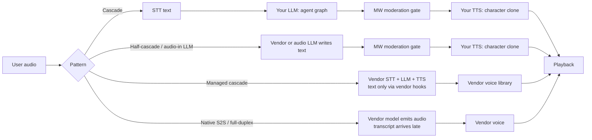
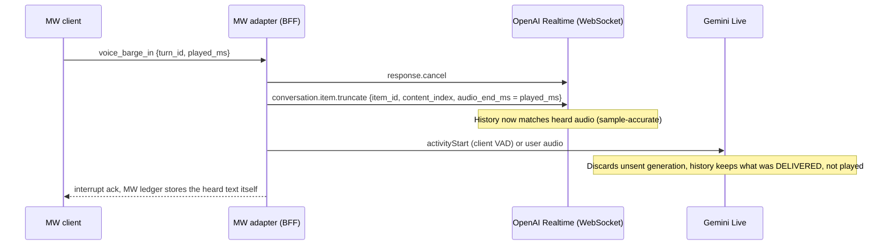
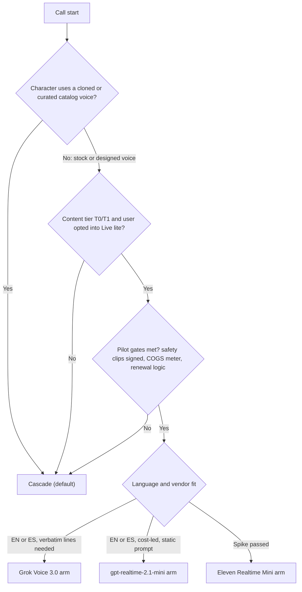
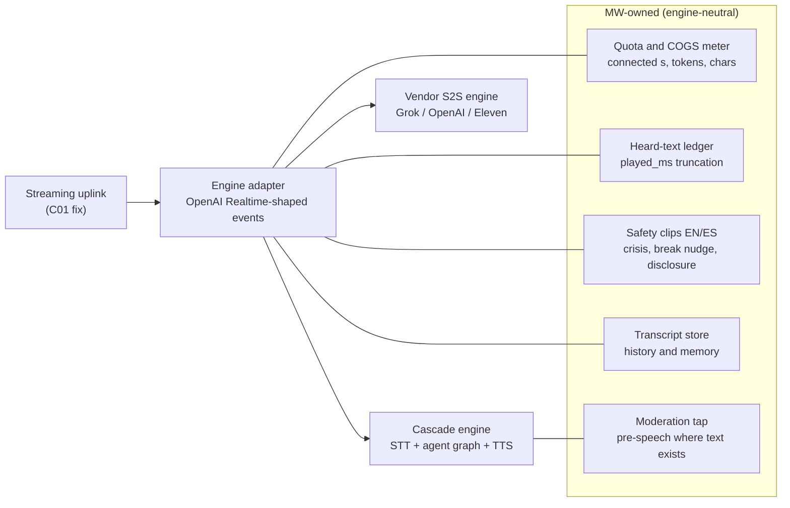

# Speech-to-speech, omni and realtime models

**Research date:** 2026-10-20. **Scope:** This document covers:

- what speech-to-speech (S2S), omni and "realtime" voice models are, and the variants that are sold under those names;
- the October 2026 commercial and open-weight landscape, read through independent benchmarks and corrected for context re-billing;
- what full-duplex research says about turn-taking quality;
- a compatibility matrix against the Magic Worlds (MW) live-call requirements;
- cost and latency against the current cascade, and when S2S wins or loses;
- a recommended position, pilot designs with success metrics, and a watch list.

The current pipeline is described in [01](01_current_architecture.md) and [02](02_turn_lifecycle_and_latency.md). Cascade improvements are in [04](04_cascaded_pipeline_sota.md) to [09](09_transport_and_client_audio.md). Vendor policy is in [14](14_safety_policy_and_compliance.md), and costs in [13](13_cost_scaling_and_operations.md). Finding ids (C01-C60 plus original ids, and GAP-* ids) refer to the register in [03](03_audit_findings.md). All vendor facts come from the fact-checked notes [r07](evidence/research/r07-speech-to-speech-omni.md), [r93](evidence/research/r93-gap-g3-s2s-byo-llm-clone-compat.md), [r94](evidence/research/r94-gap-g4-contradictions-reconcile.md) and [r91](evidence/research/r91-gap-g1-vendor-policy-retention-matrix.md). No new web research was done for this document.

## Summary

- **No S2S product keeps both MW's agent graph and MW's per-character voices** (FACT, [r93](evidence/research/r93-gap-g3-s2s-byo-llm-clone-compat.md) §TL;DR). Each keeps at most one of the two:
  - Eleven Realtime blocks custom LLMs.
  - GPT-Live accepts your backend but paraphrases it, in OpenAI voices.
  - Grok, Gemini, Nova and Qwen use their own model.
  - Ultravox and Qwen in text-out mode keep your TTS voice but not your LLM.

  ElevenLabs Speech Engine keeps both, but it is a managed cascade, not S2S.
- **MW's latency gap is orchestration, not architecture.** MW takes about 3.2-4.2 s from speech end to first audio ([02](02_turn_lifecycle_and_latency.md)). Two measured comparisons:
  - A tuned streaming cascade measured 755 ms TTFA in an independent paper ([arXiv 2603.05413v2](https://arxiv.org/abs/2603.05413v2), 2026-03-17).
  - The fastest "S2S" on the Artificial Analysis (AA) board, Eleven Realtime (0.57-0.62 s), is itself a cascade.

  S2S also does not remove endpointing. Built-in VADs default to 500-800 ms of silence, and OpenAI `semantic_vad` needs 1,143 ms (EN) and 1,044 ms (ES) to reach a 5% false cut-off rate.
- **Landscape (October 2026):**
  - Grok Voice 3.0 leads AA's S2S Index v2.0 (86.9, TTFA 0.81 s).
  - GPT-Live-1 is the strongest commercial full-duplex layer, but it has no Spanish voice, supports custom voices only with English accents, and does not guarantee verbatim speech.
  - Gemini 3.8 Live outputs audio only and costs about **$0.16/min** on a 10-minute call with continuous listening (about $0.07-0.10 with speech-only upload or a sliding window). The ≈$0.012/min list-rate floor and the $0.011 one-minute figure are ruled out because each turn re-bills the accumulated context ([r94](evidence/research/r94-gap-g4-contradictions-reconcile.md) §1).
  - Hume EVI shuts down on 2026-11-13.
  - AA TTFA is "first audio token" on reasoning questions, not mouth-to-ear. No public roleplay or persona benchmark exists for S2S.
- **Cost:** per-token S2S re-bills the whole context every turn, and per-minute S2S bills silence. On the 10-minute reference call:
  - The current EL cascade costs about $0.030/min, and the Fish lane about $0.013.
  - Only gpt-realtime-2.1-mini with cache hits (about $0.020) is in that range.
  - GPT-Live plus a backend costs about $0.051, Grok $0.08, Eleven Realtime about $0.084-0.15, and Gemini about $0.16.
  - A lorebook change mid-call busts the OpenAI cache, and the uncached figures are about 9-10 times higher.
- **Safety and records:** in native S2S the vendor writes *and* speaks the line, so no MW text exists before audio. MW's fail-closed pre-TTS gate (`magic-worlds-api/src/services/speech/moderation.py:1-12`) cannot run. Vendor moderation can end a paid call (GPT-Live). S2S transcripts are approximate and late, which weakens quota, memory and audit.
- **Position:**
  - Keep the cascade as the only engine for character calls.
  - Fix the uplink first: streaming audio is needed for any S2S pilot and for the cascade (C01).
  - Put an engine adapter behind MW-owned quota, transcripts, heard-text truncation and safety clips. Shape it on the OpenAI Realtime event protocol, which xAI, ElevenLabs, Azure and Inworld also speak.
  - Run three scoped, gated experiments: an Eleven Realtime / Speech Engine verification spike, an opt-in SFW stock-voice "Live lite" pilot, and a half-cascade comparison arm.
- **Recommendations:** S2S-01 to S2S-08 in §12. Watch-list triggers are in §13. The biggest unknowns: whether Eleven Realtime honours IVC/PVC voices; whether Grok clones work in realtime outside the US; and what the production callbot model is.

---

## 1. What these models are

"Realtime" is a marketing word. What decides fit for MW is **where text exists**, **who writes the words**, and **where the voice comes from**.

| Pattern | Where text exists | Who writes the words | Voice source | Examples (Oct 2026) |
|---|---|---|---|---|
| **Cascade** (MW today) | Between every stage | Your LLM | Any TTS, including clones | MW; Pipecat or LiveKit pipelines |
| **Managed cascade sold as realtime or S2S** | Inside the vendor; exposed only through vendor hooks | Vendor LLM, or yours if the product allows | Vendor TTS library | Eleven Realtime v1 (vendor FAQ: "not fused"), Azure Voice Live (cascaded model tiers), Inworld Realtime; EL Speech Engine (your LLM) |
| **Native S2S, turn-based with barge-in** | Only as an asynchronous transcript | Vendor model | Vendor voices | gpt-realtime-2.1 and mini, Gemini 3.8 Live, Nova 2 Sonic, Grok Voice 3.0 (output passes through TTS internally) |
| **Native full-duplex** | Only as a transcript | Vendor or open model | Vendor or fixed voices | GPT-Live-1, Moshi, PersonaPlex, MiniCPM-o 4.5, Freeze-Omni; Qwen 3.8 Omni RT claims it (vendor-claimed) |
| **Voice layer plus delegation** | Backend text exists, but the voice layer paraphrases it | Voice model, drawing on your backend | Vendor voices | GPT-Live-1 client delegation |
| **Half-cascade** (realtime model, text out, your TTS) | Yes, before speech | Vendor model | **Your TTS**, so clones are kept | OpenAI Realtime `output_modalities:["text"]`; Qwen Omni RT `modalities:["text"]`. **Not possible on Gemini native audio**, which outputs AUDIO only |
| **Audio-in LLM** (no STT) | Yes, before speech | Audio LLM | Your TTS | Ultravox (hosted or MIT weights); Qwen3-Omni with `disable_talker()` |
| **Speculative prefix hybrid** | Partly | A small duplex model speaks the first words, then the cascade continues | Mixed | RelayS2S (research) |

Sources: [r07](evidence/research/r07-speech-to-speech-omni.md) §1, [r93](evidence/research/r93-gap-g3-s2s-byo-llm-clone-compat.md) §4, [r01](evidence/research/r01-cascaded-architecture.md) (RelayS2S).

The diagram makes one point. MW's safety design ("nothing reaches a speech provider before it passes", `magic-worlds-api/src/services/speech/moderation.py:1-12`) and its voice model only fit the two top lanes. Managed cascades fit only through vendor hooks. Native S2S fits neither.

---

## 2. The October 2026 landscape

### 2.1 How to read the numbers

- **AA S2S Index v2.0** (since Aug 2026) combines Big Bench Audio (reasoning), τ-Voice (agentic tasks), Speech Agent Arena preference and task success. Conversational Dynamics (a Full-Duplex-Bench v1/v1.5 subset) is shown separately and has left the index. The index changed twice in about two months, so always cite the version ([r08](evidence/research/r08-eval-observability.md) §5; [AA methodology](https://artificialanalysis.ai/methodology/speech-to-speech-benchmarking), accessed 2026-10-20).
- **AA TTFA** is the average time to the first audio token on Big Bench Audio reasoning questions. It is not mouth-to-ear, not chit-chat latency, and excludes endpointing and the client network.
- **AA covers native S2S only.** Cascades (Deepgram Voice Agent, ElevenLabs Agents, Cartesia Line, Inworld Realtime) appear only in the Arena, with no latency or reasoning numbers. No apples-to-apples cascade versus S2S comparison is published (FACT, [r07](evidence/research/r07-speech-to-speech-omni.md) §2).
- **No public roleplay, persona-consistency or character-voice benchmark exists for S2S** (FACT). Two related results are cautionary:
  - Talk Arena found static audio benchmarks predict user preference poorly (Kendall τ ≤ 0.33; [arXiv 2502.15919](https://arxiv.org/pdf/2502.15919), 2025-02).
  - On Audio MultiChallenge ([Scale](https://labs.scale.com/leaderboard/audiomc), accessed 2026-10-20), the best audio-output entries score 36.1 (gemini-3.1-flash-live-preview) and 34.7 (gpt-realtime-1.5), against a top overall score of 60.4. Voice editing ("no wait, I meant…") averages an 18% pass. Multi-turn memory and self-coherence are exactly what persona calls stress.

### 2.2 Quality and latency (AA leaderboard, accessed 2026-10-20)

| Model | Architecture | S2S Index v2.0 | Big Bench Audio | Conv. Dynamics | TTFA (s) |
|---|---|---|---|---|---|
| Grok Voice 3.0 (xAI) | Turn-based; output via internal TTS | **86.9** | 99% | 97.0% | 0.81 |
| Grok Voice 2.0 (deprecated Oct 2026) | same | 81.3 | 97% | 95.1% | 0.70 |
| GPT-Live-1 (Astra, medium) | Full-duplex voice layer + backend | 83.2 | 90% | 94.9% | 1.34 |
| GPT-Live-1 (Sol, low) | same | 80.1 | 89% | 97.3% | 1.24 |
| Gemini 3.8 Live Extended Thinking (High) | Turn-based, native audio | 82.6 | 98% | 91.9% | 1.35 |
| Gemini 3.8 Live | same | 76.0 | 92% | 96.1% | 1.18 |
| GPT-Realtime-2.1 High | Turn-based, native audio | 75.2 | 96% | 95.7% | 1.21 |
| GPT-Realtime-2.1 Minimal | same | 70.7 | 87% | 92.7% | 0.97 |
| GPT-Realtime-2.1 Mini Minimal | same | 54.4 | 63% | 91.8% | 0.85 |
| Qwen Audio 3.0 Realtime Plus | Native | 69.5 | 99% | 98.4% | 1.54 |
| Qwen3.5 Omni Flash Realtime | Native | – | 59% | – | 0.79 |
| Eleven Realtime v1 Max | **Cascade** (vendor FAQ) | – | 99% | 94.1% | **0.57** |
| Eleven Realtime v1 Mini | **Cascade** | – | 76% | 95.8% | 0.62 |
| Nova 2.0 Sonic | Turn-based | – | 88% | – | 1.14 |
| Deepslate Opal | Emerging | – | 85% | 85.7% | 0.44 |

Source: [AA S2S leaderboard](https://artificialanalysis.ai/speech-to-speech) as transcribed in [r07](evidence/research/r07-speech-to-speech-omni.md) §2 and re-checked in its fact-check log (#20). Eleven Realtime's numbers are vendor-reported and match AA ([ElevenLabs blog](https://elevenlabs.io/blog/realtime), 2026-10-20).

What the table says for MW:

- **Newer is not faster.** Grok Voice 2.0 (0.70 s) and GPT-Realtime-1.5 (0.81 s) beat their successors on TTFA. Reasoning settings push TTFA past 1.2 s; GPT-Realtime-2.1 Mini at High takes 4.28 s.
- **Turn-taking is close to solved commercially.** Commercial Conversational Dynamics sits at 91-98%. Open full-duplex models lag far behind (§2.5).
- **Qwen mapping is unverified.** AA's "Qwen Audio 3.0 Realtime" is not the `qwen3.8-omni-flash-realtime` product MW would call. Do not transfer its scores or price.

### 2.3 Fit: voices, Spanish, LLM, limits, effective price, policy, text before speech

Effective $/min is for the r10/r94 10-minute reference call (4 exchanges/min, 4k-token prefix). It includes context re-billing; it is not a list price. Policy tier T2 means explicit sexual content between consenting adult fictional characters ([r91](evidence/research/r91-gap-g1-vendor-policy-retention-matrix.md) legend: A allowed, A\* allowed with real risk, ? ambiguous, P prohibited).

| Product | Voices and cloning | Spanish | Your LLM? | Session limit | Effective $/min | T2 policy | Text MW can check before speech? |
|---|---|---|---|---|---|---|---|
| **gpt-realtime-2.1 / -mini** | 10 stock voices (marin, cedar recommended). Recorded custom voices are sales-gated, max 20 per org, need a consent recording, may not imitate "a named person, public figure, or fictional character", and are not ZDR-compatible | Multilingual; stock voices English-native. eot-bench ES 1,044 ms @5% false cut-off (`semantic_vad`) | No. Text-out mode enables a half-cascade with your TTS | 60 min; voice fixed after first audio | 2.1: ≈0.059 cached, ≈0.61 cache broken. Mini: ≈0.020 cached, ≈0.18 broken | P (Model Spec 2026-08-18 covers audio) | Audio mode: transcript deltas only. Agents SDK guardrails (100-char debounce) "often" stop output before it is heard; not guaranteed. Text-out mode: yes |
| **GPT-Live-1** | 21 stock voices, **none Spanish**. Prompt-to-voice: 100 per org, GPT-Live only. Custom voices "with English accents" only (confirmed) | No Spanish voice | Backend via client delegation, but the voice layer "is trained to paraphrase"; appends are capped at 500 tokens | 128k context; engine swap past 90% | ≈0.051 ($0.05 voice incl. silence + backend) | P. Moderation can end the session (`reason: content`) or cut speech | No. Native audio; buffer audio yourself to check it |
| **Gemini 3.8 Live** | 30 prebuilt voices. `replicated_voice_config` is allowlist-only; self-serve replication exists only on 3.8 Flash/Flash-Lite TTS | es-US (es-ES not listed); 70-99 languages depending on the page | No. AUDIO-only output, so no half-cascade | ~10 min per connection; 15 min without compression; 2 h resumption | **≈0.16** (0.07-0.10 with speech gating and/or a 12k/6k window) | P | Output transcription only, billed at the text-output rate |
| **Grok Voice 3.0** | Stock voices. Custom voices documented for realtime, but contested by a LiveKit thread; 30 per team, API creation Enterprise-only, US-only excluding Illinois, no consent recording documented | `es-MX` / `es-ES` | No. A `force_message` shell is possible but not recommended | Resume within 30 min of inactivity; max session UNKNOWN | 0.08 + $0.004 per text input ("tokens included" unverified) | **A** (SpaceXSI AUP 2026-08-14) | No customer hook. Output passes through internal TTS (`replace` is applied before TTS). `force_message` speaks verbatim lines |
| **Nova 2 Sonic** | Fixed voices (lupe, carlos; polyglot tiffany, matthew); no custom | Yes | No | 8-min connection, renewable | List ≈$0.0045/min in, $0.018 out; carry-over billing UNKNOWN | ? (AWS AUP not reviewed) | Not documented |
| **Azure Voice Live** | Azure TTS including custom neural voice (Limited Access) | Yes | Choose from a model menu (gpt-realtime-2.1 Pro, 2.1-mini Standard, GPT-5.6 cascades, phi4-mm Lite, `azure-realtime`); own endpoint UNKNOWN | n/a | Tiered; not computed | ? (Microsoft RAI, conservative) | Cascaded tiers: inside Azure only |
| **Eleven Realtime v1 Mini/Max** | 17k+ library voices. IVC probable but untested, PVC unknown; Realtime API `audio.output.voice` defaults to `"brian"` | 90+ languages | **No**: "Realtime mode isn't available while the agent's LLM is a custom LLM" | Realtime API `max_duration_seconds` defaults to 600 | Mini ≈0.084 (vendor-derived), ≈0.088 MW-like. Max ≈0.102, ≈0.14-0.15 MW-like | A\*. Backup LLMs carry third-party terms. ZRM on Max only | Internally yes (cascade). ElevenAgents guardrails default to `end_call`, may leak under 500 ms of audio while streaming, and are not available in the Realtime API |
| **EL Speech Engine** (managed cascade) | Any of your EL voices via `tts.voice_id` (default `eleven_v4_turbo`); Fish voices dropped | EL languages | **Yes**: your server's public `wss`; `send_response` speaks exact text | Default 10 min, cap 40 min | 0.08 + your LLM; silence discount unstated | A\* for EL STT/TTS; the LLM and moderation are your "Customer System" | Yes: your server emits the text |
| **Ultravox** (Inworld since 2026-09-30) | BYO ElevenLabs voice (`externalVoice`); native clones 1-5 | Listed (26 languages); no output eval | No. Hosted GLM 4.6 default; MIT weights for self-hosting | `maxDuration` default 1 h | 0.05 + your EL TTS characters | ? (Inworld AUP) | Yes (text out); `forced_agent_message` |
| **Qwen 3.8 Omni Flash RT** | Qwen clones in realtime, 1,000 per account, $0.01 each; cloning fails on "pornographic" scripts | 36 output languages; Spanish clones | No. Text-out mode enables a half-cascade | 120 min (WebSocket) | ≈0.01-0.03 (estimate, r93) | **P de facto** (Green Net `400 DataInspectionFailed`) | Text-out mode: yes. Audio mode: verbatim not documented |
| **Inworld Realtime** | Inworld voices; clones in realtime unverified; EL clone migration tool | TTS-2 lists 100+ languages incl. Spanish | LLM selectable as `provider/model`; custom endpoint unverified | n/a | Per component; no per-minute price | ? | Cascade; customer hooks unverified |
| **Hume EVI** | – | – | – | **Sunset 2026-11-13** (announced 2026-10-02; data deleted) | – | – | – |

Sources: [r93](evidence/research/r93-gap-g3-s2s-byo-llm-clone-compat.md) §2-3, [r07](evidence/research/r07-speech-to-speech-omni.md) §3-4, [r94](evidence/research/r94-gap-g4-contradictions-reconcile.md) §1, [r91](evidence/research/r91-gap-g1-vendor-policy-retention-matrix.md) §2.4 and §4, [r92](evidence/research/r92-gap-g2-spanish-bilingual-evidence.md) (Spanish eot-bench). Primary pages, all accessed 2026-10-20:

- OpenAI: [custom voices](https://developers.openai.com/api/docs/guides/custom-voices), [GPT-Live conversations](https://developers.openai.com/api/docs/guides/live-conversations), [GPT-Live delegation](https://developers.openai.com/api/docs/guides/live-delegation).
- Google: [Gemini Live best practices](https://ai.google.dev/gemini-api/docs/live-api/best-practices) (updated 2026-09-15).
- xAI: [S2S](https://docs.x.ai/developers/model-capabilities/audio/speech-to-speech) and [custom voices](https://docs.x.ai/developers/model-capabilities/audio/custom-voices).
- ElevenLabs: [realtime models](https://elevenlabs.io/docs/eleven-agents/customization/realtime-models) and [Speech Engine API](https://elevenlabs.io/docs/api-reference/speech-engine/create).
- Alibaba: [Qwen realtime](https://www.alibabacloud.com/help/en/model-studio/realtime) (updated 2026-10-16).
- Inworld: [Realtime](https://docs.inworld.ai/realtime/overview.md).

### 2.4 Vendor notes that change the picture

- **OpenAI gpt-realtime-2.1 / mini** (2026-07-06):
  - 2.x is stricter on instruction following, has no session `truncation` property, and has `commentary` / `final_answer` phases.
  - Over WebSocket the client must send `conversation.item.truncate` with `audio_end_ms`; WebRTC and SIP truncate automatically.
  - The context window is 128k on OpenAI's page and 256k on Microsoft's (an open conflict).
  - Caching is best-effort. Changing instructions or tools, or editing earlier items, breaks it. Measured data from 4,000 mini sessions puts typical cost at $0.070/min, and RAG injections cost $0.007-0.009 each ([HackerNoon](https://hackernoon.com/openai-realtime-api-pricing-in-2026-real-world-data-from-4000-measured-sessions), 2026-06-11; single author).
- **GPT-Live-1** (GA 2026-09-10) is the architecture S2S was heading toward: a full-duplex "fast talker" that delegates to a "slow thinker". Under client delegation:
  - The voice layer decides when to delegate. `session.delegation.created` carries no task text, and results go back through 500-token appends that are paraphrased.
  - A spoken interruption does not cancel backend work.
  - There is no turn-complete event, and the voice is fixed per session.
  - Concurrency is 50 / 300 / 500 sessions by tier.

  For authored character dialogue, the backend becomes a ghost-writer whose lines are re-performed ([GPT-Live delegation](https://developers.openai.com/api/docs/guides/live-delegation)).
- **Gemini 3.8 Live** (GA 2026-09-15; Stable):
  - Proactive audio is always on, so input is billed for all listening time. Affective dialogue was removed, thinking is interleaved with no `thinking_level`, and caching is not supported.
  - History keeps what was **delivered** to the client, not what was **played**.
  - 3.1 Flash Live is now Legacy ([r94](evidence/research/r94-gap-g4-contradictions-reconcile.md) §1.1).
- **Grok Voice 3.0** (October 2026; exact day unverified):
  - Speaks the OpenAI Realtime wire format at `wss://api.x.ai/v1/realtime`.
  - The only major S2S with both a verbatim line (`force_message`) and a T2-permissive policy.
  - xAI shipped three major versions in 2026 and deprecated 2.0 within months, so expect churn.
  - Concurrency is reported to scale with lifetime spend, from 10 sessions at $0 to 200 at $5,000 (eesel, unverified).
- **Eleven Realtime v1** (2026-10-20, today):
  - WebSocket only. The LLM, ASR, TTS model and expressive mode are managed.
  - Access is rolling out per workspace.
  - Mini scores 60.3% on the vendor's tool-use benchmark versus 87.1% for Max (vendor-reported). That matters if the MW graph were reached as a tool.
  - Mini cannot run under Zero Retention Mode or HIPAA.
- **Azure Voice Live** productises the half-cascade: a realtime model with Azure TTS, including custom neural voice (Limited Access, with intake and fees).
- **Qwen 3.8 Omni Flash RT** is the cheapest option with documented realtime clones at scale:
  - It runs only in Singapore and Beijing.
  - Green Net rejects content by request.
  - Retained context is capped at 100 audio turns or 600 s of audio.
- **Hume EVI and Octave** end on 2026-11-13 with about six weeks' notice. That is the reason any S2S work needs an adapter ([Hume EVI overview](https://dev.hume.ai/docs/speech-to-speech-evi/overview), notice 2026-10-02).

### 2.5 Open-weight full-duplex and omni models

| Model | Type | Speech languages | Voices | License | AA BBA / CD | Fit for MW |
|---|---|---|---|---|---|---|
| Kyutai Moshi (2024) | Full-duplex, inner-monologue text | English | Fixed | CC-BY / Apache / MIT | 4% / 61.0% | Timing demo; reasoning far too weak |
| NVIDIA PersonaPlex (2026) | Moshi fine-tune with text role prompts | English (Fisher) | 18 fixed embeddings | MIT + NVIDIA Open Model License | 19% / 91.0% | Role prompts, but EN only and no cloning |
| NVIDIA Nemotron Voicechat (2026) | Full-duplex | – | – | – | 27% / 52.9% | No |
| VITA Freeze-Omni (2024) | Frozen Qwen2-7B + duplex head | – | – | see repo | 33% / 58.7% | Best interruption replies in FDB v1; slow |
| MiniCPM-o 4.5 (2026) | 9B full-duplex omni | **EN / ZH only** | Cloning from a short reference | Apache-2.0 | – | No Spanish |
| Qwen3-Omni (2025-09-22) | MoE Thinker-Talker | 19 in / 10 out, incl. Spanish | 3 voices, no cloning | Apache-2.0 | – | 79-145 GB VRAM; `disable_talker()` makes it an audio-in LLM |

Source: [r07](evidence/research/r07-speech-to-speech-omni.md) §5 and §2. Kyutai Unmute is a cascade (EN/FR), and Sesame CSM is a conversational TTS, not full-duplex. **No open full-duplex model offers Spanish, arbitrary voice cloning and strong reasoning together** (FACT as of 2026-10-20). Self-hosting would also add GPU operations, which [13](13_cost_scaling_and_operations.md) treats as a separate decision gate (OPS-19).

---

## 3. Full-duplex research: what the benchmarks show

| Benchmark | What it tests | Findings that matter for MW |
|---|---|---|
| **Full-Duplex-Bench v1** ([arXiv 2503.04721](https://arxiv.org/html/2503.04721), 2025-03) | Pause handling, backchannels, turn-taking, user interruption | dGSLM and Moshi take the turn during user pauses 93-98% of the time. Moshi answers in 0.27 s, but its interruption replies score 0.77/5. Freeze-Omni, a cascade-like design, gives the best interruption replies (3.6) at 0.95 s. Gemini Live had the best pause handling (takeover rate 0.26-0.31) at 1.30 s turn latency |
| **v1.5** (arXiv 2507.23159) | Overlap: backchannels, side conversations, ambient speech | Adds the cases that open MW turns by mistake today (C03 (FE-CAPTURE-02), C05 (FE-CAPTURE-01)) |
| **v2** ([arXiv 2510.07838](https://arxiv.org/abs/2510.07838), 2025-10) | Live WebRTC examiner | Full-duplex systems "get confused when users talk at the same time", struggle with corrections and lose track of entities |
| **v3** (arXiv 2604.04847, 2026-04; code 2026-05-20) | Tool use under real disfluencies | GPT-Realtime has the best Pass@1 (0.600). A Whisper → GPT-4o → TTS cascade baseline had a 100% turn-take rate but the highest task latency (10.12 s). There is no v4 |
| **SyncLLM** ([arXiv 2409.15594](https://arxiv.org/abs/2409.15594), 2024) | Wall-clock-synchronised LLM | Tolerates up to 240 ms of network latency |

Sources: [r07](evidence/research/r07-speech-to-speech-omni.md) §5, [r08](evidence/research/r08-eval-observability.md) §5.

**What to take from this:**

1. **Fast and eager is not good.** The fastest full-duplex models interrupt users in pauses and reply badly to interruptions. MW's own failure mode is the opposite: a slow reply and a 500 ms barge-in floor (K18) that discards short interjections (C16 (FE-UI-01)). A reckless full-duplex model would trade one complaint for another.
2. **Commercial models have closed most of the timing gap.** Grok 3.0, GPT-Live and Gemini 3.8 Live score 94-97% on AA's Full-Duplex-Bench subset. That is the measurable advantage S2S offers over a cascade with energy VAD.
3. **Corrections and entity tracking remain weak** (v2; Audio MultiChallenge voice editing at 18%). Roleplay leans on both: names, places and lore entities, and "no, I meant the other door".
4. **A cascade can match the turn-taking signals** with a semantic end-of-turn model, backchannel filtering and duck-then-confirm barge-in ([05](05_turn_taking_and_interruptions.md)). What it cannot easily copy is listening while speaking with overlap-aware generation. MW characters do not currently need that.

---

## 4. Turn detection, interruption and truncation inside S2S

### 4.1 Endpointing does not go away

| System | Default turn detection | Measured cost |
|---|---|---|
| MW today | Client RMS gate; 550 ms silence ends the turn (`src/features/call/components/CallScreen.tsx:114`) | Fixed 550 ms; no semantic signal (C02 (FE-CAPTURE-04)) |
| OpenAI `server_vad` | threshold 0.5, prefix 300 ms, silence 500 ms | Silence-only; eot-bench's silence-only VAD baseline is the worst entry |
| OpenAI `semantic_vad` | eagerness low / medium / high, max wait 8 / 4 / 2 s | eot-bench "GPT Realtime 2": 1,143 ms EN and 1,044 ms ES at a 5% false cut-off; 824 / 755 ms at 10% |
| Gemini Live | Automatic VAD; server default about 800 ms; Google recommends 500-800 ms | Not on eot-bench |
| LiveKit with a realtime model | Audio turn detector; when there is no STT it uses English thresholds | Endpointing defaults 0.3 / 2.5 s with the audio detector, otherwise 0.5 / 3.0 s |

Sources: [r02](evidence/research/r02-turn-taking.md) §6-7, [r92](evidence/research/r92-gap-g2-spanish-bilingual-evidence.md) §2.2, [r94](evidence/research/r94-gap-g4-contradictions-reconcile.md) §2, [eot-bench](https://github.com/livekit/eot-bench) (2026; LiveKit-run).

Built-in S2S end-of-turn detectors sit mid-pack on eot-bench. A semantic detector in a cascade can reach comparable or better operating points (see [05](05_turn_taking_and_interruptions.md)). Every S2S API allows turning built-in detection off (`turn_detection: null`, Gemini `activityStart`/`activityEnd`) so an external detector drives the turn. That is also what an adapter needs if MW wants one turn policy across engines.

### 4.2 Truncation semantics against MW's heard-text model

MW already measures what was heard. The client sends `voice_barge_in{turn_id, played_ms}` with `frame.played_ms = Math.round(played)` (`src/features/interaction/hooks/useVoiceCallController.ts:658`). The backend keeps sentences whose audio started before `played_ms` (`magic-worlds-api/src/services/voice_orchestration/call_ledger.py:380`, `keep_end`). This is sentence-granular and over-approximates what was heard (C25 (BE-ENGINE-TURNTAKING-09)). The LLM sees no interruption marker apart from a generic prompt note (GAP-REAL-CALL-OVERLAP-HISTORY-BILLING-05).

- **OpenAI over WebSocket** maps exactly onto MW's `played_ms`, and is *better* than MW today: truncation is sample-level, not sentence-level.
- **Gemini** over-counts what was heard whenever audio sits in a client buffer. MW would have to keep its own heard-text ledger and accept that the model's history disagrees with it.
- **GPT-Live** has no turn-complete event. Backend work survives interruptions, so the adapter must version tasks and drop stale results.
- **Eleven Realtime and Grok** speak the OpenAI Realtime protocol. Whether their truncate handling matches OpenAI's is UNKNOWN and must be tested in S2S-03.

**Errata applied from the reconciliation:** r07 §11 says MW uploads audio "over WebSocket". It does not. Each utterance is a 16 kHz mono PCM16 WAV in a multipart HTTP POST to `/character-chats/{session_id}/voice-segments` (`magic-worlds-api/src/routes/user/route_voice_call.py:1128-1130`). The voice WebSocket carries control frames and base64 MP3 downlink only (C76 (FE-PLAYBACK-TRANSPORT-15)). r07's "any VAD speech truncates" is also wrong: a 500 ms minimum applies while the character is audible (`useVoiceCallController.ts:137`, K18). And the server energy gate r07 assumes is off by default (C03).

**Consequence:** no S2S vendor can be connected to MW's current uplink. Every vendor expects a continuous audio stream (20-100 ms chunks over WebSocket or WebRTC). The streaming uplink in [09](09_transport_and_client_audio.md) (C01 (FE-CAPTURE-03)) is a prerequisite for any S2S pilot. It is also the single largest latency fix for the cascade.

---

## 5. Magic Worlds requirements and the compatibility matrix

### 5.1 Requirements, from the code

| # | Requirement | Evidence (FACT) |
|---|---|---|
| R1 | **Agent-graph LLM** with persona, lorebook and history | `callbot_chat.v2` runs through `api.magic_llm` with 5 nodes and no tools. The lorebook is injected per utterance. Contract: 32,768 tokens in, 1,536 out, 80 messages, 30 s; system profile only, no BYOK (`magic-worlds-api/src/services/llm_features.py:66-69`, [be-llm](evidence/audit/be-llm.md)) |
| R2 | **Per-character voices from a curated catalog**, including consented clones | The `voice_catalog` `source_kind` includes `ivc`, `pvc_shared` and `designed` (`magic-worlds-api/src/database/mysql/db.sql:1603`). An IVC needs a `consent_record_id` (`db.sql:1609`). IVC creation is root-only, after the consent record (`magic-worlds-api/src/services/speech/providers/elevenlabs/catalog.py:667-669`). The call provider must be `elevenlabs` or `fish_audio` (`route_voice_call.py:590`). The voice is frozen per call (`route_voice_call.py:513-517, 539-540`) |
| R3 | **18+ fiction**, under a no-NSFW voice lane | The 18+ and Terms attestation exists (`magic-worlds-api/src/services/speech/attestation.py:1`). The moderation categories are documented as "Hard-block categories … under the no-NSFW voice policy" (`moderation.py:92-102`). The lists are empty pending sign-off (`companion_safety_lists.py:24`) |
| R4 | **English and Spanish** | The STT language is fixed per call (C33 (BE-STT-07)). App locales are en and es |
| R5 | **Pre-speech moderation** | "Synchronous and fail-closed on every surface: nothing reaches a speech provider before it passes" (`moderation.py:1-12`). One sentence goes through the gate with a 300 ms budget, fail-closed (`magic-worlds-api/src/services/voice_orchestration/engine.py:3301`). It is latent and off in dev (C04 (BE-OBSERVABILITY-SAFETY-COST-01)) |
| R6 | **Quotas and transcripts as records** | 10 min/day per user, a 600 s maximum call and a 120 s idle limit (`magic-worlds-api/src/services/voice_orchestration/config.py:30-32`). Billing counts delivered audio, not heard audio (GAP-REAL-CALL-OVERLAP-HISTORY-BILLING-02). Stored transcripts feed history and memory |
| R7 | **Verbatim safety lines** (crisis resources, break nudges) | Crisis numbers are `LEGAL_PENDING` placeholders (`src/features/safety/crisisResources.ts:27-36`). Self-harm detection is inert (C12 (BE-OBSERVABILITY-SAFETY-COST-02)) |
| R8 | **Sessions of at least 600 s** with idle handling | `DEFAULT_VOICE_MAX_CALL_DURATION_SECONDS = 600` (`config.py:31`) |

**On "18+ fiction":** the voice lane is *designed* as no-NSFW (R3), so explicit T2 voice is not a current requirement. The binding policy risks for S2S are different:

- vendor moderation cutting or ending calls on *allowed* mature fiction (T1 romance, V1 peril);
- the vendor model, not the agent graph, writing the character's lines under its own Model Spec;
- losing MW's own gate.

If MW ever opens T2 voice, only Grok Voice (A) and Eleven Realtime (A\*) stay eligible among S2S products ([r91](evidence/research/r91-gap-g1-vendor-policy-retention-matrix.md) §4).

### 5.2 Compatibility matrix

✓ meets, ◐ partial or conditional, ✗ fails, ? unverified.

| Option | R1 agent graph | R2 existing EL/Fish character voices | R3 T0/T1 fiction without vendor call-ends | R4 Spanish | R5 pre-speech gate | R6 transcript and quota fidelity | R7 verbatim lines | R8 ≥600 s |
|---|---|---|---|---|---|---|---|---|
| **Current cascade** | ✓ | ✓ | ✓ | ✓ | ✓ (latent: C04) | ◐ (delivered, not heard) | ✓ (app clips, pending legal) | ✓ |
| **EL Speech Engine** | ✓ (your `wss`) | ◐ EL ✓, Fish ✗ | ✓ (moderation is yours) | ✓ | ✓ (your text) | ◐ (vendor STT; your LLM text) | ✓ `send_response` | ✓ (cap 40 min) |
| **Eleven Realtime v1** | ✗ (custom LLM blocked) | ? IVC probable, PVC unknown; Fish ✗ | ◐ (guardrails `end_call` by default; none in the Realtime API) | ✓ | ✗ (vendor writes; hooks only in ElevenAgents) | ◐ | ◐ (first message / Say node in ElevenAgents; nothing in the Realtime API) | ✓ (default 600 s) |
| **GPT-Live-1 + client delegation** | ◐ (paraphrased backend) | ✗ | ✗ (moderation can end the session) | ✗ (no Spanish voice; custom voices EN accents only) | ✗ | ✗ (no turn-complete; late transcripts) | ✗ (play your own clip) | ? (no stated limit; engine swap at 90% of context) |
| **gpt-realtime-2.1-mini, audio out** | ✗ (lorebook via prompt busts cache) | ✗ | ◐ (your guardrails; Model Spec applies) | ◐ (English-native voices) | ◐ (transcript-delta guardrail, not guaranteed) | ◐ (`truncate` matches `played_ms`; transcripts asynchronous) | ✗ | ✓ (60 min) |
| **gpt-realtime text-out + MW TTS** (half-cascade) | ✗ (vendor writes) | ✓ | ✓ (your gate) | ✓ | ✓ | ✓ (text is yours) | ✓ | ✓ |
| **Gemini 3.8 Live** | ✗ | ✗ (allowlist only) | ◐ (T2 P; abuse scanning) | ◐ (es-US only) | ✗ | ✗ (delivered ≠ played; transcripts billed extra) | ✗ | ◐ (~10 min connections, needs resumption) |
| **Grok Voice 3.0** | ✗ | ✗ (re-clone in xAI; US-only; contested) | ✓ (A) | ✓ (es-MX/es-ES) | ✗ | ◐ | ✓ `force_message` | ? |
| **Nova 2 Sonic** | ✗ | ✗ | ? | ✓ | ✗ | ? | ? | ◐ (8-min renewals) |
| **Ultravox + EL voice** | ✗ (hosted LLM) | ◐ EL ✓, Fish ✗ | ? | ◐ (no output eval) | ✓ (text out) | ✓ (character-level alignment) | ✓ `forced_agent_message` | ✓ (1 h) |
| **Qwen 3.8 Omni RT** | ✗ | ✗ (re-clone in Qwen) | ✗ (Green Net) | ✓ | ◐ (text-out mode only) | ◐ | ✗ (audio mode) | ✓ |
| **Inworld Realtime** | ? (custom endpoint unverified) | ? (EL clones re-cloned via migration) | ? | ✓ | ? | ? | ? | ? |
| **Open full-duplex (self-host)** | ✗ | ✗ (fixed or EN/ZH clones) | ✓ (your policy) | ✗ (no Spanish + cloning) | ✗ | ◐ | ✗ | ✓ |

Sources: §2.3 and §5.1 above; [r93](evidence/research/r93-gap-g3-s2s-byo-llm-clone-compat.md) §3; [14](14_safety_policy_and_compliance.md) §3.6.

### 5.3 Reading the matrix

- **R1 and R2 together eliminate every native S2S product.** The only rows with ✓ on both are the current cascade and EL Speech Engine, which is a managed cascade.
- **The half-cascade keeps everything except R1.** It is a credible experiment for T0/T1 characters, but its main benefits (no STT hop, semantic turn detection, paralinguistic input) are also on the cascade roadmap through streaming STT and semantic end-of-turn ([06](06_speech_to_text.md), [05](05_turn_taking_and_interruptions.md)). It loses lorebook-grounded writing, and lore is the product.
- **A "Live lite" mode is the only place native S2S fits:** opt-in, stock or designed voices, T0/T1, and MW-owned safety clips and quota. Grok scores best on R3, R4 and R7. gpt-realtime-2.1-mini scores best on cost and truncation fidelity. Gemini scores worst on R6, R7 and R8, and costs the most.
- **Fish voices have no S2S path at all.** Every voice-keeping option is ElevenLabs-based (Speech Engine, Ultravox, possibly Eleven Realtime) or a re-clone.

---

## 6. Cost against the current cascade

### 6.1 The 10-minute reference call

All figures are list-price computations from [r10](evidence/research/r10-cost-scaling-ops.md) and [r94](evidence/research/r94-gap-g4-contradictions-reconcile.md), with the same reference call: 10 minutes, 4 exchanges per minute, user speaking 21 s/min, bot 30 s/min, 4k-token prefix. None are invoices.

| Stack | ≈ $/call-min | Billing basis | What makes it worse | Heavy user (300 min/month), computed |
|---|---|---|---|---|
| Cascade A, current EL lane | **0.030** | STT seconds (Groq 10 s minimum per request, C63 (BE-STT-12)), LLM tokens, TTS characters | Long replies and over-synthesis: 34% of stored and billed TTS in dev was never heard (GAP-CALL-AUDIO-ASSETS-AND-MP3-TIMELINE-04) | ≈ $9 ($10-13 under measured dev behaviour, [13](13_cost_scaling_and_operations.md)) |
| Cascade A′, Fish lane | 0.013 | same | same | ≈ $4 |
| gpt-realtime-2.1-mini, cache hits | 0.020 | Tokens; whole conversation re-processed per response | Lorebook or instruction change, truncation | ≈ $6 |
| gpt-realtime-2.1-mini, cache broken | ≈ 0.18 | same | – | ≈ $55 |
| gpt-realtime-2.1, cache hits | ≈ 0.059 | same | same | ≈ $18 |
| gpt-realtime-2.1, cache broken | ≈ 0.61 | same | – | ≈ $185 |
| GPT-Live-1 + cheap backend | ≈ 0.051 | $0.05 per session minute, silence included, 15 s minimum; plus backend | Idle listening; long calls | ≈ $15 |
| Grok Voice 3.0 | 0.08 | Flat per minute, plus $0.004 per text input | Silence billed | ≈ $24 |
| Eleven Realtime v1 Mini / Max | ≈ 0.084-0.088 / ≈ 0.10-0.15 | $0.08 per connected minute plus tokens (Mini $0.20/$6.00, Max $1.80/$9.00 per 1M) | Persona plus lorebook re-sent per reply; burst minutes $0.16 | ≈ $25-26 / ≈ $31-45 |
| EL Speech Engine | 0.08 + MW LLM | Per minute | Silence discount unstated | ≥ $24 |
| Ultravox + EL TTS | 0.05 + EL characters | Per minute plus TTS | Silence billed | ≥ $15 plus TTS |
| Qwen 3.8 Omni Flash RT | ≈ 0.01-0.03 (estimate) | Tokens; history re-billed every turn; sub-second audio billed as 1 s | Re-billing assumption unverified | ≈ $3-9 |
| **Gemini 3.8 Live** | **≈ 0.16** (0.07-0.10 with levers) | Tokens; whole context every turn; listening billed (proactive audio always on); transcripts at the text-output rate | Minute 10 costs ≈ $0.28 at the margin | ≈ $47 |
| Nova 2 Sonic | list ≈ 0.0045 in / 0.018 out per min | Tokens | Carry-over billing UNKNOWN | not computed |

The monthly column is $/min × 300, the default 10 min/day allowance used every day (`config.py:30`). It is arithmetic, not a forecast.

### 6.2 What the table hides

- **Per-token S2S compounds.** OpenAI re-processes the conversation on every response, and only a stable prefix is cached. MW appends the lorebook to the system prompt per utterance when keyword lorebooks activate, which changes the prefix (C35 (BE-LLM-08)). On a cached S2S engine, every lore hit would cost a cache miss at roughly $0.007-0.009 (HackerNoon). Gemini bills the full context every turn with no caching at all.
- **Output-heavy calls cost more on S2S.** MW replies run 17.6 s of audio at p50, and 12 of 17 dev turns were interrupted (GAP-REAL-DEV-CALL-FORENSICS-08). OpenAI bills model audio at about $0.077 per minute of speech for 2.x, before re-billing. A vendor that generates faster than playback bills unheard audio, just as MW's TTS does today (INFERENCE). Shortening replies ([07](07_llm_in_the_voice_loop.md)) saves money on every engine.
- **Per-minute S2S bills thinking and listening.** Companion users pause and listen. GPT-Live, Grok, Ultravox and Eleven Realtime all bill connected time. Speech Engine's silence discount is unstated, and ElevenAgents gives 95% off silences longer than 10 s.
- **Rate caps bind before MW's own.** Gemini Tier 1 applies a spend cap of $10 per rolling 10 minutes. At ≈$0.16/min that allows about 6 concurrent 10-minute calls, below MW's global voice concurrency of 8 (`magic-worlds-api/src/services/voice_orchestration/config.py:41`; [r94](evidence/research/r94-gap-g4-contradictions-reconcile.md) §1.4). GPT-Live starts at 50 sessions. Grok's spend-based concurrency is unverified.
- **The cascade A baseline assumes a gpt-5-mini-class LLM** ([r10](evidence/research/r10-cost-scaling-ops.md) §3). The dev callbot appears to be Haiku-class via OpenRouter (INFERENCE, GAP-REAL-DEV-CALL-FORENSICS-07). The production model is UNKNOWN ([be-llm](evidence/audit/be-llm.md) §7). LLM cost is a small share either way: TTS is about 83-93% of the cascade's per-minute cost on the Fish and EL lanes ([13](13_cost_scaling_and_operations.md) §2.1; r10 rounds the EL lane to 85-90%).

**Conclusion (INFERENCE):** S2S does not save money for MW. The one cheaper S2S configuration (gpt-realtime-2.1-mini with cache hits) depends on a static prefix that MW's lorebook design breaks. Qwen is cheap but fails R2, R3 and data residency. A "Live lite" mode at $0.05-0.08/min costs about 1.7-2.7 times the EL cascade, which needs a pricing or allowance decision before launch ([13](13_cost_scaling_and_operations.md)).

---

## 7. Latency: what S2S would and would not buy

The reconciled MW budget is about 3.2-4.2 s from speech end to first audible audio at STT p50, and 3.6-4.7 s at STT p95. One documented sample took about 5.5 s. The hang-over, the STT hop and the LLM hop account for about 80% ([02](02_turn_lifecycle_and_latency.md); [reconciliation §7](evidence/audit/gap-finding-reconciliation.md)).

| Stage | MW today | Native S2S | Optimised cascade |
|---|---|---|---|
| End-of-turn wait | 550 ms fixed energy hang-over (C02 (FE-CAPTURE-04)) | **Not removed.** Replaced by vendor VAD: 500 ms `server_vad`, about 800 ms Gemini default, ~1.0-1.1 s `semantic_vad` at 5% false cut-off | Semantic end-of-turn; adaptive hold ([05](05_turn_taking_and_interruptions.md)) |
| Upload and STT | Whole-utterance WAV POST; Groq batch p50 526 ms, p95 1,002 ms; single attempt (C01 (FE-CAPTURE-03), C06 (BE-STT-02)) | Removed, but only after a streaming uplink exists | Streaming STT with partials ([06](06_speech_to_text.md), [09](09_transport_and_client_audio.md)) |
| api.magic_llm pre-provider recording | ~20 fsync'd commits, ~0.75-1.3 s, p50 ~0.87 s (C08 (BE-LLM-02); GAP-REAL-DEV-CALL-FORENSICS-04) | Removed only because the graph is bypassed | Removed by fixing the pipeline ([07](07_llm_in_the_voice_loop.md)) |
| Cold connections | +165 ms p50 per cold TLS hop (C09 (BE-STT-04)) | Persistent socket | Connection pooling and prewarm |
| LLM time to first text | Never measured. One probe: 1,579 ms. Dev provider fixed cost ~1.85 s (GAP-REAL-DEV-CALL-FORENSICS-07). No deadline, hedge or fallback (C07 (BE-LLM-05)) | Replaced by vendor TTFA: 0.57-1.35 s on AA (reasoning prompts) | Model and provider choice, deadlines, filler |
| Moderation, first sentence | 300 ms budget, serial for sentence 1 only; off in dev | Removed, and so is the gate | Kept; overlapped with TTS setup ([14](14_safety_policy_and_compliance.md)) |
| TTS first audio | EL v4 Turbo prewarmed during STT; SentenceBuffer waits for `. ! ?` (C17 (BE-LLM-11)) | Internal | Clause-level first chunk ([08](08_text_to_speech.md)) |
| Downlink | Base64 MP3 in JSON text frames (C76 (FE-PLAYBACK-TRANSPORT-15)) | PCM or Opus over WebSocket or WebRTC | Same change ([09](09_transport_and_client_audio.md)) |

**Reading.** Adding a vendor's silence-based endpointing default (500-800 ms) to its AA TTFA gives roughly 1.1-2.2 s before client network and buffering (INFERENCE: arithmetic on the cited components, not a measurement). The independent cascade measurement is 755 ms TTFA (LLM 296 + sentence detection 143 + TTS 316 ms; [arXiv 2603.05413v2](https://arxiv.org/abs/2603.05413v2)). The same paper measured Qwen3-Omni at about 702 ms audio-to-audio on DashScope (unverified here). These numbers come from different harnesses and are not like-for-like. They still support one conclusion: **a well-built cascade and a good S2S land in the same band.** MW is 2-4 times outside that band because of C01, C02/C03, C08, C09 and C07, none of which S2S fixes except by bypassing MW's own components.

**What S2S does buy, on paper:**

- full-duplex overlap behaviour (GPT-Live);
- paralinguistic input reaching the model;
- vendor-tuned barge-in;
- a reasoning-free fast path.

None of these is a measured gap in MW today; the measured gaps are latency, long replies and reliability (C06, C07, C14 (BE-TTS-06)).

---

## 8. When S2S wins and when it loses

| S2S wins | S2S loses |
|---|---|
| The persona can use a stock or designed vendor voice | The character's identity is a cloned or curated voice (MW's catalog, R2) |
| Content is T0/T1 and vendor moderation false positives are acceptable | Mature-but-allowed fiction where a vendor call-end is a product failure; any T2 |
| The vendor model may write the lines (assistant, tutor, small talk) | Lines must come from the agent graph with lorebook grounding and authored persona |
| Overlap, backchannels and natural pauses matter more than exact wording | Exact wording matters: safety lines, disclaimers, lore names |
| Engineering capacity is low and a single vendor socket is acceptable | MW must own quota, transcripts, audit and the heard-text record |
| Mixed-language users and automatic language switching | Spanish with a specific voice (GPT-Live has none; Gemini es-US only) |
| Short sessions, or vendors with long sessions (OpenAI 60 min, Qwen 120 min) | Long calls on Gemini (~10 min connections) or Nova (8 min) without renewal logic |
| Flat per-minute pricing fits the plan's margin | Cost per heavy user must stay near the cascade's $9-13/month |

---

## 9. Hybrid patterns worth keeping in view

- **Managed cascade with your LLM (EL Speech Engine).**
  - What it offers: EL hosts STT, `turn_v3` turn-taking, optional `speculative_turn`, a `cascade_timeout_seconds` filler window (2-15 s, default 4) and `eleven_v4_turbo` TTS. MW keeps the agent graph and EL voices.
  - Costs: inverted connectivity (EL connects to MW's public `wss`), the loss of the Fish lane, a 40-minute cap, $0.08/min on top of MW's LLM, and no published latency. This competes with the self-orchestrated cascade, not with S2S. It belongs in the cascade decision in [16](16_target_architectures.md), and S2S-03 measures it.
- **Managed cascade with a selectable LLM (Inworld Realtime).**
  - What it offers: the OpenAI Realtime protocol over WebSocket or WebRTC, per-component billing, and an EL clone-migration tool that re-clones from source samples.
  - Two unknowns decide it: whether a custom LLM endpoint is accepted, and whether clones work in realtime sessions.
- **Half-cascade.** A realtime model hears audio and returns text, and MW's TTS speaks it.
  - Gains: no STT hop and audio-native turn detection.
  - Losses: the vendor writes the lines, there are two bills, and LiveKit notes OpenAI text-only drift after long histories ([r07](evidence/research/r07-speech-to-speech-omni.md) §9). Not possible on Gemini native audio.
- **Audio-in LLM** (Ultravox; Qwen3-Omni with the talker disabled). The cleanest "skip STT" design, and MIT weights allow self-hosting. But open audio LLMs lag frontier text LLMs at persona writing, and Ultravox's ownership has just changed.
- **Voice layer plus delegation** (GPT-Live). Suits agentic tasks where paraphrase is fine. It is a poor fit for authored dialogue.
- **Speculative prefix** (RelayS2S, research). A small duplex model speaks the first words while the cascade catches up.
  - On real voice it cut P90 first chunk from 823 to 655 ms.
  - It fell back to the cascade 29.3% of the time, and about 17.5% of its prefixes were judged inappropriate.
  - For in-character speech, a wrong first five words is worse than silence (INFERENCE). Watch only.
- **Force-message shells** (xAI `force_message`, Ultravox `forced_agent_message` driven by MW's LLM). These pay S2S per-minute rates for what is effectively TTS. Not recommended ([r93](evidence/research/r93-gap-g3-s2s-byo-llm-clone-compat.md) §5).

**S2S-era techniques to copy into the cascade** (no S2S model needed): semantic end-of-turn, short in-character preambles while the LLM works, task versioning after barge-in, acting on partial transcripts, debounced transcript-delta guardrails, and application-owned context compression. They are specified in [04](04_cascaded_pipeline_sota.md), [05](05_turn_taking_and_interruptions.md) and [07](07_llm_in_the_voice_loop.md).

---

## 10. Recommended position

1. **Character calls stay on the cascade.** It is the only architecture that meets R1, R2, R5 and R7 together. Its latency problems are fixable orchestration defects, and the fixes are in [17](17_recommendations_and_roadmap.md).
2. **Build the streaming uplink, then an engine adapter, in that order.**
   - The uplink (C01) is a prerequisite for every vendor socket and the biggest cascade win.
   - Shape the adapter on the OpenAI Realtime event model (`input_audio_buffer.*`, `response.*`, `conversation.item.truncate`). OpenAI, xAI, ElevenLabs Realtime, Azure Voice Live and Inworld Realtime all speak that protocol. Gemini and Nova need translation.
   - The cascade becomes the first implementation of the adapter, so the interface is tested before any vendor is added.
3. **Run gated experiments.** None of them changes the default.
   - An Eleven Realtime / Speech Engine verification spike (S2S-03).
   - An opt-in SFW "Live lite" mode with stock or designed voices (S2S-06).
   - A half-cascade comparison arm, only if the optimised cascade misses its latency target (S2S-05).
4. **Keep MW in charge of what a call is.** This holds whatever engine runs: the quota meter, the heard-text record, the safety clips, consent and disclosure, and COGS.

The moderation tap connects only to the cascade (and to any half-cascade) because only those engines produce text before speech. Native S2S engines can feed it only the asynchronous transcript.

---

## 11. Pilot design and success metrics

### 11.1 Entry gates, common to every pilot

| Gate | Why | Owner doc |
|---|---|---|
| Streaming uplink in place | Vendors need continuous audio (§4.2) | [09](09_transport_and_client_audio.md) |
| Per-turn latency row with a client first-audible mark | Today the client mark has no reader (C13 (FE-CAPTURE-09)) | [12](12_observability_evaluation_and_testing.md) |
| COGS by vendor unit (connected seconds, tokens, characters) | Spend tracking covers TTS only (C58 (BE-OBSERVABILITY-SAFETY-COST-10)) | [13](13_cost_scaling_and_operations.md) |
| Signed EN/ES safety clips played by the app | No S2S vendor except Grok guarantees verbatim lines; crisis numbers are `LEGAL_PENDING` (C12) | [14](14_safety_policy_and_compliance.md) |
| Rule for vendor-ended calls | GPT-Live and ElevenAgents guardrails can end calls. Quota refund and an in-character reconnect message are needed | [14](14_safety_policy_and_compliance.md) |
| Disclosure and consent copy | ElevenAgents terms require AI, processing and recording notice before access, and consent records kept ≥5 years where law requires ([r91](evidence/research/r91-gap-g1-vendor-policy-retention-matrix.md) §3.4) | [14](14_safety_policy_and_compliance.md) |
| Audio-mode eval harness with EN/ES persona fixtures | "A speech-to-speech agent … is evaluated in audio mode only" ([Pipecat Evals](https://docs.pipecat.ai/pipecat/evals), accessed 2026-10-20) | [12](12_observability_evaluation_and_testing.md) |

### 11.2 Pilots

| Pilot | Question | Scope | Arms | Duration and size (proposed) |
|---|---|---|---|---|
| **P-A: Eleven Realtime / Speech Engine spike** (S2S-03) | Can EL host either engine with MW's EL voices, and how fast is it from MW's region? | Internal accounts only; scripted EN/ES sessions | Eleven Realtime Mini and Max (ElevenAgents and Realtime API); Speech Engine wired to a stub of the callbot graph | 1-2 engineer-days; ≥20 scripted turns per arm per language |
| **P-B: "Live lite" opt-in** (S2S-06) | Do users prefer full-duplex S2S with a stock voice over the cascade with the character's voice, for SFW small talk? | Opt-in toggle; T0/T1 characters with designed or stock voices; EN and ES | Optimised cascade (control) vs Grok Voice 3.0 vs gpt-realtime-2.1-mini; Eleven Realtime Mini only if P-A passes | A quarter; internal first, then a capped percentage of opted-in users |
| **P-C: Half-cascade arm** (S2S-05) | Does audio-native understanding with MW's TTS beat streaming STT plus semantic end-of-turn? | T0/T1 characters, EL voices, EN and ES | Optimised cascade vs gpt-realtime-2.1-mini in text-out mode (or Qwen 3.8 Omni RT text-out if residency is acceptable) feeding MW TTS | Only if the optimised cascade misses its target |

### 11.3 Metrics

Thresholds are **proposals** for the engineering owner to confirm. They are not measured or vendor numbers. Every metric is computed the same way for every arm, from MW's own records.

| Metric | Definition | Proposed pass | Kill |
|---|---|---|---|
| V2V latency p50 / p95 | Client speech end to first audible sample (needs C13 fixed) | Arm p50 at least 300 ms below the optimised cascade at equal or better false cut-off | p95 worse than the cascade |
| False cut-off rate | Turns where the engine answered before the user finished (human-labelled sample) | ≤ the cascade arm | > 1.5× the cascade |
| Barge-in stop latency | User speech onset to character audio stop | ≤ the cascade arm | – |
| Persona and lore fidelity, EN and ES | LLM judge plus human spot check on fixed fixtures: in character, no lore contradiction, correct language | Within 5% of the cascade arm | Any systematic language drift in ES |
| Transcript completeness | Share of turns with a final user and character transcript stored within 2 s of turn end | ≥ 99% | < 95% |
| Vendor-ended or vendor-cut calls | Per 100 calls, by reason (`content`, timeout, renewal failure) | ≤ 1 per 100 on T0/T1 fixtures | Any on T0 fixtures |
| Effective $/connected minute | From the COGS meter, by vendor unit | Within the plan's allowance budget ([13](13_cost_scaling_and_operations.md)) | > 2× the modelled figure in §6.1 |
| User outcome (P-B only) | Opt-in retention, median call length, hang-ups within 30 s, re-ask rate ("what?") | Retention and call length ≥ the cascade cohort | Hang-ups within 30 s up by ≥ 25% |

**P-A pass criteria** close the r93 checklist:

- an IVC character voice is honoured in EN and ES;
- PVC behaviour is known;
- first message and Literal Say node are verbatim;
- multi-voice tags work;
- truncate semantics match `played_ms`;
- measured TTFA from MW's region;
- the effective $/min from usage.

If IVC fails, Eleven Realtime drops to the "stock voice" bucket alongside Grok and OpenAI. If Speech Engine passes, it becomes a hosting option for the cascade, decided in [16](16_target_architectures.md), not an S2S decision.

---

## 12. Recommendations

### S2S-01: Record the decision that character calls stay on the cascade (P0)

- **What:** An ADR stating that the cascade is the only engine for character calls. It includes a "do not" list:
  - no Hume (sunset 2026-11-13);
  - no Gemini 2.5-era native-audio models;
  - no GPT-Live for characters;
  - no S2S transcript as the record of truth;
  - no force-message shells.
- **Why:** R1 and R2 eliminate every native S2S product (§5.2; [r93](evidence/research/r93-gap-g3-s2s-byo-llm-clone-compat.md)). MW's latency gap comes from C01, C02, C08, C09 and C07, not from the architecture (§7).
- **Expected impact (estimate):** stops S2S evaluation from competing with the cascade fixes for the same engineers. No user-visible change.
- **Effort:** S (days). **Dependencies:** none.
- **Validate:** the ADR is merged and referenced from [17](17_recommendations_and_roadmap.md). No S2S work starts without the S2S-02 gates.

### S2S-02: Make measurement and COGS engine-neutral before any pilot (P1)

- **What:**
  - a per-turn record with a client first-audible mark, turn outcome, interruption and `played_ms`;
  - per-call COGS by vendor unit (connected seconds, tokens, characters);
  - an EN/ES persona and lore fixture set that runs in audio mode.

  Build these as part of the observability work in [12](12_observability_evaluation_and_testing.md) and [13](13_cost_scaling_and_operations.md), with an `engine` dimension from day one.
- **Why:** latency cannot be measured end to end today (C13 (FE-CAPTURE-09)). Spend tracking covers TTS only (C58 (BE-OBSERVABILITY-SAFETY-COST-10)). S2S agents can be evaluated only in audio mode. AA TTFA is not mouth-to-ear, and no public roleplay benchmark exists (§2.1).
- **Expected impact (estimate):** makes every engine comparison in this document testable, and gives the cascade its own baseline.
- **Effort:** M. **Dependencies:** the observability recommendations in [12](12_observability_evaluation_and_testing.md).
- **Validate:** a dashboard shows V2V p50/p95, false cut-offs and $/min per engine for at least one week of cascade traffic.

### S2S-03: Run an Eleven Realtime and Speech Engine verification spike (P1)

- **What:** the P-A spike (§11.2), using the [r93](evidence/research/r93-gap-g3-s2s-byo-llm-clone-compat.md) checklist:
  - workspace access;
  - IVC and PVC character voices, EN and ES;
  - verbatim first message and Say node;
  - multi-voice tags;
  - truncate semantics;
  - TTFA from the MW region;
  - effective $/min;
  - Speech Engine's inverted `wss` connectivity and 40-minute cap.

  If Inworld confirms a custom LLM endpoint and clones in realtime, add Inworld Realtime as a third arm.
- **Why:** Eleven Realtime is the only S2S product that might keep MW's EL voices. Speech Engine is the only hosted product that keeps both the graph and the voices (§5.2).
- **Expected impact (estimate):** either closes the voice question for S2S or adds a managed-cascade option to [16](16_target_architectures.md).
- **Effort:** S (1-2 engineer-days). **Dependencies:** an EL workspace with Realtime enabled.
- **Validate:** every checklist item is marked pass, fail or unknown, with recordings and timing logs.

### S2S-04: Define the engine adapter on the OpenAI Realtime event model, with the cascade as its first implementation (P1)

- **What:** When building the streaming uplink (C01 (FE-CAPTURE-03)), put the turn loop behind an interface that carries:
  - audio in and out;
  - turn start and end;
  - cancel, and truncate at `played_ms`;
  - transcript deltas and finals;
  - usage;
  - a vendor-end reason.

  MW keeps quota, the heard-text ledger, safety clips and the transcript store outside the adapter (§10).
- **Why:**
  - OpenAI, xAI, ElevenLabs Realtime, Azure Voice Live and Inworld share this protocol.
  - MW already sends `played_ms` (`useVoiceCallController.ts:658`), which maps to `conversation.item.truncate`.
  - Vendor churn is fast: Hume's sunset, Grok's version churn, Ultravox's acquisition.
- **Expected impact (estimate):** a later vendor arm costs days, not a rewrite. The cascade gains a cleaner turn loop.
- **Effort:** M (on top of the uplink work). **Dependencies:** the streaming uplink in [09](09_transport_and_client_audio.md).
- **Validate:** the cascade runs through the adapter with no latency regression on the S2S-02 dashboard. A stub vendor engine passes the same contract tests.

### S2S-05: Half-cascade comparison arm, only if needed (P3)

- **What:** the P-C pilot (§11.2): gpt-realtime-2.1-mini in text-out mode, feeding MW's moderation gate and EL TTS with the character's voice, for T0/T1 characters in EN and ES. Run it against the optimised cascade.
- **Why:**
  - It keeps voices, the pre-speech gate and verbatim lines (§5.2).
  - It tests whether audio-native turn detection and understanding beat streaming STT plus semantic end-of-turn.
  - It gives up the agent graph, so it is an experiment, not a direction.
- **Expected impact (estimate):** unknown. It may cut the STT hop and false cut-offs. It may lower persona and lore fidelity.
- **Effort:** M. **Dependencies:** S2S-02, S2S-04, and the optimised cascade's measured baseline. Trigger: the cascade misses its V2V target.
- **Validate:** the §11.3 metrics against the cascade arm, especially persona and lore fidelity in ES.

### S2S-06: Opt-in SFW "Live lite" pilot with stock or designed voices (P2)

- **What:** the P-B pilot (§11.2).
  - Arms: Grok Voice 3.0 (best AA index, `force_message`, es-MX/es-ES) and gpt-realtime-2.1-mini (lowest cost when cache hits, exact truncation), with Eleven Realtime Mini added if S2S-03 passes.
  - Gemini 3.8 Live is excluded from the first round: no verbatim lines, audio-only output, ~10-minute connections, and ≈$0.16/min. Reconsider it only with speech gating, compression and `usageMetadata` verification.
- **Why:** this is the only place native S2S fits MW (§5.3). It tests whether full-duplex timing matters to MW users more than the character's own voice.
- **Expected impact (estimate):**
  - Possible gains in turn-taking feel for small talk.
  - About 1.7-2.7 times the per-minute COGS of the EL cascade (§6.1).
  - Plan pricing for the mode is needed.
- **Effort:** L. **Dependencies:** all §11.1 gates, S2S-02, S2S-04. The signed safety clips are blocked by C12 (`LEGAL_PENDING`).
- **Validate:** §11.3 metrics, plus opt-in retention and call length against the cascade cohort. The kill criteria are applied without exception.

### S2S-07: GPT-Live with client delegation for the in-app assistant voice, only if one is planned (P3)

- **What:** if `features/appAssistant` gets a voice, prototype GPT-Live-1 with client delegation to the existing assistant graph.
- **Why:** paraphrase is acceptable for an assistant. GPT-Live has the strongest commercial full-duplex behaviour and costs $0.05/min plus backend. It fails every character requirement (§5.2).
- **Expected impact (estimate):** a natural assistant voice without building a second cascade.
- **Effort:** M. **Dependencies:** a product decision; S2S-04.
- **Validate:** task success and user rating against a text-only assistant baseline. Moderation call-ends per 100 sessions.

### S2S-08: Quarterly watch-list review with explicit triggers (P3)

- **What:** review §13 each quarter, and on any trigger event. Re-run the §5.2 matrix only when a trigger fires.
- **Why:** the market changed monthly in 2026: Eleven Realtime launched today, GPT-Live in September, Gemini 3.8 Live in September, Grok 3.0 in October, and Hume is sunsetting.
- **Expected impact (estimate):** catches the first product that keeps both the graph and the voices, without continuous evaluation cost.
- **Effort:** S per review. **Dependencies:** none.
- **Validate:** a dated review note each quarter, with trigger status.

---

## 13. Watch list

| Item | Trigger that changes the position | Action |
|---|---|---|
| Eleven Realtime BYO LLM | A custom LLM allowed in Realtime mode, or verbatim events in the Realtime API | Re-run the matrix. It could become a managed character engine |
| Eleven Realtime clones and price | IVC/PVC confirmed in realtime; cached-input price published | Update §6.1 and P-B arms |
| GPT-Live Spanish and verbatim | A Spanish voice, non-English custom voices, or a guaranteed-exact speech event | Reconsider for ES assistant use; still not for characters while it paraphrases |
| Grok custom voices | Realtime clone use confirmed outside the US, or API creation opened beyond Enterprise | Consider a clone pilot for T1/T2 characters if the xAI policy is confirmed in writing |
| Gemini Live voices and text-out | `replicated_voice_config` self-serve in Live, or a text output mode | Re-check the half-cascade and voice columns |
| Inworld Realtime | Custom LLM endpoint and clones in realtime documented | Add as a managed-cascade arm in S2S-03 |
| Open full-duplex models | A Spanish model with voice conditioning and AA BBA within reach of commercial models | Revisit self-hosting for the 18+ lane |
| Benchmarks | A persona or roleplay S2S benchmark; Full-Duplex-Bench v4; AA index version change | Update §2 and the pilot metrics |
| Hume EVI / Octave | Sunset 2026-11-13 | Confirm that no MW dependency exists (none is known) |
| Fish S1 retirement | 2026-12-31 | Confirm that no catalog voice relies on S1 (MW calls use drama-3 / s2.1-pro; see [08](08_text_to_speech.md)) |
| OpenAI `whisper-1` and gpt-4o transcribe shutdown | 2027-02-26 | No action: MW uses Groq whisper-large-v3 |
| Gemini 2.5 native audio on Vertex | Retirement 2026-12-13 | No action unless a pilot used it (S2S-01 forbids it) |

---

## 14. Open questions and UNKNOWNs

1. **Production callbot model.** UNKNOWN. Dev appears Haiku-class via OpenRouter (INFERENCE). Its content policy decides whether the cascade's 18+ advantage is real, since Anthropic and Google ban T2 ([r91](evidence/research/r91-gap-g1-vendor-policy-retention-matrix.md) §4).
2. **Eleven Realtime voices.** IVC is probable but untested. PVC and Realtime API `voice_id` support are unknown.
3. **Grok clones in realtime.** The docs say yes; a LiveKit thread says no. They are US-only excluding Illinois either way. "Tokens included" in the $0.08/min price is unverified.
4. **Gemini billing details.** Whether model audio is re-billed at the input rate, how proactive audio treats silence, and whether the default model emits billable thinking tokens. All must be measured with `usageMetadata`.
5. **Nova 2 Sonic carry-over billing.** Unchecked.
6. **OpenAI context window.** 128k (OpenAI) versus 256k (Microsoft).
7. **Qwen.** Whether AA's "Qwen Audio 3.0" rows apply to `qwen3.8-omni-flash-realtime` (unverified mapping), and whether previous assistant audio is re-billed.
8. **Speech Engine.** Silence discount, measured latency, and PVC on v4.
9. **Ultravox.** The 0.864 s median comes from a vendor-published benchmark and was not re-verified. The Inworld acquisition may change price and product.
10. **ChatGPT adult mode.** Reported paused since 2026-03-26 (secondary source). Whether any API adult tier exists is unverified. The Model Spec rule "Don't respond with erotica or gore" covers audio regardless.
11. **User value of full-duplex.** No MW data shows that overlap or backchannel behaviour, rather than latency and reply length, is what users miss ([10](10_naturalness_and_character_experience.md)). P-B exists to answer this.

---

## Key sources

Evidence notes:

- [r07 S2S and omni](evidence/research/r07-speech-to-speech-omni.md), with its fact-check log.
- [r93 BYO LLM and clone compatibility](evidence/research/r93-gap-g3-s2s-byo-llm-clone-compat.md).
- [r94 contradictions](evidence/research/r94-gap-g4-contradictions-reconcile.md): Gemini billing, LiveKit defaults.
- [r91 policy matrix](evidence/research/r91-gap-g1-vendor-policy-retention-matrix.md).
- [r10 cost](evidence/research/r10-cost-scaling-ops.md).
- [r08 evaluation](evidence/research/r08-eval-observability.md).
- [r02 turn-taking](evidence/research/r02-turn-taking.md).
- [r92 Spanish](evidence/research/r92-gap-g2-spanish-bilingual-evidence.md).
- [r01 cascades](evidence/research/r01-cascaded-architecture.md).

Audit notes:

- [Finding reconciliation](evidence/audit/gap-finding-reconciliation.md).
- [Dev call forensics](evidence/audit/gap-real-dev-call-forensics.md).
- [Overlap, history and billing](evidence/audit/gap-real-call-overlap-history-billing.md).
- [Audio assets timeline](evidence/audit/gap-call-audio-assets-and-mp3-timeline.md).
- [be-llm](evidence/audit/be-llm.md).

Primary pages (accessed 2026-10-20 unless dated):

- [Artificial Analysis S2S leaderboard](https://artificialanalysis.ai/speech-to-speech).
- OpenAI: [Realtime conversations](https://developers.openai.com/api/docs/guides/realtime-conversations), [Realtime costs](https://developers.openai.com/api/docs/guides/realtime-costs), [GPT-Live model page](https://developers.openai.com/api/docs/models/gpt-live-1), [GPT-Live delegation](https://developers.openai.com/api/docs/guides/live-delegation), [custom voices](https://developers.openai.com/api/docs/guides/custom-voices).
- Google: [Gemini Live best practices](https://ai.google.dev/gemini-api/docs/live-api/best-practices) (2026-09-15), [Gemini Live session management](https://ai.google.dev/gemini-api/docs/live-session).
- xAI: [S2S](https://docs.x.ai/developers/model-capabilities/audio/speech-to-speech), [custom voices](https://docs.x.ai/developers/model-capabilities/audio/custom-voices).
- ElevenLabs: [Eleven Realtime blog](https://elevenlabs.io/blog/realtime) (2026-10-20), [ElevenLabs realtime models](https://elevenlabs.io/docs/eleven-agents/customization/realtime-models), [OpenAI-compatibility FAQ](https://elevenlabs.io/docs/eleven-agents/guides/openai-realtime-compatibility), [Speech Engine API](https://elevenlabs.io/docs/api-reference/speech-engine/create).
- Amazon: [Nova 2 Sonic guide](https://docs.aws.amazon.com/nova/latest/nova2-userguide/using-conversational-speech.html).
- Microsoft: [Azure Voice Live](https://learn.microsoft.com/en-us/azure/ai-services/speech-service/voice-live) (2026-10-18).
- Alibaba: [Qwen Omni realtime](https://www.alibabacloud.com/help/en/model-studio/realtime) (2026-10-16), [Qwen Omni voice cloning](https://www.alibabacloud.com/help/en/model-studio/qwen-omni-voice-cloning) (2026-10-11).
- Ultravox and Inworld: [Ultravox BYO TTS](https://docs.ultravox.ai/voices/bring-your-own.md), [Inworld acquires Ultravox](https://inworld.ai/blog/inworld-acquires-ultravox) (2026-09-30), [Inworld Realtime](https://docs.inworld.ai/realtime/overview.md).
- Hume: [Hume EVI sunset notice](https://dev.hume.ai/docs/speech-to-speech-evi/overview) (2026-10-02).
- Research: [Full-Duplex-Bench repo](https://github.com/DanielLin94144/Full-Duplex-Bench), [FDB v1](https://arxiv.org/html/2503.04721), [FDB v2](https://arxiv.org/abs/2510.07838), [Salesforce cascade measurement](https://arxiv.org/abs/2603.05413v2) (2026-03-17), [eot-bench](https://github.com/livekit/eot-bench), [Talk Arena](https://arxiv.org/pdf/2502.15919), [Audio MultiChallenge](https://labs.scale.com/leaderboard/audiomc).
