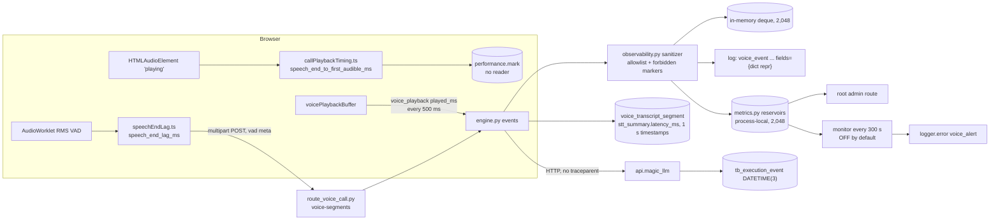
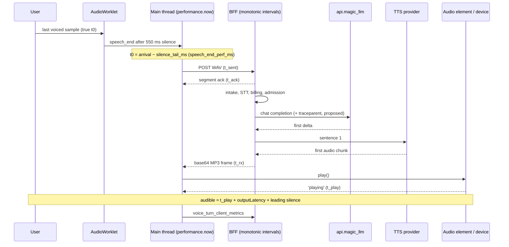
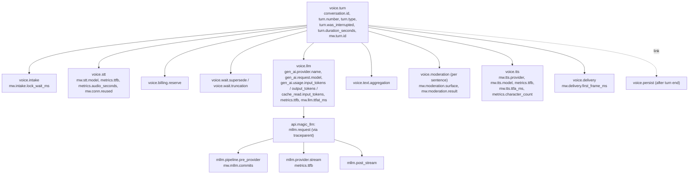
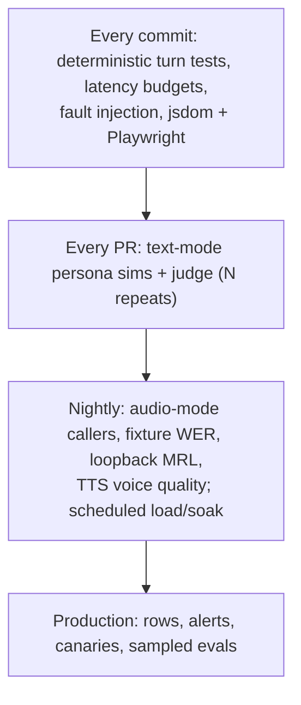

# Observability, evaluation and testing

**Research date:** 2026-10-20. **Scope:** this document covers six things for the live voice-call stack (browser, `magic-worlds-api`, `api.magic_llm`):

- what the stack measures today, and where those numbers go
- the metric set current practice uses for cascaded STT→LLM→TTS voice agents
- how to measure mouth-to-ear latency
- an instrumentation proposal: a client frame, a per-turn row, OTel spans, and dashboards and alerts
- a testing strategy
- privacy-preserving telemetry

S2S/omni models are covered only where the same harness applies; see [11_speech_to_speech_and_omni_models.md](11_speech_to_speech_and_omni_models.md).

## Summary

- **FACT.** The browser computes the latency the user actually feels: `speech_end_to_first_audible_ms`. It only writes it to `performance.mark`, which nothing reads (`src/features/interaction/audio/callPlaybackTiming.ts:1-33`).
- **FACT.** The server's `user_stop_ttfb_ms` stops at "first audio frame sent". It is stitched together from a client lag, wall-clock route timing and a server interval. This is C13 (BE-OBSERVABILITY-SAFETY-COST-05). Its severity is medium, but it is scheduled first because every latency fix needs it.
- **FACT.** Server metrics sit in process-local reservoirs with no exporter. The one latency alert covers only a TTS stage and is a `logger.error` line, and its monitor is off by default (C59, K10). LLM TTFT is never measured end to end. No trace context reaches `api.magic_llm` (C72).
- **FACT.** The event sanitizer silently drops field names containing `token` or `audio` (C70). Segment rows have 1 s timestamps. Outcome labels conflate failures: a pre-ready close is stored as `failed/internal`, a navigation as `disconnected`, and assistant segments always as `completed`.
- **Metric set to adopt:**
  - **Latency.** V2V mouth-to-ear on one clock, with the first turn reported separately. Per-stage intervals: endpointing, upload, STT, TTFT/TTFAT, aggregation, moderation, TTS TTFB/TTFA and playback.
  - **Interruptions.** False barge-in, missed interruption, stop latency, cut-off-user, no-response and overlap/gap.
  - **Quality and cost.** Heard ratio, STT WER/CER, TTS round-trip WER, speaker similarity and cost per call-minute.
- **Instrumentation proposal:**
  - A `voice_turn_client_metrics` frame, deployed server-first because unknown frames are fatal today (C29).
  - A `voice_turn_metrics` row keyed by `turn_id`, written off the critical path.
  - A content-free OTel span tree, with `traceparent` sent into `api.magic_llm`.
  - Mergeable histograms, and alerts sent to a real channel.
- **Testing.**
  - **Today:** about 545 backend voice tests run over fakes with no latency budgets. Frontend call tests are jsdom only (C57).
  - **Add:** latency-budget and fault-injection tests; text persona simulations with a judge on each PR; nightly audio-mode callers over a SHA-256-pinned EN/ES corpus; fake-mic loopback browser tests; ramp/spike/soak load tests; turn-taking A/B tests; TTS voice-quality monitors.
- **Privacy.** Telemetry carries no transcript or audio. Eval content lives in a separate, access-controlled store. Speaker similarity runs only on TTS output.

## 1. Why measurement comes first

The reconciled estimate of speech end → first audible reply is about 3.2-4.2 s at STT p50 and 3.6-4.7 s at STT p95. That figure assumes ElevenLabs with moderation off. Hang-over, STT and the LLM make up about 80% of it ([02_turn_lifecycle_and_latency.md](02_turn_lifecycle_and_latency.md)).

That is an INFERENCE from forensics, not a measurement. The forensic pass had to rebuild per-turn timings from three sources ([gap-real-dev-call-forensics](evidence/audit/gap-real-dev-call-forensics.md)):

- `DATETIME` columns with 1 s resolution
- `api.magic_llm` events stored as `DATETIME(3)`
- log lines

It also ran on a dev topology with known distortions (section 4.4).

The reconciliation note scheduled C13 first. Server histograms and per-stage events exist, but three things are missing ([gap-finding-reconciliation](evidence/audit/gap-finding-reconciliation.md), C13 verification row):

- the client-perceived number
- a persisted per-turn row
- an aggregate across turns

Without them, nobody can show that any of these changes helped:

- lowering the 550 ms hang-over
- a TTFT deadline
- fewer commits in `api.magic_llm`
- moving persistence off the reply path

## 2. What is measured today and where it goes

### 2.1 Data flow



FACT, element by element:

- **Client mark.** `CallPlaybackTiming.playing()` emits `turn_start_to_first_audible_ms` and `speech_end_to_first_audible_ms` (kept if 0-120,000 ms).
  - The default emitter only calls `performance.clearMarks` and `performance.mark` (`src/features/interaction/audio/callPlaybackTiming.ts:28-33`).
  - The file header calls `playing` "a playback proxy, not a hardware audio measurement" (`:1`).
  - The speech-end anchor is `speech_end_perf_ms` (`src/features/interaction/audio/voiceVadWorklet.ts:91`), registered on upload (`src/features/interaction/hooks/useVoiceCallController.ts:574`).
  - Nothing reads the mark (FE-PLAYBACK-TRANSPORT-05, [fe-playback-transport](evidence/audit/fe-playback-transport.md)).
- **Client lag.** `speech_end_lag_ms` runs from the last voiced audio to the upload send. The last voiced audio is taken as the arrival of the worklet's `speech_end` minus `silence_tail_ms`.
  - It includes the hang-over, hashing and any `voice_ready` wait.
  - It excludes mic input latency (`src/features/interaction/audio/speechEndLag.ts:1-17, 28-31`).
  - It rides in the segment's `vad` metadata (`magic-worlds-api/src/routes/user/route_voice_call.py:284`).
- **Server events.** `record()` logs `voice_event name=%s at_ms=%s fields=%s` as a dict repr and feeds the speech metrics (`magic-worlds-api/src/services/voice_orchestration/observability.py:164-175`).
  - Events are kept in a deque capped at 2,048 (`:20`).
  - `at_ms` comes from the wall clock, `time.time()` (`:311-316`).
- **Sanitizer.** Only allowlisted fields survive (`observability.py:22-106`), and fields whose name contains a forbidden marker are dropped silently (`:117-133, 319-339`). The markers are:
  - `transcript`, `content`, `prompt`, `audio`, `bytes`, `base64`, `hex`, `url`
  - `token`, `authorization`, `api_key`, `trace_id`, `voice_id`, `request_body`, `response_body`

  So `input_tokens`, `stt_audio_ms` or `trace_id` can never be recorded this way, while `audible` passes. This is C70 (BE-OBSERVABILITY-SAFETY-COST-06, adjusted to low).
- **Logs.** The JSON formatter drops `extra` fields (`magic-worlds-api/src/main.py:240-249`; C71, BE-OBSERVABILITY-SAFETY-COST-07). In dev, stdout is the only sink. Three pre-admission internal failures left their traceback only in the IDE console.
- **Histograms.**
  - The module states that the BFF has no metrics library and that no exporter has been chosen (`magic-worlds-api/src/services/speech/metrics.py:4`).
  - Reservoirs hold 2,048 samples each and are process-local (`:123`).
  - One uvicorn process runs today (`magic-worlds-api/src/serve.py:28-33`). The numbers are therefore consistent, but lost on restart and unmergeable across workers.
  - `_FEED` does not feed `voice_stt_completed`, `voice_turn_admitted`, `voice_llm_first_delta` or `voice_tts_first_sentence` (`metrics.py:755-776`; the events are emitted at `engine.py:2234, 2578, 2612, 2538`).
  - The `spend_budget_pct` gauge has no producer ([be-observability-safety-cost](evidence/audit/be-observability-safety-cost.md)).
- **Alerts.**
  - **Latency rule.** The only one is `call_first_audio_ms` p50 > 400 ms over 1 h with at least 20 calls (`metrics.py:1362, 1374, 1467-1482`). That metric runs from first sentence ready to first audio frame (`:55`). It is a TTS stage plus first-sentence moderation, not V2V.
  - **Failure rule.** A TTS failure rate above 3%.
  - **Delivery.** Alerts are logged at ERROR "until the owner picks a channel" (`:44-46`), deduplicated for 900 s.
  - **Monitor.** It runs every 300 s, and only when `VOICE_METRICS_MONITOR_ENABLED` is set (`:1649-1660`). By default it never evaluates the rules (C59, BE-OBSERVABILITY-SAFETY-COST-08; errata K10).
- **No trace propagation.** `execution_headers` sends `Authorization`, `Content-Type`, `X-Delegation-API-Key`, `Accept` and `Idempotency-Key`, but no `traceparent` (`magic-worlds-api/src/services/llm_execution_transport.py:82-95`; C72). Exact joins still exist: `turn_id` = `execution_id` = `adventure_message.turn_id`.

### 2.2 Stage coverage

| Stage / signal | Measured today? | Sink | Gap |
|---|---|---|---|
| Last voiced audio → upload sent | Yes, `speech_end_lag_ms` | `vad` meta → D06 | Client clock. Includes the 550 ms hang-over |
| Upload transit | Partly | — | The receipt stamp precedes the body read; first-byte transit excluded ([e2e-latency-trace](evidence/audit/e2e-latency-trace.md)) |
| Receipt → engine start (`route_lead_ms`) | Yes | Inside D06 | Wall clock |
| Intake lock, ack, billing | Events at best | Log/deque | No histogram. Serial DB awaits (C19) |
| STT | `stt_summary.latency_ms` per segment | DB JSON | Includes connect (`magic-worlds-api/src/services/voice_orchestration/stt_groq_client.py:90-109`). Not in a histogram |
| Supersede / truncation waits | Event | Log | Dev waits of 0.7-6.4 s were only found forensically |
| BFF request → first LLM delta | `voice_llm_first_delta` (`engine.py:2612`) | Log/deque | Not fed. No alert |
| `api.magic_llm` pipeline | Event rows `DATETIME(3)` | MLLM DB | Manual join. `raw_usage` ttft/tps/ttf = 0.0 in all 19 dev runs, although `time_first_token_ms` exists (`api.magic_llm/src/models/chat.py:61`) |
| First delta → first sentence | `voice_tts_first_sentence` (`engine.py:2538`) | Log | Not fed |
| Moderation | `moderation_ms` | Process | `surface` is dropped when fed (`magic-worlds-api/src/services/speech/moderation.py:682-690`, `metrics.py:605-609`), so 2 s narration batches share one histogram with 300 ms call sentences. Provider is always labelled `elevenlabs`, even on Fish calls (BE-OBSERVABILITY-SAFETY-COST-15) |
| First sentence → first audio frame | `call_first_audio_ms` | Process, 1 h | The only alerted latency |
| User stop → first audio sent (D06) | `call_user_stop_to_first_audio_ms` | Process | Partial, see below |
| Downlink, decode, element start | `playing` proxy | `performance.mark` | Never sent |
| Output device latency | No | — | `outputLatency`/`baseLatency`/`getOutputTimestamp` unused |
| Audio played | `voice_playback.played_ms` / 500 ms | Flush-ahead gate (`engine.py:1266-1296`) | Not persisted. Interrupted vs heard indistinguishable (OVERLAP-01) |
| Cost | TTS only | Spend circuit | No STT 10 s minimum or LLM tokens (C58) |

**The D06 number.** The server computes `user_stop_ttfb_ms = speech_end_lag_ms + route_lead_ms + segment_to_audio_ms` (`magic-worlds-api/src/services/voice_orchestration/engine.py:2907-2909`) and records it just before the first frame is sent (`:2456-2470`).

- It is absent when the client sent no lag.
- It mixes a client monotonic interval with wall-clock-derived server intervals.
- It excludes:
  - upload first-byte transit and downlink transit
  - decode and element start
  - output latency
  - MP3 leading silence: about 37-53 ms of codec delay on Fish ([gap-call-audio-assets-and-mp3-timeline](evidence/audit/gap-call-audio-assets-and-mp3-timeline.md))

So it is a server proxy, not mouth-to-ear.

**Two different `ttfb_ms`.** `voice_turn_audio.ttfb_ms` starts at first-sentence-ready, while D06 starts at user stop. Never plot the two on one axis.

### 2.3 Outcome labels pollute the record

FACT:

- **Pre-ready close.** A WebSocket closed before `voice_ready` is stored as `failed/internal`, while the metric says `disconnected` (GAP-SEGMENT-POST-AND-CONTROL-PLANE-UNKNOWNS-02).
- **Navigation.** Leaving the page is stored as `disconnected`, and the close code is not kept.
- **Turn failures.** `_fail_turn` maps every failure to `internal` (`engine.py:3103-3116`).
- **Assistant segments.** They are hard-coded `completed` (`:3526`).

The effects show in the dev data:

- 5 of 23 STT-completed segments ended `failed/internal` with no machine-readable cause.
- 12 of 17 audio turns were interrupted, and no row says so ([gap-real-call-overlap-history-billing](evidence/audit/gap-real-call-overlap-history-billing.md), OVERLAP-01).
- Playback-limit drops are silent (GAP-SEGMENT-POST-AND-CONTROL-PLANE-UNKNOWNS-09).

### 2.4 Tests that exist

FACT.

**Backend.** `magic-worlds-api/tests/voice/` holds 52 `test_*.py` modules with about 545 tests, run over in-memory fakes:

- `InMemoryCallbotExecution`, with `text_stream`, `hold_before_admission` and `hold_before_start`
- store, quota and billing fakes

Latency tests check arithmetic only (`test_voice_turn_latency.py:98`; the D06 sum in `test_voice_call_telemetry.py:224-302`). None asserts a budget. Privacy sentinels exist (`test_voice_privacy_sentinels.py`, `test_voice_observability_privacy.py`).

**Frontend.** About 127 `it` cases across six jsdom/mock files. `tests/browser/` has only feature-flag and voice-console/preset scripts (C57, FE-PLAYBACK-TRANSPORT-22).

## 3. Best-practice metric set

Definitions follow [r08](evidence/research/r08-eval-observability.md). They are aligned with:

- Pipecat's `UserBotLatencyObserver`/`LatencyBreakdown`
- LiveKit's `ChatMessage.metrics`: `end_of_turn_delay`, `transcription_delay`, `llm_node_ttft`, `tts_node_ttfb`, `playback_latency`, `e2e_latency`

Sources: [Pipecat metrics, docs accessed 2026-10-20](https://docs.pipecat.ai/guides/fundamentals/metrics); [LiveKit data hooks, docs accessed 2026-10-20](https://docs.livekit.io/testing/observability/data.md).

### 3.1 Latency

| Metric | Definition | Source here | External reference |
|---|---|---|---|
| **V2V / mouth-to-ear (MRL)** | User's last voiced sample → first audible reply sample, on the user endpoint's clock | Client frame (5.1) | Twilio: 1,115 ms target, 1,400 ms upper (vendor-reported) ([Twilio, 2025-11-17](https://www.twilio.com/en-us/blog/developers/best-practices/guide-core-latency-ai-voice-agents)). Pipecat guide: 1,500 ms ([guide, June 2026 update](https://voiceaiandvoiceagents.com/)) |
| First-turn latency | `voice_start` → first audible greeting | Client frame | Report separately ([IETF draft, 2026-09-07](https://datatracker.ietf.org/doc/html/draft-nygate-ippm-mrl-00)) |
| Endpointing wait | Last voiced sample → turn committed | Client | LiveKit `end_of_turn_delay` |
| Upload | Send → segment accepted | Client | — |
| STT final | Accepted → transcript | `stt_summary` | LiveKit `transcription_delay` |
| LLM TTFT / TTFAT | Request → first token / first answer token after thinking | BFF + `api.magic_llm` | Pipecat separates the two |
| Text aggregation | First token → first speakable sentence | Engine | Pipecat `text_aggregation` |
| TTS TTFB vs TTFA | First byte vs first audible sample (TTFA = TTFB + leading silence) | Engine + alignment | Coval charges leading silence to the provider ([coval-ai/benchmarks](https://github.com/coval-ai/benchmarks)) |
| Playback latency | First frame received → audible | Client | `baseLatency + outputLatency`, Baseline 2025 ([MDN](https://developer.mozilla.org/en-US/docs/Web/API/AudioContext/outputLatency)) |
| V2V jitter | Std-dev of V2V within a call | Derived | Hamming: < 100 ms (vendor-reported) |

Two human-factors anchors:

- Human floor transfer clusters around 200 ms ([Stivers et al., PNAS 2009](https://doi.org/10.1073/pnas.0903616106); this may be stale).
- A 54-person study recommends staying under 4 s ([Maslych et al., 2025-07](https://arxiv.org/html/2507.22352v1)).

The dev estimate of 3.2-4.7 s sits at that boundary.

### 3.2 Interruptions and turn-taking

| Metric | Definition | Computation here |
|---|---|---|
| False barge-in | Agent stopped for noise, a backchannel or echo | Superseding segment yields empty STT, fewer than 2 words, a backchannel hit ("mm-hm", "ajá") or an echo match. The overlap note uses gram-4 containment ≥ 0.6 or LCS ≥ 0.5 = likely echo |
| Missed interruption | User spoke over the agent, which kept talking | Segment uploaded while the agent was audible with no barge-in. Includes the post-`voice_turn_end` race (OVERLAP-03) |
| Stop latency | User onset → agent silent at the client | Client onset → `pause()`. The 500 ms voiced rule (`useVoiceCallController.ts:137`) is a floor |
| Cut-off-user | Agent took the turn too early | User resumes shortly after turn commit, or supersede before first audio |
| No-response | No audible reply within T | Accepted speech with no `playing` |
| Overlap/gap | Floor-transfer offsets (negative = overlap) | Client speech and playback timestamps |
| Heard ratio | `played_ms / generated_ms` or `kept_chars / generated_chars` | Both fields already exist as events |

Full-Duplex-Bench v1 formalises several of these ([arXiv 2503.04721](https://arxiv.org/html/2503.04721v3)):

- takeover rate (TOR)
- backchannels, defined as < 1 s and < 2 words

Tune at operating points: false-cut-off rate at a fixed latency, and latency at a fixed false-cut-off rate. For scale, the LiveKit-run eot-bench measured a plain VAD baseline (vendor-reported; [eot-bench README](https://github.com/livekit/eot-bench); [05_turn_taking_and_interruptions.md](05_turn_taking_and_interruptions.md)):

| Hang-over | False cut-offs |
|---|---|
| 300 ms | 55.6% |
| 600 ms | 21.7% |
| 1,600 ms | 5% (the latency needed to reach this rate) |

No independent false-barge-in benchmark was found (r08).

### 3.3 Recognition and synthesis quality

| Metric | Use | Notes |
|---|---|---|
| STT WER, CER for short turns | Nightly on fixtures. Production only with consent | Spanish-aware normaliser. CER is steadier on "sí"/"no" |
| Entity/name error rate | Character and place names | WER underweights them |
| TTS round-trip WER | Synthesize → ASR → WER against the input text | Catches skips and truncation (Seed-TTS-style; [MiniMax-Speech, 2025-05](https://arxiv.org/pdf/2505.07916)) |
| Speaker similarity | WavLM-large vs each character's reference clip | Same encoder only. Detects voice drift |
| UTMOS / DNSMOS | Drift detector | Not an absolute score |
| MOS (P.800/P.808), preference | Release decisions | Static benchmarks predict preference poorly, Kendall τ ≤ 0.33 ([Talk Arena, 2025-02-21](https://arxiv.org/pdf/2502.15919)) |

### 3.4 Persona, safety, economics and reliability

- **Persona** (judged on transcripts):
  - stays in character
  - reply length fits speech
  - speakable output: no markdown or emoji, which crash the Fish word ledger
  - EN/ES consistency
  - memory
  - handles "no, wait, I meant…"
- **Safety:** decision mix, refusals and crisis routing, as counts only ([14_safety_policy_and_compliance.md](14_safety_policy_and_compliance.md)).
- **Cost per call-minute** (p50/p95), from a per-call ledger:
  - TTS characters sent vs heard
  - STT billed seconds, including Groq's 10 s minimum
  - LLM tokens, cached vs uncached
  - versioned prices

  In dev, 34% of billed TTS (97 of 283 s) was never heard ([13_cost_scaling_and_operations.md](13_cost_scaling_and_operations.md)).
- **Reliability:**
  - outcome mix and errors by stage
  - provider 429/5xx
  - LLM retries (up to 3, so worst-case silence is about 92 s)
  - close codes and reconnects
  - playback stalls
  - call end reasons

## 4. Measuring mouth-to-ear correctly

### 4.1 Pitfalls

- **Mixed clocks.** The client uses `performance.now()`, the server `time.time()`, and `api.magic_llm` stamps `DATETIME(3)`. Subtract intervals only on one machine. Only the client sees both ends of V2V.
- **Sent is not heard.** The server's figure misses:
  - downlink transit
  - base64 and MP3 decode
  - element start
  - device output latency: typically 10-40 ms, more on Bluetooth (r08)
  - leading silence in the audio

  Measured onset inside the provider audio is 71-86 ms for ElevenLabs and 105-140 ms for Fish.
- **The VAD anchor is approximate.** `speech_end` arrives after 550 ms of silence (`src/features/call/components/CallScreen.tsx:114`). The client subtracts the tail, but postMessage delay remains and mic input latency is missing. An RMS threshold may also clip soft trailing phonemes. The loopback harness (4.3) measures this bias.
- **`playing` is a proxy.** The buffer listens only to `play`, `pause`, `playing`, `ended` and `error`. It ignores `waiting` and `stalled` (`src/features/interaction/audio/voicePlaybackBuffer.ts:635-639`), so mid-reply stalls are invisible.
- **Pooling hides problems.** Never pool first turns with later turns, or barge-in turns with clean ones.

### 4.2 Production method: a single client clock



Client values are differences on one `performance.now()` clock, so no clock sync is needed. Server stages should use `time.monotonic()` and travel as intervals. Wall-clock stamps stay only for ordering and joins.

The client computes:

`v2v_ms = (t_play − t0) + output_latency_ms + leading_silence_ms`

Each correction carries its source:

- **`output_latency_ms`**: `audiocontext` when `outputLatency` is available (feature-detected, Baseline 2025), else `none`.
- **`leading_silence_ms`**: the server adds it from alignment data (EL `sync_alignment`, Fish with-timestamp).

Playback uses one `HTMLAudioElement` with no Web Audio graph. `outputLatency` therefore describes a context the element does not use. It is an approximation (INFERENCE), and the source label keeps that explicit.

### 4.3 Lab method: IETF-style acoustic loopback

`draft-nygate-ippm-mrl-00` is an individual Informational draft that expires 2027-03-11; it is not a standard ([IETF, 2026-09-07](https://datatracker.ietf.org/doc/html/draft-nygate-ippm-mrl-00)). It defines two measurement points:

- **Ingress MRL**, at packet arrival
- **Playout MRL**, after the de-jitter buffer

It detects the onset of the reply with RMS thresholds:

| Variant | Above noise floor | Absolute | Sustained |
|---|---|---|---|
| Headline | +10 dB | ≥ −50 dBov | 20 ms |
| Sensitive | +6 dB | −55 dBov | 10 ms |
| Strict | +12 dB | −45 dBov | 30 ms |

A reply with a > 150 ms gap within 2 s of onset counts as discontiguous. Results go into an `mrl-report/1` record with n_attempted, n_reported, n_discarded, discard reasons, mean/p50/p95/max and turn index. The harness is calibrated against a reference responder.

A harness for this codebase would work as follows (INFERENCE, not built):

1. **Stimulus.** Run Playwright Chromium with `--use-fake-device-for-media-stream --use-file-for-fake-audio-capture=<stimulus.wav>`. Each stimulus is hash-pinned, and its end of speech is annotated offline.
2. **Capture.** Route browser output to a virtual sink, such as a PulseAudio null-sink monitor. Record it on the same machine and clock.
3. **Report.** Give headline MRL, with the sensitive-to-strict spread as onset uncertainty. Compare it per turn with the client `v2v_ms` to get the proxy bias for each browser.
4. **Calibrate.** Use a stub BFF that answers after a fixed delay with a click track.
5. **Degrade.** Add loss and jitter with `tc netem`, as the Pipecat guide recommends.

Also do a manual check monthly: record a call and measure the gap in an audio editor (Pipecat guide §5.1).

### 4.4 Measurement hygiene

These dev distortions must be removed, or recorded as dimensions, before a baseline counts:

- **`--reload` disables TCP_NODELAY**, adding about 41 ms per reused request (GAP-TOPOLOGY-RTT-MEASUREMENTS-01).
- **All dev calls came from a root user**, which bypasses flag validators (GAP-TOPOLOGY-RTT-MEASUREMENTS-05).
- **The shared dev MySQL is saturated** (GAP-TOPOLOGY-RTT-MEASUREMENTS-06). This hits `api.magic_llm` hardest: it makes about 20 fsync'd commits before the provider request (about 0.87 s at p50).
- **Dev sets `SSE_BUFFER_INTERVAL_MS=300`.** The default is 0 (`api.magic_llm/src/util/const.py:264`).
- **Cold TLS to the provider and Groq on most turns** adds about +165 ms at p50. Record `conn_reused` per stage ([gap-topology-rtt-measurements](evidence/audit/gap-topology-rtt-measurements.md)).
- **Production topology is UNKNOWN.** Every row needs `deploy_env` and `region`.

Report p50, p95, p99, max and n, split by:

- first turn vs later turns
- language
- TTS provider and model
- device class
- moderation on/off

Count barge-in turns separately.

## 5. Instrumentation proposal

Three design rules:

1. **Content-free.** Telemetry carries no content.
2. **Off the critical path.** Nothing is awaited between user stop and first audio. Serial DB awaits (C19) and previous-turn persistence already cost latency: the latter delayed the next reply by 1-5 s in 5 of 13 transitions.
3. **Typed, not sanitized.** The row goes through a typed repository, not the allowlist sanitizer, which would drop `*_tokens` and `*audio*` names (C70).

### 5.1 Client frame: `voice_turn_client_metrics`

The client sends one frame per assistant turn: after `playing`, or when the turn ends without audio.

```json
{
  "type": "voice_turn_client_metrics", "v": 1, "turn_id": "…", "segment_seq": 7,
  "speech_end_to_playing_ms": 3412, "turn_start_to_playing_ms": 2950,
  "speech_end_lag_ms": 640, "upload_ms": 180, "first_frame_to_playing_ms": 35,
  "output_latency_ms": 22, "output_latency_source": "audiocontext",
  "stalls": 0, "stall_ms": 0, "played_ms": 5200,
  "barge_in": true, "barge_in_onset_to_pause_ms": 510, "aec": true, "outcome": "barged_in"
}
```

The values are illustrative.

Rollout must follow this order. All frame models are `extra="forbid", strict=True`, and an unknown or invalid frame raises a fatal `VoiceOrchestrationError` (`route_voice_call.py:135-272, 320`; C29). A new client talking to an old server would therefore end the call.

1. **Server.** Add the model to `_VOICE_FRAME_MODELS` (`route_voice_call.py:254-262`). Make validation failures for this frame non-fatal: count them and drop the frame. Keep one frame per turn, mirroring the rate guard in `report_playback` (`engine.py:1266-1296`).
2. **Capability.** Advertise support in `voice_ready` (`magic-worlds-api/src/services/voice_orchestration/delivery.py:297`).
3. **Client.**
   - Inject a sending emitter, since `CallPlaybackTiming` already takes one (`callPlaybackTiming.ts:40`).
   - Add `waiting`/`stalled` listeners.
   - Optionally add `aec` to `voice_start`, which lacks it (`useVoiceCallController.ts:1255-1273`).

### 5.2 Durable row: `voice_turn_metrics`

There is one row per assistant turn, upserted by `turn_id`. The engine accumulates the values in memory, and a background task writes the row after the turn ends. The client frame is merged in by a second upsert. Server intervals are monotonic. Stamps are `DATETIME(3)`.

| Group | Columns | Notes |
|---|---|---|
| Keys | `turn_id` (PK, = `execution_id`), `voice_session_id`, `chat_id`, `segment_seq`, `turn_index`, `is_first_turn`, `created_at` | No `user_id`; join through the session under access control |
| Dimensions | `language`, `stt_model`, `llm_profile_id`, `llm_model`, `graph_version`, `tts_provider`, `tts_model`, `moderation_mode`, `aec`, `device_class`, `browser_family`, `fe_build`, `api_build`, `deploy_env`, `region`, `experiment_arm` | Coarse values only |
| Client | `speech_end_lag_ms`, `upload_ms`, `first_frame_to_playing_ms`, `output_latency_ms`, `output_latency_source`, `v2v_ms`, `stalls`, `stall_ms`, `barge_in_onset_to_pause_ms` | From 5.1 |
| Server | `route_lead_ms`, `intake_wait_ms`, `stt_ms`, `stt_speech_ms`, `billing_ms`, `supersede_wait_ms`, `truncation_wait_ms`, `admit_ms`, `llm_ttft_ms`, `mllm_pre_provider_ms`, `provider_ttft_ms`, `aggregation_ms`, `moderation_first_ms`, `tts_ttfb_ms`, `tts_leading_silence_ms`, `segment_to_first_frame_ms`, `persist_wait_ms`, `conn_reused_stt`, `conn_reused_llm` | `mllm_*`/`provider_ttft_ms` are joined from `api.magic_llm` |
| Hearing | `generated_chars`, `sent_chars`, `kept_chars`, `generated_ms`, `played_ms`, `heard_ratio` | Fixes OVERLAP-01 |
| Interruption | `barge_in`, `barge_in_played_ms`, `superseded`, `false_barge_in_suspect`, `missed_interruption_suspect`, `floor_offset_ms` | Flags derived per 3.2 |
| Outcome | `outcome`, `error_stage`, `error_type`, `retries_llm`, `provider_status` | See 5.3 |
| Cost | `stt_billed_s` (10 s minimum), `llm_input_tokens`, `llm_output_tokens`, `llm_cached_tokens`, `tts_chars_billed`, `tts_chars_heard`, `cost_micro_usd`, `price_table_version` | Covers C58 |

A call-level `voice_call_metrics` record holds:

- connect → `voice_ready` time
- first-turn V2V
- turn and interruption counts
- connected seconds
- close code and end reason
- COGS totals

This is the per-call ledger of [13_cost_scaling_and_operations.md](13_cost_scaling_and_operations.md). Retention follows [14_safety_policy_and_compliance.md](14_safety_policy_and_compliance.md). The rows are the source of truth for dashboards. In-process histograms are derived from the same values for alerting.

### 5.3 Outcome taxonomy

**Turn `outcome`:**

- `completed`
- `barged_in`
- `superseded`
- `no_speech`
- `refused_moderation`
- `failed_stt`, `failed_llm`, `failed_tts`, `failed_delivery`, `failed_internal`
- `cancelled_disconnect`

**Call `end_reason`:**

- `user_end`
- `navigation`
- `network_lost`
- `pre_ready_close`
- `server_error`
- `quota`
- `safety`
- `idle`

Every failure carries `error_stage` and `error_type`: an exception class or provider status, never a message body. This fixes the GAP-SEGMENT-POST-AND-CONTROL-PLANE-UNKNOWNS-02 mismatch, the always-`completed` assistant status and the undiagnosable pre-admission failures.

### 5.4 OpenTelemetry span tree

Use one trace per turn, linked by `conversation.id = voice_session_id`. Pipecat uses one trace per conversation ([Langfuse Pipecat integration, 2025-05-29](https://langfuse.com/integrations/frameworks/pipecat)). Per-turn traces stay small, and the shared id still groups them.



**Naming:**

- **Pipecat turn and service names.** Reuse `turn.*`, `conversation.id`, `metrics.ttfb`, `metrics.character_count` and `metrics.audio_seconds`.
- **GenAI names for LLM usage.** Pipecat renamed attributes to these in v1.6.0 and added `metrics.audio_seconds` in v1.7.0 ([Pipecat OTel](https://docs.pipecat.ai/server/utilities/opentelemetry), [releases](https://github.com/pipecat-ai/pipecat/releases)).
- **Avoid `turn.user_bot_latency_seconds`.** It is (unverified).
- **Version our own names.** The GenAI conventions moved to their own repo, whose schema URL reads "TODO", and they have no voice convention ([repo](https://github.com/open-telemetry/semantic-conventions-genai)). Keep project names under `mw.*` and publish `mw.telemetry.schema_version`.

**Content capture** is off:

- `OTEL_INSTRUMENTATION_GENAI_CAPTURE_MESSAGE_CONTENT=false`.
- Any content attributes go under their own prefix and are off by default, like LiveKit's `lk.pii.*` / `allow_pii=False` ([LiveKit tracing, docs accessed 2026-10-20](https://docs.livekit.io/deploy/observability/tracing/)).

**Propagation, sampling and client data:**

- **Propagation.** Add `traceparent` to `execution_headers` and extract it in `api.magic_llm`. Whether `api.magic_llm` has OTel today is UNKNOWN. The exact `turn_id` = `execution_id` join already allows offline correlation, so propagation is a convenience.
- **Sampling.** Sample 100% while volume is tiny (a global cap of 8 concurrent calls). Later, tail-sample errors and slow turns.
- **Client numbers.** The client frame arrives after the server span has ended, so its values go to the row and the histograms, not to the trace.

### 5.5 Metrics pipeline

Export mergeable histograms (OTLP exponential or Prometheus buckets). r08 notes that process-local reservoirs cannot give a fleet-wide p95. Keep the in-process snapshot for the admin route. Also:

- Feed the four unfed events.
- Label `moderation_ms` by surface and by the call's real TTS provider.
- Add a sanitizer-drop counter labelled by event name only (C70).
- Wire or delete `spend_budget_pct`.

### 5.6 Dashboards

| Dashboard | Panels |
|---|---|
| Turn latency | V2V p50/p95/p99 and n, first vs later turns. A stacked stage-median waterfall. Splits by language, provider, device class and `conn_reused` |
| Turn-taking | Barge-in rate, false-barge-in and missed-interruption suspects, stop latency, cut-off-user, no-response, floor offsets, supersede rate and wait, heard ratio |
| Reliability | Outcome mix, `error_stage` × `error_type`, provider 429/5xx, LLM retries, close codes, reconnects, stalls, end reasons |
| Providers | STT latency and Groq 429s, TTS TTFB/TTFA per provider, canaries |
| Economics | $/call-minute p50/p95, waste ratio, STT billed vs speech seconds, LLM tokens |
| Safety ops | Moderation latency by surface, decision mix, refusals, crisis routings. Counts only |

### 5.7 Alerts

Thresholds are **proposals** anchored to the cited reference, to be re-tuned after two weeks of rows. Each needs at least 20 turns or calls in the window (as `MIN_CALL_SAMPLE` does today), and goes to a pager or chat webhook.

| Alert | Proposed condition | Basis | Severity |
|---|---|---|---|
| V2V p95 sustained | p95 > 5 s for 5 min | Hamming "critical" (vendor-reported, [2026-02-10](https://hamming.ai/blog/voice-agent-analytics-post-call-metrics-definitions-formulas-dashboards)) | Page |
| V2V p50 | p50 > 4 s over 1 h | Maslych et al. | Ticket |
| Stage regression | Stage p95 > 10% above its 7-day baseline after a deploy | Hamming deploy-block (vendor-reported) | Ticket / block |
| Dead air | Turns with no audible reply within 10 s, above baseline | No TTFT deadline; about 92 s worst case | Page |
| Turn failures | `failed_*` share at 2× its 7-day rate | 5.3 | Page |
| TTS failure rate | > 3% (existing RB-1) | `metrics.py` | Page |
| TTS-stage first audio | p50 > 400 ms (existing). Rename so it is not read as V2V | `metrics.py:1374` | Ticket |
| Provider canary | 2 consecutive failures, or TTFB p95 above baseline | r10, every 30-60 s | Page |
| Groq 429s | Sustained 429s | Docs table: 20 RPM, about 5 calls (tier unlabeled) | Ticket |
| Instrumentation | Client-frame coverage < 90%, or sanitizer drops > 0 | 5.1, 5.5 | Ticket |

The dev baseline (3.2-4.7 s) sits near the V2V thresholds, so the p50 alert will fire until latency work lands. That is intended: it keeps the budget visible. The dashboard target lines are:

- **Long-term target:** 1.5 s (Pipecat).
- **Stretch:** 1.1-1.4 s (Twilio, vendor-reported).

## 6. Testing strategy



This is r08's three-layer pyramid. Voice behaviour is probabilistic, so gate on pass rates over N repeats, not on single passes. Two references:

- ElevenLabs exposes `repeat_count` 2-20 ([agent testing, docs accessed 2026-10-20](https://elevenlabs.io/docs/eleven-agents/customization/agent-testing)).
- The Pipecat guide distinguishes behaviours that need 8/10 from those that need 9.99/10.

### 6.1 Deterministic tests, latency budgets, fault injection

The existing fakes are enough for three kinds of test.

**Instrumentation correctness.** Inject known per-stage delays, then assert that the row intervals match and that `v2v_ms` equals the sum of its parts.

**Overhead budget.** With zero-delay fakes, BFF time from receipt to first frame must stay under a budget. Set the budget from the first baseline. This also catches new serial awaits (C19).

**Fault injection**, asserting the expected outcome and row for each case:

- STT timeout or 5xx
- LLM stall with retries
- TTS first-audio stall (Fish has only a 90 s watchdog)
- TTS reconnect budget exhausted
- a supersede after `voice_turn_end` (OVERLAP-03)
- a pre-ready close
- markup or emoji replies, which crash the Fish ledger
- "no." and "am." swallowed by the abbreviation list
- an unknown client frame (C29)

### 6.2 Text-mode persona simulations with a judge (every PR)

Drive the real `callbot_chat.v2` graph with a scripted or LLM-played user in text. Score each reply against:

- stays in character
- length fit for speech (dev replies run at a p50 of 17.6 s of audio)
- speakable output
- language consistency
- memory
- recovery from "no, espera, quise decir…"
- safety routing

References:

- Pipecat Evals YAML scenarios ([docs accessed 2026-10-20](https://docs.pipecat.ai/pipecat/evals))
- LiveKit `AgentSession.run` and `judge` ([test framework](https://docs.livekit.io/agents/start/testing/test-framework/))
- Vapi scenario + personality

Hamming's 40/30/15/10/5 scenario mix (vendor-reported) targets customer service. Weight ours to companion roleplay, which no public benchmark covers.

**The judge is constrained by content policy** ([r91](evidence/research/r91-gap-g1-vendor-policy-retention-matrix.md)):

- OpenAI, Anthropic and Google prohibit erotica, so their judges may refuse adult-persona transcripts.
- xAI and Groq-hosted open weights do not prohibit it.
- Groq retains nothing by default and offers self-serve ZDR.

Calibrate every judge against human labels.

### 6.3 Audio-mode simulated callers (nightly)

An LLM caller speaks EN/ES through TTS voices. It runs in two modes:

- **Protocol mode** POSTs WAV segments and consumes the WebSocket. It is fast but skips the client VAD.
- **Browser mode** (6.5) uses the fake mic.

Scenarios include:

- barge-ins
- backchannels
- 300-1,500 ms mid-utterance pauses, to probe the 550 ms hang-over
- noise
- echo of agent audio
- voice edits

Blueprints:

- τ-Voice's simulator: 200 ms ticks, with an LLM turn-taking policy every 2 s ([Sierra, 2026-05-01](https://sierra.ai/blog/tau-voice-benchmarking-real-time-voice-agents-on-real-world-tasks))
- the FDB-v2 examiner
- FDB-v3 disfluency audio ([arXiv 2604.04847, 2026-04-06](https://arxiv.org/abs/2604.04847))

Runs emit production-shaped rows, so the dashboards work unchanged. This is also the only mode that can score S2S candidates.

### 6.4 EN/ES audio fixture corpus

| Rule | Detail |
|---|---|
| Sources | Consented internal recordings and TTS speakers. Never production audio without explicit consent |
| Pinning | SHA-256 per file; the scorer refuses changed hashes. Normalised to −20 dBFS RMS (Coval, [repo](https://github.com/coval-ai/benchmarks)) |
| Labels | Reference transcript with a Spanish-aware normaliser, offline end-of-speech offsets, pauses, language, accent, noise class |
| Categories | "sí"/"no"/"ok". Turns past the 7.5 s pre-consent cap and near 29.5 s. Mid-sentence pauses. Backchannels. Coughs. TV/music. Speakerphone echo. Character names. Numbers. Code-switching. Spanish accents ([06_speech_to_text.md](06_speech_to_text.md)) |
| Uses | Nightly Groq WER/CER and entity errors. Offline VAD replay through the real worklet in Node (existing tests and the fe-capture simulation already do this). Loopback stimuli. A/B curves |

### 6.5 Browser tests with a fake mic

Use Playwright Chromium with `--use-fake-ui-for-media-stream --use-fake-device-for-media-stream --use-file-for-fake-audio-capture`, against the real BFF with provider fakes. This closes C57. Cases:

- the greeting plays under the autoplay policy
- real fixture audio drives speech start and end
- the POST carries `speech_end_lag_ms`
- the reply plays and the client frame is sent
- barge-in cuts audio and sends `played_ms`
- AEC-off and first-3-s suppression (`useVoiceCallController.ts:143, 676-687`)
- a stall is counted
- the socket drops and resumes within the 50 s liveness window (`src/infrastructure/api/voiceSocket.ts:20-21`)
- tab visibility changes

The loopback harness (4.3) runs nightly on the same setup.

### 6.6 Load and soak

Coval's method runs five phases ([2026-03-07](https://www.coval.ai/blog/voice-load-testing-methodology); r08 §4.3 and fact-check #26):

1. Baseline: 10 concurrent calls, with at least 5 repeats.
2. Ramp: double every 10 min from 10 to 640.
3. Spike: 50 → 250 → 50 → 500.
4. Soak: 8-24 h at 70-80% of capacity.
5. Target: scale to the planned peak (Coval's example reaches 10,000 concurrent calls). Not needed at Magic Worlds' 8-call cap.

At peak it requires p50 < 800 ms, p95 < 2 s, p99 < 4 s, completion > 95%, jitter < 30 ms and loss < 0.5% (vendor-reported). LLM queuing is usually the first bottleneck. For this stack:

- **Fakes for capacity.** Use latency-faithful fakes that replay recorded stage distributions. That finds BFF, DB and `api.magic_llm` limits (one process; about 20 commits per request) without burning provider quota.
- **Real providers at small scale only.** The Groq docs table (20 RPM, about 5 calls) and Fish's 5/15/50 concurrency tiers ([r10](evidence/research/r10-cost-scaling-ops.md)) mean these runs test 429 handling and the 8-call cap.
- **Judge relative degradation.** Compare peak against the baseline phase, because Coval's absolute criteria sit far below today's V2V.
- **Tooling.** `k6/websockets` covers the WebSocket ([k6 docs](https://grafana.com/docs/k6/latest/javascript-api/k6-websockets/)). The paced segment POST plus WebSocket pair is easier in a custom asyncio harness.

### 6.7 A/B of turn-taking parameters

Candidates:

- `silenceMsToEnd` 550 / `minSpeechMs` 250 (`CallScreen.tsx:114`)
- barge-in at 500 ms
- AEC warm-up 3 s
- flush-ahead limits (`magic-worlds-api/src/services/voice_orchestration/call_tts_elevenlabs.py:55-57`)

Steps:

1. **Offline first.** Replay the corpus through the worklet and pick points on the false-cut-off vs hang-over curve.
2. **Online.** Randomise per call, not per turn, and record `experiment_arm`.
   - Primary metric: V2V p50.
   - Guardrails: cut-off-user, false barge-in, no-response, call length, hang-ups.
3. **Sample size.** Compute it from measured variance once rows exist.

### 6.8 TTS voice-quality monitors

Run nightly for each character voice and each provider/model. Synthesize fixed EN/ES sentences, then measure:

- round-trip WER
- WavLM speaker similarity against the reference clip
- UTMOS drift
- leading silence (TTFA − TTFB)
- loudness

Alert when a voice drifts from its own history. In production, sample TTS output only.

### 6.9 Test-to-finding map

| Test | Guards |
|---|---|
| Budgets, instrumentation | C13, C19, C70 |
| Fault injection | Retry silence, the Fish watchdog, OVERLAP-03, GAP-SEGMENT-POST-AND-CONTROL-PLANE-UNKNOWNS-02, C29, the Fish ledger crash |
| Persona sims | Reply length, markup, language drift |
| Fixtures, VAD replay | The hang-over trade-off, short-turn STT, echo false barge-ins |
| Browser, loopback | C57, client-proxy bias, stalls |
| Load/soak | Groq RPM, Fish concurrency, the `api.magic_llm` commit path, the cap |

## 7. Privacy-preserving telemetry

- **Two planes.**
  - **Telemetry** (rows, spans, histograms, logs) holds ids, intervals, enums and counts.
  - **Content** (transcripts, audio, judge inputs) lives in a separate, access-controlled store with consent and a retention schedule.

  Keep the forbidden-marker sanitizer for events, and add a test that the typed row has no content columns.
- **Pseudonymised data is still personal data.** Use a keyed HMAC where a per-user dimension is unavoidable. Under GDPR Art. 4(5) the result remains personal data ([GDPR Art. 4](https://gdpr-info.eu/art-4-gdpr/)). The safety path logs `user_id` with risk (`magic-worlds-api/src/services/speech/companion_safety.py:466-483`; C60). Replace that with counts and a pseudonymous key.
- **No biometrics on users.** Speaker similarity on user audio is biometric processing (Art. 4(14)). Run it only on TTS output.
- **Prefer not collecting over redacting.** Deepgram's redaction is English-only ([Deepgram](https://developers.deepgram.com/docs/redaction)), and Presidio disclaims any guarantee ([Presidio](https://presidio.dataprivacystack.org/)).
- **Eval vendors see content.** Choose them by retention as well as policy ([r91](evidence/research/r91-gap-g1-vendor-policy-retention-matrix.md)):
  - Groq: no inference retention by default, and self-serve ZDR.
  - ElevenLabs: ZRM only on Enterprise.
  - OpenAI: 30-day abuse logs.
  - Paid Gemini Developer API: 55 days.
- **Keep the client frame coarse.** Use `device_class` and `browser_family` only. Do not send a raw user agent or device labels.
- **Report counts, not content.** CA SB 243 annual reports to the Office of Suicide Prevention begin 2027-07-01 ([r09](evidence/research/r09-naturalness-roleplay.md)). Design crisis-referral counters now, with counsel review ([14_safety_policy_and_compliance.md](14_safety_policy_and_compliance.md)).

## 8. Recommendations

**Priorities:**

- **P0:** now, days, no vendor change.
- **P1:** weeks.
- **P2:** a quarter, architectural.
- **P3:** experiment or watch.

Impacts are estimates (INFERENCE). Instrumentation does not cut latency by itself. It makes the fixes in [17_recommendations_and_roadmap.md](17_recommendations_and_roadmap.md) verifiable.

| ID | Pri | Effort | What | Why (evidence) | Expected impact (estimate) | Depends on | Validate with |
|---|---|---|---|---|---|---|---|
| OBS-01 | P0 | M | Send `voice_turn_client_metrics` (5.1): server first, capability-flagged and non-fatal. Add stall listeners and feature-detected `outputLatency` | C13 (BE-OBSERVABILITY-SAFETY-COST-05, FE-PLAYBACK-TRANSPORT-05, FE-CAPTURE-09). `callPlaybackTiming.ts:28-33`. C29 | V2V is measured for every turn that plays | None | Coverage ≥ 90% of completed turns. Bias against loopback (OBS-11) |
| OBS-02 | P0 | M | Add `voice_turn_metrics` and `voice_call_metrics` (5.2): typed, monotonic, `DATETIME(3)`, background upsert | 1 s timestamps forced forensics. Reservoirs are lost on restart (C59). C70. OVERLAP-01 | Replaces hand forensics. Enables p95 by dimension | OBS-01 (client columns) | A row for 100% of turns. No awaited write (budget test). Rows reconcile with D06 |
| OBS-03 | P0 | S-M | Adopt the outcome taxonomy, `error_stage`/`error_type` and stored close codes. The assistant status reflects barge-in | GAP-SEGMENT-POST-AND-CONTROL-PLANE-UNKNOWNS-02. `engine.py:3103-3116, 3526`. 5 of 23 `failed/internal` | Failures become diagnosable from rows | OBS-02 | `failed_internal` share trends to zero |
| OBS-04 | P0 | S | Make alerts real: monitor on, a real channel, the 5.7 rules. Rename the RB-1 TTS alert. Feed the unfed events. Split moderation by surface. Add a drop counter | C59, K10, C70, C71, BE-OBSERVABILITY-SAFETY-COST-15. `metrics.py:44-46, 755-776, 1649-1660` | Regressions reach a person | OBS-02 for the V2V rules | A fire drill reaches the channel. Drop counter = 0 |
| OBS-05 | P0 | S | Measure TTFT end to end: BFF `llm_ttft_ms`; populate `time_first_token_ms` and the pre-provider vs provider split in `api.magic_llm`; record `conn_reused` | ttft 0.0 in 19 runs. Pre-provider p50 about 0.87 s. Cold TLS about +165 ms ([07_llm_in_the_voice_loop.md](07_llm_in_the_voice_loop.md)) | Attributes the largest variable stage. Prerequisite for a TTFT deadline | None | Non-zero TTFT on 100% of executions. The parts sum to the BFF TTFT |
| OBS-06 | P0 | S | Baseline hygiene: no `--reload`, a non-root user, `SSE_BUFFER_INTERVAL_MS=0`, a non-shared DB, a config fingerprint, first turns split out | GAP-TOPOLOGY-RTT-MEASUREMENTS-01/05/06. `const.py:264` | Removes known distortions (about 41 ms per reused request from Nagle; the rest UNKNOWN) | None | The same build measured under both configs |
| OBS-07 | P1 | M | Add OTel per 5.4, `traceparent` in `execution_headers`, extraction in `api.magic_llm`, versioned `mw.*` names, and exported exponential histograms | C72, C59, C71 | A cross-service waterfall without manual joins | OBS-02. The owner's exporter choice | ≥ 99% of turns have full traces. Span sums match the rows |
| OBS-08 | P1 | M | Add latency-budget, instrumentation and fault-injection tests (6.1) | No budgets in about 545 tests. C19, OVERLAP-03, the Fish ledger crash, C29 | CI catches serial-await and failure-path regressions | OBS-02, OBS-03 | Tests fail on an added awaited DB call |
| OBS-09 | P1 | M | Build the EN/ES fixture corpus. Nightly WER/CER, entity errors and worklet VAD replay (6.4) | No corpus. The hang-over trade-off is unmeasured. eot-bench curve (vendor-reported) | Measured operating points for turn-taking | Recording consent | Nightly hash-checked report. False-cut-off curve |
| OBS-10 | P1 | M | Run text persona sims with a judge on each PR, with N repeats (6.2) | Reply audio p50 17.6 s. Markup crashes. No roleplay benchmark | Prompt and graph regressions caught before audio | Judge vendor per r91 | Judge-human agreement. Pass-rate deltas |
| OBS-11 | P1 | M | Add Playwright fake-mic tests and the loopback MRL harness (6.5, 4.3) | C57 (FE-PLAYBACK-TRANSPORT-22). The `playing` proxy | Browser coverage and a quantified proxy bias | OBS-01 | Stub-calibrated harness. Bias per browser |
| OBS-12 | P1 | M | Compute per-turn interruption metrics and the heard ratio (3.2) | 12 of 17 turns interrupted. 34% of TTS unheard. OVERLAP-01/02/03 | Turn-taking and waste become visible | OBS-01, OBS-02 | Flags agree with a hand-labelled sample |
| OBS-13 | P1 | S | Run provider canaries every 30-60 s: TTS sentence, 2 s STT clip, minimal LLM call | r10. No STT fallback. Status pages lag | Outages detected before users report them. STT canaries consume Groq RPM and the 10 s minimum | OBS-04 | An injected fault is detected within the window |
| OBS-14 | P2 | L | Run nightly audio-mode simulated callers (6.3) | Turn-taking and echo are only testable with audio. Also needed for S2S | A nightly V2V and interruption trend | OBS-02, OBS-09 | Noise band measured. Regressions flagged |
| OBS-15 | P2 | L | Build a load/soak harness with ramp and spike profiles on faithful fakes, plus a small real run (6.6) | One process, about 20 commits per request, Groq 20 RPM, Fish 5/15/50 | Finds the first bottleneck and 429 behaviour pre-launch | OBS-02, OBS-07 | Bottleneck named. No pool or memory growth over the soak |
| OBS-16 | P2 | M | Turn-taking A/B: offline replay, then per-call randomisation (6.7) | 550/500 ms and 3 s were never tuned on data | Data-driven parameters | OBS-01, OBS-02, OBS-09, OBS-12 | Arm balance. V2V p50 change within guardrails |
| OBS-17 | P2 | M | Add TTS voice-quality monitors (6.8) and a COGS dashboard (3.4) | C58. 34% unheard TTS. Drift unmonitored | Catches voice regressions. Quantifies waste | OBS-02, OBS-09 | Drift alarm on a changed voice. COGS reconciles with invoices |
| OBS-18 | P3 | S | Watch the IETF draft, OTel GenAI, and Pipecat/LiveKit attribute changes. Reuse the suites for S2S candidates ([11](11_speech_to_speech_and_omni_models.md)) | Individual draft. Schema URL "TODO". Attribute renames | No dashboard breakage. Like-for-like S2S scoring | OBS-14 | Quarterly review. S2S scored with the same rows |

**Order.** OBS-01 to OBS-06 first. They are small and vendor-free, and they turn every later latency change into a measurable experiment. OBS-07 and OBS-08 come next, then the corpus and simulation layers.
