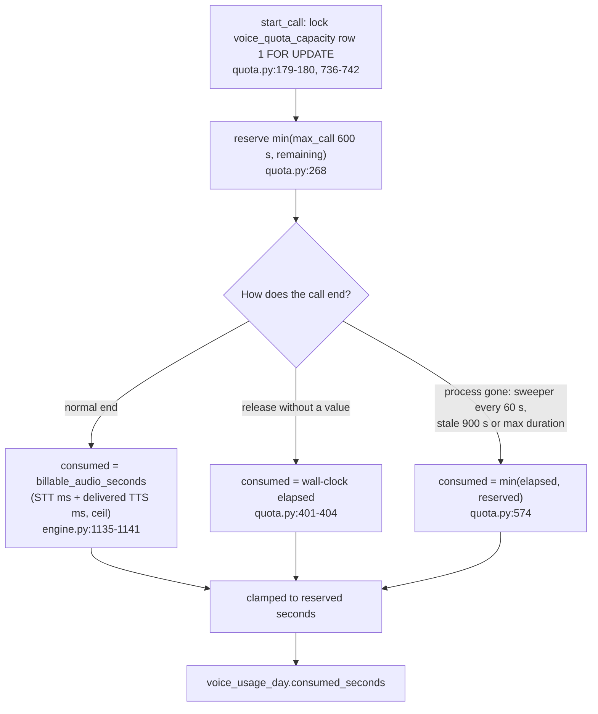
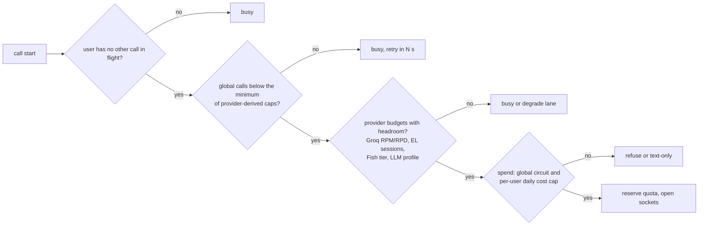
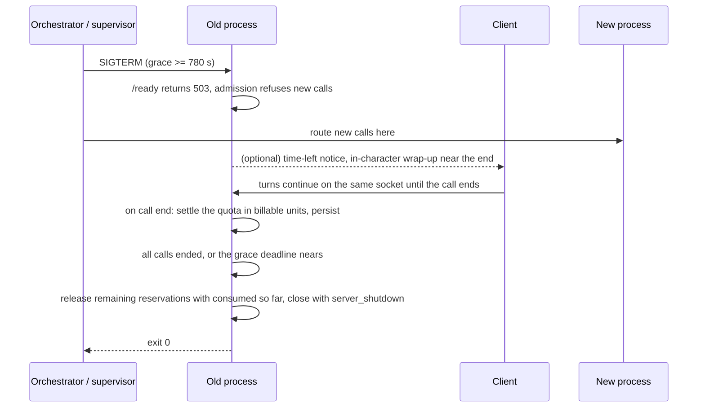

# Cost, scaling and operations

**Research date:** 2026-10-20. **Scope:** This document covers:

- what a voice call costs per minute on the current lanes and on the alternatives (optimised cascade, budget stack, bundled platforms, speech-to-speech, self-hosting);
- what a heavy user costs per month under the default allowance;
- where the quota and billing code charges the wrong amount or in the wrong unit;
- which provider limits bind before `VOICE_GLOBAL_CONCURRENCY`;
- what must change before the call runtime can run on more than one process, survive a deploy, serve its stored audio from any host and keep the database off the turn's critical path.

Latency mechanics are in [turn lifecycle](02_turn_lifecycle_and_latency.md), safety and vendor policy in [safety](14_safety_policy_and_compliance.md), and metrics in [observability](12_observability_evaluation_and_testing.md). All prices are list prices taken from the fact-checked research notes ([r10](evidence/research/r10-cost-scaling-ops.md), corrected by [r94](evidence/research/r94-gap-g4-contradictions-reconcile.md)). They are not invoices.

## Summary

- **Cost on the r10 reference call** (FACT on list prices; computed in r10). A 10-minute call with 690 billed TTS characters per minute costs about **$0.030 per call-minute on the ElevenLabs lane** and **$0.013 on the Fish lane**. TTS is 83-93% of that.
- **Cost under measured dev behaviour** (INFERENCE). Dev calls speak at about 12.8 characters/s, and 34.3% of delivered TTS was never heard. That puts the EL lane at roughly **$0.033-0.043/min**. A heavy user who spends the full 10 min/day (300 min/month) costs about **$10-13/month on EL** and **$4-6 on Fish**.
- **Alternatives** (FACT on list prices, computed in r10/r94):

  | Option | Cost per call-minute |
  |---|---|
  | Optimised API cascade | $0.018-0.021 |
  | Budget stack | $0.010-0.013 |
  | Bundled agent platforms | $0.05-0.08 |
  | gpt-realtime-2.1-mini, cache hits (the only S2S option at cascade cost) | $0.020 |
  | Gemini 3.8 Live, 10-minute call | about $0.16 (not $0.011); $0.07-0.10 with levers |

  Gemini Live costs more than its list rate suggests because it re-bills the whole context every turn. Self-hosted TTS breaks even against EL Turbo at about **145k call-min/month** on infrastructure alone, or about 435k with half an engineer.
- **Billing is wrong in kind, not just in amount** (FACT). The quota spends *audio seconds* against an allowance presented as *call time*. It bills audio that is delivered but unheard, audio dropped while the socket is away, about 0.5 s of padding per segment, no-speech segments and echo segments. It settles reservations in three different units. A hard crash followed by a restart that misses the resume window charges the full reservation (on defaults, the user's whole day) about 10-11 minutes later, and blocks the user until then.
- **Spend control covers only TTS** (FACT). The daily circuit is seeded at $45.60 of Flash-equivalent characters. No per-call cost record exists, no metrics exporter exists, and `spend_budget_pct` has no producer.
- **Capacity: the global count is the only admission check** (FACT for the code; INFERENCE for the capacity numbers).
  - `VOICE_GLOBAL_CONCURRENCY=8` is above the roughly 5 concurrent calls that Groq's documented 20 RPM allows.
  - The ElevenLabs session limiter is per process (24 slots) and holds a slot for the whole call.
  - Fish defaults to one concurrent generation.
- **Scaling: one process today** (FACT). There is a single uvicorn process with process-local call state, per-process buckets and limiter, and a single MySQL lock row. A deploy drops every live call with close code 1012. `local_fs` call audio can only be served by the host that wrote it. Before a second replica, the runtime needs sticky routing on the chat id, Redis ownership and a graceful drain with a grace period of at least about 780 s.
- **Database pressure** (FACT; the binlog volume is INFERENCE). api.magic_llm makes 32 fsync'd commits per voice turn and writes about 3-8 MB of binlog per turn. The shared MySQL is at its `max_connections`, and both pools are small with no acquire timeout. At 8 concurrent calls that is roughly 6-15 GB of binlog per hour. Recommendations OPS-01 to OPS-19 are in §12.

---

## 1. Conventions, reference call and billing units

Confidence labels follow [methodology](00_methodology_and_sources.md):

- **FACT**: seen in code, data or a primary page.
- **INFERENCE**: derived from facts, with the derivation shown.
- **UNKNOWN**: not established.

Canonical finding ids (C01-C80) and gap-note ids come from [finding reconciliation](evidence/audit/gap-finding-reconciliation.md). Vendor numbers are list prices or vendor-reported figures as dated in r10 and r94.

### 1.1 Reference call: model vs measurement

All cost tables use r10's reference call, so that cascade, S2S and bundled figures stay comparable. Measured dev behaviour differs in ways that matter for TTS cost.

| Parameter | r10 reference model | Measured in dev | Evidence |
|---|---|---|---|
| Call length | 10 min (`DEFAULT_VOICE_MAX_CALL_DURATION_SECONDS = 600`, `magic-worlds-api/src/services/voice_orchestration/config.py:31`) | Short dev calls. 9ff8d8 lasted about 70 s wall clock (REPORTED, not measured) | [overlap/billing gap](evidence/audit/gap-real-call-overlap-history-billing.md) |
| Exchanges | 4 per minute | Not measurable per minute. 12 of 17 assistant turns were interrupted | [audio assets gap](evidence/audit/gap-call-audio-assets-and-mp3-timeline.md) |
| Bot speech | 30 s/min, about 600 chars at about 20 chars/s | 78-88 ms/char untruncated, about 11.4-12.8 chars/s (X06 refuted the "7 chars/s" claim). Reply p50 is 17.6 s of audio | same; [reconciliation](evidence/audit/gap-finding-reconciliation.md) |
| TTS waste | +15% (690 billed chars/min) | **34.3%** of delivered TTS never heard: 97,003 of 283,087 ms. Up to 16.5 s unheard in a single turn | [audio assets gap](evidence/audit/gap-call-audio-assets-and-mp3-timeline.md) |
| LLM prefix and output | 4,000-token prefix, about 37 output tokens/turn | The callbot contract allows `max_input_tokens=32_768` and `max_output_tokens=1_536`, with no reasoning limit (`magic-worlds-api/src/services/llm_features.py:66-68`, C37) | [be-llm](evidence/audit/be-llm.md) |
| STT | 4 utterances/min, each billed 10 s | Groq p50 520-526 ms. About 0.5 s of padding per segment (300 ms pre-roll + 200 ms trailing). 5 of 23 segments failed with `internal` | [topology gap](evidence/audit/gap-topology-rtt-measurements.md), [overlap/billing gap](evidence/audit/gap-real-call-overlap-history-billing.md) |

INFERENCE: r10's 690 chars/min equals about **54 s of audio per call-minute** at the measured 12.8 chars/s. Provider cost follows characters, not seconds. The useful driver is therefore *characters delivered per call-minute*, and §2.1 parameterises on that.

### 1.2 What each stage is billed on

| Stage | Current provider (code) | Provider billing unit | Pitfall in this codebase |
|---|---|---|---|
| STT | Groq `whisper-large-v3`, batch, one POST per segment | Audio seconds, **10 s minimum per request** | Each segment costs at least about $0.0003 (C63, verifier figure). No-speech and echo segments are paid for too (C62) |
| LLM | Resolved from published profiles through api.magic_llm; no env var selects the model | Input, cached-input and output tokens | Every turn replays the history. The prefix changes when lorebook activation changes, which breaks the cache (C35) |
| Call moderation | LLM classifier through api.magic_llm, once per sentence, 300 ms fail-closed | Tokens | Recorded in no cost ledger. Off in dev (C04 latent) |
| TTS, EL lane | `eleven_v4_turbo` over the Text-to-Dialogue multi-stream WebSocket (`magic-worlds-api/src/services/speech/capabilities.py:159`) | Characters, $0.04 per 1K (Flash/Turbo class) | Look-ahead synthesis is paid for whether or not it is heard |
| TTS, Fish lane | `MODEL_ID = "drama-3"` (`magic-worlds-api/src/services/speech/providers/fish_audio/config.py:7`) | UTF-8 bytes for `s2.1-pro` (`fish_audio/config.py:103`). For drama-3 the operator supplies the unit and price | Drama-3 pricing ships as `price_version="unverified"`, `price_per_million_micros=0` (`fish_audio/config.py:44`). Enablement refuses an unverified price (`fish_audio/config.py:76-79`) |
| Downlink | Own WebSocket, base64 MP3 inside JSON | Cloud egress bytes | Base64 adds about 33% (C76) |

**Bitrate correction (re-verified in code).** Research notes r04/r06 give the EL call audio as "MP3 44.1 kHz 128 kbps". The code says otherwise. `STREAM_OUTPUT_FORMAT = "mp3_44100_64"` (`magic-worlds-api/src/services/speech/capabilities.py:65`), and the call surface uses it: `("call","standard"): ("el_v4_turbo","ttd_ws", STREAM_OUTPUT_FORMAT)` at `capabilities.py:159`. The asset forensics agree: EL chunks were 2.3-3.1 KB, consistent with 64 kbps CBR. Only narration uses `mp3_44100_128` (`capabilities.py:64`). The Fish lane does run at 128 kbps (`mp3_bitrate=128`, `latency='balanced'`, `magic-worlds-api/src/services/speech/providers/fish_audio/timestamp_ws.py:210-212`; [be-tts](evidence/audit/be-tts.md)). r10's transport line ("MP3 at 128 kbps") therefore holds for Fish but doubles EL egress. The money effect is negligible (§2.2). The mobile-bandwidth effect belongs in [transport](09_transport_and_client_audio.md).

---

## 2. Per-minute cost model

### 2.1 Current lanes

**Reference-call view (FACT on list prices; r10 §3).**

| Lane | STT | LLM | TTS | Transport | **Total $/call-min** | 300 min/month |
|---|---|---|---|---|---|---|
| A. EL v4 Turbo + Groq Whisper + gpt-5-mini-class (cached) | 0.0012 | 0.0010 | 0.0276 | ~0 | **≈ 0.030** | $9.0 |
| A′. Fish S2.1 Pro price + same STT/LLM | 0.0012 | 0.0010 | 0.0107 | ~0 | **≈ 0.013** | $3.9 |
| A″. EL v4 (non-Turbo), LLM uncached | 0.0012 | 0.0056 | 0.0552 | ~0 | ≈ 0.062 | $18.6 |

Assumptions behind these figures:

- STT is 4 utterances × 10 s billed at $0.111/h ([Groq STT docs](https://console.groq.com/docs/speech-to-text), accessed 2026-10-20).
- LLM is gpt-5-mini, $0.25 input / $0.025 cached / $2.00 output per 1M tokens ([OpenAI pricing](https://developers.openai.com/api/docs/pricing), accessed 2026-10-20). 40 turns add up to 211.6k input tokens, of which 205k are cacheable.
- EL v4 Turbo is $0.04 per 1K characters ([EL API pricing](https://elevenlabs.io/pricing/api), accessed 2026-10-20).
- Fish S2.1 Pro is $15 per 1M UTF-8 bytes; Spanish uses about 3% more bytes ([Fish pricing and limits](https://docs.fish.audio/developer-guide/models-pricing/pricing-and-rate-limits), accessed 2026-10-20).
- The callbot's real model is profile-resolved and UNKNOWN to this doc ([LLM](07_llm_in_the_voice_loop.md)). The Fish lane runs `drama-3`, whose price the operator supplies, so A′ holds only if drama-3 is priced like S2.1 Pro (UNKNOWN).

**Measured-behaviour sensitivity (INFERENCE).** TTS cost per call-minute = delivered chars per minute × price. The table uses the measured 12.8 chars/s, ASCII text (bytes ≈ chars) and list prices.

| Delivered TTS audio per call-minute | Chars/min | EL v4 Turbo | EL v4 | Fish S2.1 Pro price |
|---|---|---|---|---|
| 30 s (r10's speech share, measured rate) | 384 | $0.0154 | $0.0307 | $0.0058 |
| 45 s | 576 | $0.0230 | $0.0461 | $0.0086 |
| 54 s (equals r10's 690 chars) | 690 | $0.0276 | $0.0552 | $0.0104 |
| 60 s | 768 | $0.0307 | $0.0614 | $0.0115 |
| 70 s (9ff8d8: 80.6 s delivered in about 70 s wall, REPORTED) | 896 | $0.0358 | $0.0717 | $0.0134 |

Dev calls delivered more audio than wall time allows to be heard. A reply p50 of 17.6 s with 12 of 17 turns cut off fits the 60-70 s row. Adding STT ($0.0012) and LLM ($0.0010 cached to $0.0056 uncached):

- **EL lane: ≈ $0.033-0.043/min.**
- **Fish lane: ≈ $0.014-0.020/min.**

Both rest on a handful of dev calls made by root users (the topology note lists 6 Fish calls and 1 EL call). Treat them as a planning range, not a measurement of production.

**Per-turn worst case (INFERENCE).** A call turn has no spoken-length cap below the 1,536-token output budget. The `TURN_CHAR_CAP = 2_500` constant applies to narration tiers, not calls (`capabilities.py:61`, `:654-655`). The transcript sanitiser allows 8,000 characters (`magic-worlds-api/src/services/voice_orchestration/transcript_sanitizer.py:12`). At about 4 chars/token, a runaway reply is about 6,000 characters, which costs about $0.25 on EL Turbo if the user listens to all of it. The flush-ahead gate synthesises only about 3 sentences or 8 s ahead of playback, so a barge-in stops the spend. A silent listener does not.

### 2.2 Transport egress (corrected bitrate)

| Lane | Raw MP3 per audio-minute | On the wire (base64 +33%) | At 60 s delivered per call-minute, $0.09/GB |
|---|---|---|---|
| EL `mp3_44100_64` | 0.48 MB | 0.64 MB | ≈ $0.00006 |
| Fish 128 kbps | 0.96 MB | 1.28 MB | ≈ $0.00011 |

INFERENCE, using r10's $0.09/GB egress assumption. Money is not the issue. Head-of-line blocking and mobile bandwidth are ([transport](09_transport_and_client_audio.md)).

### 2.3 Optimised API cascade and budget stack

| Stack (r10 §3) | STT | LLM | TTS | **$/call-min** | 300 min/month |
|---|---|---|---|---|---|
| B. Optimised: Soniox or AssemblyAI streaming + gpt-oss-120b on Groq (cached) + Inworld TTS-2 | 0.002-0.0025 | 0.0017 | 0.0138 (Creator) - 0.0173 (on-demand) | **≈ 0.018-0.021** | $5.3-6.4 |
| C. Budget: Soniox + gpt-oss-20b + Inworld TTS-2 Flash or Gemini Flash-Lite TTS | 0.002 | 0.0009 | 0.0069-0.0104 | **≈ 0.010-0.013** | $3.0-4.0 |

Sources: [Soniox pricing](https://soniox.com/pricing), [AssemblyAI pricing](https://www.assemblyai.com/pricing), [Groq models](https://console.groq.com/docs/models), [Inworld pricing](https://inworld.ai/pricing), [Gemini pricing](https://ai.google.dev/gemini-api/docs/pricing). All accessed 2026-10-20 per r10.

Constraints that sit outside the price column:

- **Moving STT from Groq batch to streaming is a latency decision, not a cost one.** Every streaming STT option is at most about $0.008/min, so the extra cost is at most about $0.006/min ([STT](06_speech_to_text.md)).
- **AssemblyAI bills WebSocket open time**, idle time included.
- **Vendor policy rules some options out of the 18+ lane.** AssemblyAI bans erotic chats, so it is out for the 18+ lane ([r91](evidence/research/r91-gap-g1-vendor-policy-retention-matrix.md)). Deepgram retains and trains on data unless `mip_opt_out=true`. Soniox does not retain data.
- **Gemini Flash TTS and Gemini 3.8 Flash prices double on 2027-01-01.** A budget built on them needs a dated price table.
- **Cloning quality and Spanish support decide more than price does** ([TTS](08_text_to_speech.md)).

### 2.4 Bundled voice-agent platforms

These are market references for "buy, don't build" and for retail pricing anchors. Figures are from r10 §2.5; prices were read 2026-10-20.

| Offering | Price | What it includes |
|---|---|---|
| [AssemblyAI Voice Agent API](https://www.assemblyai.com/pricing) | $0.075/min | STT, LLM, TTS, turn-taking and tools, all-in |
| [Deepgram Voice Agent](https://deepgram.com/pricing) | $0.075/min; $0.050 if you bring your own LLM and TTS | STT and TTS (plus LLM) |
| [ElevenLabs Agents](https://elevenlabs.io/pricing/api) | $0.08/min plus LLM; $0.16/min burst above concurrency | STT, TTS and turn-taking |
| [Cartesia agents](https://cartesia.ai/pricing) | $0.06/min | Managed agent minutes |
| [LiveKit Cloud](https://livekit.com/pricing) | $0.01 per agent-session-minute; WebRTC $0.0004-0.0005/min | Hosting and transport only |
| [Pipecat Cloud](https://www.daily.co/pricing/pipecat-cloud) | $0.01 per session-minute active; reserved $0.0005/min | Hosting and transport only |
| E. LiveKit Cloud + Deepgram Flux + gpt-5-mini + Cartesia Sonic 3 (r10 §3) | ≈ $0.048/min ($14.4 per 300 min) | Assembled from hosted parts |

Every all-in bundled option ($0.048-0.08/min) costs 1.6-2.7× the current EL lane's reference cost and about 3.7-6.2× the Fish lane's. Two products also clash with this one: the AssemblyAI content ban, and EL's zero-retention mode, which is Enterprise-only and does not cover cloned voices. Bundling buys operations, not margin.

### 2.5 Speech-to-speech, with the corrected re-billing math

S2S products bill in one of two ways:

- **Per connected time.** GPT-Live-1, Eleven Realtime and Grok Voice bill this way. Silence is billed, but context replay is not.
- **Per token, re-processing the conversation on every response.** gpt-realtime-2.1 and Gemini 3.8 Live bill this way. Cost then depends on the cache hit rate (OpenAI) or on the context size at each turn (Gemini).

**Gemini correction (FACT, r94).** The Gemini Live API best-practices page ([ai.google.dev, updated 2026-09-15](https://ai.google.dev/gemini-api/docs/live-api/best-practices)) says every turn is billed for all tokens in the session context window. Accumulated audio is billed at the audio-input rate of about 25 tokens/s. r10's $0.011/min assumed incremental billing, which this rules out. It must not be used as a lower bound.

| Stack, 10-minute reference call | $/call-min | 300 min/month | Billing behaviour | Source |
|---|---|---|---|---|
| gpt-realtime-2.1, cache hits | 0.059 | $17.8 | Re-processes the conversation | [OpenAI realtime costs](https://developers.openai.com/api/docs/guides/realtime-costs), r10 |
| gpt-realtime-2.1, cache broken | 0.615 (1.651 at 30 min) | — | Instruction or tool changes, or aggressive truncation | r10 |
| **gpt-realtime-2.1-mini, cache hits** | **0.020** (0.030 at 30 min) | $6.0 | same | [model page](https://developers.openai.com/api/docs/models/gpt-realtime-2.1-mini) |
| gpt-realtime-2.1-mini, cache broken | 0.182 (0.506 at 30 min) | — | same | r10 |
| GPT-Live-1 + cheap backend | 0.051 | $15.3 | $0.05/min, per second, backend billed separately | [model page](https://developers.openai.com/api/docs/models/gpt-live-1) |
| **Gemini 3.8 Live, mic streamed continuously (S3)** | **0.158** ($1.58 per call) | $47.4 | Full context re-billed every turn | r94 §1.4 |
| Gemini 3.8 Live, speech-only audio (S2) | 0.098 | $29.4 | same | r94 |
| Gemini 3.8 Live, S3 + 12k/6k compression | 0.078 | $23.4 | Sliding window | r94 |
| Gemini 3.8 Live, S2 + 12k/6k compression | 0.072 | $21.6 | Sliding window | r94 |
| Gemini 3.8 Live, S3 at 6 turns/min | 0.232 | — | | r94 |
| Grok Voice 3.0 | 0.08 flat | $24 | Per minute | r94 (xAI rate card) |
| Eleven Realtime v1 | ≥ 0.08 + tokens | ≥ $24 | $0.08 per connected minute, plus Mini $0.20/$6.00 or Max $1.80/$9.00 per 1M tokens. Launched 2026-10-20 ([EL blog](https://elevenlabs.io/blog/realtime); r93 fact-check #1) | [EL API pricing](https://elevenlabs.io/pricing/api) |
| Amazon Nova 2 Sonic | ~0.015 (third-party estimate) | — | Carry-over billing (unverified); 8-minute connection limit | r10, r94 |
| Cascade A, for comparison | 0.030 | $9.0 | — | r10 |

**Why Gemini's cost grows during a call** (FACT on mechanism; figures computed in r94). In S3, the marginal cost rises from $0.037 in minute 1 to **$0.280 in minute 10**. Several things follow:

1. At Tier 1, Google's spend cap of $10 per rolling 10 minutes ([rate limits](https://ai.google.dev/gemini-api/docs/rate-limits), updated 2026-10-15) admits only about **6 concurrent 10-minute calls in S3**, 10 in S2 and 13 with compression. r10's "91 sessions" is withdrawn.
2. Proactive audio cannot be disabled on 3.8 Live, and caching is unsupported.
3. An audio session ends at 15 minutes without compression, and a connection lasts about 10 minutes.

On effective cost, Gemini Live is about **5× cascade A** and about 8× gpt-realtime-2.1-mini with cache hits. Product blockers (cloned voices, 18+ policy, GPT-Live moderation that can end sessions) are in [S2S](11_speech_to_speech_and_omni_models.md).

### 2.6 Self-hosting break-even

Per call-minute cost of self-hosted components (r10 §4.3; GPU prices are third-party aggregator prices from Sep-Oct 2026). One realtime TTS stream supports about 2 calls, because the bot speaks about half the time. INFERENCE in r10.

| Component | Throughput assumption (evidence quality) | $/call-min at 100% / 35% utilisation |
|---|---|---|
| Orpheus-class TTS, H100 @ $2.75/h | About 24 streams, so about 48 calls ([Baseten](https://www.baseten.co/library/orpheus-tts/), vendor-reported) | $0.00095 / $0.0027 |
| Kokoro-82M TTS, L40S @ $0.96/h | About 30 streams, so about 60 calls (hosting-vendor estimate, [Spheron, mod. 2026-10-19](https://www.spheron.network/blog/deploy-open-source-tts-gpu-cloud-2026/)) | $0.00027 / $0.0008 |
| Parakeet streaming STT, L4 @ $0.43/h | About 64 streams ([NVIDIA FAQ, upd. 2026-06-09](https://perspectives.nvidia.com/nemotron-speech/task/faq/open-asr-models-throughput-benchmarks/), vendor-reported) | $0.00011 / $0.0003 |
| 8B LLM on vLLM, H100 @ $2.75/h | 16-64 concurrent generations, so about 150 calls (mixed evidence) | $0.0003 / $0.0009 |

The TTS break-even assumes a minimum of 2× H100 for N+1 redundancy, about $4,015/month (r10 §4.3):

| Compared against | Infrastructure only | Including about $8k/month for 0.5 FTE |
|---|---|---|
| EL v4 ($0.055/min) | ~73k call-min/month | ~218k |
| EL v4 Turbo ($0.028/min) | ~145k | ~435k |
| Inworld TTS-2 ($0.014 AA price / $0.017 on-demand) | ~279k (~232k on-demand) | ~834k (~695k on-demand) |
| Fish S2.1 Pro ($0.011/min) | ~375k | ~1.12M |

Self-hosted STT on 2× L4 (about $628/month) breaks even at about 314k min/month against Soniox and about 510k against Groq batch.

**The non-cost blockers usually decide** (FACT on licences):

- Kokoro does not clone voices.
- Orpheus needs fine-tuning per voice and is mostly English.
- Open Fish Speech 1.5 is CC BY-NC-SA, which is non-commercial.
- Fish S2 weights need a commercial licence.

INFERENCE: self-hosting makes sense only at roughly **0.4-1M call-min/month**. Even then it fits only two cases: a stock-voice free tier, or an LLM lane where content policy or rate limits bind. One heavy user is 300 min/month, so 145k call-min/month is about 480 users each spending their full allowance every day.

---

## 3. Unit economics for consumer plans

**Allowance (FACT).** `daily_limit_seconds_for` returns the minimum of two values (`magic-worlds-api/src/services/voice_orchestration/quota.py:588-604`):

- the plan's `voice_call` `daily_quantity_limit`;
- the global `VOICE_DAILY_MINUTES_PER_USER` × 60, which defaults to 10 min (`voice_orchestration/config.py:30`).

The seeds give Free 180 s, Plus 600 s and Pro 600 s per day (`magic-worlds-api/src/database/mysql/bootstrap.py:65-72`). The comment above the seeds says "the runtime does not enforce them yet" (`bootstrap.py:60-64`). It is stale: `quota.py` reads them. At full use, the most a user can consume per month is:

- **Free:** 90 min/month.
- **Plus and Pro:** 300 min/month.

**Maximum monthly COGS per user at full use (INFERENCE: $/min × minutes).** The retail floor applies r10's guardrail that retail should be at least 3-5× COGS per voice minute (r10 §10).

| Stack | $/call-min | Free (90 min) | Plus/Pro (300 min) | Retail floor for voice alone, Plus/Pro |
|---|---|---|---|---|
| A. EL lane, reference | 0.030 | $2.70 | $9.0 | $27-45 |
| A. EL lane, measured behaviour | 0.033-0.043 | $3.0-3.9 | $9.9-12.9 | $30-65 |
| A′. Fish lane, reference | 0.013 | $1.17 | $3.9 | $12-20 |
| A′. Fish lane, measured behaviour | 0.014-0.020 | $1.3-1.8 | $4.2-6.0 | $13-30 |
| B. Optimised cascade | 0.018-0.021 | $1.6-1.9 | $5.3-6.4 | $16-32 |
| C. Budget | 0.010-0.013 | $0.9-1.2 | $3.0-4.0 | $9-20 |
| gpt-realtime-2.1-mini, cache hits | 0.020 | $1.80 | $6.0 | $18-30 |
| GPT-Live-1 + backend | 0.051 | $4.6 | $15.3 | $46-77 |
| Bundled agent ($0.075) | 0.075 | $6.8 | $22.5 | $68-113 |
| Gemini 3.8 Live, S3 | 0.158 | $14.2 | $47.4 | $142-237 |

What follows from the table:

- **EL as the default lane needs either a premium price or a cap** (INFERENCE). On the EL lane, a Plus or Pro user who uses the whole allowance every day needs about $30-65/month attributable to voice to stay above the guardrail. Either EL is the premium lane with a minute multiplier and Fish or stack B is the default, or the allowance on EL is cut. r10 notes that EL v4 costs about 2× Turbo and about 5× Fish. Bundled vendors sell agent minutes at $0.05-0.08, which anchors what competitors charge.
- **Real utilisation is UNKNOWN.** There is no production usage distribution, and every dev user is root. Plans have to survive the heavy tail or cap it.
- **The user-facing unit does not match the cost unit** (FACT on mechanism; amounts REPORTED).
  - Credits are charged at 1 per 10 s of STT + TTS audio (`VOICE_CALL_SECONDS_PER_CREDIT = 10`, `magic-worlds-api/src/services/voice_orchestration/engine.py:81`).
  - The quota consumes billable audio seconds (`engine.py:1135-1141`), counting both directions plus overlap and unheard audio.
  - So a user's "10 minutes" can run out in less than 10 minutes of conversation. On 9ff8d8, 89 s were consumed in about 70 s of wall time, which is 9 credits against 7 on wall time. Both figures are REPORTED.
- **Users pay for silence the vendor does not charge for.** Fish call audio carries 14-26% silence, which the user pays for as audio seconds (GAP-CALL-AUDIO-ASSETS-AND-MP3-TIMELINE-06). The vendor bills Fish by text bytes, not audio duration.

---

## 4. Billing correctness today

The design is right in outline. Reservation is atomic in MySQL, billing is idempotent and the spend circuit degrades to text ([be-observability-safety-cost](evidence/audit/be-observability-safety-cost.md)). The defects are in *what* gets counted and in *which unit* settles a reservation.

| # | Defect | Mechanism (code) | Measured or estimated effect | Ids |
|---|---|---|---|---|
| B1 | **Delivered audio is billed, heard audio is not the measure** | TTS is billed on delivered MP3 frames (`engine.py:2494-2508`). The client drops the unplayed tail at the next turn | 34.3% of delivered TTS was unheard (about 31% of all billable audio including STT). Billed `tts_audio_ms` equals the stored asset sums (for example 83,696 and 80,561 ms) | GAP-REAL-CALL-OVERLAP-HISTORY-BILLING-02 (verified medium: delivered-audio billing is documented policy, and the defect is spending it against call time), GAP-CALL-AUDIO-ASSETS-AND-MP3-TIMELINE-04 |
| B2 | **Audio dropped while the socket is away is billed** | `VoiceDeliveryDisconnected` → `DROPPED`, then "Delivered (or accepted while the socket is away): billable and stored" (`engine.py:2486-2497`) | Bounded by 3 free sentences plus 8 s ahead per turn (K09) | C22 (BE-ROUTE-TRANSPORT-08), GAP-CALL-AUDIO-ASSETS-AND-MP3-TIMELINE-11 |
| B3 | **Padded, no-speech and echo STT is billed** | STT is debited before the `no_speech` rejection (`engine.py:2243-2252`). Each segment carries 300 ms of pre-roll and 200 ms of trailing quiet. Every captured segment is uploaded whatever the playback state | About 0.5 s per segment to the user. Each extra Groq request costs at least about $0.0003 (10 s floor). Echo is billed twice: once as TTS, again as STT | C62, C63, GAP-REAL-CALL-OVERLAP-HISTORY-BILLING-08 |
| B4 | **Three units settle one reservation** | Audio seconds on normal end, wall clock on release without a value, `min(elapsed, reserved)` from the sweeper (diagram above) | Daily usage mixes audio seconds and wall seconds | GAP-REAL-CALL-OVERLAP-HISTORY-BILLING-09 |
| B5 | **A crash orphan charges the full reservation** | The first call reserves `min(600, remaining)`, which on defaults is the whole day. After a hard crash or SIGKILL, plus a restart that outlasts the client's 15 s resume window, the sweeper releases about 10-11 min after call start with `min(elapsed, reserved)` = the full reservation | The user loses the day's allowance and is blocked as `busy` until the release (per-user in-flight limit 1, `voice_orchestration/config.py:40`) | C31 (BE-ROUTE-TRANSPORT-04, BE-OBSERVABILITY-SAFETY-COST-11; K14) |
| B6 | **Billing continues after quota release** | Turns that outlive `end_call`'s 2 s drain keep billing credits | Credit ledger exceeds consumed seconds | GAP-SEGMENT-POST-AND-CONTROL-PLANE-UNKNOWNS-08 |
| B7 | **Abandoned starts have side effects** | An abandoned start still runs full admission. It burns a `call_start` token (3 per 600 s), records an activation, supersedes other calls, reserves quota and opens a TTS socket | Cost and UX, low | GAP-SEGMENT-POST-AND-CONTROL-PLANE-UNKNOWNS-04 |
| B8 | **Spend control covers TTS only** | The circuit counts TTS characters at the Flash list price (40 µUSD/char, non-Flash ×2) when a request is sent, failures included, across all surfaces. It fails open and caches state for 5 s (`magic-worlds-api/src/services/speech/spend_circuit.py:1-33`, `:63-64`) | STT, LLM and call moderation are outside every budget. Moderation executions have no per-user admission and are only logged | C58 (BE-OBSERVABILITY-SAFETY-COST-10) |
| B9 | **No per-call cost record** | No call-level row joins STT, LLM, TTS and moderation cost. No exporter, the monitor is off by default, and `spend_budget_pct` has no producer | Margin per call, per lane or per user cannot be computed | C58, C59 (BE-OBSERVABILITY-SAFETY-COST-08) |
| B10 | **Billing writes sit on the audio paths** | TTS billing is awaited inline at each sentence start or every 2 s of audio (`engine.py:117`, `:2507-2508`). The STT debit is awaited before the LLM | The TTS write is hidden behind up to 8 s of lead (C61, contested low). The STT write is on the critical path (C19, medium) | C19, C61 |

**What the spend circuit actually buys (INFERENCE).** The seed is `daily_budget_chars = 1,140,000` (`bootstrap.py:77`), which is $45.60/day at $0.04 per 1K. That covers:

- about **1,650 EL-Turbo call-minutes/day** at r10's 690 chars/min;
- about **1,270-1,480** at the measured 768-896 chars/min;
- half of those figures if calls use non-Flash EL.

Narration and previews draw on the same budget. Fish has its own default daily budget of $1 (`fish_audio/config.py:42`), about 87 call-minutes at the S2.1 Pro price, plus a default concurrency of 1 (`fish_audio/config.py:41`).

**Product question still open** (UNKNOWN; [overlap/billing gap](evidence/audit/gap-real-call-overlap-history-billing.md)). The product has not decided which unit to bill: generated, heard or connected time. The API doc promises "authoritative audio-seconds billing" (`docs/api_usage/voice.md:464-466` in the backend repo), while the UI presents minutes. OPS-02 forces the decision.

---

## 5. Provider concurrency and rate limits vs `VOICE_GLOBAL_CONCURRENCY`

The only call-level admission in code is the global count. `VOICE_GLOBAL_CONCURRENCY` defaults to 8, with a maximum of 64 (`magic-worlds-api/src/services/voice_orchestration/config.py:41`, `:48`). A per-user in-flight limit of 1 and the per-process `call_start` bucket sit alongside it. Downstream limits are enforced, where at all, in each provider client.

| Budget | Documented limit (vendor; dated) | What one call consumes | Calls it supports (INFERENCE) | What the code enforces |
|---|---|---|---|---|
| **Groq Whisper** | 20 RPM, 2K RPD, 7.2K audio-seconds/hour. The docs table has no tier label; the org's real limits are on the console ([Groq rate limits](https://console.groq.com/docs/rate-limits), accessed 2026-10-20) | About 4 requests per call-minute, each billed at least 10 s | About **5 concurrent** by RPM. About **3** by audio-seconds if the 10 s floor counts toward that limit (UNKNOWN). 2K RPD is about **500 call-minutes/day** | Single attempt, no queue, no backoff, no breaker (C06, BE-STT-14) |
| **ElevenLabs TTS, Flash/Turbo** | Pro 20, Scale 30, Business 30 concurrent. On a WebSocket only active generation counts. About 50 ms of queueing, then 429 with `Retry-After` ([EL help](https://elevenlabs.io/docs/help-center/technical/how-many-text-to-speech-requests-can-i-make-and-can-i-increase-it/llms.txt); [EL blog, upd. 2026-10-12](https://elevenlabs.io/blog/ai-rate-limiting-for-voice)) | Generation runs only while synthesising, roughly 3-10× faster than real time | "Well over 20" in steady state. Bursts of turn starts queue first | An in-process limiter: `flash` pool of 24 against the plan's 30, with an adaptive clamp to 80% of the header. The `ttd_session` pool is sized like `flash`, and **one slot is held for the whole call** (`magic-worlds-api/src/services/speech/limiter.py:1-31`, `:159`) |
| **EL Text-to-Dialogue sessions** | No separate session limit is documented in the evidence. Whether an open TTD socket with idle contexts counts is UNKNOWN | 1 socket per call, reopened after 20 s idle | UNKNOWN | Per process. N processes × 24 can exceed the account's limit. A handshake 429 retries after 1-5 s jittered and **spends the call's single reconnect budget** (BE-TTS-15) |
| **Fish (TTS and ASR share one pool, across all keys)** | 5 (< $100 prepaid), 15 (≥ $100), 50 (≥ $1,000). 429 without `Retry-After` ([Fish limits](https://docs.fish.audio/developer-guide/models-pricing/pricing-and-rate-limits), accessed 2026-10-20) | 1 WebSocket and 1 lease per turn. Whether an open socket counts as one request is (unverified) | At most the tier | `FISH_AUDIO_CONCURRENCY=1` by default. DB lease of 120 s, polled every 100 ms for up to 5 s when full. `SELECT … FOR UPDATE` per sentence (C66). The calls lane is off by default but on in dev (K17) |
| **LLM** (api.magic_llm → OpenRouter or provider) | Depends on the profile; UNKNOWN | 1 completion per turn plus 1 moderation classification per uncached sentence | UNKNOWN | No per-provider admission. Moderation has no per-user admission |
| Own process | Per-pod capacity UNKNOWN (never load-tested) | Event loop, two DB pools of 10 | Measure | Global count plus one MySQL lock row |
| *If adopted:* Gemini Live | $10 per rolling 10 min (Tier 1) | About $1.58 per 10-min call (S3) | About 6 (S3), 10 (S2), 13 (compressed) | — |
| *If adopted:* GPT-Live-1 | 50 / 300 / 500 concurrent sessions | 1 session | 50+ | — |
| *If adopted:* EL Agents or Realtime | 4 / 6 / 10 / 20 / 30 / 40 calls; $0.16/min burst | 1 call | Plan-bound | — |

**What binds first (INFERENCE).**

- **At the default of 8.** The first limit hit is Groq, if the org sits on the documented 20 RPM: the 6th to 8th concurrent call starts losing utterances to 429s, which surface as failed segments. If Fish is enabled, its default concurrency of 1 serialises turns across *all* Fish calls, each waiting up to 5 s for a lease. EL is not the binding limit at 8.
- **At 64.** Every budget binds: Groq RPM and RPD, EL bursts above 20-30 active generations, the 10-connection DB pools and Fish's tier. `VOICE_GLOBAL_CONCURRENCY` must be set from the minimum of these, not from process capacity, and admission must check each one (OPS-05, OPS-08).

Today the code runs only the first two checks and the TTS-only spend circuit. The rest is the target (OPS-05, OPS-08, OPS-11).

---

## 6. Scaling stateful calls

### 6.1 What is process-local today (FACT)

Production launches `python -m src.serve`, which runs a single uvicorn process with no `workers` and no graceful timeout (`magic-worlds-api/src/serve.py:28-33`; [topology gap](evidence/audit/gap-topology-rtt-measurements.md)). The voice docs require a single process or sticky routing (`docs/api_usage/voice.md:383-385` in the backend repo).

| State | Where it lives | What happens with two or more processes |
|---|---|---|
| Call runtime | `self._calls: dict[str, _VoiceCallRuntime]` (`engine.py:703`) | A segment POST that lands on the wrong process gets 409. A resume that lands on the wrong process **ends the call** (`engine.py:966-978`) |
| Supersede, cancel | In-process | A supersede issued from another process leaves the remote runtime streaming and billing |
| `call_start` bucket | Per process, 3 starts per 600 s (`magic-worlds-api/src/services/speech/token_buckets.py:73`) | N processes allow N× the start rate |
| EL limiter, `ttd_session` | Per process (`limiter.py:1-31`) | N × 24 sessions against the account limit (BE-TTS-15) |
| Global admission | MySQL singleton row, `FOR UPDATE` (`quota.py:736-742`) | Correct across processes, but serialises every reserve and release. Fine at tens per second (r10) |
| Spend-circuit state | 5 s cache (`spend_circuit.py:64`) | Overshoot window of up to 5 s per process (INFERENCE) |
| Call audio files | `local_fs` under `TTS_STORAGE_ROOT` | Only the writing host can serve them (§7) |

Do not add `uvicorn --workers N` as a shortcut. It splits call state across processes, and `--workers` and `--reload` start uvicorn without `TCP_NODELAY`, adding about 41 ms to every reused keep-alive request (GAP-TOPOLOGY-RTT-MEASUREMENTS-01, measured).

### 6.2 Sticky routing and ownership

The chat id is in both call URLs:

- the WebSocket, `/character-chats/{session_id}/ws-voice` (`magic-worlds-api/src/routes/user/route_voice_call.py:1452`);
- the segment upload, `/character-chats/{session_id}/voice-segments` (`route_voice_call.py:1130`; the upload URL is advertised at `:1019`).

Consistent hashing on that path segment at the proxy (ring-hash, or the nginx `hash` directive) gives stickiness without any code change (C65, low: "feasible today"). Hashing alone breaks when the ring changes during a deploy or scale-out, so pair it with:

1. A Redis `voice_session → instance` ownership key with a TTL heartbeat. A misrouted request is forwarded or redirected to the owner instead of getting 409, and a misrouted resume is redirected instead of ending the call.
2. Redis pub/sub for supersede, cancel and end, so a command reaches the owning runtime wherever it arrives.
3. Later, optionally: persist enough turn state at each turn boundary (the `call_turn_truncation` ledger already partly does) to rebuild a call on a new owner. That would enable migration on deploy.

Proxy buffering and read timeouts for the WebSocket and the multipart POST are UNKNOWN, because the repos contain no proxy configuration (GAP-TOPOLOGY-RTT-MEASUREMENTS-10). They must be set explicitly: no response buffering on the WebSocket, and a read timeout longer than the 30 s STT timeout plus LLM time on the POST.

### 6.3 Graceful drain on deploy

**Today (FACT, C30).** On SIGTERM, uvicorn's `connection.shutdown()` sends `fail_connection(1012)` to every WebSocket *before* lifespan shutdown runs `voice_engine.shutdown()`. The `server_shutdown` frame therefore never reaches a live socket. In-flight POSTs are awaited without limit (`timeout_graceful_shutdown=None`). A client that resumes against the new process finds no runtime, so the call ends, and the reservations stay counted until the sweeper.

**Rule (r10, from LiveKit's deployment guidance).** Grace ≥ `max_call_duration` + `idle_timeout` + margin = 600 + 120 + ~60 ≈ **780 s**. LiveKit's own agent `drain_timeout` defaults to one hour ([LiveKit deployments](https://docs.livekit.io/deploy/custom/deployments/), accessed 2026-10-20).

Implementation notes:

- **Readiness.** `/ready` (`magic-worlds-api/src/main.py:2357-2358`) is structural only today. It must flip on SIGTERM.
- **Signal handling.** Intercept SIGTERM before uvicorn begins closing sockets: a custom signal handler, or a supervisor that drains first and then signals.
- **Make release cancellation-safe first.** `except Exception` does not catch `CancelledError`. Once `timeout_graceful_shutdown` is set, a `start_call` cancelled between reserve and register orphans its reservation (GAP-SEGMENT-POST-AND-CONTROL-PLANE-UNKNOWNS notes).
- **Deploy strategy.** Rolling with `maxUnavailable=0` and surge capacity, which means about 2× capacity for up to about 10 minutes per deploy. Track "calls terminated by deploy" as an SLO.

### 6.4 Autoscaling signals

- **Scale on the custom metric "active calls per pod"**, guarded by event-loop lag and CPU.
  - For reference, LiveKit scales on CPU with `load_threshold=0.7` and advises scaling up at 0.5, with a 4 vCPU / 8 GB worker running 10-25 jobs (vendor-reported).
  - This orchestrator does no local ML, so its per-pod capacity should be higher. That is UNKNOWN until load-tested.
- **Scale up fast and scale down slowly.** A pod takes up to about 13 minutes to drain.
- **Keep warm capacity** = max(baseline, peak call starts per second × ~30 s), Pipecat's formula ([capacity planning](https://docs.pipecat.ai/deployment/pipecat-cloud/guides/capacity-planning), accessed 2026-10-20). Add time-based pre-scaling for evening peaks.
- **Provider budgets cap scale-out.** More pods do not raise Groq RPM, EL concurrency or Fish tiers, and they *multiply* every per-process limiter. Autoscaling therefore comes after shared admission (OPS-08).

### 6.5 Redis admission

The MySQL singleton row is correct and simple. Its limits are that every reserve and release takes one row lock, and that the per-process buckets and limiter do not compose (BE-ROUTE-TRANSPORT-14). The target design:

- **Redis (atomic scripts or sharded counters)** holds the global call count, per-user in-flight, `call_start` buckets, provider semaphores (EL sessions, Fish tier) and provider RPM buckets (Groq).
- **MySQL** stays the durable settle ledger (`voice_usage_day`).
- **Admission returns "busy, retry in N s"** with N taken from the binding budget. Today a global refusal answers `retry_after` = the idle timeout.

---

## 7. Storage: `local_fs` call audio is served only by its writer

**FACT** (GAP-CALL-AUDIO-ASSETS-AND-MP3-TIMELINE-05).

- **How assets are written.** Call audio assets are rows with `storage_backend='local_fs'` and a root-relative path `{Y}/{m}/{job}/{asset}.mp3` under `TTS_STORAGE_ROOT`. The write is `mkstemp` + `fsync` + `os.replace` (`magic-worlds-api/src/services/tts_generation/storage.py:239-277`).
- **How they are served.** The asset route resolves the path under the *local* storage root and returns nothing if the file is missing (`magic-worlds-api/src/routes/tts.py:78-92`). Any instance other than the writer therefore answers 404 for a row that exists in the shared DB.
- **Dev already shows the split.** The 17-20 October assets exist only on the .90 deployment.
- **A missing file looks like a foreign asset.** The UI offers a retry that cannot succeed (-09).

Related defects:

- **Persistence blocks the next turn.** The previous turn's audio persistence (an fsync'd file write plus the DB) delays the next turn's reply by **1-5 s** (-01, high latency).
- **Cleanup is broken.**
  - The orphan sweep's JSON path misses `tts_segments."0".asset_id` (-07).
  - The purge fallback filters `j.operation` instead of `j.source` (-08).
  - The sweep is manual with a 7-day grace. The EL history sweep (24 h) is off by default.

**Volume (INFERENCE).** At 30-70 s of delivered audio per call-minute, a 10-minute call stores about 2.4-5.6 MB on EL (64 kbps) or 4.8-11.2 MB on Fish (128 kbps). At the Plus/Pro ceiling, a heavy user stores roughly 72-170 MB/month on EL or 145-340 MB/month on Fish. Retention policy therefore matters as much as placement.

---

## 8. Database pressure

**FACT** ([topology gap](evidence/audit/gap-topology-rtt-measurements.md), dev; production UNKNOWN).

**Server durability settings:**

- `innodb_flush_log_at_trx_commit=1`, `sync_binlog=1`, ROW binlog with `binlog_row_image=FULL` and no `PARTIAL_JSON`.
- `innodb_buffer_pool_size` is 128 MiB, the default.
- `binlog_group_commit_sync_delay` is 0.

**The server is shared and saturated.** It runs many apps. `max_connections` is 151 with `Max_used_connections` at 152, and `Connection_errors_max_connections` grew from 24 to 29 during the investigation, so refusals are ongoing.

**api.magic_llm per voice turn:**

- **32 durable commits per voice turn** (19 of 19 turns sampled). About 20 come before the provider call, and run start → `llm_start` takes p50 874 ms (747-1,311 ms).
- A 48-123 KB JSON checkpoint is rewritten on every commit (`api.magic_llm/src/db/native_execution.py:313-353`).
- With FULL row images, that is **about 3-8 MB of binlog per turn**.
- The stream ends with a 1.0-2.5 s post-stream tail.
- Rating: GAP-TOPOLOGY-RTT-MEASUREMENTS-04, raised to critical by its verifier. C08 holds the high-rated canonical part.

**BFF per voice turn:**

- About 23-29 transactions and 8 write commits per turn.
- Write commits take p50 ≤ 2.3 ms but p99 ≤ 26 ms in `magic_worlds` and ≤ 60 ms in `magic_messages`.
- With about 28 commits, P(at least one commit > p90) ≈ 95%.
- The serialised DB tax is about 60-100 ms p50 (GAP-TOPOLOGY-RTT-MEASUREMENTS-03).

**Pools:**

- BFF: aiomysql defaults (`maxsize 10`, no acquire timeout, `autocommit=False`).
- api.magic_llm: async pool `maxsize 10`; `PersistentDB(ping=1)` adds a ping on every borrow.
- Rating: GAP-TOPOLOGY-RTT-MEASUREMENTS-09.

**Load at the default concurrency (INFERENCE).**

- **Binlog.** 3-8 MB × 4 turns/min is 0.7-1.9 GB of binlog per call-hour, so 8 concurrent calls write about **6-15 GB/h**. Replication, backup and disk are sized by voice traffic long before CPU is.
- **BFF pool.** Per call, the BFF also writes billing every sentence or 2 s, plus a Fish `FOR UPDATE` per sentence when Fish is on. Ten pooled connections with unbounded acquire waits will queue turns well before `VOICE_GLOBAL_CONCURRENCY=64`.
- **Connections.** A shared server already at `max_connections` turns that queueing into connection refusals.

Remedies, in order of leverage (OPS-10):

1. **Make the voice path in api.magic_llm ephemeral or light.** Stop rewriting the per-node checkpoint durably for voice turns. If durability must stay, use append-only events, `binlog_row_value_options=PARTIAL_JSON` with `MINIMAL` row images, and batched commits.
2. **Move persistence and billing writes off the turn's critical path.** This covers C19 (STT debit), C61 (TTS billing) and GAP-CALL-AUDIO-ASSETS-AND-MP3-TIMELINE-01 (persist blocks the next turn).
3. **Give the voice path its own database, or at least reserved headroom.** A larger buffer pool and group-commit tuning.
4. **Size both pools to the concurrency target.** Add an acquire timeout, pool-wait metrics and a keep-warm ping on an idle timer.

---

## 9. Failover with voice identity

**Today (FACT).**

- **STT** is a single attempt with no retry, hedge, breaker or fallback. A 502 or 504 loses the utterance (C06, high).
- **LLM** has no TTFT or turn deadline. magic-llm retries 3 × 30 s + 1 s, which is about 92 s of silence in the worst case (C07, high).
- **EL TTS** gets one reconnect per call. A second failure ends the speech leg, and `tts_leg_ended` is never cleared, so the rest of the call is text-only.
- **Fish** has no replay and no voice replacement. Any error stops that turn's audio.
- **Breakers and the spend limiter** cover TTS only.

**The voice-identity constraint.** In a companion app, switching TTS vendors mid-call changes the character's voice. The options, in order of quality (r10 §7):

1. **Voice twins.** Clone each top character's voice on two vendors (EL and Fish), with consent covering both. The backend already versions Fish consent (`FISH_CONSENT_VERSION`). Switch only at a **turn boundary**. The current LiveKit TTS `FallbackAdapter` likewise refuses to fall back once any audio of the segment has been pushed ([source](https://github.com/livekit/agents/blob/main/livekit-agents/livekit/agents/tts/fallback_adapter.py), accessed 2026-10-20).
2. **A designated similar stock voice**, announced to the user.
3. **Text-only**, which is the current behaviour.

**Vendor policy constrains the twin** (FACT, [r91](evidence/research/r91-gap-g1-vendor-policy-retention-matrix.md); see [safety](14_safety_policy_and_compliance.md)):

- Fish's Customer Agreement (2026-08-10) prohibits obscene or pornographic inputs and outputs, so **18+ characters cannot twin on Fish**.
- EL's zero-retention mode is Enterprise-only and revocable for flagged accounts, and IVC/PVC clones are not eligible.
- EL watermarks all output and keeps consent records for at least 5 years.
- Which vendor can host an 18+ twin is UNKNOWN.

**STT and LLM failover is invisible to users, so it should be automatic.**

- **STT.** Fall back from Groq to a second STT vendor whose retention terms fit: OpenAI `gpt-4o-mini-transcribe` at $0.003/min (ZDR by approval, 30-day abuse logs), or Soniox (no retention). Deepgram needs `mip_opt_out=true`.
- **LLM.** Fall back to a secondary provider with the same persona prompt. Through OpenRouter, a sticky `session_id` pins a conversation to one provider for about 10 minutes (r94). Hard-coding `provider.order` disables the pin, and Auto Exacto can override it on tool-calling requests.
- **Health checks.** Use passive checks (error rate and TTFB p95 per provider over 1-5 min) plus a synthetic canary every 30-60 s (r10 §7).

---

## 10. Caching

- **TTS cache, for scripted lines only.**
  - Key: `sha256(provider, model, voice_id, voice_settings, language, normalised_text, output_format)`, stored in object storage.
  - Pre-render at character-save or voice-change time, and invalidate when the clone is retrained or the settings change.
  - Candidates: per-character greetings, which hide turn-0 cold start (turn 0 is often the slowest), backchannels, system lines ("can't hear you", "reconnecting", "time almost up", "goodbye") and safety interstitials.
  - Free-form roleplay output has a hit rate near zero, so do not semantic-cache replies.
  - Check that each vendor's terms allow storing and replaying output (r10 §9).
- **Prompt cache.**
  - Order the prompt as persona/system, then the stable lorebook core, then tools, then append-only history, then per-turn lorebook hits and the user turn last.
  - C35 (adjusted): the prefix changes only when keyword lorebooks are attached *and* the activated set changes. A call with no lorebook has a static prefix.
  - Prewarm while the greeting plays, and record `cached_tokens` per turn in the CDR.
  - The gain is $0.0056 → $0.0010 per minute in the gpt-5-mini class, plus faster prefill. Groq caches only the gpt-oss family (50% off, about 2 h).
- **Moderation verdicts** already have a 24 h cache. Only uncached sentences pay the classifier (300 ms budget, [be-tts](evidence/audit/be-tts.md)).
- **Connections are a cache too** (GAP-TOPOLOGY-RTT-MEASUREMENTS-02).
  - The Groq client uses httpx's `keepalive_expiry=5` s, but utterances arrive 10-31 s apart. Every STT request after the first therefore opens a new TLS connection: +80 ms p50 (re-measured +78 ms), and 16 of 80 cold Groq connects (20%) took more than 500 ms, with outliers up to about 1.5 s (1 s initial-RTO retransmits; this dev network only).
  - OpenRouter is always cold.
  - Providers keep idle connections for at least 125 s. One process-wide client per provider with `keepalive_expiry` ≥ 120 s fixes this for free.

---

## 11. Retention and vendor policy as an operations constraint

FACT, from [r91](evidence/research/r91-gap-g1-vendor-policy-retention-matrix.md); the detail is in [safety](14_safety_policy_and_compliance.md). These terms decide which providers may join a lane, independent of price.

| Vendor | Retention / training | Content policy relevant to the 18+ lane |
|---|---|---|
| Groq | Self-serve ZDR; no retention by default | — |
| Soniox | No retention | — |
| Deepgram | Retains and trains by default unless `mip_opt_out=true` | — |
| AssemblyAI | — | Bans erotic chats: out of the 18+ lane |
| ElevenLabs | ZRM is Enterprise-only and revocable; IVC/PVC not eligible; "data use" toggle; all output watermarked; consent kept ≥ 5 years | — |
| Fish | Self-serve ZDR toggle | Prohibits obscene or pornographic inputs and outputs: keep the 18+ lane off Fish |
| OpenAI | ZDR by approval; 30-day abuse logs | GPT-Live moderation can end sessions |
| Gemini API | 55-day logs on paid; no ZDR | — |

Two operational rules follow:

- Run the 18+ lane on **separate vendor accounts or workspaces**.
- Diff vendor policies and prices **quarterly**, since prices and terms move. For example, Gemini Flash prices double on 2027-01-01, and Fish S1 retires on 2026-12-31 (after which S1 requests are served by S2.1 Pro).

---

## 12. Recommendations

| Id | Title | Priority | Effort | Expected impact (estimate) |
|---|---|---|---|---|
| OPS-01 | Per-call cost record (CDR) with versioned price tables | P0 | M | Makes margin per call, lane and user measurable; prerequisite for OPS-11/17/18 |
| OPS-02 | Decide the billing unit; stop billing no-speech, echo and dropped audio | P0 | M | Up to about 31% less allowance consumed on interrupted calls; allowance matches what users experience |
| OPS-03 | Crash-safe reservations (lease, startup release, settle from billed audio) | P0 | S-M | No full-day charge or 10-minute block after a crash |
| OPS-04 | Cap spoken output and TTS look-ahead by duration | P0 | S-M | −20-40% TTS spend; unheard share from 34% toward about 10% |
| OPS-05 | Size `VOICE_GLOBAL_CONCURRENCY` to verified provider limits; Groq and Fish backoff | P0 | S | Removes 429-driven utterance loss at 6-8 calls |
| OPS-06 | Graceful drain (readiness, grace ≥ 780 s, cancellation-safe release) | P0 | M | Deploys stop dropping calls |
| OPS-07 | Sticky routing plus Redis ownership and pub/sub before any second replica | P1 | L | Horizontal scale without 409s or ended resumes |
| OPS-08 | Redis-backed admission across global, user and provider budgets | P1 | M | Admission that composes across processes; no lock-row hotspot |
| OPS-09 | Object storage for call audio, written asynchronously; fix sweep and purge | P1 | M | Audio served from any host; removes part of the 1-5 s next-turn block |
| OPS-10 | Cut DB pressure (ephemeral voice mode, writes off the critical path, DB headroom, pools) | P1 | M-L | About 0.6-1.1 s p50 off the 0.75-1.3 s pre-provider time ([17](17_recommendations_and_roadmap.md) R38); up to 3-8 MB of binlog per turn avoided |
| OPS-11 | Spend control across STT, LLM and moderation; per-user cost cap; exporter and alerts | P1 | M | No silent overspend outside TTS |
| OPS-12 | STT resilience and connection reuse | P1 | S | −80 ms p50 per turn after the first; no utterance lost to one 5xx |
| OPS-13 | Pre-rendered scripted audio (greetings, system lines) | P1 | M | Turn 0 starts immediately |
| OPS-14 | Prompt-cache layout and verification | P1 | M | LLM cost about 5× lower when the cache would otherwise break; faster prefill |
| OPS-15 | Tiered voice lanes with multipliers; voice twins for top characters | P2 | L | Default-lane COGS of $4-6 instead of $10-13 per heavy user; same-voice failover |
| OPS-16 | Load-tested capacity model and autoscaling on active calls | P2 | M | Known per-pod capacity; no CPU-only scaling |
| OPS-17 | Dated price tables and quarterly price and policy review | P2 | S | No silent cost jumps at price-window ends |
| OPS-18 | Measured S2S pilot behind a spend cap | P3 | M | Real S2S $/min instead of modelled |
| OPS-19 | Self-hosting decision gate | P3 | S | Avoids premature GPU operations |

### OPS-01. Per-call cost record (CDR) with versioned price tables

- **Priority and effort.** P0, M.
- **What and why.**
  - Write one cost row per call, with per-turn detail, holding:
    - lane, provider and model ids;
    - STT request count and billed seconds *after* the 10 s floor;
    - LLM input, cached and output tokens, including moderation calls and cancelled turns;
    - TTS characters or bytes sent;
    - delivered vs heard ms (the truncation ledger already knows the heard prefix);
    - egress bytes;
    - the id of the price-table version used.
  - Price every row from a dated, versioned table. Fish already versions prices (`fish-s2.1-pro-2026-10`), and its enablement rejects `"unverified"` prices (`fish_audio/config.py:76-79`).
  - Why: today no record joins the stages (C58, C59). Margin per lane and per plan is unknowable, and every other cost recommendation is unmeasurable without it.
- **Impact (estimate).** No direct saving. It enables OPS-02, -04, -11, -15, -17 and -18.
- **Dependencies.** None. It feeds the exporter (OPS-11).
- **How to validate.**
  - Dashboards show $/call-min p50/p95 per lane, the heard/delivered ratio and the cache-hit ratio.
  - Monthly totals reconcile against vendor invoices within a tolerance the owner sets.

### OPS-02. Decide the billing unit; stop billing no-speech, echo and dropped audio

- **Priority and effort.** P0, M.
- **What and why.**
  - Make the product decision first: connected time (simplest; matches S2S and session-billed STT), heard audio, or generated audio. Then make the allowance shown to users spend in that unit, and settle every release path in it (B4).
  - Regardless of the unit chosen, stop:
    - debiting STT before the `no_speech` rejection (`engine.py:2243-2252`);
    - billing `DROPPED` audio (`engine.py:2486-2497`);
    - billing credits after quota release (B6).
  - Evidence: B1-B4 and B6. GAP-REAL-CALL-OVERLAP-HISTORY-BILLING-02 is verified as a unit mismatch, not a bug in the documented policy.
- **Impact (estimate).** Users stop losing up to about 31% of billable audio on interrupted calls (dev data). Provider spend is unchanged; that is OPS-04.
- **Dependencies.** A product owner's decision. Echo detection, for the echo part ([turn-taking](05_turn_taking_and_interruptions.md)).
- **How to validate.**
  - Per call, consumed seconds ÷ wall seconds ≤ 1.0 (or the heard ratio, if heard audio is chosen).
  - Zero billed `no_speech` segments.
  - Zero billed `DROPPED` frames.

### OPS-03. Crash-safe reservations

- **Priority and effort.** P0, S-M.
- **What and why.**
  - Give each reservation an owner instance id and a heartbeat (`touch_call` already exists).
  - At startup, release the reservations this instance owned that have no live runtime.
  - Let the sweeper release on a missed heartbeat, for example after a couple of sweep intervals, instead of at max duration.
  - Settle from the billable audio already persisted, not from `min(elapsed, reserved)`.
  - Release in `finally`, or catch `BaseException`, so that cancellation cannot orphan a reservation.
  - Why: B5 / C31. The full day can be charged, and the user blocked for about 10-11 minutes.
- **Impact (estimate).** Removes the full-allowance charge after a crash. A blocked user waits about 2 minutes instead of 10-11.
- **Dependencies.** None. OPS-06 depends on this.
- **How to validate.**
  - Chaos test: SIGKILL with a live call. The reservation is released within the target time, and the amount consumed equals the audio billed.
  - The count of releases where consumed = reserved and the reason is `stale` or `max_duration` trends to 0.

### OPS-04. Cap spoken output and TTS look-ahead by duration

- **Priority and effort.** P0, S-M.
- **What and why.**
  - Replace the "3 free sentences" rule with a duration gate of at most about 3-4 s ahead of the playback cursor (GAP-CALL-AUDIO-ASSETS-AND-MP3-TIMELINE-04).
  - Cap spoken text per turn at about 150-250 characters in the callbot graph and the sentence buffer (r10 §13).
  - Lower `max_output_tokens` from 1,536 toward the 300-400 on the roadmap (C37).
  - Why: TTS is 83-93% of COGS. 34% of delivered TTS went unheard, and the worst-case turn is about 6,000 characters.
- **Impact (estimate, r10).** −20-40% TTS cost. Waste falls toward about 10%. Barge-in also improves.
- **Dependencies.** [Turn-taking](05_turn_taking_and_interruptions.md), [LLM](07_llm_in_the_voice_loop.md), [TTS](08_text_to_speech.md).
- **How to validate.**
  - Unheard ÷ delivered ms from the CDR.
  - Characters per call-minute.
  - Time to first audio not regressed.

### OPS-05. Size `VOICE_GLOBAL_CONCURRENCY` to verified provider limits

- **Priority and effort.** P0, S.
- **What and why.**
  - Read the real limits:
    - the Groq org's RPM, RPD and audio-seconds/hour in the console;
    - EL concurrency from the `maximum-concurrent-requests` header;
    - the Fish prepaid tier.
  - Set the global concurrency to at most the minimum calls each limit supports (§5).
  - Add a Groq request bucket with queueing and jittered backoff. Add jittered exponential backoff on Fish 429s, which carry no `Retry-After`.
  - Why: at the documented 20 RPM, Groq supports about 5 calls, against a default of 8 (BE-STT-14).
- **Impact (estimate).** Removes 429-driven utterance loss at 6-8 concurrent calls.
- **Dependencies.** Console access. Shared buckets come later, in OPS-08.
- **How to validate.**
  - A load test at the configured concurrency shows zero provider 429s.
  - STT `internal` failure rate.

### OPS-06. Graceful drain

- **Priority and effort.** P0, M.
- **What and why.**
  - On SIGTERM:
    - flip `/ready` to failing and refuse admission;
    - let calls finish, with grace ≥ 780 s (600 + 120 + 60);
    - give the client a time-left notice;
    - settle and release whatever remains, with consumed-so-far;
    - only then let uvicorn close sockets.
  - Set `timeout_graceful_shutdown` only after OPS-03.
  - Write down the production topology: proxy, timeouts, surge policy (GAP-TOPOLOGY-RTT-MEASUREMENTS-10).
  - Why: C30. Every deploy drops every call with 1012.
- **Impact (estimate).** Calls terminated by deploys go from all live calls to about zero.
- **Dependencies.** OPS-03. A host or orchestrator that allows long grace periods and surge capacity.
- **How to validate.**
  - Deploy during synthetic calls; each call reaches its natural end.
  - An SLO metric for calls terminated by deploy.

### OPS-07. Sticky routing plus Redis ownership before any second replica

- **Priority and effort.** P1, L.
- **What and why.**
  - Consistent-hash both call paths on `session_id` (§6.2).
  - Keep a Redis `voice_session → instance` key with TTL heartbeats.
  - Forward or redirect misroutes instead of answering 409 or ending the resume.
  - Use pub/sub for supersede, cancel and end.
  - Keep a single process until this ships, and never use `--workers`.
  - Why: C65, BE-ROUTE-TRANSPORT-15. The runtime is process-local (`engine.py:703`).
- **Impact (estimate).** Unlocks horizontal scale.
- **Dependencies.** Redis. The proxy configuration from OPS-06.
- **How to validate.** A multi-replica test with forced ring changes: zero 409s from misrouting, and zero resumes ended by "no runtime".

### OPS-08. Redis-backed admission across all budgets

- **Priority and effort.** P1, M.
- **What and why.**
  - Move the global count, per-user in-flight, `call_start` buckets, the EL session semaphore, the Fish tier semaphore and the Groq RPM bucket to Redis.
  - Keep MySQL as the settle ledger.
  - Return "busy, retry in N s" with N taken from the binding budget.
  - Why: BE-ROUTE-TRANSPORT-14 and BE-TTS-15. Per-process limiters multiply with process count, and the single lock row serialises admission.
- **Impact (estimate).** Admission stays correct at any process count.
- **Dependencies.** OPS-05, OPS-07.
- **How to validate.** In a multi-process load test, no budget is overshot. Admission p99 latency is tracked.

### OPS-09. Object storage for call audio, written asynchronously

- **Priority and effort.** P1, M.
- **What and why.**
  - Write call assets to object storage, or to a shared volume, off the turn's critical path.
  - Add a storage-location column.
  - Fix the orphan-sweep JSON path and the purge filter (-07, -08).
  - Emit a metric for 404s on existing rows (-09).
  - Set a retention period.
  - Why: GAP-CALL-AUDIO-ASSETS-AND-MP3-TIMELINE-05 and -01.
- **Impact (estimate).** Audio can be served from any instance. Combined with OPS-10 step 2, it removes the persistence part of the 1-5 s next-turn delay.
- **Dependencies.** A choice of object store.
- **How to validate.**
  - The asset 404 rate across instances is 0.
  - The next turn's LLM start no longer waits on the previous turn's persistence.

### OPS-10. Cut database pressure

- **Priority and effort.** P1, M-L.
- **What and why.** Apply the four steps in §8:
  1. An ephemeral or light voice mode in api.magic_llm.
  2. Writes off the critical path (C19, C61).
  3. Dedicated DB headroom, buffer pool and group commit.
  4. Pools sized to the concurrency target, with acquire timeouts and metrics.

  Why: GAP-TOPOLOGY-RTT-MEASUREMENTS-04, -06 and -09. C08.
- **Impact (estimate).**
  - About 0.6-1.1 s p50 removed from the 0.75-1.3 s of pre-provider time (dev-measured range); admission itself still takes about 65-137 ms ([17](17_recommendations_and_roadmap.md) R38).
  - Up to 3-8 MB of binlog per turn avoided.
  - No connection refusals.
- **Dependencies.** An api.magic_llm change. A DBA or hosting decision.
- **How to validate.**
  - Commits per voice turn (32 today).
  - Binlog bytes per turn.
  - `Connection_errors_max_connections` delta = 0.
  - Pool-wait p99.

### OPS-11. Spend control across all stages

- **Priority and effort.** P1, M.
- **What and why.**
  - Extend the spend circuit from TTS characters to STT, LLM and moderation, priced from CDR tables.
  - Add a per-user daily *cost* cap next to the seconds cap, so that a premium voice combined with verbose replies cannot exceed budget within the same seconds.
  - Give `spend_budget_pct` a producer, ship an exporter, enable the monitor and alert at 50/80/95%.
  - Why: B8, B9, C58, C59.
- **Impact (estimate).** Overspend outside TTS becomes visible and bounded.
- **Dependencies.** OPS-01.
- **How to validate.**
  - A staged overspend test fires each alert level.
  - The per-user cost cap refuses or degrades the call as designed.

### OPS-12. STT resilience and connection reuse

- **Priority and effort.** P1, S.
- **What and why.**
  - Use one process-wide HTTP client per provider with `keepalive_expiry` ≥ 120 s.
  - Add one bounded retry or hedge on Groq.
  - Fail over to a second STT vendor whose retention terms fit (§9).
  - Why: C06 and GAP-TOPOLOGY-RTT-MEASUREMENTS-02.
- **Impact (estimate).**
  - −80 ms p50 on every turn after the first.
  - Fewer 0.5-1.4 s tails.
  - No utterance lost to a single 5xx.
  - Extra cost of at most about $0.003/min while on the fallback.
- **Dependencies.** A vendor policy check ([safety](14_safety_policy_and_compliance.md)).
- **How to validate.**
  - Share of STT requests made on a new TLS connection.
  - STT p95.
  - Rate of lost utterances.

### OPS-13. Pre-rendered scripted audio

- **Priority and effort.** P1, M.
- **What and why.** Cache greetings, system lines and safety interstitials as described in §10. Why: turn 0 is often the slowest turn, and system lines currently cost a live synthesis.
- **Impact (estimate).** Turn 0 starts immediately. The money saved is small.
- **Dependencies.** Object storage (OPS-09). A vendor terms check.
- **How to validate.**
  - Turn-0 time to first audio.
  - Cache hit rate on scripted lines.

### OPS-14. Prompt-cache layout and verification

- **Priority and effort.** P1, M.
- **What and why.**
  - Apply the stable-first, append-only, retrieval-last layout.
  - Prewarm while the greeting plays.
  - Use OpenRouter's sticky `session_id` = voice session, without `provider.order`.
  - Record `cached_tokens`.
  - Why: C35 (adjusted) and C34.
- **Impact (estimate).** LLM cost of $0.0010/min instead of $0.0056 in the gpt-5-mini class. Faster prefill.
- **Dependencies.** [LLM](07_llm_in_the_voice_loop.md).
- **How to validate.** Cached-token ratio per turn after turn 2, from the CDR.

### OPS-15. Tiered voice lanes and voice twins

- **Priority and effort.** P2, L.
- **What and why.**
  - Make the default lane Fish or stack B, at about $0.013-0.021/min (Fish only for non-18+ content).
  - Make EL the premium lane, with a minute multiplier or plan gating.
  - Clone top characters on two vendors with consent covering both, and switch only at turn boundaries.
  - Run the 18+ lane on separate vendor accounts.
  - Why: §3 unit economics, and §9 failover with voice identity.
- **Impact (estimate).**
  - Heavy-user COGS on the default lane of about $4-6/month instead of $10-13.
  - Same-voice failover for twinned characters.
- **Dependencies.** OPS-01 and a consent flow. [TTS](08_text_to_speech.md), [safety](14_safety_policy_and_compliance.md).
- **How to validate.**
  - COGS per heavy user per plan, from the CDR.
  - Share of TTS failures served in the same voice.

### OPS-16. Load-tested capacity model and autoscaling

- **Priority and effort.** P2, M.
- **What and why.**
  - Load-test one instance to find the call count at which event-loop lag or pool wait degrades turns.
  - Autoscale on active calls per pod, guarded by event-loop lag. Scale up at about 70% of measured capacity, and use a long scale-down cooldown.
  - Pre-scale for evening peaks.
  - Why: per-pod capacity is UNKNOWN today.
- **Impact (estimate).** Capacity becomes a known number, not a default of 8.
- **Dependencies.** OPS-06, OPS-07, OPS-08.
- **How to validate.**
  - Event-loop lag p99 under load.
  - Admission refusals caused by own capacity.

### OPS-17. Dated price tables and quarterly review

- **Priority and effort.** P2, S.
- **What and why.**
  - Give price rows effective-from and effective-to dates. Gemini Flash and Flash TTS double on 2027-01-01. Fish S1 retires on 2026-12-31. The drama-3 price is operator-supplied.
  - Run a quarterly price and policy diff for each vendor in use (r91).
- **Impact (estimate).** No silent COGS jump when a price window ends.
- **Dependencies.** OPS-01.
- **How to validate.** No CDR row is priced from an expired table.

### OPS-18. Measured S2S pilot behind a spend cap

- **Priority and effort.** P3, M.
- **What and why.**
  - Pilot gpt-realtime-2.1-mini (cache hits: $0.020/min) as a stock-voice quick-chat mode.
  - Try Gemini 3.8 Live only with speech gating and a 12k/6k window, and within the Tier-1 spend cap math (about 6-13 calls).
  - Record vendor usage metadata in the CDR.
  - Why: list prices understate S2S cost, as the Gemini correction shows.
- **Impact (estimate).** A measured $/min to decide on, not a modelled one.
- **Dependencies.** OPS-01, OPS-11. [S2S](11_speech_to_speech_and_omni_models.md) blockers: cloned voices and 18+ policy.
- **How to validate.** Measured $/min within an agreed tolerance of the r94 model, and the cache-hit ratio.

### OPS-19. Self-hosting decision gate

- **Priority and effort.** P3, S.
- **What and why.** Do not self-host speech until monthly volume passes about 145k call-min on EL Turbo for infrastructure-only break-even, realistically about 0.4-1M including staff. Even then, only for a stock-voice free tier or a policy-bound LLM lane. Why: the §2.6 break-even, and the licence and cloning blockers.
- **Impact (estimate).** Avoids GPU operations before they pay back.
- **Dependencies.** CDR volume data (OPS-01).
- **How to validate.** Revisit when monthly CDR call-minutes cross the threshold.

---

## 13. Open questions and UNKNOWNs

- **Production.** Topology, proxy buffering and timeouts, region, DB placement and per-pod capacity are all undefined in the repos.
- **Callbot LLM.** The model resolved for the callbot in production, and its cache behaviour.
- **Upstream billing on cancel.** A barge-in cancels up to api.magic_llm's provider call (A01). Whether OpenRouter or the provider bills the partial generation is UNKNOWN.
- **Fish.** The drama-3 price and unit. Whether an open Fish WebSocket counts against the 5/15/50 concurrency pool.
- **Groq.** The org's real tier, and whether audio-seconds/hour counts the 10 s floor.
- **ElevenLabs Text-to-Dialogue.** Whether an idle multi-stream socket counts toward concurrency or a separate session limit.
- **Usage.** The real allowance-utilisation distribution, which needs production data from non-root users.
- **Billing unit.** The product's choice for the billing unit (OPS-02).
- **Unverified vendor facts.** Nova 2 Sonic carry-over billing and official rates, and Eleven Realtime clone (IVC/PVC) support, are (unverified). The Eleven Realtime launch date (2026-10-20) is confirmed by the vendor blog (r93 fact-check #1).
