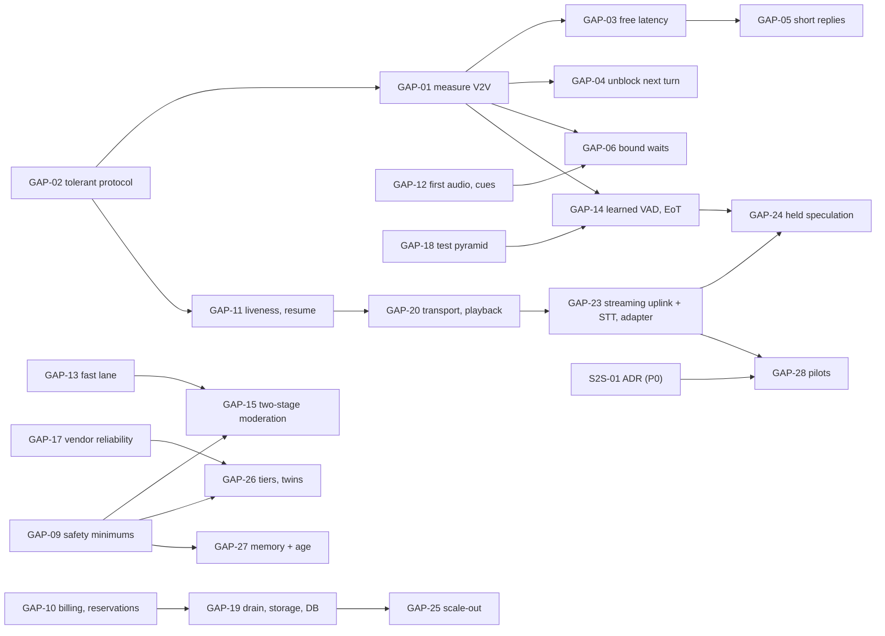

# Gap analysis: Magic Worlds vs best practice

**Research date:** 2026-10-20. **Scope:** an area-by-area comparison of the Magic Worlds (MW) live character call with the October 2026 state of the art. The areas are capture and VAD, turn-taking and barge-in, transport, STT, LLM, TTS, playback, naturalness and UX, observability, testing, cost and billing, scaling and operations, safety and compliance, and vendor strategy including speech-to-speech (S2S) readiness. This document adds no new research:

- Every best-practice claim comes from the topical documents [04](04_cascaded_pipeline_sota.md) to [14](14_safety_policy_and_compliance.md). Those take vendor facts only from the fact-checked research notes and the [r94 reconciliation](evidence/research/r94-gap-g4-contradictions-reconcile.md).
- Every MW fact comes from the register in [03](03_audit_findings.md) and the evidence it cites.
- Recommendations GAP-01 to GAP-29 consolidate the topical recommendations into one ordered set. [17](17_recommendations_and_roadmap.md) turns the topical items into a phased roadmap, and [16](16_target_architectures.md) describes the target designs.

## Summary

- **Overall maturity is about 2 on a 1-5 scale** (INFERENCE, §2). Only TTS and playback reach 3. Scaling and operations sit at 1: one process, and every deploy drops every live call (C30 (BE-ROUTE-TRANSPORT-03)).
- **The caller waits about 3.2-4.2 s from speech end to first audio** (3.6-4.7 s at STT p95; dev data, EL lane, moderation off; INFERENCE from forensics). Best-in-class cloud-API cascades reach about 1.2 s voice-to-voice (V2V) p50, or 0.8-0.9 s with speculation (an estimate synthesized from the Daily reference of 1,293 ms and the r01 build-up; [04](04_cascaded_pipeline_sota.md) §2). A human gap is about 200 ms. About 80% of MW's time is the 550 ms hang-over, batch STT and the LLM hop. None of that is a limit of the cascade architecture.
- **Five gaps are critical** (§4):
  - the whole-utterance WAV uplink (C01 (FE-CAPTURE-03));
  - about 0.87 s p50 of durable recording in api.magic_llm before every provider call (C08 (BE-LLM-02));
  - no measurement of what the caller hears (C13 (BE-OBSERVABILITY-SAFETY-COST-05));
  - a moderation gate that cannot ship as configured (C04 (BE-OBSERVABILITY-SAFETY-COST-01));
  - an inert self-harm protocol under laws already in force in New York and California (C12 (BE-OBSERVABILITY-SAFETY-COST-02)).
- **The character talks too long and keeps talking.** In dev, replies ran a p50 of 17.6 s of audio, callers cut 12 of 17 replies, and 34.3% of delivered audio was never heard but was billed. A supersede that arrives after `voice_turn_end` neither cuts nor cancels the reply (C24 (BE-ENGINE-TURNTAKING-01)). The reply to an interruption then waited 0.7-6.4 s on 4 of 19 turns (C20 (BE-ENGINE-TURNTAKING-05)).
- **Waits have no product-level bound.** STT is one attempt under the intake lock (C06 (BE-STT-02)). The LLM has no TTFT deadline (C07 (BE-LLM-05)). EL gets one reconnect per call (C14 (BE-TTS-06)), and Fish has only a 90 s timeout (C43 (BE-TTS-11)). Nothing fills the silence.
- **MW is at or above practice in several places** (§5): heard-prefix truncation from `played_ms`, EL socket prewarm, playback-paced look-ahead, idempotent uploads, content-free telemetry, prompt-cache hits, root-only cloning, and the choice of a cascade for character voices.
- **Order of work.** The P0 set (days, no vendor change) is GAP-01 to GAP-12: measure, remove free latency, unblock turns, shorten replies, bound waits, stop text-shape failures, close the echo and supersede paths, safety minimums, billing, liveness and first audio. [02](02_turn_lifecycle_and_latency.md) §10 estimates the resulting path at about 3.9 s today, about 3.4 s after P0, about 2.3 s after P1, about 1.5 s after P2 and 0.8-1.0 s with co-location. All of these are estimates.

---

## 1. How to read this document

- **Labels.** FACT, INFERENCE and UNKNOWN as defined in [00](00_methodology_and_sources.md) §4. Vendor numbers carry "(vendor-reported)" or "(vendor-run)", and unchecked claims carry "(unverified)".
- **Finding ids.** Canonical ids C01-C80 and N01-N20 come from [03](03_audit_findings.md), written as `C02 (FE-CAPTURE-04)`. Gap-note findings keep their own ids, with the short form from 03 in parentheses, for example `GAP-REAL-CALL-OVERLAP-HISTORY-BILLING-03 (OVL-03)`.
- **Gap rating is not defect severity.** [03](03_audit_findings.md) rates defects and found 0 critical and 15 high. This document rates the **distance between MW and the practice**, weighted by user impact. A gap can therefore be critical when no single defect is.

| Rating | Meaning |
|---|---|
| none | MW meets or exceeds the practice |
| minor | The practice is partly met; impact is bounded, rare or cosmetic |
| major | The practice is missing or partly met, with a known failure mode on many turns, or a robustness, cost or compliance gap with a documented trigger |
| critical | The practice is missing, and the gap blocks launch, breaches a rule already in force, dominates latency on every turn, blocks the target architecture, or blocks verifying most other fixes |

- **Recommendation ids.** Topical ids come from the sibling documents: M- ([00](00_methodology_and_sources.md)), ARCH- ([01](01_current_architecture.md)), LAT- ([02](02_turn_lifecycle_and_latency.md)), F- ([03](03_audit_findings.md)), CAS- ([04](04_cascaded_pipeline_sota.md)), TT- ([05](05_turn_taking_and_interruptions.md)), STT- ([06](06_speech_to_text.md)), LLM- ([07](07_llm_in_the_voice_loop.md)), TTS- ([08](08_text_to_speech.md)), TR- ([09](09_transport_and_client_audio.md)), NAT- ([10](10_naturalness_and_character_experience.md)), S2S- ([11](11_speech_to_speech_and_omni_models.md)), OBS- ([12](12_observability_evaluation_and_testing.md)), OPS- ([13](13_cost_scaling_and_operations.md)) and SAF- ([14](14_safety_policy_and_compliance.md)). GAP- ids belong to this document (§6).
- **Severity disagreements.** Where sibling documents rate a finding differently (C09, C20, C24), this document follows the register in [03](03_audit_findings.md), per M-01. §8 lists every disagreement.
- **Data quality.** All MW timings come from 8 dev calls on one character card, made by root users, on a dev topology with known distortions. Seven of the 8 calls ran on the Fish lane and one on the EL lane, so "EL lane" latency budgets mix lane-independent stages measured on Fish calls with one EL call. Production topology and usage are UNKNOWN.
- **Where to find what.** Today's state: §2 (scorecard) and the "MW today" column of §4. Best practice and SOTA: the "Practice" column of §4 and the sibling documents it cites. Gaps: §3 (the most consequential) and §4 (the full matrix). Recommendations: §6. What MW already does well: §5. Weak or contradictory evidence: §8.

---

## 2. Maturity scorecard

Scale: **1** absent or broken against practice; **2** basic, with structural gaps; **3** a sound baseline with known gaps; **4** close to practice; **5** at or above practice. The scores are INFERENCE from the matrix in §4.

| Area | Score | Justification |
|---|---|---|
| Capture & VAD | 2 | Processed constraints, the iOS `play-and-record` session, a 16 kHz context and 300 ms pre-roll are right. Detection is an RMS gate (MCC-class 0.11, against 0.72 for Silero), the server gate is off, and a watchdog misfire leaves AEC off for the rest of the session (C03, C47) |
| Turn-taking & barge-in | 2 | Heard-prefix truncation is sound. Endpointing is a fixed 550 ms silence, barge-in is irrevocable at 500 ms, short answers are dropped, and post-end talk-over is neither cut nor cancelled (C02, C15, C16, C24) |
| Transport | 2 | Idempotent, SHA-checked uploads and a typed protocol. The uplink is a whole-utterance POST, a dead socket takes 50-75 s to detect, and any unknown client frame ends the call (C01, C23, C29) |
| STT | 2 | Groq whisper-large-v3 is accurate enough and a hallucination filter exists. It is batch (p50 526 / p95 1,002 ms), single-shot under the intake lock, cold-connected and fixed to one language per call (C06, C09, C33) |
| LLM | 2 | Prefix caching works and cancellation reaches the provider. About 0.87 s p50 of durable commits precede every provider call, TTFT has no deadline and is never measured, and replies run 17.6 s (C08, C07, C37) |
| TTS | 3 | EL v4 Turbo is a top-rated model, prewarmed, with a per-turn context. The Fish lane fails on markup and lacks watchdogs, the first chunk waits for a whole sentence, and a second socket failure ends voice for the call (C17, C14, N01) |
| Playback | 3 | A truthful speaking state, an immediate flush, stale-frame defence and a shared frame timeline. No jitter policy, no output-latency correction, a ±500 ms `played_ms` cadence and choppy fallbacks (C25, C48) |
| Naturalness & UX | 2 | An accessible transcript, an AI badge and break nudges. No greeting, no delay cue, captions ahead of audio, abrupt ends, and the Calls page and gallery "Call" buttons start a fresh chat with no memory (C53, C49, C52) |
| Observability | 2 | Events, histograms and a privacy allowlist exist. The caller-felt V2V is never measured, nothing is exported or alerted to a person, and failures collapse into `internal` (C13, C59) |
| Testing | 2 | About 545 backend tests over fakes, plus privacy sentinels. No latency budgets, jsdom-only frontend tests, and no audio corpus, persona evals or load tests (C57) |
| Cost & billing | 2 | Atomic reservation, idempotent billing, and a spend circuit that degrades to text. The billing unit does not match the allowance shown, unheard, echo and dropped audio are billed, a crash can charge a whole day, and spend control covers TTS only (N07, C31, C58) |
| Scaling & ops | 1 | One uvicorn process with process-local call state. Deploys drop every call, call audio sits on `local_fs`, MySQL is shared and saturated, and global concurrency exceeds Groq's documented rate limit (C30, C65, N08, N10) |
| Safety & compliance | 2 | A fail-closed design, allowlisted logs, root-only cloning and versioned consent exist. The gate cannot ship, self-harm detection is inert, captions bypass moderation, and the privacy footer is wrong (C04, C12, C55) |
| Vendor strategy & S2S readiness | 2 | The cascade fits MW's requirements, and LLM profiles abstract the model. Every stage is single-sourced, no engine adapter exists, the content tier is implicit, and the batch uplink cannot feed any S2S vendor ([11](11_speech_to_speech_and_omni_models.md) §4.2) |

The diagram places the critical and major gaps on the turn. Red marks a critical gap, amber a major one, green a stage at practice.

```mermaid
flowchart LR
  classDef crit fill:#f8d7da,stroke:#b02a37,color:#000
  classDef maj fill:#fff3cd,stroke:#997404,color:#000
  classDef ok fill:#d1e7dd,stroke:#146c43,color:#000
  A["Mic + RMS VAD<br/>550 ms hang-over<br/>C02 C03"]:::maj --> B["Whole WAV POST<br/>after speech end<br/>C01"]:::crit
  B --> C["Groq batch STT<br/>single shot, cold<br/>C06 C09"]:::maj
  C --> D["BFF DB chain +<br/>previous-turn wait<br/>C19 C20"]:::maj
  D --> E["api.magic_llm durable<br/>commits ~0.87 s<br/>C08"]:::crit
  E --> F["Provider TTFT<br/>no deadline<br/>C07"]:::maj
  F --> G["Sentence buffer<br/>C17"]:::maj
  G --> M["Moderation gate<br/>unshippable<br/>C04"]:::crit
  M --> H["EL v4 Turbo<br/>prewarmed"]:::ok
  M --> H2["Fish lane<br/>N01 C43"]:::maj
  H --> I["Base64 MP3 over WS<br/>MSE playback<br/>C76 C48"]:::maj
  H2 --> I
  I --> J["played_ms truncation<br/>heard prefix"]:::ok
  K["V2V never measured<br/>C13"]:::crit -.-> A
  K -.-> I
  S["Self-harm screen inert<br/>C12"]:::crit -.-> D
```

---

## 3. The most consequential gaps

### 3.1 The input side is serial and batch

After the caller stops, MW runs these steps in series:

1. waits 550 ms of silence;
2. uploads a WAV file;
3. transcribes it in one Groq request;
4. runs 23-29 database transactions in the BFF;
5. makes about 20 fsync'd commits in api.magic_llm (874 ms p50) before the provider call;
6. calls the provider over cold connections (+165 ms p50 per turn).

Best practice streams every stage and overlaps them: the provider call starts within tens of milliseconds of the transcript, and streaming STT finalizes about 150 ms after end of speech ([04](04_cascaded_pipeline_sota.md) §4, §8). An independent measurement of a tuned cascade found 755 ms to first audio ([arXiv 2603.05413v2](https://arxiv.org/abs/2603.05413v2), 2026-03-17). Hang-over, STT and the LLM hop are about 80% of MW's budget. P0 and P1 work with no vendor change reaches about 2.3 s (estimate, [02](02_turn_lifecycle_and_latency.md) §10). The rest needs a streaming uplink and streaming STT. Matrix rows 5, 12, 13, 20, 24; GAP-03, GAP-04, GAP-13, GAP-14, GAP-23.

### 3.2 Nobody measures what the caller hears

The browser computes speech end to first audible audio and writes it to a `performance.mark` that nothing reads (`src/features/interaction/audio/callPlaybackTiming.ts:28-33`). The server metric stops at "first frame sent". TTFT is 0.0 in 19 of 19 runs. Alerts are log lines from a monitor that is off by default (C13, C59). Best practice is a client-clock V2V per turn with a per-stage breakdown (Pipecat `UserBotLatencyObserver`, LiveKit `e2e_latency`, the IETF mouth-to-ear draft; [12](12_observability_evaluation_and_testing.md) §3-4). Every latency figure in this document set is a reconstruction from dev logs and 1 s timestamps, and no fix in §6 can be verified without this. Rows 47-50; GAP-01, GAP-02.

### 3.3 The character talks too long, and keeps talking after it is cut

- **Length.** Dev replies ran p50 289 characters and 17.6 s of audio. The 1,536-token cap never binds, callers cut 12 of 17 replies, and 34.3% of delivered audio was never heard. The flush-ahead gate lets 3 "free" sentences through, and audio ran up to 16.5 s ahead of playback.
- **Talk-over.** When no barge-in frame fires (AEC off, the raw fallback, the 3 s warm-up of the first reply, or speech under 500 ms), a supersede after `voice_turn_end` neither cuts nor cancels the reply. The character talks over the caller for about 1.2-3 s (an estimate from the mechanism, OVL-03; no call measured it), and history stores the whole reply as heard (C24).
- **Slow recovery.** The reply to that interruption then waits for the previous turn's bookkeeping (C20).

Best practice is one to three short sentences with a short first sentence, a look-ahead of a few seconds, and one cancel primitive that every stage obeys ([10](10_naturalness_and_character_experience.md) §1.5, [04](04_cascaded_pipeline_sota.md) §4.7). Rows 8, 9, 27, 35; GAP-04, GAP-05, GAP-08.

### 3.4 Waits have no bound and no voice

| Wait | MW today |
|---|---|
| LLM | No TTFT or turn deadline (C07). magic-llm makes up to 3 attempts of 30 s before any output, about 92 s of silence in the worst case. The live voice path keeps that library default; only BYOK requests and the recovery route pass `retries=1` (§8) |
| STT | One 30 s attempt under `intake_lock` (C06) |
| Fish | Only a 90 s per-turn timeout (C43) |
| EL | A second socket failure ends voice for the rest of the call (C14) |
| Fish markup | Markup crashes the word ledger: 5.3-6.4 s of silence, then an error, on 2 of 15 Haiku turns (GAP-REAL-DEV-CALL-FORENSICS-01 (N01, FOR-01)) |

Nothing fills these silences: there is no filler, cue or greeting. Best practice is a per-stage deadline with hedge or fallback, plus a spoken acknowledgement when the wait grows long. Maslych et al. found that natural fillers improved perceived response time at 4.0 s and 6.5 s ([CUI '25](https://arxiv.org/html/2507.22352v1), 2025-07). Rows 21, 25, 33, 34, 42; GAP-06, GAP-07, GAP-12, GAP-17.

### 3.5 Turn-taking is energy, a fixed silence and an irrevocable cut

MW's turn-taking has five parts:

- an RMS gate for speech detection;
- a fixed 550 ms silence to end the turn;
- an irrevocable barge-in after 500 ms of energy;
- utterances under 500 ms discarded during playback;
- a raw (AEC-off) fallback that, once tripped, stays on for the session, with no echo guard.

The practice is layered: a learned VAD, then an audio end-of-turn model, then a backstop. Barge-in pauses, confirms, and resumes after a false interruption (LiveKit `false_interruption_timeout` 2.0 s; [turn-handling options](https://docs.livekit.io/reference/agents/turn-handling-options/), rendered 2026-10-20). VAD-only barge-in fired on 66.3% of backchannels in Krisp's test set (vendor-run, [Krisp](https://krisp.ai/blog/voice-ai-turn-taking-interruption-prediction/), updated May 2026). On LiveKit's eot-bench, a silence-only policy wrongly ends 24.5% of Spanish hold pauses at a 600 ms budget (vendor-run, [eot-bench](https://github.com/livekit/eot-bench)). Rows 1, 5-7, 10; GAP-08, GAP-14.

### 3.6 Safety cannot launch as designed, and the self-harm duty is already in force

**Moderation (C04).**
- With the code defaults (`required=true`, classifier off), the surface gate refuses every call.
- With the classifier on, each sentence routes through api.magic_llm's durable pipeline (about 0.87 s before the provider) against a 300 ms budget.
- Captions bypass the gate entirely.

**Self-harm (C12).**
- The lists are empty, the flag is off, and the screen starts only after LLM admission.
- Its only response is to end the call and pause voice for 30 minutes.
- The crisis numbers are `LEGAL_PENDING`.

New York GBL Art. 47 (since 2025-11-05) and California SB 243 (since 2026-01-01) require detection and crisis referral ([MoFo](https://www.mofo.com/resources/insights/251120-new-york-and-california-enact-landmark-ai), 2025-11-20). Whether they apply to MW is a counsel question. The practice is an input screen in parallel with the LLM, a two-stage output gate, captions released with their audio, and verbatim safety lines played by the app ([14](14_safety_policy_and_compliance.md) §3). Rows 68-72; GAP-09, GAP-15.

### 3.7 Operations assume one process that never restarts

- **Deploys.** Uvicorn sends 1012 to every socket before shutdown can notify the clients, and resume then finds no runtime (C30).
- **Crashes.** A crash orphans the quota reservation for 10-11 minutes and can charge the user's whole day (C31).
- **Storage and state.** Call audio is on `local_fs` (N08), and call state is process-local (C65).
- **Admission.** Global concurrency is 8, while Groq's documented 20 RPM supports about 5 calls.
- **Billing unit.** Billing spends audio seconds against an allowance shown as minutes (N07).

The practice is a drain of at least the maximum call plus idle time plus margin (about 780 s), sticky routing with shared ownership, admission derived from provider budgets, and a per-call cost record ([13](13_cost_scaling_and_operations.md) §4-6). Rows 57-59, 62-66; GAP-10, GAP-19, GAP-21, GAP-25.

---

## 4. Gap matrix

There are 78 rows in 14 areas, numbered globally so other sections can cite them. "Best practice" names the practice and links the sibling document that sources it; external figures come from that document's cited source. "MW today" gives the finding id and the code or evidence. The last column lists the topical recommendations that close the gap, followed by the GAP id that consolidates them (§6).

Tally: 5 critical, 57 major, 12 minor, 4 none.

### 4.1 Capture & VAD

| # | Best practice / SOTA | MW today | Gap | User impact | Closing recs |
|---|---|---|---|---|---|
| 1 | A learned frame VAD (Silero class) detects speech. On Google's comparison, MCC is Silero 0.72, WebRTC VAD 0.41 and RMS energy 0.11 ([arXiv 2601.17270](https://arxiv.org/abs/2601.17270), 2026-01-24; [05](05_turn_taking_and_interruptions.md) §4.2) | C03 (FE-CAPTURE-02): an adaptive RMS gate. Speech starts after 250 ms of voiced energy (500 ms while the character is audible). No neural VAD runs anywhere (`src/features/interaction/audio/voiceVadProcessor.worklet.js:265-304`) | major | Noise, music and echo start turns. Every client false trigger becomes a billed Groq request and a hallucination risk ([06](06_speech_to_text.md) §1.11) | TT-09, F-14; GAP-14 |
| 2 | A server-side VAD trims non-speech before STT. On padded speech, Whisper WER is 104.8% with no VAD, 68.3% with WebRTC VAD and 8.0% with Silero. Whisper hallucinated on 40.3% of non-speech inputs ([arXiv 2501.11378](https://arxiv.org/abs/2501.11378), 2025-01-20; [06](06_speech_to_text.md) §4) | The server energy gate is off by default. Only digital silence (`peak < 0.002`) is rejected (`magic-worlds-api/src/services/voice_orchestration/server_vad.py:25-36`). No-speech segments are billed before rejection (C62 (BE-STT-17)) | major | Every client false trigger becomes a billed Groq request and a hallucination risk | STT-05, STT-06, TR-17; GAP-14, GAP-10 |
| 3 | Capture survives device, route and permission changes. Mute must not poison VAD calibration ([09](09_transport_and_client_audio.md) §2, §4.5) | C46 (FE-CAPTURE-07): only the track's `ended` event is observed (`useMicrophoneCapture.ts:521`). C47 (FE-CAPTURE-08): the liveness watchdog can misclassify a live stream, and the raw AEC-off fallback then stays on for the session (`:421`). C45 (FE-CAPTURE-06): mute feeds zeros, the noise floor decays, and unmute produces fake turns (`src/features/interaction/hooks/useMicrophoneCapture.ts:571-580`) | major | A Bluetooth or headset change goes unnoticed. One watchdog misfire leaves echo cancellation off for the whole call, which feeds row 10 | TR-13, F-14; GAP-14, GAP-20 |
| 4 | Processed capture constraints (AEC, NS, AGC), an iOS `play-and-record` session, a fixed rate and pre-roll ([09](09_transport_and_client_audio.md) §2, §4.5) | Processed constraints (`src/features/interaction/hooks/useMicrophoneCapture.ts:80`), `play-and-record` (`:471-481`), a 16 kHz context and a 300 ms pre-roll ([fe-capture](evidence/audit/fe-capture.md)) | none | — | TR-14 keeps it verified per device |

### 4.2 Turn-taking & barge-in

| # | Best practice / SOTA | MW today | Gap | User impact | Closing recs |
|---|---|---|---|---|---|
| 5 | Layered endpointing: VAD, then an audio end-of-turn model, then a backstop. On eot-bench ES, silence alone cuts 24.5% of hold pauses at a 600 ms budget and needs 1,200 ms of dead air to reach 5%. LiveKit v1 scores 6.0% and 642 ms (vendor-run, [eot-bench](https://github.com/livekit/eot-bench); [05](05_turn_taking_and_interruptions.md) §4.3-4.5). LiveKit defaults are 0.3/2.5 s with its detector and 0.5/3.0 s without ([turn-handling options](https://docs.livekit.io/reference/agents/turn-handling-options/), rendered 2026-10-20) | C02 (FE-CAPTURE-04): a fixed 550 ms of silence ends every turn (`src/features/call/components/CallScreen.tsx:114`). No `voice_vad` frame is sent, and no semantic signal exists | major | Mid-sentence pauses split turns (one 600 ms pause produced two segments in simulation). The 550 ms is paid on every turn. The false cut-off rate is UNKNOWN but probably at least the baseline's 24.5% in Spanish (INFERENCE, [05](05_turn_taking_and_interruptions.md) §4.3) | TT-10, TT-12, LAT-07, CAS-10, F-14; GAP-14 |
| 6 | Barge-in pauses or ducks, confirms, and resumes after a false interruption (LiveKit `false_interruption_timeout` 2.0 s, `resume_false_interruption` true; [2026-06-30](https://livekit.com/blog/turn-detection-and-interruption-handling)). VAD-only barge-in fired on 66.3% of backchannels in Krisp's test set (vendor-run, [Krisp](https://krisp.ai/blog/voice-ai-turn-taking-interruption-prediction/); [05](05_turn_taking_and_interruptions.md) §4.8-4.9) | C15 (FE-CAPTURE-05): immediate and irrevocable after 500 ms of voiced energy. There is no duck, no confirm and no resume, and the generation is discarded. A 500 ms backchannel filter exists (`useVoiceCallController.ts:132-137`) | major | A cough, a "mm-hm" or a laugh can kill the reply with no way back | TT-11, LAT-12, CAS-15, NAT-11; GAP-14 |
| 7 | Short answers ("yes", "no", "sí") are captured during and after agent speech ([05](05_turn_taking_and_interruptions.md) §4.6) | C16 (FE-UI-01): interjections said entirely over the character are discarded, because the 500 ms interruption minimum also gates capture (`src/features/interaction/hooks/useVoiceCallController.ts:706`; `voiceVadProcessor.worklet.js:394`) | major | The caller answers a question and is ignored | TT-05, NAT-11; GAP-14 |
| 8 | One cancel signal that every stage obeys, at any point in the turn ([04](04_cascaded_pipeline_sota.md) §4.7) | C24 (BE-ENGINE-TURNTAKING-01): after `voice_turn_end`, a supersede neither cuts nor cancels (`engine.py:1426-1434`). Confirmed by GAP-REAL-CALL-OVERLAP-HISTORY-BILLING-03 (OVL-03). Applies when no barge-in frame fires: AEC off, the raw fallback, the 3 s warm-up of the first reply, or speech under 500 ms | major | The character talks over the caller, and history stores the whole reply as heard | TT-03, F-08; GAP-08 |
| 9 | The reply to an interruption starts at once; bookkeeping from the previous turn is off the critical path ([04](04_cascaded_pipeline_sota.md) §4.2) | C20 (BE-ENGINE-TURNTAKING-05): the next turn waits for the previous turn's bookkeeping (`engine.py:2066-2074`). GAP-REAL-DEV-CALL-FORENSICS-05 (FOR-05): 0.7-6.4 s on 4 of 19 turns. GAP-CALL-AUDIO-ASSETS-AND-MP3-TIMELINE-01 (AUD-01): +1 to +5 s on 5 of 13 transitions | major | The slowest replies come exactly when the caller has just interrupted | TT-08, LAT-05, CAS-04, F-03; GAP-04 |
| 10 | An echo guard on every path: browser AEC where it works, a server-side echo filter or a half-duplex mode where it does not ([05](05_turn_taking_and_interruptions.md) §4.10; [09](09_transport_and_client_audio.md) §4.4) | C05 (FE-CAPTURE-01): with AEC off, on the raw fallback or in warm-up, auto barge-in is skipped, any non-empty transcript supersedes, and the BFF has no echo filter (`useVoiceCallController.ts:676-687`; `engine.py:2066-2074`). The hint copy is also wrong: it says interrupting by voice is disabled (`src/app/i18n/locales/en.ts:6150`). Frequency is UNKNOWN: AEC state is not recorded, and the echo-similarity script was not run (OVL-11) | major | On speakers without AEC, the character interrupts itself, answers its own words, and the echo is billed as STT | TT-04, TR-05, F-15; GAP-08 |
| 11 | Held speculation: start the LLM on a likely end of turn and release output only when it is confirmed ([04](04_cascaded_pipeline_sota.md) §4.4) | Not implemented. It is premature until rows 5, 12 and 24 are fixed | minor | 150-500 ms left on the table once the basics are fixed (estimate) | CAS-09, LAT-15, TT-14, LLM-15; GAP-24 |

### 4.3 Transport

| # | Best practice / SOTA | MW today | Gap | User impact | Closing recs |
|---|---|---|---|---|---|
| 12 | Uplink audio streams in 20-100 ms frames from speech start, so STT runs during speech ([09](09_transport_and_client_audio.md) §4.8; [04](04_cascaded_pipeline_sota.md) §4.1). Every S2S vendor requires it ([11](11_speech_to_speech_and_omni_models.md) §4.2) | C01 (FE-CAPTURE-03): one 16 kHz WAV per utterance, POSTed after the VAD flush (`src/features/interaction/hooks/useVoiceCallController.ts:564-628`; `magic-worlds-api/src/routes/user/route_voice_call.py:1130`). C21 (BE-ROUTE-TRANSPORT-07): a turn lives as long as its POST (`engine.py:2090-2103`), and an aborted POST neither cancels nor reports it. C67 (FE-CAPTURE-11): no early "speaking" signal; both existing warm-ups already overlap STT, and the Groq connection is the one left cold ([fe-capture](evidence/audit/fe-capture.md)) | critical | Upload and the whole of STT are serial after the caller stops. Blocks the target architecture and every S2S pilot | TR-10, LAT-13, CAS-14, F-23, S2S-04; GAP-23 |
| 13 | Warm, pooled, prewarmed connections to every provider ([04](04_cascaded_pipeline_sota.md) §4.5) | C09 (BE-LLM-03): a new `httpx.AsyncClient` per stream (`magic-worlds-api/src/services/llm_execution_transport.py:276-277`). The Groq client expires keep-alive after 5 s (`magic-worlds-api/src/services/voice_orchestration/stt_groq_client.py:139-145`). GAP-TOPOLOGY-RTT-MEASUREMENTS-02 (TOP-02): 4-20% of cold TCP+TLS setups took over 500 ms. GAP-TOPOLOGY-RTT-MEASUREMENTS-07 (TOP-07): uploads arrive 10-31 s apart, beyond the 5 s server keep-alive, so each opens a new connection | major | About +165 ms p50 per turn, and about 1 turn in 3 stalls 0.5-1.5 s on the dev network (estimate, [02](02_turn_lifecycle_and_latency.md) §10) | F-02, LAT-02, CAS-02, STT-02, LLM-05, OPS-12, TR-06; GAP-03 |
| 14 | Liveness: a check every 5 s, a ping every 5-10 s, a timeout after 2 misses, and a server grace of at least 30 s ([09](09_transport_and_client_audio.md) §4.10) | C23 (FE-PLAYBACK-TRANSPORT-03): client ping 25 s and liveness 50 s, so a dead socket takes 50-75 s to detect (`src/infrastructure/api/voiceSocket.ts:20-21`, `:586-600`). That is longer than the 20 s server grace and the 15 s client resume window | major | A dropped network ends the call instead of resuming it | TR-02, F-20; GAP-11 |
| 15 | A tolerant protocol: ignore and count unknown frames, and version capabilities ([09](09_transport_and_client_audio.md) §1.5) | C29 (BE-ROUTE-TRANSPORT-06): any unknown, extra-field, binary or malformed client frame ends the call (`route_voice_call.py:135-272`, `:320-330`). GAP-SEGMENT-POST-AND-CONTROL-PLANE-UNKNOWNS-02 (SP-02): a send failure ends the call as `failed/internal`. GAP-REAL-DEV-CALL-FORENSICS-11 (FOR-11) | major | Any client rollout with a new frame kills live calls on older servers. It also blocks the measurement frame in row 47 | TR-03, ARCH-03, OBS-03; GAP-02 |
| 16 | Resume replays what the client missed, from a server buffer keyed by sequence ([09](09_transport_and_client_audio.md) §4.10) | C11 (FE-PLAYBACK-TRANSPORT-01): after a mid-reply resume, playback stalls until the next reply. C22 (BE-ROUTE-TRANSPORT-08): audio produced while the socket is away is dropped, yet billed, stored and treated as heard. C27 (FE-PLAYBACK-TRANSPORT-04): a `listening` snapshot cancels a reply the user is still hearing | major | After a network blip, the caller loses the rest of a reply, and is billed for it | TR-04, TR-08, F-21; GAP-11 |
| 17 | A send deadline and priority for control frames over audio ([09](09_transport_and_client_audio.md) §1.6) | C28 (BE-ROUTE-TRANSPORT-05): no send timeout and no slow-consumer policy (`magic-worlds-api/src/services/voice_orchestration/delivery.py:212-231`). The pong queues behind a stalled audio send | major | A slow client stalls its own call, and half-open sockets are detected late | TR-07, F-20; GAP-20 |
| 18 | Binary audio frames with timing metadata ([09](09_transport_and_client_audio.md) §4.8) | C76 (FE-PLAYBACK-TRANSPORT-15): base64 MP3 inside JSON text frames (`delivery.py:464`), +33% bytes. The EL call lane is `mp3_44100_64`, 64 kbps (`magic-worlds-api/src/services/speech/capabilities.py:65`, `:159`; [00](00_methodology_and_sources.md) E1) | minor | Small. Bytes and parse time on weak mobile links. Egress costs about $0.00006/min on the EL lane and $0.00011/min on Fish 128 kbps (INFERENCE at $0.09/GB, [13](13_cost_scaling_and_operations.md) §2.2) | TR-11, TTS-12; GAP-20 |
| 19 | WebRTC (Opus, jitter buffer, browser AEC path, congestion control) for consumer voice. OpenAI recommends WebRTC for browser clients ([realtime-webrtc](https://developers.openai.com/api/docs/guides/realtime-webrtc), accessed 2026-10-20; [09](09_transport_and_client_audio.md) §4.1) | WebSocket plus HTTP POST over TCP | minor | Head-of-line blocking on lossy links. Fixing rows 12-18 recovers most of the value first (INFERENCE, [09](09_transport_and_client_audio.md) §6) | TR-16; GAP-28 |

### 4.4 STT

| # | Best practice / SOTA | MW today | Gap | User impact | Closing recs |
|---|---|---|---|---|---|
| 20 | Streaming STT with partials. The final is ready 50-300 ms after a forced endpoint; Pipecat TTFS medians are 247-307 ms. Frontier English final WER is 2.5-3.6% on [Artificial Analysis](https://artificialanalysis.ai/speech-to-text/streaming) (extracted 2026-10-20; [06](06_speech_to_text.md) §2-3) | Groq whisper-large-v3 batch per utterance: 526 ms p50 / 1,002 ms p95 (dev, n=23). Part of C01 | major | About 400-850 ms of serial STT after every turn (estimate, [04](04_cascaded_pipeline_sota.md) §8) | STT-16, STT-17, LAT-14, CAS-14, F-23; GAP-23 |
| 21 | A per-stage deadline, a hedge or retry, and a fallback provider ([06](06_speech_to_text.md) §7.1) | C06 (BE-STT-02): one attempt with a 30 s timeout (`magic-worlds-api/src/services/voice_orchestration/stt_groq_client.py:90-109`), under `intake_lock` (`engine.py:2051-2061`). C32 (BE-STT-03): an STT exception leaves the segment `accepted` for good, with no event or metric | major | A Groq stall freezes the call for up to 30 s. A failed segment silently swallows the caller's repeat | STT-03, STT-04, F-07, LAT-09, OPS-12; GAP-06, GAP-17 |
| 22 | Per-segment language detection, or a bilingual model, for EN/ES callers ([06](06_speech_to_text.md) §6) | C33 (BE-STT-07): the language hint is fixed for the whole call from the last assistant turn's language (`magic-worlds-api/src/routes/user/route_voice_call.py:555-612`). The detected language is never used | major | A caller who switches language is transcribed in the wrong one | STT-07, NAT-10; GAP-22 |
| 23 | Hallucination filtering and vocabulary biasing for names and lore ([06](06_speech_to_text.md) §4-5) | A no-speech and hallucination filter exists (`stt_groq_client.py:218-317`). C74 (BE-STT-06): a `compression_ratio` above 2.4 rejects the whole transcript. BE-STT-13 (low, unverified): the vocabulary prompt holds only the character and persona names, fixed at call start, with no world, place or item names | minor | Occasional lost or misheard names; rare whole-segment rejections | STT-05, STT-06, STT-08 |

### 4.5 LLM

| # | Best practice / SOTA | MW today | Gap | User impact | Closing recs |
|---|---|---|---|---|---|
| 24 | The provider call starts within tens of milliseconds of the transcript. Durable records are written asynchronously ([04](04_cascaded_pipeline_sota.md) §4.1-4.2, §8: LLM service at 150 ms or less) | C08 (BE-LLM-02): api.magic_llm makes about 20 fsync'd commits before the provider call, 874 ms p50 (747-1,311 ms) (`api.magic_llm/src/db/native_execution.py:264-335`). GAP-TOPOLOGY-RTT-MEASUREMENTS-04 (TOP-04) | critical | About 0.6-0.8 s on every turn, the largest single fixable stage (estimate, LAT-06 central −780 ms) | F-13, LAT-06, CAS-08, LLM-07, OPS-10; GAP-13 |
| 25 | A TTFT deadline (T1 about 2.5 s), a total turn deadline of 10-15 s, at most one retry, then a fallback model ([07](07_llm_in_the_voice_loop.md) §4.10) | C07 (BE-LLM-05): no TTFT or turn deadline, no filler, no fallback (`magic-worlds-api/src/services/llm_features.py:66-68`). The worst case is 3 attempts of 30 s, about 92 s: the live voice path keeps magic-llm's default (`magic-llm/magic_llm/engine/base_chat.py:64`; §8) | major | A provider stall is a silent call for tens of seconds | LLM-06, LLM-10, F-06, CAS-06, LAT-08; GAP-06 |
| 26 | Thinking off or minimal on the voice path; TTFT and time to first audio measured per turn ([07](07_llm_in_the_voice_loop.md) §3, §4.3) | `raw_usage.ttft` is 0.0 in 19 of 19 runs. One tiny-prompt probe took 1,579 ms to first text. The Haiku provider window has a regression intercept of about 1.85 s (GAP-REAL-DEV-CALL-FORENSICS-07 (FOR-07)). Only `'none'` switches thinking off (`magic-worlds-api/src/services/llm_execution_transport.py:198-205`), so an unset profile keeps the provider default. That dev Haiku thinks before every reply is an INFERENCE (medium confidence, [07](07_llm_in_the_voice_loop.md) §2.6) | major | Possibly hundreds of milliseconds per turn, plus billed hidden tokens. Unverifiable until TTFT and reasoning tokens are recorded | LLM-03, LLM-09, LAT-11, CAS-12; GAP-03, GAP-16 |
| 27 | One to three short spoken sentences, with a short first sentence ([10](10_naturalness_and_character_experience.md) §1.5; [07](07_llm_in_the_voice_loop.md) §4.6) | C37 (BE-LLM-10) and GAP-REAL-DEV-CALL-FORENSICS-08 (FOR-08): the prompt asks for "one to three short sentences" (`magic-worlds-api/src/agent_graphs/runtime/callbot_chat.v2.json:18`), but nothing enforces it: the output cap is 1,536 tokens (`magic-worlds-api/src/services/llm_features.py:67`) and never binds. Dev replies: p50 289 characters, completion tokens p50 130 / max 274, 17.6 s of audio | major | Monologues. 12 of 17 replies cut, and 34.3% of delivered audio never heard | NAT-01, NAT-08, LLM-04, F-09, CAS-07, OPS-04; GAP-05 |
| 28 | History records what was heard, and the LLM is told it was interrupted ([05](05_turn_taking_and_interruptions.md) §4.11-4.12; [07](07_llm_in_the_voice_loop.md) §4.7) | C25 (BE-ENGINE-TURNTAKING-09): kept text over-approximates what was heard (EL cuts by sentence), and the LLM never sees a per-turn interruption marker; the prompt carries only a generic note that earlier lines "may stop where the caller interrupted you" (`callbot_chat.v2.json:18`). GAP-REAL-CALL-OVERLAP-HISTORY-BILLING-05 (OVL-05). GAP-REAL-DEV-CALL-FORENSICS-02 (N02, FOR-02): a failed turn's unheard reply stays `completed` at full length and enters the next prompt | major | The character refers to things the caller never heard | LLM-11, TT-07, NAT-11, F-18; GAP-16, GAP-07 |
| 29 | A tolerant spoken-text contract: normalize, strip markup, never fail a stored turn on text shape ([07](07_llm_in_the_voice_loop.md) §2.10) | C10 (BE-LLM-01): leading or trailing whitespace fails a turn that is already stored (`magic-worlds-api/src/services/voice_orchestration/transcript_sanitizer.py:131-137`). C38 (BE-LLM-13): tag-like markup kills the turn | major | A reply is lost to whitespace or a stray tag | LLM-02, F-05; GAP-07 |
| 30 | A cache-friendly prompt layout: static prefix first, volatile context last ([07](07_llm_in_the_voice_loop.md) §4.5) | Prefix caching works: 1,694-1,869 of 1,698-1,948 input tokens cached in dev. C35 (BE-LLM-08): keyword lorebooks appended to the system message break the prefix when they change. C34 (BE-LLM-07): the history trim shifts the prefix past 32k tokens | minor | Cache misses on lorebook-heavy cards: cost and some TTFT | LLM-08, OPS-14; GAP-16 |

### 4.6 TTS

| # | Best practice / SOTA | MW today | Gap | User impact | Closing recs |
|---|---|---|---|---|---|
| 31 | Never wait for full sentences. Flush a short first clause, with a first-clause budget of about 150 ms ([04](04_cascaded_pipeline_sota.md) §4.3, §8; [08](08_text_to_speech.md) §5) | C17 (BE-TTS-03): the first TTS unit waits for a whole sentence, and the abbreviation list swallows "no." and "am." (`magic-worlds-api/src/services/voice_orchestration/sentence_buffer.py:11-16`, `:19`). Spanish forms such as "Sra." are missing | major | Every turn pays the LLM time for a whole first sentence, about 200 ms (estimate, LAT-03) | TTS-03, TTS-04, LAT-03, CAS-03, F-10; GAP-07 |
| 32 | A top-quality, low-latency model on a prewarmed socket. Eleven v4 Turbo leads Artificial Analysis' English board (Elo 1333; ~150 ms time to first speech, vendor-reported; [08](08_text_to_speech.md) §4.1) | S1: `eleven_v4_turbo` on the Text-to-Dialogue multi-context socket, prewarmed, one context per turn. One measured sample: 149 ms | none | — | — |
| 33 | First-audio and inter-chunk watchdogs, reconnect with replay, and a fallback ([08](08_text_to_speech.md) §5; [13](13_cost_scaling_and_operations.md) §9) | C14 (BE-TTS-06): one reconnect budget per call, then text-only for the rest of the call (`magic-worlds-api/src/services/speech/providers/elevenlabs/tts_multicontext_ws.py:833-843`; `engine.py:2979-2985`). C41 (BE-TTS-05): a stall after `close_context` counts as completion after 5 s and resets the budget. C43 (BE-TTS-11): Fish has only a 90 s per-turn timeout | major | A second socket failure silently turns the call into text. A Fish stall is up to 90 s of silence | TTS-06, TTS-07, TTS-13, F-16, LAT-10; GAP-06, GAP-17 |
| 34 | Markup, emotes and tags are normalized per TTS model and never break a turn ([10](10_naturalness_and_character_experience.md) §3.1-3.2; [08](08_text_to_speech.md) §5) | GAP-REAL-DEV-CALL-FORENSICS-01 (N01, FOR-01): on the Fish lane, cleaned text no longer matches the word ledger's source (`magic-worlds-api/src/services/voice_orchestration/call_word_ledger.py:32-35`), the push task dies, and the turn fails as `internal`. 2 of 15 Haiku turns in dev. Separately, emotes such as `*smiles softly*` are spoken as words on both lanes (`magic-worlds-api/src/services/speech/text_pipeline.py:200-201`) | major | 5.3-6.4 s of silence, then a generic error; the unheard reply stays in history (N02) | TTS-01, TTS-02, F-04, NAT-09; GAP-07 |
| 35 | Look-ahead bounded by duration (a few seconds of audio), and leading and trailing silence trimmed ([08](08_text_to_speech.md) §5; [13](13_cost_scaling_and_operations.md) §12 OPS-04) | The flush-ahead gate allows 3 free sentences, then fewer than 3 unheard and less than 8 s ahead (`magic-worlds-api/src/services/voice_orchestration/call_tts_elevenlabs.py:55-57`). GAP-CALL-AUDIO-ASSETS-AND-MP3-TIMELINE-04 (AUD-04): delivery ran up to 16.5 s ahead of playback. GAP-CALL-AUDIO-ASSETS-AND-MP3-TIMELINE-06 (N14, AUD-06): Fish trailing silence 298-726 ms, 15-17% of audio quiet, never trimmed | major | Paying for audio nobody hears; a cut reply wastes up to the look-ahead | TTS-08, OPS-04, NAT-14, F-26; GAP-05 |
| 36 | Voice fidelity per language: the best Spanish model where Spanish matters, with regional locale and character tags passed through. On AA's Spanish cloned-voice board, Eleven v4 scores 1284, v4 Turbo 1215 and Fish S2 Pro 1005 ([08](08_text_to_speech.md) §4.3) | Locales are cut to the primary subtag, so `es-MX` becomes `es` (`magic-worlds-api/src/services/speech/types.py:129-139`). BE-TTS-21 (unverified): no emotion or tag prefix on the EL call lane. The Spanish lane uses v4 Turbo | minor | Spanish characters sound less like themselves; regional accents are lost on providers that honour region | TTS-16, TTS-17, NAT-09, NAT-10; GAP-22 |

### 4.7 Playback

| # | Best practice / SOTA | MW today | Gap | User impact | Closing recs |
|---|---|---|---|---|---|
| 37 | An explicit start and jitter policy (prebuffer target, underrun accounting), ideally an AudioWorklet ring buffer ([09](09_transport_and_client_audio.md) §4.7) | FE-PLAYBACK-TRANSPORT-10 (low): playback starts on the first chunk, with no pre-roll target and no `waiting` or `stalled` listener (`src/features/interaction/audio/voicePlaybackBuffer.ts:635-639`). C48 (FE-PLAYBACK-TRANSPORT-09): the fallbacks add a 2 s ManagedMediaSource stall (`voicePlaybackBuffer.ts:44`) or audible Blob-group gaps | minor | Occasional choppy audio on iPhone and fallback paths; stalls are invisible to telemetry | TR-12, TR-14, OBS-01; GAP-20 |
| 38 | Sample-exact played position corrected by `outputLatency`, reported at barge-in ([09](09_transport_and_client_audio.md) §4.7; [05](05_turn_taking_and_interruptions.md) §4.11) | `playedMs = playedBeforeGroupMs + audio.currentTime` with no output-latency correction (`src/features/interaction/audio/voicePlaybackBuffer.ts:147-153`; FE-PLAYBACK-TRANSPORT-13, part of C25), reported every 500 ms. EL truncates to the end of the last sentence whose audio started (`call_ledger.py:380`) | major | History keeps words the caller did not hear, especially on Bluetooth | TR-12, TT-06, TTS-11; GAP-20 |
| 39 | Fade out and drain at a cut; never stop mid-word without warning ([10](10_naturalness_and_character_experience.md) §1.7) | C52 (FE-UI-06): `max_duration` and quota ends cut the character mid-word with no warning, and implicit cuts report nothing heard. Idle ends do not cut mid-word | minor | An abrupt end at the limit | TR-12, NAT-06; GAP-12 |
| 40 | Stale audio from a cancelled turn is dropped on the client ([04](04_cascaded_pipeline_sota.md) §4.7) | S4, S13: stale frames are dropped, a 500 ms guard applies, and server and client share one frame timeline | none | — | — |

### 4.8 Naturalness & UX

| # | Best practice / SOTA | MW today | Gap | User impact | Closing recs |
|---|---|---|---|---|---|
| 41 | Ringback, then the callee speaks first with an in-character greeting, from cached or pre-rendered audio ([10](10_naturalness_and_character_experience.md) §3.4) | C53 (FE-UI-07): no greeting and no ringback. The screen says "{{name}} is listening. Say hello whenever you are ready." (`src/app/i18n/locales/en.ts:6148`). C77 (FE-UI-18): setup is serial, 0.3-1.5 s ([09](09_transport_and_client_audio.md)) or 0.4-2.5 s ([10](10_naturalness_and_character_experience.md)) to "Listening" (INFERENCE) | major | The caller speaks first, into silence; the first reply also pays the cold path | NAT-02, OPS-13, CAS-11, TTS-15; GAP-12 |
| 42 | One "thinking" state, and an in-character cue when the wait grows long. Natural fillers improved perceived response time at 4.0 s and 6.5 s; a spinner with sound did not ([CUI '25](https://arxiv.org/html/2507.22352v1), 2025-07; [10](10_naturalness_and_character_experience.md) §1.2) | C73 (FE-UI-08): the status line exposes pipeline internals, and nothing shows "thinking" during upload and STT. No filler or cue exists | major | The caller cannot tell a slow turn from a dead call; median waits are 3-4 s (INFERENCE) | NAT-03, NAT-04, LLM-18; GAP-12 |
| 43 | Captions released with their audio, from the moderated text ([10](10_naturalness_and_character_experience.md) §4; [14](14_safety_policy_and_compliance.md) §3) | C49 (FE-UI-03): deltas are shown at LLM speed, and no alignment is forwarded (`useVoiceCallController.ts:944-948`). A sentence blocked from voice is still displayed (`engine.py:2613-2616`) | major | Captions spoil the line before it is spoken | NAT-05, SAF-09, TR-11; GAP-15 |
| 44 | Graceful ends: a warning before the limit, an in-character wrap-up and goodbye, and no dead ends ([10](10_naturalness_and_character_experience.md) §1.6, §3.6-3.7) | C51 (FE-UI-05): no warning before a quota end, and "Call again" is a dead end afterwards. C52 (FE-UI-06): limit ends cut mid-word. A final-minute warning covers max duration only | major | The call ends abruptly, and the caller cannot tell why | NAT-06, NAT-07, NAT-08, SAF-04; GAP-12 |
| 45 | Memory across calls: resume the relationship, with facts and open threads carried over ([10](10_naturalness_and_character_experience.md) §3.8) | `startCall` runs `startCharacterChat`, which creates a fresh draft chat with no turns (`src/features/call/useStartCall.ts:97-117`) | major | The character does not remember the last call, which breaks the companion premise | NAT-12, SAF-13; GAP-27 |
| 46 | A responsive call surface; navigation does not silently end a call; degraded modes are persistent and named ([10](10_naturalness_and_character_experience.md) §4.2) | C50 (FE-UI-04): a fixed 188 px portrait pushes captions down on small screens (`CallScreen.tsx:473`); it shrinks to 72 px only while the transcript panel is open (`:477`). C56 (FE-UI-11): any navigation silently ends the call, stored as `disconnected`. C54 (FE-UI-09): text-only degradation shows as a transient generic error | minor | Mobile callers lose captions; calls end by accident | NAT-13; GAP-12, GAP-17 |

### 4.9 Observability

| # | Best practice / SOTA | MW today | Gap | User impact | Closing recs |
|---|---|---|---|---|---|
| 47 | Voice-to-voice per turn on one client clock, with a per-stage breakdown (Pipecat `UserBotLatencyObserver`, LiveKit `e2e_latency`, the IETF mouth-to-ear draft; [12](12_observability_evaluation_and_testing.md) §3.1, §4.2) | C13 (BE-OBSERVABILITY-SAFETY-COST-05): the client first-audible mark is a `performance.mark` that nothing reads (`src/features/interaction/audio/callPlaybackTiming.ts:28-33`). The server's `user_stop_ttfb_ms` stops at "first audio frame sent" | critical | No latency fix can be verified, and regressions go unseen | OBS-01, M-02, ARCH-02, LAT-01, CAS-01, F-01, TR-01, NAT-15; GAP-01 |
| 48 | A durable per-turn row with monotonic stage intervals, TTFT, hearing columns and outcome ([12](12_observability_evaluation_and_testing.md) §5.2) | Only STT latency is persisted. `voice_first_assistant_audio` feeds a process-local histogram (`magic-worlds-api/src/services/speech/metrics.py:755-776`); `voice_llm_first_delta` is only an event (`engine.py:2612`) and is not in that feed. TTFT is 0.0 in 19 of 19 runs; BFF timestamps have 1 s resolution | major | Every number in this document set is reconstructed by hand | OBS-02, OBS-05, LLM-01, STT-01, TTS-05; GAP-01 |
| 49 | Exported metrics, alerts that reach a person, and traces across services ([12](12_observability_evaluation_and_testing.md) §5.4-5.7) | C59 (BE-OBSERVABILITY-SAFETY-COST-08): no exporter, the monitor is off by default, and alerts are log lines (`metrics.py:4`, `:1649-1660`). C72 (BE-OBSERVABILITY-SAFETY-COST-09): no `traceparent` or `X-Request-Id` crosses services (`magic-worlds-api/src/services/llm_execution_transport.py:82-95`) | major | An outage is found by users, not by the team | OBS-04, OBS-07, OPS-11; GAP-01 |
| 50 | An outcome taxonomy that separates interrupted, failed, abandoned and completed turns ([12](12_observability_evaluation_and_testing.md) §5.3) | Failures collapse into `internal`; the assistant segment is always `completed` (`engine.py:3103-3116`, `:3526`). GAP-REAL-DEV-CALL-FORENSICS-03 (N03, FOR-03): 3 of 23 segments failed `internal` before admission with no plan, message or event row. GAP-REAL-CALL-OVERLAP-HISTORY-BILLING-01 (OVL-01): interrupted and heard turns cannot be told apart | major | Failure rates and causes are unknowable | OBS-03, F-22; GAP-02 |
| 51 | Content-free telemetry with explicit drop accounting ([12](12_observability_evaluation_and_testing.md) §7) | The allowlist keeps transcripts, prompts and audio out of events (S9). C70 (BE-OBSERVABILITY-SAFETY-COST-06): non-allowlisted fields are dropped without a trace. C71 (BE-OBSERVABILITY-SAFETY-COST-07): `extra=` fields are never printed | minor | New fields vanish silently | OBS-02, OBS-04; GAP-01 |

### 4.10 Testing

| # | Best practice / SOTA | MW today | Gap | User impact | Closing recs |
|---|---|---|---|---|---|
| 52 | Deterministic latency-budget and fault-injection tests in CI ([12](12_observability_evaluation_and_testing.md) §6.1) | About 545 backend tests in 52 modules, over in-memory fakes. Latency tests check arithmetic only, and none asserts a budget | major | Latency and failure-path regressions ship unseen | OBS-08; GAP-18 |
| 53 | Browser tests with a fake microphone for capture, playback, resume and barge-in ([12](12_observability_evaluation_and_testing.md) §6.5) | C57 (FE-PLAYBACK-TRANSPORT-22): about 127 frontend `it` cases, all jsdom with mocks. The risky paths (seq gap, snapshot, barge-in during reconnect) are untested | major | Device and browser regressions reach users first | OBS-11, TR-01, TR-14; GAP-18 |
| 54 | An EN/ES audio fixture corpus for STT, VAD and end-of-turn ([12](12_observability_evaluation_and_testing.md) §6.4; [05](05_turn_taking_and_interruptions.md) §7) | None | major | Turn-taking and STT changes cannot be compared | OBS-09, STT-13, TT-02, OBS-16; GAP-18 |
| 55 | Text-mode persona simulations per PR and audio-mode simulated callers nightly ([12](12_observability_evaluation_and_testing.md) §6.2-6.3) | None | major | Persona drift and length regressions are found by users | OBS-10, OBS-14; GAP-18 |
| 56 | Load and soak tests with concurrent synthetic callers ([Coval](https://www.coval.ai/blog/voice-load-testing-methodology), 2026-03-07; [12](12_observability_evaluation_and_testing.md) §6.6) | None | major | Capacity limits (row 64) are found in production | OBS-15, OPS-16; GAP-25 |

### 4.11 Cost & billing

| # | Best practice / SOTA | MW today | Gap | User impact | Closing recs |
|---|---|---|---|---|---|
| 57 | A per-call cost record (CDR) across every stage, with versioned price tables ([13](13_cost_scaling_and_operations.md) §12 OPS-01) | C58 (BE-OBSERVABILITY-SAFETY-COST-10): spend control and cost accounting cover TTS only. No per-call cost record; timed-out moderation calls leave no usage record | major | Unit economics are reconstructed by hand: the EL lane comes to about $0.033-0.043 per minute under measured dev behaviour (INFERENCE, [13](13_cost_scaling_and_operations.md) §2.1) | OPS-01, OPS-17, OBS-17; GAP-01, GAP-21 |
| 58 | Bill the unit the user is shown, for audio the user actually heard ([13](13_cost_scaling_and_operations.md) §4) | GAP-REAL-CALL-OVERLAP-HISTORY-BILLING-02 (N07, OVL-02): delivered audio is billed against a budget shown as call time; 34% of billed TTS seconds in dev were never played. STT is debited before the `no_speech` rejection (`engine.py:2243-2252`). Dropped audio is billed (`engine.py:2486-2497`). GAP-REAL-CALL-OVERLAP-HISTORY-BILLING-09 (OVL-09): 89 s consumed in about 70 s of wall time (REPORTED) | major | A user's "10 minutes" runs out early | OPS-02, F-19, STT-10; GAP-10 |
| 59 | Crash-safe quota reservations that charge only measured use ([13](13_cost_scaling_and_operations.md) §4) | C31 (BE-ROUTE-TRANSPORT-04): a reservation orphaned by a crash is charged by wall clock, up to `min(600 s, remaining)`, 10-11 min later, and blocks the user's new calls until then (`magic-worlds-api/src/services/voice_orchestration/quota.py:566-576`) | major | One server crash can consume a user's whole day | OPS-03, F-19; GAP-10 |
| 60 | Spend limits and circuit breakers on every metered stage ([13](13_cost_scaling_and_operations.md) §12 OPS-11) | The spend circuit covers TTS only, fails open and caches state for 5 s (`magic-worlds-api/src/services/speech/spend_circuit.py:1-33`). STT, LLM and moderation are outside every budget | major | A runaway loop or abuse is unbounded on three of four stages | OPS-11; GAP-21 |
| 61 | Plan prices fit the cost per heard minute, with tiered lanes ([13](13_cost_scaling_and_operations.md) §3) | A heavy user costs about $10-13 a month on EL against $4-6 on Fish (model, [13](13_cost_scaling_and_operations.md) §3). One lane per call, with no tiering | minor | Margin risk on heavy users | OPS-15, OPS-04, TTS-09; GAP-26 |

### 4.12 Scaling & ops

| # | Best practice / SOTA | MW today | Gap | User impact | Closing recs |
|---|---|---|---|---|---|
| 62 | Graceful drain of at least the maximum call plus idle time plus margin, about 780 s ([LiveKit deployments](https://docs.livekit.io/deploy/custom/deployments/); [13](13_cost_scaling_and_operations.md) §6.3) | C30 (BE-ROUTE-TRANSPORT-03): every deploy drops every live call with close code 1012 before shutdown can notify the clients; no graceful-shutdown timeout (`magic-worlds-api/src/serve.py:28-33`) | major | Every deploy hangs up on every caller | OPS-06, TR-09, ARCH-06, F-25; GAP-19 |
| 63 | Sticky routing with shared ownership (Redis) before any second replica ([13](13_cost_scaling_and_operations.md) §6.2) | C65 (BE-ROUTE-TRANSPORT-02): call runtime is process-local (`engine.py:703`, `:966-978`). A resume routed to another process ends the call | major | Blocks horizontal scale | OPS-07, OPS-08, TR-15, ARCH-07; GAP-25 |
| 64 | Admission derived from verified provider limits ([13](13_cost_scaling_and_operations.md) §5) | `VOICE_GLOBAL_CONCURRENCY` defaults to 8 (`magic-worlds-api/src/services/voice_orchestration/config.py:41`), above the roughly 5 calls that Groq's documented 20 RPM allows ([Groq rate limits](https://console.groq.com/docs/rate-limits), accessed 2026-10-20). The EL limiter is per process (`magic-worlds-api/src/services/speech/limiter.py:1-31`) | major | The 6th to 8th concurrent call loses utterances to 429s (INFERENCE, if the org is on the documented tier) | OPS-05, OPS-08, STT-14; GAP-10 |
| 65 | Call audio in shared object storage, written asynchronously ([13](13_cost_scaling_and_operations.md) §7) | GAP-CALL-AUDIO-ASSETS-AND-MP3-TIMELINE-05 (N08, AUD-05): call audio is on per-instance `local_fs` with a root-relative path while the DB is shared; any other instance serves 404 (`magic-worlds-api/src/routes/tts.py:78-92`) | major | Replays break after a move or on a second instance | OPS-09, F-24; GAP-19 |
| 66 | Database writes off the critical path, pools sized with acquire timeouts ([13](13_cost_scaling_and_operations.md) §8) | C19 (BE-ENGINE-TURNTAKING-03): about 23-29 transactions and 8 write commits between segment receipt and LLM dispatch. GAP-TOPOLOGY-RTT-MEASUREMENTS-06 (N10, TOP-06): the shared dev MySQL reached `max_connections=151`. GAP-TOPOLOGY-RTT-MEASUREMENTS-09 (N12, TOP-09): pools of 10 with no acquire timeout. api.magic_llm makes 32 fsync'd commits per voice turn and writes about 3-8 MB of binlog (volume INFERENCE, [13](13_cost_scaling_and_operations.md) §8) | major | About 60-140 ms per turn now; contention and refusals under load | OPS-10, F-03, LAT-04; GAP-04, GAP-19 |
| 67 | A documented production topology: proxy, TLS, HTTP/2, keep-alive, region placement ([09](09_transport_and_client_audio.md) §4.9) | GAP-TOPOLOGY-RTT-MEASUREMENTS-10 (N13, TOP-10): no repo defines it; `FORWARDED_ALLOW_IPS` assumes a proxy that does not exist, and dev connects to the DB as `root` | major | Every production latency and safety claim is UNKNOWN | M-05, TR-06, OPS-06, TR-15, LAT-16; GAP-19 |

### 4.13 Safety & compliance

| # | Best practice / SOTA | MW today | Gap | User impact | Closing recs |
|---|---|---|---|---|---|
| 68 | Moderation off the critical path: an input screen in parallel with the LLM, a local pre-vendor check (stage A), and a nuanced check that gates playout while synthesis runs (stage B) ([Agents SDK guardrails](https://openai.github.io/openai-agents-python/guardrails/); [14](14_safety_policy_and_compliance.md) §3) | C04 (BE-OBSERVABILITY-SAFETY-COST-01): with the code defaults (`VOICE_MODERATION_REQUIRED=true`, classifier off) the surface gate refuses every call. With the classifier on, each sentence goes through api.magic_llm (about 0.87 s before the provider) against a 300 ms budget (`magic-worlds-api/src/services/speech/moderation.py:73`). Dev runs with moderation off | critical | Launch blocker: either no calls, or calls that are effectively text-only, or unmoderated voice | SAF-08, SAF-19, F-17, LLM-13; GAP-15 |
| 69 | Detect self-harm on the user's transcript at once and respond with a supportive, in-call referral. Required by New York GBL Art. 47 (since 2025-11-05) and California SB 243 (since 2026-01-01) ([MoFo](https://www.mofo.com/resources/insights/251120-new-york-and-california-enact-landmark-ai), 2025-11-20; [14](14_safety_policy_and_compliance.md) §7) | C12 (BE-OBSERVABILITY-SAFETY-COST-02): the lists are empty (`magic-worlds-api/src/services/speech/companion_safety_lists.py:24-35`), the flag is off, and the screen starts after LLM admission (`engine.py:2596`). Its only response is to end the call and pause voice for 30 minutes. Every crisis number is `LEGAL_PENDING` (`src/features/safety/crisisResources.ts:27`) | critical | A caller in crisis gets no referral, or gets hung up on. Whether these laws apply to MW is a counsel question | SAF-01, SAF-02, SAF-03, F-12; GAP-09 |
| 70 | AI disclosure at the start and at the required cadence, and an honest answer when sincerely asked ([EU AI Act Art. 50](https://artificialintelligenceact.eu/article/50/); [14](14_safety_policy_and_compliance.md) §2.6, §7) | A modal line and a persistent AI badge. No spoken line, no recurring notice, and the prompt has no rule on honesty, goodbyes or stepping out of character for distress (`magic-worlds-api/src/agent_graphs/runtime/callbot_chat.v2.json:19`) | major | Disclosure duties are thinly met on an audio-first surface | SAF-04, SAF-05, SAF-10, NAT-08; GAP-09 |
| 71 | Captions follow the voice policy ([14](14_safety_policy_and_compliance.md) §2.4) | A sentence blocked from voice is still shown as a caption (`engine.py:2613-2616`) | major | Blocked content is displayed anyway | SAF-09, NAT-05; GAP-15 |
| 72 | Privacy copy matches what is stored; no sensitive labels tied to user ids in logs ([14](14_safety_policy_and_compliance.md) §2.8) | C55 (FE-UI-10): on calls under the `voice-v2` consent (the EL lane), the footer says only transcript text and metadata are saved, but character audio is stored (`CallScreen.tsx:637`; `src/app/i18n/locales/en.ts:6155`). The `voice-v3` (Fish) footer is accurate (`en.ts:6214`). C60 (BE-OBSERVABILITY-SAFETY-COST-13): self-harm risk labels and abuse disables are logged with `user_id` (`magic-worlds-api/src/services/speech/companion_safety.py:446-483`) | major | Users are told something untrue about retention; health-type data in logs | SAF-05, SAF-06; GAP-09 |
| 73 | Age assurance ready for California SB 1119 (effective 2027-01-01, most duties from 2027-07-01; [CA SD18](https://sd18.senate.ca.gov/news/governor-newsom-signs-adams-law); [14](14_safety_policy_and_compliance.md) §7) | Self-attested 18+ and Terms checkboxes only (`src/features/legal/attestation/AttestationChecks.tsx:23`) | major | A dated compliance gap; memory (row 45) raises the stakes | SAF-13, NAT-12; GAP-27 |

### 4.14 Vendor strategy & S2S readiness

| # | Best practice / SOTA | MW today | Gap | User impact | Closing recs |
|---|---|---|---|---|---|
| 74 | Fallback chains per stage, switched at turn boundaries, with voice twins to keep the character's voice ([LiveKit TTS FallbackAdapter source](https://github.com/livekit/agents/blob/main/livekit-agents/livekit/agents/tts/fallback_adapter.py); [13](13_cost_scaling_and_operations.md) §9) | Every stage is single-sourced: STT has one attempt, the LLM no fallback, EL one reconnect, and Fish no replay. Breakers cover TTS only | major | Any one vendor incident is a full outage | STT-03, LLM-10, CAS-13, TTS-19, OPS-15; GAP-17, GAP-26 |
| 75 | Route by content tier to lanes whose vendor terms allow it ([14](14_safety_policy_and_compliance.md) §4-5) | Tiers are implicit in the classifier prompt. With moderation off (the dev configuration), nothing in code stops T2 text from reaching Fish, whose Customer Agreement (2026-08-10) prohibits it ([Fish terms](https://fish.audio/enterprise-terms/)) | major | Account suspension risk on the Fish lane | SAF-07, SAF-11, LLM-14; GAP-09, GAP-26 |
| 76 | An engine adapter on a standard realtime event model, so cascade and S2S engines are interchangeable ([11](11_speech_to_speech_and_omni_models.md) §10, S2S-04) | None. The batch uplink cannot feed any S2S vendor ([11](11_speech_to_speech_and_omni_models.md) §4.2) | major | Every pilot is a rebuild | S2S-04, TR-10; GAP-23 |
| 77 | Choose the architecture by requirement. R1 (an agent-graph LLM with persona, lorebook and history) and R2 (per-character voices from a curated catalog, including consented clones) eliminate every native S2S product ([11](11_speech_to_speech_and_omni_models.md) §5.2) | The cascade is the right choice. LLM profiles mean no environment variable selects a model | none | — | S2S-01 (record it), S2S-08 |
| 78 | Dated bake-offs and price tables, with explicit re-evaluation triggers ([11](11_speech_to_speech_and_omni_models.md) §13; [08](08_text_to_speech.md) §4.5) | Fish price versioning refuses unverified prices (`magic-worlds-api/src/services/speech/providers/fish_audio/config.py:44`, `:76-79`). No STT, LLM or TTS bake-off has been run on MW audio | minor | Vendor choices age without notice | M-06, STT-13, LLM-09, TTS-23, OPS-17, SAF-18; GAP-29 |

---

## 5. What MW already does at or above best practice

Keep all of these through any redesign. "S" ids are the strengths in [03](03_audit_findings.md) §8.

| Practice | MW evidence | Standing |
|---|---|---|
| History truncated to what was heard | The client sends `voice_barge_in{turn_id, played_ms}` (`src/features/interaction/hooks/useVoiceCallController.ts:658`). On Fish, the word ledger keeps 74-91 ms of played audio per kept character, the same rate as untruncated turns (S3; [gap-call-audio-assets-and-mp3-timeline](evidence/audit/gap-call-audio-assets-and-mp3-timeline.md)) | At practice. The same model as OpenAI Realtime's `conversation.item.truncate` with `audio_end_ms`, and ahead of Gemini Live, which keeps delivered rather than played audio in history ([11](11_speech_to_speech_and_omni_models.md) §4.2). On the EL lane the cut is per sentence (C25), so OpenAI's sample-level cut is better there |
| TTS prewarm and overlap | S1: the EL socket is prewarmed during STT, and a per-turn context opens in parallel with the LLM. The EL (125 ms) and Fish (about 274 ms) handshakes overlap STT and the LLM | At practice ([04](04_cascaded_pipeline_sota.md) §4.5) |
| TTS model choice | S1, row 32: Eleven v4 Turbo, top of AA's English board (Elo 1333) | At practice for English |
| Look-ahead paced by playback | S5: a flush-ahead gate driven by real playback reports | At practice in design. Only the bound is wrong (row 35) |
| Cancel reaches the provider | S2: cancellation reaches api.magic_llm's provider call promptly | At practice. Whether the provider stops generating is UNKNOWN (A01) |
| Stale-frame defence and timeline | S4, S13: an immediate client flush, turn-id and `seq` checks, and one frame timeline shared by the server meter and the client clock, under 40 ms of skew. Exact, slice-proof MP3 metering | At practice |
| Idempotent uploads | S7: uploads are idempotent and SHA-checked, with exactly one safe resend | At practice |
| Content-free telemetry | S9: raw microphone audio is never stored, only its SHA-256. The allowlist keeps transcripts, prompts, audio, URLs and tokens out of events (`observability.py:22-133`, [14](14_safety_policy_and_compliance.md) §2.9) | At practice ([12](12_observability_evaluation_and_testing.md) §7) |
| Quota integrity and graceful degradation | S11: atomic cross-worker quota reservation and a graceful release on billed seconds. The spend circuit degrades the call to text instead of hanging up | At practice. The crash path is the gap (row 59) |
| Durability | S15: fsync on every commit plus `sync_binlog=1`, so no turn is lost on a crash | Above practice on durability. It is placed on the critical path, which is what costs C08 and C19 |
| Prompt caching | S17: without lorebooks, 1,694-1,869 of 1,698-1,948 prompt tokens were cached after the first turn | At practice ([07](07_llm_in_the_voice_loop.md) §4.5) |
| Transport hygiene in production | S14: production launchers set TCP_NODELAY (0.07 ms per reused request); providers support HTTP/2 and TLS 1.3 | At practice. Dev `--reload` loses it (N09) |
| Request hygiene | S8, S16: a typed, allow-listed protocol; the segment body is read only after every admission gate; pure-ASGI middleware avoids cancellation pitfalls | At practice. Strictness is the gap (row 15) |
| Spanish text normalization | Deterministic en/es number expansion with Spanish gender agreement ("21 puertas" → "veintiuna puertas") and es-ES thousands separators ([08](08_text_to_speech.md) §1.5) | Above most stacks ([08](08_text_to_speech.md) §1.5) |
| Voice-clone governance | Cloning is root-only. Consent is versioned and saved on every call start; Fish voices require `voice-v3` (`magic-worlds-api/src/services/voice_orchestration/config.py:25-26`) | At practice ([14](14_safety_policy_and_compliance.md) §6) |
| Safety design | Moderation fails closed by default. The classifier prompt treats each unit as data, which resists prompt injection. The self-harm screen is asynchronous and fail-open. A geo block and a minor-report hold exist | At practice in design. The configuration cannot ship (rows 68-69) |
| Architecture choice | The cascade meets R1, R2, R5 and R7 ([11](11_speech_to_speech_and_omni_models.md) §5). LLM profiles mean no environment variable selects a model | At practice |
| Call accessibility | A truthful "Speaking" state driven by playback; a polite live-region transcript of complete lines; 56-64 px targets and reduced motion; the AI voice badge (`CallScreen.tsx:484-487`); break nudges; 27 Storybook stories ([10](10_naturalness_and_character_experience.md) §4.4) | At practice |
| Price governance | Fish prices are versioned, and enablement refuses an `"unverified"` price (`magic-worlds-api/src/services/speech/providers/fish_audio/config.py:44`, `:76-79`) | At practice. OPS-17 extends it to every stage |

---

## 6. Recommendations

Each GAP recommendation consolidates topical recommendations without replacing them. The topical documents hold the implementation detail. Priorities:

| Priority | Meaning |
|---|---|
| P0 | Do now: days, no vendor change |
| P1 | Next: weeks |
| P2 | Architectural: about a quarter |
| P3 | Experiment or watch |

Every impact figure is an estimate unless it is marked as measured. Latency savings are p50 against the [02](02_turn_lifecycle_and_latency.md) §4 central values. They overlap, so do not add them blindly.

### 6.1 Summary

| Id | Pri | Effort | Title | Closes rows |
|---|---|---|---|---|
| GAP-01 | P0 | M | Measure what the caller hears | 47-51, 57 |
| GAP-02 | P0 | S | Tolerant protocol and honest failure classes | 15, 50 |
| GAP-03 | P0 | S | Remove free latency: warm connections, thinking off | 13, 26 |
| GAP-04 | P0 | M | Unblock the next turn; bookkeeping off the critical path | 9, 66 |
| GAP-05 | P0 | S-M | Short spoken replies; duration-bounded look-ahead | 27, 35 |
| GAP-06 | P0 | M | Bound every wait | 21, 25, 33 |
| GAP-07 | P0 | S | Never fail a turn on text shape; clause-first audio | 29, 31, 34 |
| GAP-08 | P0 | S-M | Close the supersede race and the AEC-off echo path | 8, 10 |
| GAP-09 | P0 | S eng + legal | Safety and compliance minimums | 69, 70, 72, 75 |
| GAP-10 | P0 | M | Bill the right unit; crash-safe reservations; admission within provider limits | 2, 58, 59, 64 |
| GAP-11 | P0 | S-M | Socket liveness and resume correctness | 14, 16 |
| GAP-12 | P0 | S-M | First audio and honest waiting | 39, 41, 42, 44, 46 |
| GAP-13 | P1 | M-L | api.magic_llm voice fast lane | 24 |
| GAP-14 | P1 | L | Learned VAD, layered end of turn, recoverable barge-in | 1, 3, 5, 6, 7 |
| GAP-15 | P1 | M-L | Two-stage moderation; captions with their audio | 43, 68, 71 |
| GAP-16 | P1 | M | Voice-grade LLM context and prompt | 26, 28, 30 |
| GAP-17 | P1 | M | Reliability across vendors | 21, 33, 46, 74 |
| GAP-18 | P1 | M | Test pyramid for voice | 52-55 |
| GAP-19 | P1 | M-L | Deploy drain, object storage, DB headroom, documented topology | 62, 65, 66, 67 |
| GAP-20 | P1 | L | Client transport and playback hardening | 3, 17, 18, 37, 38 |
| GAP-21 | P1 | M | Spend control across stages | 57, 60 |
| GAP-22 | P1 | M | Character voice fidelity in EN and ES | 22, 36 |
| GAP-23 | P2 | L | Streaming uplink, streaming STT, engine adapter | 12, 20, 76 |
| GAP-24 | P2 | M-L | Held speculation | 11 |
| GAP-25 | P2 | L | Scale-out | 56, 63 |
| GAP-26 | P2 | L | Tiered lanes, content tiers and voice twins | 61, 74, 75 |
| GAP-27 | P2 | L | Memory across calls, with age assurance | 45, 73 |
| GAP-28 | P3 | S-L | Gated pilots: WebRTC, Eleven Realtime, Live lite | 19 |
| GAP-29 | P3 | S per quarter | Watch list and dated bake-offs | 78 |

### 6.2 Dependencies

### 6.3 P0: do now (days, no vendor change)

**GAP-01 (P0, M): Measure what the caller hears.**
- **What.**
  - Add a client `voice_turn_client_metrics` frame from `callPlaybackTiming.ts`: V2V (speech end to first audible sample, corrected by `outputLatency` and leading silence), stalls, AEC state, playback path and `played_ms`. The server accepts it as non-fatal.
  - Write a durable `voice_turn_metrics` row per turn: monotonic stage intervals, provider TTFT, reasoning tokens, hearing columns (generated, sent and kept characters; heard ratio), interruption flags, outcome, cost columns, and `engine` and `experiment_arm` dimensions.
  - Export metrics. Alerts go to a person, starting from the proposals in [12](12_observability_evaluation_and_testing.md) §5.7. Pass `traceparent` across BFF, api.magic_llm and providers.
- **Why.** C13 (BE-OBSERVABILITY-SAFETY-COST-05): the client mark has no reader (`src/features/interaction/audio/callPlaybackTiming.ts:28-33`). C59 (BE-OBSERVABILITY-SAFETY-COST-08): no exporter, and alerts are log lines (`magic-worlds-api/src/services/speech/metrics.py:4`, `:1649-1660`). C72: no trace context. Rows 47-51.
- **Expected impact.** No latency change by itself. Every other estimate in this section becomes a measurement.
- **Dependencies.** GAP-02, so the new frame cannot end a call.
- **Validate.** Client-frame coverage of at least 90% of completed turns (OBS-01, adopted by [17](17_recommendations_and_roadmap.md) R01; TR-01 asks for 95%). A row for 100% of turns. A fire drill reaches the alert channel. Sanitizer drops at 0.
- **Consolidates.** OBS-01 to OBS-05, M-02, ARCH-02, LAT-01, CAS-01, F-01, TR-01, NAT-15, LLM-01, STT-01, TTS-05, TT-01, the cost columns of OPS-01, and the engine dimension of S2S-02.

**GAP-02 (P0, S): Tolerant protocol and honest failure classes.**
- **What.** Count and ignore unknown frame types and extra fields, and add `protocol_version`. Route send failures to a disconnect with grace instead of `failed/internal`. Store a pre-ready close as abandoned, and send `voice_end` on navigation. Adopt the outcome taxonomy in [12](12_observability_evaluation_and_testing.md) §5.3.
- **Why.** C29 (BE-ROUTE-TRANSPORT-06): any unknown frame ends the call (`magic-worlds-api/src/routes/user/route_voice_call.py:135-272`, `:320-330`). N04 (GAP-SEGMENT-POST-AND-CONTROL-PLANE-UNKNOWNS-02, SP-02). N03 (GAP-REAL-DEV-CALL-FORENSICS-03, FOR-03): failures before admission leave no record. C56: navigation ends stored as `disconnected`.
- **Expected impact.** Client rollouts stop killing live calls; failure classes become attributable.
- **Dependencies.** None. Ship it first on the server ([09](09_transport_and_client_audio.md) §7 "Order").
- **Validate.** Unknown-frame counter rising with zero call ends attributed to it. The share of failures labelled `internal` falls.
- **Consolidates.** TR-03, ARCH-03, OBS-03, F-22.

**GAP-03 (P0, S): Remove free latency: warm connections, thinking off.**
- **What.**
  - Pool and keep warm the Groq, api.magic_llm and provider connections, and warm them when the caller starts speaking.
  - Raise keep-alive above the 10-31 s gap between uploads (about 75-120 s on internal services).
  - Set the callbot profile's reasoning to `'none'` (or the model's lowest setting), and assert zero reasoning tokens per turn.
  - Fix dev TCP_NODELAY, and measure latency on the container image.
- **Why.** C09 (BE-LLM-03) with TOP-02 and TOP-07 (row 13). Row 26: only `'none'` switches thinking off (`magic-worlds-api/src/services/llm_execution_transport.py:198-205`), and the dev Haiku window has a 1.85 s intercept. N09, N19.
- **Expected impact (estimate).** About −165 ms p50 (LAT-02; measured cold penalties of Groq +78-80 and OpenRouter +86-95 ms). It removes most 0.5-1.5 s stalls, about 1 turn in 3 on the dev network. Thinking off: −0.5 to −1.3 s if thinking is on today, which is UNKNOWN ([07](07_llm_in_the_voice_loop.md) §6).
- **Dependencies.** GAP-01 to see TTFT and reasoning tokens.
- **Validate.** Share of turns with a cold connect near 0. TTFT p50 per profile. Reasoning tokens 0 on every turn.
- **Consolidates.** F-02, LAT-02, CAS-02, STT-02, LLM-05, LLM-03, OPS-12 (reuse part), TR-06, OBS-06, F-11.

**GAP-04 (P0, M): Unblock the next turn; bookkeeping off the critical path.**
- **What.** Release the next turn at `voice_turn_end` and persist the previous one in an ordered per-call background writer. Start admission right after the transcript. Move segment-status, STT-billing and metadata writes off the path, fold find/create/read-back into one statement, and cache per-call rows. Send `transcript_final` right after STT (C64).
- **Why.** C20 (BE-ENGINE-TURNTAKING-05): FOR-05 measured 0.7-6.4 s on 4 of 19 turns, and AUD-01 +1 to +5 s on 5 of 13 transitions. C19 (BE-ENGINE-TURNTAKING-03): 23-29 transactions before dispatch.
- **Expected impact (estimate).** About −100 ms p50 (LAT-04, range 50-150). 0.5-5 s on overlap turns (LAT-05).
- **Dependencies.** GAP-01 for verification. The writer must keep ordering per call.
- **Validate.** The wait for the previous turn on overlap turns (p95). BFF pre-LLM interval p50 (dev today 208-400 ms).
- **Consolidates.** F-03, LAT-04, LAT-05, CAS-04, CAS-05, TT-08, STT-15, OPS-10 step 2.

**GAP-05 (P0, S-M): Short spoken replies; duration-bounded look-ahead.**
- **What.**
  - Rewrite the length rule in every `callbot_chat.v2.json` variant: usually one or two short sentences, a short first sentence, stories in pieces, with EN and ES anchor examples.
  - After GAP-03 confirms thinking is off, lower `max_output_tokens` from 1,536 to about 200 (LLM-04). Sources range from 90-120 tokens (forensics) and 150-250 (r05) to 300-400 (roadmap); 300-400 would never have bound in dev, where the maximum was 274 completion tokens.
  - Cap spoken text per turn at about 150-250 characters (OPS-04). Propagate `finish_reason` and end at the last full sentence on `length`.
  - Replace the "3 free sentences" rule with at most about 3-4 s of audio ahead of the playback cursor.
- **Why.** C37 (BE-LLM-10), FOR-08: p50 289 characters and 17.6 s of audio, 12 of 17 replies cut. AUD-04: up to 16.5 s ahead. N07: 34% of billed TTS never played. Rows 27, 35.
- **Expected impact (estimate).** −20-40% TTS cost (OPS-04, from r10), with waste falling toward about 10%. TTS is 83-93% of COGS ([13](13_cost_scaling_and_operations.md)). Fewer interruptions and supersede races.
- **Dependencies.** GAP-03 first: a low cap with thinking on can cut off hidden reasoning. GAP-01 for the kept fraction.
- **Validate.** Reply audio p50 and p90. Kept fraction (heard ms over delivered ms). Interrupted share. TTS characters per call-minute. Time to first audio not regressed.
- **Consolidates.** NAT-01, NAT-08 (length), LLM-04, F-09, CAS-07, OPS-04, TTS-08, TT-05, BE-LLM-17.

**GAP-06 (P0, M): Bound every wait.**
- **What.**
  - LLM: a TTFT watchdog (T1 about 2.5 s), a turn deadline of 10-15 s, at most one retry, then a fallback route or a spoken in-character line (LLM-06).
  - STT: a deadline plus one hedged retry, `intake_lock` released on failure, and a failure event so the segment never stays `accepted` (C32).
  - TTS: first-audio and inter-chunk watchdogs on Fish. A stall after `close_context` must not count as completion or reset the reconnect budget (C41).
- **Why.** C07 (BE-LLM-05), C06 (BE-STT-02), C32 (BE-STT-03), C14 (BE-TTS-06), C41 (BE-TTS-05), C43 (BE-TTS-11). Rows 21, 25, 33.
- **Expected impact (estimate).** 0 ms at p50. Worst cases: LLM about 92 s (or about 30 s, §8) to about 5 s; STT 30 s to about 2-5 s (LAT-09); Fish 90 s to about 3-5 s (LAT-10).
- **Dependencies.** GAP-12 supplies what the caller hears during a long wait. GAP-01 shows dead air.
- **Validate.** Turns with no audible reply within 10 s ([12](12_observability_evaluation_and_testing.md) §5.7). Maximum wait per stage.
- **Consolidates.** LLM-06, F-06, CAS-06, LAT-08, STT-03 (deadline), STT-04, F-07, LAT-09, TTS-06, TTS-07, LAT-10, part of F-16.

**GAP-07 (P0, S): Never fail a turn on text shape; clause-first audio.**
- **What.** Make the Fish ledger's source the cleaned text. Trim whitespace instead of failing a stored turn. Strip tag-like markup in the sanitizer. Flush a first clause instead of a whole sentence, and fix the "no." and "am." abbreviations and the missing Spanish forms. A failed turn's unheard reply must not stay `completed` in history.
- **Why.** N01 (GAP-REAL-DEV-CALL-FORENSICS-01, FOR-01), C10 (BE-LLM-01), C38 (BE-LLM-13), C17 (BE-TTS-03), N02 (GAP-REAL-DEV-CALL-FORENSICS-02, FOR-02). Rows 29, 31, 34.
- **Expected impact (estimate).** About −200 ms p50 for clause-first audio (LAT-03, range 100-300). Removes the 5.3-6.4 s silent failures seen on 2 of 15 dev Haiku turns on the Fish lane.
- **Dependencies.** None.
- **Validate.** Zero turns failed by the contract or the ledger in a fuzz test over markup, emoji and whitespace. First-chunk characters p50. LLM start to first TTS push p50.
- **Consolidates.** F-04, TTS-01, TTS-02, F-05, LLM-02, F-10, TTS-03, TTS-04, LAT-03, CAS-03, F-18.

**GAP-08 (P0, S-M): Close the supersede race and the AEC-off echo path.**
- **What.** A supersede after `voice_turn_end` cuts client playback and truncates by `played_ms`. Where AEC is not verified (raw fallback, warm-up, `echoCancellation` not reported true), run half-duplex or require a stronger barge-in, and drop server-side transcripts that match recent assistant text. Fix the hint copy.
- **Why.** C24 (BE-ENGINE-TURNTAKING-01): talk-over on paths without a barge-in frame, about 1.2-3 s by mechanism estimate (`engine.py:1426-1434`; OVL-03). C05 (FE-CAPTURE-01) and C47. Rows 8, 10.
- **Expected impact (estimate).** Ends talk-over and self-supersede on the affected paths. Frequency is UNKNOWN until GAP-01 records AEC state.
- **Dependencies.** GAP-01 to size the echo problem. Half-duplex costs barge-in on those paths.
- **Validate.** Self-supersede events per call (transcript close to the assistant's text) at 0. Talk-over ms after a post-end supersede at 0.
- **Consolidates.** TT-03, F-08, TT-04, TR-05, F-15, NAT-13 (copy).

**GAP-09 (P0, S engineering plus legal): Safety and compliance minimums.**
- **What.**
  - Sign off and fill the EN and ES moderation and self-harm lists.
  - Move the self-harm screen to transcript time, and replace "end the call plus a 30-minute pause" with a supportive in-call flow and referral.
  - Counsel fills and publishes the crisis resources.
  - Add a non-overridable safety preamble to every callbot variant: honesty when sincerely asked, goodbyes, stepping out of character for distress.
  - Fix the privacy footer shown on `voice-v2` (EL) calls (`call.screen.privacyNote`, `en.ts:6155`) and the consent copy, and remove `user_id` from safety and abuse log lines.
  - Turn on the vendor data toggles, and refuse the Fish lane when moderation is not required.
- **Why.** C12 (BE-OBSERVABILITY-SAFETY-COST-02), C55 (FE-UI-10), C60 (BE-OBSERVABILITY-SAFETY-COST-13), and the Fish Customer Agreement. Rows 69, 70, 72, 75.
- **Expected impact (estimate).** About 0 ms: local list matching, hidden behind the LLM pre-provider time ([14](14_safety_policy_and_compliance.md) SAF-02). A protocol that can face NY and CA review, which counsel must confirm.
- **Dependencies.** Counsel and trust-and-safety time dominates.
- **Validate.** List version above 1. Precision and recall on a labelled EN/ES set of in-fiction and first-person cases. Transcript-to-verdict p95. The `isShippable` guard passes. A grep test fails on `user_id` in safety log formats. An admission test refuses Fish when `required=false`.
- **Consolidates.** SAF-01 to SAF-07, F-12, NAT-08 (honesty rules).

**GAP-10 (P0, M): Bill the right unit; crash-safe reservations; admission within provider limits.**
- **What.** Decide the billing unit and stop billing no-speech, echo and dropped audio. On the sweeper path, charge measured billable seconds, not wall clock. Set `VOICE_GLOBAL_CONCURRENCY` to at most what verified Groq, EL and Fish limits allow, with a Groq request bucket and jittered backoff.
- **Why.** N07 (OVL-02): 34% of billed TTS seconds unheard, and OVL-09 reports 89 s consumed in about 70 s (REPORTED). C62: STT billed before rejection (`engine.py:2243-2252`). C22: dropped audio billed (`engine.py:2486-2497`). C31 (BE-ROUTE-TRANSPORT-04, `magic-worlds-api/src/services/voice_orchestration/quota.py:566-576`). Concurrency 8 against about 5 calls at Groq's documented 20 RPM. Rows 2, 58, 59, 64.
- **Expected impact (estimate).** A user's minutes match their conversation. A crash no longer costs a day of quota. 429-driven utterance loss at 6-8 concurrent calls goes away.
- **Dependencies.** Console access for real limits. A product decision on the unit.
- **Validate.** Billed seconds against heard seconds per call. Orphaned reservations charged by wall clock at 0. Zero provider 429s in a load test at the configured concurrency.
- **Consolidates.** OPS-02, OPS-03, OPS-05, F-19, STT-10, STT-14.

**GAP-11 (P0, S-M): Socket liveness and resume correctness.**
- **What.** Check every 5 s, ping every 5-10 s, and declare a socket dead after two missed pongs. Probe on `online`, `offline` and `visibilitychange`. Raise the server grace to at least 30 s with the client window just below it. On resume, read `last_audio_seq` and skip gaps, report `played_ms` instead of cancelling on a `listening` snapshot, queue control frames, and hold uploads until resumed.
- **Why.** C23 (FE-PLAYBACK-TRANSPORT-03): 50-75 s to detect a dead socket (`src/infrastructure/api/voiceSocket.ts:20-21`, `:586-600`). C11, C27, C68. Rows 14, 16.
- **Expected impact (estimate).** Detection from 50-75 s to about 10-20 s, by construction. More mid-reply drops resume.
- **Dependencies.** GAP-02. GAP-20 (send deadline) for full effect, since the pong queues behind audio.
- **Validate.** Lab time-to-resume after a mid-reply network cut. Production resume success rate. Turns ending with an unfilled `seq` gap at 0.
- **Consolidates.** TR-02, TR-04, F-20, F-21.

**GAP-12 (P0, S-M): First audio and honest waiting.**
- **What.** Ringback during setup, then an in-character greeting at `voice_ready` from pre-rendered or cached audio. One continuous "Thinking" state from speech end to first audio. A warning before quota and duration limits, a drained in-character close, and no dead-end "Call again". A persistent, named "voice unavailable" state.
- **Why.** C53 (FE-UI-07), C77 (FE-UI-18), C73 (FE-UI-08), C51, C52, C54. Rows 39, 41, 42, 44, 46.
- **Expected impact (estimate).** The caller no longer speaks into silence. The 0.3-2.5 s setup is masked ([09](09_transport_and_client_audio.md) and [10](10_naturalness_and_character_experience.md) disagree on its size, §8). Waits are visibly attributed.
- **Dependencies.** Pre-rendered audio (OPS-13) for the greeting.
- **Validate.** Time from tapping Call to first audible character audio. Share of calls where the caller speaks first. Rater "felt like a conversation" score ([10](10_naturalness_and_character_experience.md) NAT-01, NAT-15).
- **Consolidates.** NAT-02, NAT-04, NAT-06, CAS-11, OPS-13, TTS-15, NAT-13 (surface fixes).

### 6.4 P1: next (weeks)

**GAP-13 (P1, M-L): api.magic_llm voice fast lane.**
- **What.** Give the callbot path an ephemeral or batched execution record (or a direct provider call) so the provider request starts within about 150 ms of dispatch. Durable records are written after the fact.
- **Why.** C08 (BE-LLM-02): about 20 fsync'd commits, 874 ms p50 (747-1,311), before the provider (`api.magic_llm/src/db/native_execution.py:264-335`). TOP-04. Row 24.
- **Expected impact (estimate).** −600 to −800 ms p50 (LAT-06 central −780; measured 874-898 ms spent recording). Also unblocks GAP-15, whose classifier route pays the same cost.
- **Dependencies.** Work in the separate api.magic_llm repo. GAP-01 for verification.
- **Validate.** Dispatch to provider request p50 at 150 ms or less. Turns lost on a crash at 0 (the durability S15 provides must not regress silently).
- **Consolidates.** F-13, LAT-06, CAS-08, LLM-07, OPS-10 step 1.

**GAP-14 (P1, L): Learned VAD, layered end of turn, recoverable barge-in.**
- **What.** A learned VAD in the client worklet and on the server. An audio end-of-turn model (Smart Turn v3.2 or LiveKit's detector, chosen on the EN/ES corpus) over a shorter silence, about 250-300 ms, with a 2.5 s backstop and the call language passed explicitly. Pause-then-confirm barge-in that resumes after a false interruption. Short answers captured during playback. Mute that does not decay the VAD floor.
- **Why.** C03 (FE-CAPTURE-02), C02 (FE-CAPTURE-04), C15 (FE-CAPTURE-05), C16 (FE-UI-01), C45. Rows 1, 2, 5, 6, 7.
- **Expected impact (estimate).** About −250 ms p50 (LAT-07). Fewer false cut-offs: silence alone cuts 24.5% of Spanish hold pauses at 600 ms on eot-bench, against 6.0% for LiveKit v1 (vendor-run). Fewer killed replies on backchannels.
- **Dependencies.** GAP-18 (corpus and harness) to choose and tune. GAP-01 to see the effect. Licences per [05](05_turn_taking_and_interruptions.md) §4.4.
- **Validate.** False cut-off and missed-turn rates per language on the corpus. Hang-over p50 in production. False-interruption rate and resume rate.
- **Consolidates.** TT-09 to TT-12, F-14, LAT-07, CAS-10, LAT-12, CAS-15, NAT-11, STT-05, TR-13 (mute).

**GAP-15 (P1, M-L): Two-stage moderation; captions with their audio. Launch gate.**
- **What.** Follow [14](14_safety_policy_and_compliance.md) §3.2:
  - An input screen runs on the final transcript in parallel with the LLM (delivered by GAP-09).
  - Stage A (deterministic lists plus a local classifier) answers before any text reaches the TTS vendor, protecting the vendor contract and hard legal lines.
  - Stage B (a nuanced classifier on a pooled direct call, not the api.magic_llm route) runs while the vendor synthesizes and gates playout. On timeout it falls back to stage A's verdict and flags the unit for review. On the Fish lane, stage B stays pre-provider until its p95 is measured within budget.
  - Verbatim out-of-character lines come from a pre-rendered set. Captions are released per sentence with their audio.
- **Why.** C04 (BE-OBSERVABILITY-SAFETY-COST-01): the code defaults refuse every call, and the classifier route cannot meet 300 ms (`magic-worlds-api/src/services/speech/moderation.py:73`). C49 and `engine.py:2613-2616`: captions run ahead of audio and show blocked text. Rows 43, 68, 71.
- **Expected impact (estimate).** Required moderation stops meaning "text-only calls". The first-audio cost is stage A's latency plus any excess of stage B over TTS time to first byte ([14](14_safety_policy_and_compliance.md) SAF-08).
- **Dependencies.** GAP-09 (lists). GAP-13 if any classifier stays on api.magic_llm. A classifier bake-off (SAF-19).
- **Validate.** Calls admitted with `required=true`. First-audio delta with the gate on. No caption without matching released audio in an e2e test.
- **Consolidates.** SAF-08, SAF-09, SAF-19, F-17, LLM-13, NAT-05.

**GAP-16 (P1, M): Voice-grade LLM context and prompt.**
- **What.** Keep the prompt prefix static: lorebook and volatile context go last. Store heard text and an explicit interruption marker in history. Scan the last few turns for lorebook activation. A voice model and host chosen by time to first audio on a bake-off. The persona and speech-first rules sit in the static prefix.
- **Why.** C35 (BE-LLM-08), C34, C25 (BE-ENGINE-TURNTAKING-09), C36 (BE-LLM-09), N02. Rows 26, 28, 30.
- **Expected impact (estimate).** 50-250 ms p50 from the profile (LAT-11, central 90), and 150-300 ms more on fast silicon (LAT-11 phase 2, from r94). Fewer replies that refer to unheard text. Cost: cache hits survive lorebook changes.
- **Dependencies.** GAP-03 (thinking off). GAP-01 (TTFT).
- **Validate.** Cached share of prompt tokens per turn, with lorebooks on. TTFT p50 per profile. Share of replies that repeat cut content, on persona sims (GAP-18).
- **Consolidates.** LLM-08, LLM-09, LLM-11, LLM-12, LAT-11, CAS-12, F-18, TT-07, NAT-08, OPS-14.

**GAP-17 (P1, M): Reliability across vendors.**
- **What.** A second STT vendor whose retention terms fit. A secondary LLM route with the same persona prompt. EL reconnect with replay instead of ending voice for the call, and a defined Fish replacement path. Passive health checks plus a synthetic canary every 30-60 s. A persistent "voice unavailable" banner.
- **Why.** C06, C14 (BE-TTS-06), C40, C43, C54 (FE-UI-09). Row 74: every stage is single-sourced.
- **Expected impact (estimate).** A single vendor incident degrades a call instead of ending it.
- **Dependencies.** GAP-06 (deadlines decide when to fail over). GAP-09 (policy fit of each fallback, [14](14_safety_policy_and_compliance.md) §4).
- **Validate.** Fault-injection tests per stage (GAP-18). Canary alerts. Calls that end text-only.
- **Consolidates.** STT-03 (fallback), CAS-13, LLM-10, F-16, TTS-13, TTS-14, OBS-13, OPS-12 (fallback part).

**GAP-18 (P1, M): Test pyramid for voice.**
- **What.** Deterministic latency-budget and fault-injection tests in CI. Text-mode persona simulations with a judge on every PR. An EN/ES audio fixture corpus for VAD, end of turn and STT. Browser tests with a fake microphone for resume, snapshot and barge-in during reconnect. A device matrix.
- **Why.** C57 (FE-PLAYBACK-TRANSPORT-22). About 545 backend tests over fakes assert no budget; the roughly 127 frontend cases are jsdom-only. Rows 52-55.
- **Expected impact.** Regressions are caught before users hear them. No direct latency change.
- **Dependencies.** GAP-01 (the same stage names).
- **Validate.** Budget tests fail on an injected awaited write. Corpus results reported per release. Browser tests cover the three risky paths.
- **Consolidates.** OBS-08 to OBS-11, STT-13, TT-02, TR-14.

**GAP-19 (P1, M-L): Deploy drain, object storage, DB headroom, documented topology.**
- **What.** On SIGTERM: refuse admission, notify clients, let calls finish with a grace of at least about 780 s, then settle and close. Move call audio to object storage, written asynchronously. Cut database pressure: pools with acquire timeouts and warm minimums, a least-privilege user, and durability settings chosen deliberately. Write down the production topology.
- **Why.** C30 (BE-ROUTE-TRANSPORT-03, `magic-worlds-api/src/serve.py:28-33`), N08 (AUD-05), N10 (TOP-06), N12 (TOP-09), N13 (TOP-10). Rows 62, 65, 66, 67.
- **Expected impact (estimate).** Calls terminated by deploys go from all live calls to about zero. Replays work from any instance.
- **Dependencies.** GAP-10 first: [13](13_cost_scaling_and_operations.md) says to set the graceful-shutdown timeout only after crash-safe reservations (OPS-03). That is why this is P1 here, although OPS-06 is P0 in [13](13_cost_scaling_and_operations.md).
- **Validate.** Deploy during synthetic calls, and each call reaches its natural end. Calls dropped per deploy at 0. Asset 404s at 0 across instances.
- **Consolidates.** OPS-06, TR-09, ARCH-06, F-25, OPS-09, F-24, OPS-10 steps 3-4, M-05, TR-06 (topology part).

**GAP-20 (P1, L): Client transport and playback hardening.**
- **What.** A 1-2 s per-send deadline and a priority lane for control frames. Binary downlink frames with a timing header. An AudioWorklet player with a small pre-roll, fades on cancel, and `played_ms` from consumed frames minus `outputLatency`, keeping MSE as fallback. Mic resilience listeners and recovery from the raw fallback.
- **Why.** C28 (BE-ROUTE-TRANSPORT-05), C76, C48, C25, FE-PLAYBACK-TRANSPORT-10, C46, C47. Rows 3, 17, 18, 37, 38.
- **Expected impact (estimate).** 25% fewer downlink bytes than base64 (arithmetic, TR-11). The 2 s ManagedMediaSource stall and Blob gaps go away. Truncation error falls from ±500 ms plus output latency toward sample-exact.
- **Dependencies.** GAP-02, GAP-11. PCM or Opus output from the TTS vendor for the worklet path (UNKNOWN for the EL socket, [09](09_transport_and_client_audio.md) TR-12).
- **Validate.** Control-frame queue delay p95. Time-to-cancel p95. Stalls per turn by browser. Raw-fallback rate.
- **Consolidates.** TR-07, TR-11, TR-12, TR-13, TTS-11, TTS-12, TT-06, TT-15.

**GAP-21 (P1, M): Spend control across stages.**
- **What.** Extend budgets and breakers from TTS to STT, LLM and moderation, fed by the per-call cost record. Record usage for timed-out moderation calls. Add TTS quality monitors next to cost.
- **Why.** C58 (BE-OBSERVABILITY-SAFETY-COST-10). The spend circuit covers TTS only and fails open (`magic-worlds-api/src/services/speech/spend_circuit.py:1-33`). Rows 57, 60.
- **Expected impact (estimate).** Runaway spend is bounded on every metered stage.
- **Dependencies.** GAP-01 (cost columns).
- **Validate.** A synthetic overspend trips each stage's breaker. Daily spend reconciles with vendor invoices.
- **Consolidates.** OPS-11, OBS-17.

**GAP-22 (P1, M): Character voice fidelity in EN and ES.**
- **What.** A language and accent policy per character. Per-segment language detection for STT. Keep the regional locale where providers honour it. Pass emotion tags on the EL lane, and match emote handling to each model's tag palette. Run EN/ES listening tests before changing the Spanish model.
- **Why.** C33 (BE-STT-07), row 22. Row 36: `es-MX` becomes `es` (`magic-worlds-api/src/services/speech/types.py:129-139`), and BE-TTS-21. On AA's Spanish cloned-voice board, Eleven v4 (1284) beats v4 Turbo (1215).
- **Expected impact (estimate).** Spanish callers are transcribed in the right language, and characters keep their accent. Moving Spanish to v4 doubles that lane's TTS price ($80 against $40 per 1M characters, [08](08_text_to_speech.md) §4.1).
- **Dependencies.** GAP-18 (corpus). M-06 listening tests.
- **Validate.** WER per language on code-switched fixtures. Preference score in EN/ES listening tests.
- **Consolidates.** NAT-09, NAT-10, TTS-16, TTS-17, TTS-20, STT-07, STT-08, M-06.

### 6.5 P2: architectural (about a quarter)

**GAP-23 (P2, L): Streaming uplink, streaming STT, engine adapter.**
- **What.** Stream binary PCM16 frames of 20-40 ms from `speech_start` over the existing socket, with the POST kept as a fallback. The session, not the POST, owns the turn. Then move to a streaming STT with partials and integrated end of turn, chosen by bake-off. Define the engine adapter on the OpenAI Realtime event model, with the cascade as its first implementation.
- **Why.** C01 (FE-CAPTURE-03), C21, C67, row 20 (526 / 1,002 ms batch STT), row 76. No S2S vendor can connect to the current uplink ([11](11_speech_to_speech_and_omni_models.md) §4.2).
- **Expected impact (estimate).** Streaming uplink: 65-150 ms on LAN, up to about 700 ms on mobile (LAT-13). Streaming STT: 250-550 ms (LAT-14). Together with GAP-24 and a fast host, the path reaches about 1.5 s ([02](02_turn_lifecycle_and_latency.md) §10, step 3).
- **Dependencies.** GAP-02, GAP-20 (send path). An STT vendor change for LAT-14, gated by policy fit ([14](14_safety_policy_and_compliance.md) §4.1).
- **Validate.** Speech end to STT final p50 and p95, split mobile and desktop. WER parity on the corpus.
- **Consolidates.** TR-10, LAT-13, LAT-14, CAS-14, STT-16 to STT-18, F-23, S2S-04, TT-13, TR-17. [09](09_transport_and_client_audio.md) rates TR-10 P1; it is P2 here with F-23, CAS-14 and LAT-13 (§8).

**GAP-24 (P2, M-L): Held speculation.**
- **What.** Start the LLM on a provisional end of turn and release output only when the turn is confirmed. Cancel on resumed speech.
- **Why.** Row 11. It is effective only once end of turn is learned (GAP-14) and STT streams (GAP-23).
- **Expected impact (estimate).** −150 to −500 ms (LAT-15; Telnyx −150 ms median, vendor-reported, [Telnyx release notes](https://telnyx.com/release-notes/automatic-eager-end-of-turn-deepgram-flux)). Costs +50-70% LLM calls (vendor-reported, [Deepgram eager EOT](https://developers.deepgram.com/docs/flux/voice-agent-eager-eot.md)).
- **Dependencies.** GAP-14, GAP-23, GAP-21 (budget for the extra calls).
- **Validate.** V2V p50 with and without speculation in an A/B. Wasted LLM calls per turn.
- **Consolidates.** CAS-09, LAT-15, TT-14, LLM-15, LLM-17.

**GAP-25 (P2, L): Scale-out.**
- **What.** Sticky routing on the chat id, Redis call ownership and admission across budgets, capacity planning, autoscaling signals, and load and soak tests with synthetic callers.
- **Why.** C65 (BE-ROUTE-TRANSPORT-02): process-local runtime (`engine.py:703`, `:966-978`). Rows 56, 63.
- **Expected impact (estimate).** A second replica becomes possible, and resume survives a restart.
- **Dependencies.** GAP-19 (drain and storage), GAP-10.
- **Validate.** Cross-instance resume success. Soak at target concurrency with V2V p95 inside budget.
- **Consolidates.** OPS-07, OPS-08, OPS-16, TR-15, ARCH-07, OBS-15.

**GAP-26 (P2, L): Tiered lanes, content tiers and voice twins.**
- **What.** Explicit content tiers (T0/T1/T2/V1/V2) routed to lanes whose vendor terms allow them. Price tiers mapped to lanes. Voice twins on two vendors for top characters, with consent covering both, switched only at a turn boundary.
- **Why.** Rows 61, 74, 75. Fish prohibits obscene or pornographic content, so 18+ characters cannot twin there ([13](13_cost_scaling_and_operations.md) §9).
- **Expected impact (estimate).** Heavy-user COGS of about $4-6 a month on a Fish-class lane against $10-13 on EL ([13](13_cost_scaling_and_operations.md) §3). TTS failover without changing the character's voice.
- **Dependencies.** GAP-09, GAP-15, GAP-17. Which vendor can host an 18+ twin is UNKNOWN.
- **Validate.** Cost per heard minute by tier. Failover drills that keep the voice.
- **Consolidates.** OPS-15, SAF-11, LLM-14, TTS-19.

**GAP-27 (P2, L): Memory across calls, with age assurance.**
- **What.** "Call" resumes the latest 1:1 chat or offers "Continue" or "New call". A post-call job extracts facts and open threads. In parallel, plan age assurance for California SB 1119.
- **Why.** Row 45 (`src/features/call/useStartCall.ts:97-117`), row 73 (`src/features/legal/attestation/AttestationChecks.tsx:23`).
- **Expected impact (estimate).** The companion premise holds across calls. Memory raises the stakes of the age duties, so both ship together.
- **Dependencies.** GAP-09. Counsel on SB 1119.
- **Validate.** Share of calls that resume a chat. Recall of facts from the previous call on persona sims.
- **Consolidates.** NAT-12, SAF-13.

### 6.6 P3: experiment or watch

**GAP-28 (P3, S-L): Gated pilots.**
- **What.** A WebRTC media-plane pilot (Cloudflare Realtime SFU first, LiveKit second). An Eleven Realtime and Speech Engine verification spike. An opt-in SFW "Live lite" pilot with stock or designed voices. A half-cascade arm only if needed.
- **Why.** Rows 19, 76, 77. The cascade decision stands, but the field moves quickly ([11](11_speech_to_speech_and_omni_models.md) §10).
- **Expected impact.** Evidence for or against a second engine. No user-facing change until a gate passes.
- **Dependencies.** Merge the S2S-01 ADR first (P0, S). GAP-01 engine dimension, GAP-23 adapter, GAP-09 policy fit.
- **Validate.** The entry gates and metrics in [11](11_speech_to_speech_and_omni_models.md) §11. Mobile A/B on stalls, reconnects and first-audio p95 for WebRTC.
- **Consolidates.** TR-16, S2S-03, S2S-05, S2S-06, CAS-17, CAS-18, OPS-18, F-26.

**GAP-29 (P3, S per quarter): Watch list and dated bake-offs.**
- **What.** A quarterly review with explicit triggers, dated price tables per stage, and a self-host break-even gate.
- **Why.** Row 78. Dated changes in the sibling documents include the end of the Fish Drama 3 promotion (2026-11-12; the default Fish call model), the Hume TTS and EVI sunset (2026-11-13), the Fish S1 retirement (2026-12-31), the doubling of the Gemini 3.8 Flash and Flash-Lite TTS prices (2027-01-01), the OpenAI `tts-1` and `gpt-4o-mini-tts` shutdown (2027-01-06) and the OpenAI `whisper-1`, `gpt-4o-transcribe` and `gpt-4o-mini-transcribe` shutdown (2027-02-26; [OpenAI deprecations](https://developers.openai.com/api/docs/deprecations)) ([00](00_methodology_and_sources.md); [08](08_text_to_speech.md) §4.1, §4.5; [06](06_speech_to_text.md)).
- **Expected impact.** Vendor choices are re-made on evidence.
- **Dependencies.** GAP-01 cost columns.
- **Validate.** Each quarterly review records the triggers checked and the decisions taken.
- **Consolidates.** TT-16, STT-20, LLM-19, TTS-25, TR-18, OBS-18, S2S-08, SAF-18, OPS-17, OPS-19, M-11.

---

## 7. Coverage of the high-severity and critical findings

Every high finding in [03](03_audit_findings.md), plus C13, which this document rates critical, has a GAP owner.

| Finding | Severity in 03 | Matrix row | Gap rating here | Owner | Why the rating differs, if it does |
|---|---|---|---|---|---|
| C01 (FE-CAPTURE-03) | high | 12, 20 | critical | GAP-23 | It blocks the target architecture and every S2S pilot |
| C08 (BE-LLM-02) | high | 24 | critical | GAP-13 | The largest single fixable stage, on every turn |
| C02 (FE-CAPTURE-04) | high | 5 | major | GAP-14 | — |
| C09 (BE-LLM-03) | high (medium in [04](04_cascaded_pipeline_sota.md), [06](06_speech_to_text.md), [07](07_llm_in_the_voice_loop.md)) | 13 | major | GAP-03 | — |
| C20 (BE-ENGINE-TURNTAKING-05) | high (medium in [05](05_turn_taking_and_interruptions.md)) | 9 | major | GAP-04 | — |
| N01 (GAP-REAL-DEV-CALL-FORENSICS-01) | high | 34 | major | GAP-07 | — |
| C10 (BE-LLM-01) | high | 29 | major | GAP-07 | — |
| C07 (BE-LLM-05) | high | 25 | major | GAP-06 | — |
| C06 (BE-STT-02) | high | 21 | major | GAP-06, GAP-17 | — |
| C24 (BE-ENGINE-TURNTAKING-01) | high, conditional | 8 | major | GAP-08 | — |
| C05 (FE-CAPTURE-01) | high, conditional | 10 | major | GAP-08, GAP-20 | — |
| C03 (FE-CAPTURE-02) | high | 1, 2 | major | GAP-14 | — |
| C14 (BE-TTS-06) | high | 33 | major | GAP-06, GAP-17 | — |
| C12 (BE-OBSERVABILITY-SAFETY-COST-02) | high | 69 | critical | GAP-09 | A duty already in force in NY and CA, if it applies (counsel) |
| C04 (BE-OBSERVABILITY-SAFETY-COST-01) | high, latent | 68 | critical | GAP-15 | A launch blocker under either code-default setting |
| C13 (BE-OBSERVABILITY-SAFETY-COST-05) | medium | 47 | critical | GAP-01 | No other fix can be verified without it |

Only one critical gap has a closing recommendation later than P1: C01, through GAP-23 (P2). It is critical because it blocks the target, not because nothing can be done sooner. P0 and P1 work recovers about 1.6 s of the roughly 3.9 s path before GAP-23 starts (estimate, [02](02_turn_lifecycle_and_latency.md) §10).

---

## 8. Contradictions and weak evidence

Items 1 to 3 and 10 are settled in code or in the sibling documents; the rest are unresolved, and this document does not settle them.

1. **EL bitrate (resolved in code).** Code sets the call lane to `mp3_44100_64`, 64 kbps (`magic-worlds-api/src/services/speech/capabilities.py:65`, `:159`; [00](00_methodology_and_sources.md) E1). Several research notes repeated 128 kbps from the narration format (`provider_capabilities.py:15`). Fish is 128 kbps. Bandwidth and egress figures must use the per-lane value.
2. **LLM retry worst case (settled in code).** C07 and [13](13_cost_scaling_and_operations.md) §9 give 3 attempts of 30 s, about 92 s. The `retries=1` client at `api.magic_llm/src/services/llm_execution.py:287` is reached only through `dependencies()`, which only the inline-execution recovery route calls (`api.magic_llm/src/util/inline_execution_recovery.py:266`). On the live voice path the BFF renders the client node itself, with no `retries` (`magic-worlds-api/src/services/llm_execution_transport.py:146-175`), so magic-llm's default of 3 attempts applies (`magic-llm/magic_llm/engine/base_chat.py:64`, `:72`). Only BYOK request credentials get `retries=1` (`api.magic_llm/src/util/request_credentials.py:117`). See [02](02_turn_lifecycle_and_latency.md) §9 and [07](07_llm_in_the_voice_loop.md) §2.5. GAP-06 bounds it; R04 in [17](17_recommendations_and_roadmap.md) records the attempt count per turn.
3. **Severity disagreements (aligned).** The reconciliation rated C09, C20 and C24 medium; [03](03_audit_findings.md) §1.1 rates them high (C24 conditional) on later measurements. [04](04_cascaded_pipeline_sota.md) to [07](07_llm_in_the_voice_loop.md) now use the register values and mention the reconciliation's medium only as history. This document follows 03 (M-01).
4. **Reply-length targets.** 90-120 tokens (forensics, F-09, NAT-01), 150-250 tokens (r05, via LLM-04), about 200 tokens (LLM-04), 150-250 characters of spoken text (OPS-04), and 300-400 tokens (the be-llm roadmap, quoted by C37, LAT-08 and OPS-04). The dev maximum was 274 completion tokens, so a 300-400 cap would never have bound. GAP-05 uses about 200 tokens plus a character cap, tuned by evals.
5. **Smart Turn Spanish accuracy.** LAT-07 quotes 91.97%, the older v3.0 figure. [05](05_turn_taking_and_interruptions.md) §4.5 gives 91.53% for v3.2 fp32 (vendor). Use 91.53%.
6. **The LLM window.** The ~1.85 s Haiku intercept is unexplained. TTFT has never been measured, and "thinking is on" is an INFERENCE of medium confidence ([07](07_llm_in_the_voice_loop.md) §2.6). The thinking-off saving in GAP-03 is therefore a range with UNKNOWN odds.
7. **Thin data.** All MW timings come from 8 dev calls on one character card, made by root users, on a saturated shared MySQL. The overlap note's numbers are REPORTED, because DB access was denied (OVL-11). Production topology, production settings, echo frequency and the Groq tier are UNKNOWN.
8. **Call setup time.** [09](09_transport_and_client_audio.md) says 0.3-1.5 s, and [10](10_naturalness_and_character_experience.md) says 0.4-2.5 s. Both are inferences (C77).
9. **Priority conflicts.**
   - TR-10 is P1 in [09](09_transport_and_client_audio.md), but F-23, CAS-14 and LAT-13 are P2. GAP-23 is P2.
   - OPS-06 (drain) is P0 in [13](13_cost_scaling_and_operations.md), while ARCH-06 is P1. GAP-19 is P1, because OPS-06 depends on OPS-03.
   - TR-05 and TT-04 (echo guard) are P0, but F-15 is P1. GAP-08 is P0.
10. **Coverage targets.** OBS-01 asks for client-frame coverage of at least 90% of completed turns; TR-01 asks for 95%. [17](17_recommendations_and_roadmap.md) R01 and gate G0 in [16](16_target_architectures.md) adopt OBS-01's 90%.
11. **Rating scales.** This document's gap ratings are not defect severities. [03](03_audit_findings.md) found 0 critical defects; this document finds 5 critical gaps (§7).
12. **Cost figures are models.** The EL lane's $0.033-0.043 per minute is an INFERENCE from dev behaviour ([13](13_cost_scaling_and_operations.md) §2.1). S2S costs in [11](11_speech_to_speech_and_omni_models.md) are list-price models. Gemini Live is about $0.16 per minute after the reconciliation, not $0.011 ([r94](evidence/research/r94-gap-g4-contradictions-reconcile.md)).
13. **Vendor-run benchmarks.** The LiveKit eot-bench, Krisp backchannel and Smart Turn figures are vendor-run. Use them for direction, not for gates.

---

## 9. Related documents

- Method, errata and recommendations M-01 to M-11: [00](00_methodology_and_sources.md).
- Current architecture: [01](01_current_architecture.md). Turn lifecycle and latency: [02](02_turn_lifecycle_and_latency.md). Findings register: [03](03_audit_findings.md).
- Topical best practice: [04](04_cascaded_pipeline_sota.md) (cascade), [05](05_turn_taking_and_interruptions.md) (turn-taking), [06](06_speech_to_text.md) (STT), [07](07_llm_in_the_voice_loop.md) (LLM), [08](08_text_to_speech.md) (TTS), [09](09_transport_and_client_audio.md) (transport and client audio), [10](10_naturalness_and_character_experience.md) (naturalness), [11](11_speech_to_speech_and_omni_models.md) (S2S), [12](12_observability_evaluation_and_testing.md) (observability and testing), [13](13_cost_scaling_and_operations.md) (cost and operations), [14](14_safety_policy_and_compliance.md) (safety and compliance).
- Target designs: [16](16_target_architectures.md). Phased roadmap with its own R01-R90 ids: [17](17_recommendations_and_roadmap.md).
- Audit evidence: [fe-capture](evidence/audit/fe-capture.md), [fe-playback-transport](evidence/audit/fe-playback-transport.md), [fe-ui](evidence/audit/fe-ui.md), [be-route-transport](evidence/audit/be-route-transport.md), [be-engine-turntaking](evidence/audit/be-engine-turntaking.md), [be-stt](evidence/audit/be-stt.md), [be-llm](evidence/audit/be-llm.md), [be-tts](evidence/audit/be-tts.md), [be-observability-safety-cost](evidence/audit/be-observability-safety-cost.md), [e2e-latency-trace](evidence/audit/e2e-latency-trace.md), [gap-finding-reconciliation](evidence/audit/gap-finding-reconciliation.md), [gap-real-dev-call-forensics](evidence/audit/gap-real-dev-call-forensics.md), [gap-real-call-overlap-history-billing](evidence/audit/gap-real-call-overlap-history-billing.md), [gap-call-audio-assets-and-mp3-timeline](evidence/audit/gap-call-audio-assets-and-mp3-timeline.md), [gap-topology-rtt-measurements](evidence/audit/gap-topology-rtt-measurements.md), [gap-segment-post-and-control-plane-unknowns](evidence/audit/gap-segment-post-and-control-plane-unknowns.md).
- Reconciled research: [r94](evidence/research/r94-gap-g4-contradictions-reconcile.md), with the policy matrix in [r91](evidence/research/r91-gap-g1-vendor-policy-retention-matrix.md), Spanish evidence in [r92](evidence/research/r92-gap-g2-spanish-bilingual-evidence.md) and S2S compatibility in [r93](evidence/research/r93-gap-g3-s2s-byo-llm-clone-compat.md).
