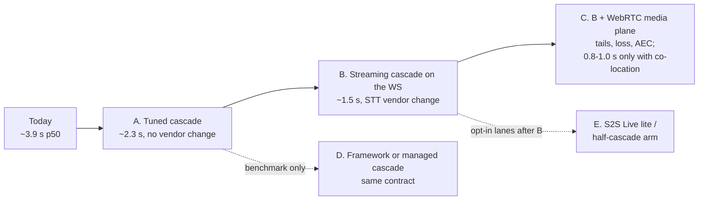
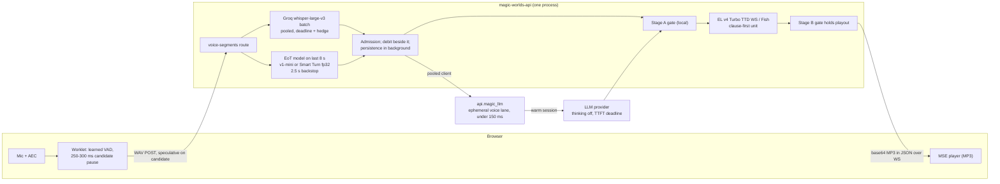
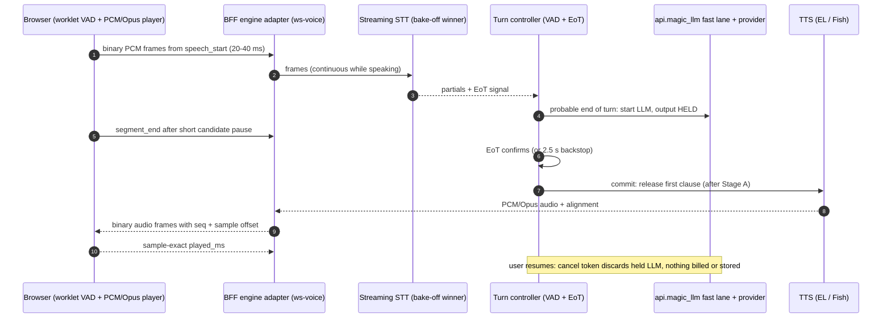
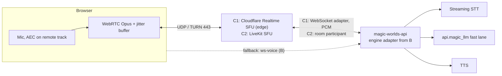
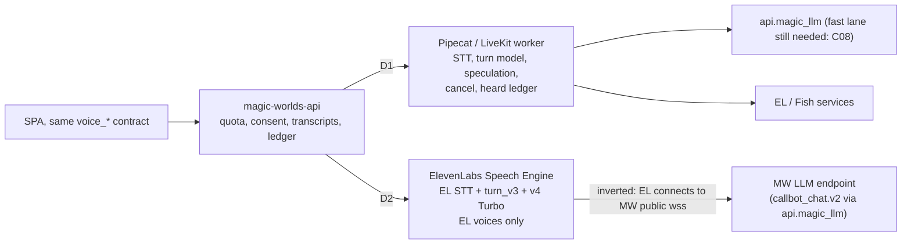
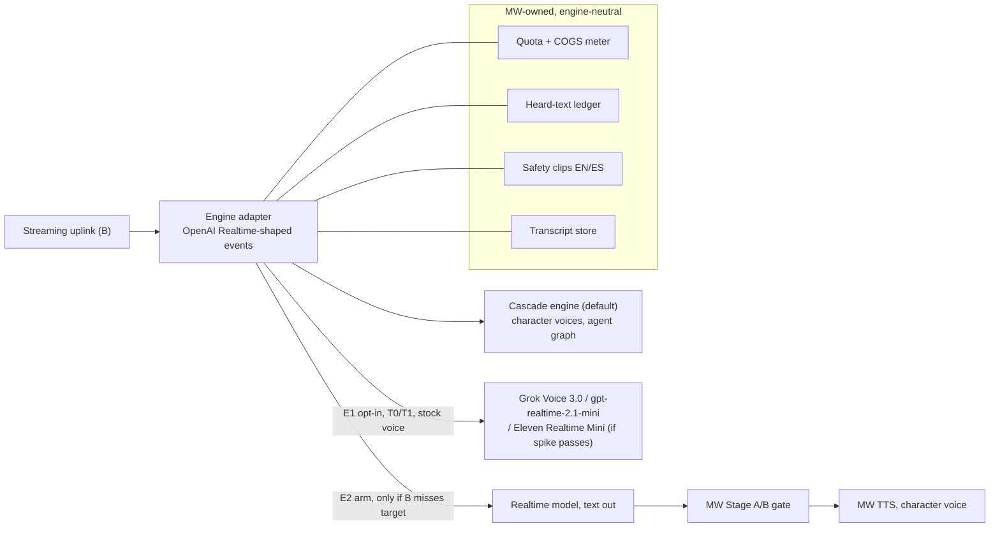
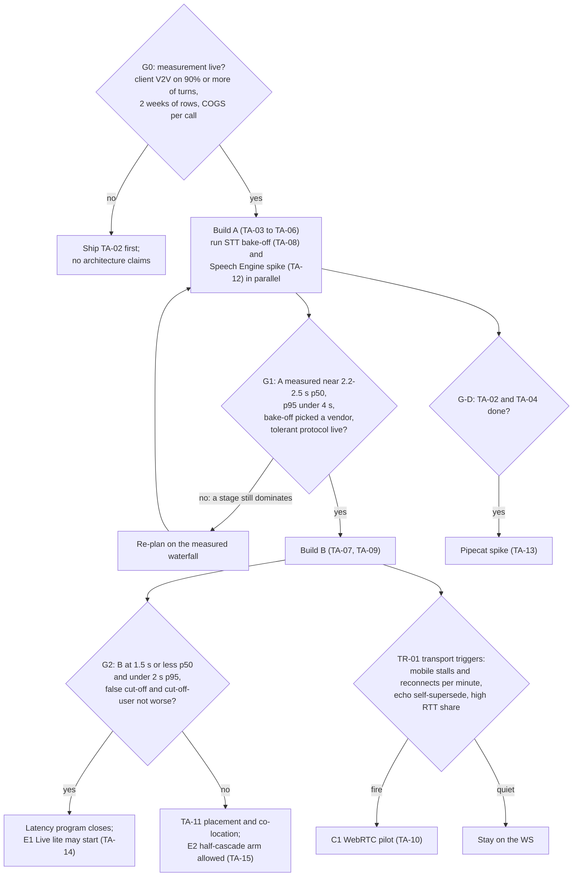
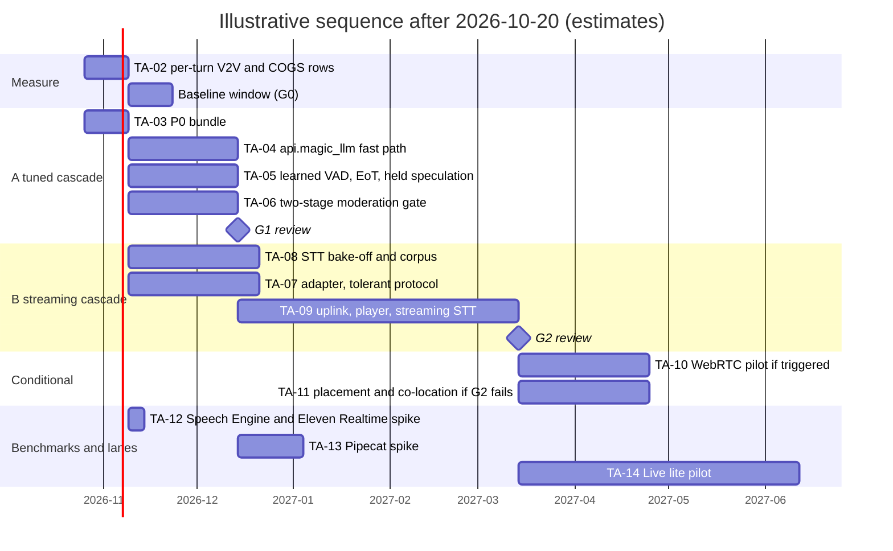

# Target architectures and options

**Research date:** 2026-10-20. **Scope:** five target architectures for the Magic Worlds live character call (browser → `magic-worlds-api` → `api.magic_llm` → providers):

- what each one changes;
- a diagram of each;
- the expected latency, cost and control trade-offs;
- a comparison table;
- a recommended path, with decision gates and the metrics that trigger each step;
- the TA- recommendations.

This document synthesizes [00](00_methodology_and_sources.md) to [14](14_safety_policy_and_compliance.md). It adds no new web research. Vendor facts come only from the fact-checked notes and the [r94 reconciliation](evidence/research/r94-gap-g4-contradictions-reconcile.md). The program-level merge with every other document's recommendations is in [17](17_recommendations_and_roadmap.md).

## Summary

- **Five targets, one contract.** Each target keeps the product contract the SPA and BFF already own: quota, transcripts, the heard-text ledger, consent and safety clips. They are:
  - **A.** Tune the current cascade: same vendors, same transport.
  - **B.** Stream the cascade over the existing WebSocket.
  - **C.** B plus a WebRTC media plane.
  - **D.** Adopt a framework or a managed cascade behind that contract.
  - **E.** Add scoped speech-to-speech (S2S) or half-cascade lanes.

  Every latency figure here is an estimate. Voice-to-voice (V2V) latency is not measured today (C13 (BE-OBSERVABILITY-SAFETY-COST-05)). The estimates are built on the reconciled ~3.9 s p50 budget in [02](02_turn_lifecycle_and_latency.md).
- **Expected V2V latency on the ElevenLabs (EL) lane (INFERENCE):**

  | Stage | p50 | p95 |
  |---|---|---|
  | Today | ~3.9 s (3.2-4.2) | 3.6-4.7 s at STT p95 |
  | A | **~2.3 s** (2.2-2.5) | ~3.1-3.4 s |
  | B | **~1.5 s** (1.3-1.9) | ~1.9-2.2 s |
  | C, media plane alone | about 50 ms better than B | gains are in loss, AEC and mobile tails |
  | C, plus a co-located worker, direct provider streaming and speculation over endpointing | **~0.8-1.0 s** | — |

  A removes about 1.6 s with no vendor change. Its largest single item is the `api.magic_llm` voice fast path: about 0.78 s, C08 (BE-LLM-02).
- **Cost.** A, B and C stay at roughly **$0.02-0.04 per call-minute** on the EL lane, because TTS is 83-93% of the bill. Streaming STT adds at most about $0.006/min, and WebRTC transport adds about $0.00001-0.001/min. Managed cascades and S2S lanes cost **$0.05-0.16/min**, which is 1.7-5× the EL reference of $0.030. The exception is gpt-realtime-2.1-mini with cache hits at $0.020, but MW's per-utterance lorebook injection breaks that cache (C35 (BE-LLM-08)).
- **Control.** Four requirements decide control: R1 (the agent graph), R2 (EL and Fish catalog voices), R5 (a pre-speech gate) and R7 (verbatim safety lines).
  - **A, B, C and a self-hosted framework worker (D1)** keep all four.
  - **ElevenLabs Speech Engine** keeps the graph and the EL voices. It drops Fish and costs at least $0.08/min.
  - **No native S2S product** keeps both the graph and the voices ([r93](evidence/research/r93-gap-g3-s2s-byo-llm-clone-compat.md)).
- **Recommended path.** Character calls stay on the cascade.
  1. **A now** (P0/P1, weeks).
  2. **B next** (P2, a quarter).
  3. **C only if** the transport triggers fire once B is in production.
  4. **D** is run as two timeboxed benchmarks: a Speech Engine spike at any time (1-2 engineer-days), and a Pipecat spike after the fast path.
  5. **E** is two opt-in experiments, both after B and behind an engine adapter: an SFW stock-voice "Live lite" pilot and a half-cascade arm.
- **Gates.**
  - **G0, measurement, gates everything.** At least 90% of turns carry a client V2V value, with two weeks of rows.
  - **G1 starts B.** A is measured near its 2.2-2.5 s estimate, and the streaming STT bake-off has picked a vendor.
  - **G2 closes or extends the program.** If B meets the 1.5 s p50 and 2 s p95 targets, the latency program closes. If not, it opens co-location and the half-cascade arm.
  - **C** is triggered by the TR-01 transport metrics.
  - **E** is governed by the entry gates and kill criteria in [11](11_speech_to_speech_and_omni_models.md).
- **Recommendations:** TA-01 to TA-15 in §7.

---

## 1. How to read this document

**Where to find what.** Today's state: §2 (baseline, what to keep, shared constraints). Best practice and the options: §3 (architectures A-E, each with its sources) and §4 (comparison). Gaps: the "Findings" each target closes in §3, §4.3, and the full matrix in [15](15_gap_analysis.md). Recommendations: §5 (decision and gates), §6 (settled design decisions) and §7 (TA-01 to TA-15). Open questions: §8.

**Labels.**

- **FACT:** seen in code, data or a primary page.
- **INFERENCE:** reasoned from facts, with the basis given.
- **UNKNOWN:** not established.
- **[est]:** arithmetic on cited inputs.

Vendor numbers carry "(vendor-reported)" or "(unverified)" as the fact-check logs direct. Finding ids are the canonical ids from [03](03_audit_findings.md), with the original id in parentheses. Gap-note findings keep their own ids (GAP-...-nn).

**How the latency estimates are built.**

- **p50.** Each p50 starts from the §4 central values in [02](02_turn_lifecycle_and_latency.md) (~3,910 ms to first audible audio). It then subtracts the per-fix savings in [02 §10](02_turn_lifecycle_and_latency.md), which are cross-checked against [04 §8](04_cascaded_pipeline_sota.md).
- **p95.** The method is cruder:
  - Take the p50.
  - Add the measured STT p95-p50 gap (1,002 - 526 = 476 ms, n=23).
  - Add the LLM p95-p50 gap from r94's planning rule. Hosted with thinking off: 0.45-0.8 s p50, 0.8-1.4 s p95, so +0.35-0.6 s.

  Summing per-stage tail gaps overstates the p95 of the total, so read these p95 figures as upper-leaning.
- **Basis.** No figure in this document is a measurement of the target. Each one must be re-based on G0 data.

**How cost is computed.**

- **Reference call.** The [r10](evidence/research/r10-cost-scaling-ops.md) / r94 reference call: 10 minutes, 4 exchanges a minute, 690 billed TTS characters a minute, a 4k-token prefix.
- **Prices.** List prices only, as tabulated in [13](13_cost_scaling_and_operations.md). These are not invoices.
- **Measured dev behaviour.** At 12.8 chars/s with 34.3% of delivered TTS unheard, the EL lane runs at about $0.033-0.043/min ([13 §2.1](13_cost_scaling_and_operations.md)).

**How control is judged.** Against requirements R1-R8 in [11 §5.1](11_speech_to_speech_and_omni_models.md):

| Id | Requirement |
|---|---|
| R1 | Agent graph |
| R2 | Catalog voices |
| R3 | T0/T1 fiction without vendor call-ends |
| R4 | English and Spanish |
| R5 | Pre-speech gate |
| R6 | Transcript and quota fidelity |
| R7 | Verbatim lines |
| R8 | Calls of at least 600 s |

Content tiers (T0/T1/T2, V1/V2) follow [14 §5](14_safety_policy_and_compliance.md).

**Errata applied.** These come from the reconciliation (§2, §5) and from the code re-checks in documents 00-14:

| Topic | What this document uses | Basis |
|---|---|---|
| EL call bitrate | **64 kbps**, not 128 (`STREAM_OUTPUT_FORMAT = "mp3_44100_64"`) | `magic-worlds-api/src/services/speech/capabilities.py:65`, used at `:159`. Fish streams 128 kbps (`magic-worlds-api/src/services/speech/providers/fish_audio/timestamp_ws.py:212`) |
| Hang-over | 550 ms (800 ms is only the worklet fallback) | `src/features/call/components/CallScreen.tsx:114` |
| Uplink | One WAV per utterance by multipart HTTP POST, not over the WebSocket | `magic-worlds-api/src/routes/user/route_voice_call.py:1130` |
| LLM retries | Up to 3 attempts of 30 s before any output, about 92 s worst case. This is magic-llm's default (`magic-llm/magic_llm/engine/base_chat.py:64`, `:72`), and the live voice path keeps it because the BFF renders the client node without `retries` (`magic-worlds-api/src/services/llm_execution_transport.py:146-175`). `retries=1` applies only to BYOK request credentials (`api.magic_llm/src/util/request_credentials.py:117`) and to the recovery factory (`api.magic_llm/src/services/llm_execution.py:287`, reached only from `inline_execution_recovery.py:266`). The deadline in TA-03 bounds it | [02 §9](02_turn_lifecycle_and_latency.md); [07 §2.5](07_llm_in_the_voice_loop.md) |
| Gemini Live cost | ≈$0.16/min on a 10-minute call ($0.07-0.10 with levers), not $0.011 | r94 §1.4 |

---

## 2. The baseline every target must beat, and keep

### 2.1 Today in one table

| Stage | Today (EL lane, moderation off, dev) | Finding |
|---|---|---|
| End of turn | Client RMS gate. Speech starts after 250 ms (500 ms while the character is audible) and ends after 550 ms of silence. 300 ms pre-roll. No neural VAD; the server energy gate is off | C02 (FE-CAPTURE-04), C03 (FE-CAPTURE-02) |
| Uplink | WAV POST after the endpoint: 20-150 ms on a LAN, up to about 700 ms on mobile | C01 (FE-CAPTURE-03), C21 (BE-ENGINE-06) |
| STT | Groq whisper-large-v3 batch, 526 / 1,002 ms p50 / p95, one attempt, 30 s timeout, under `intake_lock` | C06 (BE-STT-02) |
| BFF chain | Serial DB writes and STT debit before dispatch: 60-100 ms of DB tax p50 | C19 (BE-ENGINE-03) |
| LLM service | About 20 fsync'd commits before the provider call: 874 ms p50 (747-1,311). Then a 1.0-2.5 s tail after the stream | C08 (BE-LLM-02); GAP-TOPOLOGY-RTT-MEASUREMENTS-04 |
| Connections | Cold on most turns: +165 ms p50, plus 0.5-1.5 s stalls on a share of turns | C09 (BE-LLM-03); GAP-TOPOLOGY-RTT-MEASUREMENTS-02 |
| LLM | `callbot_chat.v2`, cap 1,536 tokens (`magic-worlds-api/src/services/llm_features.py:67`). No TTFT deadline, hedge, fallback or filler | C07 (BE-LLM-05), C37 (BE-LLM-10) |
| First TTS unit | Whole sentence on ASCII `. ! ?` or a 160-character cap. "no." and "am." are swallowed | C17 (E2E-LATENCY-TRACE-06) |
| Moderation | A 300 ms fail-closed gate through `api.magic_llm` (sentence 1 serial). Off in dev; a latent launch blocker | C04 (BE-OBSERVABILITY-SAFETY-COST-01) |
| TTS | EL `eleven_v4_turbo` on the Text-to-Dialogue multi-stream socket, prewarmed during STT, 150-350 ms first audio. Fish `drama-3` / `s2.1-pro`, 700-1,200 ms | C14 (BE-TTS-06), C43 (BE-TTS-11) |
| Downlink | Base64 MP3 in JSON over the WebSocket into MSE | C76 (BE-ROUTE-18), C48 (FE-PB-09) |
| Barge-in | 500 ms voiced, irreversible, sentence-granular on EL. A supersede after `voice_turn_end` races | C15 (E2E-08), C24 (BE-ENGINE-TURNTAKING-01), C25 (BE-TTS-08) |
| Next turn | Waits on the previous turn's persistence (1-5 s) and on supersede (0.7-6.4 s in dev) | C20 (BE-ENGINE-TURNTAKING-05); GAP-CALL-AUDIO-ASSETS-AND-MP3-TIMELINE-01 |
| **Speech end → first audible** | **~3.9 s central; 3.2-4.2 s at STT p50, 3.6-4.7 s at STT p95.** Hang-over + STT + LLM ≈ 80%. The Fish lane adds 0.5-0.9 s | [02 §4](02_turn_lifecycle_and_latency.md) |

Sources: [02](02_turn_lifecycle_and_latency.md), [03](03_audit_findings.md), [gap-finding-reconciliation](evidence/audit/gap-finding-reconciliation.md) (§7), [gap-topology-rtt-measurements](evidence/audit/gap-topology-rtt-measurements.md), [gap-real-dev-call-forensics](evidence/audit/gap-real-dev-call-forensics.md).

**Dev conversation data** ([10 §4.3](10_naturalness_and_character_experience.md)):

- Reply audio p50 is 17.6 s, and 12 of 17 replies were cut by the caller.
- 34.3% of delivered TTS was never heard.
- 5 of 23 segments ended `failed/internal`.

Several of these numbers are larger than any architecture's latency delta, and every target inherits them unless the prompt, cap and look-ahead fixes ship (NAT-01, OPS-04).

### 2.2 What every target must keep

These are strengths that every target must preserve:

- **Measuring what was heard:**
  - the `played_ms` barge-in (`src/features/interaction/hooks/useVoiceCallController.ts:658`);
  - the heard-prefix ledger (`magic-worlds-api/src/services/voice_orchestration/call_ledger.py:380`).
- **Overlaps that already work:**
  - EL socket prewarm during STT;
  - the TTS context opened in parallel with the LLM;
  - playback-gated flush-ahead;
  - working prompt-prefix caching (1,694-1,869 cached tokens after the first turn).
- **Ownership:** MW owns quota, consent and transcripts. The pre-speech gate design ("nothing reaches a speech provider before it passes", `magic-worlds-api/src/services/speech/moderation.py:1-12`) is the reason Fish and EL stay inside their terms ([14 §4.5](14_safety_policy_and_compliance.md)).

### 2.3 Constraints that bind all targets equally

These are orthogonal to the architecture choice. They must ship whichever target is chosen.

- **Single process.** Call state is process-local (`magic-worlds-api/src/services/voice_orchestration/engine.py:703`). There is one uvicorn process (`magic-worlds-api/src/serve.py:28-33`), and every deploy drops calls with 1012 (C30 (BE-ROUTE-03)). OPS-06 and OPS-07 apply to A-C and to a self-hosted D1. A vendor-hosted D2 or E lane moves media state off-box but not quota or transcripts.
- **Provider limits.** `VOICE_GLOBAL_CONCURRENCY=8` (`magic-worlds-api/src/services/voice_orchestration/config.py:41`) is above the roughly 5 calls that Groq's documented 20 RPM allows (OPS-05).
- **Safety and compliance.** The self-harm protocol is inert and the crisis numbers are `LEGAL_PENDING` (C12 (BE-OBSERVABILITY-SAFETY-COST-02)). The SAF-01 to SAF-07 work is needed for every target.

---

## 3. The architectures

Each section below gives:

- what changes and what stays;
- a diagram;
- latency with its basis;
- cost;
- control and Spanish;
- effort, risk and reversibility;
- the findings closed and left open.

### 3.1 A. Tuned current cascade

**What changes.** Every item stays on the same vendors (Groq, the current LLM route, EL and Fish) and the same transport (WAV POST up, base64 MP3 over the WebSocket down).

- **Measurement first.** A per-turn row and the client first-audible frame (OBS-01, OBS-02, CAS-01).
- **Serial waits removed.**
  - The STT debit runs beside admission, and the segment writes are asynchronous (CAS-05, LAT-04).
  - Persistence moves off the next turn (CAS-04, LAT-05).
  - The supersede race after `voice_turn_end` is closed (TT-03).
- **`api.magic_llm` voice fast path.** Option A in [07 §4.1](07_llm_in_the_voice_loop.md): ephemeral execution for BFF-owned single-node graphs, one commit after the stream, and a target of under 150 ms before the provider call (LLM-07, CAS-08, F-13).
- **Pooled, warm connections.**
  - Keep-alive of at least 120 s on Groq; provider edges keep idle connections for at least 125 s.
  - One shared BFF→`api.magic_llm` client, and a persistent magic-llm session with a DNS cache.
  - Prewarm at speech start (CAS-02, LLM-05, STT-02).
- **Learned VAD plus an end-of-turn (EoT) model on uploaded segments** (TT-09, TT-10, CAS-10):
  - a 250-300 ms client candidate pause;
  - a speculative upload with STT started at once;
  - LiveKit v1-mini or Smart Turn v3.2 fp32 on the last 8 s or less;
  - a 2.5 s backstop.

  Optionally, held speculation on the batch STT: the LLM starts with its output held and is discarded on resume (CAS-09, STT-11).
- **Clause-first TTS.** Send the first clause after about 8 words or 40 characters, fix "no."/"am.", and add Spanish abbreviations (CAS-03, TTS-03, TTS-04).
- **Moderation off the first-audio path.** The two-stage gate in [14 §3.2](14_safety_policy_and_compliance.md):
  - **Stage A:** deterministic lists plus a local or pooled-direct classifier before the vendor.
  - **Stage B:** runs during synthesis and holds playout.
  - **Routing:** never through the durable pipeline (SAF-08, LLM-13).
  - **Fish:** stays strictly pre-provider until stage B's p95 is measured.
- **Thinking off and deadlines.**
  - A non-reasoning callbot profile with zero reasoning tokens asserted (LLM-03).
  - A TTFT deadline with a filler and one bounded retry; STT deadline, hedge and fallback (LLM-06, STT-03, CAS-06).
  - Shorter replies with a backstop cap (NAT-01, LLM-04, OPS-04).

**What stays.**

- One file per utterance.
- Batch STT.
- The BFF → `api.magic_llm` → provider hop.
- The MSE player.
- Sentence-granular EL truncation, unless TT-06 ships early.

**Latency [est].**

| Basis | p50 |
|---|---|
| [02 §10](02_turn_lifecycle_and_latency.md) step 2 (LAT-02, -03, -04, -06, -07, -11) | ~3.9 s → ~3.4 s (P0) → **~2.3 s** (P1) |
| [04 §8](04_cascaded_pipeline_sota.md), with held speculation on a 250 ms provisional cut | ~2.2 s |
| [04 §8](04_cascaded_pipeline_sota.md), without speculation | ~2.5 s |

- **Range:** 2.2-2.5 s.
- **Upside not counted.** [07](07_llm_in_the_voice_loop.md) LLM-03 estimates −0.5 to −1.3 s p50 *if* the dev Haiku profile is thinking. That is an INFERENCE awaiting LLM-01. The 2.3 s figure uses LAT-11's more cautious −90 ms.
- **p95:** ~2.3 + 0.48 (STT gap) + 0.35-0.6 (LLM gap) ≈ **3.1-3.4 s** (INFERENCE, upper-leaning). Warm connections should also shrink the STT tail, which is partly cold-connect (GAP-TOPOLOGY-RTT-MEASUREMENTS-02).
- **Worst case.** Bounded by the deadlines: about 30-92 s of silence becomes a filler within about 2 s and a bounded failure (LAT-08, LAT-09).
- **Fish lane:** add 0.5-0.9 s (INFERENCE, [02 §4](02_turn_lifecycle_and_latency.md)).
- **Moderation on:** stage A adds tens of milliseconds (estimate). Stage B adds only its excess over TTS time to first byte (TTFB), against one 149 ms EL sample.

**Cost [est].**

| Lane | Today (reference / measured) | A |
|---|---|---|
| EL | $0.030 / $0.033-0.043 per min | **≈ $0.019-0.035/min** |
| Fish | $0.013 / $0.014-0.020 per min | **≈ $0.009-0.018/min** |

The A column applies OPS-04's −20-40% to the TTS share, which is 83-93% of cost.

Small additions:

- **Speculation** adds LLM calls (+50-70% for eager EoT, Deepgram, vendor-reported) on a stage that costs about $0.001-0.0056/min.
- **Extra Groq requests** on resumes cost at least about $0.0003 each, because of the 10 s floor (C63).
- **Stage A/B classifier tokens** are not computed in the evidence. `gpt-oss-safeguard-20b` lists at $0.075/$0.30 per 1M tokens (vendor-reported).
- **Heavy user** (300 min/month): about $6-11 on EL instead of $10-13 (INFERENCE).

**Control and Spanish.**

- **Control.** Everything kept: R1, R2, R5, R7 and R8. R6 improves only if OPS-02 changes the billing unit. The 18+ position is unchanged:
  - The voice lane is designed no-NSFW.
  - Fish is P for T2/V2.
  - EL is A\*.
  - T2 would need an xAI or open-weight callbot profile ([14 §5](14_safety_policy_and_compliance.md)).
- **Spanish.**
  - STT stays whisper-large-v3: 3.35% WER on read Spanish against about 2.3-2.5% for the leaders. The language is fixed per call (C33 (BE-STT-07)) until STT-07 ships.
  - The EoT choice matters most in Spanish. On [eot-bench](https://github.com/livekit/eot-bench) ES (vendor-run), the latency to a 5% false cut-off is 926 ms for v1-mini, 980 ms for Smart Turn fp32 and 1,200 ms for the silence baseline. Smart Turn int8 is worse in Spanish.
  - EL v4 Turbo rates 1215 on AA's Spanish cloned-voice board ([AA Controlled Voice](https://artificialanalysis.ai/text-to-speech/leaderboard/controlled-voice)); Fish S2.1 Pro and Drama 3 are unrated in Spanish.

**Effort, risk, reversibility.**

- **Effort:** M overall. Mostly S items, plus two M-L items: the `api.magic_llm` fast path and the two-stage gate. Weeks, not a quarter.
- **Risk:** low. No new vendor.
  - The only protocol addition is TT-10's `speech_resumed` frame. It must deploy server-first, because unknown frames are fatal today (C29).
  - The fast path changes durability semantics in `api.magic_llm`. This is acceptable for callbot, because the BFF persists the reply ([07 §4.1](07_llm_in_the_voice_loop.md)).
  - The EoT model needs a per-language threshold from the TT-02 harness.
- **Reversibility:** high. Each item can sit behind a flag or a profile.

**Findings.**

- **Closed or reduced:**

  | Finding | Change |
  |---|---|
  | C02, C03 | Reduced |
  | C04 | Unblocked |
  | C06, C07, C08, C09, C17, C19, C20, C24, C37 | Closed or reduced |
  | GAP-TOPOLOGY-RTT-MEASUREMENTS-02, -04 | Closed or reduced |
  | GAP-CALL-AUDIO-ASSETS-AND-MP3-TIMELINE-01 | Closed or reduced |

- **Left open:**
  - C01: the whole upload and batch STT stay serial after the endpoint. This is about 1 s above best practice even after every fix, as [02 §5](02_turn_lifecycle_and_latency.md) notes.
  - C76 and C48: the MP3 downlink and MSE stalls.
  - C25: sentence-granular truncation, unless TT-06 ships.

### 3.2 B. Streaming cascade over the existing WebSocket

**What changes**, on top of A:

- **Streamed uplink.** Binary PCM16 frames of 20-40 ms from `speech_start`, pre-roll included, go over the existing `ws-voice` socket, followed by a `segment_end` control frame. The session, not the POST, owns the turn. The POST stays as a fallback (TR-10, ARCH-05).
  - This needs the tolerant protocol shipped server-first, because any unknown or binary frame ends a call today (C29 (BE-ROUTE-06); TR-03).
- **Streaming STT with partials and EoT.** The vendor is chosen by an in-house EN/ES roleplay bake-off. Groq batch stays as the fallback (STT-13, STT-16). The shortlist, from [06](06_speech_to_text.md):
  - **Soniox stt-rt-v5:** best value, best Spanglish, no retention.
  - **Deepgram Flux-multi:** the best Spanish STT-integrated EoT (820 ms at 5% false cut-off), but about 2× the leaders' Spanish WER, and it needs `mip_opt_out=true`.
  - **ElevenLabs Scribe v2 Realtime:** a single vendor with the TTS, but it needs a capture notice and 5-year records.
  - **AssemblyAI** is excluded for any lane that can reach T2, because of its AUP.

  The migration runs in phases: shadow, then source, then signals ([06](06_speech_to_text.md)).
- **Speculative LLM with held output.** Start on a probable end of turn or a stable partial. Commit at the endpoint, and discard on resume or a transcript-hash change. A speculative turn is never persisted or billed (TT-14, LLM-15, STT-17).
- **Binary downlink plus an AudioWorklet player.**
  - PCM, or Opus through WebCodecs, into a ring buffer, with a binary header carrying turn, `seq`, sample offset and duration (TR-11, TR-12, TTS-12).
  - `played_ms` = consumed frames minus `outputLatency`, which makes truncation near sample-exact.
  - MSE stays as the fallback.
  - PCM or Opus output on the EL Text-to-Dialogue socket is UNKNOWN, and Fish formats are (unverified) ([08](08_text_to_speech.md)).
  - A SharedArrayBuffer ring needs COOP/COEP, which may conflict with the Google sign-in popup (UNKNOWN, [09 §8](09_transport_and_client_audio.md)). A message-port ring avoids it.
- **Word-level truncation and recoverable barge-in.**
  - EL is cut at the word using the alignment already parsed (TT-06, TTS-11).
  - Pause-then-confirm barge-in, with resume after a false interruption (TT-11).
  - A per-turn interruption note for the LLM (TT-07, LLM-11).
- **An engine adapter.** The turn loop sits behind an interface shaped on the OpenAI Realtime events:
  - `input_audio_buffer.*`, `response.*` and `conversation.item.truncate`;
  - transcript deltas and usage;
  - a vendor-end reason.

  The cascade is its first implementation (S2S-04). It also hosts the single per-turn cancel token and turn state machine (CAS-15).

**What stays.**

- Vendors other than STT.
- The `api.magic_llm` fast lane from A.
- The WebSocket over TCP.
- The single-process BFF.

**Latency [est].**

- **p50, [02 §10](02_turn_lifecycle_and_latency.md) step 3: about 2.3 s → ~1.5 s.** The step saves:

  | Fix | Saving |
  |---|---|
  | LAT-13 streaming uplink | −65 ms |
  | LAT-14 streaming STT | −250 ms |
  | LAT-15 held speculation | −150 ms |
  | LAT-11 fast host | −150 ms |
  | LAT-17 silence trim | −80 ms |
  | Remaining BFF writes | −60 ms |

  [04 §8](04_cascaded_pipeline_sota.md) gets 1.5-1.9 s with a hosted provider, and 1.3-1.5 s with a fast-silicon model at 0.25-0.45 s time to first answer token (TTFAT). Range: 1.3-1.9 s.
- **p95.** Streaming STT removes most of the STT tail: 0.7-1.3 s saved at p95 on that leg ([06](06_speech_to_text.md)). The finalization gap stays small: Pipecat's benchmark shows Nova-3 at 247/298 ms median/p95 (vendor-run). The LLM gap of +0.35-0.6 s remains, so p95 ≈ 1.5 + ~0.1 + 0.35-0.6 ≈ **1.9-2.2 s** (INFERENCE). That sits at the edge of the derived p95 target of under 2 s ([10 §1.1](10_naturalness_and_character_experience.md)).
- **Mobile.** The upload term (up to about 700 ms on a mobile uplink) leaves the critical path. This is the largest mobile-only gain (TR-10).

**Cost [est].** A plus the streaming STT delta.

- **STT per 10-minute call, continuous streaming** ([06](06_speech_to_text.md)):

  | Option | Per call | Per minute |
  |---|---|---|
  | Soniox | ≈ $0.02 | ≈ $0.002 |
  | Scribe v2 RT | ≈ $0.065 | ≈ $0.0065 |
  | Flux-multi | ≈ $0.078 | ≈ $0.0078 |
  | Groq batch today | $0.012-0.025 | |

  The extra cost is at most about $0.006/min ([13 §2.3](13_cost_scaling_and_operations.md)).
- **Speculation** adds about 28% LLM compute (literature) to +50-70% LLM calls (vendor-reported) on a stage of about $0.001/min cached.
- **A 24 kHz PCM16 downlink** is 384 kbps, about 2.9 MB per audio-minute in binary frames: about 4.5× today's EL wire bytes (64 kbps MP3 plus 33% base64, 0.64 MB/min) and about 2.3× Fish's. At r10's $0.09/GB that is ≈ $0.0003/min against ≈ $0.00006/min today ([13 §2.2](13_cost_scaling_and_operations.md)), which is negligible in money but not on weak mobile links.
- **Total:** EL ≈ $0.02-0.04/min.

**Control and Spanish.**

- **Control:** everything kept.
  - R6 improves: sample-exact `played_ms` makes "heard" billing possible if OPS-02 chooses it.
  - R5 improves when captions are released with audio (SAF-09).
  - STT retention and policy terms change with the vendor: Soniox stores nothing; Deepgram needs `mip_opt_out`; Scribe needs the capture notice and records ([14 §4.1](14_safety_policy_and_compliance.md)).
- **Spanish.** The vendor ranking flips in Spanish, so the bake-off decides it on in-house bilingual roleplay audio. Spanish EoT at a 5% false cut-off: Flux-multi 820 ms, Soniox stt-rt-preview 800 ms (its EoT degrades in Spanish), v1-mini 926 ms (eot-bench ES, vendor-run). The Soniox model scored there is the preview, not stt-rt-v5.

**Effort, risk, reversibility.**

- **Effort:** L, a quarter. Client capture and player, protocol, adapter, STT integration and speculation.
- **Risk:** medium.
  - The client audio path on iOS: WebKit 326286 and 311451.
  - The COOP/COEP question.
  - A new STT vendor with Spanish uncertainty.
  - Speculation correctness: a held turn must never leak into history or billing.
- **Reversibility:** high if staged. Streaming STT runs in shadow first, the POST and MSE stay as fallbacks, and Groq stays as the fallback STT.

**Findings.**

- **Closed:**
  - C01 and C21;
  - C67 (FE-CAPTURE-11), the early speech signal;
  - C76;
  - C48 on the worklet path;
  - C25 (word-level);
  - C15 and C16 (with TT-05/TT-11);
  - C49 (FE-UI-03), with SAF-09.
- **Left open:**
  - TCP head-of-line blocking under loss;
  - Edge AEC, where Chrome-wide AEC is not assured, so TR-12 needs a loopback AEC path;
  - iOS quirks;
  - the BFF still sits in one region with one process.

### 3.3 C. B plus a WebRTC media plane

**What changes.** The browser leg moves from the WebSocket over TCP to WebRTC: Opus, a jitter buffer, packet-loss concealment, ICE/TURN, and AEC that sees the remote track. Everything behind the media plane stays as in B. There are three variants, ranked by fit ([09 §6](09_transport_and_client_audio.md)):

| Variant | Shape | Why this rank | List cost (2026-10) |
|---|---|---|---|
| **C1. Cloudflare Realtime SFU + WebSocket adapter** (preferred pilot) | The browser speaks WebRTC to Cloudflare's edge. The SFU bridges audio to the BFF as PCM over a WebSocket | The BFF keeps a WebSocket interface, so the TR-10 and TR-12 work carries over and only the browser leg changes | SFU/TURN egress $0.05/GB after 1,000 GB/month free; ingest free ([pricing](https://developers.cloudflare.com/realtime/sfu/platform/pricing/), 2026-09-22). Whether the adapter's leg to the BFF is billed as egress is UNKNOWN |
| **C2. LiveKit (Cloud or OSS)** | The browser joins a room; the BFF or a LiveKit Agents worker joins as a participant | Mature SDKs and turn detection, but orchestration moves to a participant model. Best if D1 adopts LiveKit Agents too | Cloud: $50/month with 150,000 WebRTC-minutes, then $0.0005/min; agent hosting $0.01/min if used ([pricing](https://livekit.com/pricing), 2026-10-20) |
| **C3. Pipecat SmallWebRTC in the BFF** | An aiortc peer connection in the Python process | Prototype only. Pipecat advises against it for distributed users or more than a handful of sessions, and it adds CPU load to the single event loop (INFERENCE) | Free, plus TURN |

**Latency [est].**

- **p50.** The WebRTC/PCM playout term in [02 §10](02_turn_lifecycle_and_latency.md) step 4 is about −50 ms, so **C alone ≈ 1.45 s p50**.
- **Where the gain is.** Mostly outside the p50: concealment instead of delay under loss, an edge first hop, AEC-correct playback and ICE restart ([09](09_transport_and_client_audio.md)). The size of the p95 and mobile-tail gain is UNKNOWN until TR-01 data exists.
- **The 0.8-1.0 s band** in step 4 needs the rest of that step:

  | Item | Saving |
  |---|---|
  | A co-located voice worker streaming directly from the provider | −175 ms |
  | Warm TTS at about 150 ms | −100 ms |
  | Speculation that overlaps endpointing | −250 ms |
  | A minimal BFF gate | −50 ms |

  Those items are placement and orchestration decisions (TA-11), not transport ones. Under the same p95 method, with a fast-silicon LLM (r94: about 0.25-0.65 s p50; the bake-off p95s are about 0.5-0.9 s), the co-located variant would sit near 1.2-1.5 s p95 (INFERENCE, low confidence).

**Cost [est].** B plus transport. Transport stays far below STT, LLM and TTS spend ([09 §6](09_transport_and_client_audio.md)).

| Variant | Added cost per minute |
|---|---|
| C1, Opus to the client after the free tier | ≈ $0.000012 |
| C1, if the adapter's PCM leg is billed | + $0.0001-0.0003 |
| C2, two participant-minutes per call-minute beyond the included minutes | ≈ $0.001 |
| C2, with LiveKit agent hosting | + $0.01 |
| C3 | No vendor cost; TURN to run |

**Control and Spanish.** Unchanged from B. The media vendor sees the audio. Its retention terms were not reviewed in [r91](evidence/research/r91-gap-g1-vendor-policy-retention-matrix.md) (UNKNOWN), so the policy matrix needs a row before a pilot carries user audio.

**Effort, risk, reversibility.**

- **Effort:** M-L for C1; L for C2.
- **Risk:** medium-high.
  - New infrastructure: TURN, signalling through a vendor API, and the PCM rate of the C1 adapter, which is underspecified.
  - iOS WebKit bugs 326286 and 311451.
  - A second vendor in the media path.
- **Reversibility:** high if the WebSocket path from B is kept as the fallback, which TR-16 requires.

**Findings.**

- **Closed:** loss and jitter; C05 (FE-CAPTURE-01), the echo path, through AEC on the remote track; C23 (FE-PB-03), dead-socket detection, which is replaced by ICE.
- **Left open:** anything not in the media path, including C08 if TA-04 slips.

### 3.4 D. Adopt a framework or a managed cascade behind the same product contract

The product contract stays fixed in both variants: the `voice_*` client protocol, MW-owned quota and transcripts, `played_ms`, consent and safety clips. What changes is who runs the turn loop.

**D1. A Pipecat or LiveKit Agents worker** (self-hosted, or on Pipecat Cloud / LiveKit Cloud):

- The worker hosts streaming STT, a turn model (Smart Turn v3.2, or LiveKit's TurnDetector), held speculation, the cancel primitive and the heard ledger.
- It calls `api.magic_llm` through a custom LLM service, and EL and Fish through their services.
- Billing, quotas, moderation, persistence and resume are rewired as frame processors.

**D2. A managed cascade with our LLM.**

- **ElevenLabs Speech Engine.** EL hosts STT, `turn_v3` turn-taking, optional `speculative_turn`, a `cascade_timeout_seconds` filler window (2-15 s, default 4) and `eleven_v4_turbo` TTS with our EL voices (`tts.voice_id`).
  - Our server supplies the text over a public `wss` endpoint, and `send_response` speaks exact text.
  - Conversations default to 10 minutes and are capped at 40.
  - Fish voices are dropped ([r93](evidence/research/r93-gap-g3-s2s-byo-llm-clone-compat.md), [04 §6](04_cascaded_pipeline_sota.md)).
- **Deepgram Voice Agent API with our LLM and TTS** is in effect managed streaming STT plus turn-taking. It belongs in the B STT bake-off rather than here.
- **Eleven Realtime v1** is not a D option: "Realtime mode isn't available while the agent's LLM is a custom LLM" (r93). It is only the benchmark for what an EL-hosted cascade can reach.

**Latency [est].**

- **D1.** Same as B, or as C with WebRTC, given the same vendors. No framework removes C08: the 874 ms of `api.magic_llm` commits stays unless TA-04 ships ([04 §9](04_cascaded_pipeline_sota.md)). A framework could only win on tails and on bug classes:
  - C24-style races;
  - the C14 single-reconnect budget.

  Pipecat's published 1.044 s example (vendor-reported) uses other vendors, has no client media path, and is not a prediction for MW.
- **D2.** No published latency (UNKNOWN). Our LLM path is still in the loop, so before TA-04 it carries today's ~0.9 s pre-provider overhead plus the public-internet hop from EL to our `wss`. Eleven Realtime's 570 / 620 ms TTFA (Max / Mini, vendor-reported, Big Bench Audio, not mouth-to-ear) is the class ceiling for an EL-hosted cascade, reached without our LLM.

**Cost [est].**

| Option | Cost per minute | Basis |
|---|---|---|
| D1 self-hosted | B + worker compute (UNKNOWN) | — |
| D1 on Pipecat Cloud | B + $0.01 per active session-minute + Daily WebRTC $0.001/min | — |
| D1 on LiveKit Cloud | B + $0.01 agent-minute + WebRTC | — |
| D2 Speech Engine | **≥ $0.081** ($0.08 + our LLM) | ≥ 2.7× today's EL reference; silence discount unstated |
| Deepgram Voice Agent with our LLM and TTS | ≈ $0.050 + our TTS (≈ $0.028) + LLM ≈ $0.08 | INFERENCE |

**Control and Spanish.**

- **D1:** same as A-C if self-hosted. Hosted variants add a processor whose terms are UNKNOWN in r91.
- **D2:**
  - R1 kept (our `wss`); R2 partly (EL ✓, Fish ✗); R5 kept, because we emit the text and can gate it first; R7 kept (`send_response`); R8 kept (40-minute cap).
  - Turn-taking moves to `turn_v3`, so our EoT tuning is lost.
  - EL STT terms require a real-time capture notice and 5-year records ([14 §4.1](14_safety_policy_and_compliance.md)). INFERENCE: these apply because Speech Engine uses EL STT.
  - Policy: A\* for EL STT/TTS. The LLM and moderation remain our "Customer System" ([11 §2.3](11_speech_to_speech_and_omni_models.md)).
  - Spanish: EL STT quality on in-house audio is UNKNOWN; EL voices as today.

**Effort, risk, reversibility.**

- **Spikes:** the Pipecat worker spike is M (2-3 weeks, CAS-17); the Speech Engine spike is S (1-2 engineer-days, S2S-03 / CAS-18).
- **Adoption** is L in both cases.
- **Risk:**
  - D1 means a second runtime to operate.
  - D2 means vendor lock-in, inverted connectivity, the loss of Fish and our turn-taking, and an unpublished latency.
- **Reversibility:** medium for D1 behind the same contract; low for D2 once quotas and turn-taking move into the vendor.

**Position (INFERENCE, as in [04 §9](04_cascaded_pipeline_sota.md)).** Use D as decision data, not as a migration. Most of the gap (C08, C01) sits outside any framework's reach. Patterns are cheaper to borrow (CAS-09, -10, -13, -15).

### 3.5 E. Speech-to-speech and half-cascade lanes for specific modes

These are additional lanes behind the B engine adapter. They do not replace the character call. Every S2S vendor needs continuous audio, so no lane can attach to today's POST uplink ([11 §4.2](11_speech_to_speech_and_omni_models.md)).

**E1. "Live lite": opt-in, SFW, stock or designed voices, native S2S.**

- **Scope:** T0/T1 characters, EN and ES. MW-owned quota, transcripts, heard ledger and app-played safety clips.
- **Arms:**
  - **Grok Voice 3.0:** best AA S2S index (86.9; [AA S2S](https://artificialanalysis.ai/speech-to-speech), via [11 §2](11_speech_to_speech_and_omni_models.md)), `force_message` for verbatim lines, es-MX/es-ES, policy A.
  - **gpt-realtime-2.1-mini:** lowest cost with cache hits; `conversation.item.truncate` matches `played_ms` exactly.
  - **Eleven Realtime Mini:** only if the S2S-03 spike passes.
- **Excluded:**
  - Gemini 3.8 Live: no verbatim lines, audio-only output, about 10-minute connections, ≈ $0.16/min.
  - GPT-Live-1 for characters: paraphrases the backend, no Spanish voice, and custom voices with English accents only.
  - Hume: sunset 2026-11-13.

**E2. Half-cascade comparison arm.** A realtime model hears the audio and returns text, and MW's moderation gate and TTS speak it in the character's voice.

- **Candidates:** gpt-realtime-2.1-mini with `output_modalities:["text"]`, or Qwen 3.8 Omni RT text-out if data residency (Singapore/Beijing) were acceptable.
- **Not possible on Gemini native audio**, which outputs audio only.
- **Trade-off:** it removes the STT hop and gains audio-native turn cues. It gives up R1: the vendor writes the lines, not the lorebook-grounded agent graph.

**Latency [est].**

- **E1.** Vendor TTFA on AA (Big Bench Audio reasoning prompts; first audio token, not mouth-to-ear):

  | Model | TTFA |
  |---|---|
  | Grok 3.0 | 0.81 s |
  | gpt-realtime-2.1-mini Minimal | 0.85 s |
  | gpt-realtime-2.1 Minimal | 0.97 s |
  | Eleven Realtime (a cascade) | 0.57-0.62 s |

  Endpointing still applies: `server_vad` waits 500 ms; Gemini's default is about 800 ms; `semantic_vad` needs 1,044 ms (ES) / 1,143 ms (EN) for a 5% false cut-off. Adding a 500-800 ms silence default to the TTFA gives **about 1.1-2.2 s before client network and buffering** ([11 §7](11_speech_to_speech_and_omni_models.md), INFERENCE). p95 is UNKNOWN, because AA publishes averages.
  - E1 therefore lands in the same band as B: "a well-built cascade and a good S2S land in the same band" ([11 §7](11_speech_to_speech_and_omni_models.md)).
  - What E1 buys is full-duplex feel and vendor-tuned barge-in, not a measured latency gap.
- **E2.** UNKNOWN. No text-out timing is published, and MW's TTS first audio (150-350 ms on EL) is added after the vendor's first text.

**Cost [est], 10-minute reference call** ([11 §6.1](11_speech_to_speech_and_omni_models.md), [13 §2.5](13_cost_scaling_and_operations.md)):

| Lane | Cost per minute |
|---|---|
| gpt-realtime-2.1-mini, cache hits | $0.020 |
| gpt-realtime-2.1-mini, cache broken (a lorebook change busts it) | ≈ $0.18 |
| Grok Voice 3.0 | $0.08 + $0.004 per text input |
| Eleven Realtime Mini | ≈ $0.084-0.088 |
| Eleven Realtime Max | ≈ $0.10-0.15 |
| Gemini 3.8 Live (excluded) | ≈ $0.16 |
| E2 with gpt-realtime text-out | Not computed in r10/r94 (UNKNOWN): at least MW TTS (≈ $0.028 on EL) plus realtime input-audio and text tokens |
| E2 with Ultravox, for reference | $0.05 + EL characters |

A Live lite mode at $0.05-0.08/min costs about 1.7-2.7× the EL cascade and needs a pricing or allowance decision ([11 §6.2](11_speech_to_speech_and_omni_models.md)).

**Control and Spanish.**

- **E1.**
  - Fails R1 and R2 by design; that is the point of the scoped mode.
  - Fails R5: no text exists before audio, so vendor moderation decides, and GPT-Live can end the session. Grok has no customer pre-speech hook ([14 §3.6](14_safety_policy_and_compliance.md)).
  - R7 holds only through app-played clips or `force_message`.
  - Policy: Grok A for T2; OpenAI and Gemini P; Eleven Realtime A\* / ?.
  - Spanish: Grok es-MX/es-ES; gpt-realtime stock voices are English-native; GPT-Live has no Spanish voice; Gemini is es-US only.
- **E2.**
  - Keeps R2, R5, R6 and R7; fails R1.
  - Policy follows the realtime model: OpenAI P for T2; Qwen P de facto (Green Net).

**Effort, risk, reversibility.**

- **Effort:** L for E1 (a quarter, plus the [11 §11.1](11_speech_to_speech_and_omni_models.md) gates); M for E2.
- **Risk:**
  - Vendor churn: Hume's sunset, Grok's version churn, Ultravox's change of owner.
  - Opaque moderation.
  - Approximate, late transcripts that weaken quota and audit.
  - Grok realtime clones contested and US-only (excluding Illinois).
- **Reversibility:** high. Both lanes are opt-in, behind the adapter, and never the default.

---

## 4. Comparison

All figures are estimates unless labelled FACT. "Basis" names the document and step each estimate is built from.

### 4.1 Latency and cost

| Target | V2V p50 [est] | V2V p95 [est] | Basis | $/call-min, EL lane (Fish) | Heavy user, 300 min/month |
|---|---|---|---|---|---|
| **Today** | ~3.9 s (3.2-4.2) | 3.6-4.7 s at STT p95. Tails: 30 s STT, about 30-92 s LLM; next turn waits 0.7-6.4 s | FACT stages, INFERENCE total ([02 §4](02_turn_lifecycle_and_latency.md)) | 0.030 ref; 0.033-0.043 measured (0.013; 0.014-0.020) | $9 ref; $10-13 measured ($4-6) |
| **A** tuned cascade | **~2.3 s** (2.2-2.5) | ~3.1-3.4 s; tails bounded by deadlines | [02 §10](02_turn_lifecycle_and_latency.md) step 2; [04 §8](04_cascaded_pipeline_sota.md) | ≈ 0.019-0.035 (≈ 0.009-0.018) | ≈ $6-11 |
| **B** streaming on the WS | **~1.5 s** (1.3-1.9) | ~1.9-2.2 s | [02 §10](02_turn_lifecycle_and_latency.md) step 3; [04 §8](04_cascaded_pipeline_sota.md); [06](06_speech_to_text.md) p95 saving | A + up to ≈ 0.006 STT; ≈ 0.02-0.04 | ≈ $6-12 |
| **C** B + WebRTC, alone | ~1.45 s | Mobile and loss tails improve; size UNKNOWN | [02 §10](02_turn_lifecycle_and_latency.md) step 4, WebRTC/PCM term (−50 ms); [09](09_transport_and_client_audio.md) | B + ≈ 0.00001-0.001; + 0.01 with LiveKit agent hosting | B + ≤ $0.3 (+ $3 with agent hosting) |
| **C + co-location** (TA-11) | **~0.8-1.0 s** | ~1.2-1.5 s (low confidence) | [02 §10](02_turn_lifecycle_and_latency.md) step 4; r94 fast-silicon range | ≈ C | ≈ C |
| **D1** Pipecat / LiveKit worker | = B or C with the same vendors; C08 stays unless TA-04 ships | = B or C | [04 §9](04_cascaded_pipeline_sota.md) | B + compute (UNKNOWN), or B + ≈ 0.011 hosted | B + ≈ $3.3 hosted |
| **D2** Speech Engine | UNKNOWN (none published). Eleven Realtime 0.57-0.62 s TTFA is the class ceiling without our LLM (vendor-reported) | UNKNOWN | [r93](evidence/research/r93-gap-g3-s2s-byo-llm-clone-compat.md); [04 §6](04_cascaded_pipeline_sota.md) | ≥ 0.081 (Fish lane lost) | ≥ $24 |
| **E1** Live lite S2S | ~1.1-2.2 s before client network (TTFA + vendor endpointing) | UNKNOWN (AA reports averages) | [11 §7](11_speech_to_speech_and_omni_models.md) | Grok 0.08; gpt-realtime-2.1-mini 0.020 cached / ≈ 0.18 broken; Eleven Realtime Mini ≈ 0.084-0.088 | $24; $6 / $55; $25-26 |
| **E2** half-cascade | UNKNOWN | UNKNOWN | [11 §9](11_speech_to_speech_and_omni_models.md) | UNKNOWN: ≥ MW TTS (≈ 0.028) + realtime tokens | UNKNOWN |

Reading the table (INFERENCE):

- **Latency moves only on the left.** A and B take out about 2.4 s at p50. C on its own adds little to p50; its value is in tails and robustness.
- **Below B, placement is what counts.** The step from ~1.5 s to under 1 s is a placement and speculation decision (TA-11), not a transport one.
- **Cost moves only on the right.** Every option that keeps MW's cascade stays near today's cost. Every hosted engine costs 1.7-5× more, except a cached gpt-realtime-2.1-mini prefix, which the lorebook design breaks.

### 4.2 Control, policy and Spanish

✓ meets, ◐ partial or conditional, ✗ fails, ? unverified. R-numbers are from [11 §5.1](11_speech_to_speech_and_omni_models.md).

| Target | R1 agent graph (LLM control) | R2 catalog voices, clones | R5 pre-speech moderation | 18+ (T2) policy | R7 verbatim safety lines | Spanish |
|---|---|---|---|---|---|---|
| **A** | ✓ | ✓ EL + Fish | ✓ two-stage gate (TA-06) | As today: voice lane no-NSFW; Fish P for T2/V2; EL A\*; T2 only with an xAI or open-weight profile | ✓ app clips (pending counsel, C12) | Groq whisper ES 3.35% WER (read); learned EoT ES latency@5%: v1-mini 926 ms / Smart Turn fp32 980 ms vs 1,200 ms baseline; EL v4 Turbo ES 1215 (AA); accent dropped across languages on v4 |
| **B** | ✓ | ✓ | ✓, plus captions released with audio | As A, plus the STT vendor's terms (Soniox none; Deepgram `mip_opt_out`; Scribe A\* with notice; AssemblyAI ✗) | ✓ | Decided by the bake-off; Flux-multi best ES EoT (820 ms) but ~2× ES WER; Soniox best Spanglish |
| **C** | ✓ | ✓ | ✓ | As B, plus the media vendor's terms (UNKNOWN in r91) | ✓ | As B |
| **D1** | ✓ (custom LLM service) | ✓ (Fish alignment to verify) | ✓ re-wired as processors | As B; hosted variants add a processor | ✓ | As B |
| **D2** Speech Engine | ✓ (our public `wss`) | ◐ EL ✓, Fish ✗ | ✓ (we emit the text) | A\* EL; LLM ours | ✓ `send_response` | EL STT on our ES audio UNKNOWN |
| **E1** Live lite | ✗ vendor writes | ✗ stock or designed voices only | ✗ vendor moderation; GPT-Live can end the call | Grok A; OpenAI, Gemini P; Eleven Realtime A\* / ? | ◐ app clips; Grok `force_message` | Grok es-MX/es-ES; gpt-realtime English-native voices; `semantic_vad` ES 1,044 ms @5% |
| **E2** half-cascade | ✗ vendor writes | ✓ MW TTS | ✓ text exists before speech | Follows the realtime model: OpenAI P; Qwen P de facto | ✓ | ✓ voices; model ES quality UNKNOWN in-house |

### 4.3 Effort, risk and reversibility

| Target | Vendor change | Effort | Main risks | Reversibility | Findings mainly addressed |
|---|---|---|---|---|---|
| **A** | None (a profile change for the LLM) | M; weeks | Durability semantics in `api.magic_llm`; EoT thresholds per language | High (flags, profiles) | C02, C03, C04, C06, C07, C08, C09, C17, C19, C20, C24, C37 |
| **B** | STT vendor | L; a quarter | iOS WebKit bugs; COOP/COEP; Spanish STT; correctness of the speculation | High (shadow mode; POST, MSE and Groq fallbacks) | C01, C21, C25, C15, C16, C48, C49, C67, C76 |
| **C** | Media vendor | M-L (C1), L (C2) | TURN, signalling, adapter PCM rate, a second vendor in the media path | High with the WS fallback | C05, C23, loss and jitter |
| **D1** | Framework (+ host) | M spike, L adoption | Second runtime; billing and quotas re-wired | Medium | Bug classes (C24, C14); not C08 or C01 by itself |
| **D2** | Managed cascade | S spike, L adoption | Lock-in; Fish lost; latency unpublished; inverted connectivity | Low after adoption | C01, C02 (by outsourcing) |
| **E1** | S2S vendor(s) | L | Vendor churn; opaque moderation; late transcripts; cost | High (opt-in lane) | None of the character-call findings |
| **E2** | Realtime model | M | Lore fidelity; two bills | High (an arm) | C01 for that lane only |

---

## 5. Recommended path

### 5.1 The decision

**A → B → C only if triggered, with D as benchmarks and E as gated, opt-in lanes** (INFERENCE from §4).

- **A comes first.** It removes about 1.6 s with no vendor change, and it is a prerequisite for every other target:
  - Without the `api.magic_llm` fast path, B, C and D all keep about 0.9 s of commits.
  - Without the two-stage gate, required moderation makes every target text-only.
- **B is the only step that removes the structural floor A leaves.** That floor is the whole upload plus batch STT after the endpoint. B also brings in the engine adapter that any later lane needs.
- **C is conditional.** It buys robustness more than median speed. The sub-1 s band also needs co-location.
- **D is decision data.**
  - D2 trades Fish and at least $0.08/min for an unpublished latency.
  - A D1 framework does not remove the two largest terms.
- **E is limited by product requirements, not engineering.** It cannot carry character voices or the agent graph, so it is limited to an opt-in SFW lane and a comparison arm.

### 5.2 Gates

| Gate | Enters when | Metrics (definition, source) | Proposed pass | If it fails |
|---|---|---|---|---|
| **G0: measured baseline** | Now | `v2v_ms` = client last voiced sample → first audible, with `outputLatency` and leading silence (OBS-01, [12 §4.2](12_observability_evaluation_and_testing.md)). A per-turn stage row (OBS-02). $/call-min by vendor unit (OPS-01). Split by first turn, lane, language and device class | At least 90% of completed turns carry a client frame (the OBS-01 criterion). Two weeks of rows, the re-tune window in [09](09_transport_and_client_audio.md) and [12](12_observability_evaluation_and_testing.md). Stage intervals sum to V2V | Nothing in §4 can be confirmed. Ship only the P0 items whose value is in the tails |
| **G1: A delivered; start B** | After TA-03 to TA-06 | V2V p50/p95. Stage waterfall: endpointing, upload, STT, `mllm_pre_provider_ms`, provider TTFT, aggregation, TTS TTFB. Run start → `llm_start` (TA-04). FC@600 and latency@5% per language (TT-02) | p50 near the 2.2-2.5 s estimate. p95 under 4 s (the Maslych line, a proposal). Bake-off vendor chosen on EN/ES. TR-03 deployed server-first. COOP/COEP decided | If hang-over + upload + STT is much smaller than the 0.5-0.9 s B targets (CAS-14 estimate), re-plan B around the stage that dominates |
| **G2: B delivered** | After TA-09 | As G1, plus underruns per minute, `played_ms` error against loopback, cut-off-user rate, wasted speculative LLM calls | p50 at or below 1.5 s (the Daily/Pipecat bar and the [12](12_observability_evaluation_and_testing.md) long-term target). p95 under 2 s (the r09-derived target in [10 §1.1](10_naturalness_and_character_experience.md)). False cut-off and cut-off-user rates no worse than A | TA-11 co-location and direct streaming; the E2 arm becomes eligible (S2S-05's trigger) |
| **G-C: WebRTC pilot** | After B is in production | Mobile reconnects and playback stalls per call-minute; echo self-supersede on Edge or AEC-off calls after TR-05; share of users with a high RTT to the BFF (TR-01, TR-16) | Thresholds set from two weeks of TR-01 data, as [09 §6](09_transport_and_client_audio.md) requires. Pilot go: the mobile A/B improves stalls, reconnects, self-supersede and first-audio p95, with no V2V p50 or setup regression | Stay on the WebSocket; re-check quarterly |
| **G-D: framework or managed cascade** | Pipecat: after TA-02 and TA-04 (CAS-17). Speech Engine: any time (TA-12) | Same-harness V2V p50/p95, false cut-off, overlap-race suite, voice parity, $/min | Proposal, borrowed from [11 §11.3](11_speech_to_speech_and_omni_models.md): p50 at least 300 ms below the tuned custom path at equal or better false cut-off, with p95 not worse. Or removal of a bug class (C24, C14). For D2 also: the product accepts losing Fish and at least $0.08/min | Keep the patterns; drop the runtime |
| **G-E1: Live lite** | After B (streaming uplink) | All [11 §11.1](11_speech_to_speech_and_omni_models.md) entry gates: streaming uplink, V2V row, COGS meter, signed EN/ES safety clips, a vendor-ended-call rule, disclosure copy, an audio-mode eval harness | [11 §11.3](11_speech_to_speech_and_omni_models.md) pass criteria | [11 §11.3](11_speech_to_speech_and_omni_models.md) kill criteria, applied without exception: p95 worse than the cascade; vendor-ended calls on T0 fixtures; $/min above 2× the model; hang-ups within 30 s up 25% or more; language drift in ES |
| **G-E2: half-cascade arm** | Only if G2 fails | As G-E1, plus persona and lore fidelity in EN and ES | Fidelity within 5% of the cascade ([11 §11.3](11_speech_to_speech_and_omni_models.md) proposal) | Close the arm |

All pass thresholds above are **proposals** anchored to the cited references. They are not measurements, and the engineering owner should confirm them after G0.

### 5.3 Illustrative sequence

The durations follow the priority scale: P0 is days, P1 is weeks, P2 is a quarter, and the spikes follow [04](04_cascaded_pipeline_sota.md) and [11](11_speech_to_speech_and_omni_models.md). This is a planning sketch, not a commitment.

### 5.4 What not to do

These carry over from [04 §9](04_cascaded_pipeline_sota.md), [11 §12](11_speech_to_speech_and_omni_models.md) and [13 §6.1](13_cost_scaling_and_operations.md):

- **No S2S engine for character calls,** and no S2S transcript as the record of truth.
- **No Hume** (sunset 2026-11-13).
- **No Gemini Live for characters.** It costs ≈ $0.16/min, it is audio-only, and Tier 1 admits about 6 concurrent 10-minute calls, below `VOICE_GLOBAL_CONCURRENCY=8`.
- **No GPT-Live for characters.**
- **No force-message shells,** which pay S2S rates for TTS.
- **No `uvicorn --workers N` shortcut** before OPS-07, because it splits call state and drops `TCP_NODELAY`.
- **No framework migration** before TA-02 and TA-04. Otherwise the spike measures our backend, not the framework ([04 §9](04_cascaded_pipeline_sota.md)).
- **No managed-cascade migration** on an unpublished latency.
- **No WebRTC pilot without TR-01 data.**

---

## 6. Design decisions this document settles

Several sibling documents defer a choice to this one. They include:

- the direct-provider option in [07 §4.1](07_llm_in_the_voice_loop.md);
- Speech Engine as a hosting option in [11 §9](11_speech_to_speech_and_omni_models.md);
- the S2S scope in [14 §3.6](14_safety_policy_and_compliance.md);
- the accent policy dependency in NAT-10.

The positions below are INFERENCE from the comparison in §4.

| Decision | Choice | Why | Revisit when |
|---|---|---|---|
| Shape of the LLM fast path | **Option A**: ephemeral execution inside `api.magic_llm`, under 150 ms before the provider call | It keeps credential custody, profile rendering and the agents API. The BFF must not import `magic-agents` / `magic-llm`, which is enforced by tests. Option C, where the BFF calls the provider, duplicates provider rendering and key custody ([07 §4.1](07_llm_in_the_voice_loop.md)) | At TA-11. If the sub-1 s band is wanted, direct streaming from a co-located voice worker, or an `api.magic_llm` streaming endpoint co-located with the BFF, is the −175 ms item in [02 §10](02_turn_lifecycle_and_latency.md) step 4. Either respects the import rule, because the call stays an HTTP call (INFERENCE) |
| Where turn detection runs | **A:** the server runs the EoT model on the uploaded segment after a 250-300 ms client candidate pause. **B:** an audio EoT model or STT-integrated EoT on the stream. **E:** the same external EoT drives S2S lanes, with built-in detection off (`turn_detection: null`) | No stacked waits (TT-10). One turn policy across engines (TT-18, [11 §4.1](11_speech_to_speech_and_omni_models.md)) | When the TT-02 harness shows that a vendor's built-in EoT beats ours in both languages |
| Uplink and session ownership | **B:** binary frames on `ws-voice`; the session owns the turn; the POST stays as a fallback. ARCH-05 (202 on the POST) only if B slips | One socket carries the audio both ways, and the session already exists | Never for the POST fallback while mobile data is unmeasured |
| Downlink and player | **B:** binary PCM or Opus frames into an AudioWorklet ring; MSE as the fallback | Sample-exact `played_ms`; no 2 s MMS stall; a prerequisite for word-level truncation and heard-audio billing | If the EL Text-to-Dialogue socket cannot emit PCM or Opus (UNKNOWN), a WebCodecs decode of MP3 frames is the interim path (INFERENCE) |
| Media plane | **WebSocket** through B; **Cloudflare Realtime SFU + WebSocket adapter** as the first WebRTC option; LiveKit second | C1 replaces only the browser leg and keeps the BFF's WebSocket interface ([09 §6](09_transport_and_client_audio.md)) | If D1 adopts LiveKit Agents, C2 becomes the natural pair |
| Engine adapter | **OpenAI Realtime-shaped events**, with the cascade as the first implementation | OpenAI, xAI, ElevenLabs Realtime, Azure Voice Live and Inworld speak it. `played_ms` maps to `conversation.item.truncate` ([11 §10](11_speech_to_speech_and_omni_models.md)) | If Gemini or Nova ever enter a lane (they need translation) |
| Speech Engine | **A benchmark**, not a hosting target | It loses Fish and costs at least $0.08/min; latency is unpublished | When G-D passes and the product accepts the trade |
| S2S scope | **Opt-in SFW stock-voice lane only**, T0/T1 | R1 and R2 eliminate native S2S for characters ([11 §5.3](11_speech_to_speech_and_omni_models.md)) | On a [11 §13](11_speech_to_speech_and_omni_models.md) watch-list trigger, such as Eleven Realtime BYO LLM or clones confirmed |
| Billing unit dependency | A and B work with any OPS-02 choice. **Heard-audio billing needs B's sample-exact `played_ms`.** Connected time matches per-minute vendors (D2, E1) | Today's quota spends delivered audio against an allowance shown as call time ([13 §3](13_cost_scaling_and_operations.md)) | When OPS-02 is decided |

---

## 7. Recommendations

**Priorities:**

- **P0:** do now; days; no vendor change.
- **P1:** next; weeks.
- **P2:** architectural; a quarter.
- **P3:** experiment or watch.

Impacts are estimates (INFERENCE) unless a measurement is cited. Each item merges existing per-document recommendations; the ids in parentheses are where the detail lives.

| Id | P | Effort | Title |
|---|---|---|---|
| TA-01 | P0 | S | Record the target-architecture decision and its "do not" list |
| TA-02 | P0 | M | Gate G0: per-turn V2V and COGS, with an engine dimension |
| TA-03 | P0 | M | Architecture A, P0 bundle: remove serial waits, warm connections, bound tails |
| TA-04 | P1 | M-L | `api.magic_llm` voice fast path (option A) |
| TA-05 | P1 | M-L | Learned VAD and EoT on uploaded segments, with held speculation |
| TA-06 | P1 | M-L | Two-stage moderation off the first-audio path, before launch |
| TA-07 | P1 | M | Engine adapter, turn state machine and tolerant protocol |
| TA-08 | P1 | M | Streaming STT bake-off on in-house EN/ES roleplay audio |
| TA-09 | P2 | L | Build architecture B |
| TA-10 | P2 | M-L | WebRTC media-plane pilot (C1 first), only on TR-01 triggers |
| TA-11 | P2 | M-L | Placement, co-location and direct streaming, if G2 fails |
| TA-12 | P3 | S | Speech Engine and Eleven Realtime verification spike |
| TA-13 | P3 | M | Pipecat worker spike behind the `voice_*` contract |
| TA-14 | P3 | L | "Live lite" S2S pilot (E1) |
| TA-15 | P3 | M | Half-cascade comparison arm (E2), only if G2 fails |

### TA-01 (P0, S): Record the target-architecture decision and its "do not" list

- **What:** an ADR stating:
  - Character calls stay on the cascade.
  - The path is A → B, then C only on triggers.
  - D runs as benchmarks under G-D.
  - E runs as opt-in lanes under G-E1 and G-E2.
  - The §5.4 "do not" list applies.

  It absorbs S2S-01 and the [04 §9](04_cascaded_pipeline_sota.md) build-vs-adopt verdict.
- **Why:** R1 and R2 eliminate every native S2S product ([r93](evidence/research/r93-gap-g3-s2s-byo-llm-clone-compat.md)). The gap is orchestration: C01, C02, C07, C08 and C09. "A well-built cascade and a good S2S land in the same band" ([11 §7](11_speech_to_speech_and_omni_models.md)).
- **Expected impact (estimate):** keeps engineering on the items that remove about 2.4 s of p50 (A plus B). No user-visible change by itself.
- **Effort:** S. **Dependencies:** none.
- **Validate:** the ADR is merged and referenced from [17](17_recommendations_and_roadmap.md). No architecture work starts without its gate.

### TA-02 (P0, M): Gate G0, per-turn V2V and COGS with an engine dimension

- **What:**
  - Ship the client `voice_turn_client_metrics` frame server-first, non-fatal and capability-flagged (OBS-01).
  - Add a typed `voice_turn_metrics` / `voice_call_metrics` row with `engine`, `experiment_arm`, lane, language and `conn_reused` dimensions (OBS-02, OBS-03).
  - Measure TTFT end to end, with the pre-provider / provider split in `api.magic_llm` (OBS-05).
  - Add a per-call cost record priced from dated tables (OPS-01, S2S-02).
  - Measure with the production launcher, as a non-root user (OBS-06).
- **Why:**
  - C13: the client mark (`src/features/interaction/audio/callPlaybackTiming.ts:28-33`) has no reader.
  - C59: no exporter. C58: spend tracking covers only TTS.
  - Every figure in §4 is a reconstruction. The dev data has one EL call.
- **Expected impact (estimate):** none on latency. It turns each §4 estimate into a testable prediction, and it is the entry condition of every gate.
- **Effort:** M. **Dependencies:** none. The frame must deploy server-first because of C29.
- **Validate:**
  - At least 90% of completed turns carry `v2v_ms`.
  - Stage intervals reconcile with V2V.
  - A dashboard shows V2V p50/p95 and $/call-min per lane and engine for two weeks.

### TA-03 (P0, M): Architecture A, P0 bundle

- **What:**
  - Pooled and prewarmed connections on every hop (CAS-02, LAT-02, LLM-05, STT-02).
  - Clause-first TTS and boundary fixes (CAS-03, TTS-03, TTS-04).
  - STT debit beside admission; asynchronous segment writes (CAS-05).
  - Previous-turn persistence off the next turn (CAS-04, TT-08).
  - The supersede race after `voice_turn_end` closed (TT-03).
  - Deadlines and bounded retries on STT and LLM, with a filler (CAS-06, LLM-06, STT-03).
  - A thinking-off callbot profile with zero reasoning tokens asserted (LLM-03).
  - Shorter replies with a backstop cap and duration-bounded look-ahead (NAT-01, LLM-04, OPS-04).
- **Why:**
  - C09: +165 ms p50 cold, with 0.5-1.5 s stalls.
  - C17, C19, and C20 / GAP-CALL-AUDIO-ASSETS-AND-MP3-TIMELINE-01: 1-5 s.
  - C24, C06, C07, C37.
  - Reply audio p50 of 17.6 s (GAP-REAL-DEV-CALL-FORENSICS-08), and 34.3% unheard TTS.
- **Expected impact (estimate):**
  - p50 about 3.9 → 3.4 s ([02 §10](02_turn_lifecycle_and_latency.md) step 1).
  - A 30-92 s silence becomes a filler within about 2 s and a bounded failure.
  - 0.5-6.4 s removed from affected next turns.
  - −20-40% TTS spend (OPS-04).
- **Effort:** M (a bundle of S items). **Dependencies:** TA-02 to see the deltas; nothing blocks shipping.
- **Validate:**
  - V2V p50/p95 before and after each item.
  - Cold-connect count per call near 0.
  - Dead-air turns (no audible reply within 10 s).
  - Heard ÷ delivered ms.
  - Supersede-wait histogram.

### TA-04 (P1, M-L): `api.magic_llm` voice fast path (option A)

- **What:**
  - For BFF-owned single-node graphs like `callbot`: one admission, no per-node checkpoint rewrite before the provider call, and one commit after the stream, with `[DONE]` sent before post-stream recording.
  - Keep idempotency through a request key.
  - Keep option C (direct provider streaming) for TA-11.

  This covers LLM-07, CAS-08, F-13, OPS-10 step 1 and §6.
- **Why:**
  - C08: 874 ms p50 (747-1,311) of commits before the provider call. GAP-TOPOLOGY-RTT-MEASUREMENTS-04 was raised to critical by its verifier.
  - A 48-123 KB checkpoint is rewritten per commit (`api.magic_llm/src/db/native_execution.py:313-353`).
  - That adds up to about 3-8 MB of binlog per turn.
  - No framework (D1) removes this.
- **Expected impact (estimate):**
  - −0.6 to −0.8 s p50 (LAT-06, central −780 ms). The largest single item.
  - Removes the 1.2-1.3 s maxima and DB-saturation tails.
  - Makes speculative reruns (TA-05) cheap.
- **Effort:** M-L. **Dependencies:** the `api.magic_llm` owners; a durability decision (acceptable for callbot, because the BFF persists the reply).
- **Validate:**
  - Run start → `llm_start` p50 under 150 ms.
  - Commits per voice turn (32 today).
  - Binlog bytes per turn.
  - `Connection_errors_max_connections` delta of 0.

### TA-05 (P1, M-L): Learned VAD and EoT on uploaded segments, with held speculation

- **What:**
  - A learned VAD on both sides (TT-09).
  - A 250-300 ms client candidate pause with a speculative upload. The server runs the EoT model on the last 8 s or less: v1-mini after licence review, or Smart Turn v3.2 fp32, never int8 for Spanish. A 2.5 s backstop (TT-10, CAS-10).
  - Held LLM speculation on the candidate, discarded on resume or a transcript change, never persisted or billed (CAS-09, STT-11).
  - Thresholds per language from the TT-02 harness.
- **Why:**
  - C02: a fixed 550 ms RMS hang-over.
  - C03: no neural VAD; the server gate is off.
  - eot-bench ES (vendor-run): latency at 5% false cut-off is 926 ms (v1-mini) and 980 ms (Smart Turn fp32), against 1,200 ms for the silence baseline.
- **Expected impact (estimate):**
  - About −250 ms p50 (LAT-07).
  - Up to −300 ms more on committed turns with speculation (CAS-09).
  - Fewer fragment turns.
  - Extra LLM calls (+50-70% for eager EoT, vendor-reported) on a stage that costs about $0.001/min.
- **Effort:** M-L. **Dependencies:** TA-02, TT-02. TA-04 helps.
- **Validate:**
  - FC@600 and latency@5% per language against the worklet baseline.
  - V2V p50/p95 in a per-call A/B.
  - Fragment-turn and wasted-call rates.

### TA-06 (P1, M-L): Two-stage moderation off the first-audio path, before launch

- **What:** the [14 §3.2](14_safety_policy_and_compliance.md) design:
  - **Stage A:** signed lists plus a local or pooled-direct classifier before the vendor.
  - **Stage B:** runs during synthesis and holds playout.
  - **Timeout:** fall back to stage A, with a breaker.
  - **Routing:** never through the durable pipeline.
  - **Fish:** stays strictly pre-provider until stage B's p95 is measured.
  - **Captions** are released with their audio.

  This covers SAF-08, SAF-09, LLM-13 and F-17.
- **Why:** C04, a latent launch blocker. "Required" with no classifier refuses calls. With the classifier routed through `api.magic_llm`, most sentences would time out and calls would become text-only.
- **Expected impact (estimate):**
  - Required moderation costs tens of milliseconds plus any excess of stage B over TTS TTFB, instead of a 300 ms budget that is practically always exceeded.
  - The same gate carries over unchanged to B, C, D1 and E2.
- **Effort:** M-L. **Dependencies:** SAF-01 lists; the SAF-19 classifier bake-off; the D26 policy decision for the EL lane.
- **Validate:**
  - `moderation_ms` p50/p95 per stage.
  - First-audio delta with the gate on versus off.
  - Units skipped per turn.
  - Caption text with no released audio: 0.

### TA-07 (P1, M): Engine adapter, turn state machine and tolerant protocol

- **What:**
  - Ship TR-03 server-first: unknown and binary frames are counted, not fatal, and `protocol_version` goes in `voice_start`.
  - Put the turn loop behind an OpenAI Realtime-shaped interface (S2S-04), carrying:
    - audio in and out;
    - turn start and end;
    - cancel, and truncate at `played_ms`;
    - transcript deltas and finals;
    - usage;
    - a vendor-end reason.
  - A single per-turn cancel token and state machine owning supersede, barge-in, truncation and speculation (CAS-15).
  - The cascade is the first implementation.
- **Why:**
  - C29: deploy skew kills calls.
  - C15, C24: races between several per-stage cancel mechanisms.
  - B, C, D and E all plug in here. Vendor churn: Hume's sunset, Grok's versions, Ultravox's change of owner.
- **Expected impact (estimate):** a later vendor arm costs days, not a rewrite. Fewer race classes.
- **Effort:** M. **Dependencies:** TA-02.
- **Validate:**
  - The cascade runs through the adapter with no V2V regression.
  - A stub vendor engine passes the same contract tests.
  - Mid-call 4408 closes for non-protocol causes near 0.

### TA-08 (P1, M): Streaming STT bake-off on in-house EN/ES roleplay audio

- **What:**
  - Build the consented EN/ES fixture corpus (STT-13, OBS-09).
  - Run shadow mode (STT-16 phase A) for Soniox stt-rt-v5, Deepgram Flux-multi (with `mip_opt_out=true`) and ElevenLabs Scribe v2 Realtime.
  - Keep Groq batch as the fallback. Exclude AssemblyAI from T2-reachable lanes.
  - Measure WER/CER, entity errors, time to final, EoT FC@600 and latency@5% per language, $/min and retention terms.
- **Why:**
  - English rankings flip in Spanish.
  - Flux-multi has the best ES EoT (820 ms) but about 2× the leaders' ES WER.
  - Soniox is best on Spanglish.
  - Both independent streaming benchmarks are English-only ([06](06_speech_to_text.md)).
- **Expected impact (estimate):** decision data for G1. No latency change by itself.
- **Effort:** M. **Dependencies:** recording consent; [r91](evidence/research/r91-gap-g1-vendor-policy-retention-matrix.md) policy rows.
- **Validate:** a chosen vendor, with per-language numbers that pass the [06](06_speech_to_text.md) bake-off gates.

### TA-09 (P2, L): Build architecture B

- **What:**
  - A streamed PCM16 uplink on `ws-voice` (TR-10).
  - Binary downlink frames (TR-11).
  - An AudioWorklet player with MSE fallback (TR-12, TTS-12).
  - The streaming STT final as the transcript source, then its turn signals (STT-16 phases B-C, STT-17).
  - Held speculation on stable partials (TT-14, LLM-15).
  - Word-level EL truncation and two-stage barge-in (TT-06, TT-11, TTS-11).
  - An interruption note in history (TT-07, LLM-11).
- **Why:**
  - C01 and C21: the whole upload and batch STT are serial after the endpoint, the floor A cannot remove.
  - C76, C48, C25, C15, C16.
- **Expected impact (estimate):**
  - p50 about 2.3 → 1.5 s ([02 §10](02_turn_lifecycle_and_latency.md) step 3).
  - p95 about 1.9-2.2 s.
  - Up to about 700 ms of upload off mobile turns.
  - STT cost up to about +$0.006/min.
- **Effort:** L. **Dependencies:**
  - G1, TA-07, TA-08.
  - A COOP/COEP decision, or a message-port ring.
  - PCM or Opus from the TTS lanes (UNKNOWN on the EL Text-to-Dialogue socket).
- **Validate:**
  - V2V p50/p95 in a per-call A/B against A.
  - Underruns per minute.
  - `played_ms` error against loopback.
  - False cut-off and cut-off-user rates no worse than A.

### TA-10 (P2, M-L): WebRTC media-plane pilot, only on TR-01 triggers

- **What:**
  - C1 first: Cloudflare Realtime SFU with the WebSocket adapter. C2 (LiveKit) second. C3 (SmallWebRTC) only as a lab prototype.
  - TURN on 443. The `ws-voice` fallback stays.
  - Add the media vendor to the policy and retention matrix before user audio flows (TR-16).
- **Why:** C05 (echo when AEC is off or unreliable), C23 (dead-socket detection), loss and jitter on mobile TCP, and the AEC reality on Edge and iOS ([09 §4](09_transport_and_client_audio.md)).
- **Expected impact (estimate):**
  - About −50 ms p50.
  - Concealment instead of delay under loss, an edge first hop, and AEC-correct playback. The tail improvement is UNKNOWN until measured.
  - Cost below $0.001/min on C1.
- **Effort:** M-L. **Dependencies:** TA-02 (TR-01 data), TA-09, TA-07.
- **Validate:**
  - A mobile A/B on stalls and reconnects per call-minute, self-supersede and first-audio p95.
  - No V2V p50 or call-setup regression.
  - The iOS device matrix (TR-14).

### TA-11 (P2, M-L): Placement, co-location and direct streaming, if G2 fails

- **What:**
  - Measure RTT from Spain and Latin America to the BFF, and from each service to the Groq, LLM, EL and Fish regions.
  - Co-locate the BFF, `api.magic_llm` and the provider regions.
  - Decide between the two direct-streaming shapes in §6.
  - Pair with OPS-06 / OPS-07 so placement does not reintroduce deploy drops.

  This covers CAS-16, TR-15 and ARCH-07.
- **Why:**
  - The 0.8-1.0 s band in [02 §10](02_turn_lifecycle_and_latency.md) step 4 is mostly placement and orchestration: −175 ms direct streaming, −100 ms warm TTS, −250 ms speculation overlapping endpointing, −50 ms minimal BFF gate.
  - The production topology is UNKNOWN (GAP-TOPOLOGY-RTT-MEASUREMENTS-10).
- **Expected impact (estimate):** with C and aggressive speculation, about 0.8-1.0 s p50 (low confidence).
- **Effort:** M-L. **Dependencies:** a G2 result; the production edge documented (TR-06); OPS-07 before any second replica.
- **Validate:**
  - Per-hop RTT p50/p95 by country.
  - The V2V p50 change after the move.

### TA-12 (P3, S): Speech Engine and Eleven Realtime verification spike

- **What:** the [r93](evidence/research/r93-gap-g3-s2s-byo-llm-clone-compat.md) checklist (S2S-03, CAS-18):
  - workspace access;
  - IVC and PVC character voices in EN and ES;
  - verbatim `send_response`, first message and Say node;
  - truncate semantics against `played_ms`;
  - TTFA and V2V from MW's region on the TA-02 harness;
  - effective $/min;
  - Speech Engine's inverted `wss` and 40-minute cap.

  It can run any time; it takes 1-2 engineer-days.
- **Why:**
  - Speech Engine is the only hosted product that keeps the graph and EL voices.
  - Eleven Realtime is the only S2S product that might keep EL voices.
  - Neither publishes latency for our setup.
- **Expected impact (estimate):** closes D2 as a decision. It also decides whether Eleven Realtime Mini joins E1.
- **Effort:** S. **Dependencies:** an EL workspace with Realtime enabled; TA-02 for a like-for-like V2V.
- **Validate:** each checklist item is marked pass, fail or unknown, with recordings and timing logs.

### TA-13 (P3, M): Pipecat worker spike behind the `voice_*` contract

- **What:**
  - A 2-3 week Pipecat worker, keeping the client contract and `api.magic_llm` (with TA-04), on the same harness as the tuned custom path (CAS-17).
  - Use LiveKit Agents instead if TA-10 picks C2.
  - Adopt only under G-D.
- **Why:** frameworks bring a turn model, speculation, cancellation and heard-ledger patterns. They do not remove C08 or C01 ([04 §9](04_cascaded_pipeline_sota.md)).
- **Expected impact (estimate):** decision data. A possible removal of race classes (C24, C14).
- **Effort:** M. **Dependencies:** TA-02, TA-04.
- **Validate:**
  - Same-harness V2V p50/p95 and false cut-off.
  - The overlap-race suite.
  - Operational load (a second runtime).

### TA-14 (P3, L): "Live lite" S2S pilot (E1)

- **What:** the S2S-06 / P-B pilot:
  - opt-in, T0/T1 characters, stock or designed voices, EN and ES;
  - Grok Voice 3.0 and gpt-realtime-2.1-mini arms, plus Eleven Realtime Mini if TA-12 passes;
  - external EoT, MW quota, heard ledger and app-played safety clips;
  - every [11 §11.1](11_speech_to_speech_and_omni_models.md) entry gate, and the kill criteria applied without exception.
- **Why:** it is the only place native S2S fits ([11 §5.3](11_speech_to_speech_and_omni_models.md)). It tests whether full-duplex feel matters more to users than the character's own voice, which no MW data shows today.
- **Expected impact (estimate):**
  - Possible gains in turn-taking feel for small talk.
  - COGS about 1.7-2.7× the EL cascade.
  - A plan or pricing decision is needed.
- **Effort:** L. **Dependencies:**
  - TA-09 (streaming uplink), TA-07, TA-02 (COGS by vendor unit).
  - Signed EN/ES safety clips: SAF-03, blocked by `LEGAL_PENDING`.
  - A vendor-ended-call rule (SAF-15).
  - OPS-02 (billing unit).
- **Validate:** the [11 §11.3](11_speech_to_speech_and_omni_models.md) metrics: V2V, false cut-off, vendor-ended calls per 100, transcript completeness, $/connected minute, opt-in retention, and hang-ups within 30 s.

### TA-15 (P3, M): Half-cascade comparison arm (E2), only if G2 fails

- **What:** gpt-realtime-2.1-mini in text-out mode, feeding the TA-06 gate and EL TTS in the character's voice, for T0/T1 characters in EN and ES, against B (S2S-05).
- **Why:** it keeps R2, R5, R6 and R7, and tests whether audio-native understanding beats streaming STT plus semantic EoT. It gives up R1, so it is an experiment, not a direction.
- **Expected impact (estimate):** UNKNOWN. It may cut the STT hop and false cut-offs. It may lower persona and lore fidelity.
- **Effort:** M. **Dependencies:** TA-02, TA-07, B's measured baseline. Trigger: G2 fails.
- **Validate:** the [11 §11.3](11_speech_to_speech_and_omni_models.md) metrics, with persona and lore fidelity in Spanish within 5% of the cascade.

---

## 8. Open questions and UNKNOWNs

1. **Production V2V.** No figure exists (C13). Every §4 estimate waits on TA-02.
2. **The ~1.85 s fixed "provider intercept"** that forensics fitted is unexplained once the OpenRouter poll is ruled out ([02 §4](02_turn_lifecycle_and_latency.md)). It may hide a slower TTFT than A and B assume (GAP-REAL-DEV-CALL-FORENSICS-07).
3. **The production callbot model and route** are UNKNOWN. They set LLM latency, cache behaviour and whether T2 is possible at all ([14 §4.2](14_safety_policy_and_compliance.md)).
4. **Production topology and region** are UNKNOWN (GAP-TOPOLOGY-RTT-MEASUREMENTS-10). The size of C's and TA-11's gains depends on them.
5. **TTS output formats.** PCM or Opus on the EL Text-to-Dialogue multi-stream socket is UNKNOWN; Fish formats are (unverified). Both decide B's player path.
6. **COOP/COEP** compatibility with the Google sign-in popup is UNKNOWN. It decides whether B's ring buffer can use SharedArrayBuffer.
7. **The C1 adapter.** Its PCM rate and whether its leg to the BFF is billed as egress are UNKNOWN.
8. **Media and hosting vendors' retention terms** (Cloudflare, LiveKit, Daily) were not reviewed in r91.
9. **Speech Engine** has no published latency. Its silence discount is unstated, and PVC behaviour on v4 is unknown.
10. **Eleven Realtime.** IVC is probable but untested, and PVC is unknown. **Grok.** Realtime clones are contested and US-only (excluding Illinois); whether "tokens included" holds is (unverified).
11. **Whether a cancelled turn stops provider generation and spend** is UNKNOWN. This matters for the speculation cost in TA-05 and TA-09.
12. **The production share of AEC-off or raw-fallback calls** is UNKNOWN (C05). It decides how strongly the G-C triggers fire.

---

## 9. Evidence and related documents

**Sibling documents.**

- [00 methodology](00_methodology_and_sources.md) (errata)
- [01 current architecture](01_current_architecture.md) (ARCH-05, ARCH-07)
- [02 turn lifecycle and latency](02_turn_lifecycle_and_latency.md) (§4 budget, §10 realistic path)
- [03 audit findings](03_audit_findings.md)
- [04 cascaded pipeline SOTA](04_cascaded_pipeline_sota.md) (§8, §9 build vs adopt)
- [05 turn-taking](05_turn_taking_and_interruptions.md)
- [06 STT](06_speech_to_text.md)
- [07 LLM](07_llm_in_the_voice_loop.md) (§4.1 fast-path options)
- [08 TTS](08_text_to_speech.md)
- [09 transport](09_transport_and_client_audio.md) (§6 options)
- [10 naturalness](10_naturalness_and_character_experience.md)
- [11 S2S](11_speech_to_speech_and_omni_models.md) (§5 matrix, §11 pilots)
- [12 observability](12_observability_evaluation_and_testing.md)
- [13 cost and operations](13_cost_scaling_and_operations.md)
- [14 safety and compliance](14_safety_policy_and_compliance.md)
- [15 gap analysis](15_gap_analysis.md)
- [17 recommendations and roadmap](17_recommendations_and_roadmap.md)
- [README](README.md)

**Audit evidence.**

- [gap-finding-reconciliation](evidence/audit/gap-finding-reconciliation.md) (§2, §5, §7 and Verification)
- [gap-real-dev-call-forensics](evidence/audit/gap-real-dev-call-forensics.md)
- [gap-topology-rtt-measurements](evidence/audit/gap-topology-rtt-measurements.md)
- [gap-real-call-overlap-history-billing](evidence/audit/gap-real-call-overlap-history-billing.md)
- [gap-call-audio-assets-and-mp3-timeline](evidence/audit/gap-call-audio-assets-and-mp3-timeline.md)
- [gap-segment-post-and-control-plane-unknowns](evidence/audit/gap-segment-post-and-control-plane-unknowns.md)
- [be-llm](evidence/audit/be-llm.md)
- [e2e-latency-trace](evidence/audit/e2e-latency-trace.md)
- [fe-capture](evidence/audit/fe-capture.md)
- [fe-playback-transport](evidence/audit/fe-playback-transport.md)

**Research notes.**

- [r01 cascaded architecture](evidence/research/r01-cascaded-architecture.md)
- [r02 turn-taking](evidence/research/r02-turn-taking.md)
- [r03 streaming STT](evidence/research/r03-streaming-stt.md)
- [r04 streaming TTS](evidence/research/r04-streaming-tts.md)
- [r05 LLM for voice](evidence/research/r05-llm-for-voice.md)
- [r06 transport](evidence/research/r06-transport-client-audio.md)
- [r07 S2S](evidence/research/r07-speech-to-speech-omni.md)
- [r08 evaluation](evidence/research/r08-eval-observability.md)
- [r09 naturalness and roleplay](evidence/research/r09-naturalness-roleplay.md)
- [r10 cost](evidence/research/r10-cost-scaling-ops.md)
- [r91 policy matrix](evidence/research/r91-gap-g1-vendor-policy-retention-matrix.md)
- [r92 Spanish](evidence/research/r92-gap-g2-spanish-bilingual-evidence.md)
- [r93 BYO LLM and clones](evidence/research/r93-gap-g3-s2s-byo-llm-clone-compat.md)
- [r94 reconciliation](evidence/research/r94-gap-g4-contradictions-reconcile.md)

**Primary pages cited directly** (accessed 2026-10-20 unless dated):

- [Cloudflare Realtime SFU pricing](https://developers.cloudflare.com/realtime/sfu/platform/pricing/) (2026-09-22)
- [LiveKit pricing](https://livekit.com/pricing)
- [LiveKit eot-bench](https://github.com/livekit/eot-bench) (vendor-run)
- [Artificial Analysis S2S leaderboard](https://artificialanalysis.ai/speech-to-speech) and [TTS Controlled Voice board](https://artificialanalysis.ai/text-to-speech/leaderboard/controlled-voice)
- All other vendor figures are taken from the notes above, with the dates those notes give.
