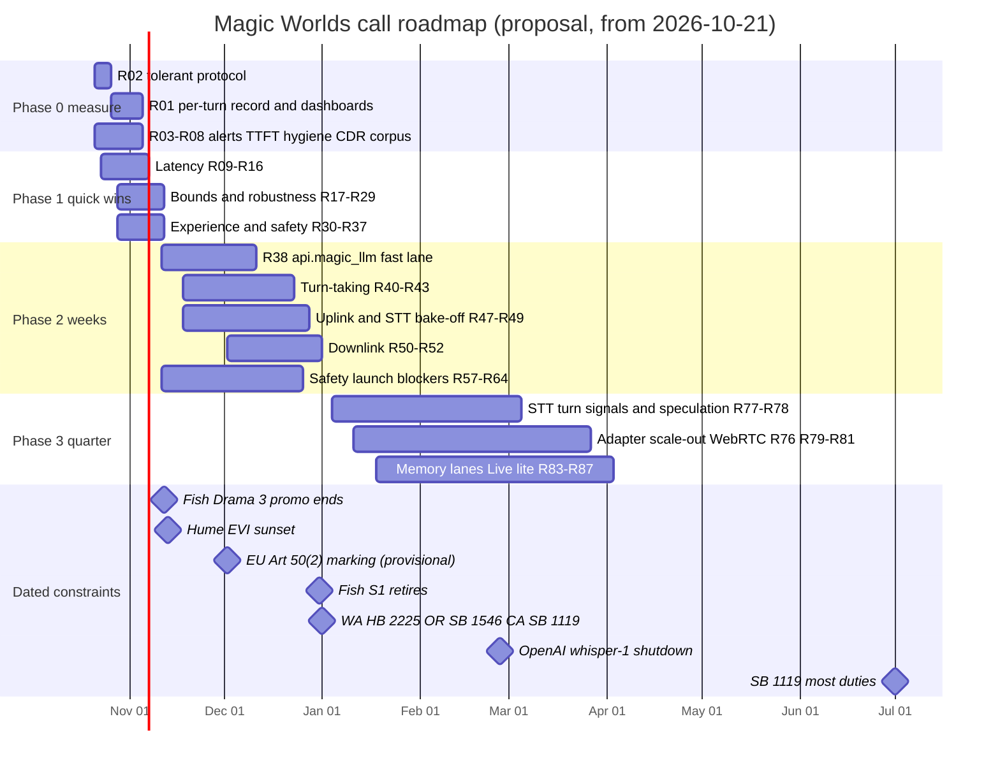
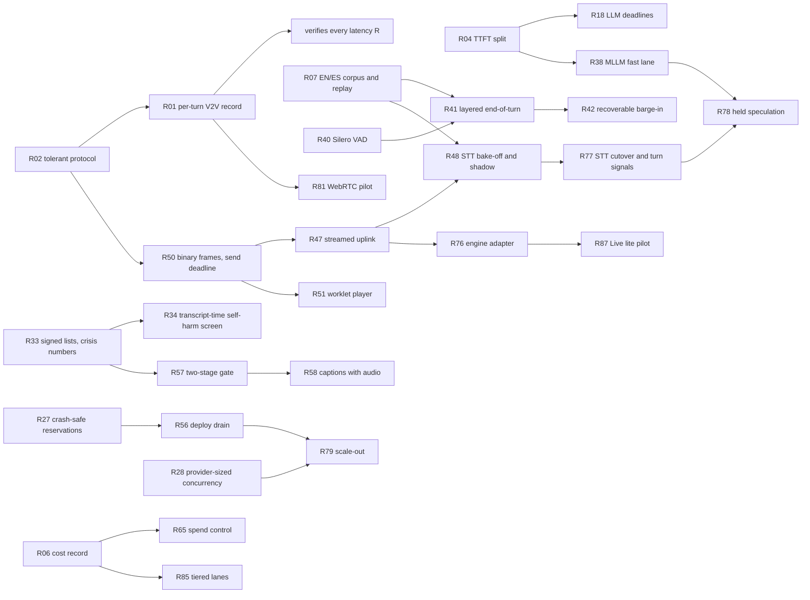
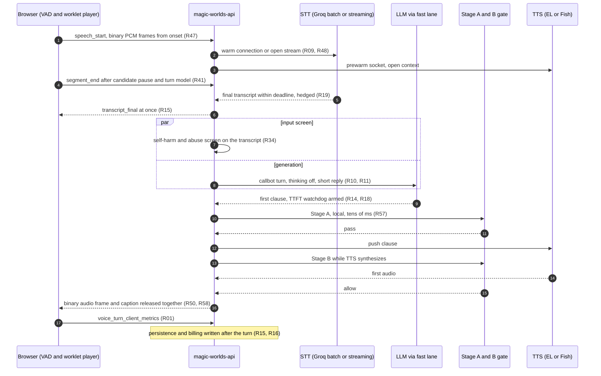

# Recommendations and roadmap

**Research date:** 2026-10-20. **Scope:** one de-duplicated, sequenced program for Magic Worlds live character calls, built from every recommendation in [02](02_turn_lifecycle_and_latency.md) to [14](14_safety_policy_and_compliance.md), plus the M- and ARCH- items of [00](00_methodology_and_sources.md) and [01](01_current_architecture.md). It contains a ten-item short list, 90 global recommendations (R01-R90) in four phases and a watch list, KPI targets per phase, an experiment plan, top risks, and the decisions that belong to the engineering owner. No new research was done: every number comes from the sibling documents and their evidence. The gap analysis is in [15](15_gap_analysis.md) and the target architectures in [16](16_target_architectures.md).

## Summary

- **Where calls stand (INFERENCE from dev data).** Speech end to first audio on the ElevenLabs (EL) lane takes about 3.2-4.2 s at STT p50 and 3.6-4.7 s at STT p95. Real dev calls ran about 4-6 s, and one sample took about 5.5 s. The hang-over, STT and the LLM hop make up about 80% of it. The tails have no bound: 30 s for STT and 30-92 s for the LLM. Replies run p50 17.6 s of audio, callers cut 12 of 17, and 34.3% of delivered TTS was never heard. Nothing measures what the caller actually hears.
- **Phase 0, measure first (R01-R08, about two weeks).** Ship a per-turn client V2V frame and a durable per-turn row behind a tolerant protocol, plus a cost record and an EN/ES replay corpus. Every later latency claim is checked against these.
- **Phase 1, quick wins (R09-R37, days, no vendor change).** Warm connections, a clause-level first chunk, writes off the path, an unblocked next turn, bounded waits, short replies, thinking off, the Fish markup crash fix, the echo guard, billing fixes and the first safety items. Estimated p50: about 3.4 s, plus 0.5-1.3 s of further upside if the voice model reasons today (UNKNOWN). Worst-case dead air falls from about 30-92 s to about 5 s.
- **Phase 2, weeks (R38-R75).** The api.magic_llm voice fast lane (−0.6 to −0.8 s by LAT-06, −0.7 to −1.1 s by LLM-07; this plan uses LAT-06's central −780 ms; the largest single item), a turn model behind a 300 ms candidate pause, recoverable barge-in, a streamed uplink, the streaming STT bake-off, binary and PCM downlink with sample-exact `played_ms`, and the safety launch blockers. Estimated p50: about 2.3 s (2.2-2.5 s across docs).
- **Phase 3, a quarter (R76-R87).** Streaming STT as the transcript source with its turn signals, held speculation, an engine adapter, scale-out, a WebRTC pilot gated on telemetry, memory across calls and a gated S2S "Live lite" pilot. Estimated p50: about 1.5 s. Reaching 0.8-1.0 s needs the architecture moves in [16](16_target_architectures.md).
- **Stance.** Character calls stay on the cascade. No S2S product keeps both the agent graph and per-character voices, and the latency gap comes from orchestration, not architecture ([11](11_speech_to_speech_and_omni_models.md)). A well-built WebSocket comes before WebRTC. Voice stays no-NSFW (T0/T1/V1) unless the owner decides otherwise.
- **Launch blockers that are not about latency.** Setting moderation to "required" refuses or silences calls (C04). Self-harm detection is inert and the crisis numbers are `LEGAL_PENDING` (C12). New York and California companion laws already apply. The fixes sit in Phase 1 (lists, a transcript-time screen, copy) and Phase 2 (the two-stage gate).
- **Owner decisions (§13).** The billing unit, the default TTS lane and its price, the streaming STT vendor, the voice LLM and host, the T2 stance, the api.magic_llm fast-lane option, the moderation D26 amendment, and the California SB 1119 approach before 2027-07-01.

---

## 1. If you only do ten things

| # | Do this | R | Why (finding) | Expected effect (estimate) | Effort |
|---|---|---|---|---|---|
| 1 | Ship the per-turn V2V record: a client `voice_turn_client_metrics` frame, server-first and non-fatal, plus a `voice_turn_metrics` row | R01, R02 | C13 (BE-OBSERVABILITY-SAFETY-COST-05): the client mark at `src/features/interaction/audio/callPlaybackTiming.ts:28-33` has no reader. C29 (BE-ROUTE-TRANSPORT-06): any new frame is fatal today | Every other line here becomes verifiable. No latency change by itself | M |
| 2 | Keep connections warm (keep-alive ≥ 120 s, shared pools) and prewarm on speech start | R09 | C09 (BE-STT-04): cold TLS costs +165 ms p50, with 0.5-1.5 s stalls on about 1 turn in 3 on the dev network | −80 to −165 ms p50; most stall tails removed | S |
| 3 | Turn thinking off for the voice lane, and make replies short: one or two sentences, a cap of about 200 tokens, a duration-bounded look-ahead | R10, R11, R13 | Only `'none'` disables reasoning (`magic-worlds-api/src/services/llm_execution_transport.py:198-205`). C37 (BE-LLM-10): 1,536-token cap, replies p50 17.6 s, 34.3% unheard | −0.5 to −1.3 s if reasoning is on today (UNKNOWN); −20-40% TTS spend; fewer interruptions | S |
| 4 | Free the next turn: move persistence off the path, and cut a superseded reply even after `voice_turn_end` | R16, R17 | C20 (BE-ENGINE-TURNTAKING-05): +1-5 s in 5 of 13 transitions, and waits of 0.7-6.4 s on 4 of 19 turns. C24 (BE-ENGINE-TURNTAKING-01): the supersede race, which lets a reply talk over the caller | −0.5 to −5 s on overlap turns | S-M |
| 5 | Bound every wait: a 3-5 s STT deadline with a hedge; an LLM TTFT watchdog, a 10-15 s turn deadline, at most one retry and an in-character recovery line | R18, R19 | C06 (BE-STT-02): one 30 s STT attempt. C07 (BE-LLM-05): up to 3 attempts of 30 s, about 92 s of LLM silence (§2.3) | Worst-case dead air falls from about 30-92 s to about 5 s | S-M |
| 6 | Never fail a turn over markup: fix the Fish ledger and add a spoken-text contract | R20 | GAP-REAL-DEV-CALL-FORENSICS-01 (high): 5.3-6.4 s of silence, then an error, in 2 of 15 Haiku turns on the Fish lane. C10 (BE-LLM-01) | Turn failures caused by markup fall to 0 | S |
| 7 | Send a clause-level first chunk, and take BFF writes off the critical path | R14, R15 | C17 (BE-LLM-11), C18 (BE-TTS-02), C19 (BE-ENGINE-TURNTAKING-03) | About −100 to −450 ms p50 combined (LAT-03 plus LAT-04 estimates) | S-M |
| 8 | Build the api.magic_llm voice fast lane: ephemeral execution, option A | R38 | C08 (BE-LLM-02): about 20 fsync'd commits, p50 about 0.87 s before the provider request | −0.6 to −1.1 s p50 (LAT-06: −0.6 to −0.8 s, central −780 ms, used in §3.3; LLM-07: −0.7 to −1.1 s); the largest single item | M-L |
| 9 | Clear the safety launch blockers: signed lists, crisis numbers, a transcript-time self-harm screen, then the two-stage gate | R33, R34, R57 | C04 (BE-OBSERVABILITY-SAFETY-COST-01), C12 (BE-OBSERVABILITY-SAFETY-COST-02). NY GBL Art. 47 and CA SB 243 are in force | Calls can launch with moderation on and still audible. The input screen adds about 0 ms (INFERENCE) | S, then M-L |
| 10 | Stream the uplink over the existing socket, then run the streaming STT bake-off with Groq batch as the fallback | R47, R48 | C01 (FE-CAPTURE-03): a whole-utterance WAV POST after the hang-over makes streaming STT impossible | −250 to −550 ms p50 (LAT-14) and −0.7 to −1.3 s p95 (STT-16) once streaming STT lands (estimates) | M, then L |

The next two are the echo guard for calls without verified AEC (R22, C05 (FE-CAPTURE-01)) and the billing-unit decision (R26), which stops users paying for unheard, echo and no-speech audio.

---

## 2. How to read this roadmap

### 2.1 Conventions

- **Where to find what.** Today's state: §2.2 (baseline) and §2.3 (corrections). Best practice and SOTA: not restated here; each R row cites the sibling document that sources it, and [15](15_gap_analysis.md) §4 holds the practice-by-practice comparison. Gaps: the "Why (findings)" column of each R row, with the full gap matrix in [15](15_gap_analysis.md). Recommendations: §1 (short list) and the phase tables in §4-§8, with sequencing in §3, KPIs in §9, experiments in §10, risks and owner decisions in §12-§13, and open questions in §15.
- **Priorities.**
  - **P0:** do now, in days, with no vendor change. All of Phase 0 and Phase 1.
  - **P1:** weeks. Phase 2.
  - **P2:** a quarter, architectural. Phase 3.
  - **P3:** experiment or watch.

  Where a source document rated an item differently, the mapping in §14 records the change.
- **Labels.** FACT, INFERENCE and UNKNOWN follow [00](00_methodology_and_sources.md). Impact figures are estimates unless marked FACT. Most come from the merged local recommendation.
- **Effort.** S means days, M means 1-3 weeks, L means longer.
- **Area.**
  - FE: this SPA.
  - BFF: `magic-worlds-api`.
  - MLLM: `api.magic_llm`, together with the magic-llm library.
  - ops, product, legal.
- **Finding ids.** Canonical ids are written `Cnn (ORIGINAL-ID)`, from [03](03_audit_findings.md) and [gap-finding-reconciliation](evidence/audit/gap-finding-reconciliation.md). Gap-note findings keep their own ids (GAP-…). Local recommendation ids (LAT-, F-, CAS-, TT-, STT-, LLM-, TTS-, TR-, NAT-, S2S-, OBS-, OPS-, SAF-, M-, ARCH-) point to the sibling documents.
- **Validation targets** are proposals for the owner to confirm after two weeks of R01 data, unless a source gives them.
- **Other ids.** X1-X12 are the experiments in §10. OD1-OD13 are the owner decisions in §13. D06 and D26 are existing project decisions cited by the sibling documents. E1-E22 are the errata in [00](00_methodology_and_sources.md). TA- ids are from [16](16_target_architectures.md), and G0-G2 are its gates.

### 2.2 The baseline this roadmap starts from

All rows are FACT from code or dev data, except where marked.

| Stage | Today | Where |
|---|---|---|
| Uplink | One 16 kHz mono PCM16 WAV per utterance, sent as a multipart POST to `/character-chats/{id}/voice-segments`. The WebSocket carries only control frames and base64 MP3 downlink inside JSON | `magic-worlds-api/src/routes/user/route_voice_call.py:1130`; `magic-worlds-api/src/services/voice_orchestration/delivery.py:464` |
| Client VAD | RMS AudioWorklet with an adaptive floor. `speech_start` after 250 ms voiced (500 ms while the character is audible). The turn ends after 550 ms of silence; 800 ms is only a fallback, and the 450 ms "strict" mode is unreachable. 300 ms pre-roll. Segments cap at 7.5 s until consent, then 29.5 s; the server caps at 30 s and 2 MB | `src/features/call/components/CallScreen.tsx:114` |
| Server VAD | The energy gate is off (`VOICE_VAD_ENERGY_GATE_ENABLED=false`); only a 0.002-peak digital-silence floor applies. No neural VAD exists anywhere | [06](06_speech_to_text.md) |
| STT | Groq whisper-large-v3, batch, one attempt, 30 s timeout, no fallback, serialized under `intake_lock`. Dev p50 526 ms, p95 1,002 ms (n=23). Groq bills a 10 s minimum per request | `magic-worlds-api/src/services/voice_orchestration/stt_groq_client.py:91-108` |
| LLM | `callbot_chat.v2` runs through api.magic_llm. About 20 fsync'd commits come before the provider request (0.75-1.3 s, p50 about 0.87 s), and a 1-2.5 s post-stream tail follows. Cold TLS to the provider and to Groq adds about +165 ms p50. One probe took 1,579 ms to first text. Output cap 1,536 tokens. No TTFT deadline, hedge, fallback or filler. The OpenRouter usage poll is off the first-audio path (C39, info) | `magic-worlds-api/src/services/llm_features.py:67`; `api.magic_llm/src/routes/completions.py:991-1004` |
| Moderation | Per sentence, fail-closed, 300 ms budget, off in dev. Only sentence 1 pays it serially. "Required" alone refuses calls, and routing it through api.magic_llm would likely time out (a latent launch blocker). Voice self-harm detection is inert. Crisis numbers are `LEGAL_PENDING` | `magic-worlds-api/src/services/speech/moderation.py:1-12`; [14](14_safety_policy_and_compliance.md) §2 |
| TTS | EL `eleven_v4_turbo` on the Text-to-Dialogue multi-stream WebSocket, `mp3_44100_64` (64 kbps; `magic-worlds-api/src/services/speech/capabilities.py:65`, `:159`), with sync alignment; the socket is prewarmed during STT and the context opens in parallel with the LLM. Fish drama-3 / s2.1-pro on `/v1/tts/live/with-timestamp`, 128 kbps, `chunk_length` 100, `latency: 'balanced'`, no first-audio watchdog (only 90 s), a 1,200-character / 64-unit cap. `SentenceBuffer` cuts only at ASCII `. ! ?` plus a 160-character cap, and its abbreviation list swallows "no." and "am.". Flush-ahead runs about 8 s or 3 sentences ahead. One TTS reconnect, then the call is text-only | `magic-worlds-api/src/services/speech/providers/fish_audio/timestamp_ws.py:212`; `magic-worlds-api/src/services/voice_orchestration/sentence_buffer.py:11-19`; `magic-worlds-api/src/services/voice_orchestration/call_tts_elevenlabs.py:14-21` |
| Barge-in | 500 ms of voiced energy, then a local cancel and `voice_barge_in{turn_id, played_ms}`. Suppressed in the first 3 s after the call's first audible reply (`AEC_WARMUP_MS`) and whenever AEC is off. Irreversible. Truncation is sentence-granular on EL (D06). A supersede race exists after `voice_turn_end`. Interruptions are invisible to the LLM | `src/features/interaction/hooks/useVoiceCallController.ts:658`, `:676-687`; `magic-worlds-api/src/services/voice_orchestration/call_ledger.py:380-392` |
| Dev data | Replies p50 17.6 s of audio. 12 of 17 interrupted. Supersede waits 0.7-6.4 s. 5 of 23 STT-completed segments failed `internal`: 2 Fish ledger crashes and 3 pre-admission failures. The Fish ledger crashes on markup or emoji. Previous-turn persistence delays the next turn by 1-5 s | [gap-real-dev-call-forensics](evidence/audit/gap-real-dev-call-forensics.md); [gap-call-audio-assets-and-mp3-timeline](evidence/audit/gap-call-audio-assets-and-mp3-timeline.md) |
| End to end | Speech end to first audio on the EL lane: about 3.2-4.2 s at STT p50, about 3.6-4.7 s at STT p95, one sample about 5.5 s (INFERENCE). Hang-over plus STT plus LLM is about 80% | [02](02_turn_lifecycle_and_latency.md) §4 |

### 2.3 Corrections carried into this roadmap

- **EL call bitrate is 64 kbps (re-verified in code).** Earlier research notes (r04, r06) and the synthesis baseline said "MP3 44.1 kHz 128 kbps". The code has `STREAM_OUTPUT_FORMAT = "mp3_44100_64"` (`magic-worlds-api/src/services/speech/capabilities.py:65`), used by the call lane at `:159`. 128 kbps applies to narration (`:64`) and to the Fish call lane. The cost effect is negligible ([13](13_cost_scaling_and_operations.md) §2.2). The EL downlink is half the bandwidth earlier notes assumed.
- **LLM retries: 3 attempts on the live voice path (re-verified in code).** magic-llm retries pre-output failures up to 3 attempts in total, about 92 s of silence in the worst case (K05; library default at `magic-llm/magic_llm/engine/base_chat.py:64`, `:72`). The `retries=1` client at `api.magic_llm/src/services/llm_execution.py:287` is reached only from the inline-execution recovery route (`api.magic_llm/src/util/inline_execution_recovery.py:266`). On the live path the BFF renders the client node itself with no `retries` (`magic-worlds-api/src/services/llm_execution_transport.py:146-175`), so the default applies; only BYOK request credentials pin `retries=1` (`api.magic_llm/src/util/request_credentials.py:117`). This matches [02](02_turn_lifecycle_and_latency.md) §9 and [07](07_llm_in_the_voice_loop.md) §2.5. R18 bounds the wait, and R04 records the attempt count actually used per turn.
- **Output cap.** Local recommendations range from 90-120 tokens (F-09, NAT-01) through 150-250 (CAS-07) and about 200 after thinking is off (LLM-04) to 300-400 (LAT-08, OPS-04). R11 sets about 200 as a backstop, lets the prompt do the work, and tests 120 against 200 in X4.
- **Severity drift.** [03](03_audit_findings.md) rates C20 and C24 high, while the reconciliation rates them medium. The topology verifier rates the C08 pipeline critical, while the register keeps it high. The ordering here holds under either rating.
- **Smart Turn.** v3.2 scores ES 91.53% in fp32 (int8 89.57%) (vendor-run). The 91.97% figure belongs to v3.0.

---

## 3. Roadmap at a glance

### 3.1 Timeline

Durations are proposals for a small team (INFERENCE), not staffing estimates. The dated constraints are FACT from [00](00_methodology_and_sources.md), [08](08_text_to_speech.md), [11](11_speech_to_speech_and_omni_models.md) and [14](14_safety_policy_and_compliance.md).

### 3.2 Dependencies that set the order

### 3.3 Latency path by phase

EL lane, p50, all estimates. The deltas are those of [02](02_turn_lifecycle_and_latency.md) §10, re-labelled with R ids.

| Step | Main items (Δ ms) | Total Δ | Resulting p50 |
|---|---|---|---|
| Today | — | — | about 3.9 s central (3.2-4.2 s; [02](02_turn_lifecycle_and_latency.md) §4) |
| Phase 1 | R09 warm connections (−165), R14 clause first chunk (−200), R15 BFF writes (−100), R16 (overlap turns only) | about −465 | **about 3.4 s** |
| Phase 1 upside not in the path | R10 thinking off: −0.5 to −1.3 s if the model reasons today (UNKNOWN, [07](07_llm_in_the_voice_loop.md)). R11 short first sentence (INFERENCE, unsized) | — | possibly lower |
| Phase 2 | R38 fast lane (−780), R41 300 ms candidate pause with a turn model (−250), R44 profile choice (−90) | about −1,120 | **about 2.3 s** |
| Phase 3 | R47 streamed uplink (−65), R77 streaming STT as the transcript source (−250), R78 speculation (−150), R44 fast host (−150), R73 silence trim (−80), remaining BFF writes (−60) | about −755 | **about 1.5 s** |
| Architecture ([16](16_target_architectures.md)) | Direct provider streaming from a co-located worker (−175), warm TTS at about 150 ms (−100), speculation overlapping endpointing (−250), minimal BFF gate (−50), WebRTC/PCM playout (−50) | about −625 | **about 0.8-1.0 s** |

[04](04_cascaded_pipeline_sota.md) estimates about 2.2 s after P0 and P1 with speculation and about 2.5 s without. Treat **2.2-2.5 s** as the honest Phase 2 range. R47 and R73 ship in Phase 2 (P1), but their savings are booked in the Phase 3 row, where [02](02_turn_lifecycle_and_latency.md) §10 counts them: the streamed uplink pays off only once R77 makes the streaming final the transcript source, and the silence trim follows R73's onset measurement. Real dev calls already sat above the stage-table estimate (about 4-6 s, erratum E8 in [00](00_methodology_and_sources.md)), so phase results must be read from R01, not from this table.

### 3.4 The target turn after Phase 2

---

## 4. Phase 0: measure first

**Goal.** Every later latency claim is checked against one client-clock V2V number per turn, split by stage, with outcome and cost attached.

**Exit criteria (proposal).**
- At least 90% of completed turns carry a client timeline, and 100% carry a server row, for two weeks. This is the OBS-01 criterion and gate G0 in [16](16_target_architectures.md) §5.2.
- Alerts reach a person.
- TTFT and its pre-provider split are non-zero on 100% of executions.
- The replay corpus produces a false-cut-off curve per language.

| ID | Recommendation: what (files) | Why (findings) | Impact (estimate) | Eff. | Area | Depends on | Validate: metric → target |
|---|---|---|---|---|---|---|---|
| **R01** | **Per-turn latency and hearing record.** Merges OBS-01, OBS-02, OBS-12, M-02, ARCH-02, LAT-01, F-01, CAS-01, TT-01, STT-01, TTS-05, TR-01, NAT-15, part of S2S-02. Client `voice_turn_client_metrics` frame: `v2v_ms = (t_play − t0) + output latency + leading silence`, stalls from `waiting`/`stalled` (not listened to today, `src/features/interaction/audio/voicePlaybackBuffer.ts:635-639`), AEC state, playback path, `played_ms`, barge-in onset-to-pause. It is emitted from `callPlaybackTiming.ts`, whose emitter is already injectable. Server: add the model to `_VOICE_FRAME_MODELS` (`route_voice_call.py:254-262`) as non-fatal and advertise it in `voice_ready`. Durable `voice_turn_metrics` row keyed by `turn_id` (= `execution_id`): monotonic stage intervals, hearing columns (generated, sent and kept chars; `played_ms`; heard ratio), interruption flags, outcome, cost columns, plus `engine` and `experiment_arm` dimensions. A `voice_call_metrics` row per call. Written by a background task. Dashboards per [12](12_observability_evaluation_and_testing.md) §5.6 | C13 (BE-OBSERVABILITY-SAFETY-COST-05), C59 (BE-OBSERVABILITY-SAFETY-COST-08), C70 (BE-OBSERVABILITY-SAFETY-COST-06), C57 (FE-PLAYBACK-TRANSPORT-22). GAP-REAL-CALL-OVERLAP-HISTORY-BILLING-01: interrupted and heard turns cannot be told apart. The D06 number `user_stop_ttfb_ms` stops at "first frame sent" (`engine.py:2907-2909`) | None on latency. Replaces hand forensics with a mouth-to-ear number per turn | M | FE, BFF | R02, or at least the frame-specific non-fatal path | Client-frame coverage ≥ 90% of completed turns (OBS-01); a row for 100% of turns; no awaited write between user stop and first audio (budget test); interruption flags agree with a hand-labelled sample |
| **R02** | **Tolerant protocol and honest failure classes.** Merges TR-03, ARCH-03, OBS-03, F-22, the tolerant-contract part of STT-04. Count and ignore unknown types and extra fields instead of closing with 4408 (`route_voice_call.py:135-272`, `:320-330`). Ignore binary frames until R47. Add `protocol_version` to `voice_start`. Adopt the outcome taxonomy of [12](12_observability_evaluation_and_testing.md) §5.3 with `error_stage` and `error_type`, replacing the catch-all at `engine.py:3103-3116` and the hard-coded assistant `completed` at `:3526`. Send failures go to disconnected-with-grace. Store a pre-ready close as abandoned. Send `voice_end{reason:'navigation'}` on unmount. Split the mid-call 4408 codes. Re-check access on resume | C29 (BE-ROUTE-TRANSPORT-06), C78 (BE-ROUTE-TRANSPORT-17), GAP-SEGMENT-POST-AND-CONTROL-PLANE-UNKNOWNS-02/-03, GAP-REAL-DEV-CALL-FORENSICS-03/-09/-11 | Removes version-skew call kills. The 3 of 23 pre-admission `internal` failures become diagnosable | S-M | BFF, FE | Deploy the server before the client | Mid-call 4408 for non-protocol causes ≈ 0; `failed_internal` share → 0; `navigation` separated from `network_lost` |
| **R03** | **Make alerts real.** Merges OBS-04. Enable the monitor (`VOICE_METRICS_MONITOR_ENABLED`, `magic-worlds-api/src/services/speech/metrics.py:1649-1660`). Send alerts to a real channel instead of `logger.error` (`:44-46`). Feed the four unfed events (`:755-776`). Split `moderation_ms` by surface and real provider. Add a sanitizer-drop counter (`magic-worlds-api/src/services/voice_orchestration/observability.py:117-133`). Rename the TTS-stage "first audio" alert. Add the V2V rules of [12](12_observability_evaluation_and_testing.md) §5.7: page on p95 > 5 s for 5 min, ticket on p50 > 4 s over 1 h, page on dead air > 10 s | C59, K10, C70, C71 (BE-OBSERVABILITY-SAFETY-COST-07), BE-OBSERVABILITY-SAFETY-COST-15 | Regressions reach a person | S | BFF, ops | R01 for the V2V rules; the owner's channel choice (OD12) | A fire drill reaches the channel; drop counter = 0 |
| **R04** | **End-to-end TTFT and the api.magic_llm stage split.** Merges OBS-05, LLM-01. BFF `llm_ttft_ms` and TTFAT. Populate `time_first_token_ms` (`api.magic_llm/src/models/chat.py:61`); TTFT was 0.0 in all 19 dev runs. Record pre-provider vs provider time, commits per turn, the attempt count actually used (closes §2.3), `conn_reused` per stage, reasoning tokens and the real `finish_reason` | C08 (BE-LLM-02), C09 (BE-STT-04), C07 (BE-LLM-05) | Attributes the largest variable stage. Sets thresholds for R18 and the baseline for R38 | S | BFF, MLLM | None | Non-zero TTFT on 100% of executions; the parts sum to the BFF TTFT |
| **R05** | **Baseline hygiene: measure like production.** Merges OBS-06, F-11, the measurement parts of M-05 and LAT-16. No `--reload` or `--workers` (no `TCP_NODELAY`). Non-root test users. `SSE_BUFFER_INTERVAL_MS=0` (`api.magic_llm/src/util/const.py:264`). A non-shared DB, or saturation recorded as a dimension. A config fingerprint plus `deploy_env` and `region` on every row. First turns reported separately. Document the production edge (proxy, TLS, HTTP version, read timeouts above the maximum turn). Measure RTT from Spain and Latin America | GAP-TOPOLOGY-RTT-MEASUREMENTS-01/-05/-06/-10. The dev MySQL sits at `max_connections` | Removes known distortions: about 41 ms per reused request from Nagle; the rest UNKNOWN | S | ops | None | The same build measured under both configurations; a written topology note |
| **R06** | **Per-call cost record (CDR) with versioned price tables.** Merges OPS-01, the COGS part of OBS-17 and of S2S-02. Per call and turn: lane, provider and model; STT requests and billed seconds after the 10 s floor; LLM input, cached and output tokens, including moderation and cancelled turns; TTS characters or bytes sent; delivered vs heard ms; egress bytes; the price-table version. Fish already versions prices and refuses `unverified` ones (`magic-worlds-api/src/services/speech/providers/fish_audio/config.py:44`, `:76-79`) | C58 (BE-OBSERVABILITY-SAFETY-COST-10), C59; B9 in [13](13_cost_scaling_and_operations.md) §4 | Margin per call, lane and user becomes computable. Prerequisite for R26, R65, R85 and R87 | M | BFF | None | $/call-min p50/p95 per lane on a dashboard; monthly totals reconcile with invoices within a tolerance the owner sets |
| **R07** | **EN/ES fixture corpus and offline replay harness.** Merges OBS-09, TT-02, STT-13, M-09. Consented EN/ES recordings, SHA-256 pinned, normalised to −20 dBFS, with labelled end-of-speech offsets. Categories: "sí"/"no"/"ok", mid-sentence pauses, backchannels, coughs, TV, speakerphone echo, lore names, numbers, code-switching, es-MX/es-ES/es-US. Offline replay through the real worklet in Node. Nightly Groq WER/CER and entity errors. eot-bench metrics: FC@300, FC@600, latency at 5% and 10% false cut-offs. Clarify the licence of the eot-bench `es` split (CC-BY-4.0 on the card, Apache-2.0 in the README) | C02 (FE-CAPTURE-04), C15 (E2E-08): the 550 ms, 500 ms and 3 s parameters were never tuned on data. No corpus exists | Measured operating points for R40-R42 and R48 | M | product, FE, BFF | Recording consent | A nightly hash-checked report; a false-cut-off vs hang-over curve per language |
| **R08** | **One source of truth for the call stack.** Merges M-01, M-03, M-04, M-08, ARCH-01. Make the register in [03](03_audit_findings.md) the source of truth. Fix the stale comments (`src/features/interaction/audio/voiceVadWorklet.ts:17`, `:23`; `src/features/interaction/hooks/useVoiceCallController.ts:128`) and any text claiming a WebSocket uplink or a 128 kbps EL lane. Re-run the overlap forensics on fresh calls. Verify BE-ENGINE-TURNTAKING-15 and FE-PLAYBACK-TRANSPORT-12 | Errata E1-E22 in [00](00_methodology_and_sources.md). The "uploaded over a WebSocket" claim in r01 and r07 is superseded | Fewer decisions made on stale facts | S | FE, BFF (docs) | None | Pending verifications closed; grep finds no stale claim |

---

## 5. Phase 1: quick wins (P0, days, no vendor change)

**Goal.** Remove the self-inflicted latency, bound every tail, and close the defects that silence or kill turns. Everything here runs on today's vendors and today's single process.

**Exit criteria (proposal).**
- R01 shows V2V p50 at or below about 3.4 s on the EL lane.
- No turn runs longer than about 10 s without audible audio.
- Turn failures from known causes (markup, the supersede race, a single STT 5xx) are zero.
- Unheard TTS is at or below about 10%.

**Deploy caution.** Until R56 ships, every deploy drops every live call with close code 1012 (C30 (BE-ROUTE-03)). Ship Phase 1 off-peak, or to internal users first.

### 5.1 Latency

| ID | Recommendation: what (files) | Why (findings) | Impact (estimate) | Eff. | Area | Depends on | Validate: metric → target |
|---|---|---|---|---|---|---|---|
| **R09** | **Reuse and prewarm connections.** Merges ARCH-04, LAT-02, F-02, CAS-02, STT-02, LLM-05, TR-06 and the reuse part of OPS-12. Use one process-wide `httpx.AsyncClient` per provider in the BFF, with `keepalive_expiry` ≥ 120 s. The Groq client (`magic-worlds-api/src/services/voice_orchestration/stt_groq_client.py:91-108`) runs on the 5 s httpx default, while provider edges keep idle connections for at least 125 s. Use one shared `aiohttp` session per provider host in magic-llm and api.magic_llm, instead of a new session per call with `use_dns_cache=False`. Cache auth in api.magic_llm, which re-authenticates every request (41-82 ms in dev). Prewarm on `voice_start` and on a client speech-start signal (C67). Facing the browser: keep-alive above the 10-31 s speaking gap at the BFF and any proxy (uvicorn uses 5 s, `magic-worlds-api/src/serve.py:28-33`), explicit WebSocket options, and microphone, consent and socket opening run in parallel (C77) | C09 (BE-STT-04); GAP-TOPOLOGY-RTT-MEASUREMENTS-02 (high), -07; C67 (FE-CAPTURE-11); C77 (FE-UI-18) | −80 ms (Groq alone) to −165 ms (Groq plus provider) p50. Removes most 0.5-1.5 s stall tails (about 1 turn in 3 on the dev network). Faster setup (size UNKNOWN) | S | BFF, MLLM, ops | None | `conn_reused` on ≥ 95% of STT and LLM requests after turn 1 (proposal); STT and TTFT p95 down |
| **R10** | **Thinking off for the voice lane.** Merges LLM-03. Make the voice profile contract send reasoning `'none'`; only `'none'` disables it (`magic-worlds-api/src/services/llm_execution_transport.py:198-205`), and Haiku-class adaptive thinking is on by default ([07](07_llm_in_the_voice_loop.md)). Assert 0 reasoning tokens through R04. Keep any model that needs reasoning out of the call lane | C37 (BE-LLM-10): no latency guardrail on the callbot model. [07](07_llm_in_the_voice_loop.md) §3 puts connect, queue, prefill and hidden reasoning at about 1.4-1.85 s, against 0.45-0.8 s possible | −0.5 to −1.3 s p50 if reasoning is on today. Whether it is on is UNKNOWN; R04 settles it | S | BFF, MLLM | R04 | Reasoning tokens = 0 on 100% of voice turns; TTFT p50 before and after |
| **R11** | **Short replies.** Merges NAT-01, CAS-07, LLM-04, the reply-length parts of F-09, OPS-04 and LAT-08. Rewrite the length rule in every variant of `callbot_chat.v2.json` (`magic-worlds-api/src/agent_graphs/runtime/callbot_chat.v2.json:18`): usually one or two short sentences, a short first sentence, one-word reactions allowed, stories only on request and told in pieces, with EN and ES anchor examples. Lower `max_output_tokens` from 1,536 (`magic-worlds-api/src/services/llm_features.py:67`) to about 200 as a backstop. On `finish_reason=length`, drop the trailing fragment instead of speaking it. Record the real `finish_reason` | C37 (BE-LLM-10); GAP-REAL-DEV-CALL-FORENSICS-08: replies p50 289 characters, 130 completion tokens (max 274), 17.6 s of audio; 12 of 17 cut. GAP-CALL-AUDIO-ASSETS-AND-MP3-TIMELINE-04: 34.3% unheard | Fewer interruptions and supersede races. Less unheard spend: part of the −20-40% TTS saving with R13 (r10). A short first sentence may reach TTS sooner (INFERENCE). The 200 cap rarely binds at today's p50; the prompt does the work | S | BFF | Ship with R12 in one prompt revision | Reply audio p50/p90 against the 17.6 s baseline; kept fraction ≥ 90%; interruption rate down; X4 |
| **R12** | **Call prompt rules and a non-overridable safety preamble.** Merges NAT-08, SAF-04, LLM-12. One revision of all four variants (`callbot_chat.v2.json:18-20`, `:37`). Safety rules sit above creator content: answer truthfully when sincerely asked whether this is an AI, then offer to resume; accept goodbyes gracefully; no guilt, abandonment or "come back to me for comfort"; never discourage breaks or real relationships; refuse "repeat after me" dictation; step out of character for real distress. Persona rules: a short first sentence; varied endings, not always a question; reply in the call language and follow the caller's switch; a one-line "current mood" slot; never write cue markup. Keep this static so the cached prefix holds | No goodbye or AI-honesty rule exists (grep); BE-LLM-18 (no call-language binding). WA HB 2225 bans simulated guilt or abandonment for minors from 2027-01-01 ([Hunton, 2026-04-06](https://www.hunton.com/privacy-and-cybersecurity-law-blog/washington-state-enacts-law-regulating-ai-companion-chatbots-with-private-right-of-action)). EU AI Act Art. 5; ElevenLabs use policy §3. 37% of 1,200 companion-app farewells were manipulative ([De Freitas et al.](https://arxiv.org/abs/2508.19258), v3 2025-10-07) | A few dozen prompt tokens (estimate); negligible TTFT if static. Safe goodbyes, no language drift | S | BFF, legal | Counsel on the honesty wording | EN/ES eval turns ("are you real?", "I have to go", "say exactly…", a mid-call language switch) pass per model family in R68; share of replies ending in "?" tracked |
| **R13** | **Duration-bounded TTS look-ahead.** Merges TTS-08, the look-ahead parts of OPS-04, F-09 and NAT-14. Replace the "3 free sentences, about 8 s ahead" flush-ahead (`magic-worlds-api/src/services/voice_orchestration/call_tts_elevenlabs.py:14-21`, `:55-57`) with a duration gate of about 3-4 s ahead of the playback cursor, counted from sentence 0. Apply the same rule on Fish | GAP-CALL-AUDIO-ASSETS-AND-MP3-TIMELINE-04: 34.3% of delivered TTS unheard, up to 16.5 s in one turn. TTS is 83-93% of COGS ([13](13_cost_scaling_and_operations.md)) | −20-40% TTS spend with R11 (r10 estimate); unheard share from 34% toward about 10%; cheaper cancels | S-M | BFF | R01 stall data, to guard against underruns | Unheard ÷ delivered ms from R06 ≤ 10%; stalls per minute not up; V2V not regressed |
| **R14** | **Clause-level first chunk and correct boundaries.** Merges LAT-03, F-10, CAS-03, TTS-03, TTS-04. In `magic-worlds-api/src/services/voice_orchestration/sentence_buffer.py:11-19`, flush sentence 0 at a clause boundary (comma, semicolon or dash past a minimum length). Remove "no." and "am." from the abbreviation list and add Spanish forms such as "Sra.". Add `。！？` before ja/zh/yue are supported | C17 (BE-LLM-11), C18 (BE-TTS-02) | −100 to −300 ms p50 (LAT-03). TTS-04 estimates 60-130 ms on Haiku-class and 150-310 ms on Sonnet-class models | S | BFF | None | First-sentence (`aggregation_ms`) p50; R01 V2V; EN/ES spot check of first-clause prosody |
| **R15** | **BFF writes off the critical path; `transcript_final` right after STT.** Merges LAT-04, CAS-05, STT-15, TTS-21 and step 2 of OPS-10. Send `transcript_final` as soon as STT returns, not after admission. Debit STT after LLM dispatch. Defer or batch the 23-29 transactions and 8 write commits between segment receipt and LLM dispatch (`engine.py:3389-3455`, `:2275-2281`). Move TTS billing writes out of the drain loop | C19 (BE-ENGINE-TURNTAKING-03), C61 (BE-TTS-07), C64 (BE-STT-11). GAP-TOPOLOGY-RTT-MEASUREMENTS-03: a serial DB tax of about 60-100 ms p50; with about 28 commits, P(at least one above p90) ≈ 95% | −50 to −150 ms p50 (LAT-04); the caller's caption appears earlier | S-M | BFF | R01 budget test | `admit_ms` (receipt to LLM dispatch) p50/p95; zero awaited DB writes in that window |
| **R16** | **Free the next turn.** Merges LAT-05, F-03, CAS-04, TT-08, part of ARCH-05 and the async-write part of OPS-09. Release the next turn at `voice_turn_end` instead of waiting for the previous turn's fsync'd asset write and its DB rows. Persist asynchronously. Bound the wait on the previous turn, today an unbounded `await previous.finished.wait()` (`engine.py:2066-2074`), to about 200-300 ms | C20 (BE-ENGINE-TURNTAKING-05); GAP-CALL-AUDIO-ASSETS-AND-MP3-TIMELINE-01: +1-5 s in 5 of 13 transitions | −0.5 to −5 s on overlap turns | S-M | BFF | None | `persist_wait_ms` and `supersede_wait_ms` p95 ≤ 300 ms; the next turn's LLM start never waits on persistence |

### 5.2 Bounds, turn-taking and robustness

| ID | Recommendation: what (files) | Why (findings) | Impact (estimate) | Eff. | Area | Depends on | Validate: metric → target |
|---|---|---|---|---|---|---|---|
| **R17** | **Close the supersede race; cut at onset.** Merges F-08, LAT-12, TT-03. When a superseding segment arrives while `_truncation_window_open` (`engine.py:1337-1352`) is true, cut even after `voice_turn_end` and send `voice_cancelled{reason: superseded, truncated: true}`. Use the client's onset time, carried by a `voice_user_speech_start` frame after R02, instead of segment arrival. Add a unit test | C24 (BE-ENGINE-TURNTAKING-01); GAP-REAL-CALL-OVERLAP-HISTORY-BILLING-03 (high) | Replies no longer play on after the caller spoke; history matches | S-M | BFF, FE | R02 | Post-end missed-interruption suspects → 0; fault-injection test in R68 |
| **R18** | **Bound LLM waits.** Merges F-06, LAT-08, CAS-06, LLM-06. A TTFT watchdog of 1.5-2.5 s that plays a cached in-character holding line (assets from R30 and R69). A 10-15 s total turn deadline. At most one retry, and only before first output. Make `llm_timeout` reachable: api.magic_llm's 10 s keep-alive (`api.magic_llm/src/routes/completions.py:80`) stops the BFF's 60 s read timeout from ever firing. Cancel upstream on the deadline. This holds however many attempts production makes (3 by default, §2.3) | C07 (BE-LLM-05) | Worst-case silence falls from about 92 s to about 5 s, with a recovery line | S-M | BFF, MLLM | R04 for thresholds | Turns with no audible reply within 10 s → 0 outside provider outages; TTFT p99 |
| **R19** | **STT deadline, hedge and failure bookkeeping.** Merges F-07, LAT-09, STT-04 and the deadline part of STT-03. A per-attempt timeout of about 2-3 s and a total of 3-5 s. One hedge at the measured p90 (847 ms in dev). Release `intake_lock` around the network call where safe. A breaker. No orphan `accepted` rows, a "didn't catch that" cue and a retryable `seq`. The vendor fallback is R49 | C06 (BE-STT-02); GAP-REAL-DEV-CALL-FORENSICS-03 | The 30 s worst case becomes a deadline; p95 moves toward p90; lost utterances become repeats | S-M | BFF | R01, R04 to place the hedge | STT p95/p99; lost-utterance rate; zero orphan `accepted` rows |
| **R20** | **Never fail a turn over markup.** Merges F-04, F-05, TTS-01, TTS-02, LLM-02 and parts 1-3 of NAT-09. Clean markup before `mark_flushed` in the Fish word ledger, and never let a mismatch raise into the WebSocket loop (`mark_flushed` raises at `magic-worlds-api/src/services/voice_orchestration/call_word_ledger.py:32-35`). Add one spoken-text contract that converts or strips `*…*` and `(…)` emotes, emoji, markdown and edge whitespace before TTS and the ledger: repair, don't fail. Keep failed and unheard replies out of history | GAP-REAL-DEV-CALL-FORENSICS-01 (high), -02 (medium); C10 (BE-LLM-01); C38 (BE-LLM-13) | Turn failures from markup → 0. Removes 2 of the 5 dev `internal` failures | S | BFF | None | Fault injection with markup and emoji replies (R68); failed turns from markup = 0 |
| **R21** | **TTS watchdogs and a windowed reconnect budget.** Merges LAT-10, TTS-06, TTS-07 and the ping part of TTS-13. Fish first-audio and inter-chunk watchdogs; today only a 90 s per-turn timeout exists. On EL, replace "one reconnect per call" with a budget per rolling window, clear `tts_leg_ended` after a successful reconnect, and ping the TTS socket | C43 (BE-TTS-11), C14 (BE-TTS-06). A handshake 429 spends the call's only reconnect (BE-TTS-15) | A stalled Fish turn fails in seconds instead of 90 s; fewer calls stuck in text-only | S | BFF | None | Fish first-audio p99; calls ending text-only per 100 calls |
| **R22** | **Echo guard where AEC is not verified.** Merges TT-04, TR-05, F-15 and the echo rule of STT-06. On the raw fallback, when `echoCancellation` is not reported true, and in the 3 s warm-up: do not upload while the reply is audible (half-duplex), or require a stronger barge-in. On the server, drop a transcript that matches recent assistant text (4-gram containment ≥ 0.6 or LCS ≥ 0.5). Fix the hint at `src/app/i18n/locales/en.ts:6150`, which says voice interruption is disabled while uploads continue | C05 (FE-CAPTURE-01, high, conditional), C47 (FE-CAPTURE-08), C24. Any non-empty transcript supersedes (`engine.py:2066-2074`) | Self-supersede in AEC-off calls → 0, at the cost of weaker barge-in there | S | FE, BFF | R01 (`aec` share) to size it | Self-supersede events per call = 0 |
| **R23** | **Let short answers reach STT during playback.** Merges TT-05 and part 1 of NAT-11. Separate the capture threshold (send to STT at 250 ms) from the barge-in threshold (stop playback at 500 ms). Today `minSpeechMs` rises to 500 ms (`src/features/interaction/hooks/useVoiceCallController.ts:706`) and the worklet discards shorter segments (`src/features/interaction/audio/voiceVadProcessor.worklet.js:394`) | C16 (FE-UI-01) | A short "yes" or "sí" said over the character's tail is no longer lost | S | FE | R22 | Share of short in-playback utterances reaching STT, on R07 fixtures, up; false barge-in unchanged |
| **R24** | **Make interruptions visible to the LLM.** Merges TT-07, LLM-11 and part 3 of NAT-11. A per-turn note in the late dynamic block ("you were cut off after: '…'") and a nothing-heard marker for replies never played | C25 (BE-ENGINE-TURNTAKING-09), C26 (BE-LLM-12), GAP-REAL-CALL-OVERLAP-HISTORY-BILLING-05 | Fewer repeat-yourself turns; a natural "sorry, go on" | S | BFF | R46 layout, to keep the cache | Repeat-yourself rate in R68 sims; cache-hit ratio unchanged |
| **R25** | **STT quality quick wins.** Merges STT-06, STT-07, STT-08, STT-09. A hallucination filter (prefix and suffix rules, read-back, de-looping). A caller-derived language hint instead of one fixed language per call. Lore vocabulary from the active cards. Groq over https with ZDR and a neutral filename | C33 (BE-STT-07), C03 (FE-CAPTURE-02); [06](06_speech_to_text.md) §4-6 | Fewer false replies and lost names (size UNKNOWN until R07) | S-M | BFF | R07 to measure | Nightly WER/CER, entity accuracy and hallucinated words on noise-only clips |
| **R26** | **Decide the billing unit; stop billing no-speech, echo and dropped audio.** Merges OPS-02, F-19, STT-10. The product picks connected time, heard audio or generated audio (OD7), and every release path settles in that unit. Today three units settle one reservation: audio seconds (`engine.py:1135-1141`), wall clock (`quota.py:401-404`) and `min(elapsed, reserved)` (`quota.py:574`). Whatever the unit: stop debiting STT before the `no_speech` rejection (`engine.py:2243-2252`), stop billing `DROPPED` audio (`engine.py:2486-2497`), and stop billing credits after release | GAP-REAL-CALL-OVERLAP-HISTORY-BILLING-02/-08/-09; C22 (BE-ROUTE-TRANSPORT-08); C62 (BE-ENGINE-10); C63 (BE-STT-12); GAP-SEGMENT-POST-AND-CONTROL-PLANE-UNKNOWNS-08 | Users stop losing up to about 31% of billable audio on interrupted calls (dev). Provider spend is unchanged; that is R11 and R13 | M | BFF, product | OD7; R22 for echo; R06 | Consumed ÷ wall seconds ≤ 1.0 per call (or the heard ratio); zero billed `no_speech` segments and `DROPPED` frames |
| **R27** | **Crash-safe reservations.** Merges OPS-03. Give each reservation an owner instance and a heartbeat (`touch_call`). Release at startup. Let the sweeper release on a missed heartbeat instead of at maximum duration. Settle from persisted billable audio, not `min(elapsed, reserved)`. Release in `finally` or on `BaseException` | C31 (BE-ROUTE-TRANSPORT-04); B5 in [13](13_cost_scaling_and_operations.md) §4 | No full-day charge after a crash; a blocked user waits about 2 min instead of 10-11 | S-M | BFF | None | SIGKILL chaos test; releases with consumed = reserved and reason `stale` or `max_duration` → 0 |
| **R28** | **Size concurrency to provider limits.** Merges OPS-05, STT-14. Read the Groq org's RPM, RPD and audio-seconds/hour, the EL concurrency header and the Fish tier. Set `VOICE_GLOBAL_CONCURRENCY` (`magic-worlds-api/src/services/voice_orchestration/config.py:41`, default 8) to the minimum they support. Add a Groq request bucket with queueing and jittered backoff, and jittered exponential backoff on Fish 429s, which carry no `Retry-After` | The documented 20 RPM supports about 5 concurrent calls ([Groq rate limits](https://console.groq.com/docs/rate-limits), accessed 2026-10-20). `FISH_AUDIO_CONCURRENCY=1` serialises every Fish turn. BE-STT-14 | No 429-driven utterance loss at 6-8 calls | S | ops, BFF | Console access | Zero provider 429s in a load test at the configured concurrency |
| **R29** | **Socket liveness and client resume correctness.** Merges TR-02, TR-04, F-20, F-21 and part of ARCH-06. Check every 5 s and ping every 5-10 s; two missed pongs mean a dead socket (`src/infrastructure/api/voiceSocket.ts:20-24`, `:586-600`). Probe on `online`, `offline` and `visibilitychange`. Raise the server grace to at least 30 s and keep the client window just below it. Read `last_audio_seq` from the snapshot and skip gaps on a timer (`src/features/interaction/audio/voicePlaybackBuffer.ts:360-368`). Report `played_ms` on a `listening` snapshot instead of cancelling. Queue control frames during a reconnect. Hold uploads until resumed. Reap dead sockets by heartbeat on the server | C23 (FE-PLAYBACK-TRANSPORT-03), C11 (FE-PLAYBACK-TRANSPORT-01), C27 (FE-PLAYBACK-TRANSPORT-04), C68 (FE-PLAYBACK-TRANSPORT-08), C22 | Detection falls from 50-75 s to about 10-20 s; a mid-reply drop ends cleanly instead of hanging | M | FE, BFF | R02; R50 for full effect, since the pong queues behind audio | Time to resume after a lab network cut mid-reply; resume success rate; turns ending on an unfilled gap → 0 |

### 5.3 Experience, cost and compliance

| ID | Recommendation: what (files) | Why (findings) | Impact (estimate) | Eff. | Area | Depends on | Validate: metric → target |
|---|---|---|---|---|---|---|---|
| **R30** | **Ringback and an in-character greeting.** Merges NAT-02, OPS-13 and the greeting parts of CAS-11 and TTS-15. A client earcon during `connecting`. On `voice_ready`, one short per-character template greeting in the call language through the prewarmed TTS context, with no LLM, kept under about 3 s so the first-reply barge-in suppression cannot trap the caller. Persist it as the character's first message. Use a resumed-call variant only when history exists. Phase 2 adds 3-5 cached variants per (voice, model, settings, normalised-text SHA) | C53 (FE-UI-07): the caller speaks first into silence. C77 (FE-UI-18): setup takes 0.3-2.5 s with no audio (estimates differ between [09](09_transport_and_client_audio.md) and [10](10_naturalness_and_character_experience.md)) | Masks setup and the turn-0 cold start; the first exchange starts from the character's line | S-M | FE, BFF, product | A greeting text source; no audio before consent; OD11 | Tap-to-first-audible; calls abandoned before the first caller turn; seconds from `voice_ready` to first caller speech |
| **R31** | **Call screen states and limit UX.** Merges NAT-04, NAT-06. Collapse `uploading_segment`, `transcribing` and `assistant_thinking` into one "Thinking" state from the VAD end. Announce changes in a polite live region. Keep Interrupt mounted. Show the muted state, and "Tap to hear" when autoplay is blocked. Count down to the real limit (the lower of max-call time and quota; today only `max_call_seconds`, `useVoiceCallController.ts:1233`), with warnings at T-60 s and T-15 s. Show "Still there?" from T-20 s before the idle end. Drain buffered audio on non-user ends, with a short cap. Hide "Call again" after a quota end. Follow the ui-components and ui-storybook conventions | C73 (FE-UI-08), C51 (FE-UI-05), C52 (FE-UI-06), FE-UI-12 to -15 | At most two label changes per turn; no surprise cut-offs or dead-end redials | S-M | FE (optional BFF hint) | None | 100% of quota and max ends warned at least 15 s earlier; axe pass in Storybook |
| **R32** | **Re-cost Fish Drama 3 before 2026-11-12.** Merges TTS-09. The Fish lane runs `MODEL_ID = "drama-3"` with `price_version="unverified"` and a zero price (`magic-worlds-api/src/services/speech/providers/fish_audio/config.py:7`, `:44`). The $10-per-1M-character promo ends 2026-11-12, and the list price after it is $50 per 1M characters (via [08](08_text_to_speech.md) and r04). Enter a dated, verified price row. Default to s2.1-pro at $15 per 1M UTF-8 bytes ([Fish pricing](https://docs.fish.audio/developer-guide/models-pricing/pricing-and-rate-limits), accessed 2026-10-20) unless X6 justifies Drama 3 | The A′ lane cost ($0.013/min) assumes S2.1 Pro pricing ([13](13_cost_scaling_and_operations.md) §2.1) | Avoids a roughly 3× TTS price step on the Fish lane (arithmetic on list prices) | S | ops, product | None; date-bound | No CDR row priced from an expired or unverified table |
| **R33** | **Signed safety lists, crisis numbers and a published protocol.** Merges SAF-01, SAF-03, M-07. Seed `moderation_lists.py` and `companion_safety_lists.py` (`_EMPTY`, `pending_signoff`: `magic-worlds-api/src/services/speech/companion_safety_lists.py:24-35`) in EN and ES from the vendor hard lines and counsel. Counsel fills `src/features/safety/crisisResources.ts` (US, MX, ES, international; `LEGAL_PENDING` at `:27-36`). Publish the self-harm protocol on the website. Run the legal review of the call stack | C04 (BE-OBSERVABILITY-SAFETY-COST-01), C12 (BE-OBSERVABILITY-SAFETY-COST-02). NY GBL Art. 47 (since 2025-11-05) and CA SB 243 (since 2026-01-01) require detection, referral and, in CA, a published protocol ([MoFo, 2025-11-20](https://www.mofo.com/resources/insights/251120-new-york-and-california-enact-landmark-ai)) | The detector and the gate go from inert to partly functional, at 0 ms | S (engineering); legal time dominates | legal, BFF, FE | Counsel | List version > 1; precision and recall reported on a labelled EN/ES in-fiction vs first-person set; `isShippable` passes; protocol URL live |
| **R34** | **Self-harm screen at transcript time, with a supportive flow.** Merges SAF-02, F-12. Start the screen when STT returns (`engine.py:2274`), in parallel with LLM admission, instead of after it (`engine.py:2596`). On a first-person hit: cancel the turn, play a pre-rendered out-of-character support line (an EN/ES app asset in a calm system voice), show the crisis panel, and offer to continue or end. Keep `voice_restricted` for repeat or imminent cases after the handoff. Screen the character's output for encouragement. Use a gentle check-in for ambiguous in-fiction signals | C12. The laws require referral, not termination, and hanging up is the documented anti-pattern (r09 §6.4) | About 0 ms added: hidden behind at least 0.75 s of api.magic_llm pre-provider time (INFERENCE). R38 removes that cover, so R57's fast classifier must be in place by then | M | BFF, FE, legal | R33; R57 for recall beyond phrase lists | Transcript-to-verdict p95 below time to first reply audio; turns cancelled before first audio on a hit; false-positive rate on the dark-roleplay set |
| **R35** | **Disclosure and privacy copy; scrub `user_id` from safety logs.** Merges SAF-05, SAF-06 and part 3 of NAT-13. Release the corrected `callPrivacyNote` draft (`src/features/legal/documents/consentCopy.ts:80-85`), replacing "Only transcript text and metadata are saved" (`src/app/i18n/locales/en.ts:6155`): character audio is stored. Add NY wording ("an AI program that cannot feel human emotions"). Show a compact disclosure when "Call again" skips the modal. Finalise `voice-v3` before Fish reaches users. Name the LLM processor class. Log ids or keyed hashes instead of `user_id` in `magic-worlds-api/src/services/speech/companion_safety.py:446-483` and the abuse lines | C55 (FE-UI-10), C60 (BE-OBSERVABILITY-SAFETY-COST-13) | Removes a misleading statement about stored audio; health-type labels leave broad-access logs | S | FE, BFF, legal | Copy sign-off | Copy-release tests (`consentCopy.release.test.ts`); a grep test fails on `user_id` in those format strings |
| **R36** | **Vendor hygiene toggles; guard the Fish lane.** Merges SAF-07, the ZDR and opt-out parts of TTS-10 and STT-09. Turn on Groq ZDR, turn off ElevenLabs' Data-use training toggle, turn on Fish ZDR. Decide `VOICE_HISTORY_SWEEP_ENABLED` after checking whether WebSocket generations reach EL history. Refuse Fish calls unless moderation is required and the classifier is healthy. Until R57 ships, that refuses user Fish calls, so keep Fish internal until then | Fish prohibits obscene or pornographic inputs and outputs (Customer Agreement 2026-08-10, via r91). EL trains on content unless the toggle is off ([14](14_safety_policy_and_compliance.md) §4.5) | No training on call content; Fish contract risk closed | S | ops, BFF | Account access | Console evidence kept with policy versions; an admission test refuses Fish when `required=false` |
| **R37** | **Record the S2S stance (ADR).** Merges S2S-01 and TA-01 ([16](16_target_architectures.md)). Character calls stay on the cascade, and the path is the one in [16](16_target_architectures.md) §5.1. The do-not list: no Hume (sunset 2026-11-13, [Hume notice](https://dev.hume.ai/docs/speech-to-speech-evi/overview), 2026-10-02); no Gemini 2.5-era native-audio models; no GPT-Live for characters; no S2S transcript as the record; no force-message shells | Requirements R1 (agent graph) and R2 (character voices) eliminate every native S2S product ([11](11_speech_to_speech_and_omni_models.md) §5.2; r93) | Keeps Phase 1-2 engineers on the cascade fixes | S | product | None | ADR merged; no S2S work starts before R01 and R06 exist |

---

## 6. Phase 2: weeks (P1)

**Goal.** Take the two big latency costs out of the current shape: the api.magic_llm durable pipeline and the fixed energy hang-over. Build the transport that streaming STT and any future engine need. Clear the safety launch blockers.

**Exit criteria (proposal).**
- R01 shows V2V p50 at about 2.3 s (2.2-2.5 s) and p95 at or below 4 s.
- The turn model passes the [05](05_turn_taking_and_interruptions.md) §7.4 gates in EN and ES.
- A streaming STT vendor has been chosen by the X2 decision rule and runs in shadow.
- Moderation runs "required" with audible calls.

### 6.1 LLM path and turn-taking

| ID | Recommendation: what (files) | Why (findings) | Impact (estimate) | Eff. | Area | Depends on | Validate: metric → target |
|---|---|---|---|---|---|---|---|
| **R38** | **api.magic_llm voice fast lane.** Merges LAT-06, F-13, CAS-08, LLM-07 and step 1 of OPS-10. Option A, recommended: an ephemeral execution mode for voice turns. No durable per-node checkpoint rewrite (48-123 KB per commit, `api.magic_llm/src/db/native_execution.py:313-353`) before the provider request; events appended asynchronously after the stream; the 1-2.5 s post-stream tail kept off the next turn's path. Option B: write-behind with append-only events, `PARTIAL_JSON`, MINIMAL row images and batched commits. Option C, BFF straight to the provider, conflicts with the rule that the BFF does not import magic-agents or magic-llm (OD8) | C08 (BE-LLM-02); GAP-TOPOLOGY-RTT-MEASUREMENTS-04: 32 commits per voice turn, about 3-8 MB of binlog per turn. It also makes any classifier routed through api.magic_llm viable (C04) | −0.6 to −1.1 s p50 (LAT-06: −600 to −800 ms; LLM-07: −0.7 to −1.1 s); up to 3-8 MB of binlog per turn avoided | M-L | MLLM | R04; OD8 | Commits on the hot path near 0; `mllm_pre_provider_ms` down to the measured admission range (65-137 ms) |
| **R39** | **Database headroom and pools.** Merges steps 3-4 of OPS-10. A dedicated database, or reserved headroom on the shared server (`max_connections` 151, 152 used, refusals ongoing). A buffer pool above the 128 MiB default, and group-commit tuning. Pools sized to the concurrency target, with acquire timeouts and pool-wait metrics: today both are `maxsize 10` with no acquire timeout, and api.magic_llm pings on every borrow | GAP-TOPOLOGY-RTT-MEASUREMENTS-06, -09 | No connection refusals; bounded pool waits | M | ops | A DBA or hosting decision | `Connection_errors_max_connections` delta = 0; pool-wait p99 tracked |
| **R40** | **Silero VAD in the client and before STT.** Merges STT-05, TT-09, the VAD parts of F-14 and CAS-10. Silero VAD v6 gates `speech_start`/`speech_end` in the worklet path and gates and trims audio on the server before STT. The RMS gate stays as the fallback | C03 (FE-CAPTURE-02): the server energy gate is off and no neural VAD exists. Silero scores MCC 0.72 against 0.11 for the RMS gate ([05](05_turn_taking_and_interruptions.md)) | Fewer noise turns and less billed noise (size UNKNOWN) | M | FE, BFF | R07 | False `speech_start` per minute on noise fixtures down; no FC@600 regression |
| **R41** | **Layered end-of-turn.** Merges LAT-07, F-14, CAS-10, TT-10, TT-12. A 250-300 ms candidate pause, then a turn model (LiveKit v1-mini, or Smart Turn v3.2 fp32: BSD-2, at most 8 s of input), then a 2.5 s backstop. Adaptive endpointing per caller, as an EMA bounded to [0.3, 3] s. It runs client-side on today's batch path and moves to vendor end-of-turn signals in R77 | C02 (FE-CAPTURE-04). On eot-bench, a silence-only VAD gives 55.6% false cut-offs at 300 ms and 21.7% at 600 ms in English, and 58.9% and 24.5% in Spanish ([eot-bench](https://github.com/livekit/eot-bench), LiveKit-run, 2026; [05](05_turn_taking_and_interruptions.md) §4.3), so a bare 300 ms is not acceptable | −250 ms p50 (LAT-07) | M | FE (BFF) | R07, R40; the v1-mini licence and packaging outside LiveKit Agents | The [05](05_turn_taking_and_interruptions.md) §7.4 gate: beats the worklet on FC@600 **and** latency@5% in **both** EN and ES; then X7 |
| **R42** | **Recoverable two-stage barge-in.** Merges TT-11, CAS-15 and part 2 of NAT-11. On voiced onset, send `voice_interrupt_suspected` and duck or pause. Confirm after about 700 ms against the transcript and a backchannel lexicon (EN: mm-hm, yeah, okay; ES: ajá, sí, vale, claro, ya). Resume after 1.5-2 s if it was false. A 1 s cooldown at turn boundaries. One cancel token and one turn state machine | C15 (E2E-08): barge-in is immediate and irreversible. VAD-only barge-in fires on about 66% of backchannels (vendor-run, [Krisp](https://krisp.ai/blog/voice-ai-turn-taking-interruption-prediction/)). LiveKit uses `false_interruption_timeout` 2.0 s ([LiveKit turns](https://docs.livekit.io/agents/build/turns/)) and reports that its adaptive interruption model rejects 51% of VAD barge-ins (vendor-reported, [LiveKit blog](https://livekit.com/blog/adaptive-interruption-handling), 2026-03-19) | Fewer stories killed by an "mm-hm"; false barge-ins down | M | FE, BFF | R41, R22, R17 | The §7.4 barge-in gate: false barge-ins on backchannel fixtures down in both languages, with no rise in missed interruptions or stop latency |
| **R43** | **Word-level truncation and a stored heard text.** Merges TT-06, F-18, TTS-11, TTS-22. Truncate EL replies at the word using the character alignment already received, instead of the sentence-granular `keep_end` (`magic-worlds-api/src/services/voice_orchestration/call_ledger.py:380-392`). Correct for output latency and add a drift guard. Update the segment transcript and the chat message together. Store the heard offset with the asset | C25 (BE-ENGINE-TURNTAKING-09); GAP-REAL-CALL-OVERLAP-HISTORY-BILLING-07 (late truncation updates only one record, 4 of 17 turns); GAP-CALL-AUDIO-ASSETS-AND-MP3-TIMELINE-02 (assets 1.08-3.21× the played audio) | History matches the heard text to within a word plus output latency, instead of a sentence | M | BFF | R01 (output latency); R51 for sample-exact `played_ms` | Kept-text error against the loopback reference (R68); call history equals chat text |
| **R44** | **Voice model and host bake-off.** Merges LAT-11, LLM-09 and the bake-off part of CAS-12. Candidates are filtered by policy tier first (R60): OpenAI, Anthropic and Google prohibit T2. Measure with thinking off and a cached 3-8k prefix on in-domain EN/ES fiction: TTFAT p50/p95/max, first-sentence time, reasoning tokens, completion success, `finish_reason`, refusal and persona-break rate | The production callbot model is UNKNOWN; dev appears Haiku-class via OpenRouter (INFERENCE). C37 | Provider TTFAT about 0.45-0.8 s p50 and 0.8-1.4 s p95 hosted, 0.25-0.65 s p50 on fast silicon (r94 planning rule). −90 ms (profile) to −150 ms (fast host) in the §3.3 path | M | MLLM, product | R04, R10, R60 | X3 |
| **R45** | **LLM hedge and fallback profile.** Merges LLM-10 and the LLM part of CAS-13. A secondary profile with the same persona prompt. Hedge when TTFT passes the R18 watchdog, on roughly the slowest 10% of turns. OpenRouter sticky `session_id` = the voice session, without `provider.order` (r94) | C07 (BE-LLM-05): no fallback | p95 cut on tail turns; the cost is duplicate prefill on about 10% of turns | M | MLLM, BFF | R18, R44 | TTFT p95/p99; hedge rate; cache-hit ratio not broken |
| **R46** | **Prompt-cache layout.** Merges LLM-08, OPS-14 and the layout part of CAS-12. Order: static system block, then the stable lorebook core, then append-only history, then a late dynamic block (per-turn lore hits, interruption note, mood), then the user turn. Prewarm while the greeting plays. Record `cached_tokens` | C35 (BE-LLM-08, adjusted: only when keyword lorebooks are attached and the activated set changes), C34 (BE-LLM-07), C36 (BE-LLM-09) | LLM cost $0.0056 → $0.0010 per minute in the gpt-5-mini class (r10); faster prefill | M | BFF, MLLM | R24 uses the late block | Cached-token ratio per turn after turn 2, from R06 |

### 6.2 Transport, STT and audio

| ID | Recommendation: what (files) | Why (findings) | Impact (estimate) | Eff. | Area | Depends on | Validate: metric → target |
|---|---|---|---|---|---|---|---|
| **R47** | **Streamed uplink on the existing socket.** Merges TR-10, LAT-13, STT-12, the decoupling part of ARCH-05, and parts of F-23 and CAS-14. Send binary PCM16 frames of 20-40 ms on `ws-voice` from `speech_start`, pre-roll included, and close each segment with a `segment_end` control frame. The server assembles them. The session owns the turn instead of the POST: today `accept_segment` runs the whole turn inside the request (`engine.py:2090-2103`). Keep the POST as a fallback. The server gets an early "user is speaking" signal for warm-ups | C01 (FE-CAPTURE-03), C21 (BE-ROUTE-TRANSPORT-07), C67 (FE-CAPTURE-11) | Upload leaves the critical path: 20-150 ms on a LAN, about 700 ms on mobile; −65 ms p50 in the §3.3 path. Prerequisite for R48, R76 and any S2S pilot | M | FE, BFF | R02, R50 | Speech end to STT start p50/p95, split mobile vs desktop |
| **R48** | **Streaming STT bake-off and shadow mode.** Merges STT-16 (phase A), LAT-14, CAS-14, part of F-23 and TA-08. Gate 0 first: AssemblyAI only on T0/T1 audio, because it bans "erotic chats" ([AssemblyAI AUP](https://www.assemblyai.com/legal/acceptable-use-policy), effective 2026-01-22); Deepgram only with `mip_opt_out=true`; written confirmation before any T2 lane. Corpus of 300-500 consented utterances, about 50/50 EN/ES (R07). Shortlist: Soniox stt-rt-v5, Deepgram Flux-multi, ElevenLabs Scribe v2 RT, against Groq with the Phase 1 fixes. Apply the [06](06_speech_to_text.md) §7.5 decision rule. Then phase A: stream to the winner in shadow while Groq stays the transcript source, with an updated capture notice and no-retention settings. The cutover (phase B) is R77 | C01, C06 (BE-STT-02) | Decision data and live shadow numbers; no latency change by itself. The −0.3 to −0.6 s p50 and −0.7 to −1.3 s p95 (STT-16 estimate) arrive with R77. Cost +$0.006/min at most ([13](13_cost_scaling_and_operations.md) §2.3) | M-L | BFF, product | R47, R07; OD1 | X2 |
| **R49** | **STT fallback vendor and breaker.** Merges the fallback part of STT-03, the failover part of OPS-12, and the STT part of CAS-13. A breaker on Groq and failover to a policy-compatible second vendor: Scribe batch or Soniox async, per [06](06_speech_to_text.md). Not OpenAI `whisper-1`, `gpt-4o-transcribe` or `gpt-4o-mini-transcribe`, which shut down on 2027-02-26 ([OpenAI deprecations](https://developers.openai.com/api/docs/deprecations)) | C06 (BE-STT-02): no fallback | No utterance lost to a single 5xx; at most about $0.003/min extra while on the fallback ([13](13_cost_scaling_and_operations.md)) | S-M | BFF | R19, R36 | Lost-utterance rate; a fallback drill passes |
| **R50** | **Binary downlink frames, a send deadline and a priority lane.** Merges TR-11, TR-07. Binary audio frames with a small header (turn, `seq`, sample offset, duration); control stays JSON; no per-message-deflate on audio. A 1-2 s per-send timeout that marks the socket slow, then disconnected with grace; today `send_frame` has none (`delivery.py:212-231`). A priority lane for `voice_cancelled`, `voice_pong` and state frames. Pace audio to a bounded lead over reported playback | C76 (FE-PLAYBACK-TRANSPORT-15), C28 (BE-ROUTE-TRANSPORT-05), K04, C49 (FE-UI-03) | 25% fewer downlink bytes than base64 (arithmetic); cancel and keepalive stop waiting behind seconds of audio; a timing anchor for captions | M | FE, BFF | R02 | Control-frame queue delay p95; time-to-cancel p95; bytes per audio-second |
| **R51** | **AudioWorklet player with PCM or Opus and a sample-exact `played_ms`.** Merges TR-12, TTS-12, TT-15, and the playback parts of LAT-17 and CAS-16. PCM, or Opus through WebCodecs, into a ring buffer. Pre-roll 40-120 ms, growing to 250 ms after underruns. Silence between sentences. A 5-10 ms fade on cancel and limit ends. `played_ms` = consumed frames minus `outputLatency`. A loopback AEC path on Chromium where Chrome-wide AEC is not assured (Edge). MSE stays as the fallback. Check COOP/COEP against the Google sign-in callback. On the TTS side, confirm whether the EL Text-to-Dialogue multi-stream socket accepts PCM (UNKNOWN); `pcm_44100` needs a Pro plan | C25, C48 (FE-PLAYBACK-TRANSPORT-09), C52 (FE-UI-06), FE-PLAYBACK-TRANSPORT-10, C05 | Removes the 2 s ManagedMediaSource stall and the Blob gaps. Truncation error falls from ±500 ms plus output latency to near sample-exact | L | FE, BFF | R50, R53; TTS PCM support | Underruns per minute; `played_ms` error against loopback; echo self-trigger on Edge |
| **R52** | **Server replay on resume.** Merges TR-08. Keep the current turn's sent chunks, replay from the client's last received `seq` + 1, and do not count audio produced while away as delivered until it is replayed | C11 (FE-PLAYBACK-TRANSPORT-01), C22, GAP-CALL-AUDIO-ASSETS-AND-MP3-TIMELINE-11 | Resume continues the reply; billing matches delivery | M | BFF | R29 | Replayed turns; billed vs delivered ms |
| **R53** | **Microphone resilience and a device test plan.** Merges TR-13, TR-14. Listen for track `mute`/`unmute`, `AudioContext` and `audioSession` `statechange`, and `devicechange`; today only `ended` is observed (`src/features/interaction/hooks/useMicrophoneCapture.ts:521`). Recalibrate the VAD floor after unmute. On a watchdog trip, retry processed constraints with a fresh context before going raw (`:421`), and re-probe later. Device matrix: iOS 26.x/27 (WebKit 326286, 311451), Android over Bluetooth, Edge AEC. An optional headphones mode | C45 (FE-CAPTURE-06), C46 (FE-CAPTURE-07), C47 (FE-CAPTURE-08) | Fewer fake turns and fewer permanent AEC-off sessions; platform risk becomes measured risk | M | FE | R01 | Raw-fallback rate; matrix pass rate |
| **R54** | **TTS leg recovery.** Merges F-16, TTS-14 and the TTS part of CAS-13. Replay closing contexts after a reconnect, and recover the leg instead of going text-only for the rest of the call. Same voice only | C14 (BE-TTS-06) | Fewer calls that lose their voice | M | BFF | R21 | Calls ending text-only per 100; recovered legs |
| **R55** | **Production topology, placement and RTT.** Merges LAT-16, M-05, the placement part of TR-15, the co-location part of CAS-16 and the topology part of F-25. Put the proxy, TLS, HTTP version, read timeouts above the maximum turn, and no WebSocket response buffering in the repo. Co-locate the BFF with the providers; a single US-East region is typical per r10 (unverified for this stack). Measure RTT p50/p95 from Spain and Latin America, and improve the last mile with an edge rather than by moving the backend | GAP-TOPOLOGY-RTT-MEASUREMENTS-10: production topology is undefined | UNKNOWN until measured; −175 ms for a co-located worker in the architecture step | M | ops | R05 | RTT by country; the proxy configuration in the repo |
| **R56** | **Graceful deploy drain.** Merges OPS-06, TR-09, and the drain parts of ARCH-06 and F-25. On SIGTERM: flip `/ready` (`magic-worlds-api/src/main.py:2357-2358`), refuse admission, and intercept before uvicorn sends 1012. Let calls finish, with a grace of at least 780 s (600 + 120 + 60). Send a time-left notice, then settle and release. Set `timeout_graceful_shutdown` only after R27. Roll with `maxUnavailable=0` | C30 (BE-ROUTE-TRANSPORT-03), C31 (BE-ROUTE-TRANSPORT-04) | Calls dropped per deploy go from every live call to about 0 | M | BFF, ops | R27; a platform that allows long grace periods (OD13) | Synthetic calls through a deploy reach their natural end; an SLO for calls terminated by deploy |

### 6.3 Safety launch blockers

| ID | Recommendation: what (files) | Why (findings) | Impact (estimate) | Eff. | Area | Depends on | Validate: metric → target |
|---|---|---|---|---|---|---|---|
| **R57** | **Two-stage moderation gate, with a classifier bake-off.** Merges SAF-08, SAF-19, LLM-13, F-17. **Stage A**, before the provider: the signed lists plus a local or pooled-direct fast classifier, never through api.magic_llm's durable pipeline. Candidates are a small CPU model or `gpt-oss-safeguard-20b` on a pooled Groq connection, whose latency on that route is UNKNOWN. **Stage B**: the nuanced categories of `speech_moderation.v1.json` with a small trailing context window, run while TTS synthesizes, holding the unit's first chunk until it answers. On timeout, fall back to the Stage A verdict, queue for review and count. A surface health probe and breaker. Fish stays strictly pre-provider until Stage B's p95 is within budget. A whole-reply block plays a pre-rendered redirect line. Label `moderation_ms` by surface | C04 (BE-OBSERVABILITY-SAFETY-COST-01): with `required` and the classifier off, the surface gate refuses calls (`magic-worlds-api/src/services/speech/surface_gate.py:138-156`); through api.magic_llm most sentences would likely time out (INFERENCE from the 874 ms p50 pre-provider overhead against a 300 ms budget); the only measured sample is one preview-surface probe that came back `unavailable` at 2,003 ms against its 2 s budget, not a call-surface measurement | "Required" moderation becomes audible calls. First-audio cost is Stage A latency plus any Stage B excess over TTS TTFB (one sample: 149 ms), against today's best case of 300 ms and practical timeouts | M-L | BFF, product, legal | R33; OD9 (the D26 amendment) | X9; `moderation_ms` p50/p95 per stage; units skipped per turn; timeouts per 1,000 units; first-audio delta with the gate on vs off |
| **R58** | **Captions released with their audio.** Merges SAF-09, NAT-05. Send each sentence's text when its audio is released, using EL alignment or Fish word timings. Dim unheard text after a barge-in and mark interrupted lines in history. Show an interim "you said…" line as soon as STT returns. In text-only mode, release text per unit after Stage B | The second half of C12: captions bypass voice moderation (`engine.py:2613-2616`). C49 (FE-UI-03), C64 (BE-STT-11) | Captions never show blocked or unheard text, and stop spoiling lines | M | FE, BFF | R57, R50 | No caption text without released audio (e2e); caption lead over audio in ms |
| **R59** | **Disclosure and break cadence.** Merges SAF-10. Track cumulative companion time across chat and call. Play a pre-rendered spoken AI disclosure at call start (EU users at minimum). Re-show the notice every 3 h of continued use, and every 1 h for known or suspected minors under WA from 2027. Set a default `VOICE_BREAK_NUDGE_MINUTES`. Use the region header for jurisdiction-specific cadence | NY GBL Art. 47; EU AI Act Art. 50(1) from 2026-08-02 ([Art. 50](https://artificialintelligenceact.eu/article/50/)); WA HB 2225 from 2027-01-01 | About 2-3 s of spoken disclosure once per call (estimate), which can overlap setup | M | FE, BFF, legal | R35; a product decision on the spoken line | Notice events per session; cadence QA across chat and call |
| **R60** | **Make the content tier explicit and pin lanes and profiles to it.** Merges SAF-11, LLM-14 and the tier part of TTS-10. A voice tier per character (default T0/T1/V1). From it derive the moderation category set, the allowed TTS lanes and the allowed callbot profiles, recorded in the published profile catalog. Store a `policy_version` per vendor next to the consent version. Get written confirmation from ElevenLabs on its prior-approval clause. Use `safety_identifier` with OpenAI or xAI | [14](14_safety_policy_and_compliance.md) §5; r91. Today the tier is implicit in one classifier prompt | No policy drift through profile changes | M | BFF, product, legal | OD4 | An admission test refuses a disallowed tier-lane-profile combination |
| **R61** | **Close the abuse-control gaps.** Merges SAF-12. End live calls on any abuse disable (reuse `end_calls_for_user`). Move the block hook out of the verdict path (`moderation.py:742-779`). Score drained characters only above a per-turn plausibility threshold | C69 (BE-OBSERVABILITY-SAFETY-COST-12); K25 | A disabled user stops talking within one turn; no DB transaction on the block path | S | BFF | None | A disable ends the call in a test; verdict latency on a block unchanged |
| **R62** | **Age assurance and an SB 1119 plan.** Merges SAF-13. Route in-call minor signals and existing minor reports to a restricted mode (no romance, short sessions), not just a block. Add a risk-based step-up to an age-estimation vendor for mature tiers. Before 2027-07-01, decide for California users between real age determination and child defaults for everyone: no persistent memory, no push notifications, 1 h sessions, a 2 h daily cap | CA SB 1119, signed 2026-09-10, most duties from 2027-07-01 ([CA SD18](https://sd18.senate.ca.gov/news/governor-newsom-signs-adams-law)). The Replika €5M fine cited missing age verification | A defensible minor-protection posture; it constrains R83 | M-L | product, legal, BFF | Counsel; an age-assurance vendor; OD10 | Restricted-mode activation counts; an audit trail per decision |
| **R63** | **Durable safety records and retention.** Merges SAF-14. A text-free safety event table (screen verdicts, referrals shown, continue-or-end choice, pauses, classifier failures) keyed by session and turn. A defined retention for transcripts, stored character audio and consent rows | CA SB 243 reports from 2027-07-01; WA and OR referral counts; the counter today is in-process and lost on restart | Reporting becomes possible | M | BFF, legal | R34, R35 | A report query reproduces counts for a test period; the retention job is tested |
| **R64** | **Provenance and the EU Art. 50(2) reading.** Merges SAF-16, moved up from P2 for its date. Get counsel's reading of Magic Worlds' role under Art. 50(2) before the provisional 2026-12-02 date. Confirm that the EL watermark survives the stored MP3 path (provider bytes are stored without a transcode). Find out whether Fish output is watermarked. Add a Magic Worlds machine-readable marker to stored call audio | EU AI Act Art. 50(2); the EL and xAI clauses that forbid stripping watermarks | A documented position before the deadline | M | legal, BFF | Counsel | Detector checks on sampled stored assets |

### 6.4 Cost, operations and test layers

| ID | Recommendation: what (files) | Why (findings) | Impact (estimate) | Eff. | Area | Depends on | Validate: metric → target |
|---|---|---|---|---|---|---|---|
| **R65** | **Spend control across every stage.** Merges OPS-11. Extend the spend circuit, which counts only TTS characters (seeded at $45.60/day), to STT, LLM and moderation, priced from R06. Add a per-user daily cost cap next to the seconds cap. Give `spend_budget_pct` a producer, ship an exporter, and alert at 50/80/95% | C58, C59; B8 in [13](13_cost_scaling_and_operations.md) §4 | Overspend outside TTS becomes visible and bounded | M | BFF, ops | R06 | A staged overspend fires each alert level; the per-user cap refuses or degrades as designed |
| **R66** | **Provider canaries.** Merges OBS-13. Every 30-60 s: one TTS sentence, a 2 s STT clip and a minimal LLM call. STT canaries consume Groq RPM and the 10 s minimum | r10; no STT fallback; status pages lag | Outages detected before users report them | S | ops | R03 | An injected fault is detected within the window |
| **R67** | **OTel tracing across services.** Merges OBS-07. One trace per turn, linked by `conversation.id`. Add `traceparent` to `execution_headers` (`magic-worlds-api/src/services/llm_execution_transport.py:82-95`) and extract it in api.magic_llm. Versioned `mw.*` attribute names; content capture off; exported exponential histograms | C72 (BE-OBS-09), C59, C71 | A cross-service waterfall without manual joins | M | BFF, MLLM, ops | R01; OD12 | ≥ 99% of turns fully traced; span sums match the rows |
| **R68** | **CI test layers.** Merges OBS-08, OBS-10, OBS-11. Latency-budget and instrumentation tests over the existing fakes. Fault injection: STT timeout, LLM stall with retries, Fish first-audio stall, reconnect budget exhausted, post-end supersede, pre-ready close, markup and emoji replies, "no." and "am.", an unknown frame. Text persona simulations with a judge on every PR, N repeats; choose the judge vendor per r91, since OpenAI, Anthropic and Google judges may refuse adult transcripts. Playwright fake-mic tests and the loopback MRL harness (`draft-nygate-ippm-mrl-00`, an individual draft) | C57 (FE-PLAYBACK-TRANSPORT-22); about 545 backend voice tests and none asserts a latency budget | CI catches serial-await and failure-path regressions; the client-proxy bias is quantified per browser | M | FE, BFF | R01, R02 | A test fails on an added awaited DB call; judge-human agreement reported; proxy bias per browser |

### 6.5 Character experience

| ID | Recommendation: what (files) | Why (findings) | Impact (estimate) | Eff. | Area | Depends on | Validate: metric → target |
|---|---|---|---|---|---|---|---|
| **R69** | **In-character cues, check-ins, wrap-ups and goodbyes.** Merges NAT-03, NAT-07, LLM-18, and the cue parts of CAS-11 and TTS-15. 4-6 pre-synthesized non-lexical clips per character and language, played by the client from about 1.2 s after end-of-turn (r05; r09 suggests 700-900 ms). At most every other turn, faded out when real audio arrives, never on the greeting, never to a muted caller, never with AEC off and no headphones, and kept out of LLM history. An idle ladder with unsourced starting values of about 30 s, 75 s and 100 s before the 120 s end. A wrap-up hint about 30 s before a max or quota end. A warm goodbye. All under the R12 rules | Maslych et al.: natural fillers improved perceived response time at 4.0 s and 6.5 s, and a spinner with sound had no effect ([arXiv 2507.22352](https://arxiv.org/html/2507.22352v1), 2025-07; VR, n=54). C52 (FE-UI-06) | Better perceived responsiveness on slow turns; measured latency unchanged. The cue rate should fall as latency falls | M | FE, BFF, product | R30 cache, R01, R22 | X8 |
| **R70** | **Spanish, accent and normalisation policy, with a listening test.** Merges NAT-10, TTS-16, TTS-17, M-06. Give each character a home language, an accent intent and a regional variant. Stop collapsing `es-MX` and `es-ES` to `es` (`magic-worlds-api/src/services/speech/types.py:129-139`) where the provider honours the region. Pick a rule for language switches. Normalise EN/ES text (numbers, abbreviations). Run a blind EN/ES listening test on the product's own characters | Eleven v4 drops the reference accent across languages by design. AA Spanish ratings: v4 1284, v4 Turbo 1215, Sonic 3.6 1203; Fish S2.1 Pro and Drama 3 are unrated (via r92). C33 (BE-STT-07) | Characters keep their identity across languages; the default Spanish model is chosen on evidence | M | product, BFF | R06 for cost | X6 |
| **R71** | **Expressive tag palette.** Merges parts 4-7 of NAT-09. A per-character palette of 3-6 tags from the neutral vocabulary (`magic-worlds-api/src/services/speech/emotion_map.py:51`), with the prompt listing only that palette. Enable tags on EL v4 Turbo (none today, BE-TTS-21) after the listening test, at 1-2 per reply at sentence start. Strip tags from captions and history. Rewrite any remaining S1 parenthesis cues before 2026-12-31 | GAP-REAL-DEV-CALL-FORENSICS-01/-02; BE-TTS-21 | More expressive delivery where raters prefer it | M | BFF, FE, product | R20, R70 | Tag leak rate in captions and history = 0; X6 tag arm |
| **R72** | **Call surface fixes.** Merges NAT-13, apart from the copy in R35 and the hint in R22. A mobile caption region at 375×680, a persistent mini call bar or a confirm on navigation, "Switch to text" relabelled to say it ends the call, `voice_end` on unmount (R02), Media Session metadata, a persistent "Voice paused, replies show as text" banner, and the smaller FE-UI singles (-17, -22, -25, -26) | C50 (FE-UI-04), C54 (FE-UI-09), C56 (FE-UI-11) | Readable captions on phones; no accidental hang-ups | M | FE | None | Storybook at 375×680 shows at least 2 caption lines; share of calls ended `disconnected` by navigation |
| **R73** | **Pacing.** Merges NAT-14, F-26, TTS-24 and the silence-trim part of LAT-17. Measure first-speech onset on the server and the client. Trim leading and trailing silent frames per generation. Test Fish `latency: 'normal'` against `'balanced'`, speed and flush granularity | GAP-CALL-AUDIO-ASSETS-AND-MP3-TIMELINE-06 (low): Fish audio is 14-26% quiet with gaps up to 1.3 s, EL 9-18%. Callers asked to "speak faster" (anecdotal) | −50 to −100 ms onset; −80 ms in the §3.3 path | M | BFF | R01 | X5 |
| **R74** | **Clone consent lifecycle.** Merges TTS-18, SAF-17. Keep cloning root-only. Add revocation and retrain invalidation for catalog clones. If user cloning ever ships: an EN/ES consent phrase, a speaker match, 18+, a public-figure blocklist, a takedown path and 5-year evidence | Eleven v4 requires verified consent for every clone; the Tennessee ELVIS Act covers tool distributors ([14](14_safety_policy_and_compliance.md) §6) | Likeness risk stays controlled | M (L for user cloning) | product, legal, BFF | A product decision | Consent-evidence completeness audit |
| **R75** | **Eleven Realtime and Speech Engine verification spike.** Merges S2S-03, CAS-18, TA-12. A P3 timeboxed spike that can run at any time; it is listed in Phase 2 only for scheduling. 1-2 engineer-days against the r93 checklist: workspace access, IVC/PVC character voices in EN and ES, a verbatim first message, multi-voice tags, truncate semantics against `played_ms`, TTFA from the Magic Worlds region, effective $/min, Speech Engine's inverted `wss` connectivity and 40-minute cap | Eleven Realtime is the only S2S product that might keep EL voices, and its custom LLM is blocked. Speech Engine keeps graph and voices but is a managed cascade at $0.08/min plus the LLM ([11](11_speech_to_speech_and_omni_models.md) §2.3) | Closes the voice question for S2S, or adds a managed-cascade option to [16](16_target_architectures.md) | S | BFF, product | An EL workspace with Realtime enabled | Every checklist item marked pass, fail or unknown, with recordings and timing logs |

---

## 7. Phase 3: a quarter (P2)

**Goal.** Remove the structural floor that Phase 2 leaves: the batch STT after the endpoint, and an LLM that only starts once the turn is confirmed. Make the runtime safe beyond one process. Run the gated pilots with real data. This is architecture B of [16](16_target_architectures.md), with C and E only on their triggers.

**Exit criteria (proposal, gate G2 in [16](16_target_architectures.md) §5.2).**
- V2V p50 at or below about 1.5 s, and p95 below 2 s.
- False cut-off and cut-off-user rates no worse than at the end of Phase 2.
- Two BFF instances pass a soak with forced reconnects.

If G2 fails, the next step is placement and co-location ([16](16_target_architectures.md) TA-11), not a new engine.

| ID | Recommendation: what (files) | Why (findings) | Impact (estimate) | Eff. | Area | Depends on | Validate: metric → target |
|---|---|---|---|---|---|---|---|
| **R76** | **Engine adapter on the OpenAI Realtime event model.** Merges S2S-04 and the adapter part of TA-07. Put the turn loop behind one interface carrying: audio in and out; turn start and end; cancel, and truncate at `played_ms`; transcript deltas and finals; usage; a vendor-end reason. Quota, the heard-text ledger, safety clips and the transcript store stay outside the adapter. The cascade is the first implementation, and the R42 turn state machine sits behind it. `played_ms` already maps to `conversation.item.truncate` (`src/features/interaction/hooks/useVoiceCallController.ts:658`) | C15 (E2E-08) and C24 (BE-ENGINE-TURNTAKING-01): several per-stage cancel paths race. Vendor churn: Hume's sunset, Grok's versions, Ultravox's change of owner ([11](11_speech_to_speech_and_omni_models.md)) | A later vendor arm costs days, not a rewrite. Fewer race classes | M | BFF | R47, R42, R02 | The cascade runs through the adapter with no V2V regression; a stub vendor engine passes the same contract tests |
| **R77** | **Streaming STT phases B-D: transcript source, turn signals, cleanup.** Merges phases B-D of STT-16, STT-17, STT-18 and TT-13. Phase B makes the streaming final the transcript source, with Groq batch as the fallback and the client VAD still ending the turn. Replace the declared `RealtimeSpeechToTextProvider.open_stream` seam (`magic-worlds-api/src/services/speech/interfaces.py`), which has no audio input, context, finalize or turn events, with an event-based session (partial, final, eager end-of-turn, end-of-turn, resumed). Wrap Groq in the same events. Stream continuously with a per-second vendor. The vendor end-of-turn co-decides with the R41 model, which stays the arbiter in Spanish if the vendor's own signal is weak. Word-confirmed barge-in. Captions from partials. Push the character's last line and scene terms as context. Phase D takes the per-utterance POST and `intake_lock` off the happy path and keeps them for the fallback. STT-18 two-pass transcripts only if the bake-off shows an entity gap, never for the live turn | C01 (FE-CAPTURE-03), C15, C67 (FE-CAPTURE-11): the batch path caps how early any turn signal can reach the server | STT leg −0.3 to −0.6 s p50 and −0.7 to −1.3 s p95 over phases B-C (STT-16); −250 ms in the §3.3 path; fewer false barge-ins. Continuous streaming per 10-minute call at list price: about $0.02 (Soniox), $0.065 (Scribe v2 RT), $0.078 (Flux-multi), against $0.012-0.025 for Groq today (INFERENCE arithmetic, [06](06_speech_to_text.md) §7.4) | L | BFF, FE | R48 phase A passed (shadow matches or beats Groq on WER and entities in both languages), R41, R42, R76 | Phase B: speech-end-to-transcript p95 beats the Groq path, low fallback rate. Phase C: false cut-off and dead-air rates per language meet the [05](05_turn_taking_and_interruptions.md) targets. Phase D: fallback drills pass |
| **R78** | **Held speculation.** Merges CAS-09, STT-11, LAT-15, TT-14, LLM-15 and the speculation part of TA-05. On the 250-300 ms candidate pause, or on a vendor eager end-of-turn, run the LLM (and on the batch path, STT) speculatively, keyed by a transcript hash. Hold the output and start no TTS before the turn is confirmed. Discard on resume or on a transcript change. Never persist or bill a speculative turn. Skip utterances longer than about 10 s. The batch-STT form can start as an early arm once R38 and R41 are live | Preemptive generation is standard practice (LiveKit, Pipecat, Flux `EagerEndOfTurn`; r01). Without R38, each discarded run costs about 32 durable commits, and Groq's 10 s minimum makes speculative batch STT expensive (LLM-15) | −150 to −500 ms on committed turns (LAT-15); −150 ms in the §3.3 path. Cost: +50-70% LLM calls with eager end-of-turn (Deepgram, vendor-reported); LLM-15 cites about +28% LLM compute (literature) | M-L | BFF, MLLM | R38, R41 or R77, R46 | X12 |
| **R79** | **Scale-out readiness.** Merges OPS-07, OPS-08, OPS-09, ARCH-07, F-24, the state part of TR-15 and the limiter part of TTS-13. Consistent-hash both call paths on `session_id`. A Redis `voice_session → instance` key with TTL heartbeats; forward misroutes instead of answering 409; pub/sub for supersede, cancel and end. Redis-backed admission across the global count, per-user in-flight, `call_start` buckets, the EL session semaphore, the Fish tier semaphore and the Groq RPM bucket, with MySQL kept as the settle ledger and "busy, retry in N s" from the binding budget. Call audio in object storage, written asynchronously, instead of per-instance `local_fs` (`magic-worlds-api/src/services/tts_generation/storage.py:23-33`); a storage-location column; fix the orphan sweep and purge filter; a metric for 404s on existing rows; a retention period. Stay on one process until this ships, and never use `--workers` | C65 (BE-ROUTE-TRANSPORT-02): the runtime is process-local (`engine.py:703`). N08 (F-24): any other instance serves 404 for stored audio. Per-process limiters multiply with process count | More than one BFF instance without 409s, ended resumes or asset 404s | L | BFF, ops | R56, R27, R28; Redis; an object store | Multi-replica test with forced ring changes: zero misroute 409s, zero resumes ended by "no runtime", zero asset 404s across instances; no budget overshot |
| **R80** | **Capacity model and autoscaling.** Merges OPS-16, OBS-15, ARCH-08. Add event-loop lag and per-call send-queue depth to metrics. A load and soak harness with ramp and spike profiles on faithful fakes, plus a small real run. Find the per-pod call count at which loop lag or pool waits degrade turns. Autoscale on active calls per pod, guarded by loop lag: scale up at about 70% of measured capacity, with a long scale-down cooldown and pre-scaling for evening peaks | One event loop carries all fan-out, base64 encoding and DB awaits, and sends have no timeout (C28 (BE-ROUTE-05)). Per-pod capacity is UNKNOWN; `VOICE_GLOBAL_CONCURRENCY` defaults to 8 | Capacity becomes a measured number | M | ops, BFF | R79, R67, R50 | The first bottleneck is named; loop lag p99 and first-audible p95 against concurrent calls; no pool or memory growth over the soak |
| **R81** | **WebRTC media-plane pilot, only on transport triggers.** Merges TR-16, TA-10. Cloudflare Realtime SFU with its WebSocket adapter first (C1), LiveKit second (C2). TURN on 443, the `ws-voice` fallback kept. Add the media vendor to the policy and retention matrix before user audio flows. Start only when the TR-01 triggers fire on two weeks of R01 data: mobile stalls and reconnects per minute, echo self-supersede, the share of callers with high RTT | C05 (FE-CAPTURE-01), C23 (FE-PLAYBACK-TRANSPORT-03); loss and jitter on mobile TCP; AEC on Edge and iOS ([09](09_transport_and_client_audio.md) §4) | About −50 ms p50. Concealment instead of delay under loss, an edge first hop, AEC-correct playback; the tail gain is UNKNOWN. Under $0.001/min on C1 ([16](16_target_architectures.md)) | M-L | FE, BFF, ops | R01, R47, R51, R76; OD6 | X10 |
| **R82** | **Server-side noise suppression.** Merges TR-17. RNNoise before VAD and STT. Keep browser noise suppression on, and do not stack models | C03 (FE-CAPTURE-02) | Fewer noise-triggered turns (size UNKNOWN) | M | BFF | R47, R07 | False `speech_start` per minute; WER on a noisy set |
| **R83** | **Memory across calls.** Merges NAT-12, LLM-16. Step 1 (S, can ship early): the Calls page "Call" button (`src/features/call/components/CallsPage.tsx:329`) and the gallery actions resume the latest 1:1 chat, or offer "Continue" and "New call", instead of `startCharacterChat` creating an empty draft (`src/features/call/useStartCall.ts:97-117`). Then: a rolling summary every 20-30 turns or at about 8k tokens; a post-call "last time" brief of at most 150 tokens; per-call incognito (no memory write, no stored audio); age-aware defaults, with no persistent memory for children under SB 1119; no voice biometrics | [10](10_naturalness_and_character_experience.md) §3.8 (FACT, code): most call buttons start a character with no memory. NY's companion definition includes retained memory | The continuity companion users expect; first-turn latency unchanged because the brief is bounded | L (step 1 S) | FE, BFF, product | R62, R35, R46 | Share of calls with prior context; rater "remembers me" score; first-turn prompt tokens and time to first audio unchanged |
| **R84** | **Talker/reasoner split.** Merges LLM-17. Route by turn type. An asynchronous reasoner updates a scene and memory block in the late dynamic block. Long-form turns escalate behind a short in-character holding line | Useful once the talker is a small model chosen for speed (R44) ([07](07_llm_in_the_voice_loop.md) §4.12) | Quality support for a small, fast talker at no first-audio cost | L | BFF, MLLM | R44, R46, R83 | Quality eval against the single-model baseline, with TTFAT unchanged |
| **R85** | **Tiered voice lanes, voice twins and a pronunciation map.** Merges OPS-15, TTS-19, TTS-20. A default lane on Fish or stack B at about $0.013-0.021/min (Fish only for non-18+ content). EL as the premium lane, with a minute multiplier or plan gating. Top characters cloned on two vendors with consent covering both, switching only at turn boundaries and never mid-segment. The 18+ lane, if any, on separate vendor accounts. A lorebook-driven pronunciation map applied before TTS on both lanes, before alignment so offsets hold | [13](13_cost_scaling_and_operations.md) §3 unit economics; C14 (BE-TTS-06): a TTS failure ends voice for the call. Only the Fish lane resolves user dictionaries today | Heavy-user default-lane COGS of about $4-6 a month instead of $10-13 ([13](13_cost_scaling_and_operations.md) estimate). A provider outage becomes a voice change, not text-only. Better proper nouns | L | product, BFF | R06, R60, R74; OD3 | COGS per heavy user per plan from the CDR; share of TTS failures served in the same voice; a name-pronunciation listening set |
| **R86** | **Audio-mode simulations, continuous turn-taking A/B, voice monitors.** Merges OBS-14, OBS-16, OBS-17. Nightly audio-mode simulated callers. Per-call randomisation of turn-taking parameters after offline replay, as a standing mechanism. TTS voice-quality drift monitors and a COGS dashboard | Turn-taking and echo are only testable with audio. The 550 ms, 500 ms and 3 s parameters were never tuned on data. Voice drift is unmonitored (C58) | Nightly V2V and interruption trends; parameters tuned on data; voice regressions caught | L | BFF, ops | R01, R07, R68, R06 | Noise band of the nightly run measured; arm balance; a drift alarm fires on a changed voice; COGS reconciles with invoices |
| **R87** | **"Live lite" S2S pilot, opt-in.** Merges S2S-06, OPS-18, SAF-15, M-10, TA-14. Opt-in, T0/T1 characters, stock or designed voices, EN and ES. Arms: Grok Voice 3.0 and gpt-realtime-2.1-mini, plus Eleven Realtime Mini if R75 passes. Gemini Live is out of the first round. External end-of-turn, MW quota, the heard ledger and app-played safety clips. SAF-15 guardrails: debounced transcript-delta screening; no quota charge for a vendor-ended segment and an in-character reconnect line; separate vendor projects. A spend cap and vendor usage metadata in the CDR | The only place native S2S fits ([11](11_speech_to_speech_and_omni_models.md) §5.3). It tests whether full-duplex feel matters more to users than the character's own voice; no MW data shows either today | Possible turn-taking gains for small talk, at about 1.7-2.7× the EL cascade's COGS per minute; a pricing decision is needed | L | BFF, product, legal | Every [11](11_speech_to_speech_and_omni_models.md) §11.1 entry gate; R47, R76, R06, R33 (signed clips), R26; OD5 | X11 |

---

## 8. Watch list (P3)

| ID | Recommendation | Merges | Effort | Validate |
|---|---|---|---|---|
| **R88** | **Dated price and policy tables, with a quarterly review.** Give every price row effective-from and effective-to dates. Diff each vendor's policy and price quarterly, and on any trigger in the table below. Re-run the [11](11_speech_to_speech_and_omni_models.md) §5.2 S2S matrix only when a trigger fires | OPS-17, SAF-18, M-11, S2S-08, OBS-18, TR-18, STT-20, LLM-19, TTS-25, TT-16, LAT-18 | S per quarter | No CDR row priced from an expired table; a dated diff log in `docs/` each quarter |
| **R89** | **Shelf experiments, run only on a trigger.** A 2-3 week Pipecat worker spike behind the `voice_*` contract, after R01 and R38 (CAS-17, TA-13). A half-cascade arm, only if G2 fails (S2S-05, TA-15). GPT-Live with client delegation, only if the in-app assistant gets a voice (S2S-07). A measured TTS bake-off from the backend region, run with X6 (TTS-23). An interruption-classifier comparison (TT-17). Character backchannels driven by the external end-of-turn, after R77 (TT-18, NAT-16 b). A caller-tone hint and an ensemble mode (NAT-16 a, d) | CAS-17, S2S-05, S2S-07, TTS-23, TT-17, TT-18, NAT-16 | M each | Each runs under its own gate with the same harness as the cascade ([16](16_target_architectures.md) G-D, G-E2) |
| **R90** | **Self-hosting gate.** Do not self-host speech until monthly volume passes about 145k call-minutes on EL Turbo for infrastructure-only break-even, realistically about 0.4-1M with staff, or until a zero-retention requirement rules out every hosted STT vendor (about 314k call-minutes a month against Soniox for STT alone). Even then, only for a stock-voice tier or a policy-bound LLM lane | OPS-19, STT-19 | S | The gate is checked at each quarterly review against CDR volume |

**Dated triggers (FACT from the sibling documents, all dates as given there).**

| Date | Event | Action |
|---|---|---|
| 2026-11-12 | Fish Drama 3 promo price ends; Anthropic Usage Policy update takes effect | R32 before the date; re-check the voice LLM's policy row (R60) |
| 2026-11-13 | Hume TTS and EVI access ends | Nothing to migrate; keep it on the do-not list (R37) |
| 2026-12-02 | EU AI Act Art. 50(2) marking (provisional date) | R64 |
| 2026-12-31 | Fish S1 retires; parentheses are no longer interpreted | R71 rewrites any remaining S1 cues |
| 2027-01-01 | WA HB 2225, OR SB 1546, CA SB 1119 in force (most SB 1119 duties from 2027-07-01); Gemini 3.8 Flash prices and Gemini 3.8 Flash and Flash-Lite TTS prices double | R59, R62; price rows in R88 |
| 2027-01-06 | OpenAI `tts-1` and `gpt-4o-mini-tts` shutdown ([OpenAI deprecations](https://developers.openai.com/api/docs/deprecations)) | Not in use; keep out of R85 |
| 2027-02-26 | OpenAI `whisper-1`, `gpt-4o-transcribe` and `gpt-4o-mini-transcribe` shutdown ([OpenAI deprecations](https://developers.openai.com/api/docs/deprecations)) | Excluded as the R49 fallback |
| 2027-07-01 | Most CA SB 1119 duties; CA SB 243 reporting | R62 decision done; R63 reporting live |
| Open | eot-bench PR #20 (LiveKit v1.1-mini results); Soniox re-run on eot-bench `es` | Re-run X1 when merged |
| Open | Eleven Realtime BYO LLM or clone support confirmed | Re-open the S2S stance (R37, OD5) |

---

## 9. KPI targets per phase

**Definitions.** Every KPI comes from R01 and R06 rows on the EL lane unless a lane is named.
- **V2V:** client clock, last voiced sample to first audible sample, with output latency and leading silence included ([12](12_observability_evaluation_and_testing.md) §4.2).
- **False barge-in rate:** the share of the character's playouts stopped by input that was not an interruption (backchannel, cough, echo), on the R07 fixtures and from labelled samples in production.
- **Cut-off-user rate:** the share of caller turns ended while the caller was still speaking. Offline it is FC@600 and latency at 5% false cut-offs on eot-bench and the roleplay fixtures. Online it is a caller turn followed by a continuation within about 1 s (proposal).
- **Turn failure rate:** turns whose outcome is not `completed` or a user interruption, by the [12](12_observability_evaluation_and_testing.md) §5.3 taxonomy.
- **Cost per minute:** provider spend per connected call-minute from the CDR.

**Baselines (dev data, small n, root users).**
- V2V is about 3.2-4.2 s at STT p50 and 3.6-4.7 s at STT p95 (INFERENCE).
- False barge-ins are UNKNOWN. A VAD-only barge-in fires on about 66% of backchannels (vendor-run, [Krisp](https://krisp.ai/blog/voice-ai-turn-taking-interruption-prediction/)).
- Cut-off-user on eot-bench: a silence-only VAD gives 55.6% false cut-offs at 300 ms and 21.7% at 600 ms in English, and 58.9% and 24.5% in Spanish (LiveKit-run, [eot-bench](https://github.com/livekit/eot-bench)). MW's 550 ms RMS gate sits near the 600 ms point, but it has not been measured.
- Turn failures: 5 of 23 STT-completed segments.
- Cost: $0.030/min list reference, $0.033-0.043/min measured, with 34.3% unheard.

| KPI | Phase 0 (exit) | Phase 1 (exit) | Phase 2 (exit) | Phase 3 (exit) |
|---|---|---|---|---|
| V2V p50 | Measured on ≥ 90% of completed turns, two weeks of rows | ≤ about 3.4 s | ≤ about 2.3 s (2.2-2.5 s) | ≤ about 1.5 s |
| V2V p95 | Measured | ≤ 5 s (the [12](12_observability_evaluation_and_testing.md) page threshold); no turn above about 10 s without audible audio | < 4 s (Maslych et al. recommend staying under 4 s; the G1 proposal in [16](16_target_architectures.md)) | < 2 s ([10](10_naturalness_and_character_experience.md) §1.1, stretch) |
| False barge-in rate | Measured offline on R07 fixtures | Echo self-supersede = 0 (R22); otherwise not raised | Down against the Phase 0 baseline on backchannel fixtures in both languages, with no rise in missed interruptions. LiveKit reports rejecting 51% of VAD barge-ins (vendor-reported), so about −50% is a plausible proposal | Further down with word-confirmed barge-in (R77) |
| Cut-off-user rate | Measured offline (FC@600, latency@5%) per language | Not raised by any change | The hang-over moves from 550 ms toward a 300 ms candidate with FC@600 at or below the Phase 0 value in each language | Not raised by vendor end-of-turn or speculation |
| Turn failure rate | Classified; `failed_internal` split by stage | Zero from known causes (markup, supersede race, a single STT 5xx); completion > 95% (the vendor-reported load-test bar in [12](12_observability_evaluation_and_testing.md) §6.6) | ≥ 99% completion (proposal, borrowing the transcript-completeness bar of [11](11_speech_to_speech_and_omni_models.md) §11.3) | ≥ 99% under load (R80) |
| Cost per minute (EL lane) | CDR live; $/min per lane | ≤ about $0.030 with unheard ≤ 10% | ≤ about $0.030 plus at most $0.006 for streaming STT | Default lane $0.013-0.021 if R85 ships; EL as premium |

All targets are proposals. Confirm them after two weeks of R01 data, then hold each phase to them.

---

## 10. Experiment plan

Every experiment runs behind a per-call flag, logs `experiment_arm` in R01 and R06, and has a written stop rule. Offline experiments use the R07 corpus. Online ones randomise per call, not per turn, and report per language.

| Exp. | Question | Arms | Sample and method | Success criteria | Stop or kill | Feeds |
|---|---|---|---|---|---|---|
| **X1** | Which end-of-turn layer ships? | 550 ms RMS worklet (control); 300 ms candidate + LiveKit v1-mini; 300 ms + Smart Turn v3.2 fp32 (never int8 for ES); each with a 2.5 s backstop | Offline replay of eot-bench `es` (400 turns, licence clarified) and the EN/ES roleplay fixtures | Beats the worklet on **both** FC@600 and latency@5% in **both** languages ([05](05_turn_taking_and_interruptions.md) §7.4) | Any language split worse on FC@600 | R41 |
| **X2** | Which streaming STT vendor? | Soniox stt-rt-v5, Deepgram Flux-multi (`mip_opt_out=true`), ElevenLabs Scribe v2 RT, against Groq with the Phase 1 fixes | 300-500 consented utterances, about 50/50 EN/ES, streamed at real-time pace from the production region | The [06](06_speech_to_text.md) §7.5 rule: drop Gate 0 failures and anything worse than Groq on ES entities or noise hallucination; then the lowest TTFS p95 with WER inside the best's 95% CI, per language, never pooled | No vendor passes: stay on Groq, re-run on the next watch trigger | R48, R77 |
| **X3** | Which voice LLM and host? | Policy-eligible models from R60, thinking off, cached 3-8k prefix | In-domain EN/ES fiction prompts, N repeats, from the production region | Provider TTFAT about 0.45-0.8 s p50 and 0.8-1.4 s p95 hosted (r94 planning rule); `finish_reason` and completion clean; refusal and persona-break rates no worse than today | A model that refuses T0/T1 fiction | R44, OD2 |
| **X4** | How short should replies be? | Output cap about 200 vs about 120, same prompt rules | Per-call A/B, plus rater sessions | Kept fraction ≥ 90%; reply audio p50 down; interruption rate down; rater score not worse | Rater score drops | R11 |
| **X5** | Which Fish delivery settings? | `latency: 'balanced'` (control) vs `'normal'`; flush granularity; speed | Same lines, EN/ES, server and client onset | Lower first-speech onset and quiet share, no rise in longest internal gap | Raters prefer control | R73 |
| **X6** | Which TTS model per language, with which tags? | EL v4 Turbo, EL v4, Fish S2.1 Pro, Fish Drama 3, Cartesia Sonic 3.6 (policy permitting); a tag arm | Blind EN/ES listening test on MW characters; TTFA from the backend region (TTS-23) | A preferred model per language within budget. AA Spanish ratings (v4 1284, v4 Turbo 1215, Sonic 3.6 1203) are priors, not the decision | — | R70, R71, R85, OD3 |
| **X7** | Does the new turn-taking help callers? | Phase 1 parameters vs R41 + R42 | Per-call randomisation in production (OBS-16) | V2V p50 down; false barge-ins and cut-off-user not up per language; no rise in hang-ups within 30 s | Any guardrail breached for 24 h | R41, R42 |
| **X8** | Do cues and the greeting help? | No cue vs cue at about 1.2 s (r05) vs about 0.7-0.9 s (r09); greeting on vs off | Per-call A/B, rater sessions on slow turns | Perceived-latency rating up; barge-in rate right after a cue not up; abandonment before the first caller turn down | Cue judged worse than silence | R30, R69 |
| **X9** | Which moderation classifier for Stage A and B? | Signed lists; a small local model; `gpt-oss-safeguard-20b` on a pooled Groq connection; the current LLM graph | Labelled dark-roleplay EN/ES set: in-fiction vs first-person self-harm, T1 vs T2 boundaries | Recall and precision per category reported; Stage A p95 in tens of ms; Stage B p95 within TTS TTFB | — | R57, OD9 |
| **X10** | Does WebRTC help mobile callers? | `ws-voice` vs Cloudflare SFU + WebSocket adapter | Mobile per-call A/B once the TR-01 triggers fire | Stalls and reconnects per minute, self-supersede and first-audio p95 improve, with no V2V p50 or setup regression; thresholds set from two weeks of R01 data | No improvement after the agreed sample | R81, OD6 |
| **X11** | Does an S2S lane earn a place? | Grok Voice 3.0, gpt-realtime-2.1-mini, Eleven Realtime Mini if R75 passes, against the cascade | Opt-in, T0/T1, EN/ES | [11](11_speech_to_speech_and_omni_models.md) §11.3: p50 at least 300 ms below the cascade; persona within 5%; transcripts ≥ 99% complete; vendor-ended calls ≤ 1 per 100 | Kill without exception: p95 worse than the cascade; vendor-ended calls on T0 fixtures; $/min above 2× the model; hang-ups within 30 s up 25% or more; language drift in ES | R87, OD5 |
| **X12** | Does held speculation pay? | No speculation vs speculation on the candidate pause vs on vendor eager end-of-turn | Per-call A/B after R38 | V2V p50 down on committed turns; wasted LLM calls and $/min reported; whether a cancelled turn stops provider spend confirmed | Extra cost per minute above the owner's cap | R78 |

---

## 11. How each change ships

- **Server first.** Any new frame, field or event deploys on the server before the client uses it (C29). R02 makes this safe.
- **One flag per change.** Each R item that changes turn behaviour sits behind a per-call flag recorded in `experiment_arm`. Rollback is a flag flip.
- **Before and after on R01.** No latency item is "done" until R01 shows its delta on the same lane and language split, with first turns reported apart.
- **Guardrails on every rollout.** Turn failure rate, false barge-ins, cut-off-user, hang-ups within 30 s and $/min. A breach for 24 h rolls the flag back.
- **Deploy windows.** Until R56, deploy off-peak or to internal users first, because every deploy drops every call.
- **Safety items never ride an experiment flag off.** R33, R34 and R57 apply to every arm.

---

## 12. Top risks and mitigations

| # | Risk | Why it is real | Mitigation | R |
|---|---|---|---|---|
| 1 | Fixes ship and nobody can tell whether they helped | V2V is not measured today (C13), and real dev calls already sat 0.5-2 s above the stage-table estimate (erratum E8 in [00](00_methodology_and_sources.md)) | Phase 0 first. A latency item is done only when R01 shows its delta (§11) | R01, R04, R05 |
| 2 | Shipping fast in Phases 1-2 drops live calls | Every deploy closes every call with 1012 (C30) | Deploy off-peak or to internal users first; pull R56 forward if deploys are frequent | R56 |
| 3 | A new client frame kills calls on an older server | Unknown frames close the call with 4408 (C29) | R02 ships server-first, before any new frame | R02 |
| 4 | Turning moderation to "required" refuses calls or makes them text-only | C04: no classifier means refusal; routing through api.magic_llm times out most sentences | Two-stage gate with a Stage A fallback and a breaker; Fish stays internal until then | R36, R57 |
| 5 | R38 removes the time that hides the transcript-time self-harm screen | R34 costs about 0 ms only because of at least 0.75 s of pre-provider commits (INFERENCE) | R57's Stage A classifier must be live before R38 reaches users; check transcript-to-verdict p95 against first audio | R34, R38, R57 |
| 6 | Legal exposure from laws already in force | NY GBL Art. 47 and CA SB 243 apply now; WA, OR and CA SB 1119 from 2027-01-01; EU Art. 50(2) on a provisional 2026-12-02 date | Counsel on R33, R35 and R64 now; R59 and R62 before 2027; R63 before 2027-07-01 reporting | R33-R35, R59, R62-R64 |
| 7 | A shorter hang-over cuts callers off, above all in Spanish | Silence-only VAD at 300 ms gives 58.9% false cut-offs in Spanish (55.6% in English) on eot-bench (LiveKit-run) | A turn model plus a 2.5 s backstop, adaptive per caller; the X1 gate per language; never pool languages | R41, X1 |
| 8 | Short replies sound curt or clip stories | The cap and rules change the character's voice | The prompt does the work and the cap is a backstop; drop trailing fragments; stories told in pieces; X4 with raters | R11, R12, X4 |
| 9 | Streaming STT is worse in Spanish, or breaks a vendor policy | English rankings flip in Spanish; Flux-multi has about 2× the leaders' ES WER; AssemblyAI bans erotic chats; Deepgram needs `mip_opt_out=true` | Gate 0, per-language decision rule, shadow before cutover, Groq kept as fallback | R48, R49, R77 |
| 10 | Provider limits bind at a handful of calls | Groq's documented 20 RPM supports about 5 concurrent calls; `FISH_AUDIO_CONCURRENCY=1`; the EL pool limit is UNKNOWN | Read the org limits and size concurrency to them; shared limiters before a second process | R28, R79 |
| 11 | Vendor and price churn invalidates a lane | Drama 3 promo ends 2026-11-12; Gemini 3.8 Flash and Flash-Lite TTS prices double 2027-01-01; Hume TTS and EVI sunset 2026-11-13; OpenAI `tts-1` and `gpt-4o-mini-tts` shut down 2027-01-06, and `whisper-1` and `gpt-4o-transcribe` on 2027-02-26 | Dated price rows, quarterly diff, the R76 adapter so a vendor swap costs days | R32, R76, R88 |
| 12 | The api.magic_llm owners cannot drop durability for voice | Option A changes what is recorded during a turn | Keep idempotency through a request key; the BFF already persists the reply; option B (write-behind) as the fallback | R38, OD8 |
| 13 | The EL lane has thin or negative margin | TTS is 83-93% of COGS; 34.3% of delivered TTS was unheard; billing units disagree | Cut waste first (R11, R13), fix the billing unit (R26), then tier lanes (R85) | R11, R13, R26, R85 |
| 14 | Every estimate rests on thin dev data | 8 dev calls, root users, one card, a dev topology with known distortions | Re-base all targets on two weeks of R01 data; production-like measurement (R05) | R01, R05 |

---

## 13. Decisions for the engineering owner

| ID | Decision | Options | Position in this roadmap (INFERENCE) | Needed by | Blocks |
|---|---|---|---|---|---|
| **OD1** | Streaming STT vendor | Soniox stt-rt-v5; Deepgram Flux-multi; ElevenLabs Scribe v2 RT; stay on Groq batch | Decide by the X2 rule only. Ties break on policy posture, then cost, then vendor consolidation (Scribe shares the TTS vendor) | End of Phase 2 | R77, R78 |
| **OD2** | Voice LLM and host | Policy-eligible models from R60, on the measured TTFAT | Thinking off; X3 decides; keep a hedge profile | Mid Phase 2 | R44, R45, R84 |
| **OD3** | Default TTS lane and its price | EL v4 Turbo; Fish S2.1 Pro; Fish Drama 3; a tiered model | EL stays default until X6. Fish S2.1 Pro is the cheaper lane for T0/T1 non-18+ content. Drama 3 only if X6 justifies its list price | Fish price row before 2026-11-12; tiering in Phase 3 | R32, R70, R85 |
| **OD4** | Content tier for voice (the T2 stance) | Voice T0/T1/V1 only; allow T2 on some lanes | Stay T0/T1/V1. T2 would exclude OpenAI, Anthropic and Google LLMs, AssemblyAI and Fish, and needs ElevenLabs' prior approval ([14](14_safety_policy_and_compliance.md) §5) | Before the R44 and R48 shortlists | R44, R48, R60, R85 |
| **OD5** | S2S stance | Cascade only; opt-in Live lite lane; S2S for characters | Cascade for characters. Live lite only after G2 and every [11](11_speech_to_speech_and_omni_models.md) §11.1 gate. Revisit if Eleven Realtime gains BYO LLM or clones | Now (ADR) | R37, R87 |
| **OD6** | Transport | WebSocket; WebRTC (Cloudflare SFU + WS adapter, LiveKit) | Binary frames on the existing WebSocket through Phase 2; WebRTC only when the TR-01 triggers fire | After two weeks of R01 data | R81 |
| **OD7** | Billing unit | Connected time; heard audio; generated audio | No unit is presumed. Heard audio needs R51's sample-exact `played_ms`; connected time matches per-minute vendors ([13](13_cost_scaling_and_operations.md) §3, [16](16_target_architectures.md) §6) | Phase 1 | R26, R52, R87 |
| **OD8** | api.magic_llm fast-lane shape | A ephemeral; B write-behind; C BFF straight to the provider | A. C conflicts with the rule that the BFF does not import `magic-agents` or `magic-llm` and duplicates key custody, unless it stays an HTTP call from a co-located worker ([16](16_target_architectures.md) §6) | Start of Phase 2 | R38, R39 |
| **OD9** | Moderation launch policy (the D26 amendment) | Required, fail-closed, as designed; required with the two-stage gate and a Stage A fallback on timeout | The two-stage gate, with timeouts counted and queued for review | Before any public launch | R57, R58 |
| **OD10** | California SB 1119 approach | Real age determination; child defaults for all California users | Counsel decides; either way it constrains memory (R83) | Before 2027-07-01 | R62, R83 |
| **OD11** | Greeting audio | Billed or free; when it may play | Free, and never before consent (proposal) | Phase 1 | R30 |
| **OD12** | Metrics exporter and alert channel | An OTel collector, Prometheus, a vendor backend; who is paged | Any exporter with histograms; a named on-call channel | Phase 0 | R03, R67 |
| **OD13** | Deploy platform | One that allows at least 780 s of termination grace and `maxUnavailable=0`; or accept drops | A platform with the long grace period | Before R56 | R56, R79 |

---

## 14. Mapping from local recommendation ids to R ids

Each local id from the sibling documents maps to one or more R ids. 261 local ids from [00](00_methodology_and_sources.md) to [14](14_safety_policy_and_compliance.md) are covered; none is dropped. Read "05 R05/R55" as "M-05 maps to R05 and R55".

| Prefix | Source | Count | Mapping (number → R) |
|---|---|---|---|
| M- | [00](00_methodology_and_sources.md) | 11 | 01 R08 · 02 R01 · 03 R08 · 04 R08 · 05 R05/R55 · 06 R70 · 07 R33 · 08 R08 · 09 R07 · 10 R87 · 11 R88 |
| ARCH- | [01](01_current_architecture.md) | 8 | 01 R08 · 02 R01 · 03 R02 · 04 R09 · 05 R16/R47 · 06 R29/R56 · 07 R79 · 08 R80 |
| LAT- | [02](02_turn_lifecycle_and_latency.md) | 18 | 01 R01 · 02 R09 · 03 R14 · 04 R15 · 05 R16 · 06 R38 · 07 R41 · 08 R11/R18 · 09 R19 · 10 R21 · 11 R44 · 12 R17 · 13 R47 · 14 R48 · 15 R78 · 16 R05/R55 · 17 R51/R73 · 18 R88 |
| F- | [03](03_audit_findings.md) | 26 | 01 R01 · 02 R09 · 03 R16 · 04 R20 · 05 R20 · 06 R18 · 07 R19 · 08 R17 · 09 R11/R13 · 10 R14 · 11 R05 · 12 R34 · 13 R38 · 14 R40/R41 · 15 R22 · 16 R54 · 17 R57 · 18 R43 · 19 R26 · 20 R29 · 21 R29 · 22 R02 · 23 R47/R48 · 24 R79 · 25 R55/R56 · 26 R73 |
| CAS- | [04](04_cascaded_pipeline_sota.md) | 18 | 01 R01 · 02 R09 · 03 R14 · 04 R16 · 05 R15 · 06 R18 · 07 R11 · 08 R38 · 09 R78 · 10 R40/R41 · 11 R30/R69 · 12 R44/R46 · 13 R45/R49/R54 · 14 R47/R48 · 15 R42 · 16 R51/R55 · 17 R89 · 18 R75 |
| TT- | [05](05_turn_taking_and_interruptions.md) | 18 | 01 R01 · 02 R07 · 03 R17 · 04 R22 · 05 R23 · 06 R43 · 07 R24 · 08 R16 · 09 R40 · 10 R41 · 11 R42 · 12 R41 · 13 R77 · 14 R78 · 15 R51 · 16 R88 · 17 R89 · 18 R89 |
| STT- | [06](06_speech_to_text.md) | 20 | 01 R01 · 02 R09 · 03 R19/R49 · 04 R02/R19 · 05 R40 · 06 R22/R25 · 07 R25 · 08 R25 · 09 R25/R36 · 10 R26 · 11 R78 · 12 R47 · 13 R07 · 14 R28 · 15 R15 · 16 R48/R77 · 17 R77 · 18 R77 · 19 R90 · 20 R88 |
| LLM- | [07](07_llm_in_the_voice_loop.md) | 19 | 01 R04 · 02 R20 · 03 R10 · 04 R11 · 05 R09 · 06 R18 · 07 R38 · 08 R46 · 09 R44 · 10 R45 · 11 R24 · 12 R12 · 13 R57 · 14 R60 · 15 R78 · 16 R83 · 17 R84 · 18 R69 · 19 R88 |
| TTS- | [08](08_text_to_speech.md) | 25 | 01 R20 · 02 R20 · 03 R14 · 04 R14 · 05 R01 · 06 R21 · 07 R21 · 08 R13 · 09 R32 · 10 R36/R60 · 11 R43 · 12 R51 · 13 R21/R79 · 14 R54 · 15 R30/R69 · 16 R70 · 17 R70 · 18 R74 · 19 R85 · 20 R85 · 21 R15 · 22 R43 · 23 R89 · 24 R73 · 25 R88 |
| TR- | [09](09_transport_and_client_audio.md) | 18 | 01 R01 · 02 R29 · 03 R02 · 04 R29 · 05 R22 · 06 R09 · 07 R50 · 08 R52 · 09 R56 · 10 R47 · 11 R50 · 12 R51 · 13 R53 · 14 R53 · 15 R55/R79 · 16 R81 · 17 R82 · 18 R88 |
| NAT- | [10](10_naturalness_and_character_experience.md) | 16 | 01 R11 · 02 R30 · 03 R69 · 04 R31 · 05 R58 · 06 R31 · 07 R69 · 08 R12 · 09 R20/R71 · 10 R70 · 11 R23/R24/R42 · 12 R83 · 13 R35/R72 · 14 R13/R73 · 15 R01 · 16 R89 |
| S2S- | [11](11_speech_to_speech_and_omni_models.md) | 8 | 01 R37 · 02 R01/R06 · 03 R75 · 04 R76 · 05 R89 · 06 R87 · 07 R89 · 08 R88 |
| OBS- | [12](12_observability_evaluation_and_testing.md) | 18 | 01 R01 · 02 R01 · 03 R02 · 04 R03 · 05 R04 · 06 R05 · 07 R67 · 08 R68 · 09 R07 · 10 R68 · 11 R68 · 12 R01 · 13 R66 · 14 R86 · 15 R80 · 16 R86 · 17 R06/R86 · 18 R88 |
| OPS- | [13](13_cost_scaling_and_operations.md) | 19 | 01 R06 · 02 R26 · 03 R27 · 04 R11/R13 · 05 R28 · 06 R56 · 07 R79 · 08 R79 · 09 R16/R79 · 10 R15/R38/R39 · 11 R65 · 12 R09/R49 · 13 R30 · 14 R46 · 15 R85 · 16 R80 · 17 R88 · 18 R87 · 19 R90 |
| SAF- | [14](14_safety_policy_and_compliance.md) | 19 | 01 R33 · 02 R34 · 03 R33 · 04 R12 · 05 R35 · 06 R35 · 07 R36 · 08 R57 · 09 R58 · 10 R59 · 11 R60 · 12 R61 · 13 R62 · 14 R63 · 15 R87 · 16 R64 · 17 R74 · 18 R88 · 19 R57 |
| TA- | [16](16_target_architectures.md) | 15 | 01 R37 · 02 R01/R04/R06 · 03 R09-R11/R13-R19 · 04 R38 · 05 R40/R41/R78 · 06 R57/R58 · 07 R02/R42/R76 · 08 R07/R48 · 09 R47/R50/R51/R77/R78 · 10 R81 · 11 R55 · 12 R75 · 13 R89 · 14 R87 · 15 R89 |

GAP-01 to GAP-29 in [15](15_gap_analysis.md) consolidate the same topical ids, so they map through the table above.

**Priority changes against the source documents.** Each change follows the phase definitions in §2.1. The reason is given in each case.

| Local id (source priority) | Here | Reason |
|---|---|---|
| STT-14, STT-15, LLM-12, STT-13, OBS-09, OBS-12, F-20, F-21 (P1); M-09, TTS-21 (P2) | P0, inside R01, R07, R12, R15, R28, R29 | Mostly S-sized and vendor-free, and each completes an R item that is P0 anyway |
| SAF-19 (P3) | R57, P1 | The two-stage gate cannot launch without the classifier choice |
| F-26, TTS-24 (P3); LAT-17 (P3) | R73 and R51, P1 | Pacing and silence trim are measurable once R01 exists; the player work needs them |
| SAF-16 (P2) | R64, P1 | Bound to the provisional 2026-12-02 EU date |
| LAT-13, F-23, LAT-14, CAS-14, CAS-16, LAT-16 (P2); the phase A part of STT-16 (P2) | R47, R48, R51, R55, P1 | The streamed uplink, the bake-off in shadow and placement measurements gate Phase 3; the cutover itself stays P2 in R77 |
| STT-03 (P0) | Split: R19 (P0 deadline and hedge), R49 (P1 fallback vendor) | The fallback needs a vendor and policy check |
| STT-05 (P0) | R40, P1 | Silero in two places is M effort and needs the R07 corpus to tune |
| TT-06 (P0) | R43, P1 | Word-level truncation depends on R01 output latency, and is exact only with R51 |
| OPS-06 (P0) | R56, P1 | Safe drain needs crash-safe reservations (R27) and a platform decision (OD13) |
| S2S-04 (P1); the adapter part of TA-07 (P1) | R76, P2 | Phase 2 already carries the tolerant protocol (R02) and the turn state machine (R42); the vendor-neutral interface is needed only before another engine plugs in |
| CAS-09, STT-11 (P1); the speculation part of TA-05 (P1) | R78, P2, merged with LAT-15, TT-14, LLM-15 (P2) | Needs R38 (each discarded run costs about 32 commits today) and R41; the batch form may start as an early R78 arm at the end of Phase 2 |
| OPS-07, OPS-08, OPS-09 (P1) | R79, P2 | One process is enough at the provider-bound scale R28 sets (about 5-8 calls); the async-write part of OPS-09 ships in R16 |
| TA-12 (P3) | R75, P3 | Listed in Phase 2 for scheduling only |
| LAT-08, LAT-09, LAT-10, LAT-12, F-15, F-22, LLM-11, M-08, OPS-13, S2S-02 (P1) | P0, inside R01, R02, R06, R08, R11, R17, R18, R19, R21, R22, R24, R30 | Each is S- or S-M-sized and vendor-free, and either bounds a tail, fixes a behaviour seen in dev data, or adds a dimension to a Phase 0 record |
| M-07 (P1) | R33, P0 | Signed lists and crisis numbers are a launch blocker under the NY and CA companion laws already in force |
| CAS-15, F-25, SAF-17, TA-11, TTS-22 (P2); LLM-18 (P3) | P1, inside R42, R43, R55, R56, R69, R74 | Each merges into a Phase 2 item: the turn state machine (R42), the stored heard text (R43), placement measurements and deploy drain (R55, R56), cues that share the R18 and R30 audio assets (R69), and revocation for catalog clones (R74; user cloning stays conditional) |
| ARCH-08, OPS-18, TA-14 (P3) | P2, inside R80 and R87 | The event-loop watch becomes a metric in the capacity model (R80); the S2S pilot is a gated Phase 3 item (R87) |
| OPS-17 (P2); S2S-03 (P1) | R88 and R75, P3 | Dated price tables are a standing quarterly review; the Eleven Realtime spike is timeboxed and can run at any time |
| ARCH-05, ARCH-06, CAS-11, M-05, NAT-09, NAT-11, NAT-13, NAT-14, OBS-17, OPS-10, OPS-12, TA-08, TA-09, TR-15, TTS-10, TTS-15 | Split across phases | One part keeps the source priority and the other moves to the phase of the R item it merges into; each R row names the part it takes |
| TTS-13 (P1) | Split: R21 (P0) and R79 (P2) | The WebSocket ping is an S-sized fix that ships with the TTS watchdogs; the capacity part waits for scale-out |

---

## 15. Open questions and UNKNOWNs

1. **Production V2V** is not measured anywhere (C13). Every phase target waits on R01.
2. **The production callbot model and route,** and whether it reasons today. This sizes R10 (0 to −1.3 s) and decides whether T2 is possible at all.
3. **LLM retries in production:** the code gives 3 attempts (about 92 s) on the live voice path (§2.3); R04 confirms the count actually used per turn, including for BYOK profiles, which make 1.
4. **The about 1.85 s fixed "provider intercept"** fitted by forensics is unexplained once the OpenRouter poll is ruled out (GAP-REAL-DEV-CALL-FORENSICS-07). It may hide a slower TTFT than Phase 2 assumes.
5. **Production topology and region** (GAP-TOPOLOGY-RTT-MEASUREMENTS-10). They size R55 and R81.
6. **TTS output formats:** whether the EL Text-to-Dialogue multi-stream socket emits PCM or Opus for v4 Turbo, and Fish's formats (unverified). They decide R51's path.
7. **COOP/COEP** compatibility with the Google sign-in popup, for a SharedArrayBuffer ring in R51.
8. **Whether a cancelled turn stops provider generation and spend.** It sets the cost of R42 and R78.
9. **The production share of AEC-off and raw-fallback calls** (C05). It sizes R22 and the R81 triggers.
10. **Provider limits:** the Groq org's real RPM and audio-seconds, the EL dialogue-pool limit, Fish's WebSocket accounting, Soniox caps.
11. **Fish Drama 3** latency on the live WebSocket, and a verified price row.
12. **Licences:** the eot-bench `es` split (CC-BY-4.0 vs Apache-2.0) and LiveKit v1-mini outside LiveKit Agents.
13. **`gpt-oss-safeguard-20b` latency** on a pooled Groq connection for Stage A.
14. **Counsel positions:** AI-honesty wording (R12), the protocol and lists (R33), Art. 50(2) role (R64), SB 1119 (R62).
15. **Media vendors' retention terms** (Cloudflare, LiveKit) were not reviewed in r91.

---

## 16. Evidence and related documents

**Sibling documents.** [README](README.md) · [00 methodology](00_methodology_and_sources.md) · [01 current architecture](01_current_architecture.md) · [02 turn lifecycle and latency](02_turn_lifecycle_and_latency.md) · [03 audit findings](03_audit_findings.md) · [04 cascaded pipeline SOTA](04_cascaded_pipeline_sota.md) · [05 turn-taking](05_turn_taking_and_interruptions.md) · [06 speech-to-text](06_speech_to_text.md) · [07 LLM in the voice loop](07_llm_in_the_voice_loop.md) · [08 text-to-speech](08_text_to_speech.md) · [09 transport and client audio](09_transport_and_client_audio.md) · [10 naturalness](10_naturalness_and_character_experience.md) · [11 speech-to-speech](11_speech_to_speech_and_omni_models.md) · [12 observability](12_observability_evaluation_and_testing.md) · [13 cost and operations](13_cost_scaling_and_operations.md) · [14 safety and compliance](14_safety_policy_and_compliance.md) · [15 gap analysis](15_gap_analysis.md) · [16 target architectures](16_target_architectures.md)

**Audit evidence.** [gap-finding-reconciliation](evidence/audit/gap-finding-reconciliation.md) · [gap-real-dev-call-forensics](evidence/audit/gap-real-dev-call-forensics.md) · [gap-real-call-overlap-history-billing](evidence/audit/gap-real-call-overlap-history-billing.md) · [gap-call-audio-assets-and-mp3-timeline](evidence/audit/gap-call-audio-assets-and-mp3-timeline.md) · [gap-topology-rtt-measurements](evidence/audit/gap-topology-rtt-measurements.md) · [gap-segment-post-and-control-plane-unknowns](evidence/audit/gap-segment-post-and-control-plane-unknowns.md) · [e2e-latency-trace](evidence/audit/e2e-latency-trace.md) · [fe-capture](evidence/audit/fe-capture.md) · [fe-playback-transport](evidence/audit/fe-playback-transport.md) · [fe-ui](evidence/audit/fe-ui.md) · [be-route-transport](evidence/audit/be-route-transport.md) · [be-engine-turntaking](evidence/audit/be-engine-turntaking.md) · [be-stt](evidence/audit/be-stt.md) · [be-llm](evidence/audit/be-llm.md) · [be-tts](evidence/audit/be-tts.md) · [be-observability-safety-cost](evidence/audit/be-observability-safety-cost.md)

**Research notes.** [r01 cascaded architecture](evidence/research/r01-cascaded-architecture.md) · [r02 turn-taking](evidence/research/r02-turn-taking.md) · [r03 streaming STT](evidence/research/r03-streaming-stt.md) · [r04 streaming TTS](evidence/research/r04-streaming-tts.md) · [r05 LLM for voice](evidence/research/r05-llm-for-voice.md) · [r06 transport](evidence/research/r06-transport-client-audio.md) · [r07 S2S](evidence/research/r07-speech-to-speech-omni.md) · [r08 evaluation](evidence/research/r08-eval-observability.md) · [r09 naturalness](evidence/research/r09-naturalness-roleplay.md) · [r10 cost](evidence/research/r10-cost-scaling-ops.md) · [r91 policy matrix](evidence/research/r91-gap-g1-vendor-policy-retention-matrix.md) · [r92 Spanish](evidence/research/r92-gap-g2-spanish-bilingual-evidence.md) · [r93 BYO LLM and clones](evidence/research/r93-gap-g3-s2s-byo-llm-clone-compat.md) · [r94 reconciliation](evidence/research/r94-gap-g4-contradictions-reconcile.md)

**Code re-checked for this document** (read-only): `src/features/call/components/CallScreen.tsx:114`; `magic-worlds-api/src/services/speech/capabilities.py:64-65`; `api.magic_llm/src/services/llm_execution.py:287`; `magic-worlds-api/src/services/llm_execution_transport.py:146-175`. Every other code reference is taken from the sibling documents, which cite the lines they read.
