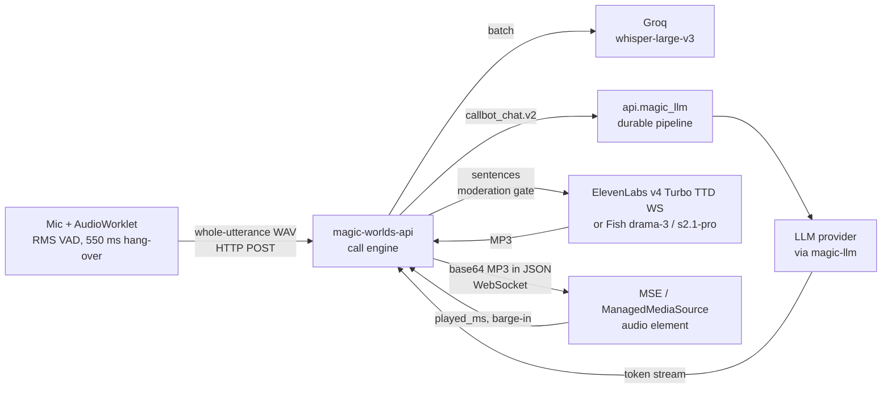

# Realtime voice calls: audit and state-of-the-art research

**Research date:** 2026-10-20. **Scope:** the Magic Worlds live character call, end to end:
- the SPA in this repo (capture, VAD, upload, WebSocket, playback, call UI);
- `magic-worlds-api` (route, call engine, STT, sentence buffer, moderation, TTS lanes, billing, persistence);
- `api.magic_llm`, `magic-agents` and `magic-llm` (the callbot LLM hop).

It also covers best practice and the state of the art for realtime voice agents. The main focus is cascaded STT → LLM → TTS pipelines, which the product uses today. Speech-to-speech, omni and realtime models, where one model or provider handles voice in and voice out, are assessed as a second option.

**Status:** research and audit only. No product code was changed. All file:line references are a 2026-10-20 snapshot.

## Bottom line

- **A caller waits about 3.2–4.2 s between finishing a sentence and hearing the character.** That figure is for the ElevenLabs lane with moderation off. It rises to about 3.6–4.7 s at STT p95, one documented sample took about 5.5 s, and dev calls with contention ran about 4–6 s. Best-in-class cascaded agents reach about 1.2–1.3 s full voice-to-voice at p50, and 0.8–0.9 s with speculation. One independent measured cascade reaches 755 ms from transcript to first audio. Details: [02](02_turn_lifecycle_and_latency.md), [04](04_cascaded_pipeline_sota.md).
- **The gap comes from orchestration, not from choosing a cascade.** Three serial stages make up about 80% of the wait:
  - a fixed 550 ms energy-silence endpoint;
  - a whole-utterance WAV upload followed by batch Groq Whisper (dev p50 526 ms, p95 1,002 ms);
  - the LLM hop: about 1.6 s to first text, including about 0.87 s p50 of fsync'd durable recording in `api.magic_llm` before the provider is even called, plus cold TLS connections on most turns.

  None of these is a limit of the cascade itself. ElevenLabs' new "realtime" model, the fastest entry on the Artificial Analysis speech-to-speech board at 0.57–0.62 s (vendor-reported), is itself an internal cascade ([11](11_speech_to_speech_and_omni_models.md)).
- **About 1.6 s is recoverable with no vendor change.** That gets the call to about 2.3 s. A streaming uplink with streaming STT, a learned end-of-turn model and held speculation gets it to about 1.5 s. Co-location and speculation over endpointing reach about 0.8–1.0 s. All of these are estimates, because voice-to-voice latency is not measured today ([16](16_target_architectures.md)).
- **Correctness and safety problems matter as much as latency:**
  - on the Fish lane, any reply that needs markup cleaning silences the turn;
  - whitespace in a reply fails an already-stored turn;
  - talk-over after `voice_turn_end` neither stops nor truncates the reply;
  - there are no deadlines, so an LLM stall can mean about 92 s of silence;
  - one TTS reconnect failure leaves the rest of the call text-only;
  - self-harm detection in calls is inert, while NY and CA companion laws already apply;
  - "required" moderation, as designed, either refuses calls or times out ([03](03_audit_findings.md), [14](14_safety_policy_and_compliance.md)).
- **The character talks too long.** Dev replies ran p50 17.6 s of audio. Callers cut 12 of 17 replies, and 34% of synthesized, billed audio was never heard ([07](07_llm_in_the_voice_loop.md), [10](10_naturalness_and_character_experience.md), [13](13_cost_scaling_and_operations.md)).
- **Stance on speech-to-speech: keep the cascade for character calls.** No S2S product keeps both the Magic Worlds agent graph and per-character cloned voices. Most also impose content policies and moderation that end sessions, or rule out text-before-speech safety checks. Costs are typically 1.7–5× the current lane once context re-billing is counted. S2S belongs in scoped, opt-in experiments behind an engine adapter, after the streaming uplink exists ([11](11_speech_to_speech_and_omni_models.md)).

## How a call works today (one turn)

Full walkthrough, protocol tables, state machines and configuration defaults: [01_current_architecture.md](01_current_architecture.md).

## Where the time goes (EL lane, speech end → first audible audio)

| Stage | Today | Main issue | Best practice |
|---|---|---|---|
| End of turn | 550 ms fixed energy silence | No learned VAD or end-of-turn model; noise and echo open turns (C02, C03) | Learned VAD with a ~250–300 ms candidate, an audio end-of-turn model, and a 2.5 s backstop |
| Upload + STT | WAV POST after speech; batch Groq p50 526 / p95 1,002 ms | Nothing overlaps the user's speech; single 30 s attempt (C01, C06) | Continuous 20 ms frames into streaming STT; final 50–300 ms after the endpoint |
| BFF bookkeeping | ~13–15 serial DB round trips, STT billing | Serial writes before the LLM (C19) | Writes off the critical path |
| LLM hop | ~1.58 s to first text (one probe), ~0.87 s of it durable commits | `api.magic_llm` records synchronously; cold TLS; thinking probably on (C08, C09, C37) | Voice fast lane, pooled warm connections, thinking off, cache-stable prompt; TTFT ≤ ~0.7 s |
| First TTS unit | Waits for a full sentence | No clause-level first chunk (C17) | First chunk at a clause (~25–40 chars), then sentences |
| TTS + playback | EL ~150–350 ms; MP3 via MSE | Coarse `played_ms`, no jitter policy (C48) | PCM/Opus into an AudioWorklet ring buffer, with sample-exact heard position |

Stage-by-stage numbers, labels (FACT, INFERENCE or UNKNOWN), barge-in timelines and tail risks: [02](02_turn_lifecycle_and_latency.md).

## What the research says (2026)

- **Cascades** ([04](04_cascaded_pipeline_sota.md)):
  - Stream every stage and overlap them.
  - Never wait for a full sentence.
  - Prewarm and pool connections.
  - Speculate on a likely end of turn, holding the output until the turn is confirmed.
  - Give every stage one cancel signal it obeys.
  - Commit only the text the caller heard.
  - Measure on the client.

  Pipecat and LiveKit Agents are the reference implementations. The recommendation is to keep the custom orchestrator, borrow their patterns, and run a timeboxed Pipecat spike after measurement exists.
- **Turn-taking** ([05](05_turn_taking_and_interruptions.md)):
  - Fixed silence is the worst option on eot-bench: about 24.5% false cut-offs at 600 ms in Spanish.
  - Learned end-of-turn models do much better: LiveKit v1/v1-mini, Smart Turn v3.2, Deepgram Flux-multi and Krisp.
  - Barge-in should pause, confirm and resume after a false interruption. It should not cancel immediately and irreversibly.
- **STT** ([06](06_speech_to_text.md)):
  - Accuracy is not the reason to leave Whisper. Latency, partial transcripts, STT-integrated end of turn, and robustness to non-speech are.
  - The shortlist is Soniox, Deepgram Flux-multi and ElevenLabs Scribe v2 Realtime, with Groq kept as the fallback.
  - Policy rules out some vendors for 18+ audio. AssemblyAI is one.
- **LLM** ([07](07_llm_in_the_voice_loop.md)):
  - TTFT is the dominant term, and most of Magic Worlds' LLM time is spent outside the model.
  - Practices: thinking off, a cache-stable prefix with the lorebook moved to a late block, short first sentences and replies, TTFT deadlines with a hedge, and an interruption marker in history.
- **TTS** ([08](08_text_to_speech.md)):
  - Eleven v4 Turbo leads quality boards. Cartesia Sonic 3.6 and Inworld TTS-2 are the strongest alternatives.
  - In Spanish, Eleven v4 beats v4 Turbo.
  - The bigger issues are correctness: the Fish ledger crash, reconnect budgets and unheard audio. So are expressive tags, which must match the model in use.
- **Transport** ([09](09_transport_and_client_audio.md)):
  - WebRTC is the 2026 consensus for browser voice. A well-built WebSocket path comes first: streamed uplink, binary frames, PCM worklet playback, liveness and a tolerant protocol.
  - Browser echo cancellation of non-WebRTC playback depends on the browser. There are open iOS 26/27 WebKit bugs.
- **Naturalness** ([10](10_naturalness_and_character_experience.md)):
  - Human turn gaps are about 200 ms. Perceived quality drops steeply after about 4 s.
  - Spoken in-character fillers help where spinners don't.
  - Greetings and ringback, short replies, backchannel-aware barge-in and memory across calls are table stakes for companion products.
- **Speech-to-speech and omni** ([11](11_speech_to_speech_and_omni_models.md)): covers the October 2026 landscape, including:
  - gpt-realtime-2.1 and GPT-Live-1;
  - Gemini 3.8 Live, about $0.16/min on a 10-minute call because each turn re-bills the context;
  - Grok Voice 3.0;
  - Eleven Realtime v1;
  - Ultravox and Qwen Omni;
  - open full-duplex models;
  - Hume EVI, which shuts down on 2026-11-13.

  It also has a compatibility matrix against Magic Worlds' requirements, a cost comparison and pilot designs.
- **Observability and testing** ([12](12_observability_evaluation_and_testing.md)): the plan covers four things:
  - measure voice-to-voice on one client clock;
  - store a durable per-turn metrics row;
  - build an OpenTelemetry span tree;
  - test with an EN/ES audio fixture corpus, persona simulations, Playwright fake-mic tests, and load/soak runs.
- **Cost and operations** ([13](13_cost_scaling_and_operations.md)):
  - The EL lane costs about $0.030/min at list price and about $0.033–0.043/min measured. The Fish lane costs about $0.013/min. TTS is 83–93% of the bill.
  - Billing counts unheard, echo and no-speech audio.
  - All call state lives in one process, and every deploy drops every live call.
- **Safety and compliance** ([14](14_safety_policy_and_compliance.md)):
  - A two-stage, latency-hidden moderation design is proposed.
  - A vendor content-policy and retention matrix covers 18+ fiction.
  - Regulatory duties for calls are mapped: NY GBL Art. 47, CA SB 243, EU AI Act Art. 50, and the 2027 wave. This is engineering research, not legal advice.

## If you only do ten things

From [17 §1](17_recommendations_and_roadmap.md):

1. **Measure what the caller hears** (R01, R02).
   - A client `voice_turn_client_metrics` frame plus a durable per-turn row.
   - Make the protocol tolerant first: any unknown frame is fatal today.
2. **Keep connections warm and prewarm on speech start** (R09). Saves about 80–165 ms at p50 and removes 0.5–1.5 s stalls.
3. **Turn thinking off and make replies short** (R10, R11, R13). One or two sentences with a backstop cap, and look-ahead bounded by duration.
4. **Free the next turn** (R16, R17).
   - Take persistence off the path.
   - Cut a superseded reply even after `voice_turn_end`.
5. **Bound every wait** (R18, R19).
   - A 3–5 s STT deadline with a hedge.
   - An LLM TTFT watchdog, a turn deadline and at most one retry.
   - An in-character recovery line.
6. **Never fail a turn over markup** (R20). Covers the Fish ledger crash and the whitespace contract.
7. **Send a clause-level first TTS chunk and move BFF writes off the critical path** (R14, R15).
8. **Build the `api.magic_llm` voice fast lane** (R38). Ephemeral execution with no synchronous durable recording, worth about −0.6 to −1.1 s at p50.
9. **Clear the safety launch blockers** (R33, R34, R57).
   - Signed phrase lists and crisis lines.
   - A transcript-time self-harm screen.
   - Then the two-stage gate.
10. **Stream the uplink over the existing socket, then run the streaming STT bake-off** (R47, R48). Keep Groq batch as the fallback.

The phases from there:

| Phase | What it does | Estimated p50 |
|---|---|---|
| Phase 0 | Measure first | Measured baseline |
| Phase 1 | Quick wins, days, no vendor change | about 3.4 s |
| Phase 2 | Weeks: fast lane, turn model, streaming uplink and STT, PCM playback, safety blockers | about 2.3 s |
| Phase 3 | A quarter: streaming STT as source, held speculation, engine adapter, WebRTC pilot, S2S "Live lite" pilot | about 1.5 s |

[17](17_recommendations_and_roadmap.md) has all 90 recommendations (R01–R90), KPI targets per phase, the experiment plan, risks, and the decisions that belong to the owner. [16](16_target_architectures.md) defines target architectures A–E and the gates between them.

## Documents

| # | Document | What it answers |
|---|---|---|
| 00 | [Methodology, evidence and sources](00_methodology_and_sources.md) | How this was produced, confidence labels, errata, evidence index, 73 key dated sources |
| 01 | [Current architecture](01_current_architecture.md) | How a call works today: components, sequences, protocol, state machines, config defaults, strengths |
| 02 | [Turn lifecycle and latency](02_turn_lifecycle_and_latency.md) | Where every millisecond goes today vs SOTA budgets; barge-in timeline; recoverable latency per fix |
| 03 | [Audit findings register](03_audit_findings.md) | 145 verified, de-duplicated issues (0 critical, 15 high, 53 medium, 67 low, 10 info) with evidence and fixes |
| 04 | [Cascaded pipeline SOTA](04_cascaded_pipeline_sota.md) | Best-in-class cascades, frameworks and platforms, anti-patterns, build vs adopt |
| 05 | [Turn-taking and interruptions](05_turn_taking_and_interruptions.md) | VAD, end-of-turn models (EN/ES), barge-in, backchannels, echo, truncation to heard words |
| 06 | [Speech-to-text](06_speech_to_text.md) | Groq path today, the streaming STT landscape, Spanish, hallucinations, bake-off and migration plan |
| 07 | [LLM in the voice loop](07_llm_in_the_voice_loop.md) | TTFT anatomy, the `api.magic_llm` overhead, model and host choice, caching, prompting, deadlines |
| 08 | [Text-to-speech](08_text_to_speech.md) | EL and Fish lanes, the TTS landscape, chunking, formats, expressive tags, Spanish, fallback |
| 09 | [Transport and client audio](09_transport_and_client_audio.md) | WebSocket vs WebRTC, capture, AEC, playback, reconnection, options and costs |
| 10 | [Naturalness and character experience](10_naturalness_and_character_experience.md) | Human timing, fillers, backchannels, companion products, call UX gaps |
| 11 | [Speech-to-speech and omni models](11_speech_to_speech_and_omni_models.md) | S2S, full-duplex and half-cascade landscape, compatibility matrix, cost, stance and pilots |
| 12 | [Observability, evaluation and testing](12_observability_evaluation_and_testing.md) | Metrics, measurement method, per-turn schema, OTel, test layers, load testing |
| 13 | [Cost, scaling and operations](13_cost_scaling_and_operations.md) | Cost per minute by lane and option, billing correctness, provider caps, scaling, drain |
| 14 | [Safety, policy and compliance](14_safety_policy_and_compliance.md) | Realtime moderation design, vendor policy matrix, regulation, consent |
| 15 | [Gap analysis](15_gap_analysis.md) | Maturity scorecard and practice-by-practice gap matrix |
| 16 | [Target architectures](16_target_architectures.md) | Options A–E with latency, cost and control trade-offs, recommended path, gates |
| 17 | [Recommendations and roadmap](17_recommendations_and_roadmap.md) | R01–R90 by phase, KPIs, experiments, risks, owner decisions |

**Implementation** started with Phase 0 (measurement, R01-R08): [phase0/](phase0/README.md) holds the socket protocol v2, the per-turn record, and the api.magic_llm measurement plan. Unlike the research above, this part changes product code.

**Evidence** lives in [evidence/audit](evidence/audit/), which holds 16 code-audit notes with adversarial verification sections. [evidence/research](evidence/research/) holds 14 fact-checked web-research notes with their source lists. When a document and an evidence note disagree, the document wins. Its errata are listed in [00 §8](00_methodology_and_sources.md) and [03 §11](03_audit_findings.md).

## Caveats

- **Dev data only, small n.** The measurements come from 23 STT samples, 8 calls and 17 replies, all made by a root user, mostly on the Fish lane, with `uvicorn --reload` and a saturated shared MySQL. Production topology is unknown. Treat every latency total as an estimate until Phase 0 instrumentation exists.
- **The vendor landscape moves monthly.** Model names, prices, deprecations and policies were checked against primary sources on 2026-10-20. Re-check them before any vendor decision.
- **Policy and regulation sections are engineering research, not legal advice.**
