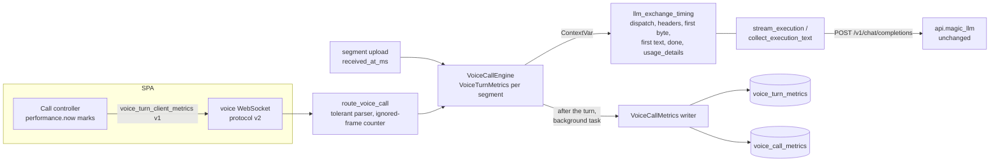

# Phase 0 · Measure the call before changing it

**Date:** 2026-10-20. **Roadmap:** R01-R08 in [17](../17_recommendations_and_roadmap.md) §5.

Phase 0 makes every call turn measurable from the user's stop to first heard audio. It records:
- where the time goes;
- what each stage costs in provider units;
- what the client actually heard.

It changes no latency behaviour, so later phases can show their delta on the same rows.

**Constraint for this phase:** `api.magic_llm` (and `magic-agents`, `magic-llm`) are not edited. The BFF measures its request to api.magic_llm and the response it gets back. Improvements on that side are a plan: [03](03_api_magic_llm_plan.md).

## Documents

| # | Document | What it defines |
|---|---|---|
| 01 | [Socket protocol v2](01_protocol_v2.md) | Tolerant parsing, version negotiation, the `voice_turn_client_metrics` frame |
| 02 | [Per-turn record](02_turn_metrics.md) | Stage marks, interval columns, usage units, dimensions, outcomes, write policy, schema, first queries, gate G0 |
| 03 | [api.magic_llm plan](03_api_magic_llm_plan.md) | What only api.magic_llm can report, the wire contract for it, and the rollout order. Plan only |

## Architecture

**Three rules hold it together.**
1. **One clock per side.** Server marks are on the engine's monotonic clock. Client numbers are intervals on the client's `performance.now()`. No interval mixes the two.
2. **Never on the path.** Rows are written after the turn on a background task. A write failure is logged and never reaches the call.
3. **No content.** Rows hold ids, counts, durations, categories and model identities. They never hold transcripts, replies, audio, prompts or tokens.

## Status of R01-R08

| Item | Status | What shipped | Where |
|---|---|---|---|
| **R01** per-turn record | Shipped | <ul><li>One row per uploaded segment (rejected and no-speech included), with 20 stage marks, 13 interval columns, hearing columns and the client's V2V.</li><li>One row per call.</li><li>Rows are written after the turn and wait up to 125 s for the client frame.</li></ul> | BFF: `services/voice_orchestration/turn_metrics.py`, `engine.py`, `database/mysql/voice_metrics_models.py`; schema revision `2026_10_voice_turn_metrics`. SPA: the client metrics frame |
| **R02** tolerant protocol | Partly shipped | <ul><li>Unknown frame types and fields, invalid mid-call frames, bad JSON and binary frames are ignored and counted.</li><li>Over 1,000 ignored frames ends the call.</li><li>An invalid handshake stays fatal.</li><li>`protocol_version` and `voice_ready.protocol` negotiation.</li><li>`voice_end.reason: "navigation"`.</li></ul> | BFF `routes/user/route_voice_call.py`; SPA `voiceSocket.ts` |
| **R03** real alerts | Deferred | The alert channel is an owner decision (OD12). The V2V rules need two weeks of R01 data first | — |
| **R04** TTFT and stage split | BFF half shipped | <ul><li>Dispatch, headers, first byte, first text and done for every api.magic_llm exchange, plus BFF retries.</li><li>Provider calls, and cached and reasoning tokens, from the `usage_details` that api.magic_llm already sends.</li><li>Stages inside api.magic_llm are planned in [03](03_api_magic_llm_plan.md).</li></ul> | BFF `services/llm_exchange_timing.py`, `llm_execution_transport.py`, `llm_execution_text.py` |
| **R05** dimensions | Shipped | <ul><li>`engine`, `deploy_env`, `region`, `config_fingerprint` and `call_turn_index`.</li><li>`experiment_arm` is reserved and stays null.</li></ul> | `MetricsDimensions` |
| **R06** usage units | Units shipped, prices deferred | <ul><li>STT sent and billed ms (Groq 10 s floor), LLM tokens, TTS characters, sentences and UTF-8 bytes, audio chunks and ms, heard ms.</li><li>The price table waits for OD2 and OD3.</li></ul> | [02](02_turn_metrics.md) §4 |
| **R07** EN/ES corpus and replay | Deferred | Needs a consent path for recorded calls and a labelling plan | — |
| **R08** stale comments | Shipped | SPA comments that described the old protocol or timing were corrected | SPA `features/interaction/**` |

## Still open in R02

- **Split close code 4408.** Today it covers both an idle timeout and a protocol conflict.
- **Account for calls abandoned before `voice_ready`.**
- **Re-check consent and flags on `voice_resume`.**

## Rollout order

1. **Schema.** `scripts/migrations/20261020_voice_turn_metrics.py`:
   - read-only by default;
   - `--apply --backup <private.sql.gz>` adds the two tables;
   - existing rows are not touched.
2. **BFF.** Protocol v2 and the writer. `VOICE_TURN_METRICS_ENABLED=false` stops the writes without a deploy. Older SPAs keep working: they never send `protocol_version`, so the server waits only 15 s before writing.
3. **SPA.** It sends `protocol_version: 2`. It sends client metrics only when `voice_ready.protocol.client_metrics >= 1`.

**Step 2 must ship before step 3. This is a hard rule.** The new SPA sends `protocol_version` (and `llm`, from the LLM-profile work) inside `voice_start` itself. The previous BFF parses `voice_start` with `extra="forbid"`, and an invalid handshake is fatal. So every call from the new SPA to the previous BFF closes with 4408 before `voice_ready`, and the client cannot learn the server's version any earlier. Once the BFF is out, an older SPA keeps working: it sends no `protocol_version` and ignores `protocol`.

## Configuration (BFF)

| Variable | Default | Meaning |
|---|---|---|
| `VOICE_TURN_METRICS_ENABLED` | on | Exactly `false` stops the writes |
| `DEPLOY_ENV` | `dev` | Row dimension |
| `DEPLOY_REGION` | none | Row dimension |
| `APP_BUILD` | empty | Feeds `config_fingerprint` |

All four are documented in `magic-worlds-api/.env.example` and `docs/configuration.md`, and passed through in `docker-compose.yml`.

## Verification

| Check | Result |
|---|---|
| `tests/voice/test_voice_protocol_v2_turn_metrics.py` (new, 24 tests) | Pass |
| <ul><li>Parser: binary, bad JSON, unknown type, invalid frame, disconnect, fatal handshake.</li><li>The socket survives malformed traffic, and a flood ends the call.</li><li>Row math on a fake clock.</li><li>STT floor.</li><li>Write policy: wait, client frame, late update, rate limit, unknown turn, duplicate.</li><li>The ContextVar reaches the runner's executor task.</li><li>A full engine turn writes one row with every mark, and no text.</li><li>Frames with extra fields never end a call.</li><li>A retried upload keeps its index and never takes the written record.</li><li>An ended call takes late client frames from its own socket for 10 s, including after a server end.</li></ul> | |
| `tests/services/test_llm_execution_text.py` | Pass. The new test covers `usage_details` read leniently onto the tracked exchange |
| Whole `tests/voice` suite | 1,060 pass. The same 59 failures, by name, as before the audit fixes, none new. They need a MySQL pool or feature-flag fixtures that unit runs do not provide (`FEATURE_FLAG_UNAVAILABLE`, "MySQL pool is not initialized") |
| `tests/services` LLM and assistant tests | 600 pass. 3 `test_assistant_upstream_contract` tests also fail on HEAD (`request_credentials`, from an earlier change) |
| All of `tests/services` and `tests/routes`, against pristine HEAD | The same 550 failures and 1 collection error (`test_turn_language.py`) on both trees, and one more pass (the `usage_details` test). Nothing new fails |
| Schema revision `2026_10_voice_turn_metrics` | <ul><li>The migration, voice schema and earlier-revision chain tests pass (47 with the new file).</li><li>The store's columns are pinned to the DDL.</li><li>`tests/test_schema_bootstrap.py` has 11 failures, all present before (stale startup text, JSON-shape checks of earlier revisions); it had 15 before.</li><li>**Not run against a real MySQL.** The only configured database is the shared project one.</li></ul> |
| SPA: call-path test files (16: audio, hooks, `voiceSocket`, the call integration test, `features/call`) | 323 pass |
| SPA: `pnpm build` | Exit 0 |
| SPA: `minimaxGrepGate` | <ul><li>Passes.</li><li>`docs/call_realtime/**` is allow-listed as dated research. It compares MiniMax as a vendor and records the MiniMax-era markup.</li></ul> |

## Gate G0

Phase 0 exits when, for two weeks:
- the client frame covers at least 90% of completed and interrupted turns;
- every segment has a row;
- `llm_ttft_ms` is non-null on every executed turn.

Details are in [02](02_turn_metrics.md) §10.
