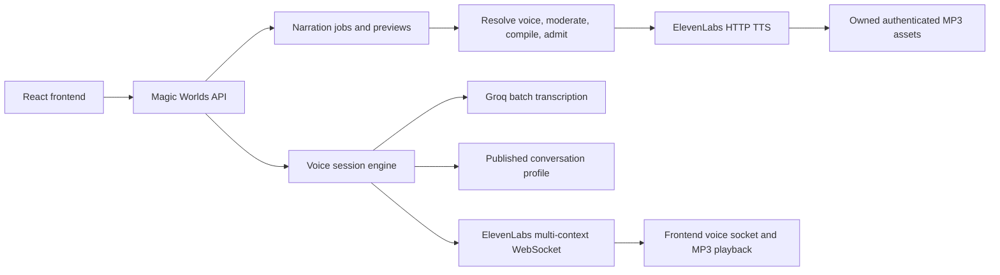

# Current ElevenLabs integration and Fish gaps

This is a source review of the current working trees, not a review of a proposed pull request. The architecture fits a second provider at its backend speech boundary. The strongest reusable parts are the surrounding application workflow; the weakest fit is the current provider-specific data and streaming semantics.

## Current flow

The browser talks to one BFF. Narration uses asynchronous jobs and owned assets; calls use a dedicated application voice socket and an HTTP microphone uplink. This is distinct from the text-chat socket. The browser already handles application turn IDs, cancellation and per-voice attenuation without needing a provider's API credentials.

## Reuse assessment

| Existing component | Fit for Fish | What must change |
| --- | --- | --- |
| BFF media routes, authentication and workspace ownership | Strong | Select Fish inside the BFF; preserve every existing scope check |
| Async narration jobs, assets, quotas and refunds | Strong | Add provider/model identity and measured supplier usage |
| Opaque application `voice_key` | Strong | Resolve to a provider-specific voice ID behind the key |
| Sentence moderation and server-owned compilation | Strong principle | Add a Fish compiler; preserve logical text and source offsets |
| HTTP synthesis interface | Good seam | Remove required ElevenLabs settings/seed assumptions |
| Catalogue storage | Partial | Queries and lifecycle assumptions are ElevenLabs-specific |
| Capability registry | Partial | Key by provider, model and surface; describe optional operations |
| Browser MP3 playback | Good with compatible output | Request mono 44.1 kHz; retain framing/sequence validation |
| Call interface and timing ledger | Partial | Different lifecycle, no declared parallel Fish contexts, word revisions |
| Speech-to-text provider boundary | Useful later | Keep Groq initially; Fish output and confidence differ |
| Operations and privacy copy | Weak provider fit | Add supplier-specific prices, history behavior, retention and rights |

## Concrete provider assumptions

| Source observed | Consequence for Fish |
| --- | --- |
| [Frontend stored voice type](/home/andres/WebstormProjects/magic-worlds/src/shared/types/voicePreset.types.ts:26) requires schema v2 and provider `elevenlabs` | New Fish records need an explicitly supported shape, not a type cast |
| [Effective voice parsing](/home/andres/WebstormProjects/magic-worlds/src/shared/voice/effectiveVoice.ts:38) drops unfamiliar routes | A valid Fish response can disappear from the UI |
| [Capability normalization](/home/andres/WebstormProjects/magic-worlds/src/shared/voice/voiceCapabilities.ts:179) assigns an ElevenLabs route | Backend capability changes alone will not select Fish |
| [Recipe controls](/home/andres/WebstormProjects/magic-worlds/src/features/voices/components/RecipeControlsV2.tsx:36) show fixed ElevenLabs controls | Drama direction, local scope and dictionary choices have no representation |
| [Backend provider/types](/home/andres/PycharmProjects/magic-worlds-api/src/services/speech/types.py:16) permit one provider and flat settings; synthesis requires a seed | Native Fish TTS has no documented equivalent for that required seed |
| [Stored backend voice](/home/andres/PycharmProjects/magic-worlds-api/src/models/character.py:28) strictly validates ElevenLabs settings | New fields would fail validation rather than pass through |
| [Preset SQL check](/home/andres/PycharmProjects/magic-worlds-api/src/database/mysql/db.sql:1651) requires v2/ElevenLabs | A database migration is necessary, including rollback semantics |
| [Job SQL check](/home/andres/PycharmProjects/magic-worlds-api/src/database/mysql/db.sql:930) and [call SQL check](/home/andres/PycharmProjects/magic-worlds-api/src/database/mysql/db.sql:476) restrict provider values | Fish jobs/calls cannot simply reuse the current persisted enum |
| [Provider construction](/home/andres/PycharmProjects/magic-worlds-api/src/services/speech/providers/__init__.py:357) builds ElevenLabs adapters only | Add native Fish configuration, clients and error classification |
| [Resolver](/home/andres/PycharmProjects/magic-worlds-api/src/services/speech/resolver.py:299) and [catalogue repository](/home/andres/PycharmProjects/magic-worlds-api/src/database/mysql/voice_catalog_models.py:27) pin the provider | Provider-aware records need provider-aware queries and availability checks |
| [Moderated synthesis](/home/andres/PycharmProjects/magic-worlds-api/src/services/speech/synthesis.py:171) rejects other providers | This wrapper is another gate even after an adapter exists |
| [Narration engine](/home/andres/PycharmProjects/magic-worlds-api/src/services/tts_generation/engine.py:229) attaches the ElevenLabs lane | Provider choice must reach the orchestration path, not just catalogue storage |

The catalogue already has a unique `(provider, provider_voice_id)` identity and JSON metadata/settings, which are useful foundations. Its current source kinds and repository methods still describe ElevenLabs workflows. A varchar provider column does not establish end-to-end multi-provider support.

## Rendering and feature gaps

The [emotion renderer](/home/andres/PycharmProjects/magic-worlds-api/src/services/speech/emotion_map.py:24) translates seven semantic emotions into ElevenLabs tags or stability adjustments, and adds thought/pauses through server-owned choices. Replacing that mapping can deliver a basic Fish emotion preset. It cannot by itself support:

- A different direction for each sentence or character intention.
- Scoped delivery on individual words.
- Positioned laughter, sighs or breaths that have audio duration but no spoken words.
- Ordered speaker references for a complete scene.
- Per-phrase language experiments and versioned pronunciation dictionaries.

The [text pipeline](/home/andres/PycharmProjects/magic-worlds-api/src/services/speech/text_pipeline.py:1) deliberately rejects or neutralizes markup and untrusted brackets. That protection is valuable. Sending raw user/LLM text with newly enabled Fish control tokens would bypass its intent. Rich direction needs a trusted representation and a provider compiler, described in [03](03_emotions_and_performance.md) and [05](05_architecture_and_integration_approach.md).

The [generation registry](/home/andres/PycharmProjects/magic-worlds-api/src/services/tts_generation/registry.py:38) already hashes provider, model, voice, settings, language, tag prefix, format and compiler versions. It also has a pronunciation dictionary version scaffold. This is a foundation to extend, not an absence of cache support. The Fish request identity must additionally cover effective performance instructions, ordered scene voices, reference digests and actually applied dictionary versions.

## Calls and audio fit

The [speech protocols](/home/andres/PycharmProjects/magic-worlds-api/src/services/speech/interfaces.py:32) expose useful methods for starting a turn, pushing text, ending input and cancellation. Their turn-scoped extension also assumes up to four live contexts and character acknowledgements. The [current adapter](/home/andres/PycharmProjects/magic-worlds-api/src/services/speech/providers/elevenlabs/tts_multicontext_ws.py:74) implements these through ElevenLabs multi-context JSON input. Fish does not document the same parallel-context facility.

The [call ledger](/home/andres/PycharmProjects/magic-worlds-api/src/services/voice_orchestration/call_ledger.py:139) expects character timing; Fish returns revisable word timing. The [engine delivery path](/home/andres/PycharmProjects/magic-worlds-api/src/services/voice_orchestration/engine.py:2351) ignores chunks without bytes before the ledger sees their metadata. Both are material gaps for interruption transcripts and final alignment.

The [browser audio validator](/home/andres/WebstormProjects/magic-worlds/src/features/interaction/audio/audioFormat.ts:13) accepts MP3 mono at 22.05, 24 or 44.1 kHz. Fish native MP3 supports 32 and 44.1 kHz; **44.1 kHz is the common choice**. The [playback buffer](/home/andres/WebstormProjects/magic-worlds/src/features/interaction/audio/voicePlaybackBuffer.ts:47) already uses a turn-level audio element and streaming/fallback paths. Keeping MP3 avoids an unrelated browser codec migration. [Native format reference](https://docs.fish.audio/api-reference/endpoint/openapi-v1/text-to-speech).

## Catalogue, operations and transcription

The [catalogue admin publication gate](/home/andres/PycharmProjects/magic-worlds-api/src/services/speech/catalog/admin.py:686) is tailored to designed/remixed ElevenLabs voices and Flash/v4 acceptance. Fish needs its own provenance and model/language acceptance records. Do not label a public Fish voice as an owned generated voice just to satisfy that gate.

The [limiter](/home/andres/PycharmProjects/magic-worlds-api/src/services/speech/limiter.py:1) is process-local and understands ElevenLabs pools/headers. The [spend circuit](/home/andres/PycharmProjects/magic-worlds-api/src/services/speech/spend_circuit.py:62) estimates Flash character costs. Catalogue history deletion, subscription reconciliation and provider readiness are also supplier-specific. These jobs need separate capability checks; an unsupported Fish operation must be visibly unsupported rather than returning a fabricated ElevenLabs-shaped success.

The [STT client](/home/andres/PycharmProjects/magic-worlds-api/src/services/voice_orchestration/stt_groq_client.py:33) consumes complete 16 kHz WAV segments and relies on recognition-quality metrics. Fish compatibility responses can use neutral placeholder metrics, which would make current quality gates unreliable. Preserve Groq for the first phase and evaluate native Fish transcription separately. [Compatibility capabilities](https://docs.fish.audio/developer-guide/compat/capabilities).

The [published voice privacy copy](/home/andres/WebstormProjects/magic-worlds/src/features/legal/documents/privacyVoiceCopy.ts:44) names ElevenLabs and Groq and describes ElevenLabs deletion/training behavior. It must be updated from verified Fish account settings before Fish traffic is enabled.

## Current readiness and implementation size

Existing [voice status documentation](/home/andres/WebstormProjects/magic-worlds/docs/voice_refactor/00_current_status_and_roadmap.md) marks the integration WIP and records earlier local Standard preview/narration/call successes with optional moderation. It also records a later conversation failure before TTS, related to internal/public tool collection, and outstanding provider/device acceptance. Those records do not prove full ElevenLabs production readiness, and adding Fish will not repair a conversation failure that occurs before synthesis.

Frontend [voice flags](/home/andres/WebstormProjects/magic-worlds/src/shared/featureFlags.ts:15) are separate gates, defaulting off in the example environment. Keep rollout scoped by provider and surface rather than treating one successful preview as call readiness.

| Proposed increment | Relative effort | Main dependency |
| --- | --- | --- |
| Offline Drama API experiment | Small | Account access and suitable reference voice |
| Supported Fish HTTP previews/narration | Medium | Schema, capabilities, routing, moderation and usage accounting |
| Rich performance and dictionaries | Medium | Trusted representation, offsets, persistence and listening evaluation |
| Complete same-provider scenes | Medium | Ordered cast, job metadata, segmentation and fallback |
| Reliable Fish calls | Large | Streaming lifecycle, revised ledger, cancellation and browser acceptance |
| Fish design/public catalogue workflow | Medium to large | Persistence provenance, rights and supplier lifecycle |
| Fish native ASR | Separate medium project | Quality gates, speaker/event cleanup and language tests |
| Hosted Agents or self-hosted inference | Separate large decision | Transport/ownership or GPU operations/licensing |

These are scope estimates, not a schedule. The [roadmap](09_validation_plan_and_roadmap.md) makes the proof points concrete before a delivery estimate is committed.
