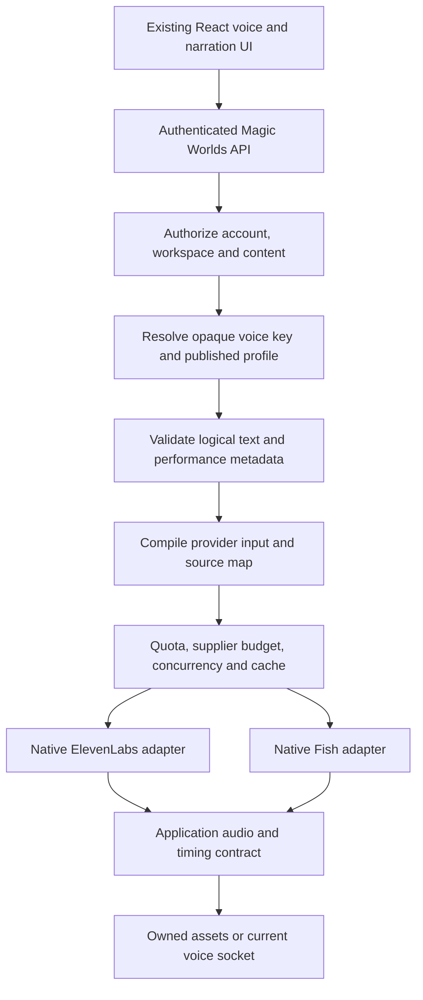

# Architecture and integration approach

Everything in this document is a **proposal**, grounded in the gaps in [01](01_current_integration_and_gaps.md). It changes no code. The recommended design is a native Fish adapter behind the existing BFF, with provider-aware data and capabilities and a trusted performance compiler.

## Keep the existing application boundaries



The browser should not connect to Fish directly. Keep credentials, reference validation, moderation, supplier budget and retry policy inside the BFF. Continue storing owned finished assets and enforcing workspace access when they are fetched. A provider does not become an alternative identity or content service.

Account-owned presets and the deployment catalogue are not workspace-owned merely because a session uses them. Preserve the current scope distinction: authorize the preset/catalogue access, then authorize the content/session workspace separately. Provider routing must not accidentally bypass either step.

## Native adapter strategy

Implement a Fish HTTP adapter first, using the existing asynchronous HTTP client pattern. Add MessagePack WebSocket support only in the call phase. Keep the provider modules independently configured and independently observable, with separate admission/breaker state.

The current catalogue protocol requires library attachment, design/save, remix, cloning, subscription and model operations from every provider. Split mandatory inventory/synthesis operations from optional capabilities, or return a typed unsupported result guarded by a capability check. Do not implement a fake successful `remix`, history deletion or ElevenLabs subscription response for Fish.

| Concern | Proposed boundary |
| --- | --- |
| Synthesis | Native request/response adapter; provider-specific options validated before admission |
| Streaming | Adapter emits application events; provider lifecycle stays internal |
| Inventory | Normalize voice identity, languages, availability and provenance |
| Design/persistence | Separate optional operations with candidate provenance |
| Dictionary lookup | Resolve/pin immutable versions before generation |
| Usage | Supplier units and monetary estimate separate from application credits |
| Error classification | Provider-specific parsing → stable application error categories |
| History/retention | Explicit supplier capabilities and account settings |

The compatibility endpoint can be used for a temporary comparison harness, but should not be the architectural foundation for Drama. Its S2.1 engine mapping and ignored controls would obscure what the product actually supports. [Compatibility contract](https://docs.fish.audio/developer-guide/compat/migrate-from-elevenlabs).

## Versioned stored voice data

Preserve existing v2 ElevenLabs records exactly. Introduce a validated new version for multi-provider writes rather than silently broadening the documented meaning of v2. The following is an illustrative **proposed application record**, not a final migration or Fish payload:

```json
{
  "schema_version": 3,
  "provider": "fish_audio",
  "voice_key": "vk_0123456789abcdef0123456789abcdef",
  "voice_name": "Approved storyteller",
  "language_code": "es",
  "emotion": "calm",
  "settings": {
    "performance_recipe_version": 1,
    "direction_preset": "attentive",
    "dictionary_refs": []
  }
}
```

`fish_audio` is a proposed application identifier; it is not a Fish model header. The server resolves `voice_key` to an authoritative provider/voice row and verifies the record agrees with it. Raw provider IDs should not become a client-controlled bypass of the catalogue.

Use a provider-discriminated settings union. Do not make stability, similarity, speaker boost and Fish performance all optional properties on an unvalidated global object. Such an object admits meaningless combinations and complicates cache identity.

Cards/cast snapshots should preserve the assigned voice identity and recipe. The resolved execution profile pins the effective supplier model, transport, output format and compiler version at generation time. A card's assigned voice and a surface's speech engine are distinct: the same approved reference could be eligible for narration but not yet for calls.

### Migration considerations

- Update frontend read/write types, effective-voice parsing, preset/catalogue constructors and capability normalization together.
- Update backend strict DTOs, provider enums, job/call provider fields and preset SQL checks together.
- Retain old v2 reads and ElevenLabs execution paths. Preserve unknown stored objects when unrelated card fields are edited, following the existing lossless parsing behavior.
- Deploy database support and readers before enabling new writes. An older reader or SQL check must not encounter enabled Fish records it cannot handle.
- Rollback should disable Fish writes/routing while preserving records and owned assets. Never rewrite Fish voice IDs as ElevenLabs IDs to satisfy an old constraint.

Actual migration names and deployment compatibility need repository review when implementation begins; this report does not invent an applied migration.

## Provider/model/surface capabilities

Key capabilities by `(provider, model_profile, surface)` rather than `(surface, tier)` alone. A profile can map a product tier to a specific provider model, but a tier is not itself a provider engine. Preserve published server-owned profile resolution and entitlement checks.

An illustrative **capability response proposal**:

```json
{
  "provider": "fish_audio",
  "profile_id": "fish_drama3_narration_v1",
  "model_id": "drama-3",
  "surface": "narration",
  "status": "experimental",
  "output": {"codec": "mp3", "sample_rate": 44100, "channels": 1},
  "controls": ["emotion", "direction_preset", "delivery_spans", "sound_events"],
  "features": {
    "whole_scene": false,
    "pronunciation_dictionaries": false,
    "call_streaming": false,
    "hosted_editing": false
  }
}
```

The false values describe a conservative initial application rollout, not absence from Fish's documented model. Change a capability to true only when the application implementation and acceptance tests exist. Experimental language tags and unverified shared-schema knobs should remain excluded.

Make the frontend render controls from these capabilities. Its present fixed-control assumptions must be removed deliberately. A user should see a meaningful preset/direction choice, not a Fish temperature slider labeled “ElevenLabs stability.” Unsupported operations should explain the unavailable feature instead of accepting a setting that is ignored.

## Performance compiler and source map

Use the trusted representation from [03](03_emotions_and_performance.md). Compile provider input after validation/moderation, keeping logical content and metadata independently reviewable.

```text
Canonical logical text
  -> validate speech content and authorized performance metadata
  -> moderate required content/metadata according to the surface policy
  -> normalize numbers/aliases with offset tracking
  -> resolve voice and dictionary versions
  -> render provider-specific directions, spans and speaker markers
  -> retain logical <-> provider source map
  -> hash exact effective request
  -> reserve budget/concurrency and synthesize
```

Existing strict moderation behavior remains a deployment policy, not a claim that every current local run requires moderation. For production Fish admission, require the chosen moderation profile to be available and record its actual mode. A required gate must not silently become optional because a second provider is used.

The source map must account for inserted directives, removed markup, expanded numbers, pronunciation substitutions, speaker tokens and nonverbal events. Provider word output then maps back to logical utterances and text ranges. A simple “subtract prefix length” calculation is insufficient once edits occur inside a line.

Direction metadata is another input surface. Bound it, reject provider/system tokens and unauthorized routing, and record whether it came from a preset, author or validated model inference. If arbitrary author direction is later offered, moderate it under an explicit policy and do not concatenate it into raw dialogue unchecked.

## Narration and scene rendering

Phase one should reuse current per-segment orchestration. Resolve each speaker, compile that segment for the selected provider, reserve usage, synthesize and own the output. This keeps mixed-provider casts and granular retries viable.

Whole-scene Fish rendering should be an optional planner optimization once tested. Require all participating voices to be Fish-eligible for the same profile, order the references deterministically and persist the scene's utterance/cast mapping. Check maximum payload/duration against application admission limits.

If a scene cannot use the optimization, return to the per-segment planner before supplier execution. If it fails after generating audio, preserve a clear retry boundary and account for any supplier spend; do not quietly concatenate duplicate segments from a full-scene retry.

Hosted take editing is not part of the initial planner. Regenerate an approved logical segment or scene and replace the asset atomically. Later infilling needs its own request contract, quality/ownership metadata and timeline reconciliation.

## Cache and idempotency

Extend the existing hash scaffold with exact effective provider input, not just a friendly preset label. Include:

- Provider, effective model/profile version and transport/output configuration.
- Ordered resolved voice IDs and reference content digests where applicable.
- Logical text, compiled performance and compiler/normalization versions.
- Applied dictionaries and immutable versions; inline content gets a digest.
- Effective supported generation options and moderation policy identity.

Keep application job idempotency separate from provider-request idempotency. No general Fish TTS idempotency guarantee was established here. A cache hit before dispatch saves supplier usage; replaying a request after an uncertain timeout may generate and charge a second take.

Do not globally share assets merely because request hashes match. A content-addressed synthesis identity can be shared internally only within authorized ownership/privacy rules; asset reads remain authenticated and scoped.

## Routing, failover and rollback

Choose a provider/model before supplier admission and pin it for that generation. Track requested versus effective provider/model/voice when substitution is permitted. A replacement voice is an audible product decision, not a technical synonym for failover.

For unavailable Fish HTTP generation, allow only the configured surface policy: fail clearly, queue/retry safely, or request an explicit preapproved substitution. Never pass a Fish ID to ElevenLabs. Never silently use an unrecognized model header and call its output Drama.

Calls must not retry a whole audible reply after partial delivery. See [06](06_streaming_calls_and_alignment.md). Rollback should disable new Fish work, cancel safely where appropriate, keep finished assets readable and leave other providers' health/limits intact.

## Scope kept separate

Native Fish ASR could later replace the batch STT adapter, but requires transcript/event cleanup and new confidence policy. Hosted Agents use a managed conversation transport and turn-taking stack; their LiveKit/WebRTC client and custom-LLM bridge would alter ownership and session integration. Self-hosting adds GPU services and different licensing. Treat each as a separate architecture decision after native TTS succeeds. [ASR](https://docs.fish.audio/api-reference/endpoint/openapi-v1/speech-to-text), [Agents protocol](https://docs.fish.audio/agents/deploy/protocol), [custom LLM](https://docs.fish.audio/agents/build/custom-llm).
