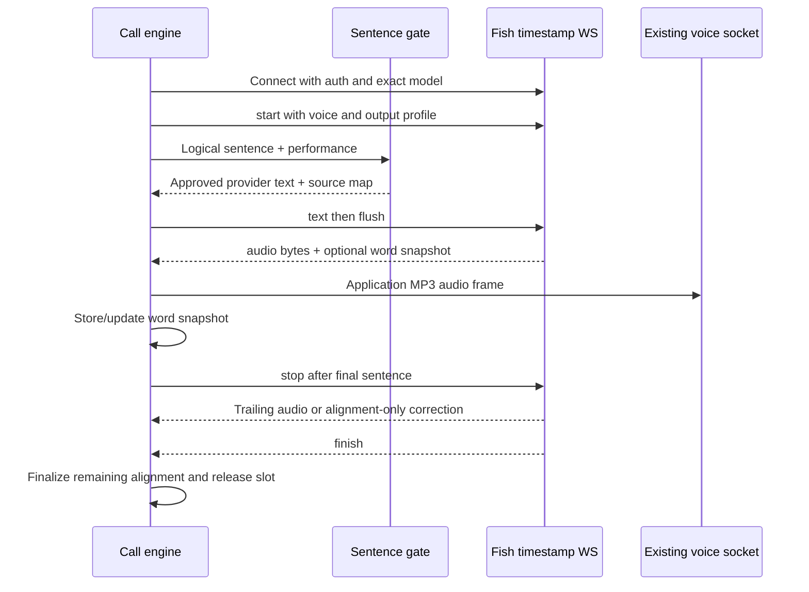

# Streaming calls, interruption and alignment

The current browser call transport can be retained if Fish output is normalized behind the BFF. The server-side call adapter and timing ledger need more work than the browser. This document describes the documented Fish protocol, the exact current gap and a proposed correct integration.

**Implementation update, October 15:** the baseline gaps below informed M6.
The native bridge, word ledger, metadata-only path, shared admission and existing
call UI are now connected behind a disabled release flag. Native application,
device and latency acceptance remain open; see the [current handoff](18_call_engine_development.md).

## Protocol comparison

| Concern | Current ElevenLabs integration | Native Fish timestamp endpoint |
| --- | --- | --- |
| Supplier frames | JSON with base64 audio | MessagePack with raw audio bytes |
| Input lifecycle | Per-turn multi-context input | `start`, `text`, `flush`, `stop` |
| Parallel contexts | Adapter handles up to four | No equivalent concurrent contexts documented |
| Timing | Character arrays interpreted by ledger | Revisable word snapshots keyed by chunk sequence |
| End input | Close/complete context | `stop`, then keep receiving until `finish` |
| Cancellation | Drop dead context frames and close context | Immediate cancel event not documented; close/isolate generation locally |
| Reuse | Call-level multi-context connection | Timestamp guide allows new start after finish; a stop description conflicts |

Protocol sources: [timestamp WS](https://docs.fish.audio/api-reference/endpoint/openapi-v1/text-to-speech-live-with-timestamps), [plain WS](https://docs.fish.audio/api-reference/endpoint/websocket/tts-live). Current seam: [speech interfaces](/home/andres/PycharmProjects/magic-worlds-api/src/services/speech/interfaces.py:44).

`flush` requests generation of buffered text. `stop` ends text input and drains remaining generation; it is not a cancellation primitive. Do not use graceful stop as the only barge-in action when the user expects immediate silence.

## Conservative initial lifecycle

Start with one Fish synthesis session/socket per assistant turn. Keep one sender and one receiver active concurrently. This avoids assuming undocumented parallel contexts and ambiguous connection reuse. Later pooling is an optimization contingent on contract measurements.



Use separate application turn ID and generation epoch. Reconnection or replacement increments the epoch even if a business turn ID is reused. Provider frames from an older epoch are stale and cannot append to the new turn.

Opening a standby connection may reduce handshake cost, but whether idle/prewarmed sockets consume account concurrency is unverified. Preserve the existing prewarm intent only after measuring its Fish equivalent. There is no reason to copy ElevenLabs keepalive payloads or inactivity settings into a Fish adapter.

## The current timing gap

The [engine's `deliver` function](/home/andres/PycharmProjects/magic-worlds-api/src/services/voice_orchestration/engine.py:2351) currently returns early when `chunk.bytes` is empty. `ledger.on_audio` runs only later, after audio delivery. Therefore a Fish frame with empty bytes and a final alignment snapshot would be discarded before updating transcript timing.

The [current ledger](/home/andres/PycharmProjects/magic-worlds-api/src/services/voice_orchestration/call_ledger.py:139) expects character start/duration arrays and otherwise apportions text against MP3 duration. Fish's `segments` describe words; interpolating word timing into character timing is approximate, and revisions must replace earlier estimates rather than append duplicate words.

Fish explicitly requires processing non-null alignment even without audio, replacing a previous snapshot for the same `chunk_seq`, preserving prior alignment when a later value is null, and adding `chunk_audio_offset_sec` to segment times. [Timestamp semantics](https://docs.fish.audio/api-reference/endpoint/openapi-v1/text-to-speech-live-with-timestamps).

## Proposed event contract

Separate audio delivery from alignment updates. The following names are a **proposed application contract**, not Fish wire events:

```text
AudioDelta(turn_id, epoch, frame_seq, bytes, format)
AlignmentSnapshot(turn_id, epoch, provider_chunk_seq, revision,
                  chunk_audio_offset_ms, words, quality)
TurnFinished(turn_id, epoch, status)
```

`frame_seq` is a monotonic application sequence for actual audio frames. `provider_chunk_seq` groups revisable timing snapshots; it is not an audio deduplication key. Several audio events can belong to the same provider chunk. Concatenate every valid audio payload once in arrival order, and replace timing only.

Maintain a separate per-turn timing store keyed by `(epoch, provider_chunk_seq)`. Increment an application revision on each accepted non-null snapshot. A null snapshot leaves the old value untouched. Record chunk offset with the snapshot so the latest correction has the correct absolute timeline.

Validate finite nonnegative times, ordered intervals, chunk/epoch identity and plausible duration bounds. Do not use the provider's `time` field as word timing: it is elapsed server session time, not the audio timeline. Keep seconds-to-milliseconds conversion explicit at the adapter boundary.

## Original correction example

This synthetic fixture illustrates how the ledger should behave; it is not a captured provider response:

| Event | Audio bytes | Chunk | Alignment | Effect |
| --- | --- | --- | --- | --- |
| A | Nonempty | 2 | “Keep” 0.00–0.20 s | Append audio; store chunk 2 snapshot |
| B | Nonempty | 2 | null | Append audio; preserve snapshot |
| C | Empty | 2 | “Keep” 0.00–0.22; “close.” 0.22–0.58 | Replace snapshot; append no audio |

With chunk offset 1.10 s, corrected absolute intervals are 1.10–1.32 and 1.32–1.68 s. The last correction contributes **zero additional audio duration and zero additional billed audio**, but changes the available transcript timing. Dropping C loses “close.”; appending C duplicates “Keep.”; deduplicating B by chunk sequence loses audio.

## Map words to canonical text

Do not assume provider word strings reproduce the provider input or canonical chat text verbatim. Numbers may expand, punctuation may attach to words, pronunciation replaces spellings, and direction/speaker tokens should not be spoken at all.

The compiler supplies a monotonic source map across these transformations. Match aligned words against the expected spoken sequence, then translate to logical utterance boundaries and text ranges. Keep a cursor per utterance/chunk to handle repeated words such as “no, no”; a global first substring search would choose the wrong occurrence.

Record mapping quality: provider word timing, derived character interpolation or fallback estimate. Unknown/unmatched words should create a quality/error signal, not silently claim exact acknowledgement. A spoken control token is a failed render even if the audio is structurally valid.

Nonverbal events and silence stay on the audio timeline but do not add committed dialogue characters. Speaker markers choose cast identity and are never transcript text. These distinctions are required for meaningful barge-in and replay.

## Commitment and interruption

Distinguish these progress values:

- Logical text approved for generation.
- Text sent to the supplier and supplier usage potentially incurred.
- Audio generated/received by the backend.
- Audio accepted by the existing delivery/replay policy.
- Audio actually audible at the browser, which needs a playback signal to measure.
- Dialogue words conservatively committed to the application transcript.

The current application bills accepted/delivered MP3 duration, including its defined disconnect handling. Preserve that policy unless deliberately changed. A supplier timestamp is not proof that the browser played the word, and supplier spend is not necessarily equal to user credits.

While a turn is live, timing snapshots can change. Avoid irreversibly committing a trailing uncertain word solely from an early snapshot. Reconcile provisional timing before committing an additional prefix; after normal finish, use the final stored snapshots. If interrupted without a final snapshot, use the latest conservative evidence and mark reduced precision rather than inventing a final correction.

On barge-in, immediately mark the application epoch cancelled, stop accepting frames for playback, cancel the sender and close/abandon the active Fish socket. Do not wait for `stop` to drain before silencing the browser. Finalize only the prefix justified by the delivery/timing policy, release owned resources and start the next turn in a new epoch.

Closing a socket is a local interruption strategy, not a documented guarantee of immediate upstream compute cancellation or zero further charge. Measure termination latency, account-slot release and debits. Do not retry the entire reply after any audible/accepted delivery; it risks repeated speech and duplicate spend.

## Backpressure and sentence gating

Reuse the intent of the current [sentence pusher/drainer](/home/andres/PycharmProjects/magic-worlds-api/src/services/voice_orchestration/call_tts_elevenlabs.py:65): moderate before pushing, flush early useful text, limit how far generation runs ahead and drain concurrently. Keep configurable bounds in logical sentences, bytes and estimated audio duration, then tune them with measurements.

Always flushing a tiny text fragment can damage prosody and increase scheduling overhead. Waiting for a large chunk delays the first response. Test short replies and long turns separately. Never feed raw LLM deltas directly into Fish simply to reduce latency; only approved complete units enter the provider stream.

A slow/disconnected browser must not permit an unbounded provider buffer. Use the existing reconnect grace and replay policy, bounded queues and cancellation. Distinguish socket cleanup from application turn completion so admission tokens are released exactly once on every path.

## Browser reuse and measurement

Normalize valid Fish MP3 frames to the existing application voice envelope: audio/mpeg, MP3, mono, 44.1 kHz, increasing application sequence, unchanged turn cancellation semantics. No raw Fish MessagePack or API key is sent to the SPA. Other codecs/sample rates require an explicit playback project.

Retain current telemetry such as `vad.speech_end_lag_ms` and server first-assistant-audio timing. Add a first-audible browser mark and correlate it with segmentation, transcription, LLM first approved sentence, moderation, queue wait, provider first byte and playback buffer readiness. This identifies whether a slow call is attributable to Fish or an earlier stage.

## Call acceptance conditions

Before enabling Fish calls, fixtures and live probes must cover:

1. Concurrent sender/receiver, orderly stop/drain/finish and closure before finish.
2. Metadata-only corrections, null preservation, repeated chunk sequence and nonzero offsets.
3. Interruption before first audio, mid-word, after final text and while disconnected.
4. Late old-epoch frames, repeated cancellation and exact-once slot release.
5. Unicode, repeated words, number expansion, scoped tags, events and pronunciation source mapping.
6. Slow playback, reconnect/replay, MP3 frame integrity and supported-device playback.
7. Concurrency refusals, account exhaustion, timeouts and partial-stream failures without duplicate speech.
8. Actual Drama direction, latency and charges on this endpoint, plus the reuse contradiction.

Detailed ownership, target quality and rollout gates are in [09](09_validation_plan_and_roadmap.md).
