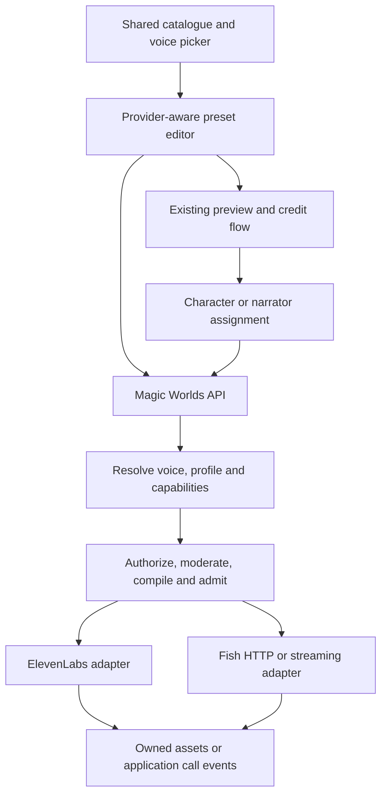

# Fish Audio: coordinated frontend and backend implementation plan

**Plan date:** 2026-10-15. **Implementation update:** M1–M7 development implementations are in place. M5 now requests native PCM and encodes complete owned MP3; four speakers at 1,200 compiled characters and the fresh application flow passed after incomplete native MP3 tails. R3 identity/order, word and device review remain open, so scenes stay disabled. M6 engine integration, schema expansion and bounded native completion/cancellation passed; calls stay off pending full R4 acceptance. The owner prioritized creating voices over expanding the starter catalogue; Gabriel is the selected Spanish starter. English/Spanish design, signed private persistence and subsequent Drama speech passed the real application flow. The development database is upgraded; production and acoustic acceptance retain their gates. [Implementation status](11_implementation_status.md) is the current execution record. The baseline observations below describe the original planning pass.

**Repositories:** [frontend](/home/andres/WebstormProjects/magic-worlds) and [backend/BFF](/home/andres/PycharmProjects/magic-worlds-api). This is the delivery plan for the research suite, including the UI/UX impact discussed after the research.

## 1. Delivery objective and scope

Add Fish Audio as a native speech provider while preserving existing ElevenLabs voices, presets, generated assets and calls. Keep the browser connected to the Magic Worlds API. Let the selected voice and server-owned model profile determine which controls and operations the UI offers.

The **first usable release** includes:

- Approved Fish voices in the existing catalogue and character/narrator pickers.
- Provider-aware presets and capability-driven recipe controls.
- Existing seven semantic emotions, plus a small approved direction-preset set where evaluated.
- Stock samples, metered recipe previews and single-speaker/per-segment Drama 3 narration.
- Application credit/quota behavior, provider spend/concurrency, admin acceptance and accurate processing disclosures.
- Backward-compatible reads of ElevenLabs v2 records and a safe rollout for new records.

Subsequent releases add advanced direction, phrase delivery, events and pronunciation; whole-scene rendering; then Fish calls. Design/persistence gets its own gated increment. Fish ASR, hosted Agents, self-hosting and unverified hosted editing are separate projects.

## 2. Planning baseline

The frontend checkout was at `a158e90c2ae290ba38c3a3801c730d39adcc9c4c`; the backend was at `2c2973d309b30faf109867ed3880d9facea3a3e1`. Both working trees may contain existing changes; these are checkout identifiers, not a clean-tree claim. The original research remains dated October 14.

Rechecked source constraints:

- [Speech provider types](/home/andres/PycharmProjects/magic-worlds-api/src/services/speech/types.py:15) still admit only ElevenLabs.
- [Capabilities DTOs](/home/andres/PycharmProjects/magic-worlds-api/src/models/voice_capabilities.py) have a single provider route and fixed control/tier structures.
- [Preset routes](/home/andres/PycharmProjects/magic-worlds-api/src/routes/voice_presets.py) still validate v2 writes.
- [Frontend API capability reads](/home/andres/WebstormProjects/magic-worlds/src/infrastructure/api/index.ts:2074) cache and normalize the existing contract.
- [Call delivery](/home/andres/PycharmProjects/magic-worlds-api/src/services/voice_orchestration/engine.py:2351) still returns before ledger updates for empty audio bytes.
- The canonical SQL revision is currently `2026_10_voice_native`; the [existing native cutover](/home/andres/PycharmProjects/magic-worlds-api/src/database/mysql/voice_native_cutover.py) includes historical cleanup and must not be repurposed as the Fish migration.

Use the exact native model header `drama-3`. Current primary documentation takes precedence over indexed material that still says `drama-3-preview`. Native timestamp streaming has different alignment and lifecycle semantics from the current adapter. [Drama guide](https://docs.fish.audio/features/text-to-speech/drama-3), [timestamp reference](https://docs.fish.audio/api-reference/endpoint/openapi-v1/text-to-speech-live-with-timestamps).

## 3. Target interaction and architecture

The normal user journey is:

**Choose voice → adjust available emotion/direction → preview → review any credit charge → save preset → assign to character/narrator.**

Provider and model are visible supporting information. Users do not need to understand transport, supplier keys or billing units to assign a voice. Advanced authoring remains separate from ordinary conversation text.

Preserve deployment catalogue scope, account preset ownership and workspace content/session ownership. Provider selection must not weaken any existing authorization boundary.

## 4. Milestones and dependencies

The table defines the original milestone scope and dependencies. M0's shared HTTP fixtures and M1–M3's code are now implemented; M0 live evidence and R1 staged acceptance remain pending. M4–M7 remain subsequent gated releases. See [current status](11_implementation_status.md). Enablement waits for both sides to pass the same acceptance gate.

| ID | Deliverable | Backend work | Frontend work | Depends on / release gate |
| --- | --- | --- | --- | --- |
| M0 | Contract and readiness baseline | Verify native request, reference rights, output, billing and retention; freeze DTO fixtures | Define picker/preset states, capability renderer and UX acceptance fixtures | First dependency for contract-sensitive work |
| M1 | Multi-provider foundation | Additive schema, v2/v3 readers, capability/profile registry and compatibility guards | Typed unions, API negotiation, lossless stored reads and versioned caches | M0; Fish writes disabled |
| M2 | Native HTTP and catalogue | Fish adapter, inventory/resolver, account admission, usage and admin acceptance | Provider filters/badges, catalogue detail, admin inventory/lab support | M1; approved synthetic-content staging checks |
| M3 | Presets, previews and narration | v3 preset/preview routes, per-segment routing, assets, credits and disclosure requirements | Dynamic recipe editor, preview costs/errors, assignments, narration status and consent copy | M2 plus frontend M1; **release R1** |
| M4 | Advanced performance | Trusted performance schema/compiler, offsets, dictionaries and complete cache identity | Optional direction field, phrase annotations, reaction menu and pronunciation editor | R1; **release R2** after quality acceptance |
| M5 | Whole-scene performance | Compatible-cast planner, ordered references, scene metadata and retry boundary | Scene preview, cast eligibility and clear update behavior | M4; **release R3**, optional optimization |
| M6 | Fish calls | MessagePack adapter, timing revisions, source matching, cancellation and capacity cleanup | Existing call UI with provider-aware eligibility, recovery and playback acceptance | R1 plus call contract/source-map work from M4; **release R4** |
| M7 | Designed voice workflow | Verified candidate persistence/provenance, voice lifecycle and publication policy | Adapt existing design/candidate/save screens to real Fish capabilities | M2; separate gate; not an R1 dependency |

M6 does not depend on whole-scene generation. M7 should not delay HTTP synthesis if approved reference voices are available. Resolve existing conversation/moderation readiness independently before assessing call synthesis.

## 5. M0 — Freeze the shared contract and prove assumptions

### Backend tasks

1. Create a redacted contract fixture for native Drama HTTP and timestamp WS. Use the research examples as starting points, not as passed tests.
2. Verify mono 44.1 kHz MP3, Spanish/English target voices, exact model selection, short/long text and intended directions.
3. Establish the actual account's billing unit/count rule, price applicability, concurrency and feature-specific retention settings.
4. Determine acceptable reference provenance under the application's catalogue policy. Do not relabel an unknown or cloned source as designed to pass an ElevenLabs publication gate.
5. Define server-owned profile/tier entitlement mapping. Existing Standard/Expressive product entitlements remain explicit; the UI must not infer access from a model's name.

### Frontend tasks

1. Specify catalogue states: loading, empty, plan-locked, unsupported language, narration-only, call-eligible and unavailable.
2. Specify preset states: existing v2, supported v3, capability loading/error, incompatible provider change, unsaved draft, previewing and save failure.
3. Keep the first editor limited to curated controls and existing fixed preview texts. Free-form direction and arbitrary authored-text preview belong to M4.
4. Prepare shared fixtures for the UI and API tests, including disabled/unknown capabilities and legacy records.

### Required decisions before new writes

Freeze provider identity (`fish_audio` is the proposed application identifier), stored voice version, API compatibility mechanism, capability shape, profile/tier mapping, initial publication policy and credit behavior. Record these choices in the existing architecture/report documents when implementation settles them.

Unknown account rights, pricing or retention block live enablement, not offline contract/UI work. A successful MP3 response alone does not pass direction, identity or billing validation.

## 6. M1 — Data, capabilities and client compatibility

### Backend tasks

- Add `fish_audio` to validated provider identities and introduce a strict version-3 stored voice/settings union. Retain existing v2 ElevenLabs semantics and reads.
- Update character voices, narrator/cast snapshots, presets, effective-voice projections, TTS jobs and call provider persistence. Resolve the opaque `voice_key` to the authoritative provider/voice pair on every write/admission.
- Create a new additive MySQL migration; update canonical SQL, revision validation and migration tests together. Preserve rows/assets/history. Do not rerun the historical native cutover or purge.
- Split optional catalogue/design/remix/history/subscription operations from mandatory synthesis/inventory behavior. Unsupported Fish operations return a typed unsupported result.
- Key executable capabilities by provider, profile and surface. Include control kinds/choices/ranges, tested language eligibility, output format, allowed tiers, availability and reason codes.
- New Fish capabilities fail closed when missing, unknown or unhealthy. A legacy fail-open status default must not enable a new provider accidentally.

### Frontend tasks

- Update stored voice/preset/catalogue types, constructors, effective-voice parsing and capability normalization. Preserve unknown stored data when unrelated fields are edited.
- Introduce a control renderer supporting curated selects/chips and later text/spans, rather than expanding the current hardcoded slider allowlist indefinitely.
- Make API/capability caching sensitive to contract version and account state; profile-dependent selections must not reuse an unrelated provider's capability result.
- Keep unsupported recipes read-only with a retry/update action. Never silently discard hidden settings or apply ElevenLabs settings to a Fish voice.

### Proposed compatibility mechanism

Use the existing routes with an explicit client contract version. The proposed request header is **`X-MW-Voice-Contract: 3`**, set through `apiService` for relevant metadata reads and voice/content writes. It is new proposed behavior, not an existing API requirement. Add it to credentialed CORS configuration and contract/cache handling.

Requests without the header retain the legacy contract. Version 3 reads accept v2 ElevenLabs and v3 multi-provider records. Legacy catalogue browsing offers legacy-compatible voices; a legacy client accessing/updating owned content or presets containing a new voice must receive a typed upgrade-required error rather than a lossy ElevenLabs projection or destructive write.

Backend authorization remains independent of the header. Blob/media reads keep their existing authentication and ownership behavior. The browser call audio protocol does not acquire a new version merely because stored voice data does; retain its current MP3 envelope initially.

Test stale tabs/older clients explicitly. Deploy readers before enabling new writes, and do not roll back to a binary that cannot safely read the expanded database/records.

### Contract surface checklist

| Existing route/surface | Planned contract change |
| --- | --- |
| `GET /voices/capabilities` | Negotiated v3 profiles/capabilities; preserve current safeguards, consent, tier and availability semantics |
| `GET /voices/catalog` and key lookup | Optional provider filtering; provider identity, tested capabilities and unchanged authorization/pagination |
| `GET /voice-presets` and individual reads | v2/v3 readable records; explicit legacy-client compatibility behavior |
| `POST/PUT /voice-presets` | Existing v2 path plus strict versioned new writes; provider/key agreement required |
| `POST /voice-presets/preview` | Provider-aware recipe/profile validation; preserve sample/render distinction, credit behavior and authenticated result |
| Card/session/effective-voice projections | Preserve provider identity, snapshot semantics and versioned settings |
| `/tts` jobs/assets | Record effective provider/profile/model; preserve task lifecycle, refunds and asset scope |
| `/admin/voices/*` | Provider-aware inventory, models/profiles, acceptance and supported operations |
| Call start/admission and current voice socket | Select approved call profile; retain browser protocol; normalize supplier events internally |

Fixture examples must cover all shared fields and errors before frontend/backend implementation diverges. New error codes need readable existing-envelope messages and recoverable UI actions; do not expose raw supplier responses.

## 7. M2 — Native HTTP, catalogue and operational admission

### Backend tasks

1. Add a Fish provider package using long-lived asynchronous HTTP clients and backend-only credentials. Send exact model headers and validate format/content; do not require a nonexistent native TTS seed.
2. Implement native voice inventory/get, complete pagination, availability/provenance normalization and provider-aware resolver queries. Separate voice IDs from speech model IDs.
3. Register an experimental Drama preview/narration profile with mono 44.1 kHz MP3. Advertise only controls demonstrated by the evaluation; shared-schema acceptance is insufficient.
4. Add supplier-account concurrency across workers/keys, bounded queues, exact-once lease release and independent provider breaker/health state.
5. Add versioned supplier-unit/USD estimates and reconciliation, separate from application credits. Bound retries and mark uncertain attempts; do not claim provider idempotency.
6. Add provider-specific curation/acceptance and supported admin operations. Keep history/retention and balance handling distinct from ElevenLabs jobs.

### Frontend/admin tasks

- Add an optional provider filter to the existing catalogue; keep All as a useful default. Show supporting provider/model, tested-language and availability information.
- Add provider/profile context to catalogue details, admin inventory, Synth Lab and acceptance samples. Replace fixed ElevenLabs model/control lists with capability-driven data.
- Disable unsupported library attachment, remix, creation or history operations with an explanation. Do not display a successful action for an unimplemented adapter method.
- Keep supplier balances, credentials and detailed failures in admin views. User screens continue to show their application allowance and actionable errors.

### Acceptance

An approved Fish catalogue item can be resolved, previewed in staging and assessed against the target profile without bypassing rights or scope checks. Account-limit and balance failures are correctly distinguished from user-credit failures. ElevenLabs behavior and its independent health/limits still pass regression tests.

## 8. M3 — Presets, previews, assignment and narration

### Backend tasks

- Extend preset/preview service routing and the moderated synthesis wrapper to select the resolved provider. Keep one canonical seven-emotion domain with provider-specific compilation.
- Make narration planning/dispatch provider-aware per segment. Preserve mixed-provider casts, admission before dispatch, owned storage, job progress and settlement/refunds.
- Extend the existing synthesis identity with effective profile/model, ordered voice identity, recipe/compiler versions and applied pronunciation/reference identity where supported.
- Validate every write and generation against the current server capability/entitlement; a stale frontend cache cannot authorize a disabled operation.
- Supply accurate sample/render source, allowance/credit information, effective voice/profile and recoverable failure reasons. Do not silently substitute a different provider/voice.
- Implement the consent/disclosure version required for the actual data flow, preserving all existing safeguards.

### Frontend tasks

1. Update Voice Studio and preset drawers for negotiated v2/v3 records. Display only the selected voice/profile's controls; retain existing seven moods where supported.
2. Changing provider selects a compatible voice and its valid recipe. Preserve the old draft until the user commits; show which provider-specific settings will change. Do not copy hidden ElevenLabs numeric values into Fish.
3. Reuse stock sample and generated preview players. Preserve fixed narration/dialogue/thought preview choices, language selection rules, paid-preview confirmation and draft retention after errors.
4. Carry new voices through character editing, narrator assignment, cast refresh and session snapshots. Existing snapshots change only through the existing explicit refresh/assignment action.
5. Reuse background narration task/progress and playback UI. Past audio remains playable with its recorded voice/model identity; adding Fish does not regenerate it.
6. Update English/Spanish consent/privacy and error copy from verified processing facts. Unknown/ineligible languages and unavailable operations receive a clear state/action.

### R1 acceptance

A user can select an approved Fish voice, set an evaluated mood/direction preset, preview it with correct credit messaging, save/reopen it, assign it and generate authorized narration. Existing ElevenLabs workflows remain usable. Drafts survive errors; unavailable Fish calls cannot be started. Mixed casts render without sending foreign provider IDs to Fish.

No advanced text-selection editor, arbitrary provider markup or new call transport is required to release R1.

## 9. M4 — Advanced direction, phrase delivery and pronunciation

**Development implementation, October 15:** the trusted compiler, immutable
pronunciation versions, metered authored previews, narration integration and
optional editor are implemented behind `FISH_AUDIO_PERFORMANCE_ENABLED=false`.
The development database expansion and five-render Gabriel application test
passed. R2 acoustic acceptance is still open. See [implementation and evidence](14_advanced_performance_development.md).

### Backend tasks

- Add a trusted performance schema separate from dialogue: bounded author directions, validated delivery spans, positioned events and pronunciation references.
- Compile after content/metadata validation and the required moderation gate. Reject untrusted control syntax and routing tokens in ordinary content.
- Preserve canonical display text and a source map through number expansion, phonemes, inserted directions, events and speaker markers. Use explicit Unicode offset conventions.
- Resolve dictionary versions before admission; handle the documented silent-drop risk for unresolved upstream references. Include applied versions/content in cache identity.
- Add authenticated, bounded authored-text preview only as an explicit API extension with admission/credit/moderation rules. The existing fixed-text preview must not become unrestricted accidentally.

### Frontend tasks

- Add an optional advanced Voice direction field with examples and bounded validation.
- Provide a performance editor for selected-text delivery and visible removable annotations. Keep raw provider tags out of normal chat/editor content.
- Add a small reaction/pause insertion menu and a reusable pronunciation editor for recurring character/world names, with locale and preview. Advanced phonemes appear only for documented/evaluated language systems.
- Support keyboard selection/editing, visible focus, accessible labels and English/Spanish copy. Translate UTF-16 selections to the agreed backend offset scheme without splitting graphemes.
- Make neutral/directed comparison useful before adding a full take-management interface.

### R2 acceptance

Scoped effects end at the chosen boundary; events do not become transcript words; pronunciation changes are versioned and audible; untrusted brackets cannot become instructions. The approved corpus passes word, identity, direction and scope criteria from [09](09_validation_plan_and_roadmap.md).

## 10. M5 — Whole-scene narration

### Backend tasks

Add an optional planner for casts whose references are all eligible for the same Fish profile. Order references deterministically, validate speaker indices and persist logical utterance/cast mappings. Measure actual request-size/speaker ceilings instead of assuming a model-card limit is the hosted limit.

Keep the per-segment planner for mixed or ineligible casts. Define scene-level retry, asset replacement and spend behavior before dispatch; partial failures must not duplicate accepted dialogue.

### Frontend tasks

Extend the existing cast/narrator controls with scene-preview availability. Show a useful explanation when a requested scene mode cannot be used. Preserve individual voice choices and session snapshots; scene optimization must not force a silent voice replacement.

### R3 acceptance

A reviewed multi-speaker scene preserves speaker identity/order and clean logical text. Mixed casts continue to work. Scene failure/retry does not append duplicate speech or conceal extra supplier spend.

## 11. M6 — Native Fish calls

The integrated engine/ledger/accounting/UI development slice is implemented
behind the disabled call flag. The configured expansion and bounded native engine
completion/cancellation passed; full R4 acceptance remains open. See
[current handoff](18_call_engine_development.md).

### Backend tasks

1. Add a MessagePack dependency and native timestamp WS adapter. Start with one generation/socket per assistant turn; optimize connection reuse only after probing its lifecycle.
2. Send approved complete text units and receive audio concurrently. End input with stop and drain to finish on normal completion; local cancellation closes the active socket, isolates that generation using its epoch and drops stale frames.
3. Separate audio deltas from timing snapshots. Process non-null alignment without audio; replace a chunk snapshot, preserve it on null, and apply audio offsets. Never deduplicate audio by provider chunk sequence.
4. Change the ledger to consume revisable word timing/source maps with explicit quality. Prevent annotations/events from becoming spoken transcript characters; do not treat early trailing-word estimates as irreversible truth.
5. Preserve accepted/delivered-audio billing policy while recording supplier generation/cancellation spend separately. Release capacity exactly once under finish, close, timeout, disconnect and barge-in.
6. Keep Groq STT and the current conversation engine initially. Verify the existing conversation/tool collection and required moderation profiles before attributing call failures to TTS.

### Frontend tasks

- Keep the existing call screen, microphone uplink, VAD, mute/end/interrupt controls and consent gate.
- Resolve call eligibility for the selected voice/profile before starting. Narration-only voices have a clear unavailable state.
- Preserve the application mono 44.1 kHz MP3 envelope, application frame ordering and cancellation behavior. Add provider-aware end/recovery messages without replaying an interrupted reply.
- Verify slow playback, reconnect/replay and supported-device fallback paths. Add a first-audible browser mark correlated with existing server/VAD timing.
- Keep current transcript/caption behavior first; synchronized word highlighting is a separate UI capability after alignment passes.

### R4 acceptance

The complete matrix in [06](06_streaming_calls_and_alignment.md) passes: metadata-only revisions, repeated chunk sequence, offsets, partial failure, Unicode/source matching, late-frame rejection, disconnect/replay and interruption. Measure end-to-end p50/p95 and cancellation-to-silence against an agreed application budget; vendor TTFA does not satisfy this gate.

## 12. M7 — Voice design and publication

**Development implementation, October 15:** prioritized at the owner's request.
The live response supplies candidate signatures; exact signed audio persisted as
private `source=voice_design` models in English and Spanish. The existing studio
now compares candidates and saves an actor-owned draft. Shared admission records
request-priced design/save estimates, and uncertain saves reconcile owned
inventory before any further provider write. Completed saves are idempotent via
catalogue provenance. Unsaved candidates use the existing studio's bounded,
same-worker session convention. See [development evidence](13_voice_creation_development.md).

Adapt existing admin design/candidate/save surfaces only after the provider's persistence/provenance contract is verified. Design candidate generation is not the same operation as creating a persistent TTS voice.

Backend work includes candidate decoding/format validation, permitted reference persistence, verified design signatures/provenance, visibility and lifecycle reconciliation. Frontend work includes candidate comparison, retained draft/save errors and only the controls actually supported by the endpoint.

Keep public publication and local catalogue publication distinct. If design signatures cannot be obtained under a documented contract, leave save/publication disabled rather than inventing metadata. See [API usage/persistence research](04_api_usage_and_examples.md#voice-design-and-persistence).

## 13. Main implementation touchpoints

These are existing locations to change or extend during implementation; proposed new Fish modules should follow their current boundaries.

| Workstream | Frontend | Backend |
| --- | --- | --- |
| Data and API | [voice types](/home/andres/WebstormProjects/magic-worlds/src/shared/types/voicePreset.types.ts), [stored reads](/home/andres/WebstormProjects/magic-worlds/src/shared/voice/parseStoredVoice.ts), [effective voice](/home/andres/WebstormProjects/magic-worlds/src/shared/voice/effectiveVoice.ts), [API service](/home/andres/WebstormProjects/magic-worlds/src/infrastructure/api/index.ts) | [character DTO](/home/andres/PycharmProjects/magic-worlds-api/src/models/character.py), [preset DTO](/home/andres/PycharmProjects/magic-worlds-api/src/models/voice_preset.py), [canonical SQL](/home/andres/PycharmProjects/magic-worlds-api/src/database/mysql/db.sql) |
| Profiles/capabilities | [normalization](/home/andres/WebstormProjects/magic-worlds/src/shared/voice/voiceCapabilities.ts), [controls](/home/andres/WebstormProjects/magic-worlds/src/features/voices/components/RecipeControlsV2.tsx) | [public route](/home/andres/PycharmProjects/magic-worlds-api/src/routes/voices.py), [DTO](/home/andres/PycharmProjects/magic-worlds-api/src/models/voice_capabilities.py), [registry](/home/andres/PycharmProjects/magic-worlds-api/src/services/speech/capabilities.py) |
| Catalogue and recipes | [filters](/home/andres/WebstormProjects/magic-worlds/src/features/voices/components/CatalogFilters.tsx), [preset editor](/home/andres/WebstormProjects/magic-worlds/src/features/voices/components/PresetEditorV2.tsx), [studio](/home/andres/WebstormProjects/magic-worlds/src/features/voices/components/VoiceStudioV2.tsx) | [catalogue route](/home/andres/PycharmProjects/magic-worlds-api/src/routes/voices_catalog.py), [repository](/home/andres/PycharmProjects/magic-worlds-api/src/database/mysql/voice_catalog_models.py), [resolver](/home/andres/PycharmProjects/magic-worlds-api/src/services/speech/resolver.py), [preset route](/home/andres/PycharmProjects/magic-worlds-api/src/routes/voice_presets.py) |
| Provider/rendering | [preview hook](/home/andres/WebstormProjects/magic-worlds/src/features/voices/useRecipePreview.ts) and existing task/playback views | [interfaces](/home/andres/PycharmProjects/magic-worlds-api/src/services/speech/interfaces.py), [provider factory](/home/andres/PycharmProjects/magic-worlds-api/src/services/speech/providers/__init__.py), [synthesis](/home/andres/PycharmProjects/magic-worlds-api/src/services/speech/synthesis.py), [compiler](/home/andres/PycharmProjects/magic-worlds-api/src/services/speech/text_pipeline.py), [narration engine](/home/andres/PycharmProjects/magic-worlds-api/src/services/tts_generation/engine.py) |
| Calls | [call screen](/home/andres/WebstormProjects/magic-worlds/src/features/call/components/CallScreen.tsx), [socket](/home/andres/WebstormProjects/magic-worlds/src/infrastructure/api/voiceSocket.ts), [audio validation](/home/andres/WebstormProjects/magic-worlds/src/features/interaction/audio/audioFormat.ts), [playback](/home/andres/WebstormProjects/magic-worlds/src/features/interaction/audio/voicePlaybackBuffer.ts) | [orchestration](/home/andres/PycharmProjects/magic-worlds-api/src/services/voice_orchestration/engine.py), [ledger](/home/andres/PycharmProjects/magic-worlds-api/src/services/voice_orchestration/call_ledger.py), [current speaker integration](/home/andres/PycharmProjects/magic-worlds-api/src/services/voice_orchestration/call_tts_elevenlabs.py) |
| Admin and disclosures | [console](/home/andres/WebstormProjects/magic-worlds/src/features/admin/voices/components/AdminVoicesPage.tsx), [lab models](/home/andres/WebstormProjects/magic-worlds/src/features/admin/voices/components/lab/useLabModels.ts), [consent](/home/andres/WebstormProjects/magic-worlds/src/features/interaction/components/VoiceConsentModal.tsx), [privacy copy](/home/andres/WebstormProjects/magic-worlds/src/features/legal/documents/privacyVoiceCopy.ts) | [admin routes](/home/andres/PycharmProjects/magic-worlds-api/src/routes/admin_voices.py), [publication policy](/home/andres/PycharmProjects/magic-worlds-api/src/services/speech/catalog/admin.py), [limiter](/home/andres/PycharmProjects/magic-worlds-api/src/services/speech/limiter.py), [spend circuit](/home/andres/PycharmProjects/magic-worlds-api/src/services/speech/spend_circuit.py) |

Reuse the existing Reverie components/tokens and context architecture. New interactive controls need component stories, focused behavior tests and keyboard/label coverage. Do not introduce a separate provider-branded application or browser provider SDK.

## 14. Verification and delivery slices

### Shared test gates

| Layer | Required evidence |
| --- | --- |
| Contract | The same v2/v3/unknown/disabled/error fixtures are asserted by backend DTO/route and frontend parser tests |
| Persistence | Fresh schema, upgrade from current revision, unchanged ElevenLabs rows, provider/key mismatch and non-destructive rollback |
| HTTP/catalogue | Binary success/error/empty audio, timeout/uncertain retry, full pagination, source rights and language eligibility |
| Security/ownership | Account presets versus workspace sessions, shared-card/cast access, stale client writes, consent and no raw provider secrets/content in logs |
| Usage | Cache hits, multiple workers/keys, admission/refund paths, credit exhaustion, supplier balance and exact-once cancellation cleanup |
| UI | Provider switch/draft retention, hidden settings, sample versus render, credit confirmation, empty/unavailable states and EN/ES/accessibility |
| Performance | No marker leakage, correct scope/pronunciation, identity/word acceptance and compiler/source-map regressions |
| Calls | The protocol/ledger/device matrix and real application latency/cancellation measurements |

Extend existing focused backend tests, then run the appropriate suite using the configured project environment and pytest exclusions. Add a proposed `live_fish_provider` marker and explicit opt-in flag; exclude live Fish tests from ordinary runs in [pytest configuration](/home/andres/PycharmProjects/magic-worlds-api/pytest.ini). Live tests use staging credentials, synthetic content and bounded concurrency/spend.

For frontend implementation, run relevant Vitest tests, then `pnpm test --run` and `pnpm build`; run `pnpm typecheck:stories` after story changes. Lint findings must be compared with the known baseline. Report checks actually run and any remaining failures; do not call a documentation syntax check an application pass.

### Suggested reviewable change sequence

1. Shared contract fixtures and compatibility decision; no Fish enablement.
2. Backend additive schema/readers and frontend typed readers, in coordinated repository changes.
3. Backend profiles/factory/HTTP/catalogue/admission, with offline adapter tests.
4. Frontend catalogue/recipe renderer/admin capability views against those contracts.
5. Backend preset/preview/narration integration and frontend preview/assignment/disclosures.
6. R1 staged acceptance and provider/surface enablement.
7. Trusted performance compiler/editor and pronunciation (R2).
8. Compatible-cast scene rendering (R3), independently from calls.
9. Timing contract/ledger, native WS adapter, call UI acceptance (R4).
10. Designed-voice persistence/publication only after its separate contract gate.

Each slice must be testable with Fish disabled and preserve existing ElevenLabs behavior. Backend/frontend changes may be separate PRs, but the shared fixtures and deployed-reader compatibility must agree before enabling new writes.

## 15. Deployment, rollback and completion

Use independent backend gates for Fish provider, preview, narration, advanced performance, scenes, calls and design. Default new gates off; a UI feature flag is not server authorization. Availability exposed by capabilities must reflect actual runtime configuration and account eligibility.

Deployment sequence:

1. Ship/test schema-revision compatibility and additive expansion without new Fish writes. Exact current revision guards need an explicit handoff strategy; use a coordinated maintenance window if safe rolling compatibility cannot be established.
2. Deploy upgraded backend readers and routes to every worker, then the frontend with negotiated contracts. Account for stale tabs and capability caches.
3. Curate/accept reference voices, verify account settings/disclosures and run bounded staging acceptance.
4. Enable approved pilot accounts for previews, then narration. Expand only after quality, errors, queue occupancy and debit reconciliation pass.
5. Promote each later surface independently after its own gate. Keep calls disabled until the full call evidence exists.

Rollback disables new affected work on the upgraded compatible deployment. Preserve new records, references/provenance, owned assets and history; cancel/settle in-flight work using its recorded provider. Do not automatically downgrade the database, substitute providers or redeploy a reader that cannot understand v3 records.

**R1 is complete** when the end-to-end catalogue → preset → preview → assignment → narration flow works with correct authorization, costs, disclosures and regression evidence. **The broader plan is complete** only when each deliberately included later release has passed its own gate; deferred ASR/Agents/self-hosting/editing remain explicitly outside that definition.

Calendar estimates should follow M0 evidence and available team capacity. The expected critical path is data/contracts → native HTTP/catalogue → integrated UI/narration → advanced performance/source mapping → reliable calls. The full risk/unknown register and listening criteria remain in [09](09_validation_plan_and_roadmap.md); operating and cost policies remain in [07](07_best_practices_and_operations.md) and [08](08_cost_privacy_and_licensing.md).
