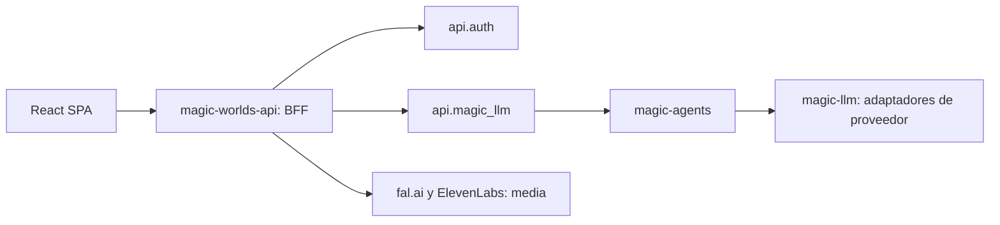

# Findings: integración y base actuales

**Reconciliación documental 2026-10-14: baseline histórico anterior al refactor.** El inventario de env/hydrators/catalogo de este archivo describe el 2026-10-08; no es el routing actual. El código de perfiles/bindings ya existe. Estado vigente, WIP operativo y gaps en [16](16_current_status_and_roadmap.md).

Revisión de código: 2026-10-08. Las referencias son evidencia estática. No se verificó el contenido de bases ni logs desplegados. Ver [fuentes y revisiones](11_sources_and_open_decisions.md).

## Arquitectura existente

La SPA llama al BFF mediante `apiService`. El BFF conserva los grafos de las features y llama por HTTP a la API LLM. No importa `magic-agents` ni `magic-llm` en producción. Mantener ese límite evita introducir en el frontend o BFF un segundo runtime de agentes.

Evidencia: [apiService](/home/andres/WebstormProjects/magic-worlds/src/infrastructure/api/index.ts), [inventario de grafos](/home/andres/PycharmProjects/magic-worlds-api/src/agent_graphs/README.md), [prueba del límite de dependencias](/home/andres/PycharmProjects/magic-worlds-api/tests/agent_graphs/test_no_magic_agents_production_dependency.py).

## Inventario de features y configuración

| Feature actual | Configuración/routing observado | Implicación |
|---|---|---|
| Generación de personaje, mundo, item y adventure template | `CARD_LLM_API_KEY`, `CARD_LLM_BASE_URL`, `CARD_LLM_MODEL`; cuatro grafos built-in con `runtime.llm_model` | Un perfil `card_generation` puede cubrir las cuatro salidas; el backend sigue validando cada schema |
| Novela / Story Studio | `stories.py` recibe `content_generation_config`; grafo `story_writer` | Se necesita resolución independiente `novel` sin acoplarla a cards |
| Aventura, personaje y grupo | Dos clientes: `response_model` y `metadata_model`; configuración `ADVENTURE_CHAT_LLM_*` | El perfil debe resolver narrativa y metadatos en un mismo plan |
| Preflight de lectura de cards en chat | Modelo de respuesta de chat, grafo `read_card_preflight` | Es una llamada interna; también necesita pagador y credencial definidos |
| Callbot / voz | Grafo con respuesta y metadata, más pipeline de voz/media | BYOK de texto no sustituye automáticamente TTS ni otros servicios de voz |
| Card assistant | `CARD_ASSISTANT_LLM_*`; ocho variantes patch/no_patch | Compatibilidad con herramientas y validaciones de patch, no solo texto libre |
| Lorebook assistant | `LOREBOOK_ASSISTANT_LLM_*` | Perfil y límites propios; conservar revisión de cambios |
| Extracción de recursos lorebook | `LOREBOOK_EXTRACTION_LLM_*`; JSON estructurado | No asumir que el modelo creativo sirve para extracción |
| Escritura de prompts para imágenes | Modelo/configuración de generación de contenido, grafo propio | Separar escritor LLM del modelo de imagen y de su costo |
| Escritura de prompts/letras para canciones | Dos grafos según modelo musical | Mantener formatos propios de ACE-Step y MiniMax; perfil LLM independiente del proveedor musical |
| Imagen, música y TTS | fal.ai / ElevenLabs, jobs y assets propios | Fuera del BYOK LLM inicial; sus credenciales y cobros siguen separados |

Evidencia: config cards e hidratación (`/home/andres/PycharmProjects/magic-worlds-api/src/services/content_generation.py:45`, fuente histórica retirada; ver [estado actual](16_current_status_and_roadmap.md)), [novela](/home/andres/PycharmProjects/magic-worlds-api/src/routes/stories.py:800), [chat](/home/andres/PycharmProjects/magic-worlds-api/src/routes/user/route_chat.py:342), card assistant (`/home/andres/PycharmProjects/magic-worlds-api/src/services/card_assistant.py:385`, fuente histórica retirada; ver [estado actual](16_current_status_and_roadmap.md)), lorebook assistant (`/home/andres/PycharmProjects/magic-worlds-api/src/services/lorebook_assistant.py:285`, fuente histórica retirada; ver [estado actual](16_current_status_and_roadmap.md)), [extracción](/home/andres/PycharmProjects/magic-worlds-api/src/services/lorebook_resources.py:793).

Muchos grafos revisados usan un límite de salida de 16,384 tokens, incluso helpers. La configuración del perfil debe incorporar límites por rol; un default creativo no debería trasladar ese presupuesto sin revisión a metadata, preflight o extracción.

## Agent Studio

- Los endpoints `/admin/agents` requieren root.
- Hay cinco built-ins visibles: character/world/item/adventure-template generation y story_writer.
- Los built-ins productivos son archivos inmutables con hashes verificados por readiness.
- Los custom agents son copias independientes con draft, versiones y publicación en DB.
- Publicar un custom agent **no lo conecta** a la ruta productiva de cards o novela.
- Sus campos model/temperature/max_tokens/etc. forman parte de la configuración del agente actual. No hay un modelo de perfiles personales ni asignaciones por feature.
- Los IDs de usuario en tablas de agentes son auditoría de edición/publicación, no propiedad privada de un perfil.

Evidencia: [registry](/home/andres/PycharmProjects/magic-worlds-api/src/services/agent_studio/builtin_registry.py), [rutas root](/home/andres/PycharmProjects/magic-worlds-api/src/routes/admin_agents.py:51), [tablas de agentes](/home/andres/PycharmProjects/magic-worlds-api/src/database/mysql/db.sql:1737).

Hay una discrepancia de contrato: la UI ofrece `{{env.CARD_LLM_MODEL}}`, pero el compilador backend reconoce `{{runtime.llm_model}}`. El nuevo contrato debe representar herencia con datos estructurados y corregir este caso durante la transición. Evidencia: [selector frontend](/home/andres/WebstormProjects/magic-worlds/src/features/admin/agents/components/AdminAgentsPage.tsx:61), [compilador](/home/andres/PycharmProjects/magic-worlds-api/src/services/agent_studio/compiler.py:40).

## Catálogo existente en api.magic_llm

La base ya contiene `cat_providers`, `cat_model`, capacidades extensibles, lifecycle de modelos, precios con vigencia y grupos de acceso. Los aliases `@{id_founder}/{model}` enlazan modelo y proveedor configurado; no son una identidad portátil suficiente para BYOK.

El esquema guarda `cat_providers.provider_key` como JSON. `CatalogRepository.create_provider` serializa el diccionario de claves con `json.dumps` al INSERT; no hay cifrado de aplicación en esa operación. Esto prueba la capacidad de guardar claves legibles por la aplicación, no el contenido real de ninguna fila. Evidencia: [DDL catálogo](/home/andres/PycharmProjects/api.magic_llm/scripts/schemas/catalog/01_create_tables.sql), [INSERT proveedor](/home/andres/PycharmProjects/api.magic_llm/src/repositories/catalog.py:397).

El DTO de respuesta omite `key`, pero conserva `provider.headers`. Si se configura Authorization u otro header secreto dentro de ese objeto, se podría exponer en la respuesta. Es un riesgo condicionado por la configuración real. Evidencia: [proyección de proveedor](/home/andres/PycharmProjects/api.magic_llm/src/services/catalog.py:224).

Las capacidades actuales son metadata, explícitamente no gates de inferencia. Se necesita validación de compatibilidad propia de las features de Magic Worlds, sin cambiar de forma inadvertida la política global de otros consumidores. Evidencia: [migración de capacidades](/home/andres/PycharmProjects/api.magic_llm/scripts/schemas/catalog/05_add_capabilities.sql).

El proxy de modelos de Agent Studio usa `/v1/models`, descarta entradas de agentes y reduce datos a ID, contexto, propietario y estado. Publicar valida existencia del ID, no compatibilidad completa con herramientas, salida o parámetros. Evidencia: [servicio de catálogo para Studio](/home/andres/PycharmProjects/magic-worlds-api/src/services/agent_studio/service.py:755).

## Persistencia de grafos y riesgo de credenciales

En el BFF, los grafos almacenados no contienen claves y se hidrata una copia aislada antes del envío. Es un límite útil **dentro de ese servicio**. Evidencia: hidratación (`/home/andres/PycharmProjects/magic-worlds-api/src/services/content_generation.py:438`, fuente histórica retirada; ver [estado actual](16_current_status_and_roadmap.md)).

En la API LLM, el camino inline admite el grafo sin resolver routing de catálogo; el wrapper conserva una copia del grafo recibido y captura un snapshot exacto. `persist=False` evita ciertas persistencias de conversación, pero no garantiza ausencia del snapshot nativo. La implementación del almacén nativo serializa el snapshot y lo escribe como evento `native.snapshot`.

Evidencia encadenada:

1. [Entrada inline](/home/andres/PycharmProjects/api.magic_llm/src/routes/completions.py:980).
2. [Copia del grafo authored](/home/andres/PycharmProjects/api.magic_llm/src/util/agt_flow.py:871).
3. [Captura del snapshot](/home/andres/PycharmProjects/api.magic_llm/src/util/execution_snapshot.py:66).
4. [Wrapper inline](/home/andres/PycharmProjects/api.magic_llm/src/util/agt_flow.py:2397).
5. [Almacén de snapshot](/home/andres/PycharmProjects/api.magic_llm/src/db/native_execution.py:388).

La combinación deja un camino en código para que una clave ya inyectada termine en persistencia. No se comprobó si ocurrió en una instancia desplegada. El cambio de transporte es un requisito previo al BYOK, también relevante para las claves actuales de plataforma.

`NodeClientLLM` instancia `MagicLLM` con engine, model y api_info; no resuelve por sí solo el catálogo ni las políticas de propietario. Acepta aliases de configuración y placeholders de entorno. Por ello, cambiar el model ID no implementa autorización ni BYOK. Evidencia: [cliente de nodo](/home/andres/PycharmProjects/magic-agents/magic_agents/node_system/NodeClientLLM.py:63), [schema de cliente](/home/andres/PycharmProjects/magic-agents/magic_agents/models/factory/Nodes/ClientNodeModel.py).

## Identidad, uso y cobro

El BFF tiene `tb_user.user_hash` único y roles consumer/admin/root. El ID entero local difiere del ID de otros servicios. La delegación conserva sesión y contexto de proyecto; debe usarse esa identidad validada, no un owner enviado por el navegador. Evidencia: [usuarios BFF](/home/andres/PycharmProjects/magic-worlds-api/src/database/mysql/db.sql:1), [headers de delegación](/home/andres/PycharmProjects/magic-worlds-api/src/services/magic_llm_config.py:190), [CompletionAuthContext](/home/andres/PycharmProjects/api.magic_llm/src/routes/dependencies/completion_auth.py:48).

El catálogo global permite bypass de grupos para admin/root. Eso no debe convertirse en bypass para leer perfiles personales de otro usuario. Evidencia: [acceso a modelos](/home/andres/PycharmProjects/api.magic_llm/src/db/model.py:137).

El BFF tiene planes, límites por operación, contador de solicitudes, concurrencia y créditos diarios/PAYG. `reserve_operation` combina admisión y cobro. BYOK requiere una política explícita con cargo cero, conservando admisión y límites; no basta con asignar `credit_cost=0` al plan compartido. Evidencia: [reserva](/home/andres/PycharmProjects/magic-worlds-api/src/database/mysql/models.py:3863), [tablas membership](/home/andres/PycharmProjects/magic-worlds-api/src/database/mysql/db.sql:642).

La reserva del chat exige `ledger_ids` no vacíos y costo positivo, y el conteo de operaciones en vuelo consulta estados específicos de cada consumidor. Por eso el camino BYOK necesita un contrato de capacidad independiente del débito, además de cambios en rutas. Evidencia: [validación de reserva de chat](/home/andres/PycharmProjects/magic-worlds-api/src/database/mysql/models.py:21810), [conteo en vuelo](/home/andres/PycharmProjects/magic-worlds-api/src/database/mysql/models.py:2968).

La API LLM ya conserva facts de uso por llamada con tokens, precio snapshot y costos. Hay caminos legacy que calculan y descuentan créditos. Se debe auditar la ruta elegida antes del lanzamiento para asegurar que BYOK no descuenta saldo en ninguno de los dos servicios. Evidencia: [usage facts](/home/andres/PycharmProjects/api.magic_llm/scripts/schemas/tables/06_create_tb_usage_fact.sql), [caminos de cobro](/home/andres/PycharmProjects/api.magic_llm/src/util/llm.py).

## Base y cliente web

El BFF usa SQL directo con aiomysql y verifica el contrato exacto del esquema, incluido un revision marker. Toda tabla/índice/check nuevo debe incorporarse a schema y validación; no basta con un ALTER aislado. Evidencia: [bootstrap](/home/andres/PycharmProjects/magic-worlds-api/src/database/mysql/bootstrap.py:15).

En la SPA, HTTP y streams pasan por apiService; chat usa `ChatSocket` con frame `type: chat`, contenido e identidad de request. El frame actual y los payloads de generación usan validación estricta en backend, por lo que añadir `llm` exige cambios coordinados. Hay refresh y reintentos automáticos que deben distinguir expiración de sesión de rechazo del proveedor. Evidencia: [sendChat](/home/andres/WebstormProjects/magic-worlds/src/infrastructure/api/chatSocket.ts:223), [WsChatFrame](/home/andres/PycharmProjects/magic-worlds-api/src/routes/user/route_chat.py:266), [StoryGeneratePayload](/home/andres/PycharmProjects/magic-worlds-api/src/routes/stories.py:218).

La vista agregada de tareas actualmente tipa `theme_song`; no es un motor genérico de tareas BYOK listo para usar. El engine de canciones tiene recuperación de jobs, pero no autoriza persistir una clave LLM. Evidencia: [tipos tareas](/home/andres/WebstormProjects/magic-worlds/src/shared/types/task.types.ts), [engine canciones](/home/andres/PycharmProjects/magic-worlds-api/src/services/theme_song_generation/engine.py).
