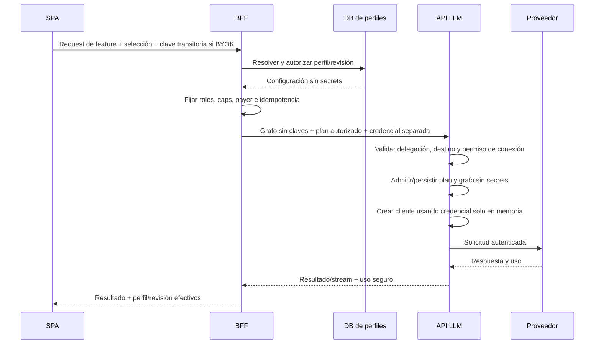

# ADR-LLM-001: perfiles en DB y credenciales BYOK transitorias

**Lifecycle: diseño/requisitos y decisiones conservados. Revisado 2026-10-15.** Este archivo define el objetivo, no un inventario de lo ya instalado. El [ledger 16](16_current_status_and_roadmap.md), la [API actual 07](07_api_changes.md) y el [registro F01–F11](../security/README.md) tienen precedencia. La custodia end-to-end sigue abierta.

**Estado:** implementación autorizada; requisitos de propiedad, no persistencia y retiro completo de legacy confirmados por el usuario. **Fecha:** 2026-10-09. **Responsable de decisión final:** propietario del proyecto.

## Contexto y decisión

El sistema ya separa frontend, BFF y ejecución LLM. Se conservará esa arquitectura. Los perfiles y la política de selección de features viven en `magic-worlds-api`; el catálogo de proveedores/modelos y la creación de clientes viven en `api.magic_llm`. Las bibliotecas ejecutan el plan autorizado, sin decidir ownership ni precios al usuario.

La entrega realiza un corte de contrato: todos los consumidores LLM usan resolución de perfiles y bindings simbólicos. Se eliminan compatibilidad con aliases antiguos, hidratación de secretos, configuración por feature en env, DTOs/wrappers obsoletos y cualquier camino de ejecución anterior. Un contrato incorrecto produce un error; ningún flag, retry o rollback vuelve al camino retirado.

Un **perfil** describe proveedor permitido, modelos por rol y settings validados. Un **agente** describe workflow, prompts, herramientas y salida. Una **conexión de plataforma** permite al ejecutor recuperar una credencial de la aplicación. Una **credencial BYOK** es un valor transitorio de la solicitud y no una entidad almacenada.

## Dos ámbitos de propiedad

| Ámbito | Creador y edición | Visibilidad | Credencial |
|---|---|---|---|
| `system` | Root; draft, validar, publicar, rollback | Usuarios autorizados del proyecto | Conexión de plataforma permitida para el proyecto |
| `user` | Su propietario; guardar nueva revisión privada | Solo ese usuario | Clave recibida con la ejecución |

El usuario puede seleccionar un perfil system pero no modificarlo. Para cambiar modelo/settings crea un perfil personal; esa copia usa BYOK y no conserva la conexión de plataforma. Un root que desea un perfil privado opera como usuario y cumple el mismo ownership. El rol root no necesita acceso a configuraciones privadas ajenas para administrar el catálogo.

Dos ámbitos no significa solo dos preferencias: cada ámbito tiene un default y asignaciones por feature. No se agrega un tercer catálogo ni herencia por novela/sesión en la primera entrega.

## Resolución determinista

```text
resolve(subject, project, feature):
  validar feature registrada y disponible
  cargar preferencias del usuario y política root del proyecto
  si user_selection_enabled:
    elegir primera asignación PRESENTE:
      user_feature → user_default → system_feature → system_default
  en otro caso:
    elegir system_feature → system_default
  autorizar propietario o disponibilidad del perfil system
  verificar perfil activo y su revisión publicada
  validar compatibilidad completa para feature y roles
  fijar revisión, grafo, modelo, settings, caps y pagador
  exigir credencial transitoria solo si el perfil es personal
```

Los defaults guardan un `profile_id`; las nuevas ejecuciones siguen su revisión publicada actual. Cada ejecución guarda la revisión resuelta una sola vez. Un rollback cambia el puntero publicado para solicitudes futuras, no las que ya empezaron.

Una asignación ausente continúa la cadena. Una asignación inválida **detiene** la resolución. Eliminar una selección personal significa volver a heredar, no seleccionar automáticamente un perfil distinto a escondidas.

Las cachés de resolución usan proyecto, subject, feature y generaciones de preferencias/política/perfil. No contienen claves. Un TTL corto limita retrasos, pero las decisiones de autorización y bloqueo se revalidan antes de una llamada nueva. La API no admite una credencial o un payer declarados como autoridad por el navegador.

## Features y roles propuestos

Los identificadores siguientes pertenecen al registro de política, no son endpoints. La tabla se reconcilió con [el registro fuente](../../../../PycharmProjects/magic-worlds-api/src/services/llm_features.py) el 2026-10-15; su proyección en DB permite administrar recomendaciones, no inventar workflows. El resto de la ADR conserva el contrato objetivo de seguridad.

| Feature key | Pantalla/consumidor | Roles LLM internos | Requisito principal |
|---|---|---|---|
| `card_generation` | Los cuatro creadores | `primary` | JSON válido y schema específico |
| `card_assistant` | Asistente de cards | `primary` | Tools/patch donde aplica; streaming cuando se solicita |
| `novel` | Story Studio | `primary` | Prosa/Markdown, contexto largo y salida candidata |
| `chat_adventure` | Aventura | `primary`, `metadata`, `preflight` | Narrativa streaming + metadata estructurada |
| `chat_character` | Chat 1:1 | `primary`, `metadata`, `preflight` | Mismo contrato con contexto de personaje |
| `chat_group` | Chat de grupo | `primary`, `metadata`, `preflight` | Roles/personajes y metadata coherentes |
| `lorebook_assistant` | Asistente lorebook | `primary` | Herramientas y validación de cambios |
| `app_assistant` | Guía de aplicación | `primary` | Texto/stream sin herramientas de escritura |
| `lorebook_extraction` | Recursos/importación | `primary` | Extracción estructurada |
| `image_prompt` | Escritor de prompt visual | `primary` | JSON/contrato del escritor; media se cobra aparte |
| `theme_song_writer` | Escritor de prompt y letras | `primary` | Contrato según modelo musical seleccionado |
| `callbot` | Conversación de voz | `primary` | Reply streaming; el registro actual no espera una fase metadata |
| `moderation` | Clasificador speech anterior | `primary` | JSON/schema y presupuesto corto; su reemplazo nativo está planificado en el dossier de moderación |

La primera activación BYOK cubre texto interactivo: cards, asistentes, novela y chats. Los escritores de media y callbot deben migrar a resolución de perfiles de sistema, pero su BYOK queda deshabilitado hasta completar transporte, presupuestos y recuperación específicos. La UI no ofrece una opción BYOK que el consumidor aún no soporte.

El registro expone `user_selection_enabled` y `byok_enabled`. Media writers y callbot mantienen ambas capacidades personales desactivadas inicialmente, por lo que un default BYOK personal no rompe sus etapas internas ni cambia su pagador. No es un fallback por error: es el alcance explícito de selección para esa feature. Extraction puede activarse cuando se complete su request transitorio, incluso si su resultado tarda más que una respuesta de chat.

Al asignar un default personal, validar las features configurables que lo heredarán y que no tengan override explícito. Si alguna es incompatible, devolver el conjunto de errores y permitir que el usuario configure sus overrides antes de guardar el cambio. La política root aplica la misma validación a features sin recomendación propia.

Un preset visual `RP` puede asignar el mismo perfil a las tres features de chat en una operación atómica. Se muestra cuáles modifica. No agrega una regla implícita al orden de resolución.

### Roles dentro de un perfil

La revisión contiene `primary` obligatorio y overrides opcionales `metadata` y `preflight`. Un rol sin override reutiliza el modelo/configuración primaria, aplicando siempre el contrato y cap del rol de la feature. Los overrides permiten un modelo más económico o parámetros conservadores para helpers.

Para la primera entrega, **todos los roles del perfil comparten proveedor target y modo de credencial**. BYOK necesita una sola clave por ejecución. Si el modelo principal no satisface un helper, debe configurarse un modelo compatible del mismo target o rechazarse la asignación. No se toma un modelo root como helper de un perfil personal.

Embeddings, resúmenes y subagentes con llamadas externas requieren dependencias/custodia explícitas antes de activarse. La propuesta original de modelar moderation como dependencia de generación queda sustituida para la integración solicitada: [moderación nativa](../moderation/README.md) ejecuta en BFF con credencial propia y fuera de los grafos/perfiles LLM del moderador. Algunas rutas genéricas de la API LLM tienen un cliente de embeddings con clave de plataforma; no deben quedar accesibles como dependencia oculta de una ejecución BYOK.

### Autoridad sobre settings

El perfil puede proponer temperature, top_p, límites de entrada/salida, timeout y parámetros específicos soportados. El servidor valida rangos y compatibilidad. La feature conserva sus prompts, tools, schema de salida, truncation permitida y máximos. El adapter define cómo enviar cada parámetro al proveedor.

```text
output_cap = min(profile_cap, feature_role_cap, model_output_cap)
input_budget + output_budget + margen <= model_context_cap
```

Si no se puede estimar contexto/modelo con confianza, se usa un límite conservador explícito o se bloquea esa combinación. No se ignoran parámetros rechazados silenciosamente. Una feature que exige tools/JSON no permite desactivarlos desde el perfil.

## Plan de ejecución sin secrets

**Arquitectura objetivo, pendiente en el límite real BFF → ejecutor.** El diagrama siguiente no representa el transporte actual; [07](07_api_changes.md) muestra su rendering dentro de `agt`.

`ResolvedLlmExecution` debe contener identidad, feature, perfil/revisión, origen de resolución, revisión de política/catálogo, graph ID/hash, roles, provider target, modelos, settings efectivos, modo `platform|user_byok` y payer. Se puede persistir esa estructura por allowlist.

`ExecutionCredentials` debe ser otro objeto, no serializable para persistencia, con vida limitada a la solicitud. No se coloca dentro de `agt`, `extras`, messages, metadata, intent durable ni checkpoints. Un campo excluido en un DTO no basta si otra capa serializa el request original.



Para perfiles system, el ejecutor recupera la clave de un alias permitido de entorno/gestor. Para BYOK, usa exclusivamente la clave de esa solicitud. Ambos caminos emplean el mismo adapter y validación de salida; divergen en la fuente de credencial y el cargo.

## Fronteras de autorización

- SPA→BFF conserva autenticación actual y no envía graph ni connection/env refs.
- BFF resuelve ownership a partir de sesión validada y proyecto de la aplicación.
- BFF→API LLM exige identidad de servicio delegador permitida para esta integración y sesión del usuario. El modo especial de plataforma/BYOK no se habilita a cualquier consumidor por conocer un alias.
- API LLM revalida que target, conexión, modelo y política son permitidos para el proyecto/servicio/usuario. No confía en un `user_hash` enviado como campo libre.
- Runtime recibe un proveedor/cliente autorizado. No puede resolver secrets arbitrarios de entorno a partir de un perfil personal.

Los permisos de feature y límites app siguen aplicando a BYOK. El acceso a un modelo mediante conexión platform y el acceso al mismo descriptor usando una cuenta BYOK son decisiones diferentes: no usar el grupo de una conexión platform para seleccionar su secreto en un request personal. La política explícita puede restringir modelos BYOK, pero no deduce el pagador de los grupos.

## Alternativas consideradas

| Alternativa | Resultado |
|---|---|
| Claves personales cifradas en DB/KMS | Descartada por requisito de no custodia; además el runtime autorizado podría descifrarlas |
| LocalStorage/sessionStorage con claves | Descartada para entrega inicial; persistencia y exposición a scripts del origen |
| Navegador llama directamente al proveedor | No seleccionada; requeriría compatibilidad CORS, nuevos límites y mover parte de la ejecución |
| Gateway local controlado por el usuario | Posible si se exige que infraestructura nunca vea la clave; proyecto independiente |
| Guardar solo env/config y no perfiles | No satisface selección por usuario/feature ni revisión/auditoría |
| Reemplazar toda la API por otro gateway | Innecesario; el stack ya contiene catálogo, runtime y usage que se pueden adaptar |

## Consecuencias

La arquitectura objetivo busca configuración consistente y trazable sin almacenar BYOK. La implementación actual del transporte aún no satisface esa parte de la decisión. Se pierde la posibilidad de reanudar automáticamente una llamada personal tras perder memoria del proceso. Publicar un perfil no actualiza prompts ni workflows; cualquier cambio de agente sigue su propio proceso. Introducir proveedores nativos requiere adaptar/validar grafos y contratos actualmente orientados a OpenAI; la lista de engines de la biblioteca no prueba compatibilidad de cada feature.
