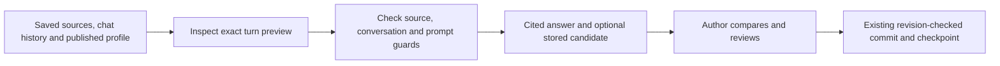

# 22 — Bound novel turns and reviewed manuscript commits

**Status (updated 2026-10-18): installed and running since 2026-10-17** — see
[14](14_status_and_roadmap.md#how-d3-runs-now); the rest of this document records the decision as prepared. This decision carries the
full D3 conversation/proposal work forward; it closes no D2 or D3–D6 phase gate
and retains all 136 capabilities in the catalog.

## Bound sources and write authority

The shared assistant gains `kind: novel`, bound to one required owned `story_id`
in the conversation's workspace. A novel is a read source. The existing card
and lorebook kinds remain the only kinds that apply assistant tools directly.
The `novel_assistant` profile contract requires a published primary role with
chat, tools and streaming, using the existing `ai_card_generation` capacity
operation.

The provider returns one strict `novel_reply`: an answer, references to supplied
passage/pin identities and an optional writing proposal. The server resolves
citations into the exact frozen quotes, revisions, hashes and anchors. Ask
rejects proposals. Suggest permits only replacement of the reviewed selection,
replacement of its complete scene, or appending to that scene. The provider
cannot choose a different book, scene, revision, generation identity, accepted
status, editable document or application action.

A tool-shaped provider response becomes a plain stored assistant message with
its frozen `novel` evidence record. It creates no applied tool message. A
suggestion also becomes a `story_generation` candidate, in the same transaction
as the reply, turn snapshot and execution settlement. The existing reviewed
accept/stash/history/checkpoint path owns manuscript commits. Candidate identity
is the admitted execution identity, chosen by the server.

The message's candidate remains an immutable record of the original suggestion.
Its frozen `candidate` status is not a claim about today's live generation
status. The Studio must read the generation's current state before showing
review/apply controls. Acceptance after another manuscript revision must pass
the existing revision and request-recovery checks.

## Preview, history and retry

A saved-source packet alone is not the full execution prompt. The separate
conversation preview resolves the published profile, selects eligible complete
history pairs and returns the exact symbolic payload, source packet, included
and excluded history identities, conservative input estimate and prompt hash.
It performs no admission, reservation, message insert or provider request, and
takes no credential or retry dispatch field.

Sending requires the inspected source-packet hash, conversation version and
full prompt hash. The same compiler and payload builder run under admission's
owned domain snapshot. A changed profile/policy, conversation or source cannot
silently replace what was reviewed. The profile's output limit must fit the
reserved output; its input/message limits also apply. Only older complete
history pairs can be omitted to fit. Protected source/instructions are not
shortened.

Prior replies are dialogue, not canon or a replacement for quoted evidence.
Pairs whose saved source version or scene/pin scope no longer fits are omitted
with a reason. Historical evidence is checked against its frozen packet,
including exact Unicode passages and anchors, rather than today's manuscript
or today's system prompt. Retained recovery uses the admitted source/payload;
a new turn must prepare against current sources.

The shared frontend hook continues to own conversations, streaming and
reconciliation. Its novel adapter sends the frozen reviewed request and never
hydrates a manuscript from the assistant's read-only target. The full Studio
composer and durable owner/API/workspace/book/conversation draft lifecycle
remain integration work.

## Schema, retention and compatibility

The target marker is `2026_10_novel_assistant`, following exactly
`2026_10_novel_erase`. Six scoped ALTER statements append the novel enum value,
add one nullable conversation binding, add its scoped index/foreign key and
update the relevant checks. A feature seed and the marker advance together
only after every original table/column projection matches a verified private
backup. Foreign-key checks stay enabled. Interrupted DDL resumes only from an
exact known state. The target still has 112 tables, with 158 foreign keys.

Fresh snapshots require the complete current projection. Only retained reads
of the three older kinds may qualify the exact former conversation projection
with an absent `story_id`; this does not rewrite any stored snapshot. Older
novel schema upgrades continue to verify their own historical contracts and
feature seeds.

Explicit whole-novel erasure must count novel conversations/messages, block
active conversation guards and redact novel-assistant execution source payloads.
The owned novel binding cascades its conversation messages and turn snapshots;
accounting headers remain. Earlier erasure receipts remain recoverable, while
previews missing the new chat counts require a fresh review. The prepared
implementation still needs native chat-erasure and race/retention acceptance.
Missing-file media records are valid and are unrelated to this migration.

## Execution custody gate

Before enabling paid execution, the executor must bind credentials outside
authored graphs and treat quoted source/history text as literal data. The
current legacy dispatch/capture path does not establish those guarantees;
[the source-confirmed custody findings](../security/README.md) and
[profile rollout requirements](../llm_profiles/16_current_status_and_roadmap.md)
remain required integration work. A helper's existence or a provider-free
storage fixture does not close that boundary. Published model/profile
compatibility and explicit credential/retry handling also need end-to-end
acceptance.

## Current verification and remaining scope

A retained synthetic upgrade verified all 61 original rows across 112 tables,
including an existing guide message and a media record with no backing file.
Invalid null/cross-workspace novel bindings were rejected. Separate retained
native HTTP/MySQL checks exercised full previews with all 112 tables unchanged,
Ask and Suggest storage, late transactional rollback, result reconciliation,
stash, explicit author acceptance and exact acceptance replay. The historical
candidate stayed readable after the author changed the manuscript. Replies were
controlled fictional fixtures; no provider request or project test write ran.

The Python-generated packet/result fixture and actual native turn wire both
pass frontend guards. The prepared full frontend suite passed 5,215 tests with
one skip, plus production build and Storybook typecheck; a subsequent focused
native-wire check adds direct persistence coverage. The broader backend run passed 14,835 non-integration tests with three skips
and four deselections. Its 17 remaining failures are the same test identities
reproduced in the unchanged installed checkout; they are not a green backend
release signal. No new failure identity remains in that comparison.

Remaining D3 includes the complete Studio conversation/composer/profile and
proposal review workflow, durable unsent drafts/navigation/reload, transport
and credential custody, concurrent/retry/stale-source cases, live candidate
status/comparison/refine/stash/undo, the unified inline/chat path, assisted
planning/summaries/canon proposals and author usefulness evaluation. Native
erasure/retention and all remaining D2/D4–D6 gates remain open. The project
schema, running API and executable sources have not been changed by this prepared
work.

## Prepared Studio conversations and retained drafts — 2026-10-17

**Prepared and verified with controlled replies; feature runtime and schema remain
uninstalled.** This extends the previous prepared core without closing D3 or
changing the 136-capability D1–D6 objective.

- The Studio header opens the writing assistant. It reuses the shared
  conversation/message/stream/composer hooks and UI primitives. A named
  conversation can be prepared before inspecting a prompt. Exact conversation
  identity and history version join the saved-source and published-profile
  guards; changing any reviewed input disables Send. Source inspection is shared
  with the existing provider-free source drawer and historical evidence reader.
- Novel conversation creation requires a retained request identity. The existing
  book operation journal stores a minimal conversation-ID receipt in the same
  transaction as creation. Concurrent identical retries create one chat. Changed
  intent fails, archived replay remains readable, and retry after an explicit
  conversation deletion cannot resurrect it. The receipt contains no question,
  source prose or title. Other assistant kinds keep their existing create shape.
- Draft keys include the API origin, stable account, workspace, book, draft and
  writer. Questions, incomplete budget fields, source choices and public profile
  selections survive navigation/reload. Recovery opens a separate copy and
  retains other writers. Exact-content retirement cannot discard newer input.
  Storage refusal retains an in-memory draft with a visible download action.
- An uncertain turn retains its original request ID, immutable source/preview
  guards and public profile intent before dispatch. Reload recovery can inspect
  the saved result and resume that original request. Completed replies retire
  only the matching pending request; a next question typed during the reply is
  preserved. The journal rejects credentials, runtime graphs and arbitrary
  execution fields. Full linked-retry/credential-demand recovery remains a gate
  below; this is not a general offline model-execution guarantee.
- Full review shows the published profile revision, included/excluded history,
  conservative input estimate, reserved output, frozen sources, exact messages
  and symbolic model payload. Completed replies expose their frozen citations.
  A separate suggestion comparison reads the current candidate status, preserves
  the original evidence and offers stash. It grants no automatic manuscript
  write. Refine and the complete editor review/apply/undo integration remain
  required.

The retained synthetic database
`magic_worlds_novel_assistturns_test_b154433de8fc` verified six concurrent creation
replays, changed-intent rejection, archived recovery and rejection of a deleted
chat's creation retry, alongside native Ask/Suggest storage, read-only previews,
late rollback and explicit acceptance/replay. All 112 synthetic table
fingerprints stayed unchanged during preview. Replies were fictional; no real
provider or project test write ran. Previous retained fixtures were not reset.

The prepared frontend passed **5,226 tests / 573 files, one skip**, production
build and Storybook typecheck. The final non-integration backend run passed
**14,859 tests**, with **17 previously verified baseline failures**, three skips
and four deselections. The failure identities match the unchanged-source
comparison from the prior checkpoint; this is not a green backend release
signal. New/changed frontend files add no lint diagnostics; 43 existing
diagnostics remain in the API client and profile control.

Controlled desktop browser inspection verified retained input across drawer
closure, stale-review send protection, cited evidence and original/proposed
comparison. It is not authenticated author, mobile, assistive-technology or
model-quality acceptance. The corresponding tests exercise the actual shared
hook, device storage, remount/recovery and request/profile guards.

Static Storybook inspection also found an independent build integration defect:
the application-only offline-shell plugin ran against Storybook's relative
iframe build. `.storybook/main.ts` now excludes that plugin; this small
configuration fix is installed in the actual checkout. Both prepared and actual
static catalog builds passed, and neither emits the app offline worker. This
configuration fix does not install the prepared assistant feature. The running
API, project schema and staged patches remain preserved.

**Next required work:** protected execution/credential custody and literal source
transport; complete linked-retry/stop recovery; assistant-page handoff and
conversation lifecycle/retention; proposal refine, source/context-bound editor
application and undo; unified inline/chat behavior that preserves existing
published writing profiles; assisted planning/summaries/canon proposals; native
selection/append/empty-scene/race/erasure and author acceptance. Remaining D2
gates and all D4–D6 work stay open. No further whole-database reset, reseed,
missing-file cleanup or project fixture CRUD is authorized by this checkpoint.

## Prepared private runtime and provider transport — 2026-10-17

**Prepared source only; not installed or enabled.** The executor recognizes the
`novel_assistant` contract and accepts only the fixed six-node, six-edge novel
workflow: one input, literal Chat source/history, one primary client, one
non-iterating LLM, one schema-only `novel_reply` definition and End. Profile limits
constrain Chat, output and timeout settings. Source and metadata may contain
fictional environment/template syntax because those fields are data. Extra nodes,
redirected edges, executable tools, parsers, hooks, nested graphs, provider aliases
and over-budget graph settings are rejected. Other graph families retain their
existing environment-placeholder gate; this does not close global F01.

The host supplies a scoped passive client capability outside the authored graph.
The graph builder forwards tuple-keyed client dependencies correctly. A native
resource codec stores only the authored client reference, and recovery binds the
passive facade without running a node or constructing an SDK. The actual SDK and
platform key are materialized when a model operation begins. The inline runner
retains only the durable execution plan in its snapshot and retires the capability
after its runtime closes. SDK-construction and private runtime errors are mapped
before public diagnostics.

The private async branch now connects frozen limits, request authorization, safe
error handling and the streaming echo guard to OpenAI Chat Completions/Responses,
Anthropic, Google and Cohere. Runtime options cannot select credentials, another
model/endpoint, stored conversation or transport. Private HTTP disables redirects,
proxy environment and automatic retries; provider failures do not read raw error
bodies or invoke legacy retry/fallback/callback paths. Closing authority prevents
new requests and late response publication. Safe withheld stream suffixes are
restored at a successful native EOF. Native JSON/tool output is decoded strictly
without discarding duplicate keys, repairing Markdown fences or accepting
nonfinite/negative-zero numbers. Literal Markdown/template text inside valid JSON
strings is preserved.

Native Google uses its existing header authentication and permits only its fixed
`alt=sse` stream query. Cohere's private plain-response mapping uses its documented
`chat_history` role/message shape and `prompt_truncation: OFF`; see the
[Cohere v1 contract](https://docs.cohere.com/v1/reference/chat) and
[Google content contract](https://ai.google.dev/api/generate-content). This does
not establish Cohere tool capability or universal provider/parameter support.
Existing published `novel` writing profiles remain required inputs to the later
unified pipeline; they are not silently converted to tool-only assistant profiles.

The provider-free verification passed 229 scoped executor/workflow tests,
173 private provider-library tests and 35 runtime tests. Fifty-six additional
actual compiled-packet runs cover seven literal-source cases, BYOK/platform
credentials and OpenAI Chat Completions/Responses, Anthropic and Google through
the real inline runner, scheduler, adapters and in-memory native recorder. The
system packet remains exact; credentials are absent from model bodies, returned
events and all 2,072 captured transitions. Generic native checks also exercise
errors, cancellation, nested graphs and escaped echoes. These checks use fake
provider replies and an in-memory store, not a paid provider or native SQL.
Four upstream tool-span test identities remain unresolved and also fail/error
in the unchanged upstream source; broader API release verification is open.
The previously recorded 17 BFF baseline failures are unchanged by this checkpoint.

**Remaining execution integration:** protected HTTP request/identity admission,
BFF dispatch and version handshake, preserving current catalog/profile identities,
and explicit retained recovery/retry/stop handling. The upstream catalog DDL still
has its earlier OpenAI-only CHECK and needs a verified non-destructive upgrade and
provisioning for accepted engines; model-level format/parameter compatibility and
SQL persistence also remain acceptance work. No source helper or these tests close
F04/F11 end to end. The running legacy path is unchanged, so the prepared novel
execution feature stays disabled. Studio lifecycle/handoff, source/context-bound
refine/apply/undo, inline unification, planning/summaries/canon and all remaining
D1–D6 acceptance requirements stay open. No database reset, reseed, missing-file
cleanup, project fixture CRUD, dependency reinstall or API restart was performed.

## Prepared protected HTTP boundary — 2026-10-17

**Prepared and checked through controlled ports; feature source and schema are
not installed.** `/v1/llm-execution/completions` requires version 1 and a trusted
delegated service. A separate credentials field is detached before ordinary DTO
validation and excluded from request serialization, cached body/JSON, durable
intent and error responses. Validation errors use fixed public codes. The volatile
credential slot is retired after handler ownership transfers to the execution
context; streaming cleanup closes that context.

The admission identity is the authenticated project/user plus execution ID.
Changed intent cannot reuse it. Fresh authorization, credential availability and
input validation precede admission. Confirmed completed replay bypasses current
catalog/key availability; pending replay returns the retained status without
another model call. The endpoint captures canonical output for keyless completed
replay. `/v1/llm-execution/capabilities` advertises explicit version support without
receiving a provider key. Protected envelopes on unrelated completion routes cannot
silently fall through to ordinary graph execution.

Sixteen focused boundary checks and 112 real compiled-packet HTTP/native-memory
runs passed, including both stream modes and payer modes across OpenAI Chat
Completions/Responses, Anthropic and Google. They qualify parsing, transient key
ownership, the runtime and output recording with controlled auth/catalog/admission,
native-storage and provider ports. They do not prove actual SQL persistence, BFF
dispatch/recovery, paid-provider behavior or authenticated author acceptance.

The broader executor/workflow run reports 347 passes, 10 failures, four fixture
errors and one deselection. Catalog/recovery route wiring, public admission
coverage and older eager-client/validation expectations still require resolution;
these newly recorded results are not claimed as verified unchanged baseline
failures. The earlier four native-tool and 17 BFF baseline identities remain
separate evidence. No full-backend pass or global credential-custody closure is
claimed.

BFF negotiation/dispatch, retained uncertain outcomes and inspect/resume/stop remain
next. Catalog upgrades/provisioning must preserve current published identities and
format/parameter behavior. Native SQL, retention/erasure races, Studio lifecycle,
source-bound refine/apply/undo, shared inline execution and all remaining D1–D6
requirements remain open. The project database and running services are unchanged.

## Prepared protected dispatch and reconciliation — 2026-10-17

**Prepared and locally verified; feature source and schema are uninstalled.**
The BFF negotiates `/v1/llm-execution/capabilities` before sending a provider key,
then uses the protected completion endpoint with the frozen symbolic graph and a
separate credential envelope. Every response requires the version acknowledgement.
Missing support cannot fall back to the public graph renderer. An acknowledged
in-progress replay, lost response or invalid completion is retained for recovery;
none authorizes an automatic second model call or a refund.

The owned workflow drains workers before releasing capacity. A disconnect,
uncertain dispatch/start acknowledgement or lost domain-commit acknowledgement
preserves the original plan, payer, ledger and pending domain turn. A keyless
completed inspection can claim that same operation for domain reconciliation,
validate the canonical result and finish it atomically. It does not re-resolve a
profile or debit/increment another admission. A deliberate continuation of a
resumable checkpoint claims dispatch capacity and posts only the retained version
and new transient key, never a replacement graph or prompt. A local failed or
cancelled status is insufficient evidence for provider-cost settlement; those
outcomes stay retained until terminal settlement and stop are qualified.

The registered executor inspection route requires retained project/user/run
ownership but no currently dispatchable catalog. Its native store reads exact
completed checkpoint output and final usage facts under one current-version lock.
Only public scalar output handles are decoded; no client, chat or prompt is
rebuilt. Completed-node recovery now replaces partial/no new deltas with its
canonical full result. OpenAI-compatible projection emits a restated native tool
name once and keeps split-name argument fragments in ordered individual frames.
A response owner closes credentials even if sending headers fails before the
stream starts. Confirmed JSON replay is converted into bounded SSE frames for
existing readers, including large Unicode tool arguments.

Validation passed 932 BFF regression checks, 94 current focused transport/workflow
checks, 64 executor recovery/boundary checks and 229 other executor/workflow
checks. Sixteen additional real loopback HTTP runs use separate BFF/executor
Python processes across OpenAI Chat Completions/Responses, Anthropic and Google,
both payer modes and both stream modes. Each loses the first BFF domain commit,
then confirms keyless replay and reconciliation with one model operation and one
final result commit. Auth/catalog/admission/native storage/SQL-query/provider
ports are controlled. This does not prove native MySQL, actual quota/credit
settlement, paid-provider behavior or author acceptance.

Twenty-four wider public test identities also fail/error in unchanged upstream
source: four debug failures and 20 ingress fixture errors. They remain unresolved,
as do the earlier public admission/catalog and native-tool release checks and
the previously recorded BFF baseline failures. No full-backend pass is claimed.

Before enabling: qualify native SQL and races, define and verify terminal usage
settlement/explicit stop and the pre-snapshot unknown-admission case, preserve
published identities/format/parameter behavior through the additive catalog
upgrade, and complete Studio lifecycle, source-bound refine/apply/undo and shared
inline execution. Existing streaming-only writing profiles remain required;
provider transport checks do not turn them into tool-only assistant profiles.
Planning/summaries/canon, remaining D2 acceptance and all D4–D6 work remain open.
Global F01/F04/F11 closure is not established. The running API and project data
remain unchanged.

## Prepared native MySQL and four-engine catalog — 2026-10-17

**Prepared and checked with actual isolated SQL; not installed.** The execution
catalog's canonical CHECK accepts `openai`, `anthropic`, `google` and `cohere`.
Explicit tooling recognizes the exact previous `engine='openai'` constraint while
runtime verification rejects that old readiness state. Widening requires an
absolute private backup path, private parent and verified 0600 file containing
prior DDL and every catalog row. Existing mismatched/public/symlink backups cannot
be used or overwritten. The upgrade changes only that CHECK, then verifies the
exact resulting schema and preservation of every original identity/value. A lost
ALTER acknowledgement resumes from the actual schema, with no rollback or table
rebuild. Fresh table creation remains independently resumable. The protected
catalog HTTP endpoint now uses real database grants and the existing secret-free
public serializer; it acknowledges version 1 and rejects untrusted services.

The retained MySQL 8.1 fixture verified backup refusal, direct upgrade, interrupted
ALTER cleanup/resume and idempotency. Its 109 original rows across 37 tables stayed
identical, including an existing completed native run and writer/profile references.
A streaming-only writer retains its model ID, route revision, feature and absence
of tools. Registry acceptance of an engine does not invent model tool capability.
Descriptors for all four engines were then registered in the fixture. This does
not migrate any deployed catalog or the project's actual published profiles.

Sixteen additional actual compiled-packet runs use real protected HTTP admission,
SQL catalog resolution, production native runtime/recorder/storage and persisted
usage reads. They cover OpenAI Chat Completions/Responses, Anthropic and Google,
both payer modes and both stream modes with controlled auth/identity/provider HTTP.
Snapshots preserve the exact graph and literal source/history, each model runs
once and each confirmed usage read returns its actual stored counts. Stale-version
and foreign-project/user reads are refused. Completed cached replay and native
inspection still work with inference disabled, no key/current catalog lookup and
a revoked fixture grant. The public catalog route also reads real SQL while
inference is disabled. A decoded JSON/binary scan of all 37 fixture tables finds
no test credential or evaluated template value; guide, missing-file and published
writer-reference fixtures remain unchanged. All fixture data/backups are retained.

108 focused checks pass, including the two previously absent catalog-route cases.
The rotation check now proves deferred construction plus one frozen credential
per active context and a new value in the next context. Earlier public-admission,
other upstream release and BFF baseline failures remain separate open evidence;
these checks do not prove a complete backend release or global F01/F04/F11 closure.

Still required: real published identity/parameter/format provisioning, BFF catalog
integration, both-service SQL/credit/quota acceptance, interrupted continuation and
concurrent claims, explicit stop/terminal settlement, erasure/retention races and
complete Studio source-bound review/refine/apply/undo. Existing inline writing
profiles must survive shared execution. Assisted planning/summaries/canon, remaining
D2 acceptance and all D4–D6 work stay open. No project write/reset/reseed/cleanup,
paid-provider call, dependency reinstall or service restart occurred.

## Prepared protected catalog boundary — 2026-10-17

The new BFF catalog reader is fixture-qualified but is not connected to the
application's catalog callers. It requires delegated authorization, an exact
protocol acknowledgement and strict public DTO validation; no root-snapshot merge
or legacy discovery fallback is allowed. An eventual cutover must move profile
selection, preview and dispatch together after the existing published target/model
identities are explicitly provisioned. Frozen legacy plans also need route-revision
verification before their existing renderer may dispatch them.

Executor capability vocabulary and public feature contracts now match the BFF,
including structured-output requirements and bounded voice turns. The four-engine
fictional round-trip preserves model IDs/revisions, 29 compatible resolutions and
50 expected incompatibility refusals. Streaming-only writing profiles remain valid.
Provider-specific parameter/format parity, actual deployment provisioning and the
shared inline/chat execution migration remain open.

Validation records 94 passing BFF checks and an expanded executor result of 343
passes plus 24 verified unchanged-source image-guidance fixture failures. This is
not a full executor release pass. No feature/schema was installed, and no project
records, files, dependencies or service process were changed. Full D3 integration,
remaining D1/D2 acceptance and D4–D6 are still required.

## Prepared shared catalog cutover and provisioning — 2026-10-17

The prepared shared `fetch_execution_catalog` now reads only the protected
project catalog. Profile selection, preview and fresh execution move together;
the old public discovery helper is explicit operator tooling. Legacy execution
checks its frozen routing revision and connection key before credentials, so an
old plan cannot silently follow a changed route or use another connection.

A read-only inventory and public-descriptor comparison preserve 9 actual profiles,
15 revisions, 45 role/model references and all three usable configured-provider
models. All 206 role resolutions remain identical; provider_options, connection
availability, authenticated deployment and provider formatting are separately open.
The private bundle contains model/routing metadata and external custody references,
with no credential values. Its schema/references validate before DDL. Exact
registration replay does not update existing rows; conflict/revocation remains
unavailable. Native SQL verifies lost-commit reconciliation, concurrent single
creation and all 1,617 earlier fixture rows unchanged across 37 tables.

The live write-rejecting CLI check reports five absent tables and no writes. Source,
schema/config activation remains pending; the env-file inventory also shows missing
trust/custody configuration and disabled inference. Process overrides were not read.
The complete BFF unit scope has 14,970 passes plus the same 17 baseline failures;
the focused assistant/profile scope passes 1,768 checks. The executor scope has
413 passes plus the same 24 image-guidance baseline failures. No full release or global F01/F04/F11 closure
is claimed. Private inventory/bundle data is excluded from the source-only archive.

Remaining provider parameter/format parity, shared inline/chat execution, native
domain/ledger/continuation/retention gates and Studio source-bound review still
block full D3 integration. D1/D2 acceptance and D4–D6 remain in scope. Recovered project records and media files remain intact. Dependencies and the
running service remain unchanged; only the three owned novel status documents
were updated in the installed checkout.

## Prepared provider-format compatibility — 2026-10-17

The private SDK now mirrors existing BFF sampling/tool/reasoning rules and checks
an execution-owned provider binding before serialization. The public profile and
frozen graph remain unchanged; only final wire controls are normalized. Existing
official GPT-6 Responses and Google sampling normalization runs before intermediate
payload guards. Cross-service policy comparison checks the BFF mirror without
adding an SDK import to the BFF.

All 45 saved roles retain the same controls, messages, schemas and stored cache
options through legacy/private serializers. SQL exposed only standard-cache shape
flags. Explicit private extensions (storage disabled, streamed usage and the
executor's existing default Claude cache policy) remain documented. No actual
provider key, raw option value or private inventory is included in the source archive.

Validation: 218 SDK / 35 scoped agent / 103 focused executor passes; broader executor
432 passes plus the same 24 image-guidance fixture failures. Native protected HTTP
and MySQL qualification passes 28 compiled-packet cases with controlled auth/provider
HTTP, one model operation/usage fact, keyless replay, exact frozen source and retired
credentials. This is not paid-provider, authenticated author, BFF settlement or full
upstream-release evidence. Other native model/parameter combinations remain subject
to explicit qualification. Shared inline/chat execution, Studio guarded review,
domain/ledger/recovery/retention gates and coordinated activation are still pending.

Only the three owned novel status documents changed in the installed checkout.
Project records/media, unrelated staged work, dependencies and the running service
remain preserved. The full D1–D6 objective remains active.

## Prepared shared inline execution — 2026-10-17

Fresh `novel` inline requests now use the same protected transport and owned
admission/recovery lifecycle as `novel_assistant`. The inline role remains plain
and streaming-only; it does not acquire the assistant's schema-tool requirement.
`runtime/story_inline.v1.json` is a complete digest-verified catalog artifact.
Its five nodes/four edges match the executor's strict `mw-story-inline-v1`
contract. The BFF checks its prompt/topology against the existing v3 writer and
substitutes that writer's one fixed wrapper marker once. Source text is literal;
model settings are enforced from the frozen plan, not duplicated in graph data.

The outbound graph, messages, trace and revision metadata remain byte-equivalent
after moving the topology into the file catalog. A new payload version selects
the protected route without changing public plan defaults or old retained hashes.
Unknown inline-family versions never select the legacy renderer. Retained v3
requests preserve their original graph and transport. Inline uncertainty and
keyless completed reconciliation share the assistant lifecycle; native partial
continuation, claims, domain/ledger settlement and terminal races remain open.

Evidence: 20 protected HTTP/native MySQL cases, including Cohere plain text,
with controlled identity/provider HTTP, one physical fake operation/usage fact,
keyless replay, exact checkpoints and no changes to 4,248 prior fixture rows.
220 SDK checks pass. BFF complete unit scope: 14,994 passes plus 17 known
baseline failures. Executor scope: 492 passes plus 24 known image-guidance
failures. No full release, paid-model or author-quality claim is made.

The Gemini stream check exposed an unconditional early `usageMetadata` lookup;
the adapter now accepts its absence until usage arrives. This preserves text and
final usage rather than failing the operation. The provider's response/stream
shape is documented in the [Gemini API reference](https://ai.google.dev/api/generate-content).
The fake stream fixture is the tested case; other native response variants need
explicit qualification.

Only the three owned novel status documents are installed. Both-service native
SQL/domain/credit proof and migration of the existing legacy SQL fixtures are the
next gate; keep every fixture in an explicitly retained isolated schema. Studio
review/handoff, source/context/pin-bound refine/apply/undo, stop/terminal settlement,
retention/erasure and coordinated activation remain required. D1/D2 acceptance
and all D4–D6 remain unchanged in scope.

## Prepared native inline candidate/credit reconciliation — 2026-10-17

The protected inline path passes 32 real two-service SQL/HTTP cases with controlled
identity/provider HTTP: completion, lost reply, rolled-back insert, lost commit
acknowledgement, cancellation during commit, concurrent keyless reconciliation,
later author edits and rejected completed output. Each retains one candidate,
one native usage fact and one physical fake model operation. Recovery preserves
quota/financial rows exactly; BYOK has no financial changes, and platform keeps
its original credit reservation without another debit or refund. Frozen source
and plan stay exact. Later author writing remains current while a recovered
candidate retains the older reviewed base revision.

Validation failure had previously escaped the persistence uncertainty guard:
the BFF marked the plan failed/refunded after the executor had completed. The
shared lifecycle now retains the confirmed result's accounting before safety
checks, validation, projection and commit. Ten before-failing regressions cover
inline/assistant modes, both payers, projection failure and normalization that
introduces a key. They pass after the fix; the native validation recovery cases
also pass. No original provider key is required to reconcile a completed result.

The 16 migrated story SQL cases pass using version-1 protected HTTP and a retained
isolated-schema harness. Complete BFF unit scope: 15,004 passes plus the same 17
baseline failures. Upstream-fixture preservation covers 10,880 prior
rows in 37 tables. The final temporary worker uses persisted fingerprints and
an explicit graceful test shutdown. Test databases and rows remain retained.
The installed project database, application source and running API stay preserved;
only the owned novel status documents are installed.

These results qualify inline completed-result/candidate reconciliation. The
assistant conversation/proposal SQL path, native partial-provider continuation,
resumable fencing, stop/terminal settlement and retention/erasure remain open,
as do Studio source/context/pin-bound refine/apply/undo and lifecycle handoff.
No paid-provider, full-backend release, author-quality, D1/D2 acceptance or D4–D6
completion is claimed.

## Prepared native assistant turns and guarded acceptance — 2026-10-17

Real BFF/executor SQL qualifies 32 streamed Ask/Suggest cases across both payers
and completion/lost-reply/rollback/lost-acknowledgement/cancellation/concurrent-
recovery/later-writing/domain-rejection modes. Controlled identity/provider HTTP
does not replace catalog/profile admission, native execution/usage persistence,
conversation/messages, atomic candidate/turn storage or financial ledgers. Every
case uses one fake model operation and usage fact. Ask creates no candidate;
Suggest stores one unapplied candidate. Completed recovery keeps the same frozen
packet, user message and plan, and adds no provider, quota or financial use.

The real path found a message-envelope mismatch hidden by the original domain
fixtures. The novel handler now accepts the shared transport's message/usage
projection and retains usage; two transport regressions fail before the fix.
A separate native reproduction showed that a text-revision-only acceptance check
could miss later novel context. Acceptance now validates the original execution
packet and compares its source version under the novel transaction lock before
any prose/checkpoint/status/receipt write. Ordinary inline candidates retain their
existing contract. Original accepted receipts are recovered before this new
source check and never overwrite later prose/context. The guard reads the
retained execution payload independently of the conversation display snapshot.

Eight native candidate cases verify current/stashed acceptance, replay after
later prose/context, blocked novel/scene metadata and context-settings/Codex
changes, archived roots and later target text. Five source-change regressions
fail before the guard. Focused checks: 44 passed. Complete BFF unit scope:
15,018 passes, the same 17 baseline failures and no new failures/errors. Graceful
temporary-worker shutdown preserves 13,312 prior native-fixture
rows across 37 tables. The schemas, rows and before-fix reproductions are retained.

Studio handoff/refine/apply/undo, output-size consistency, multi-turn and complete
source/profile/owner/lifecycle acceptance, partial provider continuation, stop/
terminal settlement and retention/erasure races remain open. Source/schema/
catalog/config activation is still uninstalled. No paid-provider, author-quality,
full backend release, D1/D2 acceptance or D4–D6 completion is claimed. The installed
project database, running API and application files are preserved.

## Prepared Studio handoff and in-place review — 2026-10-17

Studio now wires saved assistant candidates into the same editor decoration,
explicit accept/decline and durable draft-commit path used by inline writing.
The handoff first re-reads the owned source index and generation. Its source
version, target/head hash, original output/instruction/selection and live status
must match the frozen suggestion; a candidate or stash grants no write authority.
Save/selection barriers and the mounted draft's checked head still apply.
Owner/source changes, edits during reads and aborted inspectors fence late
staging. The abort signal also reaches the underlying scene loader, preventing
delayed navigation after the inspector closes. That regression failed before
the loader accepted the signal and passes afterward.

Saved selection, whole-scene and append proposals render separately until the
author accepts. Empty-scene append replaces its placeholder. Reject leaves the
original canonical document exact. Acceptance normalizes new block IDs inside
the prose transaction: three prior failures demonstrated that deferred identity
normalization could require a second undo. One undo now restores the complete
rich source and its original IDs. The shared modal footer keeps review decisions
and failure feedback reachable while sources scroll. Preview prose uses content
height instead of inheriting canvas/typewriter spacing; the corrected one-line
fixture measures 33px inside the unchanged 560px editor. The inspector is scoped to
its owner; saved-review announcements offer only available actions.

Verification: 5,279 frontend passes, two skips; production build, Storybook
typecheck and targeted lint pass. Final focused navigation/coordination checks:
55 passed. Fictional controlled browser cases cover saved/stashed handoff,
accept/decline/undo, changed-source rejection, focus return/wrapping/Escape and
320px footer reachability. They make no app API/provider request and do not
substitute for authenticated author, device, assistive-technology or model-quality
acceptance. The preceding backend native SQL/credit/source-bound acceptance
evidence is unchanged and was not rerun for this frontend-only checkpoint.

Real refine still needs a protected retained-parent contract; it must not be
simulated by merely copying text into the composer. Output-size consistency,
source-specific commit-conflict feedback/recovery, shared inline/chat source
policy/lineage, complete owner/profile/lifecycle/retention/erasure behavior,
interrupted continuation and stop/terminal settlement remain open. Coordinated
schema/catalog/config activation is still uninstalled. The full D1–D6 objective
and all remaining acceptance gates are preserved.

## Prepared reply-size and receipt boundary — 2026-10-17

Novel schema-tool replies now share the 20,000-code-point answer / 120,000-code-
point proposal semantics across BFF validation and frontend reads. Their server-
selected transport permits 2 MiB arguments and 4 MiB events/completions; native
live and retained-output projections permit 4 MiB from the validated frozen
novel-assistant plan. These byte allowances cover JSON-escaped Unicode and do
not increase semantic limits, context budgets, paid reservations or other
features' limits. Historical records without an execution envelope keep the old
projection bound. Invalid retained envelopes cannot select the larger contract.

The private echo guard uses bounded surrogate lookahead while preserving exact
bytes, nested escapes and withheld credential prefixes. Native recording now
keeps storage acknowledgement and local lease/state consumption inside one
owned write, including renewal, before surfacing cancellation. Repeated task and
AnyIO cancellation therefore leave cleanup at the confirmed version. Unknown
receipts still fail; no automatic provider retry or new identity is introduced.

The eight native size/recovery cases and their runtime-budget qualifications are
recorded in [14](14_status_and_roadmap.md#d3-novel-reply-size-and-commit-boundary-preparation--2026-10-17).
They use controlled fake provider HTTP and retained isolated SQL. They do not
establish real-model output quality, every native format/option, all interrupted
continuations or terminal settlement. Feature runtime activation remains pending.
Refinement must still include the immutable parent proposal as protected literal
input, bind a fresh result to current saved sources and retain explicit lineage.
Copying an earlier message into the composer remains insufficient.

## Prepared retained-parent refinement — 2026-10-17

The prepared provider-free generation-history `refinement-parent` read exposes
only owned candidate/stashed writing. Its strict schema-1 bundle freezes exact
output and instruction, original story/chapter/scene/base revision, command,
range coordinates plus quote hash, and a single `parentGenerationId`. Canonical
SHA-256 binds immutable parent fields; current status/timestamps are excluded.
Inline writing and assistant candidates share this input boundary; critique and
terminal generations cannot become fresh parents. Book/account/project/group/
workspace scope is checked under the existing workspace → novel lock order.

`NovelSourceTurn.refinement` is optional and contains only `generationId` and
`parentHash`. It requires Suggest and the parent's current anchor scene. Current
saved-source compilation remains independent of the old base. A continuation
parent retains append intent; other writing uses the current reviewed selection
or scene. Stale selections reject rather than widening. The author can explicitly
choose a different current scope and review it. Old unrefined requests/records
keep their exact shape; refined metadata adds one `refinement` bundle beside
`context` and `result`.

The exact parent JSON is protected literal system input after graph expansion,
independent of eligible/prunable chat pairs. It is included in the conservative
profile budget and reviewed prompt hash. A budget failure is provider-free and
never truncates the parent. The reply must contain new writing with the reviewed
operation. The shared execution/candidate store assigns a distinct new identity
and current-source base; it does not mutate the parent or manuscript. A later
refinement records the preceding generation ID without recursively nesting its
ancestry. Retained payload recovery restores detached copies of the admitted
parent/source/trace, without a current-parent or catalog lookup. Later rejection
cannot invalidate already admitted result reconciliation.

Studio's Refine action reads the owned parent, preserves unsent input/profile,
binds the original scene, shows exact prior output separately and invalidates
the earlier prompt review. Current selection capture and fresh source review
remain required. Cancellation, owner changes and later typing fence pending
reads. Scoped drafts persist the exact displayed parent; reviewed/pending sends
contain its reference only. Clear/refine returns focus to the composer. The
browser uses the server CAS hash and compares the complete selected bundle with
preview, so LAN HTTP does not depend on `crypto.subtle`.

The [ten native cases and final checks](14_status_and_roadmap.md#d3-retained-parent-refinement-preparation--2026-10-17)
verify this contract through both SQL services and fake provider HTTP; a native
public record also passes frontend guards. This does not close all inline/chat
UI integration, source-specific commit conflict recovery, interrupted native
continuation/Stop/settlement, lifecycle/retention/erasure, authenticated author or
real-provider acceptance. Feature source/schema/catalog/config activation and
the full D1–D6 objective remain open. Project records/files and the running API
were preserved.

## Prepared application-conflict recovery — 2026-10-17

The scene draft journal's optional strict `applicationRejection` records a
confirmed rejected generation, immutable request/revision/document/edit trace and
bounded typed reason. This is separate from the original pending uncertain
intent and from later device prose. Ordinary autosave, fresh acceptance and
reload cannot downgrade it to a manual write. A failed durable checkpoint blocks
application dispatch before HTTP. Existing schema-2 drafts without this field
remain valid; corrupt or contradictory metadata retains readable prose but
cannot replay. Retirement compares the rejection identity as well as the text.

The frontend recognizes only the error/status pairs raised after the server's
matching-receipt check. Unknown/auth/routing/DTO errors cannot establish that an
earlier application was not committed. Such an intent remains pending with its
original identity and exact document; new typing neither replaces it nor resets
a blocked automatic retry. Existing receipt-first application recovery remains
the authority. These distinctions apply to inline and assistant candidates.

Source-check handoff distinguishes a changed candidate from changed saved
sources. A confirmed source conflict is reported to the evidence inspector;
its original evidence and fresh-source Refine action remain available. A
post-acceptance conflict is an explicit manuscript comparison: current account,
later device writing and original submitted application are distinct. Returning
to account writing first verifies a retained device copy with the rejection
identity, then retires only the unchanged recovered draft. A stale comparison or
storage failure changes neither version. This path does not force-apply an old
candidate through ordinary save/merge. Scoped saved comparisons and copied/
downloaded device versions retain the same application metadata.

The [final checks and native browser qualifications](14_status_and_roadmap.md#d3-application-conflict-recovery-preparation--2026-10-17)
cover this prepared frontend slice. Backend/runtime sources and their prior
qualified SQL evidence are unchanged. Full inline/chat UI/source lineage,
author-edited variants, native interruption/Stop/settlement, lifecycle/retention/
erasure, coordinated activation and the full D1–D6 objective remain open.

## Prepared inline-history refinement — 2026-10-17

Generation history hands a complete candidate/stashed writing result to the
existing refinement draft through a provider-free owned reader. Fresh parent and
full-detail reads must match the inspected immutable identity, output,
instruction, command, base revision and range, and the target must remain active.
No local text becomes a replacement server parent. Current lifecycle metadata
also survives the bounded full-output cache merge.

Original ranged results bind an exact immutable scene checkpoint/hash/quote in
UTF-16 coordinates. A range that happened to cover an old whole scene does not
implicitly authorize replacement of a later whole scene. Explicit current
selection uses the existing editor/document/token/save barrier; it can replace
the old coordinates only in the same parent scene. Continue has no selection and
keeps append semantics. Missing or over-bound original selections fail visibly
without truncation, quote searching, or a silent fallback to a wider operation.

The scoped assistant model remains mounted while its drawer is closed, retaining
the same unsent instruction, conversation and public profile intent. The handoff
sets Suggest and the checked target, retains the exact parent context, clears
review authority and returns composer focus. Abort, scope retirement, read-only
changes and later composer edits fence late results. Closed or failed history
selection cannot create a conversation, send a model request or change prose.
Existing strict draft persistence and parent-reference-only admission continue
to apply; the paid server path remains the authority for its parent/hash recheck.

The [inline-history checks and qualification limits](14_status_and_roadmap.md#d3-inline-history-refinement-preparation--2026-10-17)
record final frontend verification and controlled browser evidence. The feature
remains uninstalled. Author-edited variants, full shared source policy/lineage,
native interruption/Stop/settlement, lifecycle/retention/erasure, coordinated
activation and the full D1–D6 objective remain open.

## Prepared author-edited version decision — 2026-10-17

### Context

The model result, author's edited version and applied manuscript revision must
remain independently identifiable. Replacing saved model output would destroy
the evidence behind refinement and source checks. The same edited JSON and
annotation mapping reviewed by the author must reach the atomic commit, even
after a lost response, reload, or later private typing. Recovered project content,
including records without files, remains outside this feature's mutations.

### Decision and alternatives

Use a separate immutable `story_generation_variant` record with a full original
parent projection, base document and one explicitly reviewed whole-scene snapshot
operation. Its opaque server digest binds all those values and the exact nullable
edit trace. Version, original generation, operation and request identities differ.
Mutable candidate/stashed/accepted/rejected status and applied revision live
outside the immutable digest. Editing again creates a new version.

| Option | Consequence | Disposition |
| --- | --- | --- |
| Mutate original model output | Loses original evidence and changes existing parent/source identity | Rejected |
| Retain only a mutation receipt | Exact retry exists but discovery, decisions and durable review lineage are weak | Rejected |
| Separate immutable authored record | Preserves evidence and lifecycle with additional snapshot storage and an additive schema step | Chosen for this prepared slice |

### Commit and recovery

Preview/create are provider-free and enforce owned writable current heads, exact
original base, candidate/stashed parent and its existing source policy. Storage
and creation/decision receipt are transactional. Old creation receipts remain
immutable after later decisions, so the UI must reread current status before
offering application. A missing receipt permits only the retained identical
request to be retried; it is not permission to invent a new identity.

The existing scene writer rechecks reference, complete final document, mapping,
base and parent after receipt recovery. Prose, revision `generationId`/`variantId`,
both application statuses, statistics and receipt are one commit. No version is
implicitly accepted by saving it. A late failure rolls back every effect.

Frontend request/result guards bind the visible operation and enforce strict
wire shapes; the server remains the digest/source authority. Saved review stages
the exact canonical JSON directly. It refuses editor normalization that would
change that snapshot, prevents document edits through a full-scene review, and
accepts it as one undo event with stable IDs and exact redo. Closing that review
retains both saved versions; a separate decision rejects an authored version.

The pending scene-application journal retains its reference plus exact write,
including an empty mapping versus no mapping. Receipt-first retries survive
offline/reload and may race an existing detached queue with the same request ID.
Definite post-receipt conflicts preserve the failed operation independently from
later typing, durable comparisons and retained device alternatives. Corrupt
references keep readable private prose but block request replay rather than
silently dropping version provenance.

### Tradeoffs, qualification and action items

Full snapshots increase storage. The prepared additive migration adds a composite
parent index, one version table and nullable revision lineage; it does not remove
old rows or modify model output. Exact assistant and variant schema steps each
require their own verified predecessor backup. Erasure preview includes version
counts and lifecycle/digest heads, requiring coordinated strict wire activation.

This slice intentionally records one explicit same-base whole-scene operation.
It does not settle broader reviewed rebase, terminal-parent reuse, reusable
insertion, multi-scene/dependency groups or AI refinement of authored variants;
those remain part of the full target. Native SQL currently qualifies an inline
parent without a provider plan, not the assistant-execution source path.

[The checkpoint evidence and limits](14_status_and_roadmap.md#d3-author-variant-backend-and-application-preparation--2026-10-17)
cover native additive preservation/rollback/concurrent replay, strict API and
editor recovery/undo checks. Feature code/schema/config remain uninstalled.
Implement the private author editor, retained creation/decision journals and
receipt recovery, saved-version discovery and source-checked Studio handoff next.
Complete broader source policy, native interruption/Stop/settlement/lifecycle/
retention acceptance and coordinated activation before any D3 completion claim.
The full D1–D6 objective remains active.

## Private authoring and saved-version UI decision — 2026-10-17

### Context and decision

An author's edits to a retained suggestion need a recoverable writing surface
without changing either the model result or canonical manuscript. The prepared
UI uses a separate rich editor and private, scoped writer journal. Creation and
stash/reject requests freeze their reviewed intent before dispatch and recover
receipts before retrying. Later typing cannot replace an uncertain request.
Definite post-receipt refusals remain independent recoverable records. Full
saved versions are immutable, bounded history metadata is separate, and the
original generation's target governs read-only state.

Review rechecks the saved version, original generation, scene head and source
index around compilation, then passes exact canonical JSON to the existing
Studio decoration/accept/undo boundary. Closing review retains the saved version
and original. Private editing and server-side version storage never imply apply.

### Alternatives, consequences and remaining work

Editing the manuscript to prepare a suggestion would make preview destructive;
overwriting a generation would lose model provenance. Reusing an ordinary save
after an uncertain application would lose version lineage. Separate journals and
immutable versions avoid those outcomes at the cost of larger local snapshots
and explicit recovery choices. Storage failures are visible and block mutation;
no journal is evicted to make room. The current operation remains an explicit
same-base whole-scene snapshot.

[The UI checkpoint](14_status_and_roadmap.md#d3-private-authoring-and-saved-version-ui-preparation--2026-10-17)
records current tests and the fictional browser transport's limits. Broader
reviewed rebase/terminal-parent reuse, authored AI refinement, dependency groups,
shared-device/root lifecycle, native assistant-backed source qualification and
coordinated installation remain required. D1–D6 completion is not claimed.

### Native assistant-parent qualification — 2026-10-17

[The native BFF checkpoint](14_status_and_roadmap.md#d3-native-assistant-authored-version-qualification--2026-10-17)
now qualifies the existing immutable-version decision from completed retained
assistant plans, beyond the earlier inline-parent proof. Real MySQL verifies
metadata-only source refusal, independent original/alternative retention,
concurrent exact replay, authored revision lineage and late rollback. Archived
receipt reads remain independent of current work permission. All 52 execution/
accounting-related table fingerprints stay unchanged during author version work.

The new smoke path also validates fictional reply envelopes through the current
production parser and returns native version/receipt/page payloads consumed by
frontend guards. No production source, schema or decision changed as a result of
this qualification. Upstream executor/provider dispatch, Stop/interruption and
terminal settlement, broader source/rebase policy, lifecycle/device acceptance
and coordinated installation remain required. Full D1–D6 completion is unproven.

### Private authored-version device recovery — 2026-10-17

Private version journals now participate in explicit device entry independently
of cached manuscripts, using the existing account/API/workspace key format and
workspace/novel lifecycle authorities from ADR 20. A selected key must identify
its stored novel and original generation exactly. Missing keys never fall back
to another writer; malformed records grant no authority and retain a lossless
diagnostic download. Same-window writes and cross-tab storage events refresh
discovery without replacing an open writer's captured source.

Continuing creates an independent local writer before changes and never retires
the original automatically. The shared edit operation rotates only new intent
identities/sequence while freezing pending/refused requests. Synchronous final
retention and explicit guards keep storage failure visible. The device copy has
no account/model client. Returning to Studio transfers the selected record,
preserves later writers through exact retirement and reuses source review and
the canonical acceptance boundary. No cached lifecycle or draft creates fresh
account write authority.

[Current evidence and limits](14_status_and_roadmap.md#d3-private-author-version-device-recovery--2026-10-17)
include native browser lifecycle/reload/320-pixel checks and independent quota,
owner, exact-selection and malformed-text export tests. Larger browser capacity,
shared-device/logout/eviction/retention and native account-return acceptance
remain open. The prepared source/schema/config are not activated; the full
D1–D6 objective remains unfulfilled.

### Saved authored-version refinement and terminal sources — 2026-10-17

The prepared source contract extends the generation/hash refinement reference
with optional exact `variant: {id, variantHash}`. An explicit null is invalid.
Under the existing owned-root lock, preparation rechecks the immutable saved
version and its original-model parent. The expanded context has one full version
snapshot whose parent stays the base generation context; it does not recursively
embed earlier refinements. The prompt's chosen-document projection keeps authored
writing distinct from original model output. The complete provenance remains
protected frozen input, and a budget failure never removes it.

Candidate/stashed/accepted/rejected writing is quoted source data. This does not
revive old application authority: version creation/application still use strict
candidate/stashed parents and exact-base checks. A whole-scene authored quotation
requires a newly reviewed scene replacement or explicit current passage, even
when the original command was Continue. New source/execution/candidate identity
and current revision remain independent; old offsets are never inferred.

The production assistant draft/adapter retain the exact source/reference through
handoff and uncertainty, while source selection preserves unsent instruction and
profile intent. Failed storage blocks dispatch/resume/navigation and keeps the
full source downloadable. Generation detail optionally exposes the small owned
frozen `refinementSource` identity; separate readers recover original model and
authored writing without exposing the execution payload. Existing unrefined
wire shapes and summary paging remain unchanged. No additional schema change is
introduced by this extension.

[Current qualification and remaining scope](14_status_and_roadmap.md#d3-saved-authored-version-refinement--2026-10-17)
include isolated BFF SQL, real returned-wire guards, full suites and bounded
fictional browser proof. Native upstream interruption/Stop/settlement, broader
rebase/insertion/dependencies, account/lifecycle/author acceptance and coordinated
activation remain open. Source is not installed and the full D1–D6 goal remains
unfulfilled.

### Explicit Stop and terminal accounting — 2026-10-17

The prepared novel-only BFF endpoint is
`POST /assistant/conversations/{conversation_id}/turns/{request_id}/stop` with an
empty JSON body and the original workspace/account scope. It records an exact
Stop intent even before admission. The same domain lock checks that intent before
fresh admission and publication. The local fence closes the turn and revokes the
old lease atomically with capacity release and a typed terminal receipt. It keeps
successful domain output separate: a previously committed success wins unchanged.

The executor endpoint is
`POST /v1/llm-execution/requests/{execution_id}/stop`, with empty JSON,
`X-LLM-Execution-Version: 1`, trusted-service authentication, and no provider
credentials, graph or settings. Capability discovery advertises `stop` and
`terminal_usage`. Before native snapshot creation the original admission key gets
a cancellation fence; an absent history reports unknown prior usage. Existing
native work uses the canonical cancellation/fencing port. Historical failed and
cancelled inspection also exposes the strict terminal observation.

Terminal observations contain execution/run identity, native revision, terminal
status, dispatch disposition, physical-attempt/confirmed/unresolved counts,
optional confirmed token totals and their canonical SHA-256 digest. Missing facts
are never fabricated as zero. Late usage adds facts without changing execution
permission or publishing a candidate. BFF receipts merge monotonically, preserve
the original terminal reason, and apply any proven-unused refund/quota release
once. Uncertain charges remain pending. Completion output stays in the existing
success-only result column; terminal receipts use scoped novel operation receipts,
so no schema change is introduced.

Novel reconciliation optionally returns `control` with `stop_requested`,
`executor_stopped`, `settlement` (`not_used`, `used`, `pending`), confirmed `usage`
and `usage_complete`. The original request remains spent; `recovery_required`
does not authorize dispatching stopped work. Pending upstream Stop confirmation
or accounting must be retried with Stop/reconciliation against the same identity.
The browser still needs a durable Stop-intent journal, strict guards and distinct
stopping/stopped/usage-pending feedback before activation.

Pending settlement/incomplete usage blocks deletion of the conversation and
novel erasure review. Deletion takes the workspace row exclusively before reading
that evidence; Stop takes the same workspace before its root/turn/account locks.
Erasure source fingerprints include terminal accounting so a late receipt update
invalidates an earlier review. Broader account/workspace-transfer/erasure policy,
provider partial continuation and UI/device acceptance remain open.

[Qualification and remaining scope](14_status_and_roadmap.md#d3-durable-stop-and-terminal-accounting--2026-10-17)
cover controlled two-service SQL and existing regression failures. This prepared
checkpoint does not install feature code, activate a service, or close D1–D6.

### Browser Stop journal and control response — 2026-10-17

The prepared novel client preserves the exact conversation/request ID and checks
its novel binding before Stop. It sends an empty body through the existing scoped
authenticated client, never through profile/key resolution. Its strict state union
keeps completed `turn` output separate from terminal `control` and from ordinary
running states. No extra executable inputs, foreign IDs, coerced status/counts,
invalid totals or fabricated zero usage are accepted. Existing generic assistant
surfaces keep their previous lifecycle.

`NovelAssistantPendingTurn` optionally carries `stopRequested: true` and a qualified
terminal state. The intent is persisted before aborting the stream or sending Stop.
A failed local save keeps the intent in memory, blocks the control mutation and
states that Stop was not sent. Draft download/storage retry remain available.
Close, disconnect and account changes never manufacture Stop intent. Original
message, source/refinement and public profile choices survive recovery; no provider
credential is stored.

A retained Stop or failed/cancelled usage observation is checked with the same Stop
identity, not Resume. The active pending request retires only on confirmed
completion or a terminal observation with upstream termination and complete settled
usage. The draft keeps a small outcome summary and its writing. A completion that
won before Stop remains reviewable and never automatically applies a proposal.
Current-head reload preserves subsequent conversation history. Controller, ticket,
request, draft, story and account guards reject late UI writes.

Original pending Stop/accounting journals require a matching settled outcome
before deliberate removal. A recovered copy may supply this proof; retirement
still compares the original writer's exact stored content and never silently
removes another writer's work. A fresh reviewed prompt is required for subsequent
execution. The UI distinguishes stopping, stopped/failed, unknown final usage and
confirmed usage in both languages, using existing design-system controls.

[Current evidence and remaining scope](14_status_and_roadmap.md#d3-browser-stop-and-retained-recovery--2026-10-17)
include actual retained BFF wire states, full frontend gates and controlled phone/
keyboard checks. Authenticated browser integration, native partial continuation,
ordinary completed-output usage completeness, lifecycle/retention policy and
coordinated activation remain open. This checkpoint does not install source or
close the full D1–D6 goal.
