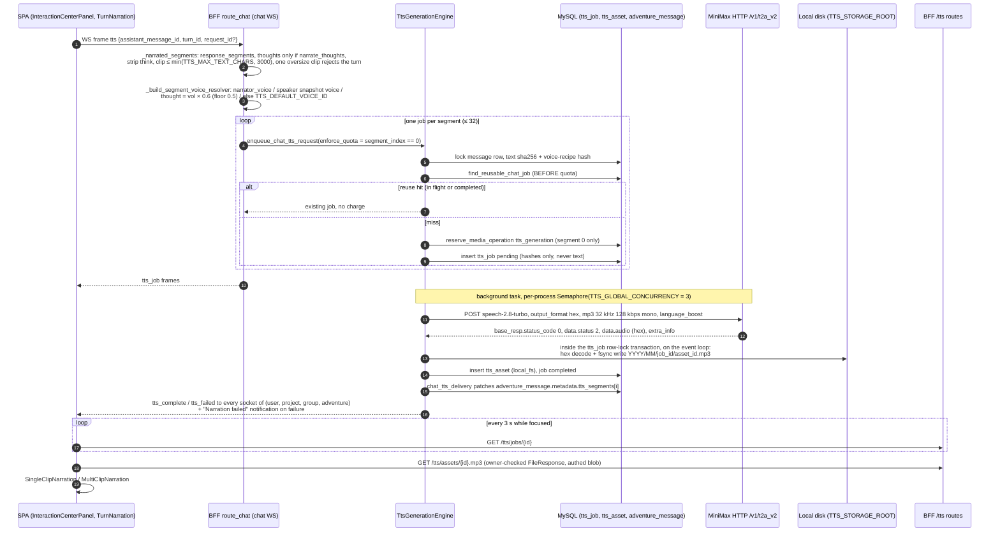
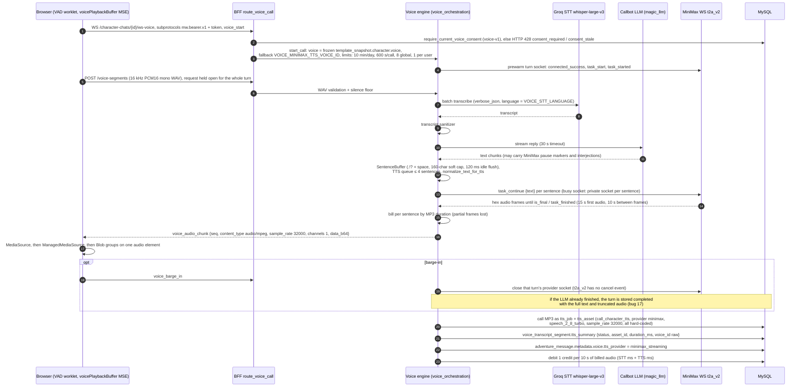
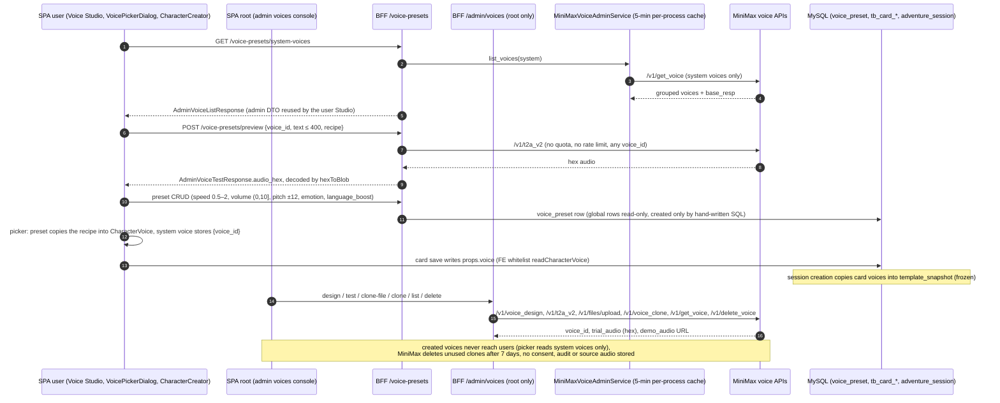
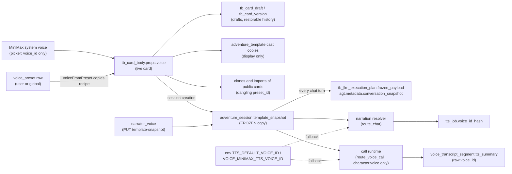

# Historical baseline: the MiniMax speech stack (2026-10-12)

> **Scope / status (reviewed 2026-10-14):** Voice design and dated evidence; product rollout is **WIP**. [00 — Current status and roadmap](00_current_status_and_roadmap.md) owns current implementation/flags/gaps. Later [03 §5.16](03_target_architecture_and_decisions.md#516-r0-implementation-decisions-2026-10-12) instructions and [15 §§11–13](15_implementation_plan_and_acceptance.md#11-minimax-voice-purge-2026-10-14) supersede MiniMax routing, cohorts, V1/maps and original rollout dates. Preserve earlier proposals and vendor facts as dated references; they are not proof of availability.

- **Date:** 2026-10-12
- **Status:** Historical before-picture. Current implementation is ElevenLabs-only and WIP rollout; read [00](00_current_status_and_roadmap.md).

## Scope

This document is the "before" picture for the MiniMax → ElevenLabs migration. It records how speech worked at that review date:
- every feature that uses TTS or voices;
- the three provider paths: narration jobs, realtime calls, and catalog/Studio/admin;
- the MiniMax integration surface;
- the voice data model and every place voice data is persisted or copied;
- billing and quotas;
- known bugs and risks, each with the decision that handles it;
- footprint counts;
- what must disappear.

It summarizes the research notes and links to them for the exhaustive inventories. It proposes nothing. Target designs are in [03](03_target_architecture_and_decisions.md) and the plan documents. Code facts were read in the working trees on 2026-10-12: backend `magic-worlds-api` HEAD `f77e60f` and frontend HEAD `f0f5769`, both with uncommitted changes. Line numbers can drift by a few lines. Search by the symbol named next to each link.

**Since then: Workspace R1 (2026-10-12).** Workspace R1 was committed afterwards (backend `f37eefd`, frontend `c7307c6`, content schema `2026_10_workspace_r1`), but it is not deployed to production. For speech it changes the following:
- **Scoping.** `tts_job` rows now carry the session's `workspace_id`, and each job and asset gets a workspace association. The chat and voice sockets take `?workspace_id=`, and the private TTS and call routes take `X-Workspace-Id`.
- **Archived workspaces.** A fresh narration or a new call needs an active workspace. Reusable jobs, call end and job completion still work after an archive.
- **Account-level surfaces.** Presets, admin voices, consent, quotas and the one-call rule stay account-level.
- **Line numbers.** About 3,000 lines moved in `models.py`, so many backend line numbers in this document are older than that commit.

The details and the refreshed line numbers are in [research 15](research/15_workspace_r1_impact.md); the target rules are 03 D39 and §5.15.

**Related.**
- [README](README.md): index and reading guide.
- [02](02_elevenlabs_capabilities.md): ElevenLabs capabilities.
- [03](03_target_architecture_and_decisions.md): source of truth (decisions D01–D39, canonical definitions §5).
- Plan documents:
  - [04](04_voice_catalog_and_library.md): catalog and Voice Library;
  - [05](05_voice_studio_and_admin_console.md): Voice Studio and admin console;
  - [06](06_chat_narration_migration.md): chat narration;
  - [07](07_realtime_calls_migration.md): realtime calls;
  - [08](08_backend_refactor_plan.md): backend plan;
  - [09](09_frontend_refactor_plan.md): frontend plan;
  - [10](10_data_migration_and_rollout.md): data migration and rollout;
  - [11](11_cost_plans_and_operations.md): cost and operations;
  - [12](12_best_practices_and_improvements.md): best practices and backlog;
  - [13](13_policy_privacy_and_compliance.md): policy and privacy;
  - [14](14_staging_spike_and_contract_tests.md): staging spike and contract tests;
  - [15](15_implementation_plan_and_acceptance.md): implementation plan;
  - [16](16_risks_and_open_questions.md): risks and open questions.
- Primary evidence:
  - [research 00](research/00_current_tts_review.md): baseline review and bugs;
  - [research 06](research/06_backend_minimax_inventory.md): backend inventory;
  - [research 07](research/07_frontend_minimax_inventory.md): frontend inventory;
  - [research 08](research/08_voice_data_model_migration_surface.md): data model;
  - [research 13](research/13_gap_codebase_checks.md): codebase gap checks;
  - [research 14](research/14_cost_model.md): cost model.

> Naming: plan documents are cited as a bare number linked to the plan file, e.g. [06](06_chat_narration_migration.md); research notes are cited as "research NN", e.g. [research 06](research/06_backend_minimax_inventory.md). Plan 06 is not research 06. Decisions are cited as (D11), staging spikes as (S-3) and legal confirmations as (L-2), all defined in [03](03_target_architecture_and_decisions.md) §4 and §6.

---

## Summary

- **Three paths, one key.** All speech goes through the BFF, using one shared `MINIMAX_AUDIO_API_KEY`:
  - **A.** Narration: async HTTP `t2a_v2` jobs, stored as local MP3s.
  - **B.** Calls: Groq STT → callbot LLM → MiniMax `t2a_v2` WebSocket.
  - **C.** Catalog, Studio, previews and the root console: MiniMax voice APIs plus `t2a_v2`.

  The SPA never calls MiniMax directly ([research 07 §0](research/07_frontend_minimax_inventory.md#0-key-findings-read-first)).
- **One model everywhere.** `speech-2.8-turbo`, MP3 at 32 kHz, hex-encoded on the wire. ElevenLabs has no 32 kHz MP3 (as of 2026-10-12), so the 32 kHz literals have to become data on the write path, while legacy 32000 stays readable (D08, §8.2).
- **One MiniMax-shaped voice object, copied by value.** `CharacterVoice` = `{voice_id, speed, vol, pitch, emotion, language_boost, preset_id, preset_name}`. It is copied into at least nine JSON locations, including **frozen session snapshots** and every chat execution record. Validation is strict on read ([research 08 §1](research/08_voice_data_model_migration_surface.md#1-key-findings)).
- **Provider identity is hard-coded and validated on read paths.** Examples: `tts_job` `CHECK provider = 'minimax'`, `Literal["speech_2_8_turbo"]`, `tts_provider == "minimax_streaming"`. Switching these literals instead of widening them would break history, `/tasks` and call replay (D23, [03 §5.14](03_target_architecture_and_decisions.md#514-r0-widening-list-for-strict-validators)).
- **Billing is per request, and leaky.**
  - Narration costs 1 credit per turn, and only segment 0 is metered.
  - Nothing is refunded.
  - Previews are unmetered.
  - Calls cost 1 credit per 10 s of audio.
- **19 numbered bugs** plus a "Lower" list ([research 00 §3](research/00_current_tts_review.md#3-issues-found-to-fix-or-design-away-during-the-migration)). D30 decides which are fixed in the migration (§6).

---

## 1. Features that use speech today

| # | Feature | User-visible behaviour | Frontend entry points | Backend routes / services | Provider path |
|---|---|---|---|---|---|
| F1 | **Chat narration** (adventure chats; character chats reuse `InteractionCenterPanel`) | A play button on each AI reply, plus a per-session auto-narrate toggle (stored in `localStorage` under `mw:autonarrate:*`). Each turn is split into segments, each with its own voice: narrator lines, each speaking character, and thoughts (only when "narrate thoughts" is on). Multi-clip playback. | [TurnNarration.tsx](/home/andres/WebstormProjects/magic-worlds/src/features/interaction/components/TurnNarration.tsx), [ChatTurn.tsx](/home/andres/WebstormProjects/magic-worlds/src/features/interaction/components/ChatTurn.tsx), [ChatComposer.tsx](/home/andres/WebstormProjects/magic-worlds/src/features/interaction/components/ChatComposer.tsx), [InteractionCenterPanel.tsx](/home/andres/WebstormProjects/magic-worlds/src/features/interaction/components/InteractionCenterPanel.tsx), [chatTtsTurnState.ts](/home/andres/WebstormProjects/magic-worlds/src/features/interaction/utils/chatTtsTurnState.ts), [chatSocket.ts:308](/home/andres/WebstormProjects/magic-worlds/src/infrastructure/api/chatSocket.ts) (`sendTts`) | Chat WS `tts` frame ([route_chat.py:212](/home/andres/PycharmProjects/magic-worlds-api/src/routes/user/route_chat.py) `WsTtsFrame`; [route_chat.py:1224](/home/andres/PycharmProjects/magic-worlds-api/src/routes/user/route_chat.py) `_handle_chat_tts_request`); `services/tts_generation/*`; [chat_tts_delivery.py](/home/andres/PycharmProjects/magic-worlds-api/src/services/chat_tts_delivery.py); `/tts/jobs/{id}`, `/tts/assets/{id}.mp3` ([tts.py:62](/home/andres/PycharmProjects/magic-worlds-api/src/routes/tts.py)) | **A**: MiniMax HTTP `t2a_v2` |
| F2 | **Narrator voice and "narrate thoughts"** (adventure settings) | Pick the adventure narrator voice; toggle thought narration | [InteractionLeftPanel.tsx](/home/andres/WebstormProjects/magic-worlds/src/features/interaction/components/InteractionLeftPanel.tsx) (`NarrationSection`) | `PUT /adventure-sessions/{id}/template-snapshot` ([route_adventure_session.py:1620](/home/andres/PycharmProjects/magic-worlds-api/src/routes/user/route_adventure_session.py)) | Data only; feeds A |
| F3 | **Realtime voice calls** (character chats in voice mode) | Phone-style talk with barge-in, live captions and a voice consent modal | [CallScreen.tsx](/home/andres/WebstormProjects/magic-worlds/src/features/call/components/CallScreen.tsx), [useVoiceCallController.ts](/home/andres/WebstormProjects/magic-worlds/src/features/interaction/hooks/useVoiceCallController.ts), [voiceSocket.ts](/home/andres/WebstormProjects/magic-worlds/src/infrastructure/api/voiceSocket.ts), [voicePlaybackBuffer.ts](/home/andres/WebstormProjects/magic-worlds/src/features/interaction/audio/voicePlaybackBuffer.ts), [voiceVadWorklet.ts](/home/andres/WebstormProjects/magic-worlds/src/features/interaction/audio/voiceVadWorklet.ts), [VoiceConsentModal.tsx](/home/andres/WebstormProjects/magic-worlds/src/features/interaction/components/VoiceConsentModal.tsx) | [route_voice_call.py:889](/home/andres/PycharmProjects/magic-worlds-api/src/routes/user/route_voice_call.py) (`/ws-voice`), `:592` (`/voice-segments`), `:574` (`/voice-consent`), `:703` (`/voice-end`); `services/voice_orchestration/*`; callbot graph | **B**: Groq STT, then the LLM, then the MiniMax WS `t2a_v2` |
| F4 | **Call history and transcript** | List of past calls, "Voice set" badge, transcript replay of the stored assistant audio | [CallsPage.tsx](/home/andres/WebstormProjects/magic-worlds/src/features/call/components/CallsPage.tsx), [CallTranscriptView.tsx](/home/andres/WebstormProjects/magic-worlds/src/features/call/components/CallTranscriptView.tsx) | `/voice-calls`, `/voice-calls/{id}/transcript` ([route_voice_call.py:769](/home/andres/PycharmProjects/magic-worlds-api/src/routes/user/route_voice_call.py), `:805`); call MP3 stored as `tts_asset` with `source='call_character_tts'` | Stored MP3; no provider call |
| F5 | **User Voice Studio** (presets) | Build presets on top of MiniMax system voices, with sliders for speed, volume and pitch plus emotion and language boost; preview | [VoiceStudioPage.tsx](/home/andres/WebstormProjects/magic-worlds/src/features/voices/components/VoiceStudioPage.tsx), PresetEditor.tsx (retired historical source: `/home/andres/WebstormProjects/magic-worlds/src/features/voices/components/PresetEditor.tsx`), PresetRecipeControls.tsx (retired historical source: `/home/andres/WebstormProjects/magic-worlds/src/features/voices/components/PresetRecipeControls.tsx`), SystemVoicePicker.tsx (retired historical source: `/home/andres/WebstormProjects/magic-worlds/src/features/voices/components/SystemVoicePicker.tsx`), usePreviewVoice.ts (retired historical source: `/home/andres/WebstormProjects/magic-worlds/src/features/voices/usePreviewVoice.ts`), recipe.ts (retired historical source: `/home/andres/WebstormProjects/magic-worlds/src/features/voices/recipe.ts`) | `/voice-presets` CRUD, `/voice-presets/system-voices`, `/voice-presets/preview` ([voice_presets.py:62-151](/home/andres/PycharmProjects/magic-worlds-api/src/routes/voice_presets.py)); `VoicePresetModel` | **C**: MiniMax `get_voice` + `t2a_v2` preview |
| F6 | **Voice picker** (character card, adventure narrator) | Tabs "My presets" and "System voices". A preset **copies its recipe** into the card. A system voice stores `{voice_id}` only. | [VoicePickerDialog.tsx:20-104](/home/andres/WebstormProjects/magic-worlds/src/features/voices/components/VoicePickerDialog.tsx), [CharacterCreator.tsx:782-819](/home/andres/WebstormProjects/magic-worlds/src/features/creation/character/components/CharacterCreator.tsx) | Card save routes (`props.voice`); preset and system-voice routes as in F5 | Data copy; preview via C |
| F7 | **Root admin voice console** (root only) | Design, clone, test and delete voices on the shared MiniMax account; inventory browser; MiniMax reference drawer | `src/features/admin/voices/**`: [AdminVoicesPage.tsx](/home/andres/WebstormProjects/magic-worlds/src/features/admin/voices/components/AdminVoicesPage.tsx), `SynthLabPanel`, `VoiceDesignForm`, `VoiceCloneForm`, `VoiceLibraryPanel`, `SystemVoiceBrowser`, MiniMaxReferenceDrawer.tsx (retired historical source: `/home/andres/WebstormProjects/magic-worlds/src/features/admin/voices/components/MiniMaxReferenceDrawer.tsx`) | `/admin/voices/*` ([admin_voices.py:75-196](/home/andres/PycharmProjects/magic-worlds-api/src/routes/admin_voices.py)); minimax_voice_admin.py (retired historical source: `/home/andres/PycharmProjects/magic-worlds-api/src/services/minimax_voice_admin.py`) | **C**: MiniMax voice APIs |
| F8 | **Tasks drawer and notifications** | Narration jobs appear as `text_to_speech` tasks; a "Narration failed" notification on failure | [TasksPanel.tsx:60,102,430](/home/andres/WebstormProjects/magic-worlds/src/features/tasks/components/TasksPanel.tsx) | Read-only projection through [media_tasks.py:7-17](/home/andres/PycharmProjects/magic-worlds-api/src/services/media_tasks.py) and `notifications.py`, both on `TtsJobPublic` | None, but the projection pins the model alias (§4.5) |
| F9 | **Membership usage** | Usage label and quotas for `tts_generation` and `voice_call` | [UsageSection.tsx](/home/andres/WebstormProjects/magic-worlds/src/features/profile/components/UsageSection.tsx), profile view | `membership_plan_limit` seeds; `reserve_media_operation`, `debit_operation_credits` | n/a |
| — | *Theme songs (not TTS, out of scope per D01)* | Character theme songs | `MediaStudioSection` | fal.ai `minimax/music-3` or `fal-ai/ace-step` with `FAL_KEY` | Not the MiniMax API |

- **Not speech:** the novel/Story Studio, gallery and lorebook features use no TTS [research 00 §1](research/00_current_tts_review.md#1-features-that-use-speech-today).
- **Kill switches:**
  - Frontend, build-time: `VITE_FEATURE_VOICES_ENABLED` (Studio, admin voices, picker) and `VITE_FEATURE_CALLS_ENABLED` (calls). Both default to `false` ([research 07 §3.5](research/07_frontend_minimax_inventory.md#3-api-layer-sockets-and-feature-flags)).
  - Backend, process-global env read at startup: `TTS_ENGINE_ENABLED` and `VOICE_MODE_ENABLED` ([research 13 §7.1](research/13_gap_codebase_checks.md#7-provider-routing-for-a-canary-09-g17)). Flipping one needs a restart, which drops every live call (bug #19). D28 moves them into the DB-backed `voice_runtime_setting` row.

---

## 2. Architecture of the three paths

### 2.1 Path A: chat narration jobs



Key facts, from [research 00 §2 Path A](research/00_current_tts_review.md#2-provider-integration-minimax) and [research 06 §2.1](research/06_backend_minimax_inventory.md#2-provider-adapters-contracts-and-abstraction-seams):

| Aspect | Today | Code |
|---|---|---|
| Trigger | Chat WebSocket only. The client never sends text, voice or model (`extra="forbid"`). | [route_chat.py:212](/home/andres/PycharmProjects/magic-worlds-api/src/routes/user/route_chat.py) |
| Segmenting | Up to 32 segments, each ≤ 3,000 characters. Worst case per turn is 96,000 characters. | [route_chat.py:1174-1221](/home/andres/PycharmProjects/magic-worlds-api/src/routes/user/route_chat.py) |
| Voice resolution | From the **frozen** session snapshot. Thought dimming is a MiniMax `vol` parameter. | [route_chat.py:1129-1171](/home/andres/PycharmProjects/magic-worlds-api/src/routes/user/route_chat.py) |
| Quota | Only segment 0 sets `enforce_quota`. Reuse is checked before quota. | [route_chat.py:1433](/home/andres/PycharmProjects/magic-worlds-api/src/routes/user/route_chat.py), [engine.py:193-258](/home/andres/PycharmProjects/magic-worlds-api/src/services/tts_generation/engine.py) |
| Concurrency | Per-process semaphore, default 3 | [engine.py:94](/home/andres/PycharmProjects/magic-worlds-api/src/services/tts_generation/engine.py) |
| Payload | Built by `TtsModelRegistry.to_provider_payload` | [registry.py:205-241](/home/andres/PycharmProjects/magic-worlds-api/src/services/tts_generation/registry.py) |
| Response validation | Strict echo match on format, rate, bitrate and size | minimax_adapter.py:217-362 (retired historical source: `/home/andres/PycharmProjects/magic-worlds-api/src/services/tts_generation/minimax_adapter.py`) |
| Storage | Hex decoded and written synchronously in the coroutine, inside the row lock | [storage.py:117](/home/andres/PycharmProjects/magic-worlds-api/src/services/tts_generation/storage.py), [engine.py:611-639](/home/andres/PycharmProjects/magic-worlds-api/src/services/tts_generation/engine.py) |
| Stale cleanup | Per user, only on that user's next enqueue; 120 s cutoff | [engine.py:296-316](/home/andres/PycharmProjects/magic-worlds-api/src/services/tts_generation/engine.py) |
| Delivery | Metadata patch, socket fan-out and notification | [chat_tts_delivery.py:503-526](/home/andres/PycharmProjects/magic-worlds-api/src/services/chat_tts_delivery.py) |
| Frontend polling | Every 3 s while focused; 15 s pending watchdog | [InteractionCenterPanel.tsx:692-700](/home/andres/WebstormProjects/magic-worlds/src/features/interaction/components/InteractionCenterPanel.tsx) |
| Tasks | Not executed by the task queue, but projected read-only into `/tasks` | [media_tasks.py:13-16](/home/andres/PycharmProjects/magic-worlds-api/src/services/media_tasks.py) |

### 2.2 Path B: realtime voice calls



Key facts, from [research 00 §2 Path B](research/00_current_tts_review.md#2-provider-integration-minimax) and [research 06 §2.2](research/06_backend_minimax_inventory.md#2-provider-adapters-contracts-and-abstraction-seams):

| Aspect | Today | Code |
|---|---|---|
| Transport | Hybrid: a WebSocket for control and downlink, and multipart HTTP POSTs for uplink. The SPA's frame denylist blocks provider keys. | [voiceSocket.ts:64-79](/home/andres/WebstormProjects/magic-worlds/src/infrastructure/api/voiceSocket.ts) |
| MiniMax session | `task_start` carries `model:"speech-2.8-turbo"`, `voice_setting`, `audio_setting{sample_rate:32000, format:"mp3", channel:1}` (no bitrate), `language_boost` and the undocumented `text_normalization_mode:"basic"` | streaming_tts_minimax.py:727-754 (retired historical source: `/home/andres/PycharmProjects/magic-worlds-api/src/services/voice_orchestration/streaming_tts_minimax.py`) |
| Voice | Read only from `snapshot.character.voice`; the engine requires a valid MiniMax default voice | [route_voice_call.py:404-421](/home/andres/PycharmProjects/magic-worlds-api/src/routes/user/route_voice_call.py), [engine.py:512-515](/home/andres/PycharmProjects/magic-worlds-api/src/services/voice_orchestration/engine.py) |
| Frame guard | Raises unless 32 kHz mono | [delivery.py:342-364](/home/andres/PycharmProjects/magic-worlds-api/src/services/voice_orchestration/delivery.py) |
| Billing parser | Per-sentence MP3 duration | [engine.py:1579-1599](/home/andres/PycharmProjects/magic-worlds-api/src/services/voice_orchestration/engine.py), `:2286-2343` |
| Call-asset identity | Hard-coded | [engine.py:2346-2444](/home/andres/PycharmProjects/magic-worlds-api/src/services/voice_orchestration/engine.py) |
| State | All call state is in process memory, so the API is single-process only (bug #19) | — |

### 2.3 Path C: catalog, user Voice Studio and root console



Key facts, from [research 00 §2 Path C](research/00_current_tts_review.md#2-provider-integration-minimax), [research 06 §2.3](research/06_backend_minimax_inventory.md#2-provider-adapters-contracts-and-abstraction-seams), [research 07 §4–§5](research/07_frontend_minimax_inventory.md#4-admin-voices-console-srcfeaturesadminvoices) and [research 13 §2–§3](research/13_gap_codebase_checks.md#2-clone-source-audio-09-g6):
- The user Studio **shares the root wire contract**: `response_model=AdminVoiceListResponse` / `AdminVoiceTestResponse` ([voice_presets.py:87](/home/andres/PycharmProjects/magic-worlds-api/src/routes/voice_presets.py), `:99`).
- The Studio also **imports admin-console modules**: `constants.ts`, `ControlSlider`, `hexAudio`, `voiceLanguage` (recipe.ts:1 (retired historical source: `/home/andres/WebstormProjects/magic-worlds/src/features/voices/recipe.ts`), usePreviewVoice.ts:10 (retired historical source: `/home/andres/WebstormProjects/magic-worlds/src/features/voices/usePreviewVoice.ts`)). Rewriting the console therefore breaks the Studio.
- Twenty user-reachable `public_detail="MiniMax …"` error strings live in minimax_voice_admin.py (retired historical source: `/home/andres/PycharmProjects/magic-worlds-api/src/services/minimax_voice_admin.py`) ([research 06 §11.11](research/06_backend_minimax_inventory.md#11-removalreplacement-checklist)).
- Voice ids are validated by **length only** and never against the provider catalog. The admin console enforces MiniMax custom-id rules: voiceIdRules.ts:13-20 (retired historical source: `/home/andres/WebstormProjects/magic-worlds/src/features/admin/voices/voiceIdRules.ts`), and the language comes from the id prefix in voiceLanguage.ts:15-21 (retired historical source: `/home/andres/WebstormProjects/magic-worlds/src/features/admin/voices/voiceLanguage.ts`).
- **Clone sources, design prompts and consent are never persisted.** MiniMax custom voices cannot be re-created from local data ([research 13 §2.2](research/13_gap_codebase_checks.md#2-clone-source-audio-09-g6)). D22 retires them.

### 2.4 Seams that exist today

The target seams are in [03 §2.1](03_target_architecture_and_decisions.md#21-component-view-and-provider-neutral-seams). Today's seams, from [research 06 §2.5](research/06_backend_minimax_inventory.md#2-provider-adapters-contracts-and-abstraction-seams):

| Seam | State today | Code |
|---|---|---|
| `TtsProvider` Protocol | Exists, but lives in the MiniMax module, and its types carry hex and 32 kHz | minimax_adapter.py:114-119 (retired historical source: `/home/andres/PycharmProjects/magic-worlds-api/src/services/tts_generation/minimax_adapter.py`) |
| `StreamingTtsClient` Protocol and factory | Exists; the factory is single-provider | streaming_tts_minimax.py:87-105 (retired historical source: `/home/andres/PycharmProjects/magic-worlds-api/src/services/voice_orchestration/streaming_tts_minimax.py`), `:698-701` |
| `AudioStorage` Protocol | Exists; takes `hex_payload` | [storage.py:52-70](/home/andres/PycharmProjects/magic-worlds-api/src/services/tts_generation/storage.py) |
| `VoiceAdminService` Protocol | Exists; the methods mirror MiniMax | [admin_voices.py:28-36](/home/andres/PycharmProjects/magic-worlds-api/src/routes/admin_voices.py) |
| Provider/model registry | **Missing.** One locked model, `provider: Literal["minimax"]` | [registry.py:21-32](/home/andres/PycharmProjects/magic-worlds-api/src/services/tts_generation/registry.py) |
| Error classifier | **Missing.** Three separate MiniMax code tables | §3.5 |
| Neutral `app.state` and readiness | **Missing.** `minimax_tts_provider`, `minimax_voice_admin_*`, and `isinstance(provider, MiniMaxT2AProvider)` | [main.py:916-953](/home/andres/PycharmProjects/magic-worlds-api/src/main.py), [main.py:1483](/home/andres/PycharmProjects/magic-worlds-api/src/main.py) |
| Per-user provider routing | **Missing.** One provider per process, pinned by a `Literal` and a DB CHECK | [research 13 §7.1](research/13_gap_codebase_checks.md#7-provider-routing-for-a-canary-09-g17) |

---

## 3. MiniMax integration surface (summary)

This section is a summary. The exhaustive, line-level inventories are [research 06 §1–§6, §11](research/06_backend_minimax_inventory.md#11-removalreplacement-checklist) for the backend and [research 07 §2–§7, §12](research/07_frontend_minimax_inventory.md#12-change-checklist) for the frontend.

### 3.1 Endpoints

| MiniMax endpoint | Transport | Used by | Code |
|---|---|---|---|
| `POST {MINIMAX_BASE_URL}/v1/t2a_v2` | HTTP JSON, `output_format:"hex"` | A narration, C user preview, C root test | minimax_adapter.py:15 (retired historical source: `/home/andres/PycharmProjects/magic-worlds-api/src/services/tts_generation/minimax_adapter.py`); minimax_voice_admin.py:63-69 (retired historical source: `/home/andres/PycharmProjects/magic-worlds-api/src/services/minimax_voice_admin.py`) |
| `wss://api.minimax.io/ws/v1/t2a_v2` | WebSocket: `task_start` / `task_continue` / `task_finish`, hex chunks | B calls | [voice_orchestration/config.py:25](/home/andres/PycharmProjects/magic-worlds-api/src/services/voice_orchestration/config.py) |
| `/v1/get_voice` | HTTP | C user system-voice catalog (5-min cache) and root inventory | minimax_voice_admin.py:238-273 (retired historical source: `/home/andres/PycharmProjects/magic-worlds-api/src/services/minimax_voice_admin.py`) |
| `/v1/voice_design` | HTTP; returns `voice_id` and hex `trial_audio` | C root design | `minimax_voice_admin.py:218-236` |
| `/v1/files/upload`, then `/v1/voice_clone` | HTTP; two-step clone with `clone_prompt` and noise/volume normalization; returns `demo_audio` URL | C root clone | `minimax_voice_admin.py:313-421` |
| `/v1/delete_voice` | HTTP (`voice_type` + `voice_id`) | C root delete | `minimax_voice_admin.py:275-297` |

All three paths send `Authorization: Bearer` with one key and no GroupId. **Not used:** `voice_modify`, `pronunciation_dict`, timbre mixing, subtitles, and the HD model outside the admin lab ([research 00 §2](research/00_current_tts_review.md#2-provider-integration-minimax)).

### 3.2 Models and audio

| Item | Value | Where |
|---|---|---|
| Model | `speech-2.8-turbo` (alias `speech_2_8_turbo`) for narration, calls and previews. `speech-2.8-hd` is offered only in the root synth lab. | [tts_generation/config.py:26-27](/home/andres/PycharmProjects/magic-worlds-api/src/services/tts_generation/config.py); [config.py:88-92](/home/andres/PycharmProjects/magic-worlds-api/src/services/tts_generation/config.py) raises unless the model is the MiniMax pair |
| Narration audio | MP3, 32 kHz, 128 kbps, mono, hex | [registry.py:205-241](/home/andres/PycharmProjects/magic-worlds-api/src/services/tts_generation/registry.py) |
| Call audio | MP3, 32 kHz, mono (no bitrate field), hex → base64 `data_b64` | streaming_tts_minimax.py:20-47 (retired historical source: `/home/andres/PycharmProjects/magic-worlds-api/src/services/voice_orchestration/streaming_tts_minimax.py`) |
| Frontend literal | `voice_audio_chunk.sample_rate: 32000` | [voice.types.ts:165-174](/home/andres/WebstormProjects/magic-worlds/src/shared/types/voice.types.ts) |

ElevenLabs offers MP3 only at 22.05, 24 and 44.1 kHz (as of 2026-10-12; [research 06 §0](research/06_backend_minimax_inventory.md#0-executive-summary-top-risks)). D08 replaces these literals.

### 3.3 Payload fields (the MiniMax recipe)

| Field | Range / values | Where it is enforced | ElevenLabs equivalent (decision) |
|---|---|---|---|
| `voice_id` | String, 1–256 characters, length check only | [character.py:17](/home/andres/PycharmProjects/magic-worlds-api/src/models/character.py) | `voice_key` catalog indirection (D11) |
| `speed` | 0.5–2.0 | `character.py`, `voice_preset.py`, `PresetRecipeControls` | `settings.speed` 0.7–1.2 (D13); legacy values clamped and flagged for review (D15) |
| `vol` (`volume` in presets) | (0, 10] | same | Dropped (D15); thoughts use client gain (D16) |
| `pitch` | −12..12 (int) | same | Dropped; `\|pitch\| ≥ 3` flagged for review (D15) |
| `emotion` | `happy, sad, angry, fearful, disgusted, surprised, calm` | admin_voice.py:28-38 (retired historical source: `/home/andres/PycharmProjects/magic-worlds-api/src/models/admin_voice.py`) | Same neutral enum, mapped to a prefix tag on Expressive or a stability offset on Standard ([03 §5.5.1](03_target_architecture_and_decisions.md#551-emotion-mapping-emotion_map_version--1); D14; tag wording pending S-6) |
| `language_boost` | `'auto'` or a language *name* | [registry.py:32](/home/andres/PycharmProjects/magic-worlds-api/src/services/tts_generation/registry.py) | `language_code` chain (D17) |
| `audio_setting` | `format`, `sample_rate`, `bitrate`, `channel` | registry, streaming client, admin test | `output_format`: `mp3_44100_128` for narration, `mp3_44100_64` for calls and previews ([03 §5.4.1](03_target_architecture_and_decisions.md#541-providers-models-and-aliases); D05, D08) |
| `text_normalization_mode` (WS only) | `"basic"`, undocumented by MiniMax | streaming client | `apply_text_normalization: "auto"` plus upstream normalization (D27; Flash behaviour pending S-5) |

### 3.4 Inline text syntax

| Syntax | Meaning | Where | Fate |
|---|---|---|---|
| `<#0.5#>` | Pause | Callbot prompt [callbot_chat.v2.json:32](/home/andres/PycharmProjects/magic-worlds-api/src/agent_graphs/runtime/callbot_chat.v2.json). The sanitizer allows it as "the sole angle-bracket markup" ([transcript_sanitizer.py:46-52](/home/andres/PycharmProjects/magic-worlds-api/src/services/voice_orchestration/transcript_sanitizer.py)). Admin toolbar and default test text ([constants.ts:29-30](/home/andres/WebstormProjects/magic-worlds/src/features/admin/voices/constants.ts)). | Kept in stored text as "app speech markup v1" and translated per model after validation (D27; `<break>` on the Flash socket pending S-26). Removed from admin tooling with the console rewrite (D20). |
| `(laughs) (sighs) (gasps) (inhale) (exhale) (humming)` | Interjections | Callbot prompt when `CALLBOT_INTERJECTIONS_ENABLED` is on ([route_chat.py:114-120](/home/andres/PycharmProjects/magic-worlds-api/src/routes/user/route_chat.py)). `SentenceBuffer` never splits inside them. | Kept as markup v1: translated to tags on v4, stripped on Flash; the flag is forced off while the call profile has no audio-tag support (D27) |
| `word/(ipa)` | Inline IPA | Admin `TextArtifactToolbar` only | Removed with the console rewrite (D20) |

Stored call transcripts and call-turn `adventure_message.content` already contain these markers. They are rendered raw today ([CallTranscriptView.tsx:63](/home/andres/WebstormProjects/magic-worlds/src/features/call/components/CallTranscriptView.tsx), `:87`); D23 strips them at display time. Narration text, by contrast, reaches MiniMax with brackets and markdown intact. Only whitespace and zero-width characters are normalized ([registry.py:248-253](/home/andres/PycharmProjects/magic-worlds-api/src/services/tts_generation/registry.py); [research 13 §9](research/13_gap_codebase_checks.md#9-literal-square-brackets-in-narration-text-09-g11)).

### 3.5 Error codes and retries

| MiniMax codes | App category | Table |
|---|---|---|
| 1026, 1027 | `content_blocked` | minimax_adapter.py:20 (retired historical source: `/home/andres/PycharmProjects/magic-worlds-api/src/services/tts_generation/minimax_adapter.py`) |
| 1042 | `invalid` | `minimax_adapter.py:21` |
| 1004, 1008, 2013, 20132, 2042, 2049 | `unavailable` | `minimax_adapter.py:22` |
| 1002, 1039, 2045, 2056 | `rate_limited` (2056 = "usage limit") | `minimax_adapter.py:19` |
| 1001 | `timeout` | — |
| Retryable: 1000, 1001, 1002, 1024, 1033, 1039, 2045, 2056 | — | minimax_adapter.py:17 (retired historical source: `/home/andres/PycharmProjects/magic-worlds-api/src/services/tts_generation/minimax_adapter.py`) |
| Admin: 1002, 1039, 2045, 2056 → 429; clone detail 2037, 2039, 2042, 2048, 1043, 1044, 1008 | — | minimax_voice_admin.py:79-87 (retired historical source: `/home/andres/PycharmProjects/magic-worlds-api/src/services/minimax_voice_admin.py`), `:576-608` |
| Streaming: separate rate, timeout and unavailable sets; rate limits map to `tts_unavailable` | — | streaming_tts_minimax.py:803-825 (retired historical source: `/home/andres/PycharmProjects/magic-worlds-api/src/services/voice_orchestration/streaming_tts_minimax.py`) |

How retries behave today:
- **Narration:** at most 2 attempts, with a 10–50 ms backoff.
- **`Retry-After`:** an HTTP `Retry-After` is parsed and surfaced on the failed job (`retry_after_seconds`), but the in-process retry ignores it.
- **Rate limits:** rate-limit codes, including 2056, are retried almost immediately (bug #12).
- **Streaming:** no mid-turn retry.
- **Admin:** no retry.

There are three separate code tables in total; D03 and [03 §5.8](03_target_architecture_and_decisions.md#58-error-category-mapping-elevenlabs--app-categories) replace them with one `ProviderErrorClassifier`.

### 3.6 Credentials and environment variables

| Variable | Default / example | Consumers | Replaced by |
|---|---|---|---|
| `MINIMAX_AUDIO_API_KEY` | secret; shared by A, B and C | minimax_credentials.py:8-17 (retired historical source: `/home/andres/PycharmProjects/magic-worlds-api/src/services/minimax_credentials.py`) | Six scoped `ELEVENLABS_KEY_*` keys (D04, [03 §5.4.3](03_target_architecture_and_decisions.md#543-api-keys-production-service-account-staging-uses-user-keys-with-the-same-scopes)). Revoked at R4 (D28). |
| `MINIMAX_BASE_URL` | `https://api.minimax.io`; the parser also allows `http` | TTS config, voice admin | `ELEVENLABS_BASE_URL` (default `https://api.elevenlabs.io`; [03 §5.4.3](03_target_architecture_and_decisions.md#543-api-keys-production-service-account-staging-uses-user-keys-with-the-same-scopes)) |
| `MINIMAX_VOICE_ADMIN_TIMEOUT_SECONDS`, `MINIMAX_VOICE_CLONE_TIMEOUT_SECONDS`, `MINIMAX_VOICE_CLONE_MAX_UPLOAD_BYTES` | 60 s, 300 s, 20 MiB | Voice admin | Neutral admin settings (D20) |
| `TTS_DEFAULT_VOICE_ID` | a MiniMax id | Narration default and voiceless characters | `voice_default` rows + `VOICE_LAST_RESORT_VOICE_KEY` (D31) |
| `VOICE_TTS_PROVIDER` | `minimax_streaming` (the only allowed value; [voice_orchestration/config.py:153-156](/home/andres/PycharmProjects/magic-worlds-api/src/services/voice_orchestration/config.py)) | Call engine | `ProviderRouter` + union literal `minimax_streaming` / `elevenlabs_streaming` (D28, [03 §5.14](03_target_architecture_and_decisions.md#514-r0-widening-list-for-strict-validators)) |
| `VOICE_MINIMAX_TTS_WS_URL`, `VOICE_MINIMAX_TTS_VOICE_ID` | `wss://api.minimax.io/ws/v1/t2a_v2`, a MiniMax id | Call engine | Adapter URL; D31 defaults |
| `VOICE_CONSENT_VERSION` | `voice-v1`; the disclosure names MiniMax | Call admission | Per-provider version, `voice-v2` for ElevenLabs (D25) |
| `CALLBOT_INTERJECTIONS_ENABLED` | toggles the prompt section | Callbot prompt | Kept; forced off without tag support (D27) |
| Provider-neutral `TTS_*` | `TTS_GLOBAL_CONCURRENCY=3`, `TTS_MAX_TEXT_CHARS=3000`, `TTS_PROVIDER_MAX_ATTEMPTS=2`, `TTS_MAX_JOB_AGE_SECONDS=120`, `TTS_STORAGE_ROOT`, … | Narration engine | Kept or retuned (plan [08](08_backend_refactor_plan.md)) |
| `VOICE_GLOBAL_CONCURRENCY`, `VOICE_DAILY_MINUTES_PER_USER`, `VOICE_MAX_CALL_DURATION_SECONDS`, `VOICE_STT_LANGUAGE` | 8, 10, 600, unset | Call engine | Daily minutes move to per-plan data, with the env value kept only as a global upper bound (D24); STT language to the D17 chain (D07) |
| `RUN_VOICE_TTS_PROVIDER_CONTRACT_TESTS`, `RUN_MINIMAX_PROVIDER_CONTRACT_TESTS`; pytest marker `live_minimax_provider` | test flags | Live contract tests | ElevenLabs contract suite ([14](14_staging_spike_and_contract_tests.md)) |

Documented in [.env.example](/home/andres/PycharmProjects/magic-worlds-api/.env.example) (the "MINIMAX AUDIO", "CHAT TTS (MiniMax T2A)" and "VOICE CALLBOT MODE" sections, starting at lines 384, 408 and 462) and in [docker-compose.yml](/home/andres/PycharmProjects/magic-worlds-api/docker-compose.yml) (lines 127–136 and 156–158). The `.env.example:474-475` comment that says theme songs use the MiniMax key is stale; the same file says the opposite at line 389 (D01).

### 3.7 Startup and readiness checks

| Check | Behaviour today | Code |
|---|---|---|
| TTS config completeness | When `TTS_ENGINE_ENABLED` is set, a missing value **aborts startup**: "Required env: MINIMAX_AUDIO_API_KEY, TTS_DEFAULT_VOICE_ID, TTS_STORAGE_ROOT" | [main.py:760-767](/home/andres/PycharmProjects/magic-worlds-api/src/main.py) |
| TTS issue codes | `missing_minimax_audio_api_key`, `missing_tts_default_voice_id`, `missing_storage_root`, `invalid_minimax_base_url`, `invalid_tts_model` (tests assert these strings) | [tts_generation/config.py:266-282](/home/andres/PycharmProjects/magic-worlds-api/src/services/tts_generation/config.py) |
| Model guard | Raises "TTS model identifiers must use the valid MiniMax model." | [tts_generation/config.py:88-92](/home/andres/PycharmProjects/magic-worlds-api/src/services/tts_generation/config.py) |
| Voice config issue codes | `unsupported_voice_tts_provider`, `missing_minimax_audio_api_key`, `invalid_voice_minimax_tts_ws_url`, `missing_voice_minimax_tts_voice_id` | [voice_orchestration/config.py:453-477](/home/andres/PycharmProjects/magic-worlds-api/src/services/voice_orchestration/config.py) |
| Call engine | "Voice engine requires a valid MiniMax default voice_id" (non-empty, stripped) | [engine.py:512-515](/home/andres/PycharmProjects/magic-worlds-api/src/services/voice_orchestration/engine.py) |
| Voice admin | Always constructed; only **warns** when unavailable | [main.py:943-953](/home/andres/PycharmProjects/magic-worlds-api/src/main.py) |
| Readiness | `_check_tts_engine` tests `isinstance(provider, MiniMaxT2AProvider)`; `_check_voice_call` | [main.py:1458-1521](/home/andres/PycharmProjects/magic-worlds-api/src/main.py) |
| Default voice exists at the provider | **Not checked.** Only non-empty text is checked, so a stale default causes a global narration outage ([research 08 §15 A''](research/08_voice_data_model_migration_surface.md#15-what-breaks-if-an-unmapped-minimax-id-reaches-elevenlabs)) | — |
| Schema parity | `bootstrap.py` compares live CHECK constraints with `db.sql` and refuses to start on drift. Widening `tts_job.provider` therefore needs a revision bump plus a migration. | [research 06 §3.3](research/06_backend_minimax_inventory.md#3-data-model-ddl-enums-embedded-json) |
| Membership op set | Every plan must carry exactly the seeded operation set, or startup aborts. Adding `voice_preview` is a lockstep change. | [research 13 §4.1](research/13_gap_codebase_checks.md#4-membership-operations-09-g10-owner-decision-14) |

The target per-surface readiness probes, which degrade a surface instead of aborting startup, are in D04.

---

## 4. Voice data model and where voice data lives

### 4.1 The voice object today (V1)

`CharacterVoice` is defined at [character.py:11-40](/home/andres/PycharmProjects/magic-worlds-api/src/models/character.py) with `extra="forbid", strict=True` on write **and** read. The frontend mirror is [voicePreset.types.ts:8-18](/home/andres/WebstormProjects/magic-worlds/src/shared/types/voicePreset.types.ts). [03 §5.1.2](03_target_architecture_and_decisions.md#512-typescript-fe) names this shape **Legacy V1**. Canonical definition, copied verbatim:

```ts
export type VoiceEmotion =
  | 'happy' | 'sad' | 'angry' | 'fearful' | 'disgusted' | 'surprised' | 'calm';

/** Legacy MiniMax shape: never created by new code; preserved when unchanged (§5.10). */
export interface CharacterVoiceLegacyV1 {
  voice_id: string;
  speed?: number | null;
  vol?: number | null;
  pitch?: number | null;
  emotion?: VoiceEmotion | null;
  language_boost?: string | null;
  preset_id?: string | null;
  preset_name?: string | null;
}
```

Facts about the V1 object ([research 08 §3](research/08_voice_data_model_migration_surface.md#3-the-voice-object-today-charactervoice)):
- **Two serializations.**
  - Card props serialize all 8 keys, with `null` for unused ones.
  - Snapshots serialize with `exclude_none`.
  - A missing `voice` means "use the global default voice".
- **Two validators disagree (bug #10).** `ResolvedVoice` / `build_resolved_voice` ([registry.py:35-101](/home/andres/PycharmProjects/magic-worlds-api/src/services/tts_generation/registry.py)) is stricter than `CharacterVoice`: it rejects int `speed`/`vol`, a padded `voice_id` and an empty `language_boost`.
- **Display-only fields.** `preset_id` and `preset_name` never affect synthesis or the reuse hash.
- **Reuse hash.** `voice_id_hash` hashes the full MiniMax recipe ([registry.py:104-119](/home/andres/PycharmProjects/magic-worlds-api/src/services/tts_generation/registry.py)).
- **Presets.** `voice_preset` ([db.sql:1276-1309](/home/andres/PycharmProjects/magic-worlds-api/src/database/mysql/db.sql)) stores `base_voice_id`, `base_voice_name`, `speed`, `volume` (named `vol` on cards), `pitch`, `emotion`, `language_boost` (default `'auto'`), `is_global` and `metadata` (always NULL).
  - Global rows are read-only and project-agnostic.
  - No seed, migration or API creates them ([research 13 §3](research/13_gap_codebase_checks.md#3-global-presets-and-seeds-09-g6)).
  - One malformed row fails **every** user's preset list ([models.py:15107](/home/andres/PycharmProjects/magic-worlds-api/src/database/mysql/models.py)).

### 4.2 Copy chain

A voice is copied **by value**, so up to four generations of copies can exist ([research 08 §3.4](research/08_voice_data_model_migration_surface.md#3-the-voice-object-today-charactervoice)):



### 4.3 Where voice data is persisted or copied

This is a summary of [research 08 §18](research/08_voice_data_model_migration_surface.md#18-migration-surface-table), which also gives the read-only count query for each row. The last column gives today's treatment under D21.

| Location | JSON path / columns | Semantics | Editable by user? | D21 treatment |
|---|---|---|---|---|
| `tb_card_body.props` (character, both roles) | `$.voice` | Live | Yes | One-shot rewrite at R5; translated at read time before then |
| `tb_card_body.props` (adventure_template) | `$.persona.voice`, `$.characters[*].voice` | Display copy; sessions re-resolve the live card | Yes | Same |
| `tb_card_draft.props`, `tb_card_version.props` | `$.voice` | Owner drafts; restorable history | Yes / restore | Same |
| `adventure_session.template_snapshot` (adventure) | `$.template.characters[*].voice`, `$.template.persona.voice`, **`$.narrator_voice`** | **Frozen** | Yes, through `PUT …/template-snapshot` | **Never rewritten by the system**; translated at read time |
| `template_snapshot` (character, character_group) | `$.character.voice`, `$.characters[*].voice`, `$.persona.voice`, `$.codex_cards[*].snapshot…voice` | **Frozen** | **No** (no edit route today) | Never rewritten; the user-initiated refresh is D36 |
| `voice_preset` | `base_voice_id` + MiniMax recipe columns | Live; global rows operator-owned | User rows yes | Rewritten at R5 (D12) |
| `tts_job` | `provider`, `model_alias`, `provider_model_id`, `voice_id_hash`, `input_summary`, `result_summary`, `error_provider_status_code`, `provider_trace_id_hash` | Immutable history | No | Never rewritten; validators widened (D23) |
| `tts_asset` + files | `{TTS_STORAGE_ROOT}/YYYY/MM/{job}/{asset}.mp3`; `sample_rate` 32000; `provider_url_hash` = sha256 of the **hex** | Immutable | No | Referenced files kept; reviewed orphan sweep after R4 + 14 days (D23; MiniMax retention terms still need legal confirmation) |
| `adventure_message.metadata.tts_segments` | Job and asset refs, no voice id | Derived cache | No | None |
| `adventure_message.metadata.voice` (call turns) | `tts_provider: 'minimax_streaming'` | Frozen execution record | No | Never rewritten; validators widened |
| `voice_session` | `tts_provider` default `'minimax_streaming'` (validated on insert **and** read) | History | No | Never rewritten |
| `voice_transcript_segment` | `tts_summary.voice_id` (raw MiniMax id); `transcript_text` with markup v1 | History | No | Never rewritten; markup stripped at display |
| `tb_llm_execution_plan`, `tb_llm_*` snapshots, receipts | Full `template_snapshot` copy per chat turn; callbot voice context | Immutable, hashed | No | Never rewritten |
| `voice_consent` | `consent_version = voice-v1` (copy names MiniMax) | Records | — | Per-provider version (D25) |
| Env defaults | `TTS_DEFAULT_VOICE_ID`, `VOICE_MINIMAX_TTS_VOICE_ID` | Config | — | Replaced (D31) |
| In-memory | 5-min system-voice cache; `_VoiceCallRuntime.voice` | Process | — | n/a |

**Negative checks.** Card PNG export, Story Studio snapshots, lorebook attachments and LLM prompts carry no TTS voice ([research 08 §8](research/08_voice_data_model_migration_surface.md#8-export-import-sharing-generation-and-other-negative-checks)). Persona voices are stored but never used for narration ([chat_segments.py:111-127](/home/andres/PycharmProjects/magic-worlds-api/src/services/chat_segments.py)); D38 covers them.

**Production volumes are unknown.** No database was queried. DATA runs the research 08 §18 counts on a read replica (D21 open item).

### 4.4 Traps

| Trap | Why it matters | Evidence | Handled by |
|---|---|---|---|
| **Retry and restore byte-equality** | Every chat turn freezes the full `template_snapshot`, every voice included, into `tb_llm_execution_plan.frozen_payload`. `prepare_retry` and `restore` require the live snapshot to be byte-equal to that copy. Any system rewrite of a snapshot therefore turns retries of pre-migration failed turns into `CHAT_RETRY_CONFLICT` 409. | [conversation_execution.py:118-121](/home/andres/PycharmProjects/magic-worlds-api/src/services/conversation_execution.py); [conversation_turn_store.py:124-137](/home/andres/PycharmProjects/magic-worlds-api/src/database/mysql/conversation_turn_store.py), `:177-178`, `:241-252` | D21 (never rewrite snapshots); D36 (voice paths excluded from equality); [03 §5.14](03_target_architecture_and_decisions.md#514-r0-widening-list-for-strict-validators) |
| **Strict reads** | One unknown key or emotion fails a whole card list, a session snapshot, or narration for the whole turn | [models.py:11128-11131](/home/andres/PycharmProjects/magic-worlds-api/src/database/mysql/models.py); [route_chat.py:1311-1323](/home/andres/PycharmProjects/magic-worlds-api/src/routes/user/route_chat.py) | D32, §5.10; expand before migrate (D28 R0) |
| **Frontend whitelists** | `readCharacterVoice` and `snapshotVoice` keep only the 8 V1 fields, and a save writes the stripped object back | [cardTransforms.ts:57-72](/home/andres/WebstormProjects/magic-worlds/src/utils/cardTransforms.ts); [adventureSnapshot.ts:81-96](/home/andres/WebstormProjects/magic-worlds/src/features/interaction/utils/adventureSnapshot.ts) | D30 (R0); [03 §5.1.2](03_target_architecture_and_decisions.md#512-typescript-fe) |
| **Backend strictness blocks a frontend-first change** | The BFF `CharacterVoice` and preset payloads are `extra="forbid"`, so ElevenLabs fields sent early get a 422. The backend must ship first. | [research 07 §0 item 3](research/07_frontend_minimax_inventory.md#0-key-findings-read-first) | D28 R0 ordering |
| **Character chats cannot be edited** | Calls read only `snapshot.character.voice`, and users cannot change it | [route_voice_call.py:404-421](/home/andres/PycharmProjects/magic-worlds-api/src/routes/user/route_voice_call.py) | D36 |
| **Card assistant erases `voice`** | `voice` is in neither allowed nor preserved root fields, so assistant edits write `voice: null` into drafts | [assistants/card.py:41-55](/home/andres/PycharmProjects/magic-worlds-api/src/services/assistants/card.py), `:361-378`, `:584-605` | D30 (before R5) |
| **Public cards propagate ids** | Clones copy the voice, including a foreign `preset_id` | [research 08 §8](research/08_voice_data_model_migration_surface.md#8-export-import-sharing-generation-and-other-negative-checks) | D21 read-time resolver |
| **Custom voices are unrecoverable** | No clone audio, design prompt or consent was stored | [research 13 §2](research/13_gap_codebase_checks.md#2-clone-source-audio-09-g6) | D22 |
| **No language field** | Cards and sessions carry no language. `preferred_language` is UI-only, and `language_boost` is the only voice-side hint. | [research 13 §8](research/13_gap_codebase_checks.md#8-language-source-of-truth-09-g8) | D17 |

### 4.5 Provider literals validated on read

| Literal | Read path that fails if the literal is switched instead of widened | Code |
|---|---|---|
| `tts_job.provider = 'minimax'` (DDL CHECK + Python) | Inserts of any other provider; asset creation | [db.sql:670](/home/andres/PycharmProjects/magic-worlds-api/src/database/mysql/db.sql); [models.py:8501](/home/andres/PycharmProjects/magic-worlds-api/src/database/mysql/models.py), `:8994` |
| `model_alias == "speech_2_8_turbo"` | `GET /tts/jobs/{id}`, chat TTS delivery, `/tasks`, notifications | [models/tts.py:61](/home/andres/PycharmProjects/magic-worlds-api/src/models/tts.py); [engine.py:980](/home/andres/PycharmProjects/magic-worlds-api/src/services/tts_generation/engine.py); [chat_tts_delivery.py:536](/home/andres/PycharmProjects/magic-worlds-api/src/services/chat_tts_delivery.py) |
| `tts_provider == "minimax_streaming"` | Call history (`voice_session` reads); call-turn replay and reconcile | [models.py:5346](/home/andres/PycharmProjects/magic-worlds-api/src/database/mysql/models.py); [conversation_turn_store.py:395](/home/andres/PycharmProjects/magic-worlds-api/src/database/mysql/conversation_turn_store.py), `:604` |
| `sample_rate == 32000` | Call frames, registry, frontend type | [delivery.py:352](/home/andres/PycharmProjects/magic-worlds-api/src/services/voice_orchestration/delivery.py); [registry.py:29](/home/andres/PycharmProjects/magic-worlds-api/src/services/tts_generation/registry.py); [voice.types.ts:170](/home/andres/WebstormProjects/magic-worlds/src/shared/types/voice.types.ts) |

D23 and [03 §5.14](03_target_architecture_and_decisions.md#514-r0-widening-list-for-strict-validators) widen all of these in R0 and keep the legacy values readable permanently.

---

## 5. Billing and quotas today

### 5.1 How speech is metered

| Surface | Unit | Mechanics | Code |
|---|---|---|---|
| Narration (`tts_generation`) | 1 credit per **request** | `reserve_media_operation` runs for segment 0 only, after the reuse check. In-flight is counted per **job**. Ledger ids are discarded, so there is **no refund**. | [route_chat.py:1433](/home/andres/PycharmProjects/magic-worlds-api/src/routes/user/route_chat.py); [engine.py:318-370](/home/andres/PycharmProjects/magic-worlds-api/src/services/tts_generation/engine.py); [models.py:2098-2105](/home/andres/PycharmProjects/magic-worlds-api/src/database/mysql/models.py) |
| Calls (`voice_call`) | 1 credit per 10 s of **billed audio** (STT ms + TTS ms; silence not billed) | Post-hoc `debit_operation_credits`, using per-sentence MP3 duration parsing. Limits: 10 min per user per day (env, the same for every plan), 600 s per call, 8 concurrent calls globally, 1 call per user. | [voice_orchestration/engine.py:58-66](/home/andres/PycharmProjects/magic-worlds-api/src/services/voice_orchestration/engine.py); [voice_orchestration/config.py:27-31](/home/andres/PycharmProjects/magic-worlds-api/src/services/voice_orchestration/config.py) |
| User preview | **Unmetered** | ≤ 400 characters, any `voice_id`, no rate limit. No rate limiter exists anywhere in the API. | [voice_presets.py:99-118](/home/andres/PycharmProjects/magic-worlds-api/src/routes/voice_presets.py) |
| Root test, design, clone | Unmetered (platform cost) | Root only | [admin_voices.py:91-104](/home/andres/PycharmProjects/magic-worlds-api/src/routes/admin_voices.py) |

Seeded limits ([db.sql:909-942](/home/andres/PycharmProjects/magic-worlds-api/src/database/mysql/db.sql); mirrored in `bootstrap.py:19-49`):

| Plan | Daily credit pool | `tts_generation` (requests/day, max in flight, credits) | `voice_call` (requests/day, max in flight, credits) |
|---|---|---|---|
| free | 50 | 20, 1, 1 | 50, 1, 1 |
| plus | 100 | 100, 2, 1 | 100, 1, 1 |
| pro | 500 | 500, 4, 1 | 500, 1, 1 |

No provider cost is recorded per job today ([research 06 §6.5](research/06_backend_minimax_inventory.md#6-error-mapping-retries-billingquota-and-observability)).

### 5.2 What it costs

All figures are as of 2026-10-12, at MiniMax **list** prices. The actual MiniMax contract (PAYG or subscription points) is unknown and needs an owner check ([research 14 §1](research/14_cost_model.md#1-method-and-formulas)).

| Item | Value | Source |
|---|---|---|
| `speech-2.8-turbo` | $0.06 per 1K characters (narration, calls, previews) | [research 14 §2.3](research/14_cost_model.md#23-minimax-the-baseline) |
| `speech-2.8-hd` | $0.10 per 1K characters (lab only) | same |
| Voice design / clone | $3 / $1.50 per voice, charged on first use | same |
| Narrated turn (1,000 characters) | $0.063; worst-case turn (96,000 characters) $5.76 | [research 14 §4.1](research/14_cost_model.md#41-narration-cost-per-narrated-turn-1000-chars) |
| Provider cost per credit | Narration $0.063; calls $0.0058; preview $0.012 per call at 0 credits | [research 14 §10.1](research/14_cost_model.md#101-what-a-credit-costs-us-today) |
| Full stack S0 per month | $1,056 / $10,421 / $51,999 at 1k / 10k / 50k MAU (narration $926 / $9,261 / $46,305; calls $95 / $954 / $4,770; previews $17 / $170 / $852) | [research 14 §5.1–§5.5](research/14_cost_model.md#5-monthly-cost-per-scenario) |
| Tail exposure | A Pro user at 500 narrations a day costs about **$945 a month**, against a proposed $24.99 plan | [research 14 §5.7](research/14_cost_model.md#57-exposure-at-todays-caps-one-user-who-maxes-out-every-day-for-30-days) |
| Preview abuse | 1 request/s × 400 characters is about **$2.1k a day** | [research 14 §7](research/14_cost_model.md#7-preview-policy-cost) |

The target billing model is character-based per-turn credits, refunds, hard caps and a metered `voice_preview` (D24, D18, D37, [03 §5.9](03_target_architecture_and_decisions.md#59-membership-numbers-d18-d24-d37)). Plan [11](11_cost_plans_and_operations.md) covers it.

---

## 6. Known bugs and risks

The **D30** column gives the D30 disposition. "Migration" means the bug is fixed in the migration; "Separate" means it is fixed outside it. "Not in D30" marks items D30 does not list; they are tracked in [12 §4.3](12_best_practices_and_improvements.md#43-lower-severity-items-dead-code-and-test-gaps) as LW-1…LW-5 and T-1. Severities follow [research 00 §3](research/00_current_tts_review.md#3-issues-found-to-fix-or-design-away-during-the-migration).

### 6.1 Numbered bugs (research 00)

| # | Sev. | Bug | Evidence | D30 | Decision / mechanism |
|---|---|---|---|---|---|
| 1 | High | **Unmetered paid preview.** Any user, ≤ 400 characters, any voice, no quota or rate limit | [voice_presets.py:99-118](/home/andres/PycharmProjects/magic-worlds-api/src/routes/voice_presets.py) | Migration | D18 (own samples, fixed texts, metered `voice_preview`); D37 |
| 2 | High | **Multi-voice player stuck on Pause** when another source takes audio focus | [TurnNarration.tsx:216-218](/home/andres/WebstormProjects/magic-worlds/src/features/interaction/components/TurnNarration.tsx), `:293-298` | Separate, but in the same FE release | — |
| 3 | High | **One failed segment halts the rest of a multi-voice turn**; Play is shown instead of Retry | [TurnNarration.tsx:225-230](/home/andres/WebstormProjects/magic-worlds/src/features/interaction/components/TurnNarration.tsx), `:268-273` | Migration | New failure categories and retry state in `TurnNarration` |
| 4 | High | **Hydration erases narration in progress**; a late poll can attach audio to the newest reply | [InteractionCenterPanel.tsx:334-336](/home/andres/WebstormProjects/magic-worlds/src/features/interaction/components/InteractionCenterPanel.tsx); [chatTurnMerge.ts:81-92](/home/andres/WebstormProjects/magic-worlds/src/features/interaction/utils/chatTurnMerge.ts); [chatTtsTurnState.ts:64](/home/andres/WebstormProjects/magic-worlds/src/features/interaction/utils/chatTtsTurnState.ts), `:283-290` | Separate | — |
| 5 | Medium | **Free re-synthesis.** When segment 0 is reused, segments 1..N run free with no in-flight cap | [route_chat.py:1433](/home/andres/PycharmProjects/magic-worlds-api/src/routes/user/route_chat.py); [engine.py:223-254](/home/andres/PycharmProjects/magic-worlds-api/src/services/tts_generation/engine.py) | Migration | D24 (reuse first, then one reservation per turn) |
| 6 | Medium | **Character names break narration.** Substring markers such as `secret`, `bearer `, `minimax` and `/home/` fail or redact the turn after the provider was paid | [chat_tts_delivery.py:28-49](/home/andres/PycharmProjects/magic-worlds-api/src/services/chat_tts_delivery.py) | Migration | Marker list rewritten without plain words, "minimax" included |
| 7 | Medium | **No refund on failure** (image generation refunds) | [engine.py:318-370](/home/andres/PycharmProjects/magic-worlds-api/src/services/tts_generation/engine.py) | Migration | D24 (turn settlement) |
| 8 | Medium | **Stuck jobs.** Shutdown cancels without terminalizing; stale cleanup is per user and late; the 120 s cutoff is shorter than the worst-case run | [engine.py:296-316](/home/andres/PycharmProjects/magic-worlds-api/src/services/tts_generation/engine.py) | Migration | Global stale sweep at switch; terminalize on shutdown; D24 stale-charge sweep |
| 9 | Medium | **No retention or deletion of MP3s** after chat, message or user deletion | [models.py:5091-5137](/home/andres/PycharmProjects/magic-worlds-api/src/database/mysql/models.py) | Separate, except the post-R4 orphan sweep | D23 |
| 10 | Medium | **Voice validation mismatch.** `CharacterVoice` accepts values that `build_resolved_voice` rejects; one bad cast voice breaks all TTS in the session | [character.py:11-40](/home/andres/PycharmProjects/magic-worlds-api/src/models/character.py) vs [registry.py:71-101](/home/andres/PycharmProjects/magic-worlds-api/src/services/tts_generation/registry.py) | Migration | One model for write, read and resolve ([03 §5.1.3](03_target_architecture_and_decisions.md#513-pydantic-field-list-be)); D32 |
| 11 | Medium | **Event-loop blocking.** Synchronous hex validation and fsync inside the row lock; the mirror timeout can never fire | [storage.py:117](/home/andres/PycharmProjects/magic-worlds-api/src/services/tts_generation/storage.py); [engine.py:611-639](/home/andres/PycharmProjects/magic-worlds-api/src/services/tts_generation/engine.py) | Migration | Byte storage off-loop and outside the lock ([03 §2.2](03_target_architecture_and_decisions.md#22-a-chat-narration)) |
| 12 | Medium | **Duplicate charges on retry.** Same budget on timeout; rate-limit codes (2056) retried almost immediately | minimax_adapter.py:17-25 (retired historical source: `/home/andres/PycharmProjects/magic-worlds-api/src/services/tts_generation/minimax_adapter.py`) | Migration | New retry classes, no retry after first byte ([03 §5.8](03_target_architecture_and_decisions.md#58-error-category-mapping-elevenlabs--app-categories)) |
| 13 | Medium | **Transient auth outage ends the call** (`auth` is a terminal category) | [useVoiceCallController.ts:124-131](/home/andres/WebstormProjects/magic-worlds/src/features/interaction/hooks/useVoiceCallController.ts) vs [voiceSocket.ts:473-478](/home/andres/WebstormProjects/magic-worlds/src/infrastructure/api/voiceSocket.ts) | Separate | — |
| 14 | Medium | **Reconnect queue guard is never true**, so reply frames are lost during reconnect | [useVoiceCallController.ts:455](/home/andres/WebstormProjects/magic-worlds/src/features/interaction/hooks/useVoiceCallController.ts) | Separate | — |
| 15 | Medium | **Audio sequence gap stalls playback** after resume (no gap skip) | [voicePlaybackBuffer.ts:273-281](/home/andres/WebstormProjects/magic-worlds/src/features/interaction/audio/voicePlaybackBuffer.ts) | Separate | — |
| 16 | Medium | **Sanitizer false positives** ("bearer of bad news"; 160+ letter runs treated as base64), both fatal | [transcript_sanitizer.py:18](/home/andres/PycharmProjects/magic-worlds-api/src/services/voice_orchestration/transcript_sanitizer.py), `:284-292` | Migration | Shared `SpeechTextPipeline` (D27, [03 §5.5.3](03_target_architecture_and_decisions.md#553-sanitizer-rules-sanitizer_version--1)) |
| 17 | Medium | **Barge-in after the LLM finished** persists `completed` with the full text and truncated audio | [voice_orchestration/engine.py:1785-1821](/home/andres/PycharmProjects/magic-worlds-api/src/services/voice_orchestration/engine.py) | Migration | D06 (`played_ms` truncation, `truncated` flag) |
| 18 | Medium | **STT failure loses the utterance**; a retry returns `duplicate` | [voice_orchestration/engine.py:1468-1483](/home/andres/PycharmProjects/magic-worlds-api/src/services/voice_orchestration/engine.py) | Separate (Groq kept, D07) | — |
| 19 | Medium (latent) | **Single process only.** All call state is in memory | `serve.py` runs one process | Separate | The provider limiter is in-process until #19 is fixed; durable counters in MySQL (D02, D37) |

### 6.2 "Lower" items and test gaps (research 00)

| Item | Evidence | D30 | Notes |
|---|---|---|---|
| MiniMax WS payload: no `bitrate`; undocumented `text_normalization_mode` | streaming_tts_minimax.py:727-754 (retired historical source: `/home/andres/PycharmProjects/magic-worlds-api/src/services/voice_orchestration/streaming_tts_minimax.py`) | Not in D30 | LW-1: disappears with the MiniMax streaming client at R4 (D01, D06) |
| Silent narration failures: fetch and play errors swallowed; stuck jobs polled forever with no backoff | `TurnNarration.tsx`, `InteractionCenterPanel.tsx` | Partly #3 (Migration); polling backoff not in D30 | LW-2 |
| Frontend re-renders: `sendTts` is a new function every render | `useAdventureChatSocket.ts` | Not in D30 | LW-3: separate performance fix (stable callback) |
| Preview races (`usePreviewVoice.runPreview` has no abort or sequence guard) | usePreviewVoice.ts:16-37 (retired historical source: `/home/andres/WebstormProjects/magic-worlds/src/features/voices/usePreviewVoice.ts`) | Migration | Rewritten modules (D18) |
| Admin console: inventory refresh races; clone demo plays from the MiniMax CDN and ignores `demo_audio_hex`; the design form skips id validation; hard-coded English | [research 07 §4.1](research/07_frontend_minimax_inventory.md#4-admin-voices-console-srcfeaturesadminvoices) | Migration | Console rewrite (D20); custom-id rules deleted |
| Accessibility: failed narration looks idle; call captions are not live regions; start errors are hidden behind the consent modal | research 00 §3 | Not in D30 (the failed state overlaps #3) | LW-4; plan [09](09_frontend_refactor_plan.md) |
| Dead code: `waitForTts`, `getCharacterChatCalls`, `_FORBIDDEN_TTS_V1_CLIENT_FIELDS`; unused `TtsAssetModel.mark_deleted` | [index.ts:3646](/home/andres/WebstormProjects/magic-worlds/src/infrastructure/api/index.ts); [tts.py:26-37](/home/andres/PycharmProjects/magic-worlds-api/src/routes/tts.py) | Not in D30 | LW-5: deleted with MiniMax removal; `mark_deleted` may be reused by the D23 orphan sweep |
| Test gaps: no `TurnNarration` tests; untested multi-segment runner; hydration tests feed data the real call site never passes; no tests for barge-in after LLM completion, STT exceptions, or the real controller with the real socket; the live MiniMax narration contract test is a skipped placeholder | research 00 §3 "Test gaps" | D30 consequence | T-1: QA adds tests for every "Migration" row, `TurnNarration` and the runner included ([14](14_staging_spike_and_contract_tests.md), [15](15_implementation_plan_and_acceptance.md)) |

### 6.3 Defects that interact with the migration (research 08 §17 and the extra D30 rows)

This table holds the research 08 §17 defects plus the D30 rows that are not research 00 bugs (V1-keyed FE checks, MP3 billing parser). Research 08 §17 also lists "one bad voice breaks everything nearby" and "dangling `preset_id` after clone"; both are covered in §4.4 Traps.

| Defect | Evidence | D30 |
|---|---|---|
| The card assistant erases `voice` on patch and replace (fix: add `voice` to the owner-preserved root fields) | [assistants/card.py:41-55](/home/andres/PycharmProjects/magic-worlds-api/src/services/assistants/card.py), `:584-605` | Migration, before R5 (D21) |
| Frontend whitelists strip voice fields | [cardTransforms.ts:57-72](/home/andres/WebstormProjects/magic-worlds/src/utils/cardTransforms.ts), [adventureSnapshot.ts:81-96](/home/andres/WebstormProjects/magic-worlds/src/features/interaction/utils/adventureSnapshot.ts) | Migration, R0 |
| `voice_id`-keyed checks would hide V2 voices (`hasVoice`, `presetMatchesVoice`) | [CallsPage.tsx:25-27](/home/andres/WebstormProjects/magic-worlds/src/features/call/components/CallsPage.tsx), [VoicePickerDialog.tsx:35](/home/andres/WebstormProjects/magic-worlds/src/features/voices/components/VoicePickerDialog.tsx) | Migration, R0 (D35 shared helpers + grep gate) |
| The per-sentence MP3 billing parser loses partial frames | [voice_orchestration/engine.py:1579-1599](/home/andres/PycharmProjects/magic-worlds-api/src/services/voice_orchestration/engine.py), `:2286-2306` | Migration (D08 tail carry) |
| 32 kHz literals | §4.5 | Migration (D08) |
| MiniMax markup is rendered raw in transcripts | [CallTranscriptView.tsx:63](/home/andres/WebstormProjects/magic-worlds/src/features/call/components/CallTranscriptView.tsx) | D23 / D27 (strip at display) |
| Orphan jobs and assets: `tts_job` has no FK to `adventure_session` | [research 08 §16](research/08_voice_data_model_migration_surface.md#16-old-minimax-mp3-assets-keep-vs-purge) | #9; D23 sweep |

---

## 7. Footprint counts

Counts come from research 06 and research 07. Totals were re-run on 2026-10-12 with `grep -ri minimax` on the trees named in Scope.

### 7.1 Backend (`magic-worlds-api`)

| Area | Count | Notes |
|---|---|---|
| `src/` literal "minimax" | **403 mentions in 44 files** | 10 of the files are theme-song paths, which stay (D01) |
| MiniMax-named modules | 4 files, 2,256 lines | `minimax_adapter.py` 528, `streaming_tts_minimax.py` 904, `minimax_voice_admin.py` 807, `minimax_credentials.py` 17; plus the wholly MiniMax-shaped `models/admin_voice.py` |
| `tests/` literal "minimax" | **814 mentions in 68 files** | 11 are theme-song files (stay). At least 41 more MiniMax-semantic references sit in 6 files without the word, and 7 more files and groups were found in verification ([research 06 §8, §11.11](research/06_backend_minimax_inventory.md#8-tests-and-fakes)) |
| MiniMax-only test files (replace wholesale) | 7 files, 102 `def test_` | Streaming 45, voice admin 34, adapter 13, live WS 3, credentials 3, static guard 3, live HTTP placeholder 1 |
| `app.state.minimax_*` usages | 38 | `main.py` ×16 plus routes, services and tests |
| Error-code tables | 3 | Adapter, streaming, admin |
| User-visible `public_detail="MiniMax …"` strings | 20 | `minimax_voice_admin.py` |
| Env vars | 8 MiniMax-specific + `TTS_DEFAULT_VOICE_ID` semantics + 1 test flag | §3.6 |
| Backend `docs/` | 49 mentions in 9 files | `theme_songs.md` stays |
| Config files | `.env.example` (3 speech sections plus the stale theme-song comment), `docker-compose.yml` (lines 127–136, 156–158), `pytest.ini` marker `live_minimax_provider` | `requirements.txt`: 0 (no MiniMax SDK) |

### 7.2 Frontend (`magic-worlds`)

| Area | Count | Notes |
|---|---|---|
| `src/` literal "minimax" | **72 mentions in 29 files** | No `elevenlabs` string exists in `src/` yet |
| Admin console `src/features/admin/voices/**` | 32 files | 8 root, 23 `components/`, 1 `hooks/` |
| User Studio `src/features/voices/**` | 12 files | Imports admin modules |
| i18n lines naming MiniMax | **8 per locale** (en, es) | 6 speech keys (privacy body, consent processing, 4 admin keys) + 2 theme-song lines (stay) |
| i18n voice namespaces (per locale) | `admin.voices.*` 157 keys; `voices.*` 81 keys | Also `interaction.voiceConsent.*` 17, `interaction.narration.*` 16, `interaction.callError.*` 20, `call.*` 64, `docs.guides.voice.*` 18 ([research 07 §7](research/07_frontend_minimax_inventory.md#7-i18n-keys-ents--ests)) |
| Test files with "minimax" | 7 | 4 are theme-song tests (stay). 13 test files match the broader MiniMax data patterns ([research 08 §9](research/08_voice_data_model_migration_surface.md#9-defaults-seeds-fixtures-and-user-facing-copy)) |
| Tests to change ([research 07 §9.2](research/07_frontend_minimax_inventory.md#9-stories-fixtures-and-tests)) | 10 rewrite or delete; 6 fixture updates | `voiceIdRules.test.ts` is deleted |
| Stories and fixtures | 3 stories contain "minimax"; 6 rewrite, 2 fixture updates | Run `pnpm typecheck:stories` |
| Frontend change checklist | 223 numbered items | [research 07 §12](research/07_frontend_minimax_inventory.md#12-change-checklist) |
| Repo docs | `CLAUDE.md` (a symlink to `AGENTS.md`) names MiniMax TTS and `MINIMAX_*` | Update after R4. Its `magic-llm` provider and `minimax/music-3` theme-song mentions stay (D01) |

---

## 8. What must disappear (and what must stay)

### 8.1 Must disappear

The scope is D01: speech only. Timing follows D28: MiniMax runtime code paths are deleted and `MINIMAX_AUDIO_API_KEY` is revoked at **R4**; legacy live-document shapes are contracted at **R5**.

| # | What | Examples | Replaced by |
|---|---|---|---|
| 1 | Every direct MiniMax API call | `MiniMaxT2AProvider`, `MiniMaxStreamingTtsClient`, `MiniMaxVoiceAdminService` (HTTP `t2a_v2`, WS `t2a_v2`, `get_voice`, `voice_design`, `files/upload`, `voice_clone`, `delete_voice`) | ElevenLabs adapters behind neutral seams (D03, [03 §2.1](03_target_architecture_and_decisions.md#21-component-view-and-provider-neutral-seams)) |
| 2 | MiniMax credentials and config | `MINIMAX_AUDIO_API_KEY`, `MINIMAX_BASE_URL`, `MINIMAX_VOICE_ADMIN_*` ×3, `VOICE_MINIMAX_TTS_WS_URL`, `VOICE_MINIMAX_TTS_VOICE_ID`, `TTS_DEFAULT_VOICE_ID` semantics, `RUN_MINIMAX_PROVIDER_CONTRACT_TESTS`, marker `live_minimax_provider` | Six scoped keys (D04); `voice_default` + `VOICE_LAST_RESORT_VOICE_KEY` (D31) |
| 3 | MiniMax-shaped wire contracts in live code | Hex payloads (`hex_audio`, `audio_hex`, `trial_audio`, `hex_payload`); 32 kHz literals; `base_resp` envelope; MiniMax code tables; Bearer auth; `extra_info` echo checks | Bytes and base64; data-driven sample rate (D08); `ProviderErrorClassifier` ([03 §5.8](03_target_architecture_and_decisions.md#58-error-category-mapping-elevenlabs--app-categories)) |
| 4 | MiniMax recipe semantics in new writes | `pitch`, `vol`/`volume`, `language_boost`, speed 0.5–2.0, emotion as a provider parameter, raw provider `voice_id` in cards | `CharacterVoice` v2 (D11), preset v2 (D12), D13–D15, D17 |
| 5 | Single-provider wiring | Registry `Literal["minimax"]` only; `CHECK provider = 'minimax'` only; `app.state.minimax_*`; `isinstance(…, MiniMaxT2AProvider)`; model guards that raise on non-MiniMax models | Widened unions (§5.14), `VoiceCapabilityRegistry`, `ProviderRouter` (D28) |
| 6 | MiniMax-only frontend modules and vocabulary | `voiceIdRules.ts`, `voiceLanguage.ts`, `MiniMaxReferenceDrawer.tsx`, hex decoding in `hexAudio.ts`, MiniMax lists in `constants.ts` (models, emotions, formats, sample rates, `language_boost`, interjection chips, id-prefix languages), `<#x#>` in admin tooling, `AdminVoice*` DTO shapes reused by the Studio | Root console and Studio rewrite (D20, D35; plans [05](05_voice_studio_and_admin_console.md), [09](09_frontend_refactor_plan.md)) |
| 7 | MiniMax-era product behaviours | Unmetered previews; per-request narration billing metered on segment 0 only; no refunds; user picker over raw MiniMax system voices; root voices unreachable by users and created with no consent record; thought dimming through `vol × 0.6`; one global consent version | D18, D24, D09/D10/D35, D20, D16, D25 |
| 8 | MiniMax in user-facing copy | 6 i18n keys × 2 locales, 20 backend `public_detail` strings, OpenAPI summaries, in-app docs ("speed, volume, pitch, emotion, and language boost"), backend and repo docs. The privacy page names both providers during R1–R4 (D25). | Neutral copy naming ElevenLabs and Groq (D01, D25) |
| 9 | MiniMax tests and fakes | 7 MiniMax-only backend test files; `FakeMiniMax*` fakes and sentinels; the live MiniMax contract tests | ElevenLabs contract suite and fakes ([14](14_staging_spike_and_contract_tests.md)) |
| 10 | Transitional pieces, at their scheduled phase | MiniMax picker (restricted to mapped ids from R0); `voice_legacy_fallback` (dropped at R4); MiniMax global presets (hidden at R3, deleted at R5); legacy preset columns (dropped at R5) | D21, D22, D28 |

### 8.2 Must stay (do not delete in a "remove MiniMax" sweep)

| What | Why | Decision |
|---|---|---|
| Legacy literals on **read**: `tts_job.provider='minimax'`, `speech_2_8_turbo`, `minimax_streaming`, `sample_rate` 32000 | History, `/tasks`, notifications and call replay must stay readable. The CHECK keeps `minimax` permanently unless the owner orders a purge. | D23, [03 §5.14](03_target_architecture_and_decisions.md#514-r0-widening-list-for-strict-validators) |
| The V1 voice parser and `voice_legacy_mapping` | Frozen snapshots keep V1 forever and are translated at read time | D21 |
| Frozen snapshots and `tb_llm_*` records, unmodified | Retry and restore byte-equality; truthful history | D21, D36 |
| Referenced MiniMax MP3s | Old clips and call history stay audible. Pending legal confirmation that MiniMax terms allow keeping generated audio; if not, purge audio and keep text. | D23 (open item) |
| App speech markup v1 (`<#x#>` and the interjection set) in stored text and in the callbot prompt | It is now the provider-neutral markup, translated per model and stripped at display | D27 |
| fal `minimax/music-3` theme songs: alias, writer graph, tests, i18n | Not MiniMax speech; no shared key or contract. Exclude from removal greps. | D01 |
| Groq STT | Kept for calls at launch | D07 |
| Provider-neutral machinery | `/tts/assets/{id}.mp3` serving, the MSE player and MP3 frame parser, `SentenceBuffer`, `tts_segments` metadata, membership primitives (`reserve_media_operation` with `credit_cost`), the `voice_consent` flow with `consent_stale` re-prompt, and the seams in §2.4 (reshaped, not deleted) | D08, D24, D25, [03 §2.1](03_target_architecture_and_decisions.md#21-component-view-and-provider-neutral-seams) |

---

## Sources

**Research notes.**
- [research 00](research/00_current_tts_review.md): baseline and bugs.
- [research 06](research/06_backend_minimax_inventory.md): backend inventory and removal checklist.
- [research 07](research/07_frontend_minimax_inventory.md): frontend inventory and change checklist.
- [research 08](research/08_voice_data_model_migration_surface.md): data model and migration surface.
- [research 13](research/13_gap_codebase_checks.md): age gate, clone audio, presets, membership ops, canary, language, brackets.
- [research 14](research/14_cost_model.md): cost baseline.

**Decision record.** [03](03_target_architecture_and_decisions.md): D01, D04, D06, D08, D11–D18, D20–D28, D30–D32, D35–D38; §2.1, §5.1, §5.8, §5.14.

**Codebase.** Read-only, 2026-10-12. Every path cited above was opened and spot-checked at the cited line in the working trees: backend HEAD `f77e60f` and frontend HEAD `f0f5769`, both with uncommitted changes. MiniMax counts were re-run with `grep -rio minimax` / `grep -ril minimax` on `src/` and `tests/` in both repositories.
