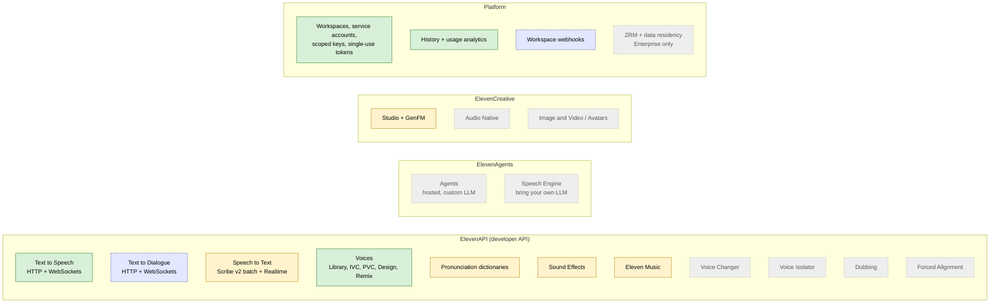
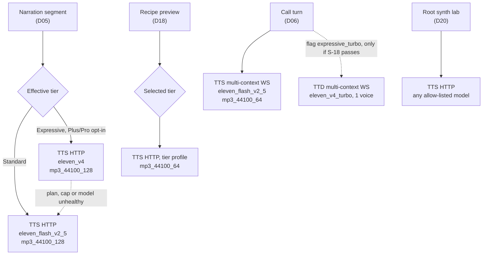
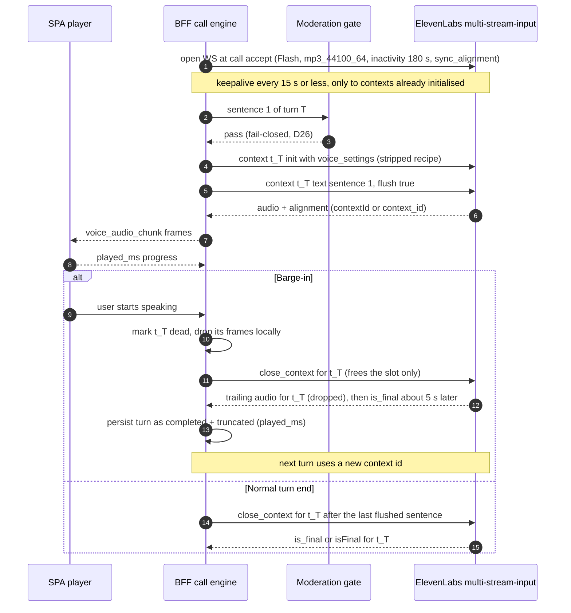

# ElevenLabs capabilities and fit for magic-worlds

- **Date:** 2026-10-12
- **Status:** Proposed (see [03](03_target_architecture_and_decisions.md) for sign-off status)

## Scope

This document records what ElevenLabs offers on 2026-10-12, how each capability behaves on the API, and whether and where magic-worlds uses it. It covers:
- the models and the speech APIs;
- streaming, expressiveness and voices;
- speech to text, the Agents platform and the other products;
- the platform rules: plans, concurrency, keys, data handling, webhooks, SDKs and reliability.

It is a **capability reference for plan authors. It makes no decisions.**
- Every statement about adoption cites the decision in [03](03_target_architecture_and_decisions.md) that makes it, as (Dnn).
- **03 is the source of truth.** Where this document and 03 disagree, 03 wins and this document is wrong.
- Facts that still depend on a staging spike (S-n, [03 §6.1](03_target_architecture_and_decisions.md)) or on a written answer from ElevenLabs (L-n, [03 §6.2](03_target_architecture_and_decisions.md)) are labelled **Not yet certain**.
- All prices, model facts, limits and plan figures are **as of 2026-10-12**, at list price. The `eleven_v4` launch promo ("72% off until Oct 12") ends today and is never used for sizing.

It was written read-only: no API key was used and no paid API was called.

Out of scope, each covered elsewhere:
- the catalog design ([04](04_voice_catalog_and_library.md));
- the user Studio and the root console ([05](05_voice_studio_and_admin_console.md));
- implementation steps ([08](08_backend_refactor_plan.md), [09](09_frontend_refactor_plan.md));
- migration ([10](10_data_migration_and_rollout.md));
- the full cost model ([11](11_cost_plans_and_operations.md)).

## Related documents

| Document | Relationship |
|---|---|
| [README](README.md) | Index of the voice refactor document set |
| [01 Current state](01_current_state.md) | The MiniMax baseline that §12 compares against |
| [03 Target architecture and decisions](03_target_architecture_and_decisions.md) | **Source of truth.** Decisions D01–D38, canonical definitions §5, spikes S-1…S-29, legal items L-1…L-16 (there is no L-11) |
| [04 Voice catalog and library](04_voice_catalog_and_library.md) | Full treatment of the voice topics summarised in §6 |
| [05 Voice Studio and admin console](05_voice_studio_and_admin_console.md) | How the per-model controls in §2.5 and the voice-creation APIs in §6 surface in the UI |
| [06 Chat narration migration](06_chat_narration_migration.md) | Narration on TTS HTTP (§3, §4) |
| [07 Realtime calls migration](07_realtime_calls_migration.md) | Calls on the multi-context WebSocket (§5.4, §5.5) |
| [08 Backend refactor plan](08_backend_refactor_plan.md) | Adapters, resolver, sanitizer, error mapping |
| [09 Frontend refactor plan](09_frontend_refactor_plan.md) | Player, Studio controls, capability endpoint |
| [10 Data migration and rollout](10_data_migration_and_rollout.md) | R0–R5 and the per-phase gates |
| [11 Cost, plans and operations](11_cost_plans_and_operations.md) | Prices and plan limits from §10 applied to our load |
| [12 Best practices and improvements](12_best_practices_and_improvements.md) | The P1–P3 features of the FIT table (§11) |
| [13 Policy, privacy and compliance](13_policy_privacy_and_compliance.md) | PUP, OEM, ZRM, retention and consent (§10.5, §10.9) |
| [14 Staging spike and contract tests](14_staging_spike_and_contract_tests.md) | How every "Not yet certain" item here gets settled |
| [15 Implementation plan and acceptance](15_implementation_plan_and_acceptance.md) | Sequencing |
| [16 Risks and open questions](16_risks_and_open_questions.md) | Risk register; Appendix A feeds it |

Research notes this document condenses:
- [research 01](research/01_elevenlabs_tts_models_and_api.md): models, TTS API, settings, tags, pauses, pronunciation.
- [research 02](research/02_elevenlabs_streaming_dialogue_realtime_agents.md): streaming, Text to Dialogue, Scribe Realtime, Agents and Speech Engine.
- [research 03](research/03_elevenlabs_voices_catalog_cloning_design.md): voices, Library, cloning, Design, Remix.
- [research 04](research/04_elevenlabs_other_products.md): other products, history and ops endpoints.
- [research 05](research/05_elevenlabs_platform_pricing_limits_policy.md): plans, limits, keys, privacy, SDKs, reliability.
- [research 10](research/10_gap_policy_licensing.md): licensing and policy.
- [research 11](research/11_gap_catalog_api_semantics.md): catalog API semantics.
- [research 12](research/12_gap_model_protocol_facts.md): endpoint × model facts, settings, protocols, contract tests CT-01…CT-20.
- [research 14](research/14_cost_model.md): the cost model.

### Evidence conventions

- **Sources.** Facts come from the research notes, which tag each one as `[verified]` (official page read 2026-10-12), `[secondary]` (third-party live observation) or `[unverified]`. This document keeps the tag only where the difference matters.
- **Not yet certain (S-n)** or **(L-n)** marks a fact that a spike or a written confirmation still has to settle. Appendix A lists every one.
- **Research links** point to the note and section, e.g. [research 12 §2](research/12_gap_model_protocol_facts.md).
- **Code links** are absolute paths with line numbers. Each was checked against the working trees on 2026-10-12.
- **Contradictions and gaps.** C-numbers (C1–C18) refer to contradictions resolved in [03 §3.1](03_target_architecture_and_decisions.md). G-numbers (G1–G17) refer to the research critic's gaps in [research 09](research/09_research_critic_gaps.md).

---

## 1. Product map

ElevenLabs sells four product families on one workspace and one bill. magic-worlds talks to the developer API (ElevenAPI) and to the platform surfaces. It uses nothing from ElevenCreative at launch (the sales-gated Studio API is a P3 candidate, D29) and rejects ElevenAgents (D06).



Legend:
- green: P0, used from the migration;
- yellow: a later phase (P1–P3, D29);
- blue dashed: a flagged or optional surface that is off at launch (v4 Turbo calls over TTD until S-18; the voice-removal webhook until S-12 and public ingress);
- grey: not adopted.

| Family | Product | API surface | magic-worlds status | Section |
|---|---|---|---|---|
| ElevenAPI | Text to Speech | `POST /v1/text-to-speech/{voice_id}` (+ `/stream`, `/with-timestamps`); WS `stream-input`, `multi-stream-input` | **P0**: narration, previews and lab on HTTP (D05, D18, D20); calls on multi-context WS (D06) | §3, §5.4 |
| ElevenAPI | Text to Dialogue (TTD) | `POST /v1/text-to-dialogue` (+ variants); WS `stream-input`, `multi-stream-input` | Not used for narration (D05). `eleven_v4_turbo` calls over TTD WS are a flagged upgrade (D06, S-18) | §5.6, §5.7 |
| ElevenAPI | Speech to Text (Scribe v2) | `POST /v1/speech-to-text`; WS `/v1/speech-to-text/realtime` | Groq stays for calls (D07). Scribe is a P1 dictation candidate and a stage-2 call option (S-19) | §7 |
| ElevenAPI | Voices | `/v2/voices`, `/v1/shared-voices`, `/v1/voices/add…`, `/v1/text-to-voice/…` | **P0**: catalog sync Jobs A/B (`CATALOG` key) and the root console (`ADMIN` key); users never call these endpoints (D09, D10, D19, D20) | §6 |
| ElevenAPI | Pronunciation dictionaries | `/v1/pronunciation-dictionaries/…` | P1 (D29) | §4.5 |
| ElevenAPI | Sound Effects | `POST /v1/sound-generation` | P2 ambience, P3 per-turn (D29) | §9.3 |
| ElevenAPI | Eleven Music | `POST /v1/music` (+ variants) | P2, legal-gated (D29); fal `minimax/music-3` is out of scope (D01) | §9.4 |
| ElevenAPI | Voice Changer, Voice Isolator, Dubbing, Forced Alignment | `/v1/speech-to-speech`, `/v1/audio-isolation`, `/v1/dubbing`, `/v1/forced-alignment` | Not adopted (D29 skip list or no decision) | §9 |
| ElevenAgents | Agents, Speech Engine | Agents API; inverted WS to our endpoint | Rejected (D06) | §8 |
| ElevenCreative | Studio (+ GenFM), Audio Native, Avatars | Studio API (sales-gated); Audio Native API; Avatars have no API | Studio P3 (D29); the rest skipped | §9 |
| Platform | Keys, service accounts, history, analytics, webhooks | `/v1/service-accounts`, `/v1/history`, `/v1/workspace/analytics/…`, `/v1/workspace/webhooks` | **P0** ops hygiene (D04, D25, D29, D37); the voice-removal webhook is optional and off until S-12 (D10) | §9.8, §9.9, §10 |
| Platform | ZRM, data residency | `enable_logging=false`; `api.{eu,in,sg}.residency…` | Not at launch: Enterprise only (D02, D25) | §10.4, §10.5 |

---

## 2. Model lineup

### 2.1 Speech (TTS) models, as of 2026-10-12

`eleven_v4` and `eleven_v4_turbo` launched on 2026-09-28. Prices are list prices [research 14 §2.1](research/14_cost_model.md).

| Model id | Role | Languages | Max chars per request | Published latency (model only) | List price per 1K chars | Surfaces | Our profile (03 §5.4.1) |
|---|---|---|---|---|---|---|---|
| `eleven_v4` | Flagship, most expressive | 90+ | 10,000 | not published | $0.08 (promo $0.022 ends 2026-10-12) | TTS HTTP, TTD HTTP, TTD WS (≤ 10 voices), TTD multi-context | `el_v4`: narration/expressive, preview |
| `eleven_v4_turbo` | Realtime, expressive | 90+; also accepts `yue`, `zh` | **not listed** (CT-01) | ~100 ms median | $0.04 (promo $0.011) | TTD WS (exactly 1 voice), TTD multi-context; TTS HTTP works live but is undocumented (S-2) | `el_v4_turbo`: flagged call option |
| `eleven_v3` | Previous-generation expressive | 70+ | 5,000 | not published | $0.08 | TTS HTTP, TTD HTTP (its default), TTD WS (≤ 10 voices) | `el_v3`: admin lab only |
| `eleven_v3_conversational` | Previous-generation realtime | 70+ | not listed | ~280 ms | $0.04 | TTD WS (its default; 1 voice) | none (catalog allow-list only) |
| `eleven_multilingual_v2` | Stable long-form | 29 | 10,000 | not published | $0.08 | TTS HTTP, TTS WS; **the default `model_id` of the TTS endpoints** | `el_multilingual_v2`: admin lab only |
| `eleven_flash_v2_5` | Fastest, multilingual | 32 | 40,000 | ~75 ms; 100–150 ms time to first byte in NA/EU | $0.04 | TTS HTTP, TTS WS | `el_flash_v2_5`: narration/standard, preview, call |
| `eleven_flash_v2` | Fastest, English only | `en` | 30,000 | ~75 ms | $0.04 | TTS HTTP, TTS WS | none (catalog allow-list only) |

Sources: [research 01 §1.1](research/01_elevenlabs_tts_models_and_api.md), [research 12 §3](research/12_gap_model_protocol_facts.md), [research 05 §9.3](research/05_elevenlabs_platform_pricing_limits_policy.md).

- **ElevenLabs' own guide:** `eleven_v4` for quality, `eleven_v4_turbo` for low latency, Flash for lowest latency.
- **2026-10-05:** v4 became the default conversational model for Agents [research 01 §1.3](research/01_elevenlabs_tts_models_and_api.md).
- **Speech Engine TTS default:** `eleven_v4_turbo` [research 12 §9](research/12_gap_model_protocol_facts.md).

### 2.2 Other model families

| Purpose | Model ids | Notes | Our use |
|---|---|---|---|
| Voice Design / Remix | `eleven_multilingual_ttv_v2` (API default), `eleven_ttv_v3` | `eleven_ttv_v3` accepts reference audio | `eleven_ttv_v3` in the root console (D09, D20) |
| Voice Changer (STS) | `eleven_multilingual_sts_v2`, `eleven_english_sts_v2` | Multilingual often outperforms English, even for English | none |
| Speech to Text | `scribe_v2`, `scribe_v2_realtime` (`scribe_v2_medical` exists) | `scribe_v1` is deprecated; removal was scheduled for 2026-07-09 (§2.3) | P1 dictation candidate; stage-2 calls (D07) |
| Sound Effects | `eleven_text_to_sound_v2` | The only allowed value | P2 (D29) |
| Music | `music_v1` (still the API default), `music_v2`, `music_v2_5` | Always pass `model_id` | P2, legal-gated (D29) |
| Dubbing | `dubbing_v1`, `dubbing_v2` (alpha, default) | | skip (D29) |

### 2.3 Deprecated and removed models

| Model id | Status | Replacement | Our handling |
|---|---|---|---|
| `eleven_monolingual_v1`, `eleven_multilingual_v1` | **Removal scheduled for 2026-07-09** (notice 2026-06-08); the models page no longer lists them. Treat as removed | `eleven_multilingual_v2` | never configured |
| `scribe_v1` | **Removal scheduled for 2026-07-09** (same notice); still listed under "Deprecated models", actual removal not confirmed [research 02 §9](research/02_elevenlabs_streaming_dialogue_realtime_agents.md). Treat as removed | `scribe_v2` | never configured |
| `eleven_turbo_v2_5` | Deprecated, "functionally equivalent" to Flash v2.5 but slower; no removal date | `eleven_flash_v2_5` | mapped to `eleven_flash_v2_5` before the catalog `verified_languages` filter (03 §5.4.1) |
| `eleven_turbo_v2` | Deprecated, as above | `eleven_flash_v2` | mapped to `eleven_flash_v2` likewise |
| `eleven_v3` | Current but "previous generation" | `eleven_v4` | lab only |

`GET /v1/models` deprecated the fields `max_characters_request_free_user` and `max_characters_request_subscribed_user` on 2026-09-28 ("not enforced"). Use `maximum_text_length_per_request` instead [research 05 §9.4](research/05_elevenlabs_platform_pricing_limits_policy.md).

### 2.4 Endpoint × model support matrix

This is the definitive matrix from [research 12 §2](research/12_gap_model_protocol_facts.md), copied with its legend.
- **Yes (doc):** documented [verified].
- **Yes (live):** a third party reports a successful live call [secondary].
- **No (doc):** documented as unsupported.
- **No (400):** rejected with `unsupported_model`.
- **?:** neither documented nor probed.
- **Bold (S-n)** marks a cell we rely on that is **not yet certain** on our account.

| Endpoint | `eleven_v4` | `eleven_v4_turbo` | `eleven_v3` | `eleven_multilingual_v2` | `eleven_flash_v2_5` | `eleven_turbo_v2_5` (legacy) |
|---|---|---|---|---|---|---|
| `POST /v1/text-to-speech/{voice_id}` (convert) | Yes (doc); live 200. **(S-2)** on our account | Yes (live); not documented. **(S-2)** | Yes (doc) | Yes (doc), default model | Yes (doc) | Yes (doc, legacy) |
| `POST …/{voice_id}/stream` | Yes (doc) | Yes (live), on the `/stream/with-timestamps` variant | Yes (doc) | Yes (doc) | Yes (doc) | Yes (doc) |
| `POST …/{voice_id}/with-timestamps` | Yes (live): `alignment` + `normalized_alignment`, tag characters included | ? | Yes (live) | Yes (doc) | Yes (doc) | Yes (doc) |
| `POST …/{voice_id}/stream/with-timestamps` | Yes (live) | Yes (live) | Yes (live) | Yes (doc) | Yes (doc) | Yes (doc) |
| WS `/v1/text-to-speech/{voice_id}/stream-input` | **No (doc)**; **No (400)** | **No (400)** | **No (doc)** | Yes (doc) | Yes (doc) | Yes (doc) |
| WS `/v1/text-to-speech/{voice_id}/multi-stream-input` | **No (400)** `unsupported_model` | **No (400)** | No (doc); `eleven_v3_conversational` returns 400 | Yes (doc) | Yes (doc), 101 live. **(S-7)** for our protocol details | Yes (doc) |
| `POST /v1/text-to-dialogue` (+ `/stream`, `/with-timestamps`, `/stream/with-timestamps`) | **Yes (doc)** | Yes (live) on `/stream` | Yes (doc), default `eleven_v3` | ? (TTD is documented for the v3/v4 families only) | ? (TTD WS returns **403**; HTTP is CT-04) | ? |
| WS `/v1/text-to-dialogue/stream-input` | **Yes (doc)**, up to 10 voices | **Yes (doc)**, **exactly 1 voice**. **(S-18)** for our use | Yes (doc); default `eleven_v3_conversational` (1 voice) | **No (doc)**: `model_id` must start with `eleven_v3` or `eleven_v4` | No (doc); **403** live | No (doc) |
| WS `/v1/text-to-dialogue/multi-stream-input` | Yes (live), barge-in through new contexts | Yes (live). **(S-18)** | Yes (doc) | No (doc) | No (doc) | No (doc) |
| `POST /v1/flows/text-to-speech` (added 2026-08-17) | **No** (union is Flash v2.5, Multilingual v2, v3) | No | Yes (doc) | Yes (doc) | Yes (doc) | No |
| Speech Engine / Agents TTS config (`tts.model_id`) | Yes (doc) | Yes (doc), **the Speech Engine default** | Yes (doc) | Yes (doc) | Yes (doc) | Yes (doc) |

Notes, from [research 12 §2](research/12_gap_model_protocol_facts.md):

1. **Stale reference pages.** The TTD WebSocket and TTD multi-context AsyncAPI pages still say "Eleven v3 dialogue models only". The TTD guide, the TTS-vs-TTD page and live use of v4 and v4_turbo contradict them. Treat the reference pages as stale.
2. **What the TTS socket returns for the v4 family.** An HTTP 400 at the WebSocket upgrade, not a close frame:

   ```json
   {"detail":{"type":"validation_error","code":"unsupported_model","message":"Model 'eleven_v4' is not supported on the text-to-speech websocket endpoint. Use the text-to-dialogue websocket endpoint instead."}}
   ```

   03 §5.8 maps it to a configuration error, never retried.
3. **Concurrency metering differs by endpoint:**
   - HTTP TTS and HTTP TTD count against the plan's concurrency while generating.
   - The TTS WebSocket counts **only generation time**.
   - Each open TTD WebSocket (single or multi-context) holds **one dialogue session for its whole life**: Pro 70, Scale and Business 105. Over the limit the connection is rejected with `too_many_concurrent_requests`. It is not queued.
4. `eleven_flash_v2` is not in the research matrix. It behaves like `eleven_flash_v2_5` on every surface, but is English only.

### 2.5 Voice settings × model behaviour

There are five settings: `stability`, `similarity_boost`, `style`, `use_speaker_boost` and `speed`. Each endpoint family declares a different subset, and each model honours a different subset. Unsupported values are often **accepted and silently ignored**, which is worse than a 400 because the reuse hash and the Studio would then lie.

#### 2.5.1 What each schema declares

| Schema (endpoint) | stability | similarity | style | use_speaker_boost | speed | Strict? |
|---|---|---|---|---|---|---|
| `VoiceSettingsResponseModel` (TTS HTTP) | 0–1, default 0.5 | `similarity_boost` 0–1, default 0.75 | **no bounds**, default 0 | bool, default true | **no bounds**, default 1.0 | No |
| `RealtimeVoiceSettings` (TTS WS, first message only) | 0–1 | `similarity_boost` 0–1 | "V2+ models" | "V2+ models" | 0.7–1.2 | — |
| `ToDialogueSettingsResponseModel` (TTD HTTP, **one global object**) | 0–1 | **`similarity`** (not `similarity_boost`) 0–1, "not supported by every model" | — | — | — | `DialogueInput` is only `{text, voice_id}`: **no per-input settings** |
| `TextToDialogueWebsocketVoiceSettings` (TTD WS, first message only) | 0–1 | — | — | — | — | "Only `stability` is supported" |
| Flows TTS per-model unions | v3: stability only. Flash v2.5: stability, similarity_boost, speed 0.7–1.2. Multilingual v2: all five, style 0–1, speed 0.7–1.2 | | | | | Yes (`additionalProperties: false`) |

Source: [research 12 §4.1](research/12_gap_model_protocol_facts.md).

#### 2.5.2 Observed behaviour per model on TTS HTTP

| Model | stability | similarity_boost | style | use_speaker_boost | speed |
|---|---|---|---|---|---|
| `eleven_v4`, `eleven_v4_turbo` | Honoured | Honoured | **Accepted, ignored** (same byte count) [secondary]. **Not yet certain (S-3)** | Accepted; `GET /v1/models` reports `can_use_speaker_boost: false`; treat as ignored | **Accepted, ignored** [secondary]. **Not yet certain (S-3)** |
| `eleven_v3` | Honoured. Whether it snaps to three stops (Creative/Natural/Robust) is **not yet certain (S-3, CT-06)** | "Not available" in the playground; ignored or rejected over the API is **not yet certain (S-3, CT-05)** | `can_use_style: false`; likely ignored | Not available in the playground | "Not available"; `speed: 1.5` returned 200 with no confirmed effect |
| `eleven_multilingual_v2` | Honoured | Honoured | Honoured, 0–1 | Honoured | Honoured **within 0.7–1.2**. Outside it: **400 `invalid_voice_settings`, no clamping** [secondary] |
| `eleven_flash_v2_5` | Honoured | Honoured | "Flash ignores some settings"; absent from the Flows Flash schema. **Not yet certain (S-3)** | Absent from the Flows Flash schema; likely ignored. **Not yet certain (S-3)** | 0.7–1.2. Out-of-range behaviour (400 or ignored) is **not yet certain (S-3, CT-05)** |

Source: [research 12 §4.2](research/12_gap_model_protocol_facts.md).

**Speed range.** 0.7–1.2 appears in every official schema that bounds speed. 0.25–4.0 appears only in ElevenLabs' agent-skills repository, and the live 400 on Multilingual v2 contradicts it. 03 therefore validates speed at **0.7–1.2** at write time and strips it at request time where the model ignores it (D13).

**Stored settings are account-wide.** `GET /v1/voices/{voice_id}/settings` and `POST /v1/voices/{voice_id}/settings/edit` change the voice's stored defaults for every user of the workspace. Per-character recipes are therefore always sent per request, never stored there [research 01 §3.4](research/01_elevenlabs_tts_models_and_api.md).

#### 2.5.3 Fields the resolver sends

This is the per-model allow-list from [research 12 §4.2](research/12_gap_model_protocol_facts.md), which 03 §5.6 (§2.6 below) adopts for the profiles we use:

| Model / endpoint | Send | Strip |
|---|---|---|
| `eleven_v4`, `eleven_v4_turbo` (TTS HTTP) | `stability`, `similarity_boost` | `style`, `speed`, `use_speaker_boost` |
| `eleven_v3` (TTS HTTP) | `stability` | everything else |
| `eleven_multilingual_v2` | all five; speed 0.7–1.2, style 0–1 | — |
| `eleven_flash_v2_5` | `stability`, `similarity_boost`, `speed` 0.7–1.2 | `style`, `use_speaker_boost` |
| TTD HTTP (any model) | one global `settings: {stability, similarity}` | all per-character settings |
| TTD WS | first-message `voice_settings: {stability}` | everything else |

### 2.6 Canonical capability matrix (copied verbatim from 03 §5.6)

| Model profile | Transport | Settings **sent** (others stripped) | Speed | Audio tags | `<break>` | `language_code` | Max chars per request | Concurrency pool |
|---|---|---|---|---|---|---|---|---|
| `el_flash_v2_5` (narration/standard, preview) | TTS HTTP | `stability`, `similarity_boost`, `speed` | 0.7–1.2 | no | yes (≤ 3 s) | allow-listed only (400 if unsupported) | 40,000 (we cap 1,200) | `flash` |
| `el_flash_v2_5` (call) | TTS multi-context WS | same, first message of each context only | 0.7–1.2 | no | S-26 | allow-listed, query parameter | streamed | `flash` (generation time only) |
| `el_v4` (narration/expressive, preview) | TTS HTTP | `stability`, `similarity_boost` | stripped | yes | no | allow-listed | 10,000 (we cap 1,200) | `non_flash` |
| `el_v4_turbo` (call option) | TTD WS (1 voice) | `stability`, first message only | stripped | yes | no | allow-listed (`yue`, `zh` ok) | streamed | TTD session per call |
| `el_multilingual_v2` (lab only) | TTS HTTP | all five; `style` 0–1 | 0.7–1.2 | no | yes | **never sent** | 10,000 | `non_flash` |
| `el_v3` (lab only) | TTS HTTP | `stability` | stripped | yes | no | allow-listed | 5,000 | `non_flash` |

Common request fields: `seed`, `apply_text_normalization: "auto"`, `output_format` per §5.4.1. No `previous_request_ids`. `previous_text`/`next_text` are off until S-17. The authoritative per-model `max_chars` and language lists come from `GET /v1/models` (`maximum_text_length_per_request`, `languages[]`) at startup. A configured model missing from that response fails readiness.

The 03 §5.4.1 rows that this matrix depends on, copied verbatim:

| Enum | Values |
|---|---|
| `tts_job.model_alias` (app alias → `provider_model_id`) | `el_flash_v2_5` → `eleven_flash_v2_5`; `el_v4` → `eleven_v4`; `el_v4_turbo` → `eleven_v4_turbo`; `el_multilingual_v2` → `eleven_multilingual_v2`; `el_v3` → `eleven_v3`; legacy `speech_2_8_turbo` → `speech-2.8-turbo` |
| Default model profiles | `narration/standard` → `el_flash_v2_5`; `narration/expressive` → `el_v4` (fallback: `narration/standard`, billed at Standard weight); `call` → `el_flash_v2_5` (flagged option `el_v4_turbo` via TTD WS); `preview` → the profile of the selected tier; `admin_lab` → any allow-listed model |
| Catalog model allow-list (`verified_languages` filter) | `eleven_v4`, `eleven_v4_turbo`, `eleven_v3`, `eleven_v3_conversational`, `eleven_multilingual_v2`, `eleven_flash_v2_5`, `eleven_flash_v2`; `eleven_turbo_v2_5` → `eleven_flash_v2_5` and `eleven_turbo_v2` → `eleven_flash_v2` before filtering |
| Output formats | narration and stored: `mp3_44100_128`; calls: `mp3_44100_64`; previews: `mp3_44100_64` |

Two things follow from the matrix:
- The `el_v4` row rests on S-2 (v4 on TTS HTTP on our account).
- The `el_flash_v2_5` (call) `<break>` cell rests on S-26.

### 2.7 Runtime model discovery: `GET /v1/models`

`ModelResponseModel` fields [research 01 §1.4](research/01_elevenlabs_tts_models_and_api.md):
- `model_id`, `name`, `description`;
- `can_do_text_to_speech`, `can_do_voice_conversion`, `can_be_finetuned`;
- `can_use_style`, `can_use_speaker_boost`, `serves_pro_voices`;
- `token_cost_factor`, `model_rates.character_cost_multiplier`, `model_rates.cost_discount_multiplier`;
- `maximum_text_length_per_request`;
- `languages[] {language_id, name}`;
- `concurrency_group`, `requires_alpha_access`.

Uses in magic-worlds:
- **Readiness.** Every configured model must be listed, checked with the `CATALOG` key (D04). A missing Expressive model degrades narration to Standard; a missing Standard model makes narration unhealthy.
- **Per-model language allow-list** for `language_code` (D17).
- **Text cap.**
- **Concurrency pool** (`concurrency_group`).

CT-01 reads the unknowns for free:
- the `eleven_v4_turbo` character limit;
- the `eleven_v4_turbo` concurrency pool;
- each model's language set.

---

## 3. TTS HTTP API

### 3.1 Hosts and authentication

| Host | Use |
|---|---|
| `https://api.elevenlabs.io` / `wss://api.elevenlabs.io` | Default, global routing to the nearest region (US, Netherlands, Singapore) since 2026-02 |
| `https://api.us.elevenlabs.io` | Pins the US. Our ops switch on `ELEVENLABS_BASE_URL` (03 §5.4.3) |
| `https://api.{eu,in,sg}.residency.elevenlabs.io` | Enterprise isolated residency: separate workspace, keys and voices. Not used (D02) |

- **REST auth** is the `xi-api-key` header. MiniMax used `Authorization: Bearer` [research 05 §4.1](research/05_elevenlabs_platform_pricing_limits_policy.md).
- **WebSocket auth** is the `xi-api-key` header, the first message, or the `authorization` / `single_use_token` query parameter.
- **Single-use tokens** (`sutkn_…`) exist for browser use. We do not use them: the key stays in the BFF (§10.3).

### 3.2 Endpoints

| Method and path | Returns | Notes |
|---|---|---|
| `POST /v1/text-to-speech/{voice_id}` | Raw binary audio | Accepts `wav_*`. **Our narration, preview and lab endpoint** (D05, D18, D20) |
| `POST /v1/text-to-speech/{voice_id}/stream` | Raw audio, chunked transfer | **No `wav_*`**. One latency guide calls it "server-sent events", but it is raw bytes |
| `POST /v1/text-to-speech/{voice_id}/with-timestamps` | JSON `{audio_base64, alignment, normalized_alignment}` | Character times in seconds (§5.8). P2 word highlight (D29) |
| `POST /v1/text-to-speech/{voice_id}/stream/with-timestamps` | Stream of JSON chunks, same shape | |
| `POST /v1/text-to-dialogue` (+ the same three variants) | Audio, or JSON with `voice_segments` | Multi-voice, v3/v4 family. Not used for narration (D05). §5.6 |

Source: [research 01 §2.2](research/01_elevenlabs_tts_models_and_api.md).

### 3.3 Query parameters (TTS HTTP)

| Parameter | Type / default | Semantics | magic-worlds use |
|---|---|---|---|
| `output_format` | enum, default `mp3_44100_128` | `codec_samplerate_bitrate` (§3.5) | Always sent, per 03 §5.4.1 |
| `enable_logging` | bool, default `true` | `false` = Zero Retention Mode: no history, **no request stitching**. Enterprise only | Not sent. The adapter flag `ELEVENLABS_ENABLE_LOGGING` stays unset until ZRM is granted (D25) |
| `optimize_streaming_latency` | int 0–4, **deprecated** | 4 also turns the normalizer off | Never sent |

### 3.4 Body parameters (the same on all four TTS HTTP endpoints)

| Field | Type / default | Semantics and limits | magic-worlds use |
|---|---|---|---|
| `text` | string, required | Text to speak | Output of the shared `SpeechTextPipeline` (03 §5.5.3). Per-segment cap 1,200 chars (03 §5.6, §5.9) |
| `model_id` | string, default **`eleven_multilingual_v2`** | Must have `can_do_text_to_speech` | **Always sent** from the capability registry (D05). Omitting it silently selects multilingual_v2 |
| `language_code` | ISO 639-1, nullable | "Enforces" language and normalization. Docs say unsupported codes are ignored; Flash returns 400 instead. Not supported on multilingual_v2 | Per D17 and 03 §5.7 (§4.7) |
| `voice_settings` | object, nullable | Per-request override of the stored settings | Stripped per profile (§2.6, D13) |
| `pronunciation_dictionary_locators` | list of `{pronunciation_dictionary_id, version_id?}` | **Up to 3**, applied in order; latest version if `version_id` is omitted | P1 (D29); version ids enter the reuse hash (03 §5.6) |
| `seed` | int 0–4294967295 | Best-effort determinism, "not guaranteed" | Stable 32-bit hash of `(job_id)` (D05) |
| `previous_text` / `next_text` | string | Continuity context | **Off until S-17** (D05). v3 reportedly rejects `previous_text` (CT-19) |
| `previous_request_ids` / `next_request_ids` | list, max 3 | Continuity from earlier or later generations; overrides the text fields | **Never** (D05, D25): ZRM-incompatible |
| `use_pvc_as_ivc` | bool, default false | Use a PVC's IVC version for latency or expressiveness. No longer deprecated (2026-09-28) | Not sent |
| `apply_text_normalization` | `auto` / `on` / `off`, default `auto` | Spell out numbers, dates and similar | `"auto"`, sent explicitly (03 §5.6, D27) |
| `apply_language_text_normalization` | bool, default false | Japanese only; "can heavily increase the latency" | Not sent |

Source: [research 01 §2.3–§2.4](research/01_elevenlabs_tts_models_and_api.md).

### 3.5 Output formats

| Codec | Values | Plan gating | Notes |
|---|---|---|---|
| MP3 | `mp3_22050_32`, `mp3_24000_48`, `mp3_44100_32`, `mp3_44100_64`, `mp3_44100_96`, `mp3_44100_128` (default), `mp3_44100_192` | 192 kbps needs Creator+ | **No 32 kHz MP3** |
| PCM s16le (raw, no header) | `pcm_8000` … `pcm_48000` (8, 16, 22.05, 24, 32, 44.1, 48 kHz) | 44.1 kHz needs Pro+ | |
| WAV | `wav_8000` … `wav_48000` | 44.1 kHz needs Pro+ | **Not on `/stream`** |
| Opus | `opus_48000_32`, `_64`, `_96`, `_128`, `_192` | — | Container undocumented |
| Telephony | `ulaw_8000`, `alaw_8000` | — | |
| FLAC | — | — | **Not offered**. The MiniMax admin lab offered it |

Source: [research 01 §4](research/01_elevenlabs_tts_models_and_api.md).

Our choices (03 §5.4.1, verbatim): narration and stored: `mp3_44100_128`; calls: `mp3_44100_64`; previews: `mp3_44100_64`. The call choice keeps the existing MSE `audio/mpeg` player (D08). PCM with an AudioWorklet is deferred unless S-8 misses the latency target.

### 3.6 Response bodies

| Endpoint | Body |
|---|---|
| convert, `/stream` | Raw audio in the requested format. No JSON envelope and no hex. MiniMax returned hex inside JSON: [/home/andres/PycharmProjects/magic-worlds-api/src/services/tts_generation/registry.py:27](/home/andres/PycharmProjects/magic-worlds-api/src/services/tts_generation/registry.py#L27) |
| `/with-timestamps` | `audio_base64`; `alignment` and `normalized_alignment`, each `{characters[], character_start_times_seconds[], character_end_times_seconds[]}`. `normalized_alignment` refers to the normalized text, e.g. digits spelled out |
| TTD `/with-timestamps` | The above plus `voice_segments[] {voice_id, start_time_seconds, end_time_seconds, character_start_index, character_end_index, dialogue_input_index}` |

### 3.7 Response headers

| Header | Status | Use in magic-worlds |
|---|---|---|
| `request-id` | Documented on TTS responses | Stored on each job (D25 item 5). Support asks for it. Fall back to `x-request-id`, then `detail.request_id` |
| `x-trace-id` | Documented | Logged |
| `x-region` | Documented | Logged; stored on the job (D25) |
| `character-cost` | Shown on TTS in the API introduction. The OpenAPI declares it only on `/v1/sound-generation`. **Absent on WebSockets** | Reconciliation. Whether it equals input length including tags is **not yet certain (S-17)**. We meter by our own count either way (D24) |
| `current-concurrent-requests`, `maximum-concurrent-requests` | Documented | Back-pressure metrics |
| `Retry-After` | **Undocumented** | Honoured if present, capped at 5 s (03 §5.8). Presence **not yet certain (S-24, CT-16)** |
| `x-character-count` | No official source | Not used |

Source: [research 12 §11](research/12_gap_model_protocol_facts.md).

### 3.8 Errors

The error envelope is `{"detail": {"type", "code", "message", "status" (legacy), "request_id", "param"}}`. Branch on `detail.code` first, then on the legacy `detail.status`.

| HTTP | Codes that matter |
|---|---|
| 400 `validation_error` | `invalid_voice_settings` (check `param`), `invalid_voice_id`, `unsupported_model`, `text_too_long`, `invalid_output_format`, unsupported `language_code` on Flash |
| 401 | `invalid_api_key`, `missing_api_key`. **`quota_exceeded` has been observed as 401**, not 402 |
| 402 | `payment_required` / `insufficient_credits` |
| 403 | `insufficient_permissions` (key scope), `voice_access_denied`, `model_access_denied`, IP not on the allow-list |
| 404 | `voice_not_found`, `model_not_found` |
| 409 | `voice_already_exists`, `already_processing`, `concurrent_modification` (retry only this one) |
| 422 | FastAPI validation `detail[]` |
| 429 `rate_limit_error` | `rate_limit_exceeded`, `concurrent_limit_exceeded` (legacy `too_many_concurrent_requests`), `system_busy` |
| 500 / 503 | `internal_error`, `service_unavailable`, `maintenance` |

Sources: [research 05 §3.4](research/05_elevenlabs_platform_pricing_limits_policy.md), [research 12 §11](research/12_gap_model_protocol_facts.md).

- **No moderation error code exists.** Enforcement is asynchronous and account-level [research 10 §3](research/10_gap_policy_licensing.md). The shapes of moderation and ban signals are **not yet certain (L-6)**.
- The mapping to our narration and call categories, retry classes, refunds and circuit breakers is canonical in **03 §5.8**. This document does not restate it.

### 3.9 Limits and segment sizing

| Limit | Provider value | Our cap (03 §5.6, §5.9) |
|---|---|---|
| Characters per request | v4 10,000; v3 5,000; multilingual_v2 10,000; Flash v2.5 40,000; v4_turbo not listed | 1,200 per segment on every model |
| Per narrated turn | none | 2,500 chars / 12 segments / 1,200 chars per segment, never above the remaining daily cap |
| TTD HTTP | ≤ 10 unique voices; keep total `inputs[].text` ≤ 2,000 chars or it "can terminate early … or return a validation error" (CT-04) | not used |
| Pronunciation dictionaries | ≤ 3 per request | P1 |
| Request ids for stitching | ≤ 3, ≤ 2 h old | not used |

Today's MiniMax path allows 32 segments × 3,000 chars (96,000 chars per turn):
- segment count: [/home/andres/PycharmProjects/magic-worlds-api/src/services/chat_segments.py:15](/home/andres/PycharmProjects/magic-worlds-api/src/services/chat_segments.py#L15);
- segment length: [/home/andres/PycharmProjects/magic-worlds-api/src/routes/user/route_chat.py:155](/home/andres/PycharmProjects/magic-worlds-api/src/routes/user/route_chat.py#L155).

The provider limits are far above our caps, so the caps are set by cost (D24), not by ElevenLabs.

---

## 4. Expressiveness

### 4.1 Audio tags on v3, v4 and v4 Turbo

- **What they are.** Inline square-bracket instructions: "natural-language instructions, not an enum parameter". Any `[…]` is a candidate instruction. Tags can be combined, and they apply until the delivery shifts.
- **Documented examples by category:**
  - emotion: `[sad]`, `[angry]`, `[happily]`, `[excited]`, `[sarcastic]`;
  - delivery: `[whispers]`, `[shouts]`, `[softly]`, `[short pause]`, `[long pause]`;
  - reactions: `[laughs]`, `[sighs]`, `[gasps]`, `[inhales deeply]`, `[exhales]`;
  - dialogue flow: `[interrupting]`, `[overlapping]`;
  - sound effects: `[gunshot]`, `[applause]`;
  - experimental accents: `[strong French accent]`.

  Source: [research 01 §5.2](research/01_elevenlabs_tts_models_and_api.md).
- **No escape mechanism is documented.** `[Chapter 2]` or an out-of-character `[OOC: brb]` reaches v4 as an instruction.
- **A tag can be performed as a sound effect.** v4 "can occasionally" read a tag as a sound-effect request. ElevenLabs advises explicit voice-quality wording (`[low, gravelly voice]`).
- **Tags occupy time in the alignment.** Tag characters stay in `alignment` with non-zero duration: `[quietly, under his breath]` spanned 0.62 s [research 12 §7](research/12_gap_model_protocol_facts.md).
- **No SSML on v3/v4.** `<break>` and `<phoneme>` do not work. Use tags, ellipses and punctuation.
- **ElevenLabs' "Enhance" prompt rules,** which we reuse for tag placement only:
  - tags go right before or after the segment they modify;
  - tags describe something audible about the voice only;
  - the words themselves never change.

  Its stock content rule would sanitize mature fiction, so we do not reuse it.

**magic-worlds rule (D14).**
- Only the server emits tags, only from the allow-list (§4.3), and only on profiles with `supports_audio_tags=true`.
- Every other `[…]` loses its brackets and keeps its words; OOC blocks are dropped.
- The chat graphs gain a "do not use square brackets" rule.
- Whether each mapped tag is audible, and not read aloud or rendered as a sound effect, is **not yet certain (S-6, CT-09)**.

### 4.2 Emotion on Flash and multilingual_v2

There is **no emotion parameter** on any ElevenLabs model, and Flash and multilingual_v2 have no tags. Bracket characters `[ ] { } < >` "will usually result in low quality speech" on them. The available levers are [research 01 §5.1](research/01_elevenlabs_tts_models_and_api.md):
- **narrative context** ("she said excitedly"), but the model **speaks** the descriptive words;
- punctuation (ellipses, `!`, CAPITALS);
- `stability`: lower is more expressive;
- `style`, on multilingual_v2 only.

**magic-worlds rule (D05, D14).**
- On the Standard tier (Flash), emotion becomes a **stability offset** (§4.3). The Studio labels it "Subtle on Standard voices" (D13).
- Every bracket character is stripped before the request (03 §5.5.3 step 5).
- Whether the offsets are audible is **not yet certain (S-6)**. If they are not, the emotion control is shown on Expressive only (D13).

### 4.3 Canonical emotion mapping and tag allow-list (copied verbatim from 03 §5.5.1 and §5.5.2)

**Emotion mapping (`emotion_map_version = 1`).**

| `emotion` | Expressive (v4/v3/v4_turbo): prefix tag | Standard (Flash/multilingual_v2): stability offset | Tag source |
|---|---|---|---|
| null | none | 0 | — |
| `happy` | `[happily]` | −0.15 | documented [verified: https://elevenlabs.io/docs/overview/capabilities/text-to-speech/best-practices, via research/01 §5.2] |
| `sad` | `[sad]` | −0.10 | documented (same source) |
| `angry` | `[angry]` | −0.20 | documented (same source) |
| `surprised` | `[surprised]` | −0.10 | documented (same source) |
| `calm` | `[calm]` | +0.15 | docs and blog examples [research/01 §5.3] |
| `fearful` | `[nervously]` | −0.20 | free-form [unverified] |
| `disgusted` | `[disgusted]` | −0.10 | free-form [unverified] |

The Standard offset is applied as `effective_stability = clamp(base + offset, 0, 1)`; it is never stored. The offsets are [unverified] starting points, tuned in S-6.

**Server tag allow-list.** Only the server emits tags, only these, and only on profiles with `supports_audio_tags=true`:
- emotion: `[happily]`, `[sad]`, `[angry]`, `[surprised]`, `[calm]`, `[nervously]`, `[disgusted]`;
- thought: `[whispers]`;
- pauses (from markup v1): `[short pause]`, `[long pause]`;
- interjections (from markup v1): `[laughs]`, `[sighs]`, `[gasps]`, `[inhales deeply]`, `[exhales]`, `[hums]`.

Composition order for a segment: `[thought tag] [emotion tag] text`, for example `[whispers] [sad] …`. At most two prefix tags.

The full sanitizer order (`sanitizer_version = 1`) is in 03 §5.5.3.

### 4.4 Pauses

| Model | Mechanism | Limits |
|---|---|---|
| multilingual_v2, Flash v2, Flash v2.5 | SSML `<break time="1.5s" />`, an "exact and natural pause" | **≤ 3 s per break**; "too many break tags" cause instability. On the TTS WebSocket, `enable_ssml_parsing=true` is documented only for phoneme dictionaries. Whether `<break>` needs it is **not yet certain (S-26)** |
| v4, v3 | No SSML. `[pause]`, `[short pause]`, `[long pause]`, ellipses `…`, dashes, line breaks | Not exact |
| All | Punctuation (`-`, `—`) | "Less consistent" |

Source: [research 01 §6](research/01_elevenlabs_tts_models_and_api.md).

**magic-worlds rule (D27).**
- The stored "app speech markup v1" stays provider-neutral: the MiniMax-era `<#x#>` pause and the `(laughs)`-style interjections.
- It is translated per model after validation:

  | Markup | Flash / multilingual_v2 | v4 / v4_turbo / v3 |
  |---|---|---|
  | `<#x#>` | `<break time="xs"/>` (x ≤ 3; > 3 clamped) if S-26 passes; otherwise `…` | x < 0.5 → `…`; 0.5–1.5 → `[short pause]`; ≥ 1.5 → `[long pause]` |
  | Interjections | **Stripped** | `[laughs]`, `[sighs]`, `[gasps]`, `[inhales deeply]`, `[exhales]`, `[hums]` |

- On Flash narration over HTTP, `<break>` is documented ("yes (≤ 3 s)", §2.6). Only the call WebSocket depends on S-26.

### 4.5 Pronunciation: inline control and dictionaries

**Inline control per model.**

| Mechanism | Models | Syntax |
|---|---|---|
| Native inline IPA | `eleven_v4` | IPA in forward slashes, best in quotes: `"/ˌbaɪoʊˈkemɪstri/"`. The IPA **replaces** the word |
| SSML `<phoneme>` | `eleven_flash_v2` (the help center also lists `eleven_turbo_v2`); **English only**; one word per tag | `<phoneme alphabet="cmu-arpabet" ph="M AE1 D IH0 S AH0 N">Madison</phoneme>`, or `alphabet="ipa"` |
| Respelling | all | e.g. "trapezIi" |

**Pronunciation Dictionaries API** [research 01 §7.2](research/01_elevenlabs_tts_models_and_api.md):

| Endpoint | Purpose |
|---|---|
| `POST /v1/pronunciation-dictionaries/add-from-file` | Create from a W3C PLS lexicon |
| `POST /v1/pronunciation-dictionaries/add-from-rules` | Create from JSON rules |
| `POST …/{id}/add-rules`, `…/remove-rules`, `…/set-rules` | Edit. **Each returns a new `version_id`** |
| `GET …/{id}`, `GET /v1/pronunciation-dictionaries` | Read (rules included since 2026-02), list |
| `PATCH …/{id}` | Rename or archive without a new version |
| `GET …/{id}/{version_id}/download` | Export the PLS |

**Rule shapes:**
- alias: `{type: "alias", string_to_replace, alias, case_sensitive, word_boundaries}`;
- phoneme: `{type: "phoneme", string_to_replace, phoneme, alphabet ("ipa" | "cmu-arpabet"), case_sensitive, word_boundaries}`.

**Applicability and limits:**
- **Phoneme rules work only on `eleven_v4`, `eleven_flash_v2` and `eleven_v3`.** Other models, **Flash v2.5 and multilingual_v2 included, skip them silently**. Non-English IPA needs `eleven_v4`.
- **Alias rules work everywhere.**
- Matching is start to end, and only the first replacement is used.
- At most 3 locators per request.
- **On WebSockets:**
  - locators go in the first message only;
  - matches apply only within a chunk;
  - phoneme dictionaries need `enable_ssml_parsing=true`.

**magic-worlds (D29, P1).** One dictionary per world or adventure, built from lorebook and card names: alias rules for all models, phoneme rules for v4. The dictionary version id enters the reuse hash (03 §5.6).
- Invented names are "the biggest narration quality lever" (D29).
- Standard narration (Flash v2.5) gets **alias rules only**, because it skips phoneme rules.
- The MiniMax inline-IPA syntax `word/(ipa)` has no equivalent on Flash v2.5.

### 4.6 Text normalization

The official sources contradict each other for Flash (C17) [research 12 §6](research/12_gap_model_protocol_facts.md):
- **Models page:** off by default on Flash v2.5; "on" is Enterprise-only.
- **Best-practices page:** on by default for all TTS models.
- **Changelog 2025-09-08:** enabled for v3, Flash and Turbo.
- **OpenAPI today:** default `auto`, "the system will automatically decide", with no plan restriction.

Flash has been documented reading "$1,000,000" as "one thousand thousand dollars". Multilingual v2 is still recommended "for phone numbers and other cases where number normalization is important".

**magic-worlds rule (D27).** Do not depend on provider normalization:
- the callbot and chat prompts spell out numbers, dates and currency in the story language;
- the sanitizer expands residual digits for en and es;
- `apply_text_normalization: "auto"` is sent explicitly.

What Flash actually does under `auto` is **not yet certain (S-5, CT-08)**, but S-5 only grows the expansion tables. v3 and v4 normalize well under `auto`.

### 4.7 `language_code`

**Provider facts** [research 12 §5.1](research/12_gap_model_protocol_facts.md):
- **Format and documented behaviour.** ISO 639-1. "If the model does not support the provided language code, it will be ignored". Not supported on multilingual_v2.
- **Live behaviour differs by model:**
  - **Flash v2.5 returns 400** for an unsupported code (`"fa"`);
  - v3 accepts and ignores it;
  - `eleven_v4_turbo` accepts `yue` (Cantonese) and `zh` (Mandarin). The models page lists v4 languages by ISO 639-3 **names** (`cmn`), which are not request codes.
- **v4 changes accent across languages.** When the target language differs from the voice's language, v4 speaks it with a native accent instead of carrying over the voice's accent ("a deliberate change"). `[strong X accent]` is experimental.
- **Other surfaces.** Japanese-only `apply_language_text_normalization` exists. WebSockets take `language_code` as a query parameter. Scribe accepts 639-1 or 639-3 and rejects a region suffix (`en-US`) with a 1008 close.

**magic-worlds language policy (copied verbatim from 03 §5.7):**

| Step | Source | Notes |
|---|---|---|
| 1 | Turn language: the new `language` field (ISO 639-1) in the turn-metadata graph output, stored on the assistant message | For calls: the chat's last known turn language |
| 2 | Voice `language_code` (CharacterVoice v2, else the catalog `primary_language` when the voice is single-language) | Migrated from `language_boost` only when it names one language; `auto` → null |
| 3 | `user_preferences.preferred_language` (server value) | en/es today |
| 4 | Omit | Provider auto-detect |
| Guard | Per-model allow-list from `GET /v1/models`; overrides `yue`, `zh` for v4_turbo | Never sent to multilingual_v2; never sent unsupported to Flash |
| Format | Lower-case ISO 639-1, no region; `yue`/`zh` exceptions | Never 639-3 (`spa`) or `es-ES` |
| Hash | The effective value enters reuse hash v2 | — |
| STT | The same chain supplies Groq's `language` hint, replacing the global `VOICE_STT_LANGUAGE` | — |

Per-model acceptance of the allow-list, and whether v4 expands Spanish numbers, are **not yet certain (S-4, CT-07)**.

### 4.8 Request stitching and context

| Mechanism | Endpoint | Limits | magic-worlds |
|---|---|---|---|
| `previous_text` / `next_text` | TTS HTTP | No documented length limit | Off until S-17 shows they are accepted and not billed (or billed predictably) (D05) |
| `previous_request_ids` / `next_request_ids` | TTS HTTP | ≤ 3 ids, ≤ 2 h old; a streamed response must be **fully read** first; unavailable with `enable_logging=false`; "not available for `eleven_v3`" | **Never** (D05, D25): it would block a later switch to ZRM |
| `previous_text` / `future_text`, request ids | TTD HTTP | Text ≤ 100 chars each; ≤ 3 ids; "not supported by every model" | n/a (TTD not used) |
| `previous_text` | Scribe Realtime | First audio chunk only; later is an error | §7.2 |

The stitching guide contradicts itself: "not available for `eleven_v3`", yet its sample uses `eleven_v4` [research 01 §10.2](research/01_elevenlabs_tts_models_and_api.md). This does not matter to us, because we never stitch.

### 4.9 Seed

- `seed` is an integer, 0–4294967295; the TTD WebSocket requires a minimum of 1. Determinism is "best effort … not guaranteed".
- 03 sends a stable 32-bit hash of `(job_id)` on narration (D05), so retries and cache misses sound close to the original.
- The contract tests send `seed: 4242` and run each baseline twice, so seed noise is measured before any "ignored vs honoured" conclusion (CT-05).

### 4.10 Pitch, volume and loudness

**No `pitch` or `volume` parameter exists** in TTS `voice_settings`, in `RealtimeVoiceSettings` or in TTD `settings` [research 01 §8](research/01_elevenlabs_tts_models_and_api.md).

| Need | ElevenLabs option | magic-worlds |
|---|---|---|
| Different pitch or timbre | Pick another voice; Voice Remix ("lower, deeper voice") creates a new voice id | Pitch is dropped; affected presets are flagged for review (D15) |
| Per-voice loudness | `loudness` (−1..1, 0 ≈ −24 LUFS) exists **only at Design/Remix time** | Per-voice `gain_db ≤ 0` measured at acceptance and applied by the player (D16). Whether attenuation-only gain is enough is **not yet certain (S-16)** |
| Per-clip volume (thoughts) | none server-side; `[whispers]`/`[softly]` change timbre, not level | `[whispers]` on Expressive, plus −3 dB client gain on all tiers (D16) |

---

## 5. Streaming

### 5.1 Transport overview

| Transport | Models | Voices | Settings | Keepalive / timeout | Concurrency metering | Frame casing | magic-worlds |
|---|---|---|---|---|---|---|---|
| HTTP `/stream` (+ timestamps) | all TTS models (v4_turbo undocumented) | 1 (path) | per request | n/a | per request while generating | JSON (timestamps variant) | Not used at launch; narration uses plain convert |
| TTS WS `stream-input` | Flash, multilingual_v2 | 1 (path) | first message only | `{"text":" "}`; 20 s default, `inactivity_timeout` up to 180 s | **generation time only** | camelCase | Not used: the multi-context socket replaces it |
| TTS WS `multi-stream-input` | Flash, multilingual_v2 | 1 (path) | first message of each context | `{"context_id","text":""}` per context; socket-wide timeout up to 180 s | generation time only | AsyncAPI camelCase; live snake_case `context_id` seen | **Calls (D06)** |
| TTD HTTP (+ variants) | v3, v4 (v4_turbo live) | ≤ 10 per request | one global `settings{stability, similarity}` | n/a | per request | JSON | Not used (D05) |
| TTD WS `stream-input` | v4 (≤ 10 voices), v4_turbo (1), v3 (10), v3_conversational (1) | see left | first-message `voice_settings{stability}` | `{"keep_alive": true}`; **fixed 20 s** | **one dialogue session for the socket's life** | snake_case | Not used |
| TTD WS `multi-stream-input` | as above | per context | first message of each context | `keep_alive` per context; fixed 20 s, after which the context is auto-flushed and closed | one session per socket | snake_case | Flagged call upgrade (D06, S-18) |



### 5.2 HTTP streaming

- `/stream` returns raw chunked MP3, PCM, Opus or telephony audio. **It has no WAV.**
- `/stream/with-timestamps` streams JSON chunks with base64 audio and alignment.
- Chunk boundaries are transport-defined. **No frame alignment is promised** (§5.10).
- 03 uses plain convert for narration, because narration is an asynchronous job whose asset is stored whole. Streaming narration is not a launch feature.

### 5.3 TTS WebSocket `stream-input` (single context)

`wss://api.elevenlabs.io/v1/text-to-speech/{voice_id}/stream-input` [research 12 §8.1](research/12_gap_model_protocol_facts.md).

- **Models.** Flash and multilingual_v2 only. The v3/v4 family is rejected at the handshake (400).
- **Query parameters:**
  - `model_id`, `language_code`, `enable_logging`, `enable_ssml_parsing`, `output_format`;
  - `inactivity_timeout`: default 20, maximum 180 s;
  - `sync_alignment`, `auto_mode`, `apply_text_normalization`, `seed`;
  - `authorization` / `single_use_token`.
- **First message.** `{"text": " ", "voice_settings": {...}, "generation_config": {"chunk_length_schedule": [...]}}`.
  - `chunk_length_schedule` defaults to `[120, 160, 250, 290]`; each value is 50–500.
  - `auto_mode` replaces the schedule with automatic chunking.
- **Text messages.** `{"text": "… ", "flush": true?}`.
  - **Keepalive** is a single space, `{"text": " "}`.
  - **`{"text": ""}` ends the stream** and closes the socket.
- **Server messages.**
  - `{audio, alignment, normalizedAlignment}`, camelCase, with alignment `{chars, charStartTimesMs, charDurationsMs}`. Times are **relative to the chunk**.
  - Then `{isFinal: true}`.
  - No error message type is defined.
- **Changing settings mid-socket.** The AsyncAPI forbids it, and a live change closes the socket with 1008 "voice_settings field must be provided in the first message and then either be not provided or not change". One guide claims per-message overrides. Trust the 1008 (CT-18).
- **Unknown voice.** The handshake succeeds, then the socket closes with 1008 "A voice with voice_id X does not exist."
- **Concurrency.** Only generation time counts. An idle open socket costs no concurrency.

### 5.4 TTS multi-context WebSocket (our call transport)

`wss://…/v1/text-to-speech/{voice_id}/multi-stream-input` [research 12 §8.2](research/12_gap_model_protocol_facts.md).

**Provider facts:**
- **Same model rule as `stream-input`.** v3, v4, v4_turbo and v3_conversational all return 400.
- **Contexts.** Every message carries `context_id`. **At most 5 concurrent contexts per connection.**
- **Inactivity** is socket-wide: default 20 s, up to 180 s.
- **Keepalive** is `{"context_id": X, "text": ""}`. On multi-context, empty text is a keepalive, not end-of-stream.
  - A keepalive sent to a context **before its initialising message** (the one with `voice_settings`) leads to a later 1008 [secondary].
- **`close_context`** is `{"context_id": X, "close_context": true}`.
  - "If it has already been set to flush it will continue flushing."
  - The id may be reused, but it is not linked to the old context.
- **`close_socket`** is `{"close_socket": true}`. It closes the socket after flushing the open contexts.
- **Server messages** are `{audio, alignment, normalizedAlignment, contextId}` and `{isFinal, contextId}` per the AsyncAPI. Live traffic has carried snake_case `context_id`, so **accept both `context_id`/`contextId` and `is_final`/`isFinal`**.
- **`is_final_audio_for_turn`** appeared in the 2026-09-21 changelog under "Text to Speech: Multi-context", but the TTS AsyncAPI does not define it. On TTD it arrives several times per turn. **Do not use it for lifecycle**; only `is_final` ends a context (CT-12).

**03 protocol (D06), summarised.** D06 is canonical:
- **URL.** One socket per call, opened at call accept to prewarm:

  ```
  wss://api.elevenlabs.io/v1/text-to-speech/{provider_voice_id}/multi-stream-input?model_id=eleven_flash_v2_5&output_format=mp3_44100_64&inactivity_timeout=180&sync_alignment=true&apply_text_normalization=auto[&language_code=…]
  ```

- **Contexts.** One context per assistant turn, `"t_" + turn_id`, never reused. The first message carries the stripped recipe.
- **Sentences.** Each sanitized sentence that has passed moderation (D26) is sent with `flush: true`.
- **Flush-ahead window:** ≤ 3 sentences, or about 8 s of audio, beyond the client's `played_ms`.
- **Live contexts:** ≤ 4, counting closed contexts until their slot is free.
- **Turn end:** `close_context` at every turn end.
- **Keepalive** at least every 15 s.
- **On a 1008 close:** reconnect once, re-create the active context and replay the unacknowledged sentence; on a second failure end the TTS leg with `tts_stream_interrupted` and continue in text.



Not yet certain:
- `is_final` after `flush`, the actual casing, and the 1008 on early keepalive or settings change **(S-7)**;
- the call latency target, p50 ≤ 250 ms and p95 ≤ 600 ms to first audio including moderation **(S-8)**, and whether the synchronous moderation classifier fits inside it (300 ms p95 per sentence) **(S-29)**;
- what happens to unflushed text on `close_context`, and whether drained audio is billed **(S-25, CT-11/CT-12)**.

### 5.5 `close_context` and barge-in

`close_context` is **not a cancel** on either socket (C8) [research 12 §8.5](research/12_gap_model_protocol_facts.md):

| | TTS multi-context | TTD multi-context |
|---|---|---|
| Text already flushed | Keeps generating | Keeps generating |
| Text buffered but not flushed | Not stated; probably dropped. **Not yet certain (S-25, CT-12)** | **Generated** ("flush the context's remaining audio") |
| After close | `isFinal` / `is_final` for that context | `is_final` for that context |
| Reusing the id | Allowed, but not linked to the old context | A message to a *closing* context is a protocol error that **closes the whole connection** |
| Slot freed | At final (about 5 s observed) | At `is_final` |
| Drained audio billed? | Undocumented; assume yes. **Not yet certain (S-25)** | Undocumented; assume yes (CT-11, S-18) |

The barge-in recipe on both sockets:
1. Drop the old context's frames locally by `context_id`.
2. Send `close_context` only to free the slot.
3. Start the next reply on a new id.
4. Never send to the old id again.

03 bounds the drained cost with the flush-ahead window. It counts drained characters per user into `voice_abuse_counter` and bills users only for delivered audio (D06, D37). The single-context TTS and TTD sockets have **no cancel primitive** at all: the only way to stop generation is to close the socket.

### 5.6 Text to Dialogue HTTP

`POST /v1/text-to-dialogue` (+ `/stream`, `/with-timestamps`, `/stream/with-timestamps`) [research 01 §2.8](research/01_elevenlabs_tts_models_and_api.md), [research 12 §3](research/12_gap_model_protocol_facts.md).

- **Body:**
  - `inputs[] {text, voice_id}`, at most 10 unique voices;
  - `model_id`, default `eleven_v3`;
  - `language_code`, `seed`, `use_pvc_as_ivc`, `apply_text_normalization`;
  - one global `settings{stability, similarity}`;
  - `pronunciation_dictionary_locators` (≤ 3);
  - `previous_text`/`future_text` (≤ 100 chars), request ids (≤ 3).
- **Reliability.** Keep the total of `inputs[].text` at or below 2,000 characters; past that, generation may stop early or fail validation (CT-04).
- **`/with-timestamps`** returns `voice_segments[]`, which map each input line to its time range in the single file.
- **Why 03 does not use it for narration (D05):**
  - one global settings object loses per-character recipes;
  - one `language_code` covers the whole request;
  - retries are all-or-nothing per turn;
  - typical turns exceed 2,000 characters.

  The only fallback role TTD keeps is for S-2: if v4 fails on TTS HTTP on our account, Expressive could run as **one input per TTD request** at the same price (03 §6.1 S-2).

### 5.7 Text to Dialogue WebSockets

`wss://api.elevenlabs.io/v1/text-to-dialogue/stream-input` and `…/multi-stream-input` [research 12 §8.3–§8.4](research/12_gap_model_protocol_facts.md).

- **Query parameters:**
  - `model_id`, `output_format`, `language_code`;
  - `sync_alignment` (default false), `apply_text_normalization`;
  - `seed` (1–4294967295), `enable_logging` (default true).
- **First message** (or the first message of each context on multi-context):
  - **must** include `voices: [voice_id, …]`;
  - may include `voice_settings: {stability}` and `pronunciation_dictionary_locators`, which are accepted only there.
- **Text:**
  - `{"inputs": [{"text": "…", "voice_id": "…", "new_turn": true?}]}`;
  - `new_turn`, or switching `voice_id`, ends the prosody segment;
  - the server buffers until about **40 characters and 8 words**, unless the client sends `{"flush": true}`.
- **Controls:**
  - `{"flush": true}`;
  - `{"close_socket": true}`;
  - `{"keep_alive": true}`, which resets the **fixed 20 s** timeout;
  - on multi-context, also `close_context`. A context idle past 20 s is auto-flushed and closed.
- **Server messages** are snake_case:
  - `{audio, alignment{chars, char_start_times_ms, char_durations_ms}, normalized_alignment}`;
  - `{is_final_audio_for_turn}`, which can repeat within a turn;
  - `{is_final}`;
  - errors `{message, error, code, param}`, followed by a close with `code`.
- **Protocol errors close the whole connection:**
  - a missing `context_id`;
  - an unregistered voice;
  - a message to a closing context;
  - a 6th context, which has also produced a misleading 1008 "voices can only be set in the first message".
- **Metering.** One open socket is one dialogue session for its whole life: Pro 70, Scale and Business 105.
- **`eleven_v4_turbo` here** means exactly 1 voice and stability only. This is 03's flagged call upgrade `expressive_turbo` (D06 item 8). It is enabled only if S-18 shows that barge-in billing is acceptable and session-pool headroom exists.
- **Errors for non-dialogue models.** The handshake returns **403** for Flash.

### 5.8 Timestamps and alignment

| Surface | Shape | Units | Notes |
|---|---|---|---|
| TTS HTTP `/with-timestamps` | `alignment` / `normalized_alignment` `{characters, character_start_times_seconds, character_end_times_seconds}` | seconds, absolute | `normalized_alignment` follows normalized text (spelled-out digits) |
| TTD HTTP `/with-timestamps` | the above plus `voice_segments[]` | seconds | Maps `inputs[]` to time ranges |
| TTS WS (single and multi) | `alignment` / `normalizedAlignment` `{chars, charStartTimesMs, charDurationsMs}` | ms, **relative to the chunk** | camelCase per the AsyncAPI; `sync_alignment=true` sends alignment with each audio chunk |
| TTD WS (single and multi) | `{chars, char_start_times_ms, char_durations_ms}` | ms | snake_case; sent "when available" |
| Forced Alignment | `characters[]`, `words[] {text, start, end}`, `loss` | seconds | For audio we did not synthesize with timestamps (§9.7) |

Uses in magic-worlds:
- **Calls (P0, D06).** `sync_alignment=true` lets `SentenceBuffer` record each sentence's cumulative audio start offset. Barge-in can then persist the turn as `completed` with text truncated at `played_ms`, keeping every sentence whose audio had started. Where alignment is missing, MP3 frame durations are used instead.
- **Word highlight (P2, D29)** via `/with-timestamps`. **Audio tags have non-zero duration** in alignment, so the highlighter must skip tag spans. The normalized text differs from the displayed text wherever digits were expanded.

### 5.9 Error frames, inactivity and keepalive

| Surface | Handshake failure | In-band error | Close |
|---|---|---|---|
| TTS WS (single and multi) | HTTP 400 `{"detail":{type, code, message}}`, e.g. `unsupported_model` | **None documented.** Handle a JSON `error` field defensively | **1008** with a text reason: unknown voice, settings change, `input_timeout_exceeded` |
| TTD WS (single and multi) | HTTP 403 for a non-dialogue model; `too_many_concurrent_requests` when out of sessions | `{message, error, code, param}`; `code` is the close code that follows | `code` from the payload; 1008 seen at the context limit |
| Scribe v2 Realtime | — | `{message_type: <error type>, error}`: `auth_error`, `quota_exceeded`, `commit_throttled`, `rate_limited`, `session_time_limit_exceeded`, `input_error`, `invalid_request`, `chunk_size_exceeded`, … | 1008 for `invalid_request` |

| Surface | Timeout | Keepalive |
|---|---|---|
| TTS WS single | 20 s default, `inactivity_timeout` ≤ 180 s | `{"text": " "}`. An empty string is end-of-stream |
| TTS WS multi | Same, socket-wide, applied per context | `{"context_id": X, "text": ""}`, only after the context's init message |
| TTD WS (both) | **Fixed 20 s** | `{"keep_alive": true}` (with `context_id` on multi) |
| Scribe Realtime | Closes about 15 s after audio stops | Stream silence frames; optional `keepalive_interval_ms` |

Error shapes for an unknown or removed voice on every surface are **not yet certain (S-10, CT-10)**. The safe rule (03 §6.1) treats any 4xx or 1008 that mentions the voice as `voice_unavailable`.

### 5.10 MP3 chunk alignment

- **ElevenLabs makes no statement** that WebSocket or `/stream` MP3 chunks start or end on frame boundaries.
- The 2026-09-21 changelog shows the encoder buffering across message boundaries. That argues against per-message alignment.
- Treat chunks as unaligned. **Not yet certain (S-9, CT-15).**

Code status:
- **Frontend (safe).** `completeMp3Length` plays only the leading run of whole frames and carries the tail: [/home/andres/WebstormProjects/magic-worlds/src/features/interaction/audio/voicePlaybackBuffer.ts:694-709](/home/andres/WebstormProjects/magic-worlds/src/features/interaction/audio/voicePlaybackBuffer.ts#L694-L709).
- **Backend (needs the fix).** `bill_delivered_tts` marks the whole pending slice billed before parsing: [/home/andres/PycharmProjects/magic-worlds-api/src/services/voice_orchestration/engine.py:1579-1599](/home/andres/PycharmProjects/magic-worlds-api/src/services/voice_orchestration/engine.py#L1579-L1599). `_mp3_duration_ms` counts only whole frames: [engine.py:2286-2306](/home/andres/PycharmProjects/magic-worlds-api/src/services/voice_orchestration/engine.py#L2286-L2306). A sentence that ends mid-frame therefore loses about one frame of billing and risks a false resync. The tail-carry fix ships regardless of S-9 (D08, D30).

---

## 6. Voices (summary)

The full treatment, including the catalog tables, sync jobs, acceptance and lifecycle, is in [04](04_voice_catalog_and_library.md). This section lists only the provider capabilities that 04 builds on.

### 6.1 Voice types

| Category / concept | What it is | Uses a custom slot? | Our stance |
|---|---|---|---|
| `premade` (Default) | ElevenLabs stock voices | no | **Banned** (D09) |
| `generated` | Voice Design or Remix output, owned by us | **yes** | Preferred source (D09) |
| `cloned` (IVC) | Instant clone from 1–2 min of audio | **yes** | Root-only, with a consent record (D20) |
| `professional` (PVC) | Fine-tuned clone; can only be created by the speaker in their own account | PVC slots | No PVC creation; commissioned PVCs arrive through sharing (D20) |
| Library copies (`high_quality`, `famous`, community) | Voices other accounts share, added to our account | **no** | Curated filters; `visibility=admin` until L-2 (D09) |

### 6.2 Default voice expiry

- **Default voices expire on 2026-12-31.** Accounts created after March 2026 never had them. Whether our production account has any, and whether anything depends on them, is **not yet certain (S-1)**.
- What a TTS call with a Default id does after expiry is **undocumented**: assume failure or a silent voice change.
- ElevenLabs names **19 replacement Library voices**. The 16 ids that were checked have `notice_period = 4015` and rate 1.0, and come from one public owner. **None lists `eleven_v4` in `verified_languages`.**
- Whether ElevenLabs owns them, and whether they are perpetual, is **not yet certain (S-27, L-12)**.

Source: [research 11 §1](research/11_gap_catalog_api_semantics.md).

### 6.3 Voice Library

| Capability | Fact |
|---|---|
| Browse | `GET /v1/shared-voices`: offset paging, `page_size` ≤ 100; filters include `min_notice_period_days`, `include_custom_rates`, `include_live_moderated`, language, gender, accent. Unauthenticated calls return at most 3 results |
| Add | `POST /v1/voices/add/{public_owner_id}/{voice_id}`. Uses **no slot** and probably **1 voice operation**. **May return a different `voice_id`**: store both the returned id and the library id. **Not yet certain (S-11)** |
| Terms lock-in | Adding locks in the owner's terms at that moment (live moderation, free-user exclusion). A re-add picks up the current terms |
| Re-add | Impossible once the source has left the Library. Adding twice returns 400 `voice_already_cloned` |
| Notice period | 30 days to 2 years, or **none** (instant removal). Owners can lengthen it, never shorten it. ElevenLabs may remove any voice at any time. Whether accounts that added a voice keep notice-period access after ElevenLabs removes it is **not yet certain (L-10)** |
| Lifecycle fields | `sharing.notice_period`, `sharing.disable_at_unix`, `sharing.status`, `sharing.original_voice_id`, `sharing.voice_mixing_allowed` (semantics undocumented) |
| Live Moderation | Owner-enabled; adds latency; refusals are undocumented. Banned in our catalog (D09) |
| Custom rates | Legacy "credit multipliers" make some voices cost 2× or more. Banned (D09); the analytics `group_by` includes `voice_multiplier` |
| Free tier | Library voices are **not usable via the API on Free** |
| Child-like and famous voices | Child-like voices are not allowed; `famous` is excluded by our filter (D09) |
| Similar voices | `POST /v1/similar-voices` seeds replacement candidates (D19) |

Sources: [research 11 §2, §5](research/11_gap_catalog_api_semantics.md), [research 03 §4](research/03_elevenlabs_voices_catalog_cloning_design.md).

Whether users may select Library voices we added, and whether attribution or owner approval is needed, is **not yet certain (L-2)**. Until then Library voices stay admin-only (D09).

### 6.4 Instant and Professional Voice Cloning

- **IVC:** `POST /v1/voices/add`, multipart.
  - Inputs: `files`, `remove_background_noise`, `labels`.
  - Returns `{voice_id, requires_verification}`.
  - Starter and above; 1–2 minutes of clean audio.
  - **No consent field exists in the API.** The PUP requires explicit, informed consent, so we keep the record ourselves (D20).
  - Whether `requires_verification` can be completed without the dashboard is **not yet certain (S-22, L-13)**.
- **PVC:**
  - 30 minutes to 3 hours of audio; training takes 3–24 h;
  - only the speaker can create one, in their own account, behind a CAPTCHA;
  - PVC voices are slower than default, designed and IVC voices, which matters for calls.

  Not built (D20).
- **Retention.** IVC and PVC samples are **not ZRM-eligible**.

### 6.5 Voice Design and Remix

- **Design:** `POST /v1/text-to-voice/design`.
  - Inputs:
    - `voice_description`, 20–1,000 chars;
    - `model_id`: `eleven_multilingual_ttv_v2` (default) or `eleven_ttv_v3`;
    - preview `text` (100–1,000 chars) or `auto_generate_text`;
    - `loudness`, `seed`, `guidance_scale`;
    - reference audio on `eleven_ttv_v3`.
  - Returns **3 previews**, each with a `generated_voice_id` and `audio_base_64`.
  - **Cost:** only the preview-text characters, once per call.
  - **Save:** `POST /v1/text-to-voice` uses **1 custom slot**, and probably 1 operation.
  - **`generated_voice_id` lifetime is undocumented. Not yet certain (S-20).** Save within the same session.
  - `create-previews` is deprecated.
- **Remix:** `POST /v1/text-to-voice/{voice_id}/remix`.
  - **Allowed sources:** owned IVC, PVC and Design voices; remixes of those; and Library voices with an **infinite** notice period. Finite-notice Library voices cannot be remixed.
  - **Output:** a new voice and new id, 1 slot, at IVC-grade quality.
- **v4 caveat.** "Voice Design voices work with Eleven v4, but they may not be as performative". Acceptance on both Flash and v4 is required (D09).
- **Our policy:**
  - Library remixes need L-2, L-12, L-16 and `voice_mixing_allowed` (the D09 remix rule).
  - Whether perpetual Library copies can be remixed is **not yet certain (S-20)**.
  - **Users never create provider voices** (D20).

### 6.6 Previews

- **Shapes.** `preview_url` (voice-level) and `verified_languages[].preview_url`, one per (language, model, accent).
- **Hosting.** Static GCS objects (`max-age=3600`) or API preview URLs whose payload is **unsigned** and whose timestamp is **not enforced**.
- **A preview can outlive its voice**, so preview reachability is not a health signal.
- **Caching or re-hosting** is not addressed by the terms. Persistent re-hosting needs written confirmation: **not yet certain (L-3)**. Proxy stability is **not yet certain (S-13)**.
- **Our policy (D10, D18).**
  - Catalog auditions are **own pre-rendered samples**, rendered with the `ADMIN` key and stored in `voice_sample_asset`.
  - "Hear my recipe" renders fixed per-language texts on the selected tier's model with the `PREVIEW` key, through a shared cache and the metered `voice_preview` op (D18).
  - Upstream previews are never hotlinked and are not proxied to users until L-3.
  - Root may listen to upstream previews in the console.

Source: [research 11 §4](research/11_gap_catalog_api_semantics.md).

### 6.7 Management endpoints, slots and voice operations

| Endpoint | Use |
|---|---|
| `GET /v2/voices` | The account's voices: cursor paging, `page_size` ≤ 100, `voice_ids` ≤ 100, `voice_type` (`non-default`, `default`, `personal`, …), label filters (added 2026-08-10). Pass `include_total_count=false`. Job A (D10) |
| `GET /v1/voices/{id}` | One voice, including `sharing.disable_at_unix`. Job B and readiness (D04, D10) |
| `GET /v1/voices/accents` | Accent vocabulary |
| `DELETE /v1/voices/{id}` | Permanent. Only for owned voices with zero references, or IVC consent revocation (D19) |
| `GET /v1/voices` (legacy) | Stops working past 500 voices. **Never use** |
| `GET /v1/user/subscription` | `voice_limit`, `max_voice_add_edits`, `voice_add_edit_counter`. Job C (D10) |

Slots and monthly voice operations are **account-wide** and read from `GET /v1/user/subscription`, never hard-coded:

| Plan | Custom slots | Voice add/edit ops per month | PVC slots |
|---|---|---|---|
| Pro | 160 | 290 | 1 |
| Scale | 660 | 1,040 | 3 |
| Business | 660 (help center) vs **2,200** (pricing page): conflict | 1,040 | 10 |
| Enterprise | custom | unlimited | custom |

Our launch needs about 150 operations and about 50 slots, which fits Scale (D09).

### 6.8 magic-worlds voice policy at a glance

| Topic | Decision |
|---|---|
| Sourcing | Owned designed voices preferred; curated Library voices (admin-only until L-2); root-only IVC with consent; commissioned PVC; **Default/premade banned**; ≥ 40 public voices at launch (D09) |
| Source of truth | DB `voice_catalog`, synced by Jobs A/B/C, with a mass-miss guard (D10) |
| Previews | Own samples only until L-3 (D10, D18) |
| Lifecycle | Always add; store both ids; retire as `status=hidden`; never provider-delete Library copies; replacement voice per published voice (D19) |
| Console | Catalog manager, Acceptance, Library browser, Design (`eleven_ttv_v3`), Remix, IVC with consent, synth lab; **no PVC creation; users never create voices** (D20) |
| Call consistency | Publishing requires `call_eligible=1`: acceptance on Flash and the narration models (D06, D09). **Not yet certain (S-14, S-15)** |

---

## 7. Speech to text: Scribe

### 7.1 Scribe v2 batch

`POST /v1/speech-to-text`, multipart, `model_id=scribe_v2` [research 04 §6](research/04_elevenlabs_other_products.md).

- **Price:** **$0.22/h**. Keyterms add $0.05/h; transcript editing adds $0.07/h [research 14 §2.1](research/14_cost_model.md).
- **Inputs:**
  - `file` (< 5 GB, ≤ 10 h) or `source_url`;
  - `file_format=pcm_s16le_16`, which matches the call uplink's 16 kHz PCM16 mono and lowers latency;
  - `language_code`, ISO 639-1 or 639-3.
- **Options:**
  - `keyterms`, ≤ 1,000 terms: character, persona and world names;
  - `diarize`, ≤ 32 speakers;
  - `timestamps_granularity`;
  - `tag_audio_events`;
  - `entity_detection` with `offensive_language`;
  - `no_verbatim`, `temperature`, `seed`.
- **Async mode.** `webhook=true` returns 202 and delivers to the workspace webhook `speech_to_text_transcription`.
- **Browser use.** A `batch_scribe` single-use token lets a browser call directly, which would bypass our metering.
- **Deletion.** `DELETE /v1/speech-to-text/transcripts/{id}`.
- **Accuracy:**
  - ≤ 5% WER for English and Spanish [verified];
  - a third-party benchmark gives Scribe v2 2.2% vs Whisper Large v3 Turbo on Groq 4.6% [secondary].

### 7.2 Scribe v2 Realtime

`wss://api.elevenlabs.io/v1/speech-to-text/realtime?model_id=scribe_v2_realtime&…` [research 12 §10](research/12_gap_model_protocol_facts.md), [research 02 §9](research/02_elevenlabs_streaming_dialogue_realtime_agents.md).

| Item | Fact |
|---|---|
| Price | **$0.39/h**; keyterms +$0.08/h; transcript editing +$0.12/h. Whether billing counts session minutes or speech minutes is undocumented |
| Audio | `pcm_8000`…`pcm_48000` or `ulaw_8000`; **mono only**; chunks of 0.1–1 s |
| Commit | `commit_strategy`: `manual` (default), `vad`, `turn_prediction`. Processing starts after the first 2 s; auto-commit after about 36 s uncommitted; commit every 20–30 s |
| Context | `previous_text` on the **first** chunk only; keyterms ≤ 50 |
| Idle | Closes about 15 s after audio stops |
| Session cap | **Undocumented.** `session_time_limit_exceeded` exists; one aggregator says 10 min. **Not yet certain (S-19, CT-17)** |
| Concurrency | Realtime STT: Pro 30, Scale and Business 45 |
| Latency | About 150 ms |

### 7.3 Fit

| Use | Decision |
|---|---|
| Call STT | **Groq `whisper-large-v3` stays at launch** ($0.111/h, 10 s minimum per request; [/home/andres/PycharmProjects/magic-worlds-api/src/services/voice_orchestration/config.py:24](/home/andres/PycharmProjects/magic-worlds-api/src/services/voice_orchestration/config.py#L24)). Scribe v2 Realtime is a stage-2 option, only if S-19 shows commit-to-final p50 < 300 ms, Spanish WER ≤ Groq and working session rollover (D07). `voice_session.stt_provider` reserves `elevenlabs_scribe` (03 §5.4.1) |
| Dictation (push-to-talk in the composer) | **P1** (D29) on the same `SpeechToTextProvider` interface; new op `stt_dictation`; provider from the S-19 WER comparison with keyterms, default Groq (D07) |
| Audio or video lorebook import | Not in D29; candidate only |

Moving STT to ElevenLabs would put users' voice audio into ElevenLabs history without ZRM. This is part of why D07 keeps Groq.

---

## 8. Agents platform and Speech Engine

### 8.1 ElevenAgents with a custom LLM

- **Pipeline.** ElevenLabs hosts STT, turn-taking and TTS; we supply the LLM as an OpenAI-compatible endpoint.
- **Price:** about $0.08/min plus our LLM cost. Burst allows up to 3× concurrency at 2× price.
- **Features:**
  - overrides;
  - post-call webhooks (`post_call_transcription`, `post_call_audio`);
  - default conversation retention of 2 years.
- **SDKs:** `@elevenlabs/client` 1.27.0 and `@elevenlabs/react` 1.17.0 for browser WebRTC.

Source: [research 02 §10.1](research/02_elevenlabs_streaming_dialogue_realtime_agents.md).

### 8.2 Speech Engine (launched 2026-05-25)

- **Pipeline.** ElevenLabs runs STT, turn-taking, interruption detection, TTS and browser playback over WebRTC. **Our server supplies the LLM through an inverted WebSocket**: ElevenLabs connects to a **public** `wss://` endpoint we host, one connection per conversation, authenticated by a JWT in `X-Elevenlabs-Speech-Engine-Authorization`.
- **Defaults:**
  - TTS `eleven_v4_turbo`;
  - `agent_output_audio_format` `pcm_16000`;
  - `text_normalisation_type` `system_prompt`;
  - `record_voice: true` and `retention_days: -1` (unlimited), both to be overridden at creation;
  - `bursting_enabled: true`.
- **Per-character voices.** Only `first_message` is client-overridable. The shared TTS config has `supported_voices[]` with per-voice stability, speed and similarity, switched by `<Label>text</Label>` markup and capped at 10. Whether Speech Engine honours it is **not yet certain (CT-20)**. If it does not, each character voice needs its own engine.
- **Price:** $0.08/min, burst $0.16/min. Included minutes and concurrent calls per plan:

  | Plan | Included minutes | Concurrent calls |
  |---|---|---|
  | Free | 15 | 4 |
  | Starter | 75 | 6 |
  | Creator | 275 | 10 |
  | Pro | 1,238 | 20 |
  | Scale | 3,738 | 30 |
  | Business | 12,375 | 40 |
- **Status.** No beta marker, but young: config fields keep changing, e.g. `cascade_timeout_seconds` was added 2026-09-21.

Source: [research 12 §9](research/12_gap_model_protocol_facts.md).

### 8.3 Why both are rejected (D06)

- **Cost (C18).** Speech Engine costs 3.2–4.3× the do-it-yourself pipeline. DIY call pipelines cost $0.019–0.025 per call-minute, against $0.08/min. Per 03 §3.1 (C18), the multiple is 3.2–3.6× like-for-like (Scribe Realtime baselines) and up to 4.3× against keeping Groq [research 14 §4.2](research/14_cost_model.md).
- **Ingress.** Speech Engine needs public `wss://` ingress, which the BFF does not have today.
- **Voices.** Per-character voices are unproven (CT-20).
- **Control.** Both would move moderation, metering and the barge-in contract (D06 item 3) out of our code.
- **Concurrency.** Speech Engine at the heavy-call sensitivity (54 concurrent calls) would exceed Scale's 30 and fall into burst pricing [research 14 §0](research/14_cost_model.md).

---

## 9. Other products

### 9.1 Summary

| Product | API | Limits | List price (2026-10-12) | Fit | Phase (D29) |
|---|---|---|---|---|---|
| Studio (+ GenFM) | `POST /v1/studio/projects`, chapters, convert, snapshots; podcasts | **Sales-gated**; 500 chapters × 400 paragraphs × 5,000 chars; per-voice settings only; not ZRM-eligible | TTS rates | Medium as a product, low as a dependency | P3 |
| Sound Effects | `POST /v1/sound-generation` | 0.5–30 s; `loop`; `prompt_influence`; UI prompt ≤ 450 chars; not in the History API | $0.12/min, or "200 credits per generation" (sources conflict) | High for ambience | P2 ambience; P3 per-turn |
| Eleven Music | `POST /v1/music`, `/detailed`, `/stream`, `/plan`, `/upload`, stems, finetunes | 3–600 s on the API vs "5 min" on the capability page; concurrency 2 (Starter–Pro) or 5 (Scale/Business) | $0.15/min | High capability, legal-gated | P2 (legal-gated) |
| Voice Changer (STS) | `POST /v1/speech-to-speech/{voice_id}` | ≤ 5 min | $0.12/min | Low (user-facing is an impersonation surface) | Skip (user-facing) |
| Voice Isolator | `POST /v1/audio-isolation` | ≤ 500 MB / 1 h | $0.12/min | Low: IVC already has `remove_background_noise` | Not adopted |
| Dubbing | `POST /v1/dubbing/project` | v2 alpha; 3 concurrent jobs | v2 $2.20/min | Low | Skip |
| Audio Native | `POST /v1/audio-native` | Hosted third-party player | — | Low | Skip |
| Avatars | **No API** | — | — | Out of scope | Skip |
| Forced Alignment | `POST /v1/forced-alignment` | File < 1 GB (API) vs 3 GB (capability page); text ≤ 675,000 chars; no diarization | STT rate | Low | Not adopted |
| History | `GET /v1/history`, `DELETE /v1/history/{id}` | `page_size` ≤ 1,000; one delete per item | free | **High (privacy)** | P0 sweep (D25) |
| Usage and subscription | `POST /v1/workspace/analytics/query/usage-by-product-over-time`; `GET /v1/user/subscription` | — | free | **High (ops)** | P0 (D29, D37) |

Source: [research 04](research/04_elevenlabs_other_products.md).

### 9.2 Studio

- **Access.** "The ElevenCreative Studio API is only available upon request."
- **Content model.** `from_content_json` with `tts_node`s carrying a per-node `voice_id`.
- **Settings collapse.** `voice_settings` overrides are keyed **per voice_id per project**. Two characters on the same base voice cannot keep distinct recipes through Studio.
- **Media.** Music and SFX placement is UI-only.

D29 puts the Studio API at P3. The P1 adventure audio export and the P2 Story Studio audiobook are self-assembled from our own TTS clips instead, because adventure turns already carry speaker-attributed segments and stored MP3s.

### 9.3 Sound Effects

- **Parameters:** `text`; `model_id=eleven_text_to_sound_v2`; `duration_seconds` 0.5–30 (null = auto); `loop` (v2 only); `prompt_influence` 0–1; `output_format`.
- **Output:** MP3 for all effects; WAV at 48 kHz only for non-looping effects.
- **License:** royalty-free on paid plans.
- **Fit.** D29 P2 is per-world or per-location **ambience loops**: `loop=true`, generated once per card, on a separate `MEDIA` key (D04). Per-turn SFX cues are P3.
- **Cost.** The three official cost figures disagree. Measure with `character-cost` and analytics.

### 9.4 Eleven Music

- **Models.** `music_v2` and `music_v2_5`. The API default is still `music_v1`, so always pass `model_id`.
- **Output.** Direct MP3 up to 48 kHz/320 kbps, which removes the WAV-to-MP3 transcode.
- **Features:** composition plans, `force_instrumental`, word timestamps, waveform, inpainting, C2PA signing.
- **Prompt guardrails.** Copyrighted prompts return `bad_prompt` with a suggestion.
- **Music Terms, updated 2026-10-09:**
  - **eligibility:** Free–Pro are "For Individual Use Only"; companies need Scale (< 10 employees, 1,100 min/month) or Business (< 50 employees, 4,800 min/month);
  - **Model Resale ban,** which covers "offering any Music Model alongside third-party models";
  - **Studio Games** media right, which an interactive roleplay app may trigger above the indie thresholds;
  - **Music Library** ban;
  - concurrency 2 or 5.
- **magic-worlds.** fal `minimax/music-3` theme songs are outside the MiniMax removal (D01). Eleven Music is **P2, legal-gated** (D29): only after counsel clears Model Resale, Studio Games and Music Library and Scale/Business eligibility is confirmed; one engine behind our alias, never offered next to ACE-Step in a picker.

### 9.5 Voice Changer and Voice Isolator

- **Voice Changer** (`eleven_multilingual_sts_v2`):
  - a user-facing "speak as your persona" feature is skipped (D29): latency, cost, and an impersonation surface;
  - an admin "performance capture" use was proposed in research but is not in any decision.
- **Isolator:** IVC's `remove_background_noise` already uses the isolation model, so the standalone product adds little.

### 9.6 Dubbing, Audio Native, Avatars

All skipped (D29):
- **Dubbing:** narration is text-first, so re-running TTS in the target language is cheaper.
- **Audio Native:** a hosted third-party player for public pages.
- **Avatars:** no API.

### 9.7 Forced Alignment

- **Returns** character and word timings for existing audio and text, at the STT rate.
- **When it would matter:**
  - read-along for **legacy MiniMax MP3s** (regenerating is simpler);
  - synced replay of call history.
- **magic-worlds.** Not adopted. New ElevenLabs narration already returns alignment via `/with-timestamps` (P2).

### 9.8 History API

- **Endpoints:**
  - `GET /v1/history`: `page_size` ≤ 1,000, `start_after_history_item_id`, date filters, `source`. Items include **`text`**, `voice_id`, `model_id`, `settings` and `request_id`;
  - `GET /v1/history/{id}` (+ `/audio`);
  - `DELETE /v1/history/{id}` (**one item per call**; no bulk delete or auto-expiry was found);
  - `POST /v1/history/download`.
- **Not covered:** Music and SFX generations are not listed or retrievable.
- **Deletion semantics.** Deletion removes audio and text from the database, but "debugging and moderation logs may still retain data". **Backups keep deleted items up to 30 days.**
- **magic-worlds, P0 (D25).** A continuous `OPS` sweep deletes items older than 24 h, with bounded parallelism (start at 4 in flight).
  - **SLO:** the oldest undeleted item is younger than 48 h; alert at 36 h; page at 72 h.
  - The privacy copy **never promises 24 h**.
  - Not yet certain **(S-23)**: whether the `OPS` key can list and delete, whether delete throughput supports about 60k items a day, and whether multi-context WebSocket TTS creates history items.

### 9.9 Usage and subscription APIs

| Endpoint | Use in magic-worlds |
|---|---|
| `POST /v1/workspace/analytics/query/usage-by-product-over-time` | `group_by` includes `product_type`, `model`, `voice_id`, **`hashed_xi_api_key`**, `voice_multiplier`, `region`. Per-key cost attribution, daily reconciliation with a > 5% drift alert (D37), P0 (D29) |
| `POST /v1/workspace/analytics/requests` | Request log |
| `GET /v1/usage/character-stats` | **Deprecated.** Do not build on it |
| `GET /v1/user/subscription` | `tier`, `status`, `character_count`, `character_limit`, `next_character_count_reset_unix`, voice slot and op counters. Readiness probe (`OPS` key, D04), Job C hourly (D10), reconciliation (D37) |

---

## 10. Platform

### 10.1 Plans and billing

| | Starter | Creator | Pro | Scale | Business | Enterprise |
|---|---|---|---|---|---|---|
| Monthly price | $6 | $22 | $99 | **$299** | $990 | custom |
| Seats | 1 | 1 | 1 | **3** | 10 | custom |
| Service accounts | no | no | no | **yes** (multi-seat) | yes | yes |
| OEM "Making Available" | barred | barred | barred | not barred | not barred | custom |
| PAYG purchase cap without 2FA | $100 | $100 | $200 | $600 | $2,000 | n/a |

Free is non-commercial and cannot use Library voices over the API.

Billing rules [research 05 §2](research/05_elevenlabs_platform_pricing_limits_policy.md), [research 14 §1](research/14_cost_model.md):
- **"API usage is billed in US dollars, not credits."** A plan fee is a prepaid USD allowance spent at the same list rates, with no per-unit volume discount below Enterprise.
- **Overage** comes from a prepaid PAYG balance.
  - "With Auto Top Up off, or after a failed attempt, usage pauses immediately."
  - An optional monthly spend cap exists; 2FA lifts the purchase caps.
- **Unused allowance** rolls over for up to 2 months.
- **Burst cap:** at most twice the monthly quota can be used at once.

magic-worlds (D02):
- **Production is Scale**, held by a legal entity (account facts: S-1).
- **Staging** is a separate Creator or Pro workspace with user keys and synthetic text only.
- **Account settings:** auto top-up on, 2FA on, and a PAYG spend cap sized from telemetry.
- **Enterprise talks** open at about $3k/month or at R3, whichever comes first.
- **Startup Grant** (12 months, 33M characters): apply, but use it only after **L-14** confirms it counts as a paid commercial subscription with no attribution duty. Until then the paid Scale subscription stays active alongside any grant.
- **Sizing.** Plan fees do not change the bill at any modelled level, so the tier is chosen on concurrency, service accounts, OEM and slots [research 14 §0](research/14_cost_model.md).

### 10.2 Concurrency

| Plan | Non-Flash TTS (incl. v3/v4 over HTTP) | Flash TTS | STT batch | STT realtime | Music | TTD WS sessions | Priority |
|---|---|---|---|---|---|---|---|
| Pro | 10 | 20 | 40 | 30 | 2 | 70 | 5 |
| Scale | **15** | **30** | 60 | 45 | 5 | 105 | 5 |
| Business | 15 (pricing page: **25**, conflict) | 30 | 60 | 45 | 5 | 105 | 5 |
| Enterprise | elevated | elevated | elevated | elevated | highest | elevated | 6 |

Source: [research 05 §3](research/05_elevenlabs_platform_pricing_limits_policy.md).

- **Over the limit, requests queue.** This "typically only adds ~50 ms". Beyond the queue, a 429 `concurrent_limit_exceeded` (or legacy `too_many_concurrent_requests`) is returned.
- **Concurrency is workspace-wide**, shared by every key. **Per-key limits are Enterprise-only.**
- **Planning figure:** "a concurrency limit of 5 can typically support up to approximately 100 simultaneous audio broadcasts".
- **magic-worlds (D02, D37).** One provider limiter with pools:
  - `flash`: 24 of 30;
  - `non_flash`: 12 of 15 (narration Expressive 10, preview 1, admin 1);
  - in-process while the BFF is single-process (bug #19).

  A concurrency 429 is back-pressure: the job re-queues and the attempt is not counted (03 §5.8).
- **Current BFF limits.** `TTS_GLOBAL_CONCURRENCY` defaults to 3 per process ([/home/andres/PycharmProjects/magic-worlds-api/src/services/tts_generation/config.py:34-35](/home/andres/PycharmProjects/magic-worlds-api/src/services/tts_generation/config.py#L34-L35)). `VOICE_GLOBAL_CONCURRENCY` defaults to 8 ([/home/andres/PycharmProjects/magic-worlds-api/src/services/voice_orchestration/config.py:31](/home/andres/PycharmProjects/magic-worlds-api/src/services/voice_orchestration/config.py#L31)). At 1k and 10k MAU, ours bind before ElevenLabs' [research 14 §0](research/14_cost_model.md).
- **Generation speed.** Whether generation speed keeps p99 concurrency inside Scale is **not yet certain (S-21)**.

### 10.3 API keys, service accounts and single-use tokens

**Provider capabilities** [research 05 §4](research/05_elevenlabs_platform_pricing_limits_policy.md):
- **Key types.** User keys belong to a person with a Full Seat. **Service-account keys** need a multi-seat plan (Scale+) and **never expire**.
- **Restrictions on both types:**
  - endpoint **scopes**;
  - a **`character_limit`** per key. Its unit, reset, error and the meaning of 0 are **not yet certain (S-28)**; the live page calls it a "custom credit limit";
  - an **IP allow-list** of 1–100 public IPs or CIDRs; other IPs get 403;
  - GitHub secret-scanning **auto-disable** for leaked keys.
- **Service accounts start with no access.** Voices must be shared with their group, and the reverse also applies: voices a service account creates are visible only to admins until shared.
- **Single-use tokens.** `POST /v1/single-use-token/{realtime_scribe|batch_scribe|tts_websocket}` returns a `sutkn_…` token, valid 15 min and consumed on use. We do not use them: they would bypass BFF metering and moderation.
- **Per-key concurrency** (`tts_concurrency_limit` and similar) is Enterprise-only.

**Our key topology (copied verbatim from 03 §5.4.3):**

| Env var | Surface | Scopes | `character_limit` |
|---|---|---|---|
| `ELEVENLABS_KEY_NARRATION` | narration jobs | `text_to_speech` | ~65% of monthly budget |
| `ELEVENLABS_KEY_CALLS` | call TTS (+ STT if Scribe is adopted) | `text_to_speech` (+ `speech_to_text`) | ~30% |
| `ELEVENLABS_KEY_PREVIEW` | user recipe previews only; readiness probe | `text_to_speech` | hard cap ~2% |
| `ELEVENLABS_KEY_CATALOG` | Jobs A/B, models | `voices_read`, `models_read` | minimal |
| `ELEVENLABS_KEY_ADMIN_VOICES` | root console, acceptance renders, catalog sample renders | `voices_read`, `voices_write`, `voice_generation`, `create_instant_voice_clone`, `add_voice_from_voice_library`, `text_to_speech`, `pronunciation_dictionaries_read`, `pronunciation_dictionaries_write` | small cap (sized for one full catalog render) |
| `ELEVENLABS_KEY_OPS` | reconciliation, history sweep, webhooks, subscription probe | `user_read`, `workspace_analytics_full_read`, `speech_history_read`, `speech_history_write`, `webhooks_write` | smallest non-zero value until S-28 says what 0 means |
| `ELEVENLABS_BASE_URL` | all | — | default `https://api.elevenlabs.io`; ops switch `https://api.us.elevenlabs.io` |

Other key rules (D04):
- never grant `publish_voice_to_voice_library`, `share_voice_externally`, `create_user_api_key`, `service_account_write` or `terms_of_service_accept`;
- IP-allowlist the BFF egress;
- rotate quarterly;
- a seventh `MEDIA` key exists only if D29 adopts SFX or Music.

### 10.4 Routing and data residency

- **Routing.** `api.elevenlabs.io` routes each request to the nearest region: US, Netherlands or Singapore. `x-region` reports which one served it. `api.us.elevenlabs.io` pins the US.
- **Storage** is in the US by default.
- **Residency (EU, India, Singapore)** is Enterprise-only, in **separate blank workspaces** with their own keys and voices. Even there, content moderation may process data outside the region.
- **Failover.** There is no customer-controlled failover beyond the `api.us` switch.

### 10.5 Retention, ZRM and training

| Item | Fact | magic-worlds |
|---|---|---|
| History | **On by default**: TTS text and audio are kept in workspace history, readable by every dashboard seat | Sweep + seat restriction (D25) |
| ZRM | `enable_logging=false` per request. **Enterprise only**; may be refused for high-risk use. Eligible: TTS, TTD, STS, STT, Agents. **Not eligible:** Music, Image and Video, IVC/PVC samples, Dubbing, Studio. Disables request stitching and limits support | Not at launch; requested when Enterprise talks start; eligibility **not yet certain (L-9)** (D25) |
| Training | ElevenLabs trains on customer data unless the account toggle "Improve the models for everyone" is off. No per-request flag. Enterprise is opted out by default | Off on day one in production and staging, with a dated screenshot (D02, D25) |
| Self-serve retention | Content may be deleted after 180 days of inactivity; derived voice data is kept ≤ 3 years | — |
| DPA | Updated 2026-04-08: SCCs, 30 days' notice of new subprocessors; SOC 2 Type II on request | Counsel sign-off before R2 (D25) |

### 10.6 Webhooks

- **Configuration.** `POST /v1/workspace/webhooks` (+ `PATCH`, delete), admin-only, HMAC-authenticated.
- **Catalog events:**
  - `voice_removal_notice`, `voice_removal_notice_withdrawn`, `voice_removed`;
  - delivered only if the webhook subscribes to the **`voice_library_removal_notice`** event group.
- **Payload.** Only `{type, event_timestamp, data}` is documented; the voice-id field is **not yet certain (S-12)**.
- **Signature:**
  - header `ElevenLabs-Signature: t=<unix>,v0=<hex>`, where `v0 = HMAC_SHA256(secret, "{t}.{raw_body}")`;
  - the SDK uses a 30 min tolerance; other sources say 5 min;
  - the exact format (`v0` vs `v1`) and the tolerance are **not yet certain (S-12)**.
- **Retries.**
  - **Opt-in.** When enabled: up to 5 attempts (0 s, 30 s, 2 min, 8 min, 30 min) on 5xx, 429, 408 and connection errors.
  - **Documented only for agent events.** Treat `voice_removal_*` delivery as best effort.
- **Auto-disable** after ≥ 10 consecutive failures with no success in 7 days.
- **Egress IPs:**
  - US: `34.67.146.145`, `34.59.11.47`;
  - EU: `35.204.38.71`, `34.147.113.54`;
  - Asia: `35.185.187.110`, `35.247.157.189`.
- **magic-worlds (D10).** The webhook is optional and disabled until S-12 passes and public HTTPS ingress exists.
  - HMAC is checked on the raw bytes with `compare_digest`.
  - Events are deduplicated.
  - Its only action is to enqueue Job B. Polling stays primary.

### 10.7 SDKs

| Package | Version (2026-10-12) | Relevant facts |
|---|---|---|
| `elevenlabs` (PyPI) | 2.71.0 (2026-10-05); 3.0.0a1 pre-release | 240 s default timeout; `max_retries=2` on 408/409/429/5xx; **no async TTS or TTD WebSocket client**, only a sync helper; webhook check compares with `!=` (not constant-time); response models `extra="allow"` |
| `@elevenlabs/elevenlabs-js` | 2.71.0 | Node only; 60 s timeout; 2 retries |
| `@elevenlabs/client` / `@elevenlabs/react` | 1.27.0 / 1.17.0 | Browser WebRTC for Agents. Not relevant unless we adopt Agents |

**magic-worlds (D03).**
- Raw `httpx.AsyncClient` + `websockets` on every path, admin included.
- The SDK source, at a pinned commit, is the reference implementation and contract-test oracle.
- Re-evaluate when SDK 3.x ships stable async WebSocket clients.

### 10.8 Reliability and change management

- **SLA.** None on self-serve ("as is"). Custom SLAs are Enterprise only.
- **Status page:** `status.elevenlabs.io`, with no uptime percentages.
- **Recent incidents on our paths:**
  - Aug 3: TTS and STT errors;
  - Aug 26: TTS and STT latency;
  - Sep 4: STT latency;
  - Sep 28: STT latency;
  - Sep 29: Agents, STT and Creative;
  - Oct 6: latency.

  Expect a degradation every 2–4 weeks, usually latency rather than a hard outage [research 05 §9.1](research/05_elevenlabs_platform_pricing_limits_policy.md).
- **Breaking-change policy:**
  - removing fields, adding required parameters or changing types is breaking; adding fields is not;
  - "Clients should ignore fields they don't recognize";
  - **no notice period is defined**; the changelog is weekly;
  - model removals have had about 4 weeks' notice (v1 models and `scribe_v1`: notice 2026-06-08, removal scheduled for 2026-07-09).
- **magic-worlds:**
  - strict validation of only the fields we rely on, ignoring unknown fields (D03);
  - the startup `GET /v1/models` check (§2.7);
  - one circuit breaker per path (03 §5.8);
  - the `api.us` ops switch;
  - narration fails, refunds and offers a retry; calls continue as text.

### 10.9 Policy and licensing

- **Prohibited Use Policy** (updated 2026-10-09):
  - no fiction carve-out;
  - an attempted violation is itself a violation, and enforcement can hit the whole workspace;
  - no "client, wrapper, or proxy" access for others;
  - no terms for end users "more permissive than those that apply to you";
  - 18+.

  magic-worlds answers with:
  - **fail-closed pre-TTS moderation on every surface**;
  - the no-NSFW voice policy (adult content gated on **L-5**);
  - server-side attestation (D26).

  Whether click-wrap ToS with PUP flow-down plus 18+ attestation satisfies PUP §12 is **not yet certain (L-4)**. Whether ElevenLabs gives notice before restricting a key, voice or workspace, and whether enforcement can target a single key, is **not yet certain (L-7)**; meanwhile any enforcement email is a rollback trigger (D28).
- **OEM Terms.** They bar Free–Pro from "Making Available". Whether a consumer app rendering output server-side is ordinary paid use ("Reading A") is **not yet certain (L-1)**. Until it is answered, no non-staff traffic reaches ElevenLabs (R2 gate, 03 §6.3). Scale is the floor (D02).
- **Attribution** is not required on paid plans. It is required for output generated outside an active subscription, so the production subscription must never lapse.
- **Higher-risk use.** Whether an 18+ roleplay companion app counts as "higher-risk use" is **not yet certain (L-8)**.
- **Applicable ToS region** is **not yet certain (L-15)**.

---

## 11. FIT table

Phases follow D29:
- **P0** ships with the MiniMax migration (R0–R5). It adds no new user-facing feature beyond replacing today's surfaces, plus ops hygiene.
- **P1–P3** are later phases.
- **not adopted** means rejected, skipped, deferred behind a flag, or covered by no decision. The "why" says which.
- "—" in the decision column means no decision in 03 covers the capability.

| Capability | Useful for magic-worlds? | Where (feature) | Decision | Phase | Why (one line) |
|---|---|---|---|---|---|
| `eleven_flash_v2_5` on TTS HTTP | Yes | Standard narration, previews | D05, D18 | P0 | Cheapest ($0.04/1K), fast, takes per-request recipes; about a third cheaper than MiniMax narration (D05) |
| `eleven_v4` on TTS HTTP | Yes | Expressive narration (Plus/Pro opt-in), Expressive previews | D05 | P0 | Best expressiveness with per-character settings; works on HTTP. **(S-2)** |
| Flash on the TTS multi-context WebSocket | Yes | Realtime calls | D06 | P0 | Documented low-latency path; concurrency counts generation time only. **(S-7, S-8)** |
| `eleven_v4_turbo` on the TTD (multi-context) WebSocket | Maybe | Expressive calls (`expressive_turbo` flag) | D06 | not adopted (flagged; S-18) | Session held per socket and drained audio likely billed; enabled only if S-18 passes |
| `eleven_multilingual_v2` | Lab only | Root synth lab | D05, D20 | P0 (lab) | Same price as v4, no tags, no `language_code`; never a production fallback |
| `eleven_v3` | Lab only | Root synth lab | D20 (03 §5.4.1) | P0 (lab) | Superseded by v4; 5,000-char cap |
| `eleven_v3_conversational`, `eleven_flash_v2` | No | Catalog `verified_languages` filter only | D10 (03 §5.4.1) | not adopted | No surface needs them |
| TTS HTTP `/stream` (+ timestamps) | No (launch) | — | D05 | not adopted | Narration is an asynchronous job whose asset is stored whole; plain convert suffices |
| TTS single-context `stream-input` WebSocket | Fallback | Calls, if S-7 fails | D06 | not adopted (S-7 fallback) | Multi-context is the primary call transport; single-context socket per turn only if S-7 fails |
| Text to Dialogue HTTP | No | Narration (rejected option D) | D05 | not adopted | One global settings object, one language, ≤ 2,000 chars, all-or-nothing retries; S-2 fallback only |
| Request stitching (`previous_request_ids`) | No | — | D05, D25 | not adopted | Blocks a later switch to ZRM; serializes jobs |
| `previous_text` / `next_text` | Maybe | Narration continuity | D05 | not adopted (until S-17) | Billing and v3 acceptance unknown |
| `seed` | Yes | All narration requests | D05 | P0 | Retries and cache misses sound close to the original |
| `output_format` `mp3_44100_128` / `mp3_44100_64` | Yes | Stored narration / calls and previews | D08 (03 §5.4.1) | P0 | Keeps the MSE `audio/mpeg` player; no 32 kHz MP3 exists |
| PCM + AudioWorklet playback | Maybe | Calls | D08 | not adopted (deferred) | Only if S-8 misses latency because of MSE priming |
| Audio tags (allow-listed) | Yes | Expressive emotion, thoughts, markup v1 | D14, D16, D27 | P0 | The only emotion control on v4; server-emitted only. **(S-6)** |
| Stability offset as emotion | Yes | Standard emotion | D05, D14 | P0 | Flash has no tags. **(S-6)** |
| SSML `<break>` | Yes | Flash pause translation | D27 | P0 | Exact pauses ≤ 3 s on HTTP. **(S-26 on the call WS)** |
| `apply_text_normalization: "auto"` + upstream normalization | Yes | All TTS | D27 | P0 | Flash normalization is not dependable (C17). **(S-5)** |
| `language_code` with per-model allow-list | Yes | All TTS | D17 | P0 | Accent and normalization by story language; prevents Flash 400s. **(S-4)** |
| `apply_language_text_normalization` | No | — | — | not adopted | Japanese only, high latency |
| Inline IPA / `<phoneme>` | No | Root synth lab free text only | D20 | not adopted | v4 / Flash v2 only; dictionaries cover the product need |
| Pronunciation dictionaries | Yes | Per-world names: aliases for all models, phonemes for v4 | D29 | P1 | Biggest narration quality lever for invented names |
| `/with-timestamps` alignment | Yes | Word highlight in narration | D29 | P2 | Character timings; tags need skipping |
| WS `sync_alignment` | Yes | Barge-in truncation at `played_ms` | D06 | P0 | Sentence audio offsets for truncated turn persistence |
| `use_pvc_as_ivc` | No | — | — | not adopted | No PVC in the hot path |
| `GET /v1/models` | Yes | Readiness, allow-lists, caps | D04, D13 (03 §5.6) | P0 | Free; settles the v4_turbo limit and language sets |
| Voice Library add | Yes | Catalog (admin-only until L-2) | D09, D19 | P0 | No slot; perpetual voices hedge Default expiry. **(S-11, L-2)** |
| Voice Design (`eleven_ttv_v3`) | Yes | Owned catalog voices, defaults | D09, D20 | P0 | Owned, legally clean, cheap (preview characters only). **(S-20)** |
| Voice Remix | Yes (owned voices) | House variants | D09, D19, D20 | P0 (owned); Library remix after L-2/L-12/L-16 | New owned voice; Library-derived rights unresolved |
| IVC | Root only | Consenting speakers, root console | D20 | P0 | Needs a consent record we keep. **(S-22, L-13)** |
| PVC creation | No | — | D20 | not adopted | Speaker-only creation behind a CAPTCHA; commissioned PVCs arrive by sharing |
| User-created provider voices | No | — | D20 | not adopted | Proxy and consent risk; slots are account-wide |
| Default/premade voices | No | — | D09 | not adopted (banned) | Expire 2026-12-31 |
| Live-moderated, custom-rate, `famous` or child-like Library voices | No | — | D09 | not adopted (banned) | Undocumented refusals and latency, 2×+ cost, impersonation and minor-safety risk |
| Upstream `preview_url` to users | No | — | D10, D18 | not adopted (until L-3) | Re-serving is not our Output; own samples instead |
| `POST /v1/similar-voices` | Yes | Replacement-voice candidates | D19 | P0 | Seeds the per-voice replacement |
| `GET /v2/voices` sync, `GET /v1/voices/{id}` health | Yes | Jobs A/B | D10 | P0 | DB catalog is the source of truth |
| Workspace webhooks (voice removal) | Yes (optional) | Job B trigger | D10 | P0 (optional, after S-12) | Best-effort delivery; polling stays primary |
| Scribe v2 batch | Maybe | Push-to-talk dictation | D07, D29 | P1 (candidate) | Keyterms suit names; provider picked by S-19 WER, default Groq |
| Scribe v2 Realtime | Maybe | Call STT | D07 | not adopted (stage 2; S-19) | 3.5× Groq's price, undocumented session cap, user audio into ElevenLabs history |
| ElevenAgents (custom LLM) | No | — | D06 | not adopted | Moves moderation, metering and barge-in out of our code; $0.08/min |
| Speech Engine | No | — | D06 | not adopted | 3.2–4.3× DIY cost, public ingress, per-character voices unproven |
| Studio API | Later | Audiobook editor | D29 | P3 | Sales-gated; per-voice settings collapse recipes |
| Adventure "export as audio" (self-assembled) | Yes | Adventure export | D29 | P1 | Stitches stored clips; synthesizes only missing ones |
| Story Studio audiobook (self-assembled) | Yes | Novel feature | D29 | P2 | Needs an attribution pass |
| Sound Effects ambience loops | Yes | Per world or location | D29 | P2 | Generated once per card; `MEDIA` key |
| Per-turn SFX | Maybe | Adventure turns | D29 | P3 | Cost and latency without cross-user caching |
| Eleven Music | Maybe | Theme songs | D01, D29 | P2 (legal-gated) | Model Resale, Studio Games, Music Library, eligibility |
| Instrumental beds | Maybe | Adventure background | D29 | P3 | Depends on Music |
| Voice Changer (user-facing) | No | — | D29 | not adopted (skip) | Latency, cost, impersonation surface |
| Voice Isolator | No | — | — | not adopted | IVC `remove_background_noise` covers it |
| Dubbing, Audio Native, Avatars | No | — | D29 | not adopted (skip) | No fit; Avatars have no API |
| Forced Alignment | No | — | — | not adopted | New audio has timestamps; legacy MP3s can be regenerated |
| History list and delete | Yes | Privacy sweep | D25 | P0 | Text and audio retained by default. **(S-23)** |
| `request-id` / `character-cost` capture | Yes | Every job | D25, D29 | P0 | Support, reconciliation. **(S-17)** |
| Usage analytics by key | Yes | Admin cost view, reconciliation | D29, D37 | P0 | Per-surface attribution via `hashed_xi_api_key` |
| `GET /v1/user/subscription` | Yes | Readiness, Job C, limits widget | D04, D10, D37 | P0 | Slots, ops and headroom are read, never hard-coded |
| Service account + per-surface scoped keys | Yes | All surfaces | D04 | P0 | Blast radius; last-line caps. **(S-28)** |
| Single-use tokens | No | — | — | not adopted | Would bypass BFF metering and moderation |
| ZRM | Later | All TTS | D25 | not adopted (Enterprise; L-9) | Enterprise only; history sweep at launch |
| Data residency | No | — | D02 | not adopted | Enterprise only, separate workspaces |
| Official SDKs | No (runtime) | Contract oracle only | D03 | not adopted | No async WS client; blind retries; non-constant-time webhook check |
| Startup Grant | Maybe | Billing | D02 | not adopted (until L-14) | Grant-funded output may carry attribution duties |
| Training opt-out | Yes | Account setting | D02, D25 | P0 | Off before any real user text |

---

## 12. Gotchas: what differs from MiniMax and will bite

Each item is: what the code assumes today (MiniMax) → what ElevenLabs does → where 03 handles it.

1. **No 32 kHz MP3.**
   - 32 kHz is hard-coded in: [registry.py:29](/home/andres/PycharmProjects/magic-worlds-api/src/services/tts_generation/registry.py#L29); [delivery.py:159](/home/andres/PycharmProjects/magic-worlds-api/src/services/voice_orchestration/delivery.py#L159) and [delivery.py:342-353](/home/andres/PycharmProjects/magic-worlds-api/src/services/voice_orchestration/delivery.py#L342-L353); and the SPA type [voice.types.ts:165-170](/home/andres/WebstormProjects/magic-worlds/src/shared/types/voice.types.ts#L165-L170).
   - ElevenLabs' MP3 rates are 22.05, 24 and 44.1 kHz.
   - Validators widen to {22050, 24000, 44100} plus legacy 32000 on read (D08, 03 §5.14).
2. **Raw bytes, not hex in JSON.**
   - The MiniMax registry pins `output_format: "hex"` ([registry.py:24-32](/home/andres/PycharmProjects/magic-worlds-api/src/services/tts_generation/registry.py#L24-L32)).
   - ElevenLabs returns raw audio, or base64 inside JSON on the timestamps endpoints.
3. **No emotion parameter.**
   - MiniMax took an `emotion` enum.
   - On ElevenLabs, emotion is a text-prefix tag on v3/v4 or a stability offset on Flash (§4.3, D14).
   - A tag sent to Flash degrades the audio.
4. **No pitch or volume.**
   - MiniMax had `pitch` (−12..12) and `vol`.
   - ElevenLabs has neither. Both are dropped and flagged (D15).
   - Thought dimming (`vol × 0.6`, [route_chat.py:1129-1134](/home/andres/PycharmProjects/magic-worlds-api/src/routes/user/route_chat.py#L1129-L1134)) becomes `[whispers]` plus −3 dB client gain (D16).
5. **Speed range shrinks from 0.5–2.0 to 0.7–1.2.**
   - multilingual_v2 **rejects** out-of-range values with 400 instead of clamping.
   - v4 **silently ignores** speed.
   - Validate at write time, strip at request time (D13). **(S-3)**
6. **Silently ignored settings poison caches.**
   - v4 accepts `style` and `speed` and returns identical audio.
   - The reuse hash must use the post-strip settings (03 §5.6), or two "different" recipes share audio while the UI shows a difference.
7. **Omitting `model_id` selects `eleven_multilingual_v2`.** That is the most expensive non-tag model, and it rejects `language_code`. Always send `model_id` (D05).
8. **`language_code` can fail the request.**
   - MiniMax `language_boost: "auto"` never failed.
   - Flash returns 400 on an unsupported code.
   - Region suffixes (`es-ES`) and 639-3 codes are not request codes.
   - Use the per-model allow-list (D17). **(S-4)**
9. **Digits are no longer normalized for us.**
   - The sanitizer keeps digits because MiniMax normalized them ([transcript_sanitizer.py:170-180](/home/andres/PycharmProjects/magic-worlds-api/src/services/voice_orchestration/transcript_sanitizer.py#L170-L180); MiniMax `text_normalization_mode` at [streaming_tts_minimax.py:753](/home/andres/PycharmProjects/magic-worlds-api/src/services/voice_orchestration/streaming_tts_minimax.py#L753)).
   - Flash normalization is not dependable.
   - Prompts spell numbers out and the sanitizer expands the rest (D27). **(S-5)**
10. **The pause marker and the markup validator are MiniMax-shaped.**
    - `<#x#>` is the only angle-bracket markup allowed, and any other tag is fatal ([transcript_sanitizer.py:46-52](/home/andres/PycharmProjects/magic-worlds-api/src/services/voice_orchestration/transcript_sanitizer.py#L46-L52), [transcript_sanitizer.py:116-123](/home/andres/PycharmProjects/magic-worlds-api/src/services/voice_orchestration/transcript_sanitizer.py#L116-L123)).
    - A `<break>` would fail validation.
    - Markup v1 is tokenized and translated per model after validation (D27, 03 §5.5.3).
11. **Square brackets become instructions.**
    - Today bare `[text]` survives the sanitizer (only empty brackets are removed, [transcript_sanitizer.py:219](/home/andres/PycharmProjects/magic-worlds-api/src/services/voice_orchestration/transcript_sanitizer.py#L219)).
    - On v4, `[Chapter 2]` or user-injected `[whispers]` is performed.
    - There is no escape mechanism.
    - Fix: strip every non-allow-listed bracket, drop OOC, and emit tags server-side only (D14). **(S-6)**
12. **The v4 family is not on TTS sockets.**
    - The rejection is an HTTP 400 at the upgrade, not a close frame.
    - v4 Turbo needs the TTD socket, whose session is held for the socket's whole life (§2.4, D06).
13. **`close_context` is not a cancel.**
    - Flushed text keeps generating, and the slot is held about 5 s.
    - Drained audio is probably billed.
    - Drop frames locally, keep the flush-ahead window small, and use a new context id (D06). **(S-25)**
14. **Settings are fixed per socket or context.**
    - Changing `voice_settings` mid-socket closes it with 1008.
    - A recipe change needs a new context; TTD settings live in a context's first message (CT-18).
15. **Keepalives differ per socket, and the wrong one ends the stream.**
    - On `stream-input`, `{"text": ""}` closes the stream; the keepalive is `" "`.
    - On multi-context, `""` with a `context_id` is the keepalive, and only after that context's init.
    - On TTD, it is `{"keep_alive": true}` with a fixed 20 s timeout.
16. **Frame casing drifts.** Accept `context_id`/`contextId` and `is_final`/`isFinal`. Ignore `is_final_audio_for_turn` for lifecycle.
17. **MP3 chunks may split frames.**
    - The BFF billing parser loses about one frame per sentence and can falsely resync ([engine.py:1579-1599](/home/andres/PycharmProjects/magic-worlds-api/src/services/voice_orchestration/engine.py#L1579-L1599), [engine.py:2286-2306](/home/andres/PycharmProjects/magic-worlds-api/src/services/voice_orchestration/engine.py#L2286-L2306)).
    - The tail-carry fix ships regardless (D08, D30). **(S-9)**
18. **The error model is different.**
    - MiniMax `base_resp` numeric codes ([minimax_adapter.py:17-22](/home/andres/PycharmProjects/magic-worlds-api/src/services/tts_generation/minimax_adapter.py#L17-L22)) give way to `detail.code` plus legacy `detail.status`.
    - `quota_exceeded` arrives as 401.
    - Three different 429s need three behaviours.
    - There is **no moderation error code**: enforcement is asynchronous and account-wide.
    - Mapping in 03 §5.8.
19. **Concurrency is per model family and workspace-wide.**
    - Pools: non-Flash 15, Flash 30 and TTD sessions 105 on Scale, shared by all keys.
    - `TTS_GLOBAL_CONCURRENCY` is per process ([tts_generation/config.py:34-35](/home/andres/PycharmProjects/magic-worlds-api/src/services/tts_generation/config.py#L34-L35)), so two workers double the effective limit (D02, D37).
20. **Billing is per character, not per request.**
    - Today one narrated turn reserves quota only for segment 0 ([route_chat.py:1433](/home/andres/PycharmProjects/magic-worlds-api/src/routes/user/route_chat.py#L1433)); Pro allows 500 a day ([db.sql:939](/home/andres/PycharmProjects/magic-worlds-api/src/database/mysql/db.sql#L939)).
    - On a per-character bill that leaks money.
    - Fix: character-based credits, one reservation per turn, per-turn and daily caps (D24, 03 §5.9).
21. **The preview route is an open spend hole.**
    - `/voice-presets/preview` accepts free text for any voice, unmetered ([voice_presets.py:99-118](/home/andres/PycharmProjects/magic-worlds-api/src/routes/voice_presets.py#L99-L118)): about $2.8k a day on v4 if scripted.
    - Fix: fixed texts, a shared cache, a metered `voice_preview` op and a hard-capped `PREVIEW` key (D18, D37).
22. **The provider keeps the story text.**
    - ElevenLabs history retains TTS text and audio by default, readable by every dashboard seat.
    - ZRM is Enterprise-only.
    - Fix: sweep, seat restriction, training opt-out, no user identifiers in text (D25). **(S-23)**
23. **Voices can vanish.**
    - Library owners can withdraw with no notice, ElevenLabs can remove any voice, and Default voices expire 2026-12-31.
    - The add call may return a new id.
    - Fix: always add, store both ids, keep replacement voices, detect at runtime (D19). **(S-11, L-10)**
24. **Stored voice settings are shared account-wide.** `/v1/voices/{id}/settings/edit` changes the voice for every user. Recipes must travel per request (§2.5).
25. **Voice creation is metered by slots and operations, not dollars.**
    - MiniMax charged $3 per designed voice and $1.5 per clone, on first use.
    - ElevenLabs charges preview characters only, but every save takes an account-wide slot and probably an operation.
    - Users never create provider voices (D20).
26. **Previews are free upstream, but not ours to serve.** Until L-3, own samples only (D10, D18).
27. **`character-cost` is missing on WebSockets, and `Retry-After` is undocumented.**
    - Call TTS must be metered by our own count.
    - Backoff works without headers. **(S-17, S-24)**
28. **The promo price is a trap.** At the promo price ($0.022), v4 narration would look 62% cheaper than MiniMax. At the list price ($0.08), all-v4 narration costs more than MiniMax: +37% on narration (D05), +30% on the total speech bill [research 14 §0](research/14_cost_model.md). Size everything at list (D02).
29. **The license is tier-dependent.**
    - Starter–Pro are barred from "Making Available".
    - Output generated outside an active subscription requires attribution.
    - Production stays on Scale and never lapses (D02). **(L-1, L-14)**
30. **Different auth header.** MiniMax used `Authorization: Bearer`; ElevenLabs uses `xi-api-key`. Redaction patterns gain `xi-api-key:`, `sk_…` and `sutkn_…` (D04).
31. **v3 and v4 take no SSML at all.**
    - `<break>` and `<phoneme>` do not work on the expressive models; pauses become `…` or `[short pause]`/`[long pause]` (§4.4), and pronunciation needs inline IPA or dictionary rules (§4.5).
    - One stored markup therefore needs per-model translation at the provider edge, after validation (D27, 03 §5.5.3 step 8).
    - Pronunciation dictionaries do not even behave the same across our two production models: Flash v2.5 silently skips phoneme rules, so Standard narration gets aliases only (§4.5).
32. **Library voices are third-party property.**
    - MiniMax system voices were ours to use; an ElevenLabs Library voice belongs to its owner, who sets the notice period, live moderation and custom rates, and whose terms lock in at add time (§6.3).
    - Whether users may pick Library voices we added is **not yet certain (L-2)**, so they stay `visibility=admin` and the public launch catalog must be reachable with owned designs alone (D09).
    - Remixing a Library voice needs L-2, L-12, L-16 and `voice_mixing_allowed` (D09).

---

## Appendix A. Facts in this document that are not yet certain

| Fact | Section | Settled by | Safe default meanwhile (03) |
|---|---|---|---|
| Production account facts: Scale under an entity, creation date, existing (Default) voices | §6.2, §10.1 | S-1 | Create a new Scale workspace for production |
| `eleven_v4` (and `eleven_v4_turbo`) on TTS HTTP on our account, with `request-id` and `character-cost` | §2.4, §3 | S-2 (CT-02) | Expressive via TTD HTTP with one input per segment (same price), else `eleven_multilingual_v2` |
| v4 ignores `style`/`speed`; Flash `style`/`use_speaker_boost` effect and out-of-range speed; v3 similarity and stability discreteness | §2.5 | S-3 (CT-05, CT-06) | Tighter allow-lists |
| `language_code` acceptance per model; v4 Spanish number handling | §4.7 | S-4 (CT-07, CT-01) | Omit on Flash; normalize upstream |
| Flash normalization under `auto` | §4.6 | S-5 (CT-08) | Upstream expansion (already the design) |
| Emotion tags and `[whispers]` audible, not read aloud or rendered as SFX; Standard offsets audible | §4.1–§4.3 | S-6 (CT-09) | Failing rows map to no tag |
| Multi-context `is_final`, casing, 1008 rules | §5.4 | S-7 (CT-12, CT-14, CT-18) | Single-context socket per turn |
| Call latency target | §5.4 | S-8 | Tune chunking; then PCM; then v4 Turbo |
| MP3 chunk frame alignment | §5.10 | S-9 (CT-15) | Tail-carry fix ships regardless |
| Unknown-voice error shapes per surface | §5.9 | S-10 (CT-10) | Any voice-mentioning 4xx/1008 → `voice_unavailable` |
| Library add returns a new id and uses ≤ 1 op | §6.3 | S-11 | Store both ids; budget ops |
| Webhook payload, signature format and tolerance, retries | §10.6 | S-12 | Polling only |
| Upstream preview stability | §6.6 | S-13 | Own samples only |
| Enough en/es voices pass acceptance; Flash–v4 voice consistency | §6.8 | S-14, S-15 | Owned designs; narrow `call_eligible` |
| LUFS spread allows attenuation-only gain | §4.10 | S-16 | Phase-2 server gain |
| `character-cost` equals input incl. tags; context fields' billing | §3.7, §4.8 | S-17 (CT-16, CT-19) | Own count; context fields off |
| v4 Turbo TTD barge-in billing and session headroom | §5.7 | S-18 (CT-11, CT-13, CT-14) | Stay on Flash |
| Scribe Realtime session cap, latency, Spanish WER | §7.2 | S-19 (CT-17) | Keep Groq |
| `generated_voice_id` lifetime; remix of perpetual Library copies | §6.5 | S-20 | Save in-session; remix owned only |
| Generation speed vs Scale concurrency | §10.2 | S-21 | Lower Expressive share; queue |
| IVC `requires_verification` path | §6.4 | S-22, L-13 | Dashboard-assisted IVC |
| History list/delete with the `OPS` key; throughput; WS history items | §9.8 | S-23 | Ask for bulk delete; bring ZRM talks forward |
| 429 shapes and headers | §3.7 | S-24 (CT-16) | Backoff with jitter, ignoring headers |
| Flash `close_context` drops unflushed text; drained-audio billing | §5.5 | S-25 (CT-11, CT-12) | Flushed sentences only; accept drained cost |
| `<break>` on the Flash multi-context socket | §4.4 | S-26 | Translate pauses to `…` |
| Default-replacement voices are ElevenLabs-owned and perpetual | §6.2 | S-27, L-12 | Treat as ordinary noticed Library voices |
| Per-key `character_limit` unit, reset, error, meaning of 0 | §10.3 | S-28 | App-side guards only |
| Moderation classifier latency inside the call budget | §5.4 | S-29 | Self-hosted classifier for calls |
| Speech Engine honours `supported_voices` | §8.2 | CT-20 | n/a (Speech Engine rejected) |
| `eleven_v4_turbo` max characters and concurrency pool | §2.1 | CT-01 | Read from `GET /v1/models` |
| App is ordinary use ("Reading A"), not "Making Available" | §10.9 | L-1 | No non-staff traffic |
| Users may pick Library voices we added | §6.3 | L-2 | Library voices admin-only |
| Minimum tier and contracting party; may we persist preview audio | §6.6, §10.1 | L-3 | Scale; own samples only |
| Click-wrap ToS with PUP flow-down + 18+ suffices for PUP §12 | §10.9 | L-4 | Ship the ToS and attestation as designed |
| Adult fiction narration | §10.9 | L-5 | No-NSFW voice |
| Moderation and ban signal shapes | §3.8 | L-6 | Treat as `voice_unavailable` / `unavailable` |
| Notice before key, voice or workspace restriction; per-key enforcement | §10.9 | L-7 | Monitored shared inbox; per-surface keys; any enforcement email is a rollback trigger |
| 18+ roleplay companion as "higher-risk use" | §10.9 | L-8 | Companion safeguards |
| ZRM eligibility | §10.5 | L-9 | History sweep |
| Notice-period access after an ElevenLabs takedown | §6.3 | L-10 | Treat removal as instant |
| Startup Grant counts as a paid commercial subscription | §10.1 | L-14 | Keep paid Scale active |
| Applicable ToS region | §10.9 | L-15 | Non-EEA ToS only if the entity is non-EEA |
| Rights in Library-derived remixes after withdrawal | §6.5 | L-16 | No Library-derived remixes |
| Business slots (660 vs 2,200) and concurrency (15 vs 25) | §6.7, §10.2 | Sales answer | Moot at Scale; read limits from the API |
