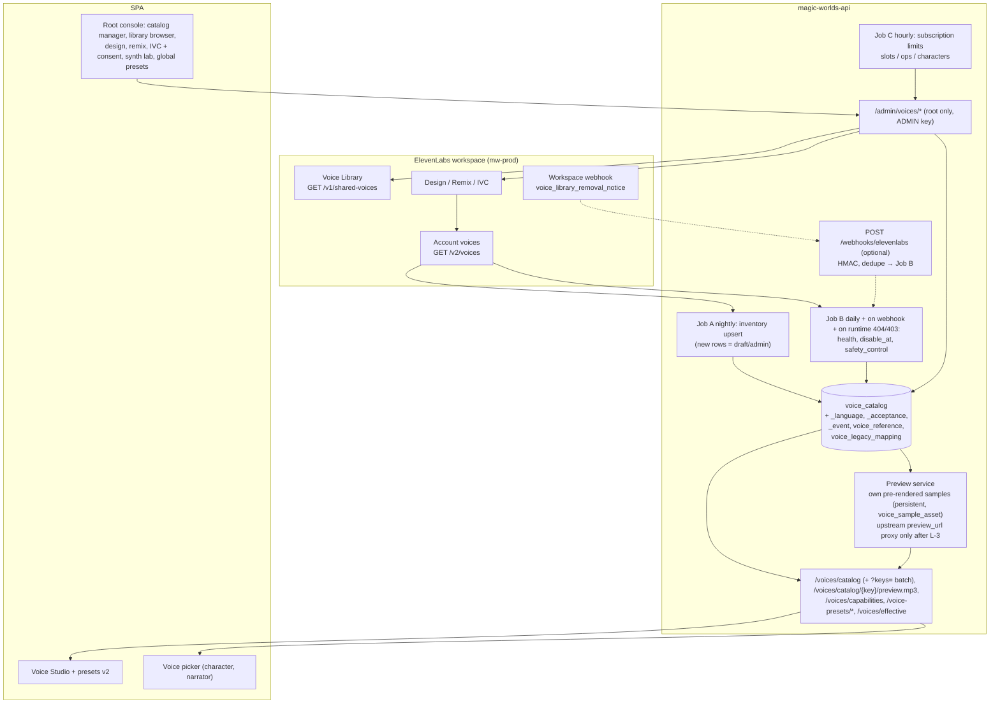
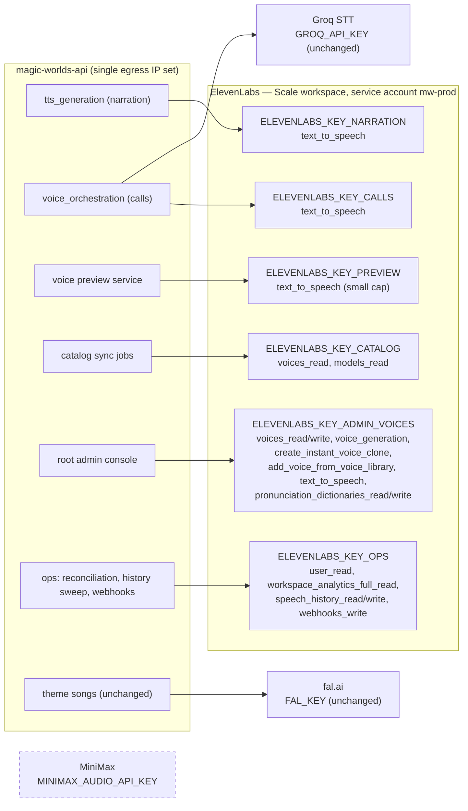

# Voice refactor: target architecture and decision record (MiniMax → ElevenLabs)

- **Date:** 2026-10-12
- **Status:** Proposed — awaiting owner sign-off (revised the same day after three adversarial reviews; see the Review log at the end)
- **Workspace R1 alignment (2026-10-12):** re-read against backend `f37eefd` and frontend `c7307c6` (content schema `2026_10_workspace_r1`). Adds D39 and §5.15, updates D28, D32, D36, §5.2 and §5.14. Evidence: [research/15](research/15_workspace_r1_impact.md).
- **Owner of this document:** lead architect (voice refactor)
- **Supersedes:** the conflicting target designs in research notes 01–08 wherever they disagree with this record.

## Scope

This is the single source of truth for the MiniMax removal and the ElevenLabs migration. It covers every speech surface of magic-worlds:
- chat narration jobs (adventure and character chats);
- realtime voice calls (TTS and STT);
- the voice catalog, the user Voice Studio and presets, the character and narrator voice pickers;
- the root admin voice console;
- the membership and billing, privacy, content-policy and rollout rules that these surfaces depend on.

It fixes one target architecture, resolves every contradiction C1–C18 and every owner decision listed in [research/09_research_critic_gaps.md](research/09_research_critic_gaps.md), and publishes the canonical shared definitions (schemas, enums, tables) that all later plan documents must copy verbatim. It does not contain code. It was written read-only against both repositories; no API key was used, no paid API was called and no database was queried.

## How to read this document

1. Read the **executive summary** (§1) and the **decision index** (§3).
2. Plan authors then read the ADR entries (§4) for their area and copy the **canonical definitions** (§5) verbatim. If a plan needs to deviate, it must first change this record. Decisions changed by the 2026-10-12 adversarial reviews carry a **Review notes** paragraph; the full disposition list is the Review log at the end.
3. Every decision has a status:
   - **Recommended:** the architect's call. It stands unless someone objects at sign-off.
   - **Needs owner sign-off:** a product, money or legal choice the owner must confirm. The recommendation is the default if the owner does not choose otherwise.
   - **Blocked on staging spike S-n:** the design is fixed, but a parameter or a fallback switch depends on the spike results in §6.
4. Evidence tags:
   - `[verified: url]`: read today, 2026-10-12, on an official page. Where the page was read by a research note rather than by this record, the note is named.
   - `[secondary: url]`: non-official source.
   - `[unverified]`: not confirmed; usually mapped to a spike in §6.
   - Codebase facts cite absolute paths with line numbers, as of the working trees on 2026-10-12.
5. **Plan documents** that follow this record are referred to by these short names. The full index is in [README.md](README.md).

   | Short name | Plan | File |
   |---|---|---|
   | **BE** | Backend implementation plan (magic-worlds-api) | [08_backend_refactor_plan.md](08_backend_refactor_plan.md) |
   | **FE** | Frontend implementation plan (this SPA) | [09_frontend_refactor_plan.md](09_frontend_refactor_plan.md) |
   | **DATA** | Data model and migration plan | [10_data_migration_and_rollout.md](10_data_migration_and_rollout.md) |
   | **BILL** | Membership and billing plan | [11_cost_plans_and_operations.md](11_cost_plans_and_operations.md) |
   | **LEGAL** | Policy, consent, ToS and copy plan | [13_policy_privacy_and_compliance.md](13_policy_privacy_and_compliance.md) |
   | **ROLL** | Rollout, operations and runbook plan | [10_data_migration_and_rollout.md](10_data_migration_and_rollout.md) (rollout) and [11_cost_plans_and_operations.md](11_cost_plans_and_operations.md) (operations, runbooks) |
   | **QA** | Staging spike and test plan | [14_staging_spike_and_contract_tests.md](14_staging_spike_and_contract_tests.md) and [15_implementation_plan_and_acceptance.md](15_implementation_plan_and_acceptance.md) |

   Surface designs: catalog [04](04_voice_catalog_and_library.md), Studio and admin console [05](05_voice_studio_and_admin_console.md), narration [06](06_chat_narration_migration.md), calls [07](07_realtime_calls_migration.md). Bare references such as "research/08 §18" mean the research notes listed below, not plan docs with the same number.

### Research notes this record builds on

| Note | Subject |
|---|---|
| [research/00_current_tts_review.md](research/00_current_tts_review.md) | MiniMax baseline and known bugs (#1–#19 plus "Lower") |
| [research/01_elevenlabs_tts_models_and_api.md](research/01_elevenlabs_tts_models_and_api.md) | TTS models, settings, tags, pauses, pronunciation |
| [research/02_elevenlabs_streaming_dialogue_realtime_agents.md](research/02_elevenlabs_streaming_dialogue_realtime_agents.md) | Streaming, Text to Dialogue (TTD), Scribe realtime, Agents and Speech Engine |
| [research/03_elevenlabs_voices_catalog_cloning_design.md](research/03_elevenlabs_voices_catalog_cloning_design.md) | Catalog, Voice Library, IVC, PVC, Design, Remix, previews |
| [research/04_elevenlabs_other_products.md](research/04_elevenlabs_other_products.md) | Music, SFX, Scribe batch, Studio, history, ops endpoints |
| [research/05_elevenlabs_platform_pricing_limits_policy.md](research/05_elevenlabs_platform_pricing_limits_policy.md) | Plans, concurrency, keys, privacy, policy, SDKs, retries |
| [research/06_backend_minimax_inventory.md](research/06_backend_minimax_inventory.md) | Backend MiniMax inventory and removal checklist |
| [research/07_frontend_minimax_inventory.md](research/07_frontend_minimax_inventory.md) | Frontend MiniMax inventory and change checklist |
| [research/08_voice_data_model_migration_surface.md](research/08_voice_data_model_migration_surface.md) | Voice data model and migration surface |
| [research/09_research_critic_gaps.md](research/09_research_critic_gaps.md) | Critic: gaps G1–G17, contradictions C1–C18, owner decisions 1–23 |
| [research/10_gap_policy_licensing.md](research/10_gap_policy_licensing.md) | Licensing, OEM, content policy, age gate, cloning consent |
| [research/11_gap_catalog_api_semantics.md](research/11_gap_catalog_api_semantics.md) | Default-voice expiry, Library API semantics, previews, webhooks |
| [research/12_gap_model_protocol_facts.md](research/12_gap_model_protocol_facts.md) | Endpoint × model matrix, settings behaviour, language, protocols, contract tests CT-01…CT-20 |
| [research/13_gap_codebase_checks.md](research/13_gap_codebase_checks.md) | Age gate, clone audio, presets, membership ops, ingress, loudness, canary, language, brackets |
| [research/14_cost_model.md](research/14_cost_model.md) | Consolidated cost model and membership re-pricing |
| [research/15_workspace_r1_impact.md](research/15_workspace_r1_impact.md) | Workspace R1 (personal workspaces, copy to workspace, workspace-local activity) re-read against every speech path; migration chain and handshake coupling |

---

## 1. Executive summary: the end state after MiniMax is removed

1. **One speech provider, behind neutral seams.** ElevenLabs is the only TTS provider. The BFF reaches it through provider-neutral interfaces (`SpeechSynthesisProvider`, `StreamingSpeechProvider`, `VoiceCatalogProvider`, `ProviderErrorClassifier`) and a server-side **capability registry**. No MiniMax key, URL, literal or data shape remains in live code paths; legacy MiniMax rows stay readable (D01, D23).
2. **Theme songs are out of the removal scope.** The fal-hosted `minimax/music-3` model shares no key, contract or data with MiniMax speech, so it stays until a separate decision; Eleven Music is a later, legally gated option (D01, D29).
3. **Plan: ElevenLabs Scale, held by a legal entity**, with service accounts and one scoped, quota-capped API key per surface. Launch requires ElevenLabs' written confirmation that the app is ordinary commercial use, not "Making Available" (D02, D04).
4. **Narration stays one job per segment on `POST /v1/text-to-speech`**, so per-character recipes keep working. It has two tiers: **Standard** on `eleven_flash_v2_5` for everyone, and **Expressive** on `eleven_v4` (opt-in, Plus and Pro, double credit weight). Text to Dialogue is not used for narration (D05).
5. **Calls use `eleven_flash_v2_5` on one multi-context TTS WebSocket per call**, with Groq Whisper kept for STT. Barge-in drops frames by `context_id`. MP3 44.1 kHz/64 kbps replaces the 32 kHz literals. `eleven_v4_turbo` over the TTD WebSocket is a flagged upgrade path, not the launch default (D06, D07, D08).
6. **The catalog is ours.** A synced `voice_catalog` table is the source of truth. Users browse it, never the provider. It holds owned designed or remixed voices and, once L-2 is answered, curated Voice Library voices (always added to the account, notice period ≥ 365 days, no live moderation, no custom rate). **Default/premade voices are banned**: they expire on 2026-12-31. Every published voice works in calls. Default and fallback voices are explicit catalog rows per language (`voice_default`), never an env voice id (D09, D10, D31).
7. **One canonical voice object: `CharacterVoice` v2** = `{schema_version: 2, provider, voice_key, voice_name, settings{…}, emotion, language_code, preset_id, preset_name}`. It references the catalog by `voice_key`, stores no model id, and keeps emotion as a neutral 7-value enum (D11, §5.1).
8. **The server decides the model and strips what the model ignores.** Speed is 0.7–1.2. Emotion becomes an allow-listed audio tag on v4 and a stability offset on Flash. Every `[…]` in LLM or user text is stripped before synthesis; tags come only from our allow-list (D13, D14).
9. **MiniMax pitch and volume are dropped.** Thoughts use the character's own voice, a `[whispers]` tag on the Expressive tier, and −3 dB client gain. Loudness is evened out with a measured per-voice gain stored in the catalog (D15, D16).
10. **Language comes from the story, not the UI.** The order is turn language, then voice language, then the user's preferred language, then omit. A per-model allow-list guards it, because Flash rejects unsupported codes with HTTP 400 (D17).
11. **Previews cost almost nothing and cannot be abused.** Catalog auditions use our own pre-rendered samples. "Hear my recipe" uses fixed per-language texts only, and is a new metered `voice_preview` membership operation (D18).
12. **Migration is hybrid.** Frozen session snapshots are **never rewritten by the system**; a resolver translates legacy MiniMax voices at read time through `voice_legacy_mapping`, keeps a cast's speakers distinct, and users can opt in to "use the card's current voice" per chat. From R1 the SPA shows the *effective* voice users actually hear. Live cards, drafts, versions and presets are rewritten once at contract time, with 100% coverage (unmapped → language default + review flag). Catalog eligibility is checked only when a voice is set or changed, so retiring a voice never blocks an unrelated save. MiniMax custom voices are retired (D21, D22, D32–D36).
13. **Billing becomes character-based.** Standard costs 1 credit per 400 characters and Expressive 1 per 200, rounded **once per turn** and reserved once per turn after the reuse check; failed segments are refunded at turn settlement, and per-turn and daily character caps apply (hard, never bypassed by PAYG). At base usage and list prices the recommended stack costs about 13% less than MiniMax today, before moderation-classifier cost; at list price +25% it costs more than MiniMax [research/14_cost_model.md §5.5, §9]. App-side budget guards back the provider-side key caps (D24, D37).
14. **Voice launches under the existing no-NSFW policy.** It adds a **fail-closed** pre-TTS moderation gate (every narration segment and every call sentence is checked synchronously before any ElevenLabs request), a server-recorded 18+ and ToS attestation (HTTP 428 or the equivalent WebSocket error frame when missing), rewritten consent and privacy copy with a provider-specific consent version (`voice-v2` for ElevenLabs calls), the training opt-out, and a scheduled ElevenLabs history-deletion sweep with a lag SLO. ZRM is deferred to Enterprise; talks open at about $3k/month (D25, D26).
15. **Rollout is canary-based.** It runs prepare (provider-neutral) → internal cohort → percentage canary → 100% → contract, behind a per-user cohort router whose switches are DB-backed (no restart). The dual-provider window is at most 30 days, with a per-phase spike, legal and privacy gate table (§6.3), a reverse mapping for non-cohort playback and rollback, and explicit rollback criteria. The MiniMax key is revoked 14 days after 100%, after which rollback means text-only (D28).
16. **Voice follows Workspace R1's boundary.** Narration, turn charges, session voice settings, refresh and calls inherit the session's workspace and need it active for fresh work. Catalog, Studio, presets, attestation, preferences, caps, budget guards and cohort routing stay account-level. Voice migrations chain after `2026_10_workspace_r1`, whose production deploy comes first, and never change the workspace capability's `schema_revision` (D39, §5.15).

---

## 2. Target architecture

### 2.1 Component view and provider-neutral seams

The BFF (`magic-worlds-api`) owns every provider call. The SPA never names a provider, never holds a key and never calls ElevenLabs. That rule already exists for calls: `/home/andres/WebstormProjects/magic-worlds/src/infrastructure/api/voiceSocket.ts:64-79` [research/07 §11.2].

Today the seams are MiniMax-shaped or missing [research/06 §2.5]:
- the `TtsProvider` Protocol lives in the MiniMax module (`/home/andres/PycharmProjects/magic-worlds-api/src/services/tts_generation/minimax_adapter.py:114-119`);
- the registry is locked to `Literal["minimax"]` (`/home/andres/PycharmProjects/magic-worlds-api/src/services/tts_generation/registry.py:24`);
- `tts_job` carries `CHECK provider = 'minimax'` (`/home/andres/PycharmProjects/magic-worlds-api/src/database/mysql/db.sql:670`);
- `main.py` builds one `MiniMaxT2AProvider` per process (`/home/andres/PycharmProjects/magic-worlds-api/src/main.py:916-942`).

The target seams:

| Seam (Python, BE) | Responsibility | Replaces |
|---|---|---|
| `SpeechSynthesisProvider` | `synthesize(SynthesisRequest) -> SynthesisResult`. One HTTP request carries text, `provider_voice_id`, `model_id`, effective settings, `language_code`, `seed` and `output_format`. The result carries audio **bytes**, `content_type`, `sample_rate`, `bitrate`, `request_id`, `billed_characters` (from `character-cost` when present) and optional alignment. | `TtsProvider` + `MiniMaxT2AProvider`; hex payloads |
| `StreamingSpeechProvider` | Call TTS with per-turn context semantics: `open_call`, `begin_turn(turn_id, voice)`, `push_text`, `end_turn`, `cancel_turn`, `close_call`. It yields `AudioChunk{context_id, seq, bytes, codec, sample_rate, channels}` [research/02 §13.1]. | `StreamingTtsClient` + `streaming_tts_minimax.py` |
| `SpeechToTextProvider` | Batch STT per uplink segment (Groq today). `RealtimeSpeechToTextProvider` is defined but unimplemented until D07 stage 2. | unchanged Groq client, renamed behind the interface |
| `VoiceCatalogProvider` | `list_account_voices`, `get_voices(ids)`, `search_library`, `add_library_voice`, `design_previews`, `save_generated_voice`, `remix`, `create_ivc`, `delete_owned_voice`, `subscription_limits`, `list_models`. | `VoiceAdminService` / `minimax_voice_admin.py` |
| `ProviderErrorClassifier` | Maps a provider response, WS close or exception to `ProviderError{category, retry_class, voice_scoped, request_id}`, using the table in §5.8. | three MiniMax code tables [research/06 §2.5] |
| `VoiceCapabilityRegistry` | Maps a **surface** (`narration`, `call`, `preview`, `admin_lab`) and **tier** (`standard`, `expressive`) to a `ModelProfile`: provider, `model_id`, transport, settings allow-list and ranges, tag support, SSML-break support, language allow-list, `max_chars`, concurrency pool and `output_format`. It is built from a static table (§5.6) plus `GET /v1/models` at startup. It is exposed neutrally through `GET /voices/capabilities`. | registry `Literal`s, config guards, frontend constants |
| `VoiceResolver` | Turns a stored voice (V1 legacy or V2) plus surface, tier and language context into `ResolvedSpeechVoice{provider, provider_voice_id, model_profile, effective_settings, tag_prefix, language_code, gain_db, substitution_reason}`. It never raises for one bad voice; it substitutes per segment. | `build_resolved_voice` (`/home/andres/PycharmProjects/magic-worlds-api/src/services/tts_generation/registry.py:71-101`) |
| `SpeechTextPipeline` | Shared sanitizer, moderation gate and per-model markup translator for narration, calls and previews (D14, D26, D27). | `normalize_tts_text` + `transcript_sanitizer.normalize_text_for_tts` |
| `ProviderRouter` | Chooses the provider per job or call during the dual-provider window. It is driven by the cohort (D28) and persisted on `tts_job.provider` and `voice_session.tts_provider`. | single provider per process |
| Neutral `app.state` names | `speech_synthesis_provider`, `speech_streaming_provider`, `voice_catalog_provider`, … | `minimax_tts_provider`, `minimax_voice_admin_*` (`/home/andres/PycharmProjects/magic-worlds-api/src/main.py:920-949`) |

**Not hard-wired.** Only adapter modules (`providers/elevenlabs/*`) import provider URLs, header names or `detail.code` strings. Everything else sees neutral types. Adding a second provider later means one new adapter set plus registry rows; there is no schema change, because `provider` is already a column and a voice-object field.

### 2.2 (a) Chat narration

```mermaid
flowchart LR
    SPA["SPA: play / auto-narrate<br/>WS frame tts{assistant_message_id, turn_id}"] --> RC["route_chat._handle_chat_tts_request"]
    RC --> GATE{"Attestation 18+ / ToS<br/>(WS tts_failed attestation_required)"}
    GATE --> SEG["Segment builder<br/>response_segments → clips<br/>cap 2,500 chars / 12 segments / 1,200 per clip"]
    SEG --> STP["SpeechTextPipeline<br/>sanitize → moderate → markup per model"]
    STP -->|blocked or classifier timeout| CB["segment = content_blocked / unavailable<br/>0 credits, never sent (fail closed)"]
    STP --> RES["VoiceResolver (§5.10)<br/>V1 → voice_legacy_mapping → V2<br/>voice_key → voice_catalog → provider_voice_id<br/>cast distinct-voice rule (D33); defaults (D31)<br/>tier → ModelProfile; strip settings; emotion tag/offset"]
    RES --> REUSE{"Reuse hash v2 hit?"}
    REUSE -->|completed| DONE["attach existing asset, free"]
    REUSE -->|pending / in progress| ATT["attach to existing job, no new charge"]
    REUSE -->|miss| Q["Membership reserve ONCE PER TURN<br/>for all missed segments (one transaction)<br/>credits = ceil(Σ std/400 + Σ expr/200)<br/>daily char cap + turn-level in-flight"]
    Q --> JOB["tts_job pending per missed segment<br/>provider='elevenlabs', turn charge id"]
    JOB --> LIM["Provider limiter (in-process until #19)<br/>pool: flash | non_flash"]
    LIM --> EL["ElevenLabs POST /v1/text-to-speech/{voice_id}<br/>model eleven_flash_v2_5 (Standard) | eleven_v4 (Expressive)<br/>output mp3_44100_128, seed, language_code (allow-listed)"]
    EL -->|error| ERR["ProviderErrorClassifier → category<br/>refund at turn settlement; 404 → catalog suspect + Job B, replacement next attempt"]
    EL --> STORE["bytes → tts_asset (local_fs)<br/>request_id, billed chars, gain_db"]
    STORE --> META["adventure_message.metadata.tts_segments[i]<br/>+ kind, gain_db"]
    META --> SPA2["SPA player: per-clip volume =<br/>user vol × 10^(gain_db/20) × (thought? 0.7)"]
```



Key properties:
- One request per segment, so each character keeps its own voice and settings.
- The reuse lookup runs **before** any reservation, as today (`/home/andres/PycharmProjects/magic-worlds-api/src/services/tts_generation/engine.py:226-258`). A completed hit is free; a pending or in-progress hit attaches to the existing job (today's double-click de-duplication); only misses are charged.
- Credit is reserved **once per turn** for every missed segment, not only for segment 0 (`/home/andres/PycharmProjects/magic-worlds-api/src/routes/user/route_chat.py:1433` passes `enforce_quota` only for segment 0). That fixes baseline bug #5 without tripping `max_in_flight` on segment 2 of a turn, because in-flight is counted per turn (D24, §5.9).
- Failed segments are refunded at turn settlement, which fixes bug #7.
- The provider bytes are written to storage **outside** the `tts_job` row-lock transaction and off the event loop. That fixes bug #11 [research/13 §6.1].

### 2.3 (b) Realtime voice calls

```mermaid
sequenceDiagram
    participant B as Browser (VAD worklet, MSE player)
    participant API as BFF voice engine
    participant G as Groq STT (whisper-large-v3)
    participant L as LLM (magic_llm callbot graph)
    participant E as ElevenLabs TTS multi-context WS<br/>eleven_flash_v2_5
    B->>API: WS /ws-voice (mw.bearer.v1) — call start
    API->>API: attestation + voice consent voice-v2 check (428)
    API->>E: open 1 socket per call (prewarm)<br/>?model_id=eleven_flash_v2_5&output_format=mp3_44100_64<br/>&inactivity_timeout=180&sync_alignment=true
    B->>API: POST /voice-segments (16 kHz PCM16 WAV)
    API->>G: transcribe (language from chain, D17)
    G-->>API: transcript
    API->>L: stream reply
    L-->>API: text chunks
    API->>API: SentenceBuffer → SpeechTextPipeline (sanitize, moderate, markup→Flash)
    API->>E: {context_id:"t_<turn>", text:" ", voice_settings} (first msg of context)
    API->>E: {context_id, text:"<sentence> ", flush:true} per sentence
    E-->>API: {audio, alignment, contextId|context_id}
    API-->>B: voice_audio_chunk{seq, content_type:audio/mpeg, sample_rate:44100, gain_db}
    B->>API: interrupt {turn_id, played_ms}
    API->>API: mark ctx dead → drop its frames; truncate persisted text at the last sentence whose audio started before played_ms
    API->>E: {context_id, close_context:true} (frees slot only)
    E-->>API: late frames for dead ctx (dropped), is_final
    API->>API: bill delivered audio only (whole-frame parser with tail carry)
    Note over API,E: normal turn end: close_context after the last flushed sentence; flush-ahead ≤ 3 sentences / ≈ 8 s beyond played_ms
```

Key properties:
- `eleven_v4`/`eleven_v4_turbo` cannot use the TTS sockets; the handshake returns HTTP 400 `unsupported_model` [research/12 §2]. The call model is therefore Flash on the TTS multi-context socket, or `eleven_v4_turbo` on the TTD socket after spike S-18.
- `close_context` is **not** a cancel: flushed text keeps generating. Dropping frames by `context_id` is the cancel (C8, [research/12 §8.5]).
- Per-sentence billing currently loses partial MP3 frames (`/home/andres/PycharmProjects/magic-worlds-api/src/services/voice_orchestration/engine.py:1579-1599`, `:2286-2306`). It is replaced by a whole-frame parser that carries the tail into the next slice [research/12 §12.1].

### 2.4 (c) Voice catalog, user Voice Studio and root console



Rules:
- Users read only our DB. No provider call is made per user action [research/11 §4.6].
- A voice reaches users only through **Publish** (`status=active`, `visibility ∈ {public, plan_gated}`) after it passes the acceptance protocol, has an own sample per accepted language and is `call_eligible=1` (D09, D10, D06).
- Library copies are never provider-deleted from the console. Owned voices may be deleted only when their reference count is 0 (D19).

### 2.5 (d) Provider and key topology



`MINIMAX_AUDIO_API_KEY` stays only during the dual-provider window and is revoked at R4 (D28). Staging is a separate Creator or Pro workspace with **user keys** (service accounts need a multi-seat plan): the same six scopes, tiny quotas, IP allow-list, owned by a dedicated operator seat on a shared mailbox, training opt-out on (D02, D04).

---

## 3. Decision index

| ID | Topic | Decision (short) | Status | Docs affected |
|---|---|---|---|---|
| D01 | Scope of "remove MiniMax" | Remove all MiniMax **speech** usage (narration, calls, previews, voice admin, `MINIMAX_*` config, MiniMax-shaped contracts). fal `minimax/music-3` theme songs are out of scope. | Needs owner sign-off | BE, FE, ROLL |
| D02 | ElevenLabs plan and account | **Scale** held by a legal entity; separate Creator/Pro staging workspace with user keys; written confirmation of B2C "ordinary use" before launch; Startup Grant only after L-14, with paid Scale kept active; Enterprise/ZRM talks at ~$3k/month or R3, whichever is first | Needs owner sign-off (+ legal L-1…L-3, L-14; spike S-1) | ROLL, LEGAL, BILL |
| D03 | Integration style | Raw `httpx` + `websockets` adapters everywhere; the official SDK is a contract oracle, not a runtime dependency | Recommended | BE |
| D04 | API key topology | One service account in production (user keys in staging); one scoped, quota-capped, IP-allowlisted key per surface (narration, calls, preview, catalog, admin, ops); readiness probes use the key that holds each scope | Recommended; spike S-28 | BE, ROLL |
| D05 | Narration architecture and models | Per-segment `POST /v1/text-to-speech`; Standard = `eleven_flash_v2_5`, Expressive = `eleven_v4` (Plus/Pro opt-in in `user_preferences`, per-session override outside `template_snapshot`); Expressive falls back to Standard (never to multilingual_v2); no TTD for narration; per-character recipes honoured | Needs owner sign-off (tiering, cost); spikes S-2, S-3 | BE, FE, BILL, QA |
| D06 | Call architecture, model, latency, consistency | Flash v2.5 on one TTS multi-context WS per call; frame drop by `context_id` = cancel; `close_context` at every turn end; ≤ 4 live contexts; flush-ahead window; barge-in stores `completed` + truncated text (`truncated`, `played_ms`); latency targets include moderation; voice consistency enforced by acceptance; v4 Turbo on TTD WS is a flagged upgrade; Speech Engine rejected | Needs owner sign-off (consistency trade-off); spikes S-7, S-8, S-15, S-18 | BE, FE, QA |
| D07 | STT and dictation | Keep Groq Whisper for calls at launch; Scribe v2 Realtime only after a latency and WER spike; dictation is P1 through the same STT interface | Recommended; spike S-19 | BE, FE |
| D08 | Call output format | `mp3_44100_64` over the existing MSE player; sample rate data-driven; PCM + AudioWorklet deferred | Recommended; spike S-9 | BE, FE |
| D09 | Catalog sourcing policy | Owned designed voices + curated Library voices (strict filters, public only after L-2) + root-only IVC with consent; Library remixes only after L-2, L-12 and `voice_mixing_allowed`; **Default/premade banned**; ≥ 40 public voices at launch with en/es coverage; publish requires `call_eligible` | Needs owner sign-off (+ L-2); spikes S-14, S-27 | BE, FE, DATA, LEGAL |
| D10 | Catalog source of truth and previews | Synced DB `voice_catalog` (Jobs A/B/C with a mass-miss guard, webhook optional); previews are own pre-rendered samples only until L-3; never hotlinked | Recommended; spikes S-11, S-12, S-13 | BE, FE |
| D11 | Voice identity model (CharacterVoice v2) | `voice_key` catalog indirection; nested `settings`; no `model_id`; neutral `emotion` enum; `provider` + `schema_version`; exact schema in §5.1 | Recommended | BE, FE, DATA |
| D12 | Preset v2 schema | `voice_preset` expand: `schema_version`, `provider`, `voice_key`, `settings`, `language_code`; legacy columns nullable then dropped; root-only global presets | Recommended | BE, FE, DATA |
| D13 | Per-model capability handling | Capability registry + `GET /voices/capabilities`; **reject** out-of-range values at write time, **strip** unsupported settings at request time; speed 0.7–1.2 | Blocked on staging spike S-3 (allow-lists) | BE, FE |
| D14 | Emotion → tag mapping, allow-list, sanitizer | One mapping table (§5.5); tags emitted only by the server; every other `[…]` stripped; OOC dropped; no square brackets in prompts | Blocked on staging spike S-6 (tag wording) | BE, QA |
| D15 | Pitch and volume migration | Drop both. Presets and cards with `\|pitch\| ≥ 3`, `vol ∉ [0.8, 1.25]` or speed outside 0.7–1.2 are flagged in `voice_review_flag` with a one-time, dismissible "review voice" notice; originals kept in the audit | Needs owner sign-off | DATA, FE |
| D16 | Thought delivery and loudness | Character's own voice; `[whispers]` on Expressive; −3 dB client gain on all tiers; per-voice `gain_db` (attenuation-only) measured at acceptance and applied by the player | Recommended; spike S-16 | BE, FE |
| D17 | `language_code` policy | Turn language → voice language → user preferred language → omit; per-model allow-list; ISO 639-1 lower-case; part of the reuse hash | Recommended; spike S-4 | BE |
| D18 | Preview policy | Catalog auditions free (own samples); recipe preview = fixed per-language texts (narration, dialogue, thought), settings quantized to 0.05, shared cache (`voice_preview_render`), metered op `voice_preview`: 3 free per day, then 1 credit each, up to 3/10/20 | Needs owner sign-off (limits) | BE, FE, BILL |
| D19 | Library voice lifecycle | Always add; store both ids; reference tracking; soft retire (`status=hidden`); never delete referenced or Library copies, except IVC consent revocation; replacement voice per published voice; "voice leaving" UX; removal needs per-voice confirmation | Recommended; spikes S-11, S-12 | BE, FE, DATA, ROLL |
| D20 | Root console scope; user-created voices | Root: catalog manager (with impact view), **acceptance runner**, Library browser/add, Design, Remix, IVC with consent record and revocation, synth lab, global presets, defaults, limits widget; no PVC creation. **Users never create provider voices** in this program | Needs owner sign-off | BE, FE, LEGAL |
| D21 | Snapshot migration strategy; unmapped voices | Read-time translation for frozen snapshots (never rewritten by the system); one-shot rewrite of live cards, drafts, versions, template casts and presets at R5 with 100% coverage (unmapped → language default `voice_key` + review flag); MiniMax picker restricted to mapped ids from R0; reverse mapping for non-cohort playback and rollback | Recommended | DATA, BE, FE |
| D22 | MiniMax custom voices and global presets | Retire custom voices (no source audio); re-create only with operator-supplied audio + fresh consent; global presets re-seeded as curated ElevenLabs presets | Needs owner sign-off | DATA, ROLL |
| D23 | Legacy MiniMax assets and history rows | Keep referenced MP3s and rows readable (widened validators); reviewed orphan sweep at cutover; markers stripped at display | Needs owner sign-off (MiniMax retention terms) | DATA, BE, FE |
| D24 | Billing unit and membership re-pricing | Character-based credits via the `credit_cost` override; reuse first, then **one reservation per turn** rounded per turn; in-flight and daily requests counted per turn; settlement refunds failed segments; hard per-turn and daily character caps (schema in §5.2); per-plan call minutes; `voice_preview` op | Needs owner sign-off | BILL, BE, FE |
| D25 | Privacy posture and consent | No ZRM at launch; training opt-out (production and staging); scheduled history-deletion sweep with lag SLO; no request-id stitching; named dashboard seats; consent and privacy copy rewrite naming both providers during the window; consent version per provider (`voice-v2` for ElevenLabs); moderation processor named; external counsel signs off | Needs owner sign-off | LEGAL, BE, FE, ROLL |
| D26 | Content policy and age gate | No-NSFW voice; **fail-closed** synchronous pre-TTS moderation on every segment and call sentence (classifier via a `magic_llm` moderation profile); BFF-side `user_attestation` (18+, ToS) enforced with 428 or a WS error frame; ToS page; minor-report review path; abuse-score thresholds; companion safeguards | Needs owner sign-off | LEGAL, BE, FE |
| D27 | Callbot pause/markup and sanitizer | Keep neutral markup v1 (`<#x#>`, `(laughs)`) in stored text; translate per model after validation; interjections off on Flash; numbers normalized upstream | Recommended; spikes S-5, S-26 | BE, FE |
| D28 | Rollout | R0 prepare → R1 internal cohort (2026-11-18) → R2 canary 5/25/50% → R3 100% → R4 key revocation → R5 contract; dual window ≤ 30 days; per-phase gates (§6.3); DB-backed switches; reverse mapping; no build rollback below R0 after R1 | Needs owner sign-off (dates) | ROLL, BE, FE |
| D29 | New ElevenLabs features and timing | P0: ops hygiene only. P1: pronunciation dictionaries, Scribe dictation, adventure audio export. P2: SFX ambience, word highlight, Story Studio audiobook, Eleven Music (legal-gated). P3: Studio API | Needs owner sign-off | BE, FE, BILL, LEGAL |
| D30 | Known bugs fixed in vs out of the migration | Fix in the migration: #1, #3, #5, #6, #7, #8, #10, #11, #12, #16, #17, card-assistant voice erasure, preview race, MP3 billing parser, 32 kHz literals, V1-keyed FE checks (`hasVoice`, `presetMatchesVoice`). Separately: #2, #4, #9 (except the orphan sweep), #13, #14, #15, #18, #19 | Recommended | BE, FE, QA |
| D31 | Default and fallback voices | `voice_default` rows per (role, language), owned voices, accepted on Flash and v4, call-eligible; `VOICE_LAST_RESORT_VOICE_KEY` as the only env value; voiceless characters keep sharing the narrator default (today's behaviour) | Needs owner sign-off (voiceless rule) | BE, DATA, FE, ROLL |
| D32 | Voice write validation and resolver matrix | Shape-only for unchanged or copied voices; catalog eligibility + plan check only when a voice is set or changed; V1 writes only unchanged (or mapped ids for non-cohort before R3); `plan_gated` limits picking, never hearing; one status × visibility × acceptance matrix (§5.10) | Recommended | BE, FE, DATA |
| D33 | Cast distinct-voice rule | Speakers whose stored voices differ never resolve to the same provider voice in one session; ordered alternates in `voice_legacy_mapping`, then catalog neighbours; per-session deterministic | Recommended | BE, DATA, QA |
| D34 | Language scope beyond en/es | Curated launch catalog en/es; other languages narrated by multilingual catalog voices with light acceptance for the languages actually in use; untested language → allowed with a badge, never substituted; MiniMax non-en/es ids mapped to multilingual targets | Needs owner sign-off | BE, FE, DATA, QA |
| D35 | User-facing catalog contract, effective voice, badges | Canonical catalog DTO, filters, pagination, batch lookup; effective-voice projection from R1; badge and copy inventory (en/es) with placements; shared FE `hasAssignedVoice`/`voiceIdentity` helpers | Recommended | FE, BE |
| D36 | User-initiated voice refresh in existing chats and adventures | "Use the card's current voice" per chat and per adventure cast entry; writes only voice paths as V2; voice paths excluded from retry byte-equality; substitution surfaced in turn and call UI | Recommended | BE, FE |
| D37 | Budget guards, exposure and abuse controls | App-side global spend circuit, per-user token buckets, daily reconciliation with drift alert; all-surface exposure table; caps hard for PAYG; abuse-score thresholds; Free voice requires a verified, attested account | Needs owner sign-off (caps, Free rules); spike S-28 | BILL, BE, ROLL |
| D38 | Persona-card voices | Picker hidden for persona cards; stored values kept and mapped silently; excluded from badges and coverage gates | Recommended | FE, DATA |
| D39 | Workspace scope of voice surfaces | Content-bound voice work (narration jobs, turn charges, session voice settings, refresh, calls) inherits the session's workspace and needs it active for fresh work; catalog, Studio, presets, attestation, preferences, caps, budget guards and cohort routing stay account-level; voice migrations chain after `2026_10_workspace_r1` without changing the workspace capability's `schema_revision`; copies to another workspace are shape-only (§5.15) | Recommended | BE, FE, DATA, ROLL |

### 3.1 Contradictions C1–C18: where each is resolved

| Contradiction | Resolution | Decision |
|---|---|---|
| C1 Default voices acceptable vs banned | **Banned**: never published, mapped or used as a fallback. Perpetual (4015-day) ElevenLabs Library voices and owned voices replace them. | D09 |
| C2 Read-time translation vs one-shot snapshot rewrite | **Read-time translation for all frozen snapshots**; one-shot rewrite only for live, editable documents. | D21 |
| C3 `voice_key` catalog vs raw `voice_id` + mapping | **`voice_key` catalog indirection.** `voice_legacy_mapping` maps MiniMax ids to `voice_key`. | D11 |
| C4 Recipe shape (model id, tags, flat vs nested) | **Nested `settings`, no `model_id`, neutral `emotion` enum**, no stored tag prefix, no gain field. | D11 |
| C5 Three emotion→tag tables | **One table** (§5.5), using documented tags where they exist. | D14 |
| C6 Per-segment v4 vs TTD per turn vs Flash default | **Per-segment TTS HTTP**; Flash Standard + v4 Expressive tiers; no TTD. | D05 |
| C7 v4 on TTS HTTP or TTD only | **TTS HTTP works for `eleven_v4`** [verified: https://elevenlabs.io/docs/help-center/product/core-capabilities/text-to-speech/what-is-eleven-v4, via research/12 §1]; confirmed on our account by S-2. | D05 |
| C8 `close_context` clean cancel vs keeps flushing | **Keeps flushing.** Frame drop by `context_id` is the cancel; `close_context` only frees the slot. | D06 |
| C9 Allow `<break/>` in sanitizer vs neutral marker | **Neutral marker in stored text**, translated after validation; the sanitizer stays fail-closed on XML. | D27 |
| C10 Library voices usable without add | **Always add**, and store the returned id plus the original Library id. | D10, D19 |
| C11 Pro enough vs Scale required; Business numbers | **Scale.** Pro is barred from "Making Available" and lacks service accounts. Slot and concurrency numbers are read from `GET /v1/user/subscription`, never hard-coded. | D02 |
| C12 Live catalog + hotlinked previews vs DB catalog + BFF previews | **DB catalog; BFF previews**; own pre-rendered samples persistent; upstream audio not served to users until L-3 (then proxied ≤ 1 h); never hotlinked. | D10, D18 |
| C13 Admin delete direct vs never delete referenced | **Soft retire.** Library copies are never provider-deleted from the console; owned voices only at reference count 0. | D19 |
| C14 Four thought-dimming designs | `[whispers]` on Expressive + −3 dB client gain + per-voice catalog `gain_db`; the character's own voice. | D16 |
| C15 v4 promo vs list price | **List price** ($0.08/1K v4, $0.04/1K Flash and v4 Turbo). The promo ends 2026-10-12 [verified: https://elevenlabs.io/pricing/api]. | D24 |
| C16 Remix of Library voices | **Allowed** for owned voices. For Library voices (even with an infinite 4015-day notice period [research/11 §3]) only after L-2, L-12 and L-16 and with `voice_mixing_allowed=true` at add time. | D09, D20 |
| C17 Flash normalization default | **Do not depend on it.** Normalize numbers upstream (prompt + sanitizer); send `apply_text_normalization: "auto"`. | D27, D17 |
| C18 Speech Engine 3.5× vs 4× | Both are $0.08/min against different DIY baselines: 3.2–3.6× like-for-like, up to 4.3× against keeping Groq [research/14 §4.2]. Speech Engine is not adopted. | D06 |

### 3.2 Owner decisions 1–23 (research/09) → decisions here

| 09 # | Topic | Here |
|---|---|---|
| 1 | Scope incl. `minimax/music-3` | D01, D29 |
| 2 | Plan and account | D02 |
| 3 | Narration architecture and model, +33% cost | D05, D24 |
| 4 | Call architecture, latency, consistency | D06 |
| 5 | Groq vs Scribe; dictation | D07, D29 |
| 6 | Catalog sourcing; Default ban; size | D09 |
| 7 | Voice identity model | D11 |
| 8 | User-created voices; console scope | D20 |
| 9 | Pitch and volume | D15 |
| 10 | Thought delivery | D16 |
| 11 | Snapshot migration; unmapped voices | D21 |
| 12 | MiniMax custom voices; global presets | D22 |
| 13 | Preview policy | D18 |
| 14 | Billing unit | D24 |
| 15 | Privacy posture; consent | D25 |
| 16 | Content policy; age gate | D26 |
| 17 | Legacy data | D23 |
| 18 | Rollout | D28 |
| 19 | Call output format | D08 |
| 20 | Integration style | D03 |
| 21 | Key topology | D04 |
| 22 | New features | D29 |
| 23 | Studio speed range | D13 |

---

## 4. Decision records

### D01. Scope of "remove MiniMax"

**Context.** MiniMax is reached directly through `MINIMAX_AUDIO_API_KEY` by three paths: narration, calls, and voice admin/presets [research/00 §2]. Theme songs use `minimax/music-3` **through fal.ai with `FAL_KEY`**, and it is today's default theme-song model (`/home/andres/PycharmProjects/magic-worlds-api/src/services/theme_song_generation/config.py:23-24`; `/home/andres/PycharmProjects/magic-worlds-api/src/services/theme_song_generation/fal_adapter.py:3`). The comment at `/home/andres/PycharmProjects/magic-worlds-api/.env.example:474-475` claims that theme songs use the MiniMax key. That is stale: no theme-song module imports `minimax_credentials`.

**Options.**
1. Speech only.
2. Speech + switch the theme-song default to ACE-Step.
3. Speech + Eleven Music.

**Decision (recommended): option 1.** This program removes:
- every direct MiniMax API call, credential and config key (`MINIMAX_*`, `VOICE_MINIMAX_*`, `TTS_DEFAULT_VOICE_ID` semantics);
- every MiniMax-shaped contract in live code: hex payloads, 32 kHz literals, `language_boost`, pitch and vol, `<#x#>` in admin tooling, `voiceIdRules.ts` and `voiceLanguage.ts`;
- every MiniMax mention in user-facing copy.

`minimax/music-3` on fal stays unchanged. If the owner wants no MiniMax-branded model at all, the fallback is a one-line config change, `THEME_SONG_DEFAULT_MODEL_ALIAS=ace_step`, plus hiding the alias in the picker. Eleven Music is handled in D29.

**Rationale.**
- The fal path shares no key, contract or data with MiniMax speech, so it adds risk to the migration without benefit.
- Eleven Music carries Model Resale, Studio Games and eligibility risks that need legal review [research/04 §5.4].
- fal `minimax/music-3` costs $0.002/s [research/14 §2.5].

**Consequences.**
- The `minimax_music_3` alias, tests and i18n stay. Inventories must exclude them from "MiniMax removal" greps [research/08 §9 note on 4 theme-song test files].
- Fix the stale `.env.example` comment.
- "MiniMax removed" means `MINIMAX_AUDIO_API_KEY` is revoked (D28 R4).

**Open items.**
- Owner confirms that "remove MiniMax" means the speech contract.
- Separately, MiniMax's direct music API stopped onboarding new users on 2026-08-20 [verified: https://platform.minimax.io/docs/pricing/overview, via research/14 §2.3]. That has no effect on fal.

### D02. ElevenLabs plan and account

**Context.**
- **OEM.** The OEM Terms expressly bar Free–Pro from "Making Available". Consumers can never be OEM End Users on any self-serve plan [research/10 §2.3].
- **Commercial use.** Any paid plan grants commercial use. The reading that a consumer app rendering Output server-side is ordinary paid use ("Reading A") rests on verified clauses but needs written confirmation [research/10 §2.3, §9].
- **Plan features.** Service accounts need a multi-seat plan (Scale+) [research/05 §4.2]. Scale has 15 non-Flash / 30 Flash TTS concurrency, 105 TTD sessions, 45 realtime STT, 660 slots and 1,040 voice ops [research/14 §2.2]. Business slot and concurrency figures conflict between official pages (C11).
- **Price.** The plan fee does not change spend at any modelled level [research/14 §6.1].
- **Account facts are unknown (G5).** Default voices exist only on accounts created before March 2026 and expire on 2026-12-31 [verified: https://elevenlabs.io/docs/help-center/product/voices/my-voices/what-are-default-voices.md].

**Options.** Pro; Scale; Business; Enterprise.

**Decision (recommended).**
- **Production: Scale ($299/month)**, contracted by a legal entity with a non-personal admin email routed to a monitored shared inbox. Which ElevenLabs ToS applies (EEA/UK/CH vs non-EEA) follows the contracting entity's residence; LEGAL records it (L-15).
- **Staging: a separate paid workspace (Creator or Pro)** carrying synthetic, policy-safe text only. Creator and Pro have one seat and no service accounts [research/05 §4.2, §11.1], so staging uses **scoped, quota-capped, IP-allowlisted user keys** owned by a dedicated operator seat on a shared mailbox (not a person's account), rotated quarterly. There is no service-account mirroring in staging. Training opt-out applies to staging too [research/10 §6]. (Rejected: a second Scale workspace, about $299/month more; a staging service account inside production, which would share concurrency, settings and history with production.)
- **Launch precondition:** written confirmation of items L-1…L-3 (§6.2), and the legal and privacy gate in §6.3.
- **Escalate to Enterprise** if ElevenLabs says the app is "Making Available", or if adult audio, ZRM or EU residency become requirements. **Open Enterprise and ZRM talks at about $3k/month of spend or at R3, whichever comes first** [research/05 §11.1; research/14 §0 item 4], and send L-9 (ZRM eligibility) together with the L-1 request, so a refusal leaves time for a fallback.
- **Day-one account settings:**
  - training opt-out ("Improve the models" off) before any real user text, with a dated screenshot in the ROLL log;
  - 2FA on;
  - auto top-up;
  - a monthly PAYG spend cap, set at R1 to 1.5× the R0 forecast and re-sized from R1/R2 telemetry before R3 (not from a forecast alone); the app-side budget guards (D37) trip long before it;
  - dashboard seats limited to named operators, recorded in the ROLL access register, because shared history items contain users' story text [research/04 §12];
  - **Startup Grant: apply, but use it only after L-14** confirms in writing that grant-funded usage is a paid commercial subscription with Business Entity status and no attribution duty. The grant is described for building conversational agents ("12 months free", 33M characters) [verified: https://elevenlabs.io/pricing/api], and output generated outside an active subscription carries attribution duties [research/10 §2.6]. Until L-14 is answered, a paid Scale subscription stays active alongside any grant, so production output is never generated "outside a subscription".
- **Promo-era allowances.** The v4 promo ("72% off until Oct 12") is still displayed today [verified: https://elevenlabs.io/pricing/api]; spend caps, auto top-up and forecasts are sized at list price only, never from promo-era allowances.
- **Numbers are read, not hard-coded.** Slot, ops and concurrency limits come from `GET /v1/user/subscription` and response headers.

**Rationale.**
- Scale is the cheapest tier that is not expressly barred and that unlocks service accounts (D04).
- Its concurrency fits the recommended mix up to 50k MAU base load [research/14 §6.2].
- Business adds nothing we need unless slots or seats run out.

**Consequences.**
- No production traffic on Starter–Pro, ever.
- The staging account must never receive real user content.
- Concurrency settings, starting points [research/05 §11.4]:
  - one provider limiter with pools `flash` (24 of 30), `non_flash` (12 of 15; narration Expressive 10, preview 1, admin 1), in-process while the BFF is single-process (bug #19), moved to a MySQL lease table (or the optional Redis) when #19 is fixed (D37);
  - calls are sized from STT and load tests.

**Open items.**
- S-1 (account facts, G5).
- L-1, L-2, L-3, L-14, L-15.
- Whether a sole proprietor qualifies as a Business Entity (L-3).
- Business concurrency "15 vs 25" is moot at Scale.

**Review notes (2026-10-12).** Staging changed to user keys (service accounts need multi-seat); Startup Grant made conditional on L-14; Enterprise trigger moved to ~$3k/month or R3; spend cap sized from telemetry; dashboard seats restricted.

### D03. Integration style

**Context.** The Python SDK 2.71.0 has no async TTS/TTD WebSocket clients. It also defaults to a 240 s timeout and 2 blind retries on 408/409/429/5xx, and it compares webhook signatures with `!=` [research/05 §7.2]. `httpx` and `websockets` are already dependencies [research/05 §7.4].

**Options.**
1. SDK everywhere.
2. Raw everywhere.
3. Raw for hot paths, SDK for admin.

**Decision (recommended): option 2, raw `httpx.AsyncClient` + `websockets` for every path, admin included**, so there is one style, one error mapper and one retry policy.
- Use the SDK source (pinned commit) as the reference implementation and contract-test oracle.
- Verify webhooks ourselves with `hmac.compare_digest`.

**Rationale.** Budget-aware retries, strict validation of the fields we rely on (ignore unknown fields per ElevenLabs' breaking-change policy), no event-loop blocking, and no weekly-regenerated dependency.

**Consequences.**
- More boilerplate for multipart admin calls (IVC, design).
- Re-evaluate SDK 3.x when it ships stable async WS clients.

**Open items.** None.

### D04. API key topology

**Context.**
- ElevenAPI §5.1 lets ElevenLabs disable a single credential for misuse, without the usual notice [research/10 §2.2].
- Keys support scopes, `character_limit`, IP allow-lists and leak auto-disable [research/05 §4.2].
- Service-account keys never expire, and voices must be shared with the service account's group [research/05 §4.3].

**Options.** One key; per-surface user keys; per-surface service-account keys.

**Decision (recommended).**
- One **service account in production** (`mw-prod`). Staging uses user keys with the same scopes on its own workspace (D02).
- Six keys, listed in §5.4.3 with scopes, caps and env names. A seventh `MEDIA` key exists only if D29 adopts SFX or Music.
- Rules:
  - never `permissions: "all"`;
  - never grant `publish_voice_to_voice_library`, `share_voice_externally`, `create_user_api_key`, `service_account_write` or `terms_of_service_accept`;
  - IP-allowlist the BFF egress;
  - rotate quarterly and on any incident (create → deploy → delete).
- **Readiness probes**, each run with the key that holds the scope (a probe with the wrong key would return 403 `insufficient_permissions`):

  | Probe | Key | Failure effect |
  |---|---|---|
  | `GET /v1/models` lists every configured model | `CATALOG` (`models_read`) | the affected surface/tier is unhealthy (Expressive → Standard fallback; Standard missing → narration unhealthy) |
  | Every `voice_default` voice and `VOICE_LAST_RESORT_VOICE_KEY` exist (`GET /v1/voices/{id}`) | `CATALOG` (`voices_read`) | missing default → next default in the D31 chain + root alert; last resort missing → narration and calls unhealthy |
  | Subscription active, character headroom | `OPS` (`user_read`) | alert; billing breaker if inactive |
  | `text_to_speech` keys valid | `PREVIEW` only: a 1-character Flash synthesis on the last-resort voice, at most once per process start | preview unhealthy; `NARRATION` and `CALLS` are not probed with synthesis (their first real request is the check; the config breaker in §5.8 handles 401/403) |

  A failed probe marks that surface unhealthy (narration, call, preview, catalog, ops); it never aborts process startup, so a provider outage cannot block text chat.
- Every catalog voice is shared with the service-account group. Job A asserts this through the `CATALOG` key's view; a key-level 401/403 there is a configuration breaker, not a voice event (D10).

**Rationale.**
- It limits the blast radius: a disabled preview key must not stop narration.
- Per-surface provider-side spend caps are the last line of defence.

**Consequences.**
- Requires Scale (D02).
- If the owner refuses Scale, use user keys with the same scopes. They need one human Full Seat, and keys break if that person leaves.
- Concurrency is shared across keys. Partitioning is our job.
- The redaction patterns gain `xi-api-key:`, `sk_…`, `sutkn_…` and `ELEVENLABS_KEY_*=` (extend `/home/andres/PycharmProjects/magic-worlds-api/src/services/image_generation/errors.py:24-32` and `/home/andres/PycharmProjects/magic-worlds-api/src/services/voice_orchestration/errors.py:58-69`).

**Open items.** S-23 (OPS key can list and delete history). S-28 (`character_limit` unit, reset, error and the meaning of 0).

**Review notes (2026-10-12).** Self-check rewritten per scope; failures degrade a surface instead of aborting startup. The live api-keys page describes the per-key cap only as a "custom credit limit" with no unit, reset or error stated [verified: https://elevenlabs.io/docs/overview/administration/workspaces/api-keys.md], so the per-key caps are a last line of defence only; D37 adds app-side guards. The `OPS` key's cap of `0` in §5.4.3 is replaced by "smallest non-zero value" until S-28 says what 0 means.

### D05. Narration architecture and models

**Context.**
- **TTS HTTP.** `eleven_v4` works on `POST /v1/text-to-speech/{voice_id}` with **per-request** `voice_settings` (C7 resolved [research/12 §1]).
- **TTD HTTP** has one global `settings{stability, similarity}` and `inputs[]` of `{text, voice_id}` only. It recommends ≤ 2,000 characters per request and costs about 3% more than per-segment, because retries are per turn [research/12 §2–§3; research/14 §4.1].
- **Cost.** At list prices, all-v4 narration costs +37% vs MiniMax, Flash −33%, and the mix "Flash default + v4 for half of paid turns" −9% [research/14 §4.1].
- **Behaviour.** v4 ignores `style` and `speed` [research/12 §4.2]. Flash has no audio tags.

**Options.**
- **A:** per-segment v4 for all.
- **D:** TTD v4 per turn.
- **C:** Flash for all.
- **E:** Flash Standard + v4 Expressive tier.

**Decision (recommended): option E**, per-segment `POST /v1/text-to-speech/{provider_voice_id}`:

| Tier | Who | Model | Credit weight | Notes |
|---|---|---|---|---|
| **Standard** | Everyone (default) | `eleven_flash_v2_5` | 1 credit / 400 chars | No tags. Emotion = stability offset. Speed honoured. |
| **Expressive** | Plus and Pro, opt-in per user (setting) and per session toggle | `eleven_v4` | 1 credit / 200 chars | Emotion and thought tags. Speed and style stripped. |

**Tier storage and fallback.**
- The user setting is a new column `user_preferences.narration_tier` (`standard` \| `expressive`, default `standard`), exposed on the existing preferences DTO and shown in the Studio and narration settings.
- The per-session toggle is stored in a separate row, `session_voice_setting(session_id, tier_override, updated_at)`, **never** in `template_snapshot` and never bumping `conversation_version`, so it cannot cause `CHAT_RETRY_CONFLICT` (`/home/andres/PycharmProjects/magic-worlds-api/src/database/mysql/conversation_turn_store.py:124-137,241-252`). DDL in §5.2.
- Effective tier per turn = session override, else user setting, then clamped by plan. A turn falls back to **Standard** (never silently refused) when: the plan no longer allows Expressive (downgrade), the Expressive weighted cost would exceed the remaining daily cap while the Standard cost fits, or the Expressive model is unhealthy. Each clip records `tts_segments[].tier`; the player shows a small "Standard voice" indicator on fallback clips.

Request rules:
- `output_format=mp3_44100_128`;
- `seed` = stable 32-bit hash of `(job_id)`;
- `apply_text_normalization: "auto"`;
- `language_code` only per D17;
- **no** `previous_request_ids` (ZRM-incompatible; D25);
- `previous_text`/`next_text` disabled until S-17 shows they are accepted and not billed (v3 is reported to reject `previous_text`, CT-19).
- Model ids live in the capability registry, never in code. **The Expressive fallback is Standard (Flash), billed at Standard weight**, switched by config if v4 regresses. `eleven_multilingual_v2` is never a production fallback: it has no audio tags, never takes `language_code`, costs the same as v4 and is not covered by acceptance; it stays lab-only.

**Rationale.**
- Per-character recipes (stability and similarity per voice) and per-segment retry survive. TTD cannot honour them.
- Option E is the only option at or below today's cost (−9% narration, −13% total stack [research/14 §5.5]).
- The 2× credit weight steers usage and protects margin.

**Consequences.**
- Standard narration has no audio tags, and its delivery is flatter than v4. This is a product trade-off the owner must accept.
- **Free users get Flash only.**
- The player keeps the per-clip model (`tts_segments[]`), and bug #3 is fixed (D30).
- The Studio shows a Standard/Expressive toggle for previews (D18).

**Open items.**
- S-2: v4 on TTS HTTP on our account.
- S-3: settings matrix.
- S-21: generation speed.
- Owner sign-off on tiering and on Free = Standard only.
- What would change this:
  - if Flash quality is judged unacceptable for the default, switch Standard to `eleven_v4` with the same 2× weight for all (+30% cost);
  - if a v4 price drop restores promo-level pricing, make Expressive the default.

**Review notes (2026-10-12).** Fallback changed from multilingual_v2 to Standard; tier storage defined outside `template_snapshot`; downgrade and cap fallback defined.

### D06. Call architecture, model, latency target and voice consistency

**Context.**
- The v4 family is rejected on TTS sockets. `eleven_v4_turbo` works only on the TTD WebSocket, exactly 1 voice, with `stability` only, on the first message [research/12 §2, §8.3].
- `close_context` does not cancel flushed audio (C8).
- Speech Engine costs $0.08/min, 3.2–4.3× DIY [research/14 §4.2]. It needs a public inverted WebSocket, and its per-character voices are unverified (CT-20).
- Flash v2.5 has 100–150 ms TTFB in NA/EU [research/05 §9.3].
- Today calls use MiniMax `speech-2.8-turbo` with one socket per turn plus private sockets per sentence [research/00 §2 Path B].

**Options.**
- **A1:** Flash multi-context TTS WS + Groq.
- **B:** A1 + Scribe realtime.
- **K3:** v4 Turbo on TTD WS.
- **Speech Engine.**

**Decision (recommended): A1** with these protocol rules:
1. **Socket.** One TTS multi-context socket per call, opened at call accept to prewarm:
   `wss://api.elevenlabs.io/v1/text-to-speech/{provider_voice_id}/multi-stream-input?model_id=eleven_flash_v2_5&output_format=mp3_44100_64&inactivity_timeout=180&sync_alignment=true&apply_text_normalization=auto[&language_code=…]`, with the `xi-api-key` header.
2. **Contexts.** One context per assistant turn, `ctx = "t_" + turn_id`, never reused.
   - The first message carries `voice_settings` (the stripped recipe). Never change settings mid-socket (CT-18).
   - Each sanitized sentence that has **passed moderation** (D26) is sent with `flush: true`.
   - **Flush-ahead window:** at most 3 sentences, or about 8 s of generated audio, beyond the client's last reported `played_ms`; further sentences wait in `SentenceBuffer`. This bounds the audio that a barge-in drains and bills.
   - At normal turn end, after the last flushed sentence, send `close_context` for that context, so the slot is freed whether or not `is_final` arrives without it (S-7 decides; the design does not depend on it). The turn's audio is complete at `is_final`/`isFinal` or at a 5 s idle timeout after the last audio frame.
   - Accept snake_case and camelCase.
   - Allow up to **4 live contexts** (5 allowed), counting closed contexts until their slot is observed free (about 5 s [research/12 §8.5]). If none is free, the new turn's first sentence waits (queued) instead of opening a sixth context.
3. **Barge-in.**
   - Mark the context dead and drop its frames locally.
   - Send `close_context` once, only to free the slot.
   - **Persist the turn as `completed` with truncated content**, not as `interrupted`: the turn store requires `content == ''` and `partial == False` for `interrupted` (`/home/andres/PycharmProjects/magic-worlds-api/src/database/mysql/conversation_turn_store.py:580-605`). Truncation is by sentence: `SentenceBuffer` records, for every flushed sentence, its character span in the **stored** (pre-sanitizer) text and its cumulative audio start offset (from alignment, else from MP3 frame durations). The stored content keeps every sentence whose audio started before `played_ms` (the partially heard sentence included). `metadata.voice` gains `truncated: bool` and `played_ms: int | null`. The callbot validators are widened in R0 (§5.14). This fixes bug #17.
   - Bill only delivered audio. Drained (generated but undelivered) characters are counted per user into `voice_abuse_counter` (D37).
4. **Keepalive** every ≤ 15 s; send a context's keepalive only after its initialising message.
5. **On a 1008 close:** reconnect once, re-create the active context and replay the unacknowledged sentence. On a second failure, end the TTS leg with `tts_stream_interrupted` and continue in text.
6. **Latency targets**, measured at the BFF in the production region:
   - p50 first-audio ≤ 250 ms after the first sanitized sentence is ready, **including the synchronous moderation check** (D26); p95 ≤ 600 ms;
   - no 1008 across 200 scripted barge-ins;
   - end-to-end "user stops speaking → first audio" must not regress vs the MiniMax baseline, which is measured in R0.
7. **Same character, different models.** The rule is **one voice identity, acceptance-gated**.
   - A catalog voice gets `call_eligible=1` only if it passes the acceptance rubric on **both** `eleven_flash_v2_5` and the narration models (§5.2 `voice_catalog_acceptance`).
   - **Publishing to users requires `call_eligible=1`.** So a voice picked in the picker always sounds like itself in calls; no "call voice" surprise exists for catalog picks.
   - The `not_call_eligible` substitution (to `replacement_voice_key`, else the D31 language default) remains only for references that can still point at a non-eligible voice: legacy mappings made before a voice lost eligibility, root-assigned admin voices, and voices whose eligibility is revoked after a re-acceptance. The call header then shows "Call voice: {name}" (copy in §5.12).
   - Fallback if S-15 leaves fewer than the D09 launch target eligible: publish non-eligible voices with a "Not available in calls: uses {replacement}" badge and add a "Works in calls" filter (copy keys `not_call_eligible` and `voices.catalog.filters.worksInCalls` in §5.12, used only in this fallback). Owner decides at R0 exit.
   - Free users hear Flash in both narration and calls, so consistency is exact for them.
8. **Upgrade path.** `eleven_v4_turbo` on the TTD multi-context socket sits behind `VOICE_CALL_MODEL_PROFILE=expressive_turbo`. Enable it only if S-18 passes, meaning barge-in billing is acceptable and session-pool headroom exists.
9. **Speech Engine is rejected.** It costs 3.2–4.3× more, needs public ingress, and its per-character voices are unproven.

**Rationale.**
- A1 is the documented low-latency path with a mature protocol.
- It costs 32% less than today [research/14 §4.2].
- It matches the 1:1 call shape (one voice per socket).

**Consequences.**
- No audio tags in calls.
- Callbot interjections are switched off automatically while the call profile has `supports_audio_tags=false` (D27).
- Numbers must be normalized upstream (C17).
- `SentenceBuffer` stays, because the sanitizer and moderation work per sentence. The private-socket-per-sentence pattern is removed.

**Open items.** S-7, S-8, S-9, S-10, S-15, S-18, S-25. Owner signs off on the consistency trade-off: Expressive narration users hear a flatter Flash rendering in calls.

**Review notes (2026-10-12).** Added `close_context` at normal turn end, 4 live contexts with queueing, a flush-ahead window, the `completed` + truncated persistence contract, moderation inside the latency budget, and call eligibility as a publish requirement.

### D07. STT and dictation

**Context.**
- Groq `whisper-large-v3` costs $0.111/h with a 10 s minimum per request [research/14 §2.4]. Scribe v2 Realtime costs $0.39/h, and its session cap is undocumented (CT-17).
- Moving STT to ElevenLabs puts user voice audio into ElevenLabs history without ZRM [research/10 §6].
- K2 adds about $0.0056/call-minute (+30% on calls) [research/14 §11].

**Options.** Keep Groq; Scribe realtime relay; Scribe batch per segment.

**Decision (recommended).**
- **Keep Groq for calls at launch**, behind the `SpeechToTextProvider` interface.
- **Scribe v2 Realtime is a stage-2 option**, adopted only if S-19 shows:
  - commit-to-final p50 < 300 ms;
  - Spanish WER no worse than Groq;
  - session-rollover handling works.
- **Dictation** (push-to-talk in the chat composer) is a P1 feature (D29), built on the same interface. Its provider choice comes from the S-19 WER comparison with keyterms; the default is Groq. Dictation is a new membership operation `stt_dictation`.
- The STT `language` hint comes from the D17 chain instead of the global `VOICE_STT_LANGUAGE` (`/home/andres/PycharmProjects/magic-worlds-api/src/services/voice_orchestration/config.py:47,89`).

**Rationale.** Less change in one release, lower cost, and less biometric data at the new processor.

**Consequences.**
- `voice_session.stt_provider` stays `groq`.
- The consent copy names both processors (D25).

**Open items.** S-19.

### D08. Call output format

**Context.**
- ElevenLabs has no 32 kHz MP3; its MP3 rates are 22.05, 24 and 44.1 kHz.
- 32 kHz is hard-coded in:
  - `/home/andres/PycharmProjects/magic-worlds-api/src/services/voice_orchestration/delivery.py:159,342-353`;
  - `/home/andres/PycharmProjects/magic-worlds-api/src/services/tts_generation/registry.py:29`;
  - `/home/andres/WebstormProjects/magic-worlds/src/shared/types/voice.types.ts:165-170` [research/08 §6.3].
- The frontend MSE player already plays only whole frames (`/home/andres/WebstormProjects/magic-worlds/src/features/interaction/audio/voicePlaybackBuffer.ts:694-709`).

**Options.** `mp3_22050_32`; `mp3_44100_64`; `pcm_24000` + AudioWorklet.

**Decision (recommended).**
- **`mp3_44100_64`** for call streaming and stored call assets.
- `sample_rate`, `codec` and `channels` become data on every `voice_audio_chunk` frame and on `tts_asset`. Validators accept {22050, 24000, 44100} plus legacy 32000 on read.
- PCM + AudioWorklet is deferred. Revisit only if S-8 misses the latency target because of MSE priming.

**Rationale.** No player rewrite, and decent quality at 8 KB/s.

**Consequences.** The backend billing parser gets the whole-frame tail-carry fix regardless of S-9.

**Open items.** S-9.

### D09. Catalog sourcing policy

**Context.**
- Default voices expire on 2026-12-31, are absent on accounts created after March 2026, and their post-expiry behaviour is undocumented [verified: https://elevenlabs.io/docs/help-center/product/voices/my-voices/what-are-default-voices.md; research/11 §1].
- Library voices can be withdrawn by their owner (notice 0–730 days) or by ElevenLabs at any time [research/11 §5.1].
- Live Moderation refusals are undocumented [research/10 §3.4].
- The official Default replacements are perpetual (`notice_period` 4015) Library voices. None lists `eleven_v4` in `verified_languages` [research/11 §1.2].
- No document forbids letting B2C users pick Library voices we have added. Written confirmation is still pending [research/10 §2.4].

**Options.** Owned only; owned + curated Library; everything incl. Default.

**Decision (recommended, conditional on L-2).**

| Source | Policy |
|---|---|
| Owned Voice Design (`eleven_ttv_v3`) and Remix voices | **Allowed, preferred** for archetypes and for edgy dark-fantasy narration. Must pass v4 and Flash audition (designed voices may be less performative on v4). |
| ElevenLabs perpetual Library voices (`notice_period ≥ 4015`, incl. Default replacements) | **Allowed** after add + acceptance. Keep our own display names (names drift). |
| Curated community Library voices | **Allowed** only if all of these hold:<br/>- added to our account;<br/>- `notice_period ≥ 365`;<br/>- `rate = 1.0` and `fiat_rate` null;<br/>- `live_moderation_enabled = false` at add time;<br/>- `sharing.category ≠ famous`;<br/>- `safety_control` NONE or null;<br/>- not child-like;<br/>- no public-figure name or description. |
| Root-only IVC | **Allowed** with a consent record (D20). |
| Commissioned PVC shared to us | **Allowed** with a written licence from the actor. |
| **Default / premade** | **Banned.** Never published, mapped, used as `TTS_DEFAULT_VOICE_ID` or used as a fallback. Job A tags them `premade_deprecated` and admin-only. A startup or CI guard rejects configured ids from the old-Default list [research/11 §1.2] or `category=premade`. An alert fires from 2026-12-01 if any reference remains. |
| Live-moderated, custom-rate, famous, child-like, sound-alike voices | **Banned.** |

**Launch size:**
- **≥ 40 public voices**: ≥ 16 English and ≥ 16 Spanish, covering narrator, hero, villain, mentor, companion, creature and noble across genders and age buckets, all `call_eligible=1` (D06);
- **≥ 1 owned (designed) narrator per language per gender**, used as the D31 defaults and distinct-voice candidates;
- other languages per D34.

**Safe-by-default rule (L-2).** L-2 gates **public Library voices only**, not R0 or any other phase. Until L-2 has a written answer, Library voices (perpetual or noticed) stay `visibility=admin`, and the public catalog is **owned designed voices only** (plus remixes of owned voices). Library-derived remixes are **not** a safe default: a remix is a derivative of a third party's voice, and the derivative's status after the owner withdraws is unanswered [research/10 §2.4; research/11 §3]. The launch target of ≥ 40 must therefore be reachable with owned designs alone (S-14 fallback).

**Library remix rule.** Remixing a Library voice (perpetual or not) is allowed only when all hold: L-2 and L-12 are answered positively, `terms_at_add.voice_mixing_allowed = true` was recorded at add time [research/03 §12, line 757], and L-16 (derivative rights after withdrawal) is answered. Remixes of owned voices need none of these.

**Demotion path** (if L-2 is answered negatively after Library voices were public, or ElevenLabs withdraws permission): set `status=hidden` (no new picks), keep resolving existing references, show the "Voice leaving" badge with a one-click switch to the voice's owned `replacement_voice_key`, then run the D19 removal batch on a date LEGAL sets. Existing cards stay savable because unchanged voices get shape-only validation (D32).

**Rationale.** Removes the Default-voice cliff and minimises withdrawal risk. It keeps quality: Library PVCs are studio-grade, and remixes are IVC-grade.

**Consequences.**
- Acceptance protocol (G7, §5.2): fixed en/es scripts (narration, dialogue, thought, numbers) are rendered on `eleven_flash_v2_5` and `eleven_v4` with the `ADMIN` key and scored on a 1–5 rubric (timbre match, naturalness, emotion-tag response, language accent, artefacts). Results are stored per `(voice_key, model_id, language)`. `call_eligible` requires a pass on Flash plus timbre consistency with v4 ≥ 4. It runs in the console Acceptance module (D20), an R0 deliverable.
- Curation metric for the legacy mapping: **legacy ids per target voice** (reported by DATA; a target receiving many distinct legacy ids that co-occur in casts gets alternates, D33).
- About 150 voice ops and about 50 slots at launch fit Scale [research/14 §6.3].

**Open items.** L-2, L-12, L-16; S-11; S-14 (Spanish v4 coverage); S-27 (replacement-voice ownership).

**Review notes (2026-10-12).** Safe default narrowed to owned designs (no Library remixes); L-2 made a gate on public Library voices only, consistent with §6.2 and §6.3; demotion path added; launch voices must be call-eligible.

### D10. Catalog source of truth and preview hosting

**Context.**
- No rate limits are published.
- Curation data exists only in our DB.
- Preview URLs are unsigned and their timestamps are not enforced. Caching or re-hosting is not addressed by the terms; ≤ 1 h caching per upstream `Cache-Control` is defensible [research/11 §4].
- Audio we generate ourselves is our Output under ToS §4 [research/10 §2.2].
- Hotlinking leaks user IPs and needs a CSP change [research/11 §4.4].

**Options.**
- Live `/v2/voices` + hotlink (research/07).
- DB catalog + persistent re-hosting (research/03).
- DB catalog + own samples + short proxy cache.

**Decision (recommended).**
- **The DB `voice_catalog` (§5.2) is the source of truth.** Sync jobs [research/11 §10.2]:
  - **Job A (inventory):** nightly, after admin mutations and on demand. `/v2/voices?voice_type=non-default&page_size=100&include_total_count=false`. New rows are `draft`/`admin`. A **separate** `voice_type=default` query tags premade voices `premade_deprecated` and admin-only (the non-default query cannot see them).
    - **Mass-miss guard:** the run aborts without changing any status, and alerts root, if the listing call errors, returns empty, or more than `max(3, 5%)` of known active voices are missing in one run. A key-level 401/403 is a configuration breaker, never a voice event.
    - A voice missing in two consecutive *non-aborted* runs gets `missing_sync_count = 2` and is queued for Job B. **Only Job B's per-voice confirmation** (`GET /v1/voices/{id}` 404, or absent from a `voice_ids` batch while the batch call itself succeeds) sets `removed`.
  - **Job B (health):** daily, on webhook, and on runtime 404/403. `voice_ids` batches of ≤ 100. Updates `disable_at`, `sharing_status`, `safety_control` and terms.
  - **Job C (limits):** hourly. `GET /v1/user/subscription`.
  - The jobs run in a lifespan loop with a DB lease (`GET_LOCK('voice_catalog_sync', 0)`) held on a **dedicated connection** taken out of the aiomysql pool for the whole job (a named lock belongs to its connection), serially, one request in flight, honouring `Retry-After` if present.
- **Previews:**
  1. Own pre-rendered samples, stored persistently as `tts_asset`-like owned audio:
     - fixed per-language showcase text rendered on each accepted model;
     - kept design or remix `audio_base_64` previews.
     They are served by `GET /voices/catalog/{voice_key}/preview.mp3?lang=&tier=` with `Cache-Control: private, max-age=86400` and a content hash in the URL.
  2. Upstream `preview_url`, `verified_languages[].preview_url`: **not served to users until L-3 confirms it** (L-3 safe default = own samples only). Re-serving a Library owner's preview audio is not our Output under ToS §4 [research/10 §2.2]. Root may listen to upstream previews in the console only. **No voice is published without an own sample** for each of its accepted languages; a full re-render costs about $5 [research/14 §3.4].
  3. Never hotlinked from the SPA.
  4. Own samples are stored in `voice_sample_asset` (§5.2), which has no `tts_job` foreign key, rendered with the `ADMIN` key (never `PREVIEW`, so a catalog re-render cannot starve user previews).
- **Webhook.** `POST /webhooks/elevenlabs` is optional. It is enabled only where public HTTPS ingress exists:
  - HMAC on raw bytes with `compare_digest`; the header format (`t=…,v0=…` vs `v1`) and the tolerance window (5 vs 30 min) are **[unverified]** [research/13 §5.1] and are fixed from a captured delivery in S-12; the tolerance must cover the documented retry schedule unless retries are re-signed. The webhook stays disabled until S-12 passes;
  - dedupe in `voice_catalog_event.dedupe_key`;
  - its only action is to enqueue Job B.

**Rationale.**
- Users never touch the provider, which keeps us inside "Reading A".
- Own samples are legally clean and deterministic.
- Polling works without ingress; the repo has none confirmed [research/13 §5].

**Consequences.**
- A full re-render of the catalog samples costs about $5 [research/14 §3.4].
- Preview reachability is never used as a health signal.

**Open items.** L-3 (persistent caching); S-12 (webhook payload, signature, retries); S-13 (preview stability).

**Review notes (2026-10-12).** Added the mass-miss guard and per-voice confirmation before `removed`; separate premade query; dedicated lease connection; upstream proxy dropped until L-3; sample storage without a `tts_job` FK; webhook signature marked unverified.

### D11. Voice identity model: CharacterVoice v2

**Context.**
- One voice object is copied into at least nine JSON locations, and frozen snapshots do not follow cards [research/08 §1].
- Readers are strict (`extra="forbid"`), so one bad voice breaks lists and turns.
- The frontend strips unknown fields (`/home/andres/WebstormProjects/magic-worlds/src/utils/cardTransforms.ts:57-72`; `/home/andres/WebstormProjects/magic-worlds/src/features/interaction/utils/adventureSnapshot.ts:81-96`).
- Library voices can be removed or renamed, and the add call may return a different id [research/11 §2.2].
- A canary needs request-time translation of shared cards [research/13 §7.3].

**Options.**
- **(a)** Raw ElevenLabs `voice_id` + `voice_name` + a mapping table (research/08).
- **(b)** `voice_key` into our catalog (research/03).
- Plus sub-choices: flat or nested settings; with or without `model_id`; emotion as enum, tag or deleted.

**Decision (recommended).**
- **(b) `voice_key` indirection**, `settings` nested, **no `model_id`**, `emotion` kept as the neutral 7-value enum, with explicit `provider` and `schema_version`.
- The exact JSON, TypeScript and pydantic definitions are in §5.1.
- The stored object carries **no provider voice id**: the resolver always resolves `voice_key` → `voice_catalog.provider_voice_id`, following `replacement_voice_key` when the voice is `removed`.
- `voice_name` is a display cache only.

**Rationale.**
- Removal, replacement, re-add with a new id, and Library renames are handled once, in the catalog, without touching frozen copies.
- Model choice stays a server policy (tiers can change with no data migration).
- Emotion stays provider-neutral.
- The single `voice` props key keeps `CARD_PROPS` and replay validators intact (`/home/andres/PycharmProjects/magic-worlds-api/src/database/mysql/card_body.py:33-45,271-321`).

**Consequences.**
- Catalog rows are **never hard-deleted**.
- Write validation is split (D32, §5.10): the pydantic model is I/O-free and checks **shape** only; a write-service layer checks **catalog eligibility** (status, visibility, plan) only when the request **sets or changes** a voice. Unchanged and copied voices pass on shape alone, so retiring or gating a voice never blocks an unrelated save. This still fixes bug #10's class: no more length-only id checks for new picks.
- The V1 MiniMax shape stays readable forever (frozen records). It may be written only when unchanged from the stored value (and, before R3, as a mapped MiniMax pick by a non-cohort user); see D32.
- The frontend parser passes both shapes through intact during the window. Every FE check keyed on `voice_id` goes through shared helpers (D35).

**Open items.** None. This decision closes C3 and C4.

**Review notes (2026-10-12).** "Validate on every write" replaced by change-only eligibility checks (D32); the existence check moved out of pydantic.

### D12. Preset v2 schema

**Context.** `voice_preset` is MiniMax-shaped (`base_voice_id`, `speed`, `volume`, `pitch`, `language_boost`) (`/home/andres/PycharmProjects/magic-worlds-api/src/database/mysql/db.sql:1276-1309`). One malformed row breaks every user's list, because global rows appear in all lists [research/08 §5]. No code creates global rows [research/13 §3].

**Options.** A new table, or expand-in-place.

**Decision (recommended).**
- **Expand in place.** Presets keep their `preset_id`, so card links stay valid.
- The DDL is in §5.3. A v2 preset carries the same fields as `CharacterVoice` v2 minus `preset_*`, plus `name`, `description` and `is_global`.
- Global presets are created only through a new root endpoint, `POST /admin/voice-presets/global`.
- Legacy columns become nullable and are dropped at contract.
- `metadata.migration` records dropped values.

**Rationale.**
- Same conventions and no FK churn.
- A preset is copied by value into cards, as today [research/08 §3.4].

**Consequences.** `_from_row` must parse v1 and v2 rows without failing the list. A bad row is skipped and logged, not fatal.

**V1 presets during R1–R5.** For a cohort user, opening a V1 preset in the Studio shows its effective voice (D35) and opens the editor as a **V2 draft** pre-filled from `voice_legacy_mapping` (voice_key, settings override, clamped speed). Saving converts the row to V2 in place (same `preset_id`), which counts as a voice change (eligibility checked). Preview of an unconverted V1 preset renders its effective voice. Non-cohort users keep the MiniMax editor, restricted to mapped ids (D21).

**At R5** every remaining V1 preset is converted: mapped → its target; unmapped → the D31 language default with `metadata.migration.needs_review = true` and a `voice_review_flag` row. No V1 preset survives R5, so the R5 `CHECK` in §5.3 holds; DATA's `--check` run must report 0 V1 rows before the R5 DDL is applied.

**Open items.** The production count of `is_global` rows (G6; DATA runs the read-replica query).

**Review notes (2026-10-12).** Added the V1 preset edit/preview flow for the window and 100% conversion at R5.

### D13. Per-model capability handling and speed range

**Context.**
- Per-model behaviour [research/12 §4.2]:
  - v4: `style` and `speed` accepted but ignored;
  - multilingual_v2: speed outside 0.7–1.2 → 400 `invalid_voice_settings`, no clamping;
  - Flash: language codes it does not support → 400;
  - 0.25–4.0 appears only in a skills repo.
- The frontend needs dynamic controls [research/07 §11.2].

**Options.**
- Reject unsupported settings at request time.
- Strip at request time.
- Strip at storage time.

**Decision (recommended).**
- **Write time** (API and DB): validate ranges strictly and reject with 422:
  - stability, similarity_boost, style: 0–1;
  - speed: **0.7–1.2**.
- **Request time** (resolver): **strip** settings the resolved model does not support, using the allow-list in §5.6. Log the stripped keys as a debug metric. Never send a value the server would reject.
- `GET /voices/capabilities` returns a provider-neutral description per surface and tier: which controls exist, their ranges and defaults, `supports_emotion`, `supports_speed`, text limits.
- **Studio controls:**

  | Tier | Controls shown |
  |---|---|
  | Standard | stability, similarity, speed |
  | Expressive | stability, similarity; speed hidden with a note "speed applies to Standard narration and calls" |
  | All | `style` and `use_speaker_boost` are **not shown to users**; stored defaults are `style=0` and `use_speaker_boost=true`. The root synth lab exposes all fields per model. |
  | All: emotion | Shown on both tiers. On Expressive it is labelled by its effect; on Standard the control carries the hint "Subtle on Standard voices" (it is only a stability offset, §5.5.1). If S-6 shows the Standard offset inaudible, the control is shown on Expressive only. |
  | All: language | **No language select.** The Studio shows the voice's primary language and accent read-only (from the catalog), with the note "Your story's language is used when it's known". `CharacterVoice.language_code` stays in the schema (filled from `language_boost` by migration and used as step 2 of D17 only when the turn language is unknown); no user override of the turn language exists in this program. |

**Rationale.** Changing a model needs no data migration. 4xx errors on every narration become impossible.

**Consequences.** Migration clamps legacy speed into 0.7–1.2 and flags values outside it (D15).

**Open items.** **S-3** finalises the per-model allow-lists: Flash `style`/`use_speaker_boost` effect, v3 stability discreteness, and the `stability:1.01` error code.

**Review notes (2026-10-12).** Emotion and language controls specified per tier.

### D14. Emotion → audio-tag mapping, tag allow-list and bracket sanitizer

**Context.**
- Three notes proposed three tag tables (C5).
- v3/v4 treat any `[…]` as an audio instruction, and no escape mechanism is documented [research/12 §7].
- Narration sends brackets and markdown to the provider unchanged (`/home/andres/PycharmProjects/magic-worlds-api/src/routes/user/route_chat.py:1174-1221`; `/home/andres/PycharmProjects/magic-worlds-api/src/services/tts_generation/registry.py:248-253`).
- User text, cards and lorebooks can inject tags [research/13 §9].

**Options.**
- Free-text `delivery` field (research/01).
- Stored `tag_prefix` (research/03).
- Neutral enum → server mapping (research/08).

**Decision (recommended).**
- **The neutral enum maps to one server-side table** (§5.5), versioned as `emotion_map_version = 1`, with tags limited to an explicit allow-list.
- One **shared `SpeechTextPipeline`** serves narration, calls and previews. Its rules are in §5.5.3. In short:
  - markdown is reduced to plain text;
  - OOC blocks are dropped;
  - every other `[…]` loses its brackets and keeps its words;
  - on Flash and multilingual_v2 every `[ ] { } < >` character is removed;
  - our tags are prepended **after** sanitizing and only from the allow-list.
- The three chat graphs gain a "do not use square brackets" rule.

**Rationale.**
- A single table removes C5.
- Server-owned tags make injection from user-authored text impossible.
- Stripping is the only safe option, because no escape exists.

**Consequences.**
- `emotion_map_version` and `sanitizer_version` enter the reuse hash.
- Prompt changes alter graph hashes in new execution records, which is acceptable.

**Open items.**
- **S-6:** listening test of each tag on 3–5 catalog voices on v4; behaviour of stripped brackets (CT-09). If a tag is unreliable, its row becomes "no tag".

### D15. Pitch and volume migration policy

**Context.**
- ElevenLabs has no per-request pitch or volume [research/01 §8].
- MiniMax speed 0.5–2.0 does not fit 0.7–1.2.
- Usage counts are unknown (G6).

**Options.**
- Drop silently.
- Warn.
- Flag for review.
- Approximate with gain or another voice.

**Decision (recommended).**
- **Drop pitch and vol** from the v2 shape.
- **Clamp speed** to 0.7–1.2.
- Record originals in `voice_migration_audit` and `voice_preset.metadata.migration`.
- Flag rows where `|pitch| ≥ 3`, `vol ∉ [0.8, 1.25]` or the original speed was outside 0.7–1.2 (this is the only threshold set; the decision index matches it). Owners of flagged presets and cards see a one-time, dismissible notice in the Studio or editor: "This voice used settings the new voice engine doesn't support. Listen and adjust, or pick another voice."
- **Flag storage:** `voice_review_flag(owner_user_id, ref_type, ref_id, flags, created_at, dismissed_at)` (§5.2). Card props cannot carry flags (`CARD_PROPS` is strict, `/home/andres/PycharmProjects/magic-worlds-api/src/database/mysql/card_body.py:33-45`). Flags are computed from the mapping at **R1** for cohort users' documents (so the notice appears when the change is first heard, D35) and for everyone at R3; R5 adds `needs_review` flags for unmapped voices. `GET /voices/review-flags` lists them; `POST /voices/review-flags/{id}/dismiss` sets `dismissed_at`.
- Curators may set a per-legacy-voice override in `voice_legacy_mapping` (e.g. "pitched-down" MiniMax presets → a deeper catalog voice).
- No per-character gain is introduced.

**Rationale.** Pitch cannot be emulated without artefacts, and per-character gain adds a field for little value. The voice choice itself carries timbre.

**Consequences.** A small notice UI in FE. DATA reports counts before apply.

**Open items.** Owner sign-off on "flag + notice" vs silent drop.

**Review notes (2026-10-12).** Threshold contradiction removed (index aligned to the body); flag storage and timing defined.

### D16. Thought delivery and loudness normalisation

**Context.**
- Today thoughts use `vol × 0.6`, floored at 0.5 (`/home/andres/PycharmProjects/magic-worlds-api/src/routes/user/route_chat.py:1129-1134`).
- Four replacements were proposed (C14).
- The TTS pipeline has no decode or encode step. Server-side LUFS normalization would need WAV output plus a new dependency [research/13 §6].
- Narration plays through `HTMLAudioElement` with the playlist volume (`/home/andres/WebstormProjects/magic-worlds/src/features/interaction/components/TurnNarration.tsx:125`).

**Options.**
- Tag only.
- Client gain.
- Server gain or LUFS.
- A combination.
- Narrator voice vs character voice for thoughts.

**Decision (recommended).**
- **Thoughts use the speaking character's own voice**, as today.
  - Expressive (v4): prefix `[whispers]`.
  - Standard (Flash): no tag.
  - All tiers: the player applies **−3 dB (×0.708)** for `tts_segments[].kind == 'thought'`.
- **Loudness:**
  - each `(voice_key, model_id)` gets a measured integrated loudness at acceptance and a stored `gain_db ≤ 0`, which attenuates to the quietest accepted voice's target, nominally −18 LUFS;
  - the BFF copies `gain_db` into each clip's metadata and into call chunk frames;
  - the player sets `volume = user_volume × 10^(gain_db/20) × thought_factor`;
  - no server-side re-encode at launch.

**Rationale.** Cheap, reversible and lossless. It works for stored clips and streamed calls alike.

**Consequences.**
- Attenuation only: quiet voices cannot be boosted. Acceptance rejects voices that would need more than −6 dB.
- Phase 2 option: request `pcm_24000`, apply gain, and encode with the existing `lameenc` path in `to_thread` [research/13 §6.2].

**Open items.** **S-16:** measure the LUFS spread of about 20 candidate voices per model. If the spread exceeds 6 LU, or boosts are needed, enable phase 2.

### D17. `language_code` policy

**Context.**
- `language_code` is ISO 639-1. It is not supported on multilingual_v2.
- Flash returns 400 for unsupported codes, while v3 ignores them. v4_turbo accepts `yue` and `zh` [research/12 §5].
- Cards and sessions store no language. Only `user_preferences.preferred_language` (en/es) exists [research/13 §8].

**Options.** UI locale; voice language; world or adventure language; auto-detect.

**Decision (recommended).**
- Resolve per job, in order (§5.7):
  1. **turn language**: a new `language` field (ISO 639-1) in the turn-metadata graph output, stored on the assistant message;
  2. the **voice's `language_code`** (from the catalog or the recipe);
  3. **`user_preferences.preferred_language`**;
  4. **omit**.
- Then apply the **per-model allow-list** from `GET /v1/models` `languages[]`, cached, with overrides (`yue`, `zh` for v4_turbo). Never send a code on multilingual_v2. Format: lower-case 639-1, no region.
- The effective code enters the reuse hash.
- The same chain feeds the Groq STT hint for calls.

**Rationale.** The story's language, not the reader's UI, decides accent and number normalization. The allow-list prevents 400 errors on Flash.

**Consequences.** One new field in three graph outputs and in message metadata (BE). Mixed-language turns use the turn value; per-segment detection comes later.

**Open items.** **S-4** (CT-07, CT-01).

**Review notes (2026-10-12).** Languages beyond en/es are scoped in D34. A voice's `language_code` is not user-editable in the Studio (D13); it only fills step 2 when the turn language is unknown.

### D18. Preview policy

**Context.**
- Today's preview endpoint accepts free text up to 400 characters, unmetered, for any `voice_id` (`/home/andres/PycharmProjects/magic-worlds-api/src/routes/voice_presets.py:99-118`; bug #1). Scripted abuse could cost about $2.8k a day on v4 [research/14 §7].
- Free-text previews are the most proxy-like feature under PUP §12 [research/10 §8.1].
- No `voice_preview` op exists. Adding one is a lockstep, startup-validated change [research/13 §4.4].

**Options.**
- Free text.
- Fixed texts.
- Model selection.
- Metering.

**Decision (recommended).**
- **Catalog auditions** (picker, Studio, console browse): own pre-rendered samples (D10). They are free and rate-limited to 60/min per user.
- **"Hear my recipe":**
  - **fixed per-language texts only**: 3 texts per language, ≤ 150 characters, chosen by `text_id`: one narration line, one in-character dialogue line, one thought line. Root curates them; an optional per-archetype dialogue line (narrator, hero, villain, mentor, companion, creature, noble) may replace the generic dialogue line when the voice carries that tag;
  - rendered on the **model of the tier the user selects** (toggle Standard / Expressive; the default is the user's narration tier; Free sees Standard only);
  - **settings are quantized to 0.05 steps** before both the cache key and the provider request, so small slider nudges hit the cache;
  - a shared cache (`voice_preview_render`, §5.2) keyed by `sha256(provider_voice_id, model_id, quantized effective settings, tag_prefix, language_code, text_id, output_format)`;
  - cache hits are free and do not count against the daily limit;
  - **"default settings" auditions are free**: when the quantized settings equal the voice's catalog defaults and no emotion is set, the own catalog sample (D10) is served instead of a render.
- **New membership operation `voice_preview`**, `max_in_flight` 1, metered on cache **misses** only (one rule, also in §5.9):

  | Plan | Free renders per day | Then | Daily hard limit |
  |---|---|---|---|
  | free | 3 | — | 3 |
  | plus | 3 | 1 credit each | 10 |
  | pro | 3 | 1 credit each | 20 |

  The picker and Studio show the remaining renders ("{n} previews left today") next to the button. Previewing one's own preset in the picker is the same operation (a cache hit costs nothing).
  It is added in R0, before the provider switch, because of the startup contract: `voice_preview` joins `MEMBERSHIP_MEDIA_OPERATIONS`, gets a `count_in_flight` branch over `voice_preview_render` rows of that user in `rendering` state (`/home/andres/PycharmProjects/magic-worlds-api/src/database/mysql/models.py:2061-2117` raises on unknown operations today), and gets seed rows in `membership_plan_limit`.
- **Free text** is allowed only in the root synth lab.

**Rationale.**
- Closes the abuse hole.
- Users hear what they will get (G10).
- Cost is about $16/month at 10k MAU [research/14 §5.3].

**Consequences.**
- `usePreviewVoice` splits into a catalog-sample hook and a metered recipe hook, which fixes the preview race.
- A `PREVIEW` key with a small hard cap, used for user recipe previews only (catalog samples use `ADMIN`).
- Per-user token bucket on recipe previews (D37) in addition to the daily limit.

**Open items.** Owner signs off on the limits.

**Review notes (2026-10-12).** Metering aligned with research/14 §10.2 row 7 (3 free, then 1 credit), Pro hard limit lowered from 30 to 20 to bound exposure (D37); quantization, free default auditions, remaining-count display and the preview table added.

### D19. Library voice lifecycle

**Context.**
- Adding a Library voice uses no slot and probably 1 op. It may return a new id. It locks in the owner's terms at add time [research/11 §2].
- Deleting a copy is irreversible if the source has left the Library [research/11 §2.4].
- Webhook payloads are undocumented, and their retries are not guaranteed [research/11 §5.3].
- Today's admin delete calls the provider directly (`/home/andres/PycharmProjects/magic-worlds-api/src/routes/admin_voices.py:182-196`).

**Decision (recommended).**
1. **Add:**
   - always `POST /v1/voices/add/{public_owner_id}/{voice_id}`;
   - store `provider_voice_id` (returned), `library_voice_id`, `public_owner_id`, `terms_at_add` and `added_at`;
   - pre-flight against Job C counters (refuse when fewer than 5 ops remain).
2. **Reference tracking:** a `voice_reference(voice_key, ref_type, ref_id)` table, written on save of cards, presets and narrator voices and refreshed nightly by a scan. Frozen snapshots are counted by the scan.
3. **Retire, don't delete.**
   - The console action "Retire" sets **`status=hidden`** (visibility is unchanged; `hidden` is a status, §5.4.2). No new picks are allowed; every existing reference keeps resolving to the same voice, and saves that leave the voice unchanged keep working (D32).
   - Before "Retire" or "Set replacement" is confirmed, the console shows the impact: reference counts per `ref_type`, the number of distinct owners, and up to 20 example references (D20).
   - **Library copies are never provider-deleted from the console.**
   - Owned voices may be provider-deleted only when the reference count is 0, the status is not `deprecating` or `removed`, and root confirms twice.
   - **Exception: IVC consent revocation** overrides this lock (item 9).
4. **Replacement:** every published voice has a `replacement_voice_key` of the same language, gender and age bucket, preferring an owned voice. Candidates are seeded with `POST /v1/similar-voices`.
5. **Deprecation** (`disable_at` set):
   - `status=deprecating`;
   - root gets a console banner and an email;
   - card and preset owners see a "Voice leaving on {date}" badge with one-click switch to the replacement;
   - no end-user email.
6. **Removal** (past `disable_at`, `voice_removed`, or Job B's per-voice confirmation after 2 non-aborted sync misses or a runtime 404 — D10):
   - the resolver substitutes the replacement for every reference, including frozen snapshots;
   - the substitution is recorded in the `tts_job` metadata and in `tts_segments[].substitution_reason` (D36);
   - live cards and presets are rewritten to the replacement by a reviewed batch.
7. **Runtime detection:** a 404 on a catalog voice marks it `suspect`, triggers Job B for that voice, uses the replacement for that segment, and alerts root. A 403 `voice_access_denied` marks the voice `suspect` only if fewer than 3 distinct voices hit 403 within 10 minutes; at 3 or more it is treated as a key or group-sharing misconfiguration (config breaker, page ops), never as voice removal. Nothing is retried blindly.
8. **Hedge:** for the 10 most-referenced perpetual Library voices, root may remix an owned house variant (1 slot each) only under the D09 Library remix rule (L-2, L-12, L-16 answered and `voice_mixing_allowed=true`) and if S-20 confirms eligibility.
9. **IVC consent revocation** (overrides items 3 and 6 and D21's "never rewritten"):
   - within 1 business day: `status=removed`, the resolver substitutes the replacement for **every** reference, frozen snapshots included (forced substitution, `substitution_reason=voice_removed`);
   - within 7 days: live cards and presets rewritten to the replacement; the provider voice deleted (`DELETE /v1/voices/{id}`, `ADMIN` key) regardless of reference count; encrypted samples deleted;
   - stored audio rendered with that voice is purged from `tts_asset` storage within 30 days (the clip shows "audio no longer available", text kept), unless counsel advises otherwise;
   - only the consent record (with `revoked_at`) is kept, for its retention period.

**Rationale.** Withdrawal can be instant (no notice, or ElevenLabs takedown). Only runtime detection plus pre-chosen replacements keep narration working.

**Consequences.** New console UX in FE. The DATA batch for live rewrites.

**Open items.** S-11, S-12, S-20. LEGAL confirms the revocation SLAs.

**Review notes (2026-10-12).** Retire now sets `status=hidden` (a valid status) consistently with §5.2 and §5.4.2; removal requires per-voice confirmation; mass 403 treated as configuration; IVC revocation path added; remix hedge gated by the D09 rule.

### D20. Root admin console scope; can users ever create voices?

**Context.**
- The MiniMax console designs, clones, tests and deletes, and records no consent (`/home/andres/WebstormProjects/magic-worlds/src/features/admin/voices/components/VoiceCloneForm.tsx:43-150`) [research/13 §2].
- The PUP requires explicit, informed consent for cloning. The API has no consent field. ElevenLabs' own terms set a 5-year record benchmark [research/10 §5].
- PVC can only be created by the speaker in their own account [research/10 §5.1].
- End-user voice creation is the feature closest to the proxy ban [research/10 §8.1].

**Decision (recommended).** The root console (root-only, `ADMIN` key) ships with:

| Module | Scope |
|---|---|
| Catalog manager | List, filter, publish, hide, retire, edit display metadata and tags, set replacement, reference counts, sync now. **Impact view** before Retire, Set replacement or Publish-removal: references per `ref_type`, distinct owners, up to 20 example references, and the D33 collision count the change would cause |
| **Acceptance** (R0 deliverable) | Batch-renders the fixed scripts (narration, dialogue, thought, numbers) per `(voice, model, language)` with the `ADMIN` key; side-by-side player (Flash vs v4, candidate vs reference voice); rubric form writing `voice_catalog_acceptance`; server-side integrated-loudness measurement of each render (BE picks the library; or an offline meter whose results are imported) and computation of `gain_db` per D16; flags voices needing more than −6 dB; renders and stores the own catalog samples (`voice_sample_asset`) once accepted |
| Defaults | Edit `voice_default` rows per (role, language) with the D31 readiness checks |
| Legacy mapping | Curate `voice_legacy_mapping` (target + ordered alternates), with the coverage report and the legacy-ids-per-target metric |
| Library browser | Live `/v1/shared-voices` with enforced curated filters (D09); "Add to catalog" |
| Voice Design | `POST /v1/text-to-voice/design` (`eleven_ttv_v3`) → 3 previews kept locally → save in the same session → `draft`. No sound-alike prompts. |
| Remix | Owned voices; Library voices only under the D09 Library remix rule (C16) |
| IVC | Multipart upload plus a mandatory consent record:<br/>- identity and the **identity-check method**;<br/>- 18+;<br/>- consent text version naming ElevenLabs and the app's use;<br/>- **biometric-consent version and the subject's jurisdiction** (BIPA, Texas and Washington rules [research/10 §5.3]; LEGAL item);<br/>- no sharing to the Library;<br/>- revocation terms (the D19 item 9 procedure and SLAs);<br/>- sample provenance;<br/>- sample SHA-256.<br/>Samples are stored encrypted and root-only while the voice exists. Records are kept for the longer of the legal period or **5 years after deletion**. `requires_verification` → `blocked`. A **Revoke consent** action runs D19 item 9. |
| Synth lab | Any allow-listed model, all settings, free text, model-aware markup toolbar |
| Global presets | Create, edit and delete `is_global=1` presets on catalog voices |
| Limits widget | Slots, ops and character headroom from Job C; per-key usage |

**PVC creation is not built.** Commissioned PVCs arrive through sharing plus Library add.

**Users never create provider voices** (no design, clone or remix) in this program. Personalisation goes through presets. Revisit only with:
- written ElevenLabs approval;
- a consent and verification flow;
- per-user slot metering;
- abuse handling.

**Rationale.** It keeps all voice creation under accountable, recorded root control. Slots are account-wide.

**Consequences.**
- The admin DTOs are rewritten provider-neutrally.
- `voiceIdRules.ts`, `voiceLanguage.ts` and `MiniMaxReferenceDrawer.tsx` are deleted.
- Root actions are logged with actor and voice id.

**Open items.** S-20, S-22. LEGAL drafts the consent text and the biometric-consent wording.

**Review notes (2026-10-12).** Added the Acceptance, Defaults and Legacy-mapping modules, the impact view, and the IVC identity, biometric and revocation fields.

### D21. Snapshot migration strategy and unmapped voices

**Context.**
- `prepare_retry` and `restore` require byte equality between the live `template_snapshot` and the copy frozen in `tb_llm_execution_plan`. Any snapshot rewrite therefore makes pre-migration failed turns return `CHAT_RETRY_CONFLICT` 409 (`/home/andres/PycharmProjects/magic-worlds-api/src/database/mysql/conversation_turn_store.py:124-137,177-178,241-252`) [research/08 §14.4].
- Character-chat snapshots are not user-editable [research/08 §1].
- A canary needs request-time translation anyway [research/13 §7.3].

**Options.**
- One-shot rewrite of everything (research/08).
- Read-time translation of everything (research/03).
- Hybrid.

**Decision (recommended): hybrid.**

| Location | Strategy |
|---|---|
| `adventure_session.template_snapshot` (all kinds, incl. `narrator_voice`, codex cards) | **Never rewritten by the system.** Translated at read time by `VoiceResolver` (V1 → `voice_legacy_mapping` → `voice_key`). Users may change voices: the adventure narrator through `PUT …/template-snapshot`, and any cast or character-chat voice through the D36 "use the card's current voice" action. Those writes store V2 at the changed voice paths only; untouched cast entries in a `PUT` keep their stored V1 value byte-for-byte (D32 shape-only rule). Forced substitution of a removed or revoked voice happens in the resolver, never in the row (D19). |
| `tb_card_body`, `tb_card_draft`, `tb_card_version`, adventure-template cast copies | **One-shot rewrite at R5 (contract)** with **100% coverage**: reviewed `--check`/`--apply` run, batched, timestamps preserved, one `voice_migration_audit` row per JSON path. Mapped → the target `voice_key` (+ `settings_override`); unmapped → the D31 language default `voice_key` (language from the legacy id or `language_boost`, else `en`) with a `voice_review_flag` `needs_review` row and audit outcome `defaulted_review`. Before R5 they are translated at read time like snapshots, and the effective voice is shown (D35). |
| `voice_preset` | Rewritten in place at R5 with the same 100% rule (D12). |
| `tts_job`, `tts_asset`, `voice_session`, `voice_transcript_segment`, `adventure_message.metadata.voice`, `tb_llm_*`, receipts | Never rewritten. Validators widened (D23). |

**Unmapped policy:**
- frozen snapshots keep V1, and the resolver substitutes the D31 `character_fallback` voice for the speaker's language (narrator role for narrator voices), subject to the D33 distinct-voice rule, logging `substitution_reason=unmapped_legacy` (there is no "by gender": `Character` has no gender field, `/home/andres/PycharmProjects/magic-worlds-api/src/models/character.py:43-62`);
- **from R0 the MiniMax picker offers only mapped (`approved`) legacy ids**, and V1 writes by non-cohort users are accepted only with a mapped id (D32), so new unmapped references cannot appear; unmapped references can therefore only be old ones;
- live cards and presets still unmapped at R5 are set to the language default with a "Voice needs re-selection" badge (`voice_review_flag.needs_review`); none stays V1, so R5 writes never meet a V1 value that is being changed, and the R5 preset `CHECK` holds;
- a turn **never fails** because of one voice.

**Reverse mapping (R1–R4 only).** `voice_legacy_fallback(voice_key → legacy MiniMax id)` (§5.2) gives every published voice a representative MiniMax id: by default the most-referenced approved legacy id mapped to it, else a curator choice of the same language, gender and age. It is used when a **non-cohort** user's MiniMax job meets a V2 voice (a cohort user re-picked a voice on a shared card, preset or narrator), and for every V2 voice after a rollback. The MiniMax default voice is used only if a voice has no reverse entry (alerted; R1 entry requires 100% reverse coverage of published voices). The table is dropped after R4.

**Rationale.** It avoids 409s on retries entirely, makes the rewrite reversible and small, and supports the canary.

**Consequences.**
- The V1 parsing path and `voice_legacy_mapping` stay permanently. That is small and tested.
- `voice_legacy_mapping` must be curated **by R0 exit**, covering every distinct MiniMax id referenced in live data (G6 counts), plus every MiniMax system voice the restricted picker will still offer. The coverage query is re-run before R1, before each canary step, at R3 and before R5; any gap blocks that step.
- MiniMax ids in languages other than en/es are mapped to multilingual targets (D34).
- The card-assistant voice erasure must be fixed **before** R5 (D30).

**Open items.** DATA runs the [research/08 §18](research/08_voice_data_model_migration_surface.md) counts #1, #7–#11, #13, #18, #23 on a read replica.

**Review notes (2026-10-12).** The contradiction between "unmapped keep V1" and the R5 DDL is resolved by 100% coverage at R5 (default + review flag) and by D32's rule that unchanged V1 values pass shape-only. The MiniMax picker is restricted to mapped ids from R0, so the coverage gate stays met. Reverse mapping added for non-cohort playback and rollback. "By gender when known" removed.

### D22. Fate of MiniMax custom voices and global presets

**Context.**
- No clone source audio, design prompt or consent record was ever stored. MiniMax custom voices cannot be re-created from local data [research/13 §2.2].
- Global presets can exist only through hand-written SQL [research/13 §3].

**Decision (recommended).**
- **Retire all MiniMax custom (cloned or designed) voices.** Their references go to `voice_legacy_mapping` targets chosen by audition, or to the unmapped policy.
- **Exception:** if the operator holds off-platform source audio **and** obtains fresh consent naming ElevenLabs, root re-creates the voice as an IVC through the D20 flow.
- **Global presets:**
  - count them;
  - do not auto-translate them;
  - **re-seed a curated set of ElevenLabs global presets** through `POST /admin/voice-presets/global` (e.g. one narrator and two archetypes per language);
  - MiniMax global rows are hidden at R3 by a reversible flag (shown again if the cohort is rolled back before R4) and deleted at R5 (no user owns them).

**Rationale.** Fresh consent is legally required. Auto-translated global presets would inherit unreviewed recipes.

**Consequences.** ROLL lists the custom voices from the existing root inventory (`/home/andres/PycharmProjects/magic-worlds-api/src/routes/admin_voices.py:166-179`) before R1.

**Open items.** Operator answers on off-platform audio. Owner sign-off.

### D23. Legacy MiniMax assets and history rows

**Context.**
- MP3 serving is provider-agnostic. The job serializers pin `speech_2_8_turbo`. `voice_session` pins `minimax_streaming` on read. `/tasks` and notifications go through the same serializer [research/08 §6, §7, §16].
- No retention exists today. MiniMax retention terms are unverified.

**Decision (recommended).**
- **Keep and widen:**
  - `tts_job.provider ∈ {minimax, elevenlabs}`;
  - `model_alias` set incl. `speech_2_8_turbo`;
  - `voice_session.tts_provider ∈ {minimax_streaming, elevenlabs_streaming}`;
  - `adventure_message.metadata.voice.tts_provider` union;
  - sample rate 32000 accepted on read.
- Referenced MiniMax MP3s stay playable.
- **Reviewed orphan sweep after R4 plus a 14-day grace** (no earlier, so MiniMax rollback data is intact while rollback is possible), following the theme-song pattern (mark → remove file → delete row), covering:
  - assets whose adventure no longer exists;
  - files without rows;
  - assets referenced by no `tts_segments` or `tts_summary`.
- Stored transcripts keep MiniMax markers. The UI strips `<#x#>` and the interjection set at display time (`/home/andres/WebstormProjects/magic-worlds/src/features/call/components/CallTranscriptView.tsx:63,87`).
- MiniMax-era `error_provider_status_code` values are analysed only together with `provider`.

**Rationale.** History stays truthful and audible. Narrowing literals would break call history and `/tasks`.

**Consequences.** The CHECK constraint keeps `minimax` permanently unless the owner orders a purge.

**Open items.** Legal confirms that MiniMax terms allow keeping generated audio after the contract ends. If not, purge referenced MiniMax audio, keep the text, and show "audio no longer available".

**Review notes (2026-10-12).** Orphan sweep moved from R3 to R4 + 14 days.

### D24. Billing unit and membership re-pricing

**Context.**
- One credit per turn, with only segment 0 metered.
- No refunds.
- A Pro user can trigger 500 narrations a day: $1,298/month on v4 vs a $24.99 plan [research/14 §0].
- `reserve_media_operation` already accepts a per-call `credit_cost`. TTS never refunds [research/13 §4].

**Options.**
- Keep per-request.
- Character credits via the `credit_cost` override (design A).
- A new metered unit (design B).

**Decision (recommended): design A**, with the numbers in §5.9. The narration charge algorithm, per turn (canonical; BE and BILL copy it):
1. **Build** segments (per-turn cap: 2,500 characters, ≤ 12 segments, ≤ 1,200 characters per segment). Characters are counted on the final sanitized text without our prefix tags.
2. **Reuse first**, per segment, before any reservation (today's order, `/home/andres/PycharmProjects/magic-worlds-api/src/services/tts_generation/engine.py:226-258`): a completed hit attaches the asset for free; a pending or in-progress hit attaches to that job with no new charge. Only misses continue.
3. **Reserve once per turn**, in one transaction, for all missed segments: `credits = ceil(Σ standard_chars / 400 + Σ expressive_chars / 200)` (rounded **per turn**, minimum 1 when there is at least one miss). This is one `reserve_media_operation` call, so `daily_request_limit` counts **turns**, and one row in `tts_turn_charge` (§5.2) holds the reservation, the ledger id, the reserved characters per tier and the usage day. Each missed segment's `tts_job` row carries the `turn_charge_id`.
4. **Daily cap** is checked in the same transaction against `Σ reserved_chars` (Standard-equivalent, Expressive × 2) of the user's `tts_turn_charge` rows for the usage day. Cap-crossing rule: segments are taken in presentation order while they fit; the first segment that would cross the cap and every later one are marked `daily_limit_reached` (not narrated, never partially), with the copy in §5.12. If the Expressive cost does not fit but the Standard cost does, the turn falls back to Standard first (D05).
5. **In-flight** for `tts_generation` counts **distinct non-terminal turn charges**, not jobs, so segment 2 of a turn is never refused while segment 1 is pending (today's query counts jobs, `/home/andres/PycharmProjects/magic-worlds-api/src/database/mysql/models.py:2098-2105`).
6. **Settlement** when every segment of the charge is terminal: `final = ceil(Σ completed standard_chars / 400 + Σ completed expressive_chars / 200)`, 0 if none completed; refund `reserved − final` to the original ledger entry; reduce the charge's counted characters to the completed ones (so failed segments do not consume the daily cap). A stale-charge sweep settles charges whose jobs were terminalized by the stuck-job sweep (bug #8).
7. Calls keep 1 credit per 10 s of billed audio. **Daily call minutes move from the process-wide env `VOICE_DAILY_MINUTES_PER_USER` (`/home/andres/PycharmProjects/magic-worlds-api/src/services/voice_orchestration/config.py:27,96`) to per-plan data** (`membership_plan_limit.daily_quantity_limit` for `voice_call`, in seconds); the env value stays as a global upper bound. Recommended: Free 3, Plus 10, Pro 10 min/day (Pro stays at today's 10; the earlier proposal of 20 is withdrawn, D37).
8. `voice_preview` per D18.
9. **Caps are hard.** PAYG wallet credits pay for usage inside the caps; they never buy past the per-turn cap, the daily character cap, the daily call minutes or the preview limit. The absolute per-user daily ceiling is the sum of the plan's caps (§5.9 exposure table).
10. Settlement against `character-cost` is logged for reconciliation only. The user is charged by our own character count.

Theme-song re-pricing is out of scope here (D01), noted for BILL.

**Schema and DTO changes** (they were wrongly listed as "none"): `tts_turn_charge` table; `membership_plan_limit.daily_quantity_limit` (characters for `tts_generation`, seconds for `voice_call`, null elsewhere), editable in the root plan editor including custom plans; revised `tts_generation` seeds (§5.9); usage DTO fields `narration_chars_used`, `narration_chars_limit`, `call_seconds_used`, `call_seconds_limit`, `previews_left`. `billing_unit` stays `action`.

**Rationale.**
- Bounds narration tail exposure to about 1× plan price; the all-surface exposure is stated in §5.9 and accepted by the owner (D37).
- Fixes baseline bugs #5 and #7 without breaking multi-voice turns under `max_in_flight`.
- Per-turn rounding matches the cost model ("1 credit per 400 chars, rounded up per turn", [research/14 §10.2 row 2]).

**Consequences.**
- Credits barely constrain typical users. The character caps bound the tail.
- **Free narration is a product regression to own explicitly:** today Free gets 20 narrations a day (`/home/andres/PycharmProjects/magic-worlds-api/src/database/mysql/db.sql:921`). The recommended Free cap of 2,500 characters a day is one maximum turn, or about 2–3 typical turns (the cost model's base turn is 1,000 characters). The alternative 1,000 (research/14) is less than one maximum turn and is rejected because the per-turn cap must fit inside the daily cap.
- Re-tune after 30 days of telemetry.
- The usage UI, the narration controls and the Studio show remaining narration characters, call minutes and previews.

**Open items.** Owner signs off on prices, caps and the Free trade-off. S-17 (`character-cost` semantics; whether tags are billed).

**Review notes (2026-10-12).** Per-segment reservation replaced by per-turn reservation after the reuse check (it would have hit `max_in_flight` 1/2 on segment 2 and burned `daily_request_limit` per segment); rounding is per turn; schema is defined; caps are hard against PAYG; Pro calls stay at 10 min; Free narration raised to 2,500 characters and called out as a trade-off.

### D25. Privacy posture, consent copy and version bump

**Context.**
- Without ZRM, ElevenLabs keeps TTS text and audio in history (deleted items persist up to 30 days in backups). ZRM is Enterprise-only and may be refused for high-risk use [research/05 §5.2–5.3; research/10 §6].
- The safety team may read content (DPA §13.1.3).
- DPA §2.2 makes us responsible for notice and consent [research/10 §6].
- The copy names MiniMax (`/home/andres/WebstormProjects/magic-worlds/src/app/i18n/locales/en.ts:2047,4823`).

**Options.**
- Buy Enterprise ZRM at launch.
- Accept retention + a sweep.
- Delay launch.

**Decision (recommended): retention + sweep at launch.**
1. Training opt-out on day one, in production and staging.
2. A scheduled `OPS` job lists history and deletes items older than **24 h**. Deletion is one `DELETE /v1/history/{id}` per item, with no bulk delete or auto-expiry found and undocumented rate limits [research/04 §12.2; research/05 §5.3]. Volume is about 12k narration items a day at 10k MAU and about 60k at 50k MAU, before call sentences if WebSocket TTS creates history items (open, research/05 §12 Q12). Therefore:
   - the sweep runs continuously in small batches with bounded parallelism (start at 4 in flight) under its own `OPS` concurrency budget, separate from synthesis;
   - **SLO:** the oldest undeleted item is younger than 48 h; alert at 36 h; page at 72 h;
   - fallback if S-23 shows insufficient throughput: ask ElevenLabs for bulk deletion or auto-expiry, and bring the Enterprise/ZRM talks forward (D02);
   - the privacy copy says text is "deleted from the provider's history on a regular schedule" and **never promises 24 h**.
3. Request-id stitching is never used, so ZRM can be switched on later with no code change. The adapter flag `ELEVENLABS_ENABLE_LOGGING` stays unset until ZRM is granted.
4. No user identifiers in TTS text.
5. Store `request_id`, billed characters, region, model and voice on each job, never the text.
6. Rewrite the privacy section, the call consent and the first-run voice bullet (drafts in [research/10 §8.3]):
   - name ElevenLabs (TTS) and Groq (STT), and the moderation classifier's provider (D26; it is a provider already processing the story text for generation, but it must still be named for this purpose);
   - US storage;
   - provider retention and the scheduled deletion;
   - possible safety review;
   - training opt-out.
   - **During R1–R4 the privacy page is global, so it names both MiniMax and ElevenLabs** ("depending on your account, voice is generated by MiniMax or ElevenLabs"); MiniMax is removed from the copy after R4.
7. **Consent version per provider.** `VOICE_CONSENT_VERSION` is one process-wide value today (`/home/andres/PycharmProjects/magic-worlds-api/src/services/voice_orchestration/config.py:26,308-312`), which cannot serve both cohorts. The required version becomes a function of the TTS provider chosen at `start_call`: `minimax_streaming → voice-v1`, `elevenlabs_streaming → voice-v2`. `require_current_voice_consent` takes the provider (`/home/andres/PycharmProjects/magic-worlds-api/src/services/voice_orchestration/admission.py:96-107`), and the accepted version is persisted on `voice_session.consent_version`. Cohort users are re-prompted with copy naming ElevenLabs; non-cohort users are not shown ElevenLabs copy. After R4 only `voice-v2` exists.
8. **Dashboard access.** Shared workspace history contains users' story text and is readable by every dashboard seat [research/04 §12]. Seats are limited to named operators listed in the ROLL access register; staff never browse history except for an incident, which is logged.
9. **Sign-off:** owner + external counsel, before any non-staff user text reaches ElevenLabs (R2 entry gate, §6.3). ZRM is requested when Enterprise talks start (D02), with explicit mention of the use case.

**Rationale.** ZRM is not available on Scale and may be refused. The sweep minimises retention within our control.

**Consequences.** The copy must not claim "not stored by providers".

**Open items.** S-23 (extended: throughput, rate limits, WebSocket history items, backlog test). Counsel review. L-9 (ZRM eligibility).

**Review notes (2026-10-12).** Sweep sized with an SLO and fallback; copy no longer promises 24 h; consent version made per provider; dual-provider privacy copy; seat restriction; classifier named as a processor.

### D26. Content policy and age gate

**Context.**
- The PUP has no fiction carve-out. Adult erotic audio is neither allowed nor banned.
- Enforcement is asynchronous and account-level, with no moderation error code [research/10 §3].
- The app already bans NSFW (`/home/andres/WebstormProjects/magic-worlds/src/app/i18n/locales/en.ts:884`) and has no content rating.
- The 18+ gate is a dismissible `localStorage` modal with no server record (`/home/andres/WebstormProjects/magic-worlds/src/ui/components/AppWarningModal.tsx:7-42`) [research/13 §1].

**Decision (recommended).**
1. **Voice launches under the no-NSFW policy.** Adult audio is not enabled until all of these exist:
   - ElevenLabs written approval (L-5);
   - a content rating;
   - age assurance;
   - updated ToS.
2. **Pre-TTS moderation gate** (`SpeechTextPipeline`), **fail-closed and synchronous before any ElevenLabs request**, on every narration segment, every call sentence, every recipe preview text and every root free-text test. Categories from [research/10 §8.5]. Under the PUP an attempted violation is itself a violation and enforcement can hit the whole workspace [research/10 §3.1; research/05 §11.6], so nothing is flushed to ElevenLabs before it passes.
   - **Layers:** (a) a deterministic filter (keyword and pattern lists per category, en/es first); (b) a classifier. Both run synchronously per unit of text: per segment for narration (all segments of a turn classified in one batched call), per sentence for calls.
   - **Classifier:** a published `moderation` profile in `api.magic_llm` (resolved like every other profile; no env model id), whose provider must be one already named in the privacy copy for story generation, so no new processor receives story text; it is still named for this purpose (D25). Timeout 300 ms per call sentence, 2 s per narration batch.
   - **Fail mode (all surfaces): closed.** Blocked → `content_blocked`, 0 credits, never sent, abuse counter incremented. Classifier timeout or error → narration segment `unavailable` with `error.code = moderation_unavailable` (refunded, retryable by the user); call sentence skipped for TTS while the text continues on screen; lab text refused.
   - **Calls:** sentence N is classified while sentence N−1 is generating or playing, so only the first sentence of a turn adds classifier latency, which is inside the D06 latency budget (S-29 measures it). If S-29 misses the budget, BE switches the call layer (b) to a self-hosted small classifier; the fail-closed rule does not change. The asynchronous per-turn classifier stays as a second layer that ends voice for the call if it flags.
   - **Cost:** one batched classifier call per narrated turn and one small call per call sentence. Its unit cost is [unverified] until BE picks the profile; BILL adds it to the cost comparison before the "−13%" claim is used, together with the +25% list-price sensitivity of [research/14 §9] (at +25% the recommended stack costs more than MiniMax today).
   - The moderation path is tested only with mocks.
3. **Server-side attestation:** a `user_attestation(user_id, project_hash, user_group_hash, kind ∈ {age_18_plus, terms_of_service}, version, accepted_at, revoked_at, method)` table, modelled on `voice_consent`.
   - Captured **by the BFF**, not by `api.auth`: the sign-up form shows the 18+ and ToS checkboxes and, right after a successful registration, posts them to a new BFF endpoint (`POST /user/attestations`); existing and OAuth users get a blocking prompt. `api.auth`'s strict registration model (`/home/andres/PycharmProjects/api.auth/src/Util/Models.py:2149-2154` [research/13 §1.2]) is not changed.
   - **HTTP 428 `attestation_required`** on HTTP surfaces (call start, voice consent, recipe preview). Narration is requested over the chat WebSocket `tts` frame, where 428 cannot be returned; there the BFF answers with the frame defined in §5.8 (`tts_failed` with `status: "unavailable"`, `error.code: "attestation_required"`), and the SPA opens the same blocking prompt.
4. **A Terms of Service page** with click-wrap: 18+, PUP flow-down, no impersonation, no training on outputs, our enforcement rights.
5. **Companion safeguards:**
   - no retention prompts in character voice;
   - break nudges;
   - self-harm detection that pauses voice and shows crisis resources;
   - a published self-harm protocol.
6. **"Report a minor"** on the Contact page. A report places a **temporary voice hold** (voice off, text unaffected) for at most 48 h pending human review, only when the reporter is a verified, attested account older than 7 days; reporters are limited to 3 reports a day, and repeated unfounded reports disable reporting for that account. Review either lifts the hold or escalates to account review.
6a. **Abuse-score thresholds** (`voice_abuse_counter`, rolling 7 days; blocked segments or sentences, drained call characters over 20k, preview-limit hits):
   - 3 moderation blocks → in-app warning;
   - 10 blocks, or any block in the minors or sexual-violence categories → voice disabled for 24 h and root notified;
   - 25 blocks, or a second disable within 30 days → voice disabled until account review;
   - thresholds are tuned after 30 days of R2/R3 telemetry.
7. **"AI voice" labels** on narrated turns and the call header.
8. The ElevenLabs account email goes to a monitored inbox. A per-user voice kill switch and an incident runbook exist (text-only fallback).

**Rationale.** It meets PUP §12 ("not more permissive"), gives auditable evidence and protects the whole workspace.

**Consequences.** Moderation adds latency to narration enqueue (one batched classifier call per turn) and to the first sentence of each call turn.

**Open items.** Counsel decides whether self-attestation is sufficient per jurisdiction. L-5, L-8. S-29 (classifier latency and the call budget). BE picks the `moderation` profile; BILL adds its cost.

**Review notes (2026-10-12).** Calls no longer flush unchecked sentences: moderation is synchronous and fail-closed everywhere. The classifier is chosen (a `magic_llm` profile on an already-disclosed provider) and named in the privacy copy; its cost goes into the comparison. Attestation is captured by the BFF without changing `api.auth`; the WebSocket error frame is defined; minor reports cause a reviewed, rate-limited hold instead of an instant disable; abuse thresholds defined.

### D27. Callbot pause and markup conventions; sanitizer changes

**Context.**
- The callbot prompt emits MiniMax `<#x#>` pauses and `(laughs)`-style interjections when `CALLBOT_INTERJECTIONS_ENABLED` is on.
- The sanitizer treats the pause marker as the only allowed angle-bracket markup and fails closed on any XML (`/home/andres/PycharmProjects/magic-worlds-api/src/services/voice_orchestration/transcript_sanitizer.py:46-52,116-123`) [research/08 §6.2].
- Flash supports `<break time>` up to 3 s, while v3/v4 do not support SSML [research/01 §6].
- The sanitizer keeps digits because MiniMax normalized them (`transcript_sanitizer.py:170-180`). Flash normalization is not dependable (C17).

**Decision (recommended).**
- **"App speech markup v1"** = the existing `<#x#>` pause and the interjection set `(laughs) (sighs) (gasps) (inhale) (exhale) (humming)`. It stays the only markup allowed in stored text, so no graph-hash churn is needed for markup.
- Translation happens **after** validation, at the provider edge, per `ModelProfile`:

  | Markup | Flash / multilingual_v2 | v4 / v4_turbo / v3 |
  |---|---|---|
  | `<#x#>` | `<break time="xs"/>` (x ≤ 3; > 3 clamped) if S-26 passes; otherwise `…` | x < 0.5 → `…`; 0.5–1.5 → `[short pause]`; ≥ 1.5 → `[long pause]` |
  | Interjections | **Stripped** | `[laughs]`, `[sighs]`, `[gasps]`, `[inhales deeply]`, `[exhales]`, `[hums]` |

- `CALLBOT_INTERJECTIONS_ENABLED` is forced off at runtime while the call profile has `supports_audio_tags=false`.
- `SentenceBuffer` never splits inside a marker.
- In the sanitizer, markup v1 is tokenized into opaque placeholders right after step 1 and restored only at translation (step 8), so bracket stripping and digit expansion cannot corrupt `<#0.4#>` (§5.5.3).
- **Numbers:**
  - the callbot and chat prompts spell out numbers, dates and currency in the story language;
  - the sanitizer expands residual digits for en and es;
  - `apply_text_normalization: "auto"` is sent explicitly.
- The display layer strips markup v1 (D23).
- The sanitizer false positives (bug #16) are fixed in the shared module.

**Rationale.** It keeps the fail-closed validator (C9 claim B) and keeps stored text provider-neutral.

**Consequences.** One shared module replaces two normalizers.

**Open items.** S-5 (Flash normalization), S-26 (`<break>` on the multi-context socket).

**Review notes (2026-10-12).** The sanitizer order in §5.5.3 was corrupting markup v1 before translation (bracket stripping and digit expansion ran first); markup v1 is now tokenized into placeholders right after step 1.

### D28. Rollout

**Context.**
- Backend flags are process-global, and `user_group_hash` is per process.
- The TTS provider is pinned per process, by a `Literal` and a CHECK.
- Frontend flags are build-time [research/13 §7].
- Adding a membership op is a lockstep startup contract [research/13 §4.4].
- Workspace R1 is committed in both repositories (content schema `2026_10_workspace_r1`) but not deployed; its deploy stops the API and migrates every content root [research/15 §8].

**Decision (recommended).**

| Phase | Proposed target | Content | Exit criteria |
|---|---|---|---|
| **R0 Prepare** (still MiniMax) | 2026-11-06 | Expand-only releases:<br/>- V1/V2 union readers on BE and FE, shared FE voice helpers (D35);<br/>- the strict-validator widening list (§5.14);<br/>- capability registry;<br/>- `SpeechTextPipeline` with fail-closed moderation;<br/>- `user_attestation` + 428 / WS error frame;<br/>- `voice_preview` op (on MiniMax);<br/>- per-turn reservation, settlement and refunds (`tts_turn_charge`), per-plan caps;<br/>- catalog tables + Jobs A/B/C, `voice_default`, Acceptance console module;<br/>- MiniMax picker restricted to mapped ids;<br/>- `ProviderRouter` with DB-backed rollout settings;<br/>- budget guards (D37);<br/>- baseline latency and error metrics. | Deployed 7 days with no regressions. The R0 gates in §6.3. |
| **R1 Internal** | 2026-11-18 | Cohort = `user_type ∈ {root, admin}` + allow-list. Provider-specific consent (`voice-v2` for ElevenLabs calls). Effective-voice projection and first-exposure notice for the cohort (D35). Reverse mapping live. | 7 days within thresholds; the R1 gates in §6.3 |
| **R2 Canary** | 2026-11-25 → 2026-12-04 | `hash(user_hash) % 100 < canary_percent` at 5 → 25 → 50%, each step ≥ 3 days; mapping coverage re-run before each step | Within thresholds at each step; R2 entry requires the legal and privacy gate in §6.3 |
| **R3 100%** | 2026-12-04 | All users on ElevenLabs. MiniMax global presets hidden (reversible). Review flags computed for everyone. | 14 days with no rollback |
| **R4 Revoke** | 2026-12-18 | Revoke `MINIMAX_AUDIO_API_KEY`; delete MiniMax runtime code paths; drop `voice_legacy_fallback`; MiniMax removed from copy | — |
| **R4 + 14 days** | 2027-01-01 | Reviewed orphan sweep (D23) | — |
| **R5 Contract** | January 2027 | One-shot rewrite of live cards, drafts, versions and presets with 100% coverage (D21); V1 accepted on writes only when unchanged (D32); drop legacy preset columns after `--check` reports 0 V1 presets | Audit table kept one release cycle |

- **Cohort routing.**
  - Narration: the provider is chosen per job by `ProviderRouter`.
  - Calls: chosen at `start_call` and persisted on `voice_session` (with the provider-specific consent version, D25).
  - The SPA learns per-voice and per-surface capability from the BFF, never from build flags.
  - During R1–R4 a non-cohort user meeting a V2 voice (picked by a cohort user on a shared card, preset or narrator) gets that voice's **reverse-mapped MiniMax id** (`voice_legacy_fallback`, D21), not the MiniMax default.
- **Rollout settings are DB-backed**, not env: a `voice_runtime_setting` row (§5.2) holds `rollout_mode ∈ {off, internal, canary, all}`, `canary_percent`, `tts_engine_enabled` and `voice_mode_enabled`, read with a TTL ≤ 60 s, so rollback needs no restart (a restart drops every live call in the single process, bug #19). `rollout_mode=off` routes **everyone**, the internal cohort included, to MiniMax. The env values remain only as boot defaults.
- **Dual-provider window:** ≤ 30 days (R1 2026-11-18 → R4 2026-12-18).
- **Workspace R1 first (added 2026-10-12, D39).** Workspace R1 must be live in production, with the database at `2026_10_workspace_r1` and the R1 frontend serving, before voice migration 1 runs. Voice migration 1 starts from that revision only; there is no supported path from `2026_10_image_profiles` straight to the voice revision. If the Workspace R1 deploy slips past about 2026-10-30, R0 is re-dated with the [15 §1.5](15_implementation_plan_and_acceptance.md) rule. The two deploys never share a maintenance window.
- **Rollback data policy.**
  - Rollback is **route-only**: from R1 onward the build is never rolled back below R0, because pre-R0 builds cannot read V2 voices (`/home/andres/PycharmProjects/magic-worlds-api/src/models/character.py:11-41`, strict `extra="forbid"`). Build rollbacks stay within R0+ builds; the membership-op reverse migrations exist only for a rollback before R1.
  - V2 voices written by cohort users during the window stay as they are; MiniMax playback reads them through the reverse mapping. No data is reverted.
- **Rollback triggers.** Route the cohort back to MiniMax while the key is live if, over 1 h:

  | Metric | Threshold |
  |---|---|
  | narration `tts_failed` rate | > 2% (or > 2× baseline) |
  | `voice_unavailable` | > 0.5% of segments |
  | call first-audio p50 | > 400 ms |
  | call TTS failure | > 3% |
  | narration job p95 | > 2× baseline |
  | moderation `moderation_unavailable` | > 1% of segments |
  | shared-card voice substitution rate (non-cohort plays of V2 voices without a reverse entry, plus resolver substitutions on shared cards) | > 1% of segments |
  | account events | any key disable, voice ban or enforcement email |

- **Kill switches:** `tts_engine_enabled`, `voice_mode_enabled` and `rollout_mode=off` in `voice_runtime_setting`. After R4, rollback means text-only mode, not MiniMax.

**Rationale.** It avoids a global outage from a single bad default or mapping ([research/08 §15 A''](research/08_voice_data_model_migration_surface.md)), and stays inside the Default-voice horizon anyway.

**Consequences.** Two providers are live for at most a month. Build rollback below R0 is forbidden from R1 on.

**Open items.** The owner confirms the dates. The per-phase spike, legal and privacy gates are in §6.3 (they replace "S-1…S-17 must close before R1").

**Review notes (2026-10-12).** Workspace R1 alignment: the Workspace R1 production deploy is an R0 prerequisite (D39). R1 moved to 2026-11-18 so the window is 30 days; orphan sweep moved after R4; switches moved to the DB with a 60 s TTL and an `off` mode that includes the internal cohort; reverse mapping replaces the MiniMax default for non-cohort and rollback playback; build rollback below R0 forbidden after R1; gates moved to §6.3; new rollback metrics.

### D29. New ElevenLabs features and timing

**Context.** The backlog is in [research/04 §17]. The Music Terms carry Model Resale, Studio Games and eligibility risks [research/04 §5.4]. The Studio API is sales-gated.

**Decision (recommended).**

| Phase | Features |
|---|---|
| **P0** (with the migration) | No new user-facing features. Ops only:<br/>- history sweep;<br/>- `request-id` / `character-cost` capture;<br/>- per-surface keys;<br/>- usage analytics (`POST /v1/workspace/analytics/query/usage-by-product-over-time`);<br/>- subscription readiness in the console. |
| **P1** (first quarter after R5) | (1) **Pronunciation dictionaries per world/adventure**: lorebook and card names, alias rules for all models, phoneme rules for v4; ≤ 3 locators; dictionary version in the reuse hash.<br/>(2) **Push-to-talk dictation** (D07; new op `stt_dictation`).<br/>(3) **Adventure "export as audio"**: stitch existing clips and synthesize only missing ones. |
| **P2** | (4) **SFX ambience loops** per world or location (`loop=true`, generated once per card, `MEDIA` key).<br/>(5) **Word highlight** via `/with-timestamps` alignment.<br/>(6) **Story Studio audiobook** (self-assembled).<br/>(7) **Eleven Music theme songs**, only after counsel clears Model Resale, Studio Games and Music Library and we confirm Scale or Business eligibility; one engine behind our alias, never offered next to ACE-Step in a picker. |
| **P3** | Studio API (sales access), instrumental beds, per-turn SFX. |
| **Skip** | Dubbing, Audio Native, user Voice Changer, Avatars. |

Each feature passes the beta-label check before shipping (Beta Services Addendum).

**Rationale.** Keep the migration small. Pronunciation of invented names is the biggest narration quality lever.

**Consequences.** New membership ops need the lockstep pattern.

**Open items.** Owner prioritisation. Music legal review.

### D30. Known bugs: fixed in the migration vs separately

**Decision (recommended).** Bugs are fixed in the migration when the code is rewritten anyway, or when the migration depends on the fix:

| Bug (research/00 or 08) | Where fixed |
|---|---|
| #1 unmetered preview | **Migration** (D18) |
| #3 failed segment halts multi-voice player | **Migration** (new failure categories, retry state in `TurnNarration`) |
| #5 free re-synthesis | **Migration** (D24) |
| #6 character names break narration | **Migration** (redaction marker list rewritten without plain words, incl. "minimax") |
| #7 no refund | **Migration** (D24) |
| #8 stuck jobs | **Migration** (global stale sweep at switch; terminalize on shutdown) |
| #10 voice validation mismatch | **Migration** (one model for write, read and resolve) |
| #11 event-loop blocking | **Migration** (bytes storage off-loop, outside the row lock) |
| #12 duplicate charges on retry | **Migration** (new retry classes; no retry after first byte) |
| #16 sanitizer false positives | **Migration** (shared `SpeechTextPipeline`) |
| #17 barge-in persists full text with truncated audio | **Migration** (D06 played_ms truncation) |
| Card assistant erases `voice` [research/08 §17.1] | **Migration, before R5** |
| Frontend whitelists strip voice fields | **Migration, R0** |
| V1-keyed FE checks hide V2 voices (`CallsPage.hasVoice`, `presetMatchesVoice`) | **Migration, R0** (shared helpers and grep gate, D35) |
| MP3 per-sentence billing parser | **Migration** (D08) |
| 32 kHz literals | **Migration** (D08) |
| Preview race; admin console races and hard-coded English | **Migration** (rewritten modules) |
| #2 stuck pause button | Separate, but schedule in the same FE release because `TurnNarration` is touched |
| #4 hydration erases narration | Separate |
| #9 MP3 retention | Separate, except the post-R4 orphan sweep |
| #13, #14, #15 call frontend issues | Separate |
| #18 STT failure loses utterance | Separate (Groq kept) |
| #19 single process | Separate. The provider limiter (D02) is in the migration, in-process until #19 is fixed; durable counters are in MySQL (D37). |

**Rationale.** Fix what the migration touches or depends on. Keep unrelated frontend state bugs out of the critical path.

**Consequences.** QA adds tests for every "Migration" row, including the missing `TurnNarration` and multi-segment runner tests.

**Open items.** None.

**Review notes (2026-10-12).** Added the V1-keyed FE checks row. #19 note: the provider limiter, breakers and token buckets are in-process until #19 is fixed (D37).

### D31. Default and fallback voices; voiceless characters

**Context.**
- Every narration path depends on a default voice. A character with `voice = null` is narrated with "the global default voice" (`/home/andres/PycharmProjects/magic-worlds-api/src/models/character.py:60-61`), and so are narrator lines without `narrator_voice`. Today that is `TTS_DEFAULT_VOICE_ID` / `VOICE_MINIMAX_TTS_VOICE_ID` (`/home/andres/PycharmProjects/magic-worlds-api/src/services/tts_generation/config.py:205-208,274-275`).
- The default is also the fallback for unmapped legacy voices, for non-call-eligible voices without a replacement, and for the D04 readiness probe. A bad default causes a global narration outage [research/08 §15 A''].
- `Character` has no gender field (`/home/andres/PycharmProjects/magic-worlds-api/src/models/character.py:43-62`), so "by gender when known" cannot be implemented.
- research/03 §12.9 proposed a single `ELEVENLABS_DEFAULT_NARRATOR_VOICE_KEY`.

**Options.** One env voice key; a catalog flag per voice; a `voice_default` table per (role, language); deterministic auto-casting for voiceless characters.

**Decision (recommended).**
- **Defaults live in the DB** (`voice_default`, §5.11), keyed by `(role, language, rank)`:
  - `role = narrator`: rank 1 is the narrator default for that language;
  - `role = character_fallback`: an ordered pool of ≥ 4 voices per language, mixed gender, used for unmapped legacy voices and as D33 distinct-voice candidates.
- **Eligibility of a default** (checked on write in the console and by the readiness probe): `source_kind ∈ {designed, remixed}` (owned; Library voices only after L-2 and L-12), `status = active`, `call_eligible = 1`, an accepted `voice_catalog_acceptance` row on `eleven_flash_v2_5` **and** `eleven_v4` for that language, and an own sample.
- **Required rows at R0 exit:** `narrator` and ≥ 4 `character_fallback` voices for `en` and `es`; for D34's light languages, a `narrator` row (it may be a multilingual en/es voice that passed light acceptance in that language).
- **Language chain for a default:** the D17 effective language → `en`. **Last resort:** `VOICE_LAST_RESORT_VOICE_KEY` (env, a `voice_key`, validated at startup like any default). It replaces `TTS_DEFAULT_VOICE_ID` and `VOICE_MINIMAX_TTS_VOICE_ID`, which are removed (D01).
- **Voiceless characters keep today's behaviour: they share the narrator default** of the turn's language. This is not a regression, and auto-casting without a gender field risks giving a character a voice of the wrong gender. Deterministic auto-casting from the `character_fallback` pool is a P1 option once the card or the turn-metadata graph exposes a voice hint (gender, age), with owner sign-off.
- The resolver records `substitution_reason = default_voice` whenever a default is used for a non-null voice.

**Rationale.** One table, one readiness rule and one chain replace an env id that could silently point at a removed or premade voice.

**Consequences.** The console gains a Defaults module (D20). Readiness probes check every default (D04). Changing a default is logged in `voice_catalog_event`.

**Open items.** Owner signs off on "voiceless characters share the narrator default" vs auto-casting.

**Review notes (2026-10-12).** New decision, added after review (it was missing; research/03 §12.9's single env key is replaced by the table plus one last-resort key).

### D32. Voice write validation and resolver behaviour

**Context.**
- A voice is copied by value: preset → card → snapshot → clones [research/08 §3.4]. Session snapshots are built from the current library card at creation [research/08 §4.2], and `PUT …/template-snapshot` sends the whole template back, cast voices included (`/home/andres/PycharmProjects/magic-worlds-api/src/routes/user/route_adventure_session.py:1620-1672`).
- If eligibility is validated on every write, retiring, gating or removing a voice makes every unrelated save, clone, version restore and session start fail with 422 for every owner of that voice.

**Decision (recommended).** The canonical rules are §5.10. In short:
- **Shape** (I/O-free pydantic, §5.1.3) is validated on every read and write.
- **Catalog eligibility** (status, visibility, plan, acceptance) is validated in the write-service layer **only when a request sets or changes a voice**: a new pick in the picker or Studio, a preset save whose voice differs from the stored one, a card save whose voice path differs from the stored value, a narrator or cast change in a snapshot `PUT`, the D36 refresh action. "Differs" means a different `voice_key` (or a V1 → V2 conversion); settings-only edits are checked for ranges only.
- **Copies are shape-only:** clones of public cards, version restores, session creation from cards, snapshot `PUT`s of untouched entries, card-assistant rewrites that keep the voice, and Workspace R1 **copy to workspace** (`POST /workspaces/{id}/copy-cards`, which copies the published `props.voice` verbatim, [research/15 §5](research/15_workspace_r1_impact.md)). The resolver handles whatever they carry.
- **V1 writes:** before R5, V1 values are accepted only when unchanged, or as a **mapped** MiniMax pick by a non-cohort user (MiniMax picker restricted from R0, D21). After R5 a V1 value is accepted only when byte-identical to the stored value at the same path (frozen snapshot `PUT`s).
- **`plan_gated`** limits **picking** only: a pick requires the caller's plan rank ≥ `min_plan`. **Playback always works** for everyone (the cost per character does not depend on the voice), so Free players of a Pro creator's public card hear the voice, and a user who downgrades keeps their existing references. The picker shows gated voices with a lock badge and an upgrade hint.
- **Retire = `status=hidden`** everywhere (D19, §5.2, §5.4.2).
- The resolver never raises for one voice; its behaviour per status × visibility × acceptance is the §5.10 matrix.

**Rationale.** Root actions change what new picks may choose, never whether existing work can be saved.

**Consequences.** BE adds a "voice changed?" comparison per voice path in the card, preset and snapshot write services. QA adds fixtures for each copy flow with a retired, gated and removed voice.

**Open items.** None.

**Review notes (2026-10-12).** New decision, added after review (product and engineering lenses both found the old "validate on every write" rule blocking).

### D33. Cast distinct-voice rule

**Context.** `voice_legacy_mapping` is many-to-one: users picked from the full MiniMax system catalog [research/00 line 152; `/home/andres/WebstormProjects/magic-worlds/src/features/admin/voices/constants.ts:110-137`], and the launch catalog has about 40 voices. Two characters in one adventure with different MiniMax voices can map to the same ElevenLabs voice, as can substitutions and defaults. Multi-voice turns then become indistinguishable.

**Decision (recommended).**
- **Rule:** within one session snapshot, speakers whose **stored** voices differ (different legacy id, different `voice_key`, or one null and one not) never resolve to the same `provider_voice_id`. Speakers whose stored voices are identical, and voiceless characters sharing the narrator default (D31), are exempt.
- **Algorithm** (deterministic, computed over the whole cast of the snapshot, not per turn, so a character keeps one voice across turns): order speakers by narrator first, then cast order in the snapshot; resolve each; when a speaker collides with an earlier one, take the next candidate from (1) the mapping's ordered `alternate_voice_keys`, (2) the `character_fallback` pool of that language, (3) public catalog voices with the same gender, age bucket and language by `sort_rank`, skipping voices already used. Record `substitution_reason = distinct_voice`.
- The resolved cast map is cached per `(session_id, snapshot hash, catalog version)`; it changes only when the snapshot or the catalog changes.
- **Curation:** DATA reports the "legacy ids per target voice" metric and the co-occurrence of mapped ids in the same casts; targets with co-occurring legacy ids get alternates before R0 exit.
- **QA fixture:** a 3-character cast whose three MiniMax ids map to one voice, plus a narrator mapped to the same voice.

**Rationale.** It prevents a silent regression in exactly the sessions the record promises "never fail".

**Consequences.** `voice_legacy_mapping` gains `alternate_voice_keys` (§5.2).

**Open items.** None.

**Review notes (2026-10-12).** New decision, added after review.

### D34. Language scope beyond English and Spanish

**Context.** The MiniMax catalog spans many languages, and stories can be in any language. Cards carry no language; the graph says "stay in the conversation's language" [research/13 §8.1]. The record sized the catalog, acceptance and defaults for en/es only.

**Options.** (a) en/es curated, other languages narrated by multilingual voices with light acceptance; (b) a per-language launch list.

**Decision (recommended, needs owner sign-off): option (a).**
- **Curated launch catalog: en and es** (D09 sizes).
- **Light languages:** every language that has at least 1% of narrated segments in R0 telemetry (the turn `language` field ships in R0), or is the language of a MiniMax voice referenced in live data (DATA count), with fr, de, pt and it included by default. For each, root runs a **light acceptance** (one narration and one dialogue script, Flash and v4) on the narrator default and the 4 `character_fallback` voices, chosen among multilingual en/es voices.
- **Resolver and picker use `voice_catalog_acceptance` per (model, language):**
  - accepted → normal;
  - not tested in the turn language → **allowed, never substituted** (substitution would change a voice the user chose); the picker and Studio show "Not tested in {language}" when the user's preferred language or the card's last turn language is untested;
  - failed in that language → the resolver uses the replacement voice for that language, else the D31 default (`substitution_reason = language_unsupported`).
- **MiniMax non-en/es ids** map to multilingual targets that passed light acceptance in that language when one exists, else to the closest en/es voice by gender and age (the turn language still drives `language_code`, D17).
- **UI copy:** "Voices are tuned for English and Spanish; other languages may sound less natural."
- Languages a model does not support are handled by the D17 allow-list (code omitted on Flash), never by an error.

**Rationale.** It keeps the launch scope small while making behaviour in other languages explicit and measurable.

**Consequences.** QA adds light-acceptance scripts for each light language. The language-unsupported substitution reason joins §5.4.2.

**Open items.** Owner signs off on the light-language rule and the 1% threshold.

**Review notes (2026-10-12).** New decision, added after review.

### D35. User-facing catalog contract, effective voice, badges and copy

**Context.**
- §2.4 only named `/voices/catalog`. The research proposed filters, a "Recommended for this character" sort and badges [research/03 §12.5], and the record requires badges with no data source or placement.
- Between R1 and R5 live cards and presets stay V1 while cohort users hear an ElevenLabs voice, and the editor, picker and Studio still show the MiniMax name or raw id (`/home/andres/WebstormProjects/magic-worlds/src/features/creation/character/components/CharacterCreator.tsx:790-793`; `/home/andres/WebstormProjects/magic-worlds/src/features/voices/components/VoiceStudioPage.tsx:189`; `/home/andres/WebstormProjects/magic-worlds/src/features/voices/components/PresetEditor.tsx:171-172`).
- FE checks keyed on `voice_id` hide V2 voices: `hasVoice` (`/home/andres/WebstormProjects/magic-worlds/src/features/call/components/CallsPage.tsx:25-27`) and `presetMatchesVoice` (`/home/andres/WebstormProjects/magic-worlds/src/features/voices/components/VoicePickerDialog.tsx:35`) [research/08 §3.3].

**Decision (recommended).**
- **Catalog API** as in §5.12: `GET /voices/catalog` with filters, cursor pagination and a "recommended for" sort; `GET /voices/catalog?keys=` batch lookup (≤ 100 keys) for badges on lists of cards and presets.
- **Effective-voice projection, from R1:** card, preset, snapshot and character-chat read DTOs carry, next to each stored voice, an `effective_voice` object (§5.12) computed by the resolver for the **caller's** provider route: for cohort users the mapped ElevenLabs voice, flags and substitution reason; for non-cohort users the stored MiniMax voice. The SPA displays the effective voice name and plays the effective sample. On a cohort user's first exposure, a one-time notice explains: "Voices have a new engine. We picked the closest match for your existing voices; you can change them anytime."
- **Badges and copy:** the inventory in §5.12, with en and es keys and the surfaces where each appears, including the badges shown to **players** of public cards and session users (leaving, replaced).
- **Shared FE helpers** in `src/shared` (names fixed): `hasAssignedVoice(voice)`, `voiceIdentity(voice)` (returns `voice_key` for V2, `minimax:{voice_id}` for V1) and `isSameVoice(a, b)`. `CallsPage.hasVoice`, `presetMatchesVoice` and every other `.voice_id` read use them. R0 adds a CI grep gate that fails on `.voice_id` outside the V1 parser and the helpers.

**Rationale.** Users see what they hear, and badges have one source.

**Consequences.** FE builds the picker filters, badge components and the notice. BE adds the projection and the batch lookup.

**Open items.** None.

**Review notes (2026-10-12).** New decision, added after review (the alternative of moving the live-document rewrite to R3 was rejected because rollback stays possible until R4; the projection gives the same user-visible result without rewriting data during the window).

### D36. User-initiated voice refresh for existing chats and adventures

**Context.**
- Character-chat snapshots have no edit route, and calls read only the frozen `snapshot.character.voice` (`/home/andres/PycharmProjects/magic-worlds-api/src/routes/user/route_voice_call.py:404-421`) [research/08 §1, §4.2]. Under "never rewrite snapshots" a companion whose voice was unmapped or removed would be voiced by a substitute in that chat forever.
- Retry and restore compare the live `template_snapshot` byte-for-byte with the frozen copy (`/home/andres/PycharmProjects/magic-worlds-api/src/database/mysql/conversation_turn_store.py:124-137,241-252`).

**Decision (recommended).**
- **Action "Use the card's current voice"**:
  - character chats: `POST /character-chats/{id}/voice/refresh` copies the source card's current voice into `template_snapshot.character.voice`;
  - adventures: `POST /adventure-sessions/{id}/voices/refresh` with a list of cast card ids (or all), copying each source card's current voice into the matching cast entries; the narrator stays editable through `PUT …/template-snapshot`.
  - Writes only the voice paths, as V2 (eligibility checked, D32); refused with 409 while a stream or call is active.
  - **Workspace rules (D39).** Both routes take `X-Workspace-Id` and use the `new_work` intent, so an archived workspace returns 409 `WORKSPACE_ARCHIVED`. The source card is resolved **only in the session's workspace**, with the same lookup as the "newer version" annotation (`CardModel.get_latest_version_map(…, workspace_id=…)`). A source card that was deleted, or that now lives only in another workspace, is "absent": the action is not offered, and the route returns 409 `voice_source_unavailable` for that entry (all-or-nothing for the request). The snapshot keeps its voice.
  - Shown on the chat or adventure header, and in the "voice replaced" indicator's menu, when the effective voice differs from the source card's current voice.
- **Retry byte-equality excludes voice paths.** The comparison canonicalizes both snapshots with every voice object (`character.voice`, cast `voice`, `narrator_voice`) removed. Voices do not enter the LLM graph input; BE verifies that in R0 with a test asserting the graph payload is identical with and without voices. If that test cannot pass, the fallback is to accept 409 `CHAT_RETRY_CONFLICT` on retries of that chat's pre-refresh failed turns, with a message telling the user why.
- **Substitution is visible:** `tts_segments[].substitution_reason` and `voice_audio_chunk.substitution_reason` carry the §5.4.2 reason; the turn shows a small "voice replaced" indicator and the call header shows "Voice replaced: {name}", both offering the refresh action.

**Rationale.** It gives users a path out of a substituted voice without the system rewriting frozen data. Resolving the source only in the session's workspace keeps the Workspace R1 rule that live targets need current workspace ownership.

**Consequences.** Two routes, one comparison change, two UI indicators.

**Open items.** None.

**Review notes (2026-10-12).** New decision, added after review (research/08 called chat-snapshot migration mandatory; this is the user-initiated form of it).

### D37. Budget guards, exposure and abuse controls

**Context.**
- Per-key `character_limit` is per billing period, its unit is unclear ("custom credit limit" [verified: https://elevenlabs.io/docs/overview/administration/workspaces/api-keys.md]), and its reset and error are undocumented (S-28). It is a last line of defence only.
- research/05 §11.5 asks for an app-side spend circuit, reconciliation and per-user token buckets.
- A user who maxes out every capped surface costs more than the plan price (§5.9 exposure table). Free accounts are free to create.

**Decision (recommended, needs owner sign-off for numbers).** Canonical rules in §5.13:
- **Global daily spend circuit** on our own character counter (all surfaces, list price): alert at 50% and 80% of the daily budget; at 95% auto-narration pauses (manual play still works); at 100% new narration and new calls are refused with `unavailable` (live calls continue as text). The daily budget is the monthly budget ÷ 30 × 1.5.
- **Per-user token buckets** on narration enqueue, call start and recipe preview (in addition to daily caps).
- **Daily reconciliation** of our counter against `GET /v1/user/subscription` and usage analytics (`OPS` key); drift > 5% alerts.
- **Caps are hard against PAYG** (D24 item 9).
- **Free-tier abuse controls:** voice features on Free require an attested account (D26) with a verified email and an account age ≥ 24 h; at most 3 Free accounts with voice per device fingerprint or IP per day (BFF-side); the global circuit bounds the rest. If `api.auth` exposes no verified-email flag, the BFF tracks verification itself (BE).
- **Shared state:** the BFF is single-process today (bug #19). The provider limiter, breakers and token buckets are in-process until #19 is fixed; the daily counters, abuse counters and rollout settings are in MySQL (§5.2), so they already work across processes. When #19 lands, the limiter moves to a MySQL lease table (or the optional Redis) — BE decides then.

**Rationale.** Provider caps alone would let a loop burn most of the month's budget in a day.

**Consequences.** New tables `voice_abuse_counter` and `voice_spend_daily` (§5.2). Exposure numbers in §5.9 go to the owner.

**Open items.** S-28. Owner signs off on the exposure table and the Free rules.

**Review notes (2026-10-12).** New decision, added after review.

### D38. Persona-card voices

**Context.** Persona cards (`role = "persona"`, `/home/andres/PycharmProjects/magic-worlds-api/src/models/character.py:46`) can carry a `voice`, but no narration path speaks the user's persona.

**Decision (recommended).**
- The voice section is hidden in the editor for persona cards from R0 (no new picks).
- Stored persona voices are kept and migrated by the same mapping (R5 coverage rule applies, so the R5 checks hold), without badges, notices or review flags, and they are excluded from the mapping-coverage gates and from retire-impact counts.
- If a future feature narrates the persona, it re-enables the picker.

**Rationale.** No user-visible noise for a value nobody hears.

**Consequences.** One FE condition; one DATA exclusion.

**Open items.** None.

**Review notes (2026-10-12).** New decision, added after review.

### D39. Workspace scope of voice surfaces

**Context.**
- Workspace R1 is committed in both repositories (backend `f37eefd`, frontend `c7307c6`, content schema `2026_10_workspace_r1`) and not yet deployed [research/15].
- It adds personal workspaces as a domain boundary inside the existing owner and application scope. `tts_job`, `adventure_session` and `tb_card` carry a required `workspace_id`. `voice_session`, messages, transcripts, card bodies, drafts and versions inherit it from their root. Each `tts_job` gets a `tb_content_operation_context` row and each TTS asset a `tb_workspace_media` association (`/home/andres/PycharmProjects/magic-worlds-api/src/database/mysql/models.py:575-623,801-823`).
- Voice presets, admin voices, voice consent, call quotas, memberships, `user_preferences` and `tts_asset` bytes stay account-level by design ([workspace_r1 16](../workspace_r1/16_scope_inventory.md)).
- Fresh narration needs an active workspace; a reusable job is returned even after an archive (`/home/andres/PycharmProjects/magic-worlds-api/src/services/tts_generation/engine.py:135-139`). Call start is `new_work`; resume and end are `control_admitted`; supersede and the one-call rule stay account-wide; archive with a live call returns `WORKSPACE_ACTIVE_CALL`.
- The SPA's startup handshake accepts the API only when the workspace capability reports `schema_revision = "2026_10_workspace_r1"` (`/home/andres/WebstormProjects/magic-worlds/src/infrastructure/api/workspaceContract.ts:91-94`). The BFF reports a hard-coded value (`/home/andres/PycharmProjects/magic-worlds-api/src/services/workspaces.py:27`).
- Copy to workspace copies the published `props.voice` verbatim (`/home/andres/PycharmProjects/magic-worlds-api/src/database/mysql/workspace_copy.py:112-123`).

**Decision (recommended).** The canonical matrix is §5.15. In short:
1. **Content-bound voice work inherits the session's workspace.** Narration jobs, `tts_turn_charge` rows, `session_voice_setting`, the D36 refresh routes, the tier override, calls and call audio all take the workspace of the `adventure_session` they belong to. No voice table stores a workspace the client chose: the BFF derives it from the session row.
2. **Fresh work needs an active workspace; finishing admitted work does not.**
   - New narration misses, the per-turn reservation, call start, segment upload, refresh, tier override and narrator changes need an active workspace (`new_work`).
   - Reuse hits, settlement, refunds, the stale sweep, job finalization, call end and call-audio persistence run as continuations and complete after an archive.
   - Reads (job status, history, transcripts, effective voice) work on archived workspaces.
3. **Account-level, never per workspace:**
   - the catalog and its samples, capabilities, Voice Studio, presets and recipe previews (`voice_preview_render`);
   - attestation, voice consent and `user_preferences.narration_tier`;
   - daily caps, in-flight counts, credits and refunds;
   - token buckets, the spend circuit, abuse counters;
   - cohort routing (`hash(user_hash)`), runtime settings and the one-call-per-account rule.
   The same user hears the same provider route in every workspace.
4. **The reservation follows the workspace lock.** The per-turn plan locks the assistant message in the session's workspace, runs the reuse lookup, and only then, if there are misses, takes the active-workspace share lock (`_admit_media_job_origin`) before reserving credits. An archived workspace therefore never reserves or charges anything. Every new `tts_job` keeps today's operation-context row; the turn charge does not get its own operation kind.
5. **Copies are shape-only (D32).** A card copied to another workspace keeps its stored voice, V1 or V2, and creates new live references that the R5 rewrite covers. The copy transaction writes no `voice_reference` rows; the nightly scan picks the copies up.
6. **Live sources are workspace-local.** The D36 refresh and the "differs from the source card" indicator resolve the source card only in the session's workspace. A source in another workspace is treated as absent.
7. **Migrations chain after Workspace R1.**
   - Voice migration 1 freezes `2026_10_workspace_r1` as the predecessor schema and follows the `workspace_cutover.py` pattern: advisory lock, exact revision gate, frozen-schema check, data fingerprint, marker compare-and-set.
   - It advances `CONTENT_SCHEMA_REVISION`.
   - It **never changes the workspace capability's `schema_revision`** (`2026_10_workspace_r1`): that value names the workspace contract, and changing it would put every deployed SPA build into the "updating" state.
   - The Workspace R1 production deploy is an R0 prerequisite (D28).
8. **Responses carry origin, requests never do.** Voice DTOs tied to content (TTS jobs, calls, review flags of cards, effective-voice lookups) carry the server-owned `organization` read field where Workspace R1 defines one. No voice request body, snapshot, frame or provider request carries a workspace id.
9. **Account wipe.** New user-owned voice tables join `delete_all_user_data` in FK-safe order around the workspace tables (§5.15).

**Rationale.** It reuses the boundary Workspace R1 already enforces, keeps billing and abuse limits impossible to multiply by creating workspaces, and lets the voice migration ship without a frontend handshake change.

**Consequences.**
- §5.2 gains scope columns on `tts_turn_charge` and `voice_review_flag` and a typed FK on `session_voice_setting`.
- §5.14 gains the MiniMax hard-codes that R1's new admission paths carry.
- BE and FE add the R1 selector and read-only rules to every new voice route and surface (§5.15).
- DATA's R5 rewrite runs across every workspace, archived ones included, as a system write.

**Open items.** None for the architecture. The Workspace R1 deploy date is an owner step outside this program (Q-33).

**Review notes (2026-10-12).** New decision, added when Workspace R1 was committed.

---

## 5. Canonical shared definitions

Plan documents copy this section **verbatim**. Changes require an update to this record first.

### 5.1 CharacterVoice v2

#### 5.1.1 JSON shape

```jsonc
{
  "schema_version": 2,                 // required, literal 2 (discriminator)
  "provider": "elevenlabs",            // required, literal for now; future providers add values
  "voice_key": "vk_3f0c2a9e5b7d4c1a8e6f0b2d4a6c8e1f", // required, our catalog key
  "voice_name": "Eldrin",              // required, display cache only (never trusted for synthesis)
  "settings": {                        // optional; null/absent => catalog default_settings
    "stability": 0.5,                  // 0..1
    "similarity_boost": 0.75,          // 0..1
    "style": 0.0,                      // 0..1 (not user-editable; root/lab only)
    "use_speaker_boost": true,         // bool (not user-editable; root/lab only)
    "speed": 1.0                       // 0.7..1.2
  },
  "emotion": "calm",                   // optional: happy|sad|angry|fearful|disgusted|surprised|calm|null
  "language_code": "es",               // optional: ISO 639-1 lower-case (yue/zh allowed), or null
  "preset_id": null,                   // optional, display-only link (≤64)
  "preset_name": null                  // optional, display-only (≤255)
}
```

Rules:
- No `model_id`, no provider voice id, no `pitch`, no `vol`, no gain, no tag prefix and no free-text delivery.
- Card props (`tb_card_*`) serialize all keys, with `null` for unused ones. Snapshots serialize with `exclude_none`. Readers accept both.
- Within `settings`, `null` and absent mean the same thing: "use the catalog default". The resolver then falls back to ElevenLabs defaults (stability 0.5, similarity 0.75, style 0, speaker boost true, speed 1.0).
- Floats accept JSON integers (0, 1).
- **Legacy V1** is the current MiniMax shape `{voice_id, speed, vol, pitch, emotion, language_boost, preset_id, preset_name}` (`/home/andres/PycharmProjects/magic-worlds-api/src/models/character.py:11-24`). It is selected when `schema_version` is absent. Write rules for V1 are in §5.10 (after R5: accepted only when byte-identical to the stored value at the same path).

#### 5.1.2 TypeScript (FE)

```ts
export type VoiceEmotion =
  | 'happy' | 'sad' | 'angry' | 'fearful' | 'disgusted' | 'surprised' | 'calm';

export interface VoiceSettingsV2 {
  stability?: number | null;        // 0..1
  similarity_boost?: number | null; // 0..1
  style?: number | null;            // 0..1
  use_speaker_boost?: boolean | null;
  speed?: number | null;            // 0.7..1.2
}

export interface CharacterVoiceV2 {
  schema_version: 2;
  provider: 'elevenlabs';
  voice_key: string;                // /^vk_[0-9a-f]{32}$/
  voice_name: string;               // 1..255
  settings?: VoiceSettingsV2 | null;
  emotion?: VoiceEmotion | null;
  language_code?: string | null;    // /^[a-z]{2,3}$/
  preset_id?: string | null;        // ≤64
  preset_name?: string | null;      // ≤255
}

/** Legacy MiniMax shape: never created by new code; preserved when unchanged (§5.10). */
export interface CharacterVoiceLegacyV1 {
  voice_id: string;
  speed?: number | null;
  vol?: number | null;
  pitch?: number | null;
  emotion?: VoiceEmotion | null;
  language_boost?: string | null;
  preset_id?: string | null;
  preset_name?: string | null;
}

export type StoredCharacterVoice = CharacterVoiceV2 | CharacterVoiceLegacyV1;
export const isVoiceV2 = (v: StoredCharacterVoice): v is CharacterVoiceV2 =>
  (v as CharacterVoiceV2).schema_version === 2;
```

FE parsers (`readCharacterVoice`, `snapshotVoice`, `voiceFromPreset`) must preserve the whole object for both shapes. They must never strip fields of either shape.

#### 5.1.3 Pydantic field list (BE)

`CharacterVoiceV2(BaseModel)`, `model_config = ConfigDict(strict=True, extra="forbid")`:

| Field | Type | Required | Validation |
|---|---|---|---|
| `schema_version` | `Literal[2]` | yes | — |
| `provider` | `Literal["elevenlabs"]` | yes | — |
| `voice_key` | `str` | yes | `^vk_[0-9a-f]{32}$` (shape only; the model does no I/O). Catalog eligibility is checked by the write-service layer only when the voice is set or changed (§5.10) |
| `voice_name` | `str` | yes | stripped, 1–255 |
| `settings` | `VoiceSettingsV2 \| None` | no | see below |
| `emotion` | `Literal["happy","sad","angry","fearful","disgusted","surprised","calm"] \| None` | no | — |
| `language_code` | `str \| None` | no | `^[a-z]{2,3}$` |
| `preset_id` | `str \| None` | no | ≤ 64 |
| `preset_name` | `str \| None` | no | ≤ 255 |

`VoiceSettingsV2(BaseModel)`, strict, `extra="forbid"`. Every field is optional and nullable:

| Field | Type | Range |
|---|---|---|
| `stability` | `float` | `ge=0, le=1` |
| `similarity_boost` | `float` | `ge=0, le=1` |
| `style` | `float` | `ge=0, le=1` |
| `use_speaker_boost` | `bool` | — |
| `speed` | `float` | `ge=0.7, le=1.2` |

Floats accept `int` input.

The stored type is `StoredCharacterVoice = Annotated[Union[MiniMaxVoiceV1, CharacterVoiceV2], Discriminator(lambda v: "v2" if schema_version == 2 else "v1")]`. The same model validates the **shape** on write, read and resolve, which fixes bug #10; the catalog-existence and eligibility check is a separate write-service function (`validate_voice_change(old, new, actor)`, §5.10), never run on reads.

### 5.2 `voice_catalog` and related tables (DDL sketch)

MySQL, raw SQL, the conventions of `/home/andres/PycharmProjects/magic-worlds-api/src/database/mysql/db.sql:1276-1309`. Column names are canonical; types and indexes may be refined by DATA without renaming.

```sql
create table voice_catalog (
    voice_key               varchar(64)  character set utf8mb4 collate utf8mb4_bin primary key, -- 'vk_' + 32 hex
    provider                varchar(32)  character set utf8mb4 collate utf8mb4_bin not null default 'elevenlabs',
    provider_voice_id       varchar(64)  character set utf8mb4 collate utf8mb4_bin not null,  -- id used for synthesis (returned by add/save)
    source_kind             varchar(24)  character set utf8mb4 collate utf8mb4_bin not null,
        -- designed|remixed|ivc|pvc_shared|library_perpetual|library_noticed|premade_deprecated
    provider_category       varchar(24)  character set utf8mb4 collate utf8mb4_bin null,      -- generated|cloned|professional|high_quality|premade|famous
    library_voice_id        varchar(64)  character set utf8mb4 collate utf8mb4_bin null,
    public_owner_id         varchar(128) character set utf8mb4 collate utf8mb4_bin null,
    parent_voice_key        varchar(64)  character set utf8mb4 collate utf8mb4_bin null,      -- remix lineage
    provider_name           varchar(255) not null,                                            -- provider's name (drifts)
    display_name            varchar(255) not null,                                            -- ours
    description             text null,
    gender                  varchar(16)  character set utf8mb4 collate utf8mb4_bin null,      -- male|female|neutral
    age                     varchar(16)  character set utf8mb4 collate utf8mb4_bin null,      -- young|middle_aged|old
    accent                  varchar(64)  null,
    primary_language        varchar(8)   character set utf8mb4 collate utf8mb4_bin null,      -- ISO 639-1
    tags                    json null,                                                         -- our roleplay taxonomy
    provider_labels         json null,
    default_settings        json null,                                                         -- VoiceSettingsV2 shape
    notice_period_days      int null,
    disable_at              datetime null,
    sharing_status          varchar(24)  character set utf8mb4 collate utf8mb4_bin null,      -- enabled|disabled|copied|copied_disabled
    terms_at_add            json null,       -- {live_moderation_enabled, free_users_allowed, rate, fiat_rate, voice_mixing_allowed}
    added_at                datetime null,
    safety_control          varchar(24)  character set utf8mb4 collate utf8mb4_bin null,      -- NONE|BAN|CAPTCHA|ENTERPRISE_BAN|ENTERPRISE_CAPTCHA
    uses_custom_slot        tinyint(1) not null default 0,
    status                  varchar(16)  character set utf8mb4 collate utf8mb4_bin not null default 'draft',
        -- draft|active|hidden|deprecating|removed|blocked|failed
    suspect_since           datetime null,
    visibility              varchar(16)  character set utf8mb4 collate utf8mb4_bin not null default 'admin', -- admin|public|plan_gated (who may PICK; playback is never gated)
    min_plan                varchar(32)  character set utf8mb4 collate utf8mb4_bin null,      -- required when plan_gated; compared by plan rank
    call_eligible           tinyint(1) not null default 0,
    replacement_voice_key   varchar(64)  character set utf8mb4 collate utf8mb4_bin null,
    consent_record_id       varchar(64)  character set utf8mb4 collate utf8mb4_bin null,
    sort_rank               int not null default 1000,
    created_by_user_id      int null,
    last_synced_at          datetime null,
    last_seen_at            datetime null,
    missing_sync_count      int not null default 0,
    last_error_code         varchar(64) null,
    sync_hash               char(64) character set utf8mb4 collate utf8mb4_bin null,
    metadata                json null,
    created_at              datetime default CURRENT_TIMESTAMP not null,
    updated_at              datetime default CURRENT_TIMESTAMP not null on update CURRENT_TIMESTAMP,
    unique key uq_voice_catalog_provider (provider, provider_voice_id),
    key idx_voice_catalog_public (visibility, status, primary_language, gender, age, sort_rank),
    key idx_voice_catalog_disable (status, disable_at),
    fulltext key ftx_voice_catalog_text (display_name, description),
    constraint chk_voice_catalog_ivc_consent check (source_kind <> 'ivc' or consent_record_id is not null),
    constraint chk_voice_catalog_no_premade_public check (source_kind <> 'premade_deprecated' or visibility = 'admin'),
    constraint chk_voice_catalog_plan_gate check (visibility <> 'plan_gated' or min_plan is not null)
) engine = InnoDB default character set = utf8mb4 collate = utf8mb4_0900_ai_ci;

-- Per-language capability and own samples (from verified_languages, filtered by the model allow-list).
create table voice_catalog_language (
    voice_key           varchar(64) character set utf8mb4 collate utf8mb4_bin not null,
    language            varchar(8)  character set utf8mb4 collate utf8mb4_bin not null,
    locale              varchar(16) character set utf8mb4 collate utf8mb4_bin null,
    accent              varchar(64) null,
    model_ids           json not null,
    sample_asset_id     varchar(64) character set utf8mb4 collate utf8mb4_bin null,   -- own pre-rendered sample (voice_sample_asset.sample_asset_id)
    preview_source_key  varchar(512) null,                                            -- upstream URL minus timestamp
    preview_sha256      char(64) null,
    primary key (voice_key, language)
) engine = InnoDB default character set = utf8mb4 collate = utf8mb4_0900_ai_ci;

-- Acceptance protocol results per (voice, model, language) — G7.
create table voice_catalog_acceptance (
    voice_key        varchar(64) character set utf8mb4 collate utf8mb4_bin not null,
    model_id         varchar(64) character set utf8mb4 collate utf8mb4_bin not null,
    language         varchar(8)  character set utf8mb4 collate utf8mb4_bin not null,
    verdict          varchar(8)  character set utf8mb4 collate utf8mb4_bin not null,  -- pass|fail
    scores           json not null,   -- {timbre, naturalness, emotion_tags, accent, artefacts, consistency_vs_v4}
    integrated_lufs  double null,
    gain_db          double null,     -- <= 0 (attenuation only)
    script_version   varchar(16) not null,
    reviewed_by_user_id int not null,
    reviewed_at      datetime not null,
    primary key (voice_key, model_id, language)
) engine = InnoDB default character set = utf8mb4 collate = utf8mb4_0900_ai_ci;

create table voice_catalog_event (
    event_id     varchar(64) character set utf8mb4 collate utf8mb4_bin primary key,
    voice_key    varchar(64) character set utf8mb4 collate utf8mb4_bin null,
    event_type   varchar(40) character set utf8mb4 collate utf8mb4_bin not null,
        -- synced|added_from_library|designed|remixed|cloned|published|hidden|retired|removal_notice|
        -- removal_withdrawn|removed|suspect|replaced|deleted|webhook_received|sync_missing
    actor_user_id int null,
    payload      json null,
    dedupe_key   varchar(128) character set utf8mb4 collate utf8mb4_bin null,
    created_at   datetime default CURRENT_TIMESTAMP not null,
    unique key uq_voice_catalog_event_dedupe (dedupe_key),
    key idx_vce_voice (voice_key, created_at)
) engine = InnoDB default character set = utf8mb4 collate = utf8mb4_0900_ai_ci;

-- Reference tracking (written on save + nightly scan incl. frozen snapshots).
create table voice_reference (
    voice_key  varchar(64) character set utf8mb4 collate utf8mb4_bin not null,
    ref_type   varchar(32) character set utf8mb4 collate utf8mb4_bin not null, -- card|card_draft|card_version|preset|template_cast|session_snapshot
    ref_id     varchar(128) character set utf8mb4 collate utf8mb4_bin not null,
    updated_at datetime default CURRENT_TIMESTAMP not null on update CURRENT_TIMESTAMP,
    primary key (voice_key, ref_type, ref_id),
    key idx_voice_reference_ref (ref_type, ref_id)
) engine = InnoDB default character set = utf8mb4 collate = utf8mb4_0900_ai_ci;

-- Legacy MiniMax id -> catalog voice (read-time translation; curated by audition).
create table voice_legacy_mapping (
    legacy_provider     varchar(32)  character set utf8mb4 collate utf8mb4_bin not null,  -- 'minimax'
    legacy_voice_id     varchar(256) character set utf8mb4 collate utf8mb4_bin not null,
    voice_key           varchar(64)  character set utf8mb4 collate utf8mb4_bin null,      -- null = explicitly unmapped
    alternate_voice_keys json null,                                                        -- ordered candidates for the D33 distinct-voice rule
    settings_override   json null,                                                         -- VoiceSettingsV2 shape
    legacy_language     varchar(8)   character set utf8mb4 collate utf8mb4_bin null,      -- language of the MiniMax voice (D34, R5 default choice)
    status              varchar(16)  character set utf8mb4 collate utf8mb4_bin not null,  -- proposed|approved|retired
    reviewed_by_user_id int null,
    reviewed_at         datetime null,
    notes               text null,
    primary key (legacy_provider, legacy_voice_id)
) engine = InnoDB default character set = utf8mb4 collate = utf8mb4_0900_ai_ci;

create table voice_consent_record (
    consent_record_id   varchar(64) character set utf8mb4 collate utf8mb4_bin primary key,
    subject_name        varchar(255) not null,
    subject_contact     varchar(255) null,
    subject_is_adult    tinyint(1) not null,
    identity_check_method varchar(64) not null,   -- e.g. id_document_in_person|video_call|notarised
    jurisdiction        varchar(16) not null,       -- ISO 3166-1/-2 of the subject (BIPA, TX, WA rules)
    biometric_consent_version varchar(32) not null,
    consent_version     varchar(32) not null,
    scope               text not null,
    document_ref        varchar(512) null,      -- encrypted storage key of signed release
    sample_sha256       json not null,          -- array of sha256 of uploaded samples
    samples_ref         varchar(512) null,      -- encrypted root-only storage
    signed_at           datetime not null,
    revoked_at          datetime null,
    retain_until        datetime null,          -- max(legal period, voice deletion + 5 years)
    recorded_by_user_id int not null,
    created_at          datetime default CURRENT_TIMESTAMP not null
) engine = InnoDB default character set = utf8mb4 collate = utf8mb4_0900_ai_ci;

create table voice_migration_audit (
    run_id      char(36) not null,
    table_name  varchar(64) not null,
    row_key     varchar(64) not null,
    json_path   varchar(255) not null,
    old_voice   json not null,
    new_voice   json null,
    outcome     varchar(24) not null,   -- mapped|defaulted_review|skipped_active_stream|flagged_review
    applied_at  datetime not null default current_timestamp,
    primary key (run_id, table_name, row_key, json_path)
) engine = InnoDB default character set = utf8mb4 collate = utf8mb4_0900_ai_ci;
-- ===== Added after review (2026-10-12) =====

-- Default and fallback voices (D31).
create table voice_default (
    role        varchar(24) character set utf8mb4 collate utf8mb4_bin not null,  -- narrator|character_fallback
    language    varchar(8)  character set utf8mb4 collate utf8mb4_bin not null,  -- ISO 639-1
    `rank`      int not null,                                                      -- 1 = primary; pool order for character_fallback
    voice_key   varchar(64) character set utf8mb4 collate utf8mb4_bin not null,
    updated_by_user_id int not null,
    updated_at  datetime default CURRENT_TIMESTAMP not null on update CURRENT_TIMESTAMP,
    primary key (role, language, `rank`),
    key idx_voice_default_voice (voice_key)
) engine = InnoDB default character set = utf8mb4 collate = utf8mb4_0900_ai_ci;

-- Reverse mapping for non-cohort playback and rollback (D21, D28). Dropped after R4.
create table voice_legacy_fallback (
    voice_key        varchar(64)  character set utf8mb4 collate utf8mb4_bin primary key,
    legacy_provider  varchar(32)  character set utf8mb4 collate utf8mb4_bin not null,  -- 'minimax'
    legacy_voice_id  varchar(256) character set utf8mb4 collate utf8mb4_bin not null,
    source           varchar(16)  character set utf8mb4 collate utf8mb4_bin not null,  -- derived|curated
    updated_at       datetime default CURRENT_TIMESTAMP not null on update CURRENT_TIMESTAMP
) engine = InnoDB default character set = utf8mb4 collate = utf8mb4_0900_ai_ci;

-- Per-document review flags and dismissal (D15, D21).
create table voice_review_flag (
    flag_id        bigint auto_increment primary key,
    owner_user_id  int not null,
    project_hash   varchar(64)  character set utf8mb4 collate utf8mb4_bin not null,   -- app scope of the flagged document (D39)
    user_group_hash varchar(64) character set utf8mb4 collate utf8mb4_bin not null,
    workspace_id   char(36)     character set utf8mb4 collate utf8mb4_bin null,       -- card refs: the card's workspace; presets: null (account-level)
    ref_type       varchar(32)  character set utf8mb4 collate utf8mb4_bin not null,   -- card|card_draft|preset|template_cast
    ref_id         varchar(128) character set utf8mb4 collate utf8mb4_bin not null,
    json_path      varchar(255) not null,
    flags          json not null,          -- ["pitch_dropped","vol_dropped","speed_clamped","needs_review","voice_changed"]
    created_at     datetime default CURRENT_TIMESTAMP not null,
    dismissed_at   datetime null,
    unique key uq_voice_review_flag (ref_type, ref_id, json_path),
    key idx_voice_review_flag_owner (owner_user_id, project_hash, user_group_hash, dismissed_at),
    key idx_voice_review_flag_workspace (owner_user_id, project_hash, user_group_hash, workspace_id, dismissed_at),
    constraint fk_voice_review_flag_workspace foreign key (owner_user_id, project_hash, user_group_hash, workspace_id)
        references tb_workspace (user_id, project_hash, user_group_hash, workspace_id) on delete no action on update no action,
    constraint chk_voice_review_flag_workspace check ((ref_type = 'preset') = (workspace_id is null)),
    constraint chk_voice_review_flag_scope_nonempty check (char_length(project_hash) > 0 and length(project_hash) = length(trim(project_hash)) and char_length(user_group_hash) > 0 and length(user_group_hash) = length(trim(user_group_hash)))
) engine = InnoDB default character set = utf8mb4 collate = utf8mb4_0900_ai_ci;

-- Recipe preview render cache and in-flight source (D18).
create table voice_preview_render (
    cache_key          char(64)    character set utf8mb4 collate utf8mb4_bin primary key,  -- sha256 per D18
    provider           varchar(32) character set utf8mb4 collate utf8mb4_bin not null,
    provider_voice_id  varchar(64) character set utf8mb4 collate utf8mb4_bin not null,
    model_id           varchar(64) character set utf8mb4 collate utf8mb4_bin not null,
    status             varchar(16) character set utf8mb4 collate utf8mb4_bin not null,     -- rendering|ready|failed
    storage_path       varchar(512) null,
    byte_size          int null,
    requested_by_user_id int not null,       -- first requester; in-flight counted on (user, status='rendering')
    ledger_entry_id    varchar(64) null,     -- null when the render was within the free allowance
    request_id         varchar(128) null,
    created_at         datetime default CURRENT_TIMESTAMP not null,
    completed_at       datetime null,
    key idx_voice_preview_inflight (requested_by_user_id, status)
) engine = InnoDB default character set = utf8mb4 collate = utf8mb4_0900_ai_ci;

-- Own catalog samples (D10). No tts_job foreign key.
create table voice_sample_asset (
    sample_asset_id  varchar(64) character set utf8mb4 collate utf8mb4_bin primary key,
    voice_key        varchar(64) character set utf8mb4 collate utf8mb4_bin not null,
    language         varchar(8)  character set utf8mb4 collate utf8mb4_bin not null,
    model_id         varchar(64) character set utf8mb4 collate utf8mb4_bin not null,
    kind             varchar(16) character set utf8mb4 collate utf8mb4_bin not null,   -- showcase|design_preview|acceptance
    script_version   varchar(16) null,
    storage_path     varchar(512) not null,
    content_sha256   char(64) not null,
    content_type     varchar(32) not null,
    created_by_user_id int not null,
    created_at       datetime default CURRENT_TIMESTAMP not null,
    key idx_voice_sample_voice (voice_key, language, kind)
) engine = InnoDB default character set = utf8mb4 collate = utf8mb4_0900_ai_ci;

-- Per-turn narration charge (D24). One reservation per turn; settlement refunds failed segments.
create table tts_turn_charge (
    turn_charge_id     char(36) character set utf8mb4 collate utf8mb4_bin primary key,
    user_id            int not null,
    project_hash       varchar(64) character set utf8mb4 collate utf8mb4_bin not null,   -- same app scope as tts_job
    user_group_hash    varchar(64) character set utf8mb4 collate utf8mb4_bin not null,
    workspace_id       char(36)    character set utf8mb4 collate utf8mb4_bin not null,   -- the session's workspace (D39); never client-chosen
    adventure_id       int not null,
    usage_day          date not null,                -- membership usage day of the reservation
    assistant_message_id bigint not null,
    turn_id            char(36) not null,            -- the turn UUID (as built; was bigint in the first sketch)
    tier               varchar(16) not null,         -- standard|expressive (effective, after D05 fallback)
    reserved_std_chars int not null,
    reserved_expr_chars int not null,
    counted_chars      int not null,                 -- Standard-equivalent chars counted against the daily cap
    credits_reserved   int not null,
    credits_final      int null,
    ledger_entry_id    varchar(64) not null,
    status             varchar(16) not null,         -- open|settled
    created_at         datetime default CURRENT_TIMESTAMP not null,
    settled_at         datetime null,
    key idx_tts_turn_charge_day (user_id, usage_day),     -- caps and in-flight are per account, never per workspace (D39)
    key idx_tts_turn_charge_open (user_id, status),
    key idx_tts_turn_charge_workspace (user_id, project_hash, user_group_hash, workspace_id, created_at),
    constraint fk_tts_turn_charge_workspace foreign key (user_id, project_hash, user_group_hash, workspace_id)
        references tb_workspace (user_id, project_hash, user_group_hash, workspace_id) on delete no action on update no action,
    constraint chk_tts_turn_charge_scope_nonempty check (char_length(project_hash) > 0 and length(project_hash) = length(trim(project_hash)) and char_length(user_group_hash) > 0 and length(user_group_hash) = length(trim(user_group_hash)))
) engine = InnoDB default character set = utf8mb4 collate = utf8mb4_0900_ai_ci;
-- tts_job gains: turn_charge_id char(36) null (FK to tts_turn_charge), billed_chars int null,
--                tier varchar(16) null, substitution_reason varchar(32) null.

-- Per-session tier override, outside template_snapshot (D05).
create table session_voice_setting (
    session_id     int primary key,              -- adventure_session.adventure_id (character chats included); workspace inherited (D39)
    tier_override  varchar(16) character set utf8mb4 collate utf8mb4_bin null,   -- standard|expressive|null
    updated_at     datetime default CURRENT_TIMESTAMP not null on update CURRENT_TIMESTAMP,
    constraint fk_session_voice_setting_session foreign key (session_id)
        references adventure_session (adventure_id) on delete cascade on update no action
) engine = InnoDB default character set = utf8mb4 collate = utf8mb4_0900_ai_ci;

-- DB-backed rollout switches, read with TTL <= 60 s (D28).
create table voice_runtime_setting (
    setting_key    varchar(64) character set utf8mb4 collate utf8mb4_bin primary key,
        -- rollout_mode (off|internal|canary|all), canary_percent, tts_engine_enabled, voice_mode_enabled,
        -- daily_budget_chars, auto_narration_paused
    value_json     json not null,
    updated_by_user_id int not null,
    updated_at     datetime default CURRENT_TIMESTAMP not null on update CURRENT_TIMESTAMP
) engine = InnoDB default character set = utf8mb4 collate = utf8mb4_0900_ai_ci;

-- Abuse counters (D26, D37); rolling windows are computed over day rows.
create table voice_abuse_counter (
    user_id        int not null,
    usage_day      date not null,
    kind           varchar(32) not null,      -- moderation_block|moderation_block_severe|drained_call_chars|preview_limit_hit|minor_report
    count          int not null default 0,
    primary key (user_id, usage_day, kind)
) engine = InnoDB default character set = utf8mb4 collate = utf8mb4_0900_ai_ci;

-- Global daily spend counter for the circuit (D37).
create table voice_spend_daily (
    usage_day      date not null,
    surface        varchar(16) not null,      -- narration|call|preview|admin
    model_id       varchar(64) not null,
    chars          bigint not null default 0,
    est_cost_usd_micros bigint not null default 0,   -- at list price
    primary key (usage_day, surface, model_id)
) engine = InnoDB default character set = utf8mb4 collate = utf8mb4_0900_ai_ci;

-- Per-user voice restrictions (D26 items 6, 6a and 8). Account-level, no workspace.
-- Added by the 2026-10-12 implementation review: the kill switch, abuse disables and
-- the minor-report hold had no storage. A row is active while lifted_at is null and
-- (ends_at is null or ends_at > now()).
create table voice_user_restriction (
    restriction_id     char(36) character set utf8mb4 collate utf8mb4_bin not null primary key,
    user_id            int not null,
    kind               varchar(24) character set utf8mb4 collate utf8mb4_bin not null,
        -- kill_switch|abuse_disable_24h|abuse_disable_review|minor_hold
    reason             varchar(255) null,
    starts_at          datetime not null default CURRENT_TIMESTAMP,
    ends_at            datetime null,             -- null = until lifted
    lifted_at          datetime null,
    created_by_user_id int null,                  -- null = system (abuse thresholds)
    lifted_by_user_id  int null,
    created_at         datetime not null default CURRENT_TIMESTAMP,
    key idx_voice_user_restriction_user (user_id, lifted_at, ends_at),
    constraint chk_voice_user_restriction_kind check (kind in ('kill_switch','abuse_disable_24h','abuse_disable_review','minor_hold'))
) engine = InnoDB default character set = utf8mb4 collate = utf8mb4_0900_ai_ci;

-- Free-tier voice activations (D37, 13 §3.5): at most 3 new Free voice accounts per
-- hashed IP per day. One row per user, written on the first voice use on Free.
-- The IP is stored only as a keyed hash (HMAC-SHA-256); retention follows CN-9.
create table voice_free_activation (
    user_id       int not null primary key,
    ip_hash       char(64) character set utf8mb4 collate utf8mb4_bin not null,
    activated_at  datetime not null default CURRENT_TIMESTAMP,
    key idx_voice_free_activation_ip (ip_hash, activated_at)
) engine = InnoDB default character set = utf8mb4 collate = utf8mb4_0900_ai_ci;

-- Column additions (R0 expand):
-- alter table user_preferences add column narration_tier varchar(16) not null default 'standard';   -- standard|expressive
-- alter table membership_plan_limit add column daily_quantity_limit int null;
--     -- tts_generation: Standard-equivalent chars/day; voice_call: seconds/day; null elsewhere
-- tts_job / voice_session / tts_asset widenings: see §5.14.
```

The catalog is global per deployment. A per-project restriction, if ever needed, is a `voice_catalog_scope(voice_key, project_hash)` table. Catalog rows are never hard-deleted.

**Workspace scope (D39, §5.15).** Catalog, acceptance, defaults, samples, preview renders, legacy mapping, consent records, runtime settings, abuse and spend counters carry no workspace. `tts_turn_charge` and `voice_review_flag` carry the workspace of the session or card they belong to; `session_voice_setting` inherits it through its FK. Every new table that carries `project_hash`/`user_group_hash` also gets a `chk_*_scope_nonempty` check, the Workspace R1 convention.

### 5.3 `voice_preset` v2 (DDL sketch)

```sql
-- R0 (expand)
alter table voice_preset
    add column schema_version tinyint not null default 1,
    add column provider       varchar(32) character set utf8mb4 collate utf8mb4_bin not null default 'minimax',
    add column voice_key      varchar(64) character set utf8mb4 collate utf8mb4_bin null,
    add column settings       json null,
    add column language_code  varchar(8)  character set utf8mb4 collate utf8mb4_bin null,
    modify column base_voice_id varchar(255) character set utf8mb4 collate utf8mb4_bin null,
    modify column speed   float null,
    modify column volume  float null,
    modify column pitch   int   null,
    modify column language_boost varchar(64) character set utf8mb4 collate utf8mb4_bin null,
    add constraint chk_voice_preset_settings_object check (settings is null or json_schema_valid('{"type":"object"}', settings)),
    add constraint chk_voice_preset_shape check (
           (schema_version = 1 and provider = 'minimax' and base_voice_id is not null)
        or (schema_version = 2 and provider = 'elevenlabs' and voice_key is not null)
    ),
    add key idx_voice_preset_voice_key (voice_key);
-- base_voice_name is reused as the v2 display cache (voice_name); emotion keeps the same 7 values.
-- metadata.migration = {"legacy": {...}, "flags": ["pitch_dropped","vol_dropped","speed_clamped"], "needs_review": true}

-- R5 (contract). Precondition: the R5 --check run reports 0 rows with schema_version = 1
-- (every V1 preset converted: mapped, or D31 default + needs_review; D12, D21).
alter table voice_preset
    drop check chk_voice_preset_shape,
    drop column base_voice_id, drop column speed, drop column volume,
    drop column pitch, drop column language_boost,
    alter column schema_version set default 2,
    alter column provider set default 'elevenlabs',
    add constraint chk_voice_preset_shape check (schema_version = 2 and voice_key is not null);
```

API DTO (v2):

```jsonc
{
  "preset_id": "…",
  "name": "…",
  "description": "…",
  "voice_key": "vk_…",
  "voice_name": "…",
  "settings": { /* VoiceSettingsV2 */ },
  "emotion": null,
  "language_code": null,
  "is_global": false,
  "schema_version": 2,
  "provider": "elevenlabs"
}
```

### 5.4 Enumerations

#### 5.4.1 Providers, models and aliases

| Enum | Values |
|---|---|
| Voice `provider` | `elevenlabs`; legacy read-only `minimax` |
| `tts_job.provider` | `minimax` (legacy), `elevenlabs` |
| `voice_session.tts_provider`, `adventure_message.metadata.voice.tts_provider` | `minimax_streaming` (legacy), `elevenlabs_streaming` |
| `voice_session.stt_provider` | `groq` (launch); reserved: `elevenlabs_scribe` |
| Surfaces | `narration`, `call`, `preview`, `admin_lab` |
| Narration tiers | `standard`, `expressive` |
| `tts_job.model_alias` (app alias → `provider_model_id`) | `el_flash_v2_5` → `eleven_flash_v2_5`; `el_v4` → `eleven_v4`; `el_v4_turbo` → `eleven_v4_turbo`; `el_multilingual_v2` → `eleven_multilingual_v2`; `el_v3` → `eleven_v3`; legacy `speech_2_8_turbo` → `speech-2.8-turbo` |
| Default model profiles | `narration/standard` → `el_flash_v2_5`; `narration/expressive` → `el_v4` (fallback: `narration/standard`, billed at Standard weight); `call` → `el_flash_v2_5` (flagged option `el_v4_turbo` via TTD WS); `preview` → the profile of the selected tier; `admin_lab` → any allow-listed model |
| Catalog model allow-list (`verified_languages` filter) | `eleven_v4`, `eleven_v4_turbo`, `eleven_v3`, `eleven_v3_conversational`, `eleven_multilingual_v2`, `eleven_flash_v2_5`, `eleven_flash_v2`; `eleven_turbo_v2_5` → `eleven_flash_v2_5` and `eleven_turbo_v2` → `eleven_flash_v2` before filtering |
| Output formats | narration and stored: `mp3_44100_128`; calls: `mp3_44100_64`; previews: `mp3_44100_64` |

#### 5.4.2 Catalog enums

| Enum | Values |
|---|---|
| `source_kind` | `designed`, `remixed`, `ivc`, `pvc_shared`, `library_perpetual` (`notice_period ≥ 4015`), `library_noticed` (365–730), `premade_deprecated` |
| `status` | `draft`, `active`, `hidden` (the console "Retire"/"Hide" result: no new picks, references keep resolving), `deprecating`, `removed`, `blocked`, `failed` (+ `suspect_since` flag) |
| `visibility` | `admin`, `public`, `plan_gated` (who may pick; playback is never gated) |
| Substitution reasons (job metadata, `tts_segments[]`, `voice_audio_chunk`) | `unmapped_legacy`, `voice_removed`, `voice_unavailable`, `voice_blocked`, `not_call_eligible`, `default_voice`, `distinct_voice`, `language_unsupported`, `tier_fallback` |
| `voice_default.role` | `narrator`, `character_fallback` |
| `tts_segments[].status` additions | `daily_limit_reached`, `not_narrated` (per-turn cap) — display-only segment states, never `tts_job` statuses |

#### 5.4.3 API keys (production service account; staging uses user keys with the same scopes)

| Env var | Surface | Scopes | `character_limit` |
|---|---|---|---|
| `ELEVENLABS_KEY_NARRATION` | narration jobs | `text_to_speech` | ~65% of monthly budget |
| `ELEVENLABS_KEY_CALLS` | call TTS (+ STT if Scribe is adopted) | `text_to_speech` (+ `speech_to_text`) | ~30% |
| `ELEVENLABS_KEY_PREVIEW` | user recipe previews only; readiness probe | `text_to_speech` | hard cap ~2% |
| `ELEVENLABS_KEY_CATALOG` | Jobs A/B, models | `voices_read`, `models_read` | minimal |
| `ELEVENLABS_KEY_ADMIN_VOICES` | root console, acceptance renders, catalog sample renders | `voices_read`, `voices_write`, `voice_generation`, `create_instant_voice_clone`, `add_voice_from_voice_library`, `text_to_speech`, `pronunciation_dictionaries_read`, `pronunciation_dictionaries_write` | small cap (sized for one full catalog render) |
| `ELEVENLABS_KEY_OPS` | reconciliation, history sweep, webhooks, subscription probe | `user_read`, `workspace_analytics_full_read`, `speech_history_read`, `speech_history_write`, `webhooks_write` | smallest non-zero value until S-28 says what 0 means |
| `ELEVENLABS_BASE_URL` | all | — | default `https://api.elevenlabs.io`; ops switch `https://api.us.elevenlabs.io` |

### 5.5 Emotion → audio-tag mapping, tag allow-list and sanitizer

#### 5.5.1 Emotion mapping (`emotion_map_version = 1`)

| `emotion` | Expressive (v4/v3/v4_turbo): prefix tag | Standard (Flash/multilingual_v2): stability offset | Tag source |
|---|---|---|---|
| null | none | 0 | — |
| `happy` | `[happily]` | −0.15 | documented [verified: https://elevenlabs.io/docs/overview/capabilities/text-to-speech/best-practices, via research/01 §5.2] |
| `sad` | `[sad]` | −0.10 | documented (same source) |
| `angry` | `[angry]` | −0.20 | documented (same source) |
| `surprised` | `[surprised]` | −0.10 | documented (same source) |
| `calm` | `[calm]` | +0.15 | docs and blog examples [research/01 §5.3] |
| `fearful` | `[nervously]` | −0.20 | free-form [unverified] |
| `disgusted` | `[disgusted]` | −0.10 | free-form [unverified] |

The Standard offset is applied as `effective_stability = clamp(base + offset, 0, 1)`; it is never stored. The offsets are [unverified] starting points, tuned in S-6.

#### 5.5.2 Server tag allow-list

Only the server emits tags, only these, and only on profiles with `supports_audio_tags=true`:
- emotion: `[happily]`, `[sad]`, `[angry]`, `[surprised]`, `[calm]`, `[nervously]`, `[disgusted]`;
- thought: `[whispers]`;
- pauses (from markup v1): `[short pause]`, `[long pause]`;
- interjections (from markup v1): `[laughs]`, `[sighs]`, `[gasps]`, `[inhales deeply]`, `[exhales]`, `[hums]`.

Composition order for a segment: `[thought tag] [emotion tag] text`, for example `[whispers] [sad] …`. At most two prefix tags.

#### 5.5.3 Sanitizer rules (`sanitizer_version = 1`)

Applied to all text bound for TTS (narration, calls, previews), in this order:
1. Strip `<think>…</think>` (existing) and the chat XML wrappers. Reject other XML/HTML-shaped tags (fail closed), except markup v1 `<#x#>`.
1a. **Tokenize markup v1**: replace each valid `<#x#>` pause and each interjection of the D27 set with an opaque placeholder token (a private-use Unicode code point plus an index) and keep the originals in a side list. Steps 2–7 never see markup v1, and they leave placeholder tokens untouched.
2. Markdown links and images → visible text. Remove emphasis, headings, list bullets, code fences and inline code markers.
3. Drop OOC blocks: `[OOC …]`, `[ooc: …]`, `((…))`, `(OOC …)`, case-insensitive.
4. Every remaining `[ … ]`: remove the brackets and keep the inner words, adding a comma or period boundary when needed. Empty brackets are removed. Nested brackets are flattened.
5. On profiles without tag support: remove every `[`, `]`, `{`, `}`, `<`, `>` character from the non-placeholder text.
6. Normalize whitespace; remove zero-width characters and NUL (existing). Expand residual digits per D27 for en and es, in non-placeholder text only.
7. Moderation gate (D26), on the text with placeholders removed. Fail closed.
8. Translate markup v1 per model (D27): each placeholder becomes its model-specific form (`<break time="xs"/>`, `…`, `[short pause]`, `[laughs]`, or nothing). This is the only step that may introduce `<`, `>`, `[` or `]`.
9. Prepend allow-listed tags (§5.5.2).
10. Hash the final text into `normalized_text_sha256` for reuse. Billed and capped characters (D24) are counted on the step-8 text without step-9 prefix tags.

Fixture cases QA must cover:
- `[Chapter 2]`
- `[OOC: brb]`
- `[link](http://x)`
- `[whispers]` injected through card or user text (must be neutralized)
- `[quoted instruction marker]`
- `*emphasis*`
- `<#0.4#>`
- `<#0.4#>` next to digits in the surrounding text (for example `He waited <#0.4#> 3 seconds`), on both Flash and v4: the marker must survive steps 5–6 and the digits must be expanded
- `(laughs)`
- "bearer of bad news"
- a literal `<` or `[` in user text next to a placeholder (must not merge with it)

### 5.6 Capability matrix used by the resolver

| Model profile | Transport | Settings **sent** (others stripped) | Speed | Audio tags | `<break>` | `language_code` | Max chars per request | Concurrency pool |
|---|---|---|---|---|---|---|---|---|
| `el_flash_v2_5` (narration/standard, preview) | TTS HTTP | `stability`, `similarity_boost`, `speed` | 0.7–1.2 | no | yes (≤ 3 s) | allow-listed only (400 if unsupported) | 40,000 (we cap 1,200) | `flash` |
| `el_flash_v2_5` (call) | TTS multi-context WS | same, first message of each context only | 0.7–1.2 | no | S-26 | allow-listed, query parameter | streamed | `flash` (generation time only) |
| `el_v4` (narration/expressive, preview) | TTS HTTP | `stability`, `similarity_boost` | stripped | yes | no | allow-listed | 10,000 (we cap 1,200) | `non_flash` |
| `el_v4_turbo` (call option) | TTD WS (1 voice) | `stability`, first message only | stripped | yes | no | allow-listed (`yue`, `zh` ok) | streamed | TTD session per call |
| `el_multilingual_v2` (lab only) | TTS HTTP | all five; `style` 0–1 | 0.7–1.2 | no | yes | **never sent** | 10,000 | `non_flash` |
| `el_v3` (lab only) | TTS HTTP | `stability` | stripped | yes | no | allow-listed | 5,000 | `non_flash` |

Common request fields: `seed`, `apply_text_normalization: "auto"`, `output_format` per §5.4.1. No `previous_request_ids`. `previous_text`/`next_text` are off until S-17. The authoritative per-model `max_chars` and language lists come from `GET /v1/models` (`maximum_text_length_per_request`, `languages[]`) at startup. A configured model missing from that response fails readiness.

**Reuse hash v2** (`voice_signature_sha256`) is computed over:
- `provider`, `provider_model_id`, resolved `provider_voice_id`;
- effective (post-strip) settings;
- effective `language_code`;
- the composed tag prefix;
- `emotion_map_version`, `sanitizer_version`;
- `output_format`;
- pronunciation dictionary version ids (P1).

### 5.7 Language policy

| Step | Source | Notes |
|---|---|---|
| 1 | Turn language: the new `language` field (ISO 639-1) in the turn-metadata graph output, stored on the assistant message | For calls: the chat's last known turn language |
| 2 | Voice `language_code` (CharacterVoice v2, else the catalog `primary_language` when the voice is single-language) | Migrated from `language_boost` only when it names one language; `auto` → null |
| 3 | `user_preferences.preferred_language` (server value) | en/es today |
| 4 | Omit | Provider auto-detect |
| Guard | Per-model allow-list from `GET /v1/models`; overrides `yue`, `zh` for v4_turbo | Never sent to multilingual_v2; never sent unsupported to Flash |
| Format | Lower-case ISO 639-1, no region; `yue`/`zh` exceptions | Never 639-3 (`spa`) or `es-ES` |
| Hash | The effective value enters reuse hash v2 | — |
| STT | The same chain supplies Groq's `language` hint, replacing the global `VOICE_STT_LANGUAGE` | — |

### 5.8 Error-category mapping: ElevenLabs → app categories

This replaces the MiniMax `base_resp` tables (`/home/andres/PycharmProjects/magic-worlds-api/src/services/tts_generation/minimax_adapter.py:17-22`).
- **New internal categories:** `voice_unavailable`, `attestation_required` and `moderation_unavailable` in `TtsErrorCategory` and `VoiceErrorCategory`. They are **not** new public job statuses: `tts_job.status` is a closed ENUM guarded by `chk_tts_job_lifecycle` (`/home/andres/PycharmProjects/magic-worlds-api/src/database/mysql/db.sql:637,679`), and the SPA's terminal set is closed (`/home/andres/WebstormProjects/magic-worlds/src/features/interaction/utils/chatTtsTurnState.ts:21-32`), including in older SPA builds during the canary.
- **Public mapping** (job rows, `/tasks`, the chat WebSocket):

  | Internal category | Public `tts_job.status` | `error.code` | Chat WS frame | HTTP (non-WS surfaces) |
  |---|---|---|---|---|
  | `voice_unavailable` (only when no substitute exists, which D31's last resort makes exceptional) | `unavailable` | `voice_unavailable` | `tts_failed{assistant_message_id, turn_id, segment_index, status:"unavailable", error:{code:"voice_unavailable", retryable:false}}` | 409 |
  | `attestation_required` | none (no job is created) | `attestation_required` | `tts_failed{assistant_message_id, turn_id, status:"unavailable", error:{code:"attestation_required", retryable:false, action:"attest"}}` | 428 |
  | `moderation_unavailable` | `unavailable` | `moderation_unavailable` | `tts_failed{…, status:"unavailable", error:{code:"moderation_unavailable", retryable:true}}` | 503 |
  | moderation block | `content_blocked` (existing) | `content_blocked` | existing `tts_failed` with `content_blocked` | — |
  | daily or per-turn cap | none (segment not enqueued) | `daily_limit_reached` / `not_narrated` | `tts_segments[i].status` set, no failure frame | — |

  Older SPA builds see only existing statuses and treat them as terminal. Calls send the equivalent `voice_error{code}` frames with existing `VoiceErrorCategory` names on the wire (`tts_unavailable` + `code`).
- **Matching rules:**
  - match `detail.code` first, then legacy `detail.status`;
  - log `request-id`, `x-request-id`, `detail.request_id` and `x-trace-id`;
  - never log text.

| Provider signal | Narration (`TtsErrorCategory`) | Calls (`VoiceErrorCategory`) | Retry class | Refund | Side effects |
|---|---|---|---|---|---|
| Our pre-TTS moderation block | `content_blocked` | sentence skipped; `tts_unavailable` if the turn is fully blocked | none | 0 charged | abuse score +1 |
| 400 `invalid_voice_settings`, `validation_error`, unsupported `language_code`, `text_too_long` | `invalid` | `upstream_contract` | none | yes | alert: resolver bug |
| 400 `unsupported_model` (HTTP or WS handshake); 403 TTD for a non-dialogue model | `unavailable` | `tts_unavailable` | none | yes | config breaker open; page ops |
| 404 `voice_not_found`, 400 `invalid_voice_id`, WS close 1008 "voice … does not exist", 403 `voice_access_denied` | `voice_unavailable` | `voice_unavailable` | none (substitute replacement on the next attempt) | yes | catalog `suspect`, Job B now, alert root; check group sharing |
| Any 4xx whose message mentions terms, verification, moderation or ban; `safety_control` BAN or CAPTCHA | `voice_unavailable` (voice-scoped) or `unavailable` | same | none | yes | voice `blocked`; incident runbook |
| 401 `invalid_api_key`, 403 `insufficient_permissions`, `model_access_denied`, IP denied | `unavailable` | `tts_unavailable` | none | yes | config breaker; page ops |
| 401 `quota_exceeded`, 402 `payment_required` / `insufficient_credits`, key `character_limit` reached | `unavailable` | `tts_unavailable` | none | yes | billing breaker; page ops (never shown as the user's quota) |
| 429 `concurrent_limit_exceeded` / `too_many_concurrent_requests` | re-queue behind the limiter; after exhaustion `rate_limited` | `tts_unavailable` | back-pressure (not counted as an attempt) | yes if final | shrink pool |
| 429 `rate_limit_exceeded` | `rate_limited` | `tts_unavailable` | backoff from 1 s, honour `Retry-After` ≤ 5 s | yes if final | — |
| 429 `system_busy`; 500/502/503/504; connect errors before any byte | retry once (narration only), then `unavailable` | `tts_unavailable` (no retry; reconnect once) | transient | yes if final | breaker counts |
| Read timeout after the first byte, or provider timeout | `timeout` (no retry) | `tts_timeout` | none | yes | — |
| WS 1008 `input_timeout_exceeded` | internal reconnect | internal reconnect | — | — | keepalive bug metric |
| TTD protocol error `{message, error, code, param}` then close | n/a | `tts_stream_interrupted` (reconnect with fresh contexts) | once | partial | — |
| Non-audio body, empty body, size over `TTS_MAX_OUTPUT_BYTES`, malformed alignment | `upstream_contract` | `upstream_contract` | none | yes | — |
| Unclassified 4xx | `failed` | `tts_unavailable` | none | yes | alert |

**Circuit breakers:** one per path (narration, call TTS, preview, admin), process-local while the BFF is single-process (bug #19, D37). Open after 5 transient failures in 30 s and cool down for 30 s with a half-open probe. While a breaker is open:
- narration fails fast and is refunded;
- auto-narrate pauses;
- new calls are refused;
- live calls continue as text.

### 5.9 Membership numbers (D18, D24, D37)

| Operation | Unit | Free | Plus | Pro |
|---|---|---|---|---|
| `tts_generation` Standard | 1 credit / 400 chars, rounded **per turn** (min 1 per charged turn) | ✓ | ✓ | ✓ |
| `tts_generation` Expressive | 1 credit / 200 chars, same rounding (mixed turns: `ceil(Σstd/400 + Σexpr/200)`) | — | ✓ (opt-in) | ✓ (opt-in) |
| Daily narration cap, `daily_quantity_limit` (Standard-equivalent chars; Expressive counts 2×; hard, PAYG cannot exceed it) | chars/day | 2,500 | 8,000 | 20,000 |
| Per-turn cap | chars / segments / chars per segment | 2,500 / 12 / 1,200 (never more than the remaining daily cap) | same | same |
| `tts_generation` `daily_request_limit` (now counts **turns**) | turns/day | 20 | 100 | 500 (seed values unchanged; meaning changed) |
| `tts_generation` `max_in_flight` (now counts **open turn charges**) | turns | 1 | 2 | 4 |
| `voice_call` | 1 credit / 10 s billed audio (unchanged); `daily_quantity_limit` in seconds | 3 min/day | 10 min/day | 10 min/day |
| `voice_preview` (new; cache misses only) | 3 free renders/day, then 1 credit each | 3/day | 10/day | 20/day |
| Refunds | at turn settlement, for failed segments | ✓ | ✓ | ✓ |

Cap-crossing: segments are narrated in order while they fit; the rest are `daily_limit_reached` (copy in §5.12). Remaining characters, minutes and previews are exposed in the usage DTO (D24) and shown in the usage page, the narration controls and the Studio.

**All-surface tail exposure** (one user maxing every capped surface every day for 30 days, list prices: Flash $0.04/1K, v4 $0.08/1K [verified: https://elevenlabs.io/pricing/api]; call TTS ≈ $0.01875/min derived from research/14 §10.2 row 6; Groq STT and LLM excluded; research/14 uses an effective Flash rate of about $0.042/1K, so its figures are about 5% higher):

| Plan (price) | Narration | Calls | Previews (all misses) | Total / month | × plan price |
|---|---|---|---|---|---|
| Free ($0) | 2,500 × 30 × $0.04/1K = $3.00 | 3 × 30 × $0.01875 = $1.69 | 3 × 150 × 30 Flash = $0.54 | **$5.23** | — |
| Plus ($9.99) | 8,000 × 30 × $0.04/1K = $9.60 | 10 × 30 × $0.01875 = $5.63 | 10 × 150 × 30 v4 = $3.60 | **$18.83** | 1.9× |
| Pro ($24.99) | 20,000 × 30 × $0.04/1K = $24.00 | $5.63 | 20 × 150 × 30 v4 = $7.20 | **$36.83** | 1.5× |

Narration alone is bounded at about 1× plan price; the all-surface tail is 1.5–1.9× and is an explicit owner trade-off (the alternative is lower call or preview limits). The absolute hard ceiling per user per day is the plan's row divided by 30 (Pro ≈ $1.23/day). Typical users sit far below (research/14 base). The earlier proposal (Free 1,000 chars and 5 min, Pro 20 min and 30 previews) was withdrawn: Free's daily cap was smaller than one maximum turn, and Pro's tail was about $46.8 per month.

### 5.10 Voice write validation and resolver matrix (D32)

**Write rules** (`validate_voice_change(old, new, actor)` in the write-service layer; pydantic does shape only):

| Write | Shape | Catalog eligibility + plan | V1 allowed? |
|---|---|---|---|
| New pick (picker, Studio, preset create, narrator or cast change, D36 refresh) | yes | yes | before R3: only a mapped id by a non-cohort user; else no |
| Save with the voice **unchanged** at that path (card, draft, preset, snapshot `PUT` untouched entries, card assistant) | yes | no | yes (byte-identical to stored) |
| Settings-only edit (same `voice_key`) | yes, ranges (D13) | no | V1 settings edits only before R3 for non-cohort users |
| Copies: clone of a public card, version restore, session creation from cards, template cast copy, copy to workspace (D39) | yes | no | yes (as stored); after R5 sources are V2 anyway |
| Root writes (console, global presets) | yes | status and acceptance only (any visibility) | no |

Eligibility for a pick: `status = active` (not `hidden`, `deprecating`, `removed`, `blocked`, `failed`, `draft`), `visibility = public`, or `visibility = plan_gated` with plan rank(caller) ≥ rank(`min_plan`) (free < plus < pro; custom plans carry a rank), and an accepted Flash row for at least one language. `deprecating` voices cannot be newly picked (they are leaving).

**Resolver matrix** (any surface; per segment; never raises):

| Catalog state | Picker shows | Resolver plays | Badge to owner | Badge to players / session users |
|---|---|---|---|---|
| `active` + `public` | yes | the voice | — | — |
| `active` + `plan_gated`, caller below `min_plan` | yes, locked | the voice (playback never gated) | — | — |
| `active` + `admin` | no (root only) | the voice | — | — |
| `hidden` (retired) | no | the voice | "Voice retired: pick another anytime" (optional switch) | — |
| `deprecating` (`disable_at` set) | no | the voice until `disable_at` | "Voice leaving on {date}" + one-click switch | "Voice leaving on {date}" (info only) |
| `removed` or `blocked` | no | `replacement_voice_key` → D31 default (`voice_removed` / `voice_blocked`) | "Voice replaced by {name}" + switch | "Voice replaced" indicator |
| `suspect_since` set | unchanged | the voice; on a runtime 404 the replacement for that segment | — | "Voice replaced" on affected clips |
| Not accepted in the turn language | "Not tested in {language}" | the voice (no substitution) | — | — |
| Failed acceptance in the turn language | — | language replacement → D31 default (`language_unsupported`) | — | "Voice replaced" |
| `call_eligible = 0` on the call surface | n/a (publish requires eligibility) | replacement → D31 default (`not_call_eligible`) | — | "Call voice: {name}" in the call header |
| Expressive model unavailable or tier not allowed | — | same voice on Standard (`tier_fallback`) | — | "Standard voice" on the clip |
| Unmapped V1 | — | D31 `character_fallback` (narrator role for narrator voices) (`unmapped_legacy`) | "Voice needs re-selection" | "Voice replaced" |
| Collision within a cast | — | next D33 candidate (`distinct_voice`) | — | — |

### 5.11 Default and fallback voices (D31)

| Item | Definition |
|---|---|
| Storage | `voice_default(role, language, rank, voice_key)` (§5.2) |
| Roles | `narrator` (rank 1 used); `character_fallback` (ordered pool, ≥ 4 per language, mixed gender) |
| Eligibility (console write and readiness probe) | `source_kind ∈ {designed, remixed}` (Library only after L-2, L-12); `status = active`; `call_eligible = 1`; accepted on `eleven_flash_v2_5` and `eleven_v4` in that language; own sample present |
| Required at R0 exit | `en`, `es`: narrator + 4 character_fallback; each D34 light language: narrator |
| Selection chain | D17 effective language → `en` → `VOICE_LAST_RESORT_VOICE_KEY` (env; validated at startup) |
| Voiceless character (`voice = null`) | narrator default of the turn language (today's behaviour; not a substitution) |
| Unmapped legacy voice | `character_fallback` pool with the D33 rule; narrator role for narrator voices |
| Removed | `TTS_DEFAULT_VOICE_ID`, `VOICE_MINIMAX_TTS_VOICE_ID` |
| Readiness | probe each default with the `CATALOG` key (D04); a failing default is skipped in the chain and root is alerted; a failing last resort marks narration and calls unhealthy |

### 5.12 User catalog API, effective voice, badges and copy (D35)

**`GET /voices/catalog`** (authenticated; served from our DB only):
- Filters: `language` (ISO 639-1; matches `voice_catalog_language`), `accent`, `gender`, `age`, `tags` (roleplay taxonomy, any-of), `use_case`, `works_in_calls` (all published voices qualify while D06 requires eligibility), `q` (full-text on `display_name`, `description`), `recommended_for` (a card id: ranks by the card's tags and last turn language; gender/age only when the card's voice or tags carry them), `include_locked` (default true).
- Pagination: cursor (`after`), `limit` ≤ 50, stable order `sort_rank, display_name, voice_key`.
- Batch: `GET /voices/catalog?keys=vk_…,vk_…` (≤ 100) returns the same item shape, including non-public voices that the caller references (for badges), without filters.

Item DTO:

```jsonc
{
  "voice_key": "vk_…",
  "display_name": "Eldrin",
  "description": "…",
  "gender": "male", "age": "old", "accent": "british",
  "primary_language": "en",
  "languages": [ { "language": "en", "native": true,  "accent": "british", "accepted_models": ["standard", "expressive"], "sample_url": "/voices/catalog/vk_…/preview.mp3?lang=en&tier=standard&h=…" },
                 { "language": "es", "native": false, "accent": null,      "accepted_models": ["standard"],             "sample_url": "…" } ],
  "tags": ["narrator", "mentor"],
  "house_voice": true,                 // source_kind in designed|remixed|ivc
  "call_eligible": true,
  "status": "active",                  // active|hidden|deprecating|removed|blocked (non-active only in batch lookups)
  "disable_at": null,
  "locked": false, "min_plan": null,   // plan_gated and caller below min_plan
  "replacement": null                  // { voice_key, display_name } when deprecating/removed/blocked
}
```

`accepted_models` uses tier names, never provider model ids.

**Effective voice** (attached next to every stored voice in card, preset, snapshot and character-chat read DTOs from R1; computed for the caller's provider route):

```jsonc
"effective_voice": {
  "voice_key": "vk_…" ,                // null when the caller is routed to MiniMax
  "display_name": "Eldrin",
  "provider_route": "elevenlabs",      // elevenlabs|minimax
  "substitution_reason": "unmapped_legacy",  // §5.4.2 or null
  "flags": ["pitch_dropped"],          // from voice_review_flag, undismissed only
  "badges": ["leaving", "needs_reselect"]
}
```

`GET /voices/effective?ref_type=&ref_id=` returns the same for one document.

**Badge and copy inventory** (i18n keys under `voices.badge.*` / `voices.notice.*`; en shown, es required in the same release):

| Key | en copy | Where it appears | Who sees it |
|---|---|---|---|
| `leaving` | "Leaving on {date}" | picker row, Studio preset card, character editor voice field, card preview modal, session cast list | owners; players see it as info only |
| `needs_reselect` | "Voice needs re-selection" | character editor, Studio preset card, picker current-voice row | owners |
| `review` | "Review this voice: some settings changed" (dismissible) | Studio preset card, character editor | owners |
| `retired` | "Retired: pick another anytime" | character editor, Studio | owners |
| `replaced` | "Voice replaced" (tooltip: "{original} isn't available; using {name}") | narrated turn (clip menu), call header, chat header | everyone who hears it |
| `call_voice` | "Call voice: {name}" | call header | callers |
| `not_call_eligible` (S-15 fallback only, D06) | "Not available in calls: uses {name}" | picker row, character editor voice field | everyone |
| `voices.catalog.filters.worksInCalls` (S-15 fallback only, D06; filter label, not a badge) | "Works in calls" | picker and Studio catalog filters | everyone |
| `locked` | "Plus" / "Pro" lock + "Upgrade to pick this voice" | picker row | users below `min_plan` |
| `expressive_only` | "Expressive" | Studio controls, preview toggle | Plus/Pro |
| `standard_fallback` | "Standard voice" | narrated clip | everyone who hears it |
| `not_tested_language` | "Not tested in {language}" | picker row, Studio | users whose preferred or story language is untested |
| `house_voice` | "House voice" | picker row | everyone |
| `daily_limit` | "Daily voice limit reached. Narration resumes tomorrow." | narrated turn, narration controls | the user |
| `previews_left` | "{n} previews left today" | Studio, picker preview button | the user |
| `first_exposure` notice | "Voices have a new engine. We picked the closest match for your existing voices; you can change them anytime." | one-time banner (Studio, chat) | cohort users at first exposure |
| `language_scope` note | "Voices are tuned for English and Spanish; other languages may sound less natural." | Studio, picker | everyone |

**Shared FE helpers** (`src/shared`): `hasAssignedVoice(voice)`, `voiceIdentity(voice)`, `isSameVoice(a, b)`; a CI grep gate forbids `.voice_id` reads outside the V1 parser and these helpers from R0.

### 5.13 Budget guards (D37)

| Guard | Rule |
|---|---|
| Global daily spend circuit | Counter `voice_spend_daily` (our characters × list price, all surfaces). Daily budget = monthly budget ÷ 30 × 1.5 (`voice_runtime_setting.daily_budget_chars`). 50% and 80% → alert; 95% → auto-narration paused (manual play continues); 100% → new narration and new calls refused as `unavailable`, live calls continue as text; root can raise the budget in the console. |
| Per-user token buckets | narration enqueue: 6 turns/min, burst 10; call start: 3/10 min; recipe preview: 6/min (catalog auditions: 60/min, D18). In-process until bug #19 is fixed. |
| Reconciliation | Daily, `OPS` key: our counters vs `GET /v1/user/subscription` and usage analytics; drift > 5% alerts; the report feeds the PAYG cap re-sizing (D02). |
| Provider-side caps | Per-key `character_limit` (§5.4.3) and the PAYG spend cap: last line of defence only; unit and behaviour from S-28. |
| Abuse counter | `voice_abuse_counter`; thresholds in D26 item 6a. |
| Free accounts | voice requires attestation, a verified email and account age ≥ 24 h; ≤ 3 new Free voice accounts per device or IP per day. |

### 5.14 R0 widening list for strict validators

Every one of these is widened in R0 (expand-only, still on MiniMax), before any ElevenLabs value can be written:

| Validator | Change |
|---|---|
| `tts_job.provider` CHECK (`/home/andres/PycharmProjects/magic-worlds-api/src/database/mysql/db.sql:670`) and registry `Literal["minimax"]` (`registry.py:24`) | add `elevenlabs` |
| `tts_job.status` ENUM and `chk_tts_job_lifecycle` | **unchanged** (no new public status, §5.8) |
| `tts_job` new columns | `turn_charge_id`, `billed_chars`, `tier`, `substitution_reason` |
| `models/tts.py` `model_alias` Literal; `tts_generation/engine.py:980` and `chat_tts_delivery.py:536` alias checks [research/13] | accept the §5.4.1 alias set (incl. legacy `speech_2_8_turbo`) |
| `voice_orchestration/config.py` `tts_provider` guard | accept `elevenlabs_streaming` |
| `conversation_turn_store.py` callbot `validate_output` and `finish` (`:383-397`, `:580-605`) | `tts_provider ∈ {minimax_streaming, elevenlabs_streaming}`; voice key set adds `truncated`, `played_ms` (D06) |
| `voice_session.tts_provider`, `adventure_message.metadata.voice.tts_provider` | union per §5.4.1 |
| Sample-rate validators (`delivery.py:159,342-353`, `registry.py:29`, FE `voice.types.ts:165-170`) | {22050, 24000, 44100} + legacy 32000 on read |
| `MEMBERSHIP_MEDIA_OPERATIONS`, `count_in_flight` (`models.py:2061-2117`, `:2943`) | add `voice_preview` with a branch over `voice_preview_render`; `tts_generation` branch counts open `tts_turn_charge` rows |
| `membership_plan_limit` | `daily_quantity_limit` column; `voice_preview` seed rows |
| `CharacterVoice` readers (BE `character.py:11-41`, FE `cardTransforms.ts:57-72`, `adventureSnapshot.ts:81-96`) | V1/V2 union (§5.1) |
| Retry byte-equality (`conversation_turn_store.py:124-137,241-252`) | voice paths excluded (D36) |
| FE `TERMINAL_STATUSES`, `tts_failed` union (`chatTtsTurnState.ts:21-32`, `interaction.types.ts:212`) | unchanged statuses; new `error.code` values and segment states `daily_limit_reached`, `not_narrated` |
| *Added 2026-10-12 (Workspace R1 alignment, [research/15](research/15_workspace_r1_impact.md)); backend line numbers at `f37eefd`:* | |
| `TtsJobModel.create_pending_job` provider set `allowed={"minimax"}` (`models.py:8935`) | add `elevenlabs` |
| `_required_asset_parent_job` called with `provider="minimax"` from `TtsAssetModel.create_asset` (`models.py:766`, `:9465`) | accept the job's persisted provider from the widened set; never a literal |
| `voice_session` insert guard and row validator (`models.py:6027-6033`, `:5509-5520`) | `tts_provider ∈ {minimax_streaming, elevenlabs_streaming}` |
| Call-audio persistence (`voice_orchestration/engine.py:2419-2444`: `provider="minimax"`, `model_alias="speech_2_8_turbo"`, `provider_model_id="speech-2.8-turbo"`) | written from the call's routed provider and model; keeps `source="call_character_tts"`, `continuation=True` and no `turn_charge_id` (calls are billed per second, D24) |
| `tts_job` provider CHECK (now `db.sql:835`) | the line above for `db.sql:670` moved; same change |

### 5.15 Workspace scope matrix (D39)

The selectors and intents are Workspace R1's ([workspace_r1 15](../workspace_r1/15_execution_contracts.md)): `X-Workspace-Id` on private REST routes, `?workspace_id=` on the chat and voice sockets, none on account routes. `new_work` needs an active workspace and returns 409 `WORKSPACE_ARCHIVED` otherwise. A foreign or mismatched root is 404 and never reveals another workspace.

**Surfaces and routes.**

| Surface or route | Scope | Selector | Intent | Archived workspace |
|---|---|---|---|---|
| `GET /voices/catalog`, `?keys=`, sample MP3, `GET /voices/capabilities`, `GET /voices/preview-texts` | account | none | — | works |
| `GET /voices/catalog?recommended_for={card_id}` | the card's workspace | `X-Workspace-Id` required with `recommended_for` (422 `WORKSPACE_REQUIRED` without it); a public card needs none | read | works |
| `/voice-presets/*`, recipe preview, `voice_preview_render` | account | none | — | works |
| `GET /voices/review-flags`, dismiss | account list; each item carries `organization: {workspace_id} \| null` | none | — | works; card flags open read-only in an archived workspace |
| `GET /voices/effective?ref_type=preset` | account | none | read | works |
| `GET /voices/effective?ref_type=card\|card_draft\|card_version\|session` | the document's workspace | `X-Workspace-Id` | read | works |
| `effective_voice` on card, snapshot and chat read DTOs | the DTO's workspace | the read's own selector | read | works |
| `POST /user/attestations`, `GET /user/attestations`, `PATCH /user/preferences` (`narration_tier`) | account | none | — | works |
| Chat socket `tts` frame (narration request) | session workspace | `?workspace_id=` on the socket | reuse hit: read; miss: new work | hits attach free; misses are refused (`tts_failed`, `error.code: "workspace_archived"`); nothing is reserved |
| `GET /tts/jobs/{id}`, `/result` | job's workspace | `X-Workspace-Id` | read | works |
| TTS audio bytes | account | none | — | works |
| `PUT /adventure-sessions/{id}/voice-settings` | session workspace | `X-Workspace-Id` | new_work | 409 `WORKSPACE_ARCHIVED` |
| `POST /character-chats/{id}/voice/refresh`, `POST /adventure-sessions/{id}/voices/refresh` | session workspace; source card resolved in the same workspace | `X-Workspace-Id` | new_work | 409 `WORKSPACE_ARCHIVED` |
| `PUT …/template-snapshot` (narrator, cast) | session workspace | `X-Workspace-Id` | new_work (today) | 409 `WORKSPACE_ARCHIVED` |
| `POST /character-chats/{id}/voice-consent` | consent is account-level; the chat is validated in its workspace | `X-Workspace-Id` | read (today) | works |
| WS `ws-voice` start / segment upload | session workspace | `?workspace_id=` / `X-Workspace-Id` | new_work | refused (`voice_error`, code `WORKSPACE_ARCHIVED`) |
| WS resume, `voice-end` | session workspace | same | control_admitted | works |
| Call history, transcripts | session workspace | `X-Workspace-Id` | read | works |
| Archive of a workspace with a live call | — | — | manage | 409 `WORKSPACE_ACTIVE_CALL` (unchanged) |
| `/admin/voices/*`, `/admin/voice-presets/global` | account (root) | none | — | — |

**Continuations** (complete after an archive, never re-checked for an active workspace): job finalization and asset creation, settlement and refunds, the stale sweep, call-audio persistence (`continuation=True`), call end.

**Account-level counters** (never per workspace): `daily_quantity_limit` usage, `max_in_flight` (open turn charges, live calls), credits and refunds, token buckets, `voice_spend_daily`, `voice_abuse_counter`, call supersede and the one-call rule, cohort routing.

**Storage.**

| Table | Workspace | How |
|---|---|---|
| `tts_job` | yes (R1) | column + FK; one `tb_content_operation_context` row (`operation_kind = tts_job`) per job and one `tb_workspace_media` row (`media_kind = tts`) per asset, as today |
| `tts_turn_charge` | yes | column + FK, copied from the session row in the planning transaction |
| `tts_turn_charge_ledger` (interim, 08 §4.9) | inherited | FK to `tts_turn_charge`, cascade |
| `session_voice_setting` | inherited | FK to `adventure_session`, cascade |
| `voice_review_flag` | card refs yes, presets null | column + nullable FK; check `(ref_type = 'preset') = (workspace_id is null)` |
| `voice_reference` | no | root-only analytics; `ref_id` is unique without it |
| `voice_migration_audit` | no | system record; the R5 rewrite covers every workspace |
| `voice_preview_render`, `voice_sample_asset`, catalog tables, `voice_default`, `voice_legacy_*`, `voice_consent_record`, `voice_runtime_setting`, `voice_abuse_counter`, `voice_spend_daily`, `user_attestation`, `voice_user_restriction`, `voice_free_activation` (§5.16 I-17, I-18) | no | account-level or global |

**Account wipe order** (`delete_all_user_data`, `/home/andres/PycharmProjects/magic-worlds-api/src/database/mysql/models.py:5237-5311`; additions in bold):
1. Today's steps 1–26, ending with `theme_song_job`.
2. `tts_job`.
3. **`tts_turn_charge`**: it must come after `tts_job` (FK `tts_job.turn_charge_id`); `tts_turn_charge_ledger` cascades. The membership ledger rows themselves are kept, like every billing record.
4. **`voice_review_flag`**.
5. **`voice_preview_render`** rows with `requested_by_user_id` = the user. They hold no user text (fixed texts, D18). Default: delete them and their files; another user's next miss simply re-renders (Q-35).
6. `resource_task`.
7. `tb_workspace_scope`, then `tb_workspace`.
8. `user_notification`, `user_preferences`.

`session_voice_setting` goes with `adventure_session` by cascade. `user_attestation` and `voice_consent_record` follow LEGAL's retention rule (Q-29). **Kept by the wipe (as built, 2026-10-12):** `voice_user_restriction`, `voice_abuse_counter` and `voice_free_activation`. The self-service wipe keeps the account active, so deleting them would let a user lift their own kill switch, abuse disable or minor hold and reset the D26 6a counters. They are purged by a retention job under CN-9 (13 §5.7 suggests 90 days for abuse counters), not by the wipe.

**Migration chain.**
1. Voice migration 1 freezes `db.sql` at `2026_10_workspace_r1` as `src/database/mysql/migrations/2026_10_workspace_r1.sql`.
2. It then runs the `workspace_cutover.py` pattern: advisory lock, exact revision gate, frozen-schema check, data fingerprint before and after, marker compare-and-set.
3. `bootstrap.py` gains a `"2026_10_workspace_r1"` upgrade entry, and every older entry gains `20261012_workspace_r1.py` before the voice script.
4. The workspace capability keeps `schema_revision = "2026_10_workspace_r1"` and `contract_version = 1`. A BE test asserts this across the voice revision.

### 5.16 R0 implementation decisions (2026-10-12)

The R0 code audit of 2026-10-12 found contract gaps and conflicts between documents. The decisions below close them for R0. They follow the existing D-records; the owner can revisit any of them at the R0 exit review. Where another document says otherwise, this section wins for R0.

| # | Topic | Decision | Closes |
|---|---|---|---|
| I-1 | Usage DTO placement | Flat fields on `MembershipResponse`, as 08 §1.10 says: `narration_chars_used`, `narration_chars_limit`, `call_seconds_used`, `call_seconds_limit`, `previews_left` (nullable ints). The 09 §1.8 `membership.voice_usage` proposal is dropped; the FE keeps reading the nested shape only as a fallback. | 08/09 conflict |
| I-2 | `daily_quantity_limit` nullability | Required (non-null) for `tts_generation` and `voice_call`, null for every other operation. A CHECK enforces both directions after the seeds. The admin plan API answers 422 `daily_quantity_limit_required` when it is missing for those two operations, so a new custom plan can never be uncapped. | D24 "hard caps" |
| I-3 | `voice_preview` limits | `membership_plan_limit.daily_request_limit` for `voice_preview` holds the **hard** daily limit (3/10/20). The free allowance is the code constant `FREE_PREVIEWS_PER_DAY = 3` (D18). The preview meter enforces both, because zero-cost reservations do not count toward `daily_request_limit`. A `rendering` row older than 120 s is swept to `failed` and refunded, so a crashed render never blocks a user. | D18; in-flight leak |
| I-4 | Recipe-preview texts and acceptance scripts | Code-owned versioned constants in R0: `text_id ∈ {narration, dialogue, thought}` per language, with a server `PREVIEW_TEXTS_VERSION` that enters the D18 cache key (editing a text bumps it). Acceptance scripts are `acc-v1` from 14 §5.3; D34 light languages render N1 and D1 and record `acc-v1-<lang>`. The console "Preview scripts" editor and any table move to R1. | 05 §6.2 cache-key caveat; R0-CUR-01 |
| I-5 | Narrator projection key | Read DTOs carry `effective_narrator_voice` next to `narrator_voice`, as the FE already strips. | 08 §5.6 / 09 §1.2 |
| I-6 | Moderation scope in R0 | The gate runs only on text bound for ElevenLabs (dark in R0) and on root synth-lab text, as D26 item 2 and 13 say. MiniMax narration and calls are **not** moderated; this supersedes the 15 R0.2 wording. The deterministic lists ship as a versioned data module with empty term lists until policy signs off. The classifier uses a `moderation` LLM feature; with no published profile it is unavailable, so the gate fails closed on the dark paths only. | 15 vs 13/D26 |
| I-7 | Sanitizer on MiniMax | Pipeline v1 runs on the MiniMax route too, with a MiniMax render mode that keeps MiniMax markup. It fixes #6 and #16 for everyone. | R0-BE-18 |
| I-8 | Plan rank | `free = 0`, `plus = 1`, `pro = 2`; custom plans rank as `pro`, whose limits they copy. No column. | §5.10 `plan_rank` |
| I-9 | `voice_reference` for V1 values | A V1 reference is recorded under its approved mapping's `voice_key`. An unmapped V1 id is not recorded; the coverage script (R0-DATA-04) counts it instead. | D19 / R0-DATA-05 |
| I-10 | Restricted MiniMax picker | The MiniMax system list (cached, at most one MiniMax call per 10 min) filtered to approved mapped ids. Enabled by env `VOICE_LEGACY_PICKER_RESTRICTED` (default false) until R0-DATA-02 shows the top-referenced ids approved; on by R0 exit. | R0-BE-06 display names |
| I-11 | Internal cohort allow-list | Env `VOICE_INTERNAL_COHORT_USER_IDS` (comma-separated ids), plus root and admin users. | 08 §11 #2 |
| I-12 | Runtime switches | The effective switch is `env AND db`: `TTS_ENGINE_ENABLED` and `VOICE_MODE_ENABLED` stay boot gates, and the `voice_runtime_setting` rows can only turn a surface off. Literal seeds are accepted. | D28 / R0-DATA-06 |
| I-13 | Admin MiniMax routes | Moved in R0 to `/admin/voices/legacy/minimax/*` (08 §5.4). The old `/admin/voices/{design,test}` and `DELETE /admin/voices/{voice_type}/{voice_id}` paths are removed, so they no longer collide with the console routes. | 08 §5.3/§5.4 |
| I-14 | Synth-lab response headers | Neutral `X-Voice-Request-Id` and `X-Voice-Character-Cost`, listed in CORS `expose_headers`. Provider header names stay inside the ElevenLabs adapter. | console headers |
| I-15 | Loudness | Root sends `integrated_lufs` from an offline meter in the acceptance PUT. `gain_db = min(0, −18 − integrated_lufs)`. A `pass` verdict with `gain_db < −6` is refused (422 `gain_out_of_range`), as D16 says. | D16 vs R0-BE-36 |
| I-16 | Effective voice and review flags in R0 | Built in R0 but exposed only to root and the internal cohort; the flag job is off by default (D15 runs it at R1 and R3). R0-BE-38 covers the routes that exist in R0; the R1 routes are scoped when they are built (R1-BE-09). | 08 §5.1 vs 15 |
| I-17 | Free-tier prerequisites in R0 | Attested (R0-BE-21), account age ≥ 24 h (`tb_user.creation_at`), and at most 3 new Free voice activations per hashed IP per day (`voice_free_activation`). Verified email waits for Q-17. No device fingerprint is collected in R0. | D37 / 13 §3.5 |
| I-18 | Per-user restrictions | `voice_user_restriction` (§5.2) stores the kill switch (D26 item 8), the 6a abuse disables and the item 6 minor hold. Any active row turns voice off for that user; text is unaffected. | D26 storage gap |
| I-19 | Attestation at call start | Call start is the voice WebSocket handshake, so it answers with a fatal `voice_error{category:"tts_unavailable", code:"attestation_required"}`, not HTTP 428 (13 §3.2). Voice consent and recipe preview keep HTTP 428. | R0-BE-21 |
| I-20 | Preview readiness | Until the last-resort voice resolves (R0-BE-31), the ElevenLabs preview surface reports `unverified` (degraded), never `ok`. | R0-BE-12 |
| I-21 | Moderation admission (as built) | The `moderation` LLM feature uses its own `speech_moderation` operation, which has no plan limits, so it never consumes a user's `tts_generation` or `voice_call` capacity. The classifier's admission path (a system path, or seeded limits) is decided with Q-06 before any profile is published. | stage-1 review |
| I-22 | Free-rule details (as built) | Root and admin users skip the Free rules. The IP window is a rolling 24 h; IPv6 addresses are grouped by /64; an unknown IP shares one bucket. `VOICE_IP_HASH_KEY` is a production secret; without it a random per-process key is used and a warning is logged. | I-17 |
| I-23 | Guard public codes (as built) | `VoiceAccessDenied` maps to existing public codes: restriction or revoked 18+ → `voice_restricted`; narration switch or spend at 100% → `narration_paused`; call switch or spend at 100% → `provider_unavailable`; auto request while paused → `auto_narration_paused`; missing attestation → `attestation_required`; Free account under 24 h or IP limit → `voice_not_eligible`. | 03 §5.8 |
| I-24 | New custom plans before the plan-API 422 | Until R0-BE-24 lands the 422 (I-2), a plan created through the admin API copies `pro`'s `daily_quantity_limit` values, so the CHECK always holds. | I-2 |
| I-25 | Account wipe and turn charges | The self-service wipe first settles every open `tts_turn_charge` of the user (refunding reserved but unspent credits), then deletes the rows in the §5.15 order. The day's narration cap therefore restarts after a wipe, the same as the call cap does today (`voice_usage_day` is already wiped). The wallet's daily credit limit still bounds it. Revisit with R2 abuse telemetry. | stage-2 review |
| I-26 | V1 settings-only edits | While `VOICE_LEGACY_PICKER_RESTRICTED` is on, a settings-only edit of a V1 voice is accepted only when its id has an approved mapping (D32, 08 §6.2); with the switch off it is accepted as today. Before R3, for non-cohort users only. | §5.10 row 3 |
| I-27 | Write-validation codes | `validate_voice_change` answers 422 `{code, message, path}` with `voice_v1_not_allowed`, `voice_v2_not_allowed` (a V2 pick by a non-cohort user in R0), `voice_not_eligible`, `voice_plan_locked` or `voice_invalid` (shape or bug #10 values such as a padded `voice_id`). The card assistant keeps only the stored voices: a voice it did not change is preserved, and it never writes a new pick. | §5.10, D32 |
| I-28 | Call eligibility and publish (as built; adopts P-13) | `call_eligible = 1` needs a `pass` on both `eleven_flash_v2_5` and `eleven_v4` in the voice's `primary_language` plus Flash `consistency_vs_v4 ≥ 4`; it is recomputed on every verdict and when `primary_language` changes. Publishing applies 04 P-13: every Flash-passed language also needs a v4 pass, consistency ≥ 4 and a showcase per passed model. Failure codes: `expressive_not_passed:<lang>`, `call_consistency_low:<lang>`, `no_expressive_sample:<lang>`, `ivc_publish_blocked`, `source_not_allowed`. A failing re-acceptance of a published voice clears `call_eligible` and writes `call_eligibility_revoked`. The owner can relax P-13 at the R0 exit review (one rule in the console service). | 04 §10.6, P-13 |
| I-29 | Replacement targets | A replacement is an owned (`designed` or `remixed`) voice with `status = active`, `call_eligible = 1`, visibility `public` **or `admin`** (never `plan_gated`), the same language, gender and (where set) age bucket, and no two-cycle. Allowing `admin` follows the 04 §5.4 matrix and lets the first published voices get a replacement; it overrides the narrower 04 I-3 text. A change that would make a voice ineligible as some voice's replacement is refused with `voice_is_replacement` unless the dependants are re-pointed. | 04 I-3 vs §5.4 |
| I-30 | Console error codes and lab limits (as built) | Console codes avoid provider detail-code names: `catalog_voice_not_found`, `model_not_allowed`, `text_over_model_limit`, `acceptance_scripts_missing`, `gain_out_of_range`, `voice_limits_unknown`, `visibility_requires_publish`, `picker_coverage_unavailable` (503 when the picker count is not measured). In R0 the root synth lab accepts only `mp3_44100_128`/`mp3_44100_64` with normalization `auto`, caps text at 5,000 characters, and each model's effective limit is its profile's `max_chars` (1,200 for Flash and v4). This narrows 05 §10's "lab may use the model maximum" until R1. | 05 §10, 08 §5.3 |
| I-31 | Moderation identity (as built) | The moderation classifier always runs as the real caller: `user_hash` from the session (or `tb_user`), and for the root lab the request's Bearer token captured by `ModerationCallerContextMiddleware`; a missing identity fails closed (`moderation_identity_unavailable`). `VOICE_MODERATION_CLASSIFIER_ENABLED` defaults to false, so until Q-06 is decided every root-lab render answers 503 `moderation_unavailable`. R1 narration workers must pass the caller explicitly. | I-6, I-21 |
| I-32 | Capabilities client switches (as built) | `GET /voices/capabilities` carries `provider_route` (the narration route), `tiers_allowed` (plan rank ∩ route; MiniMax offers Standard only), `narration_tier` (the preference clamped to `tiers_allowed`), `consent_version_required` (the call route's version) and `status` at the top level, plus per-tier `steps` (0.05) and `user_editable` (false for `style` and `use_speaker_boost`). `status` reflects the runtime switches, the spend circuit and the caller's active `voice_user_restriction` or revoked 18+ attestation; a missing attestation or Free prerequisite never marks a surface unavailable. Any failed guard read logs and fails open; a failed plan read limits tiers to Standard. | 09 §1.5, 08 §5.6 |
| I-33 | Staff plan rank | Plan rank comes from the plan code only (I-8), for root and admin too, so capabilities, the picker and the write gate agree. Internal testers need a Plus or Pro membership to use Expressive; root grants it in the membership console. The owner may revisit at the R0 exit review. | I-8, I-11 |
| I-34 | Replacement dependents | A catalog PATCH that would make a voice ineligible as another voice's replacement answers 409 `voice_is_replacement` with `dependent_voice_keys` and `reasons`, unless `?repoint_dependents_to=<voice_key>` names a valid target (422 `repoint_target_invalid` otherwise; each move writes `replacement_repointed`). Paths where the provider or a verdict already decided (Job B removal, the mass-removal override, a failed re-acceptance) never refuse: they record `dependent_voice_keys` in the event and log an ERROR alert so root re-points by hand. | I-29, 04 §8.5 |
| I-35 | Free activation and review-flag safety (as built) | Narration records the Free activation only after `TurnChargeLedger.reserve` succeeds for a turn with misses, after the frames are sent. Call start and preview record it after admission (I-17). The review-flag job treats a degraded settings snapshot or a router error as "cohort unknown": it neither flags nor prunes that owner and logs `alert=voice_review_flags_cohort_unavailable`, so a settings outage cannot wipe flags. | I-17, D35 |
| I-36 | `narration_tier` preference writes (as built) | `PATCH /user/preferences` accepts `narration_tier`. `standard` is always accepted; `expressive` only when it is in the caller's `tiers_allowed` (plan rank ∩ route, I-32): a Free plan gets 422 `voice_plan_locked`, and a Plus/Pro user on the MiniMax route gets 422 `voice_tier_unavailable`. In R0 only ElevenLabs-routed cohort users can store `expressive`, which keeps the expand reversible (the reverse refuses any non-standard tier). A tier-only write updates an existing row only; a first write must also send `preferred_language`. | D05, 08 §5.2 |
| I-37 | Design and remix inputs (as built) | The console forwards design `quality`, `should_enhance`, `loudness`, `guidance_scale` and remix `loudness`, `prompt_strength`, `guidance_scale`, omitting unset values. BFF ranges: `loudness` −1..1, `quality` −1..1, `guidance_scale` 0..100, `prompt_strength` 0..1. The `quality` and `guidance_scale` bounds are not in the research notes and are confirmed by the staging contract tests (14). | 05 §7, research 03 §7 |
| I-38 | R0 metrics scope | The database-backed narration and call aggregates are split by provider, not by cohort. In R1 the provider is the route, so the ElevenLabs rows are the cohort; a cohort user moved to MiniMax by a breaker counts as MiniMax, which rendered the audio. The in-process view keeps the cohort label. The shared-card substitution rule counts every replaced voice, because `tts_job` has no "card owner ≠ caller" flag: it can fire early but never misses, and R0 has no V2 voices. **R1-entry gate:** add the `shared` field that 10 §7 requires before the R1–R4 rollback page relies on it. | 11 §8, 10 §7 |
| I-39 | Account events and the mass-removal override (as built) | Account events have automatic producers: catalog Jobs A/B report `voice_ban` when the provider's block starts (judged from the stored safety state, once per voice, after the write commits), and the ElevenLabs classifier reports policy 4xx as `voice_ban` or `policy_rejection` (one per provider and kind per 10 min). Enforcement emails still need a manual record; a root route for that is an open item. The Job B mass-removal override reads the persisted `sync_run` event: it is open only when the newest Job B run is a `mass_removal` abort at most 24 h old, so it survives restarts and works on any worker. | 08 §8.3, 04 §6.3 |
| I-40 | Light-language acceptance texts | Draft N1/D1 texts for fr, de, pt and it live in the BFF at `docs/voice/light_acceptance_scripts_DRAFT.md`, machine-drafted and **not wired**. `LIGHT_LANGUAGE_SCRIPTS` stays empty (renders answer `acceptance_scripts_missing`) until a native speaker reviews each language (14 §5.1). Open owner choices: the pt variant, and per-language revisions (`acc-v1-<lang>-r<n>`) before the first light verdict. | D34, I-4 |

**R1 dark-build decisions (2026-10-13).** The R1 code, plus the dark-buildable rows of R2, R3 and R5, is built behind the R0 switches, so nothing changes while `rollout_mode = off`. The decisions below settle the conflicts that build found. They follow the same rule as I-1…I-40.

| # | Topic | Decision | Closes |
|---|---|---|---|
| I-41 | Session tier errors | `PUT …/voice-settings` refuses Expressive with the I-36 codes (422 `voice_plan_locked` / `voice_tier_unavailable`), not 403. The response is the full session voice-settings DTO. The chat alias is `/character-chats/{id}/voice-settings`. | 08 §5.1 |
| I-42 | D36 refresh and conversation version | A voice refresh rewrites only voice paths and does not bump `conversation_version`. Its refusals (`voice_refresh_busy`, `voice_source_unavailable`) are route detail codes. A legacy voice that would only translate to a defaulted voice is refused with `voice_not_eligible`. | D36 |
| I-43 | Narration substitution precedence | When a segment has both a voice substitution and a tier fallback, the voice reason is the one recorded in `substitution_reason`. | D05, D33 |
| I-44 | `ai_voice` provenance | The `ai_voice` field is emitted only on ElevenLabs frames and segments, so MiniMax output stays byte-identical. The SPA's "AI voice" label is shown regardless and never reads the field. | D26, R1-BE-12 |
| I-45 | Geo block | The geo block for sanctioned regions is a `ProviderRouter.decide` outcome (cohort `none`), with `VOICE_GEO_BLOCK_MODE = off` by default. No country signal reaches the BFF yet (Q-13), so it stays off until one exists. | R2-BE-03, L-15 |
| I-46 | Global presets (admin) | Name length is 1…255. The admin POST requires the catalog voice to be `active` with a Flash acceptance, but not `public`. Such a row shows `voice_public: false` and the console warns. Only the curated seed script requires a public voice. | R1-BE-08, 05 AC-R11 |
| I-47 | Capabilities `safeguards` | The `safeguards` block appears only for ElevenLabs-routed callers, so non-cohort capabilities bodies stay byte-identical. | R2-BE-01 |
| I-48 | Retention guard | Deferred. Editing the built-in graph JSON changes `graph_hash`, and retries compare it, so every failed pre-deploy turn would stop retrying. A design that leaves the hash unchanged is required (for example, persist the flag in the plan and keep the old hash for retries). The copy also needs approval. | R2-BE-01 Part A |
| I-49 | V2 globals in MiniMax preset lists | The preset list for MiniMax-routed callers gains a clause that hides V2 global presets. Results are identical as long as no V2 global exists, which holds until R3-BE-01 seeds them. This is the one accepted SQL-text difference on the rollout-off path. The SPA's legacy views also render any V2 row read-only. | R1-BE-08, R3-BE-01 |
| I-50 | Preview refusals for safety and region | The recipe preview maps `voice_safety_pause` and `voice_region_unavailable` to 403, with the same messages as the call route, instead of the generic 503. | R2-BE-01, R2-BE-03 |
| I-51 | Mid-stream barge-in (Q-19) | Option (a) of 07 §3.5. The cancelled turn is stored `completed` with its heard prefix (`truncated`, `played_ms`) through the store path `complete_interrupted_call_turn`. The write happens before `voice_turn_end` and before the next turn's LLM reads the history, and `VOICE_TRUNCATION_WAIT_SECONDS` (3 s) bounds it. On a timeout or a refused write, the turn stays `interrupted` and empty, which matches the frames already sent. A supersede that arrives without a barge-in frame (echo cancellation off, or the raw-fallback microphone) cuts the superseded reply at that turn's last `voice_playback`. Without one, it cuts at `delivered_ms`, an upper bound. Both rules apply to the ElevenLabs lane only, so the MiniMax lane is unchanged. Open item: the stored turn carries `usage: null`, not the "usage so far". | Q-19, R1-BE-02 |
| I-52 | Drained call characters | `drained_call_chars` rows hold characters per user per day. The D26 6a score adds one event for each full 20k step of the rolling 7-day total (`drained_events`: 0 up to 20k, 1 over 20k, 2 over 40k, and so on). A drain that crosses no new step is stored but not scored. | D26, R1-BE-02 |
| I-53 | Exposure widening (R-23) | `catalog_exposed` and `effective_voice_exposed` also answer any caller whose `ProviderRouter.decide` cohort is not `none`. Every caller passes its decision. Rollout `off`, a degraded settings snapshot and a router error all give cohort `none`, so the rule fails closed to the R0 rule (I-16). It must be deployed before the first canary step. | I-16, R2-OPS-02 |
| I-54 | S-23 harness | S-23 is scripted in `scripts/elevenlabs_spike/cases/s23_history_sweep.py` and tested against fakes, including a backlog of 2,000 items and the sweep query. Only the staging run remains. | R1-QA-01 |
| I-55 | Frozen snapshot PUTs at R5 | At R5, a session snapshot PUT passes `frozen_snapshot` to the write contract. A V1 value is accepted only if it is byte-identical to the stored value at the same path. There is no audit lookup, because snapshots are never rewritten (D32). One relaxation covers a cast entry keyed by position (`#i`), which happens when its card id appears more than once. Removing or reordering those duplicates moves their frozen values to other paths, so such an entry may also carry a V1 value equal to one of the same card's stored values in the same cast list. A copy from another card, a copy between uniquely keyed entries, and a library copy are all still refused. Below R5 the path is unchanged. | R5-BE-01, D32 |
| I-56 | Catalog `replacement` is scoped to the caller | A user catalog item names its `replacement` only when the caller could save that voice. The test is the per-voice rule of the V2 write (03 §5.10): the voice is `active` with an accepted Flash row, and either the caller is root, or it is `public`, or it is `plan_gated` and the caller's plan rank is at least `min_plan`. Otherwise `replacement` is `null`. This narrows §5.12, where `replacement` is set whenever the status is deprecating, removed or blocked. So an admin-only replacement (allowed by I-29) is visible to root only, and the AC-K6 one-click switch never leads to a save refused with 422. A leaving voice with no pickable replacement shows only the "Leaving on {date}" badge. *Proposed, owner choice:* offer "Choose a voice" there, and add a console warning when a replacement is admin-only. List pages hold only active voices, so they never carry a replacement. | AC-K6, I-29, R1-FE-01 |
| I-57 | ElevenLabs call turn notices and socket errors | A call turn whose sentences moderation blocked entirely sends `voice_error{tts_unavailable}` once, just before `voice_audio_final`. It is skipped when another `voice_error` already covered the turn, and it is not a call TTS failure, because the provider did not fail. A classifier timeout, error or unavailable verdict sends `voice_error{tts_unavailable, code: moderation_unavailable}` once per turn, at the first sentence it could not clear. It is never sent after the turn was cancelled, and it counts as one call TTS failure, as narration counts `moderation_unavailable`. Non-fatal frames omit `fatal` (the existing wire convention), so the `fatal:false` of 07 §10.2 reads as "absent". An in-band JSON `error` on the multi-context socket is classified at once: a missing voice takes the voice-unavailable path; a configuration or billing error ends the leg and the breaker records it; an error about a context already given up is dropped; anything else uses the one reconnect. `voice_ws_close` carries `provider_code` (the payload's integer code, else null) and never invents a 1008. The adapter holds no flash-limiter permit per live context (07 §9.3, 03 §5.6). A handshake concurrency 429 shrinks the flash pool. | R1-BE-01, 07 §10.1–§10.2 |
| I-58 | Call event dimensions | ElevenLabs call events, including `voice_barge_in`, `voice_turn_truncated` and `voice_turn_truncation_skipped`, carry four dimensions: `provider` (07 §6.3's `tts_provider`), `cohort`, `model` (the profile alias, standing for `model_profile`, as on narration events) and `region` (from `x-region`). | 07 §6.3 |
| I-59 | Minor-report reporter eligibility (scope, 2026-10-14) | The owner placed external integrations out of scope, so the BFF reads no verified-email fact (Q-17) and makes no `api.auth` call for one. Eligibility uses the attested account and its age: more than 7 days, from `tb_user.creation_at`. While `VOICE_MINOR_REPORT_REQUIRE_VERIFIED_EMAIL` is on (the default), the verified-email fact is unknown, so no reporter is eligible and no hold is placed. Turning the flag off, so that age and attestation decide, is an owner choice. | R2-BE-02, D26 item 6, Q-17 |
| I-60 | Shared-card flag (closes the I-38 R1-entry gate) | `tts_job.shared_card` (`tinyint(1) NULL`) joins the unapplied R0 revision. 1 means the card's owner or original author is another account. 0 means the caller's own card, or no card voice plays. NULL means unknown. Only the ElevenLabs narration lane sets it, with a separate UPDATE, so MiniMax SQL, frames and segments are unchanged. Narrator clips are always 0, because only the session owner sets the narrator. The D28 substitution rule counts replaced voices on jobs whose flag is 1 or NULL (unknown counts as shared, so the rule may fire early but never misses), with detail `shared_cards`. The flag lives on `tts_job` only, and it is named `shared_card`, not the `shared` of 10 §7.3. | I-38, 10 §7.3, D28 |
| I-61 | R3 hide of V1 global presets | The hide is computed at read time (preset list and V2 projection) instead of the `metadata.legacy_hidden = true` data write of 08 §4.8. This follows 10 §3.6: it needs no write and reverses with the rollout mode. Callers that the router sends to MiniMax at `rollout_mode = all` (an outage or a breaker) still see V1 globals. | R3-BE-01, 08 §4.8 |
| I-62 | R5 rewrite details | **Unmapped rows.** An explicitly unmapped approved row (`voice_key` NULL) keeps its `legacy_language` for the D31 default. Only the R5 script reads such rows; runtime translation (preset drafts, refresh, preview) keeps the boost-then-`en` rule. **Targets.** A "resolvable replacement" is a replacement chain that ends at an `active` voice. Hidden, deprecating, draft or missing targets are listed by `--check` and refused (exit 2). **Review.** The report carries an `identity_sha256` over every planned path. `--check --review-file` preflights with no writes: exit 2 for an unusable file, 3 on drift, 0 on a match. **Apply and revert.** `--apply` requires `rollout_mode = all`. `--revert` restores NULL preset metadata as NULL, and the exact speed and volume. **Flags.** A review-flag path is kept only while it still holds the voice the rewrite wrote. | R5-DATA-01, R5-DATA-02, 10 §4.3–§4.5 |
| I-63 | D33 at rewrite time | The R5 rewrite applies the D33 algorithm to every cast document it rewrites (template casts and session snapshots), using the same order and candidates. Cast entries whose stored V1 voices differ never receive the same `voice_key`. A collision takes the next candidate, is recorded in the audit with `substitution_reason = distinct_voice`, and is flagged `needs_review`. Without this, two MiniMax ids that share a target would become identical stored V2 voices, D33 would exempt them, and new sessions built from rewritten templates would lose their distinct voices. | D33, 10 §4.4 |
| I-64 | Orphan sweep (R4-DATA-02) | Built dark as `scripts/voice_migration/orphan_sweep.py` (08), run only at R4 + 14 days. It departs from the `theme_song_cutover` precedent in these ways: row locks (`FOR UPDATE`) instead of `LOCK TABLES`, because the API stays live; the cutoff is fixed at inspection and stored in the review; any transcript reference keeps the asset; previews, catalog samples, symlinks, files outside the layout and files newer than the cutoff are excluded; `tts_job` rows are never deleted; dangling associations are a fourth reviewed class, with per-class identity fingerprints. The default and `--check` are read-only. Apply needs a matching review file and proof that R4 ran, and it refuses a TTS storage root that overlaps the theme-song root. | R4-DATA-02, D23, D01 |
| I-65 | MiniMax grep gate modes | The 15 §6.2 gate exists in both repos. With `MINIMAX_GATE_MODE` unset or `report`, it prints counts and hits and never fails. `strict` (the 15 §6.2 name) and `enforce` fail on any hit outside the allow-list. Any other value reports, with a warning. The allow-list readings are written in each gate test. Baseline at build time: BFF about 2,150 hits in 162 files; SPA about 570 hits in 139 files. | 15 §6.2, R4-QA-01 |
| I-66 | Global preset seed (strict) | Each seed row's voice must be catalog `call_eligible` and must pass the I-28 rule in the row's own language. en and es are always required, with one narrator and two archetypes each (05 §8.12). | R3-BE-01 |
| I-67 | Doc conflicts settled | (1) A cohort user who holds only `voice-v1` consent gets `consent_stale`, not the `consent_required` of 07 §11.1 (10 §9, 13 §5.9). (2) `tts_engine_enabled` governs narration only (08 §3.5, 11 §4). Calls are governed by `voice_mode_enabled` (no new calls) and by the spend circuit (live calls go text-only at 100 %), so 07 §10.5's "live calls continue as text" for `tts_engine_enabled` does not apply. (3) Schema revisions are not built dark. R4-DATA-01 and R5-DATA-03 need new revisions, and a revision in the chain would run at the next deploy, so both stay time-gated. | 07 §10.5, §11.1 |
| I-68 | MiniMax voice purge now (owner, 2026-10-14) | The owner ordered every MiniMax voice and TTS integration removed from the code now, instead of waiting for R4/R5. **In scope:** narration, calls, MiniMax voices, voice cloning and design, V1 presets as a MiniMax feature, the MiniMax admin consoles, speech clients and their env vars. **Out of scope:** theme songs (`minimax_music_3` through fal.ai), MiniMax as an LLM provider, and the database schema and data (no table or column is dropped and no data is deleted). **ElevenLabs serves everyone.** The cohort rollout goes away: internal, canary, allow-lists and cohort exposure. The kill switches, the spend circuit and the breakers remain, and every fallback is text-only, never MiniMax. **Stored V1 values** are translated on read (legacy mapping, then the D31 defaults) until the R5 rewrite script runs, and new writes accept V2 only. This supersedes the staged R1–R3 rollout, the rollout-off dark gate, and the time gating of the R4/R5 code rows. The data scripts (R4-DATA-02 sweep, R5-DATA-01/02 rewrite, R5-DATA-05) still run whenever ops chooses. | R1–R5, D23, D28 |
| I-69 | MiniMax voice purge as built (2026-10-14) | The purge follows I-68. The details are in **I-69 as built** below this table. They cover routing (the surface gate), the wire contract, data, env and what was not executed. | I-68, 15 §2.5–§2.6, §6.1–§6.2 |
| I-70 | Final contract revision (owner, 2026-10-14) | The owner asked for the final post-R5 database state on the owner's disposable test database, plus a runbook to replicate it. This supersedes I-68's "schema and data out of scope", the time gating in I-64 and I-67 (3), and I-62's `rollout_mode = all` requirement. The details are in **I-70 as built** below this table. | R4-DATA-01, R4-DATA-02, R5-DATA-01…05, I-68 |
| I-71 | Legal rows closed, sweep grace waived, env cleaned (owner, 2026-10-14) | **Legal.** The project is the owner's own and has no users. The owner closed R1-LEG-01, R2-LEG-01, R2-LEG-02 and R4-LEG-01 (and the Q1 release blocker) without counsel. The Privacy page wires the ElevenLabs variant, the `voice-v2` consent copy is final, and no MiniMax wording is left in the legal copy. MiniMax audio already generated is kept and stays playable (D23). **Sweep.** The owner ordered the R4-DATA-02 orphan sweep to run before its 14-day `legacy_speech_recent` grace ends. The default is unchanged. Skipping the guard needs both `--waive-legacy-grace` on the apply and `legacy_grace_waived: true` in the review, and the apply output records the waiver with the waived counts. **Env (R4-OPS-01).** The retired names were removed from the operator's BFF `.env`. Revoking the MiniMax key in MiniMax's console stays with the owner. | R1-LEG-01, R2-LEG-01/02, R4-LEG-01, R4-DATA-02, R4-OPS-01, I-70 |
| I-72 | Native ElevenLabs catalog and legacy removal (owner, 2026-10-14) | The owner ordered everything left of the MiniMax voices removed and a native ElevenLabs voice set built in its place. This supersedes: D23's retention of MiniMax audio (and I-71's "kept and playable"); D32's "snapshots are never rewritten"; D15 review flags and the first-exposure notice; 09 §9.2's "keep the V1 parser forever"; I-70's frozen-snapshot translation through `voice_legacy_mapping`; the I-71 sweep waiver; and the `rollout_mode` / `canary_percent` settings. Only the test database exists, so the pre-contract voice upgrade chains are deleted. The details are in **I-72 as built** below this table. | I-68…I-71, D15, D23, D32 |
| I-73 | Moderation optional for testing; LLM classifier retired as a stopgap (owner, 2026-10-14) | Measured on the test stack, the D26 classifier (the `moderation` system profile on Claude Haiku 5.5 through api.magic_llm and OpenRouter) took about 2.3 s per batch. That is over the 2 s narration budget and far over the 300 ms per call sentence, so every unit failed closed (`moderation_unavailable`) and no surface spoke. The owner ordered moderation made optional for testing and the LLM classifier switched off. New BFF setting `VOICE_MODERATION_REQUIRED`: exactly true/false, default `true`, which keeps the D26 fail-closed behaviour unchanged. With `false`, a unit no classifier answers for (none configured, timeout, error) passes unmoderated: the surface gate opens every speech surface without a classifier, deterministic and classifier blocks still block, and an unmoderated allow is never cached. Startup logs one WARNING `issue=voice_moderation_optional`, and the `speech_providers` health node shows an `ok` `moderation` component with that message. The test `.env` sets `VOICE_MODERATION_REQUIRED=false` and `VOICE_MODERATION_CLASSIFIER_ENABLED=false`. **TBD:** replace the LLM classifier with a dedicated moderation model (for example an omni moderation endpoint), then set `VOICE_MODERATION_REQUIRED=true` again before real users. This supersedes D26's "fail closed on every surface" only while the flag is false. Q-06 (who pays for moderation) moves to the new model. | D26, I-6, I-21, Q-06 |

**I-69 as built.**

**Routing.**
- `ProviderRouter` and the cohort resolver are deleted. `SurfaceGate.decide(surface)` decides each surface with no cohort and no settings read. It checks, in order: configured, verified, healthy, breakers, lane wired, moderation ready.
- When the result is not `available`: narration delivers text only; a call start is refused (geo gives `voice_region_unavailable`, a voice that cannot stream gives `voice_unavailable`, a deployment state such as moderation not configured gives `voice_unavailable`, anything else gives `provider_unavailable`); a preview cache miss answers 503.
- Readiness probes re-run with backoff while a configured surface is degraded, so surfaces recover without a restart.
- Capabilities `status.narration_available` and `calls_available` also follow the gate.

**Contract.**
- Capabilities keep `provider_route = "elevenlabs"` as a constant for one release.
- Consent is `voice-v2` for everyone. A user who holds only `voice-v1` gets 428 `consent_stale`.
- Every signed-in caller is served the catalog, the effective voice, review flags, refresh, the V2 preview and session voice settings. The cohort 404s are gone.
- The R5 write contract is always on. A new or changed V1 value gets 422 `voice_v1_not_allowed`. A V1 value copied to a new path (for example, a library card into a new template) is translated to V2, or refused with `voice_not_eligible`. V1 preview bodies get 422.
- **Removed routes:** `/voice-presets/system-voices`, `/admin/voices/legacy/minimax/*`, `/admin/voices/legacy-fallback*` and the frozen clone routes.
- The mapping PUT moves to `/admin/voices/legacy-mapping/{legacy_voice_id}`. The old path answers 422 `legacy_voice_invalid`.
- The `rollout_mode` and `canary_percent` rows stay in the database, unread. A PUT to either answers 422 `setting_retired`. The repository still requires all six rows.

**Data.**
- New rows accept only `elevenlabs` / `elevenlabs_streaming`. Readers keep the legacy literals, so MiniMax rows and audio stay readable and playable.
- 32 kHz is dropped from live frames.
- V1 globals are hidden from non-root callers permanently.

**Env.**
- **Retired:** the `MINIMAX_*` speech keys, `TTS_DEFAULT_VOICE_ID`, `TTS_GLOBAL_CONCURRENCY`, `TTS_PROVIDER_MAX_ATTEMPTS`, `VOICE_TTS_PROVIDER`, `VOICE_MINIMAX_*`, `VOICE_CONSENT_VERSION`, `VOICE_STT_LANGUAGE`, `VOICE_INTERNAL_COHORT_USER_IDS`, `VOICE_LEGACY_PICKER_RESTRICTED` and `VOICE_CONTRACT_PHASE`. If any is set, startup logs one WARNING naming the keys (`retired_voice_env_set`) and does not fail.
- **Without ElevenLabs keys:** startup still boots, `/ready` stays 200 and lists the lanes as not configured, and old assets keep serving. Moderation off logs a WARNING and adds the readiness issue `voice_moderation_not_configured`.
- **Calls:** an ElevenLabs call idle limit above 150 s is a configuration error. With calls enabled but no call lane, a sweeper still expires stale sessions and releases their quota.

**Other.**
- Metrics drop the cohort dimension. The frozen MiniMax baseline stays as a historical bar.
- Geo `elevenlabs_only` is an alias of `all_voice`.
- Review flags cover every owner, and minor reports are gated by env only.
- Moderation and companion safety run on every synthesized text.
- The strict MiniMax grep gate runs by default in both repos, over tracked and untracked files. Its allow-list lives in each gate test: the V1 data reader, the legacy test fixtures, migration scripts, theme songs, the retired-env names, the Q1 legal rows and `AGENTS.md`.

**Not executed.** No schema or data change was made:
- R4-DATA-01: `voice_legacy_fallback` is kept, unread.
- R4-DATA-02: the orphan sweep is dormant.
- R5-DATA-03, R5-DATA-04 and R5-DATA-05.

I-70 supersedes this list.

**I-70 as built.**

**Revision.** `2026_10_voice_contract` (BFF `db.sql`, 99 tables) contains:
- **R4-DATA-01:** `voice_legacy_fallback` is dropped. New `tts_job.provider` rows default to `elevenlabs`, and new `voice_session.tts_provider` rows to `elevenlabs_streaming`. The checks keep the legacy literals (D23).
- **R5-DATA-03:** `voice_preset` loses `base_voice_id`, `speed`, `volume`, `pitch` and `language_boost`. `schema_version` defaults to 2 and `provider` to `elevenlabs`. `chk_voice_preset_shape` accepts only V2 ElevenLabs rows that have a `voice_key`. The check is swapped in two statements before the columns are dropped, because MySQL cannot drop and re-add a check of the same name in one ALTER.
- **R5-DATA-04:** `voice_migration_audit` is exported, then dropped.
- **R5-DATA-05:** the V1 global presets are exported, then deleted in one transaction together with their `voice_reference` rows.

**Script.** `scripts/migrations/20261014_voice_contract.py` (`voice_contract_cutover.py`) follows the sibling migrations: read-only check, review file, preflight, then apply.
- The review must set `irreversible_acknowledged`.
- It refuses with exit 2 unless all of these hold:
  - the revision is exactly `2026_10_voice_r0`;
  - V-1 = 0 (card bodies, drafts and versions of any type, plus V1 user presets);
  - every preset passes the new check;
  - the review matches.
- It takes the schema lock and the R5 rewrite lock.
- Exports are JSON Lines files, created exclusively with mode 0600, fsynced and listed in a sha256 manifest. The export directory must be outside the repo.
- Each DDL statement commits on its own. Every partial state is recognized, so an interrupted run resumes.
- The marker moves last, after V-1 is re-checked and `_verify_schema` passes.
- There is no `--reverse`: restoring a backup is the only rollback.
- On the contract revision, the expand and the older cutovers report `superseded`.

**One maintenance window.** No API build serves `2026_10_voice_r0`: HEAD serves `2026_10_workspace_r1` and the working tree serves the contract. So the expand, the catalog prerequisites, the sweep, the rewrite and the contract run back to back with the API stopped. This replaces "R4 + 14 days" and the release-cycle wait before R5-DATA-04. The pre-contract backup is the rollback point.

**Code changes.**
- A V1 value saves only when it equals the value already stored at the same path. Otherwise the write answers 409 `voice_reload_required` or 422 `voice_v1_not_allowed`. There is no audit-based acceptance any more.
- Frozen session snapshots are still translated on read through `voice_legacy_mapping`, which stays.
- Review flags on V2 paths are kept until the user dismisses them.

**Scripts.**
- `rewrite_voices.py` and `orphan_sweep.py` passed `autocommit` twice, so they could not connect. Fixed.
- The rewrite refuses in every mode unless the schema is an untouched `2026_10_voice_r0` (`schema_revision_not_r0`, `voice_contract_in_progress`). It records its run id before the first write.
- The sweep no longer reads `rollout_mode`. It runs on `2026_10_voice_r0` or the contract revision, and still needs the 14-day `legacy_speech_recent` grace and `delete_orphans: true`.

**Runbook.** The steps are T0 to T8 in BFF `docs/voice_final_cutover.md`:
- T3 has SQL fixtures for a test catalog.
- T4 warns that the sweep must not point at shared TTS storage.

I-72 replaces this runbook with BFF `docs/voice_native_cutover.md`; `voice_final_cutover.md` and the scripts it ran are deleted.

**I-72 as built.**

**Native catalog.** `scripts/voice_catalog/native_set.py` (BFF `docs/voice_native_catalog.md`) designed six voices with Voice Design on the owner's account. They are neutral Latin American Spanish, with `es` as the primary language and also accepted in `en`:

| Voice | Name | Ring (replacement) |
|---|---|---|
| F1 | Narradora | F2 |
| F2 | Joven brillante | F3 |
| F3 | Abuela sabia | F1 |
| M1 | Narrador grave | M2 |
| M2 | Joven amable | M3 |
| M3 | Viejo rudo | M1 |

- All six are `designed`, `active`, `public` and `call_eligible`. Each has its own showcase sample. No premade or Library voice is used (D09).
- Acceptance is automatic, by owner decision: no one listened to the renders. Each voice passed Flash (`eleven_flash_v2_5`) and v4 (`eleven_v4`) in `es` and `en`, 24 of 24. A pass needs an integrated loudness that keeps the gain at or above -6 dB. The scores are a fixed 4. A `voice_catalog_event` of type `acceptance_auto_note` per voice, model and language records that the review was automatic, because the console row names the operator as reviewer.
- The `en` and `es` defaults are: narrator F1; `character_fallback` M1, F2, M2 and F3. The `fr`, `de`, `pt` and `it` defaults fall back to `en`. `VOICE_LAST_RESORT_VOICE_KEY` is F1.

**Code removed (BFF and SPA).**
- The V1 stored-voice schema: `MiniMaxVoiceV1`, the V1 branch of the stored-voice union, `v1_translation` and the `unmapped_legacy` substitution reason. A stored voice that is not V2 now fails validation, and a malformed stored value plays the role default (`default_voice`).
- The review flags (D15) with their job, route and table, the first-exposure notice, and `effective_voice.flags`.
- The legacy mapping (`voice_legacy_mapping`) and the coverage report, including the root console's Legacy mapping tab.
- The `rollout_mode` and `canary_percent` settings, and the retired-env warnings.
- The MiniMax speech literals: the provider sets are now `elevenlabs`, `elevenlabs_streaming` and the `el_*` aliases.
- The MiniMax-era tools (`rewrite_voices`, `inventory`, `coverage`, `voice_baseline_report`, `language_share`), the frozen metrics baseline (including the SPA baseline rules), and the voice r0, contract and live-rewrite migration chains.

**Code kept.**
- Theme songs (MiniMax music through fal) and MiniMax as an LLM provider.
- `voice_reload_required`, and a generic `consent_stale` whose legacy list is empty.
- The SPA's `needs_reselect` preset state. The BFF no longer emits it as a badge, because it came only from unmapped V1 voices and review flags.
- `provider_route` and the `elevenlabs_only` geo alias.

**Revision `2026_10_voice_native`** (BFF `db.sql`, 97 tables):
- `voice_legacy_mapping` and `voice_review_flag` are dropped.
- `chk_tts_job_identity` admits only `provider = 'elevenlabs'`, and the new `chk_voice_session_tts_provider` only `elevenlabs_streaming`.
- The runtime-setting check and seed drop `rollout_mode` and `canary_percent`.

`src/database/mysql/migrations/2026_10_voice_contract.sql` freezes the previous revision. The only upgrade path is from `2026_10_voice_contract`; every other database is provisioned fresh from `db.sql`.

**Upgrade path.** The upgrade has three steps:
- **N1, purge.** `scripts/voice_migration/native_purge.py` deletes the MiniMax history: narration jobs and their assets, calls and their turns, `voice-v1` consents, and legacy catalog events. It rewrites V1 voice objects and fixture keys to native voices, recomputes assistant-turn target hashes, and rebuilds `voice_reference`.
- **N2, cutover.** `scripts/migrations/20261014_voice_native.py` exports, then runs the DDL. The marker moves last.
- **N5, orphan sweep.** It runs only on the native revision, with no MiniMax grace period and no waiver.

The run on the test database is in [15 §13](15_implementation_plan_and_acceptance.md#13-native-catalog-and-legacy-removal-2026-10-14).


---

## 6. Assumptions pending staging spike and written confirmation

### 6.1 Staging spike (paid staging workspace, synthetic policy-safe text only)

The test scripts are CT-01…CT-20 in [research/12 §13] and T1…T13 in [research/11 §9]. Estimated spend is under $10. Never send prohibited content [research/10 §3.4].

| ID | Assumption | Decisions | Test | Fallback if false |
|---|---|---|---|---|
| S-1 | The production account can be (or is) Scale, held by an entity; its creation date and existing voices are known; nothing depends on Default voices | D02, D09 | T1 + `GET /v1/user`, `/v1/user/subscription`, `/v2/voices?voice_type=default|personal`, `/v1/workspace/webhooks` with the production key (read-only) | Create a new Scale workspace for production |
| S-2 | `eleven_v4` (and `eleven_v4_turbo`) work on `POST /v1/text-to-speech` on our account, with `request-id` and `character-cost` headers | D05, D06 | CT-02 | Expressive via TTD HTTP with one input per segment (same price), else Expressive marked unhealthy and turns fall back to Standard (`eleven_flash_v2_5`, Standard weight) per D05; `eleven_multilingual_v2` stays lab-only |
| S-3 | Per-model settings behaviour matches §5.6: v4 ignores style and speed; Flash rejects speed outside 0.7–1.2 or ignores it; v3 stability continuity | D13 | CT-05, CT-06 | Tighten allow-lists (e.g. Flash: stability and similarity only); v3 three-stop control in the lab |
| S-4 | `language_code` acceptance per model matches the allow-list; Flash 400 on unsupported codes; `es` normalizes numbers on v4 | D17 | CT-07, CT-01 | Omit `language_code` on Flash and rely on upstream normalization |
| S-5 | Flash `apply_text_normalization: "auto"` handling of digits in es and en | D27 | CT-08 | Already mitigated: upstream expansion is the default; only the expansion tables grow |
| S-6 | The §5.5 emotion tags and `[whispers]` are audible and not read aloud or rendered as SFX on v4; stripped brackets read naturally | D14, D16 | CT-09 + listening test on 3–5 catalog voices, en and es | Replace a failing tag with none (that row maps to no tag); thought falls back to gain only |
| S-7 | Flash multi-context WS: `is_final` after `flush`; casing; keepalive before init causes 1008; settings change causes 1008 | D06 | CT-12, CT-14, CT-18 | Single-context `stream-input` socket per turn, prewarmed |
| S-8 | Call latency target met: p50 first audio ≤ 250 ms after the first sentence; p95 ≤ 600 ms; no 1008 in 200 barge-ins | D06, D08 | Load script per research/02 §13.4 in the production region | Tune `chunk_length_schedule` and `auto_mode`; then consider PCM + AudioWorklet (D08), then v4 Turbo (S-18) |
| S-9 | MP3 chunk frame alignment on WS and `/stream` | D08, D24 | CT-15 | None needed: the tail-carry parser fix ships regardless |
| S-10 | Unknown or removed voice error shapes on HTTP, TTS WS and TTD WS | §5.8 | CT-10, T4 step 2 | Treat any 4xx or 1008 mentioning the voice as `voice_unavailable` |
| S-11 | Library add returns an id (same or different), consumes ≤ 1 op, and re-add works while still listed | D10, D19 | T2, T3, T4 | Already designed for both ids; budget ops; never delete copies |
| S-12 | Webhook payload contains a parseable voice id; retries behave as documented when enabled | D10, D19 | T5, T6 (or support-provided samples) | Polling only (already primary) |
| S-13 | Upstream preview URLs are stable enough to proxy with a 1 h cache | D10, D18 | T9 | Own pre-rendered samples only (already primary) |
| S-14 | Enough Spanish and English voices pass acceptance on Flash and v4 to reach ≥ 16 per language | D09 | T11 + acceptance protocol | Design owned Spanish voices (`eleven_ttv_v3`); lower the launch target to ≥ 10 per language |
| S-15 | Accepted voices sound like the same character on Flash and v4 (rubric consistency ≥ 4) | D06, D09 | Acceptance protocol renders on both models | Narrow `call_eligible`; use call-specific replacements; or adopt v4 Turbo for calls (S-18) |
| S-16 | LUFS spread among accepted voices is ≤ 6 LU and attenuation-only gain suffices | D16 | Measure ~20 voices per model (offline loudness meter on rendered samples) | Phase 2 server gain via PCM + `lameenc` |
| S-17 | `character-cost` is present on HTTP TTS and equals the input length incl. tags; `previous_text`/`next_text` are not billed (or are billed predictably) | D05, D24 | CT-16, CT-19 + compare against `len(text)` | Meter by our own count (already the case); keep context fields off |
| S-18 | `eleven_v4_turbo` TTD multi-context: barge-in drained audio billing is acceptable; context limit and slot hold are manageable | D06 (upgrade path) | CT-11, CT-13, CT-14 | Stay on Flash |
| S-19 | Scribe v2 Realtime: session cap handled; commit-to-final p50 < 300 ms; Spanish WER ≤ Groq | D07 | CT-17 + WER set | Keep Groq (already the launch default) |
| S-20 | `generated_voice_id` survives ≥ 60 min; remix allowed on perpetual Library copies | D19, D20 | T7, T8 | Save within the same session; remix owned voices only |
| S-21 | Generation speed per 1K chars (Flash ~1.5 s, v4 ~4 s) keeps p99 concurrency inside Scale at the target load | D02, D05 | Locust recipe [research/05 §11.4] | Lower the Expressive share or caps; queue; plan upgrade or Enterprise |
| S-22 | IVC `requires_verification` can be completed for a consenting speaker without the dashboard, or rarely triggers | D20 | One consenting-speaker IVC | IVC created in the dashboard by root, then synced as `ivc` with a consent record |
| S-23 | The OPS service-account key can list and delete history items; deletion is effective; delete throughput and rate limits support ≥ 60k deletions a day with bounded parallelism; whether multi-context WebSocket TTS creates history items | D25 | List and delete 5 staging items; then a backlog test of 2,000 synthetic items at 4 in flight, measuring items/min and 429s; one Flash multi-context call, then list history | Ask ElevenLabs for bulk deletion or auto-expiry; prioritise Enterprise ZRM; the privacy copy already avoids a 24 h promise |
| S-24 | 429 shapes and headers (`Retry-After`, concurrency headers) as assumed in §5.8 | §5.8 | CT-16 | Exponential backoff with jitter, ignoring headers |
| S-25 | Flash multi-context `close_context` drops unflushed text, or audio after close is not billed | D06, D24 | CT-11/CT-12 on Flash | Send text only as flushed sentences (already the design); accept the drained cost |
| S-26 | `<break time="xs"/>` is honoured on the Flash multi-context socket (with or without `enable_ssml_parsing`) | D27 | Flash WS with a break, both parameter settings | Translate pauses to `…` |
| S-27 | The Default-replacement voices are ElevenLabs-owned and perpetual (4015) | D09 | T1 + L-12 | Treat them as ordinary `library_noticed` voices (admin-only until L-2); no remix unless the D09 remix rule holds |
| S-28 | Per-key `character_limit`: unit (characters or credits), reset timing, the error returned when reached, and what 0 or empty means | D04, D37 | Staging key with a tiny limit: exhaust it on Flash, read the error; set 0 and empty and test one request each | Treat the per-key cap as unknown: keep app-side guards (D37) as the only enforced budget; set OPS to the smallest non-zero value |
| S-29 | The moderation classifier (`magic_llm` `moderation` profile) returns within 300 ms p95 for one call sentence and 2 s p95 for a narration batch, in the production region | D26, D06 | 500 synthetic policy-safe sentences en/es plus a public moderation evaluation set, run against the classifier only (never sent to ElevenLabs) | Self-hosted small classifier for calls; fail-closed rule unchanged |

### 6.2 Pending written confirmations (ElevenLabs sales or legal; items from [research/10 §9])

| ID | Question | Decisions | Safe default until answered |
|---|---|---|---|
| L-1 | Is the app ordinary commercial use (Reading A), not "Making Available"? | D02 | No non-staff user traffic (R2 entry blocked, §6.3) |
| L-2 | May users select Library voices we have added; is attribution or owner approval needed? | D09 | Library voices `visibility=admin`; owned designed voices only; no Library remixes. Gates public Library voices only, not any phase |
| L-3 | Minimum tier (Scale?) and contracting party (entity vs sole proprietor); may we persist and serve preview audio? | D02, D10 | Scale; own samples only; **no upstream proxy** |
| L-4 | Is click-wrap ToS with PUP flow-down + 18+ sufficient for PUP §12? | D26 | Ship the ToS and attestation as designed |
| L-5 | Adult fiction narration permitted, and under which safeguards? | D26 | No-NSFW voice |
| L-6 | Moderation and ban signal shapes; billing of refused requests | §5.8 | Treat as `voice_unavailable` / `unavailable` |
| L-7 | Is there notice before a key, voice or workspace is restricted; which email or webhook gets warnings; can enforcement target a single service account or key? [research/10 §9 item 7] | D04, D28 | Monitored shared inbox; per-surface keys; any enforcement email is a rollback trigger |
| L-8 | Is an 18+ roleplay companion app a "higher-risk use"? | D26 | Companion safeguards as designed |
| L-9 | ZRM eligibility on Enterprise (sent together with L-1) | D25 | History sweep |
| L-10 | If ElevenLabs removes a shared voice (VLA §8), do accounts that added it keep notice-period access; how are they notified? [research/10 §9 item 10] | D19 | Treat removal as instant: replacement voices and runtime detection (D19) |
| L-12 | Ownership and permanence of the Default-replacement voices | D09 | Ordinary Library rules |
| L-13 | IVC verification path for a third-party speaker | D20 | Dashboard-assisted IVC |
| L-14 | Does a Scale-level Startup Grant count as a paid commercial subscription and a Business Entity plan (OEM §1.D, §2.B), with no attribution duty? [research/10 §9 item 14] | D02 | Do not rely on the grant; keep paid Scale active |
| L-15 | Which ElevenLabs ToS applies (EEA/UK/CH vs non-EEA) for our contracting entity, and how must we handle users in regions ElevenLabs blocks (sanctions) [research/10 §6]? | D02, D26 | Contract under the non-EEA ToS only if the entity is non-EEA; geo-block voice for sanctioned regions |
| L-16 | Rights in a remix derived from a Library voice after the owner withdraws the source voice | D09, D19 | No Library-derived remixes |

There is no L-11: research/10 §9 item 11 (preview caching) is folded into L-3.

### 6.3 Per-phase gates (replaces "S-1…S-17 before R1")

| Gate | Spikes (§6.1) | Written confirmations (§6.2) | Legal, privacy and product preconditions | Data and readiness |
|---|---|---|---|---|
| **R0 migration 1** (before the first voice DDL; added 2026-10-12, D39) | — | — | — | Workspace R1 live in production: database at `2026_10_workspace_r1`, R1 frontend serving with its handshake green ([workspace_r1 11](../workspace_r1/11_migration_and_rollout.md)); predecessor schema frozen; workspace capability unchanged |
| **R0 exit** (before any ElevenLabs request with real user text) | S-1, S-2, S-3, S-4, S-5, S-6, S-11, S-13, S-14, S-16, S-20, S-27, S-28, S-29 | L-1 **sent** (with L-9); L-3 answered or its safe default applied | Training opt-out verified with a dated screenshot (production and staging); dashboard seats limited and recorded | ≥ 40 published voices (call-eligible, accepted, own samples); `voice_default` rows per §5.11; `voice_legacy_mapping` 100% of referenced ids and of the ids the restricted picker offers, with alternates per D33; reverse mapping 100% of published voices; Acceptance console module live; readiness probes green |
| **R1 exit** (before R2; staff traffic only until here) | S-7, S-9, S-10, S-15, S-17, S-23, S-24, S-25 | — | — | 7 days within thresholds; coverage re-run green |
| **R2 entry** (before any non-staff user text reaches ElevenLabs) | S-8 measured in the production region; S-21 | **L-1, L-4 and L-8 answered** | External counsel sign-off (D25); ToS page, click-wrap, `user_attestation` and 428 / WS frame live (D26); privacy copy naming both providers published for **all** users; consent `voice-v2` copy live | Budget guards live (D37); history sweep running within its SLO |
| **R3 entry** | — | — | — | Every canary step within thresholds; coverage re-run green; PAYG cap re-sized from telemetry |
| **Public Library voices** (any time) | S-11, S-12 (for lifecycle) | **L-2** (and L-12 for perpetual voices; L-16 for remixes) | — | Library voices pass acceptance |
| **Optional features** | S-18 (v4 Turbo calls), S-19 (Scribe), S-26 (`<break>` on WS), S-12 (webhook), S-22 (IVC) | L-13 for third-party IVC | — | — |

---

## Review log (2026-10-12)

Three adversarial reviews (product and catalog; engineering feasibility and rollout safety; cost, licensing, privacy and policy) were checked against the code and against live pages read today (https://elevenlabs.io/pricing/api, https://elevenlabs.io/docs/overview/administration/workspaces/api-keys.md). Every code fact cited by a reviewer that this record now relies on was re-read (paths in Sources). Dispositions: **accepted** (record changed as proposed), **partially** (changed, but differently or in part), **rejected** (decision kept, rebuttal recorded).

### Lens 1: product, voice catalog and Voice Studio

| # | Sev. | Issue | Disposition | Where |
|---|---|---|---|---|
| P1 | blocker | Unmapped V1 "kept until re-selection" contradicts R5 "reject V1 on writes" and the R5 preset DDL; snapshot `PUT` resends V1 cast voices | **Accepted.** V1 accepted when unchanged; R5 maps 100% (unmapped → D31 default + `needs_review`); R5 DDL gated on 0 V1 rows | D21, D12, D32, §5.3, §5.10 |
| P2 | blocker | Eligibility check on every write breaks saves after Retire, gating, demotion; `hidden` is not a visibility | **Accepted.** Eligibility only on set/change; plan check; Retire = `status=hidden`; status × visibility matrix | D11, D19, D32, §5.1.3, §5.4.2, §5.10 |
| P3 | blocker | No canonical default voice replacing `TTS_DEFAULT_VOICE_ID`; "by gender" impossible | **Accepted.** `voice_default` per (role, language), eligibility and readiness rules, last-resort env key; voiceless characters keep sharing the narrator (auto-casting deferred: no gender field) | D31, §5.11, D04 |
| P4 | major | Many-to-one mapping collapses a cast onto one voice | **Accepted.** Distinct-voice rule with ordered alternates, curation metric, QA fixture | D33, §5.2, D09 |
| P5 | major | No decision for languages other than en/es | **Accepted, option (a)** with light acceptance for languages in use; untested → allowed with badge; failed → substitute | D34, §5.10 |
| P6 | major | Existing character chats and calls can never adopt a new voice | **Accepted.** "Use the card's current voice" for chats and adventure casts; voice paths excluded from retry byte-equality (fallback: accept 409); substitution surfaced in clips and calls | D36, D21, §5.14 |
| P7 | major | Users hear a different voice from R1 but see MiniMax names until R5 | **Partially.** Effective-voice projection from R1, first-exposure notice, V1 preset edit/preview flow, flags computed from R1. Rejected: moving the live rewrite to R3 (rollback stays possible until R4) | D35, D12, D15, §5.12 |
| P8 | major | Both canary directions fall back to the MiniMax default | **Accepted.** Reverse mapping `voice_legacy_fallback`; new rollback metric for shared-card substitutions | D21, D28, §5.2 |
| P9 | major | 100% mapping coverage cannot stay met while the MiniMax picker lists everything | **Accepted.** Picker and V1 writes restricted to mapped ids from R0; coverage re-run before every step | D21, D32, D28 |
| P10 | major | Call eligibility enforced after selection | **Accepted (simplest).** Publishing requires `call_eligible=1`; badge plus "Works in calls" filter as the S-15 fallback | D06, D09, §2.4 |
| P11 | major | No catalog DTO, filters, batch lookup or badge inventory; `hasVoice` breaks on V2 | **Accepted.** | D35, §5.12, D30 |
| P12 | major | `plan_gated` and Expressive storage undefined | **Accepted.** Gating limits picking only; Expressive in `user_preferences` + `session_voice_setting`; falls back to Standard with an indicator | D32, D05, §5.2, §5.10 |
| P13 | major | Free cap ≈ one turn; per-turn cap > daily cap; no cap-crossing UX | **Partially.** Free cap raised to 2,500 (one maximum turn) and stated as an owner trade-off; cap-crossing rule, copy and remaining-budget display defined | D24, §5.9, §5.12 |
| P14 | minor | Emotion and language controls unclear per tier | **Accepted.** Emotion with "Subtle on Standard" hint (Expressive-only if S-6 finds it inaudible); no language select | D13 |
| P15 | minor | Previews stingy | **Accepted.** 0.05 quantization, free default-settings auditions, remaining count, narration/dialogue/thought texts with optional archetype line | D18 |
| P16 | minor | D15 thresholds contradict; no flag storage | **Accepted.** One threshold set; `voice_review_flag` table and API | D15, §5.2, §3 |
| P17 | minor | L-2 timing contradiction; no demotion path | **Accepted.** L-2 gates public Library voices only; demotion path defined | D09, §6.2, §6.3 |
| P18 | minor | No acceptance tooling or impact view in the console | **Accepted.** Acceptance module (R0 deliverable) and impact view | D20, D19 |

Missing decisions from this lens, now covered: defaults (D31); voiceless characters (D31); language scope (D34); distinct voices (D33); chat refresh (D36); write validation (D32); resolver matrix (§5.10); effective-voice projection (D35); reverse mapping (D21); picker freeze (D21); plan gating and Expressive storage (D32, D05); cap crossing (D24); catalog DTO and badges (§5.12); review-flag storage (D15); Studio controls (D13); **persona-card voices (D38)**; call eligibility (D06); acceptance tooling (D20).

### Lens 2: engineering feasibility and rollout safety

| # | Sev. | Issue | Disposition | Where |
|---|---|---|---|---|
| E1 | blocker | Per-segment reservation trips `max_in_flight` 1/2 and burns `daily_request_limit` per segment | **Accepted.** One reservation per turn (`tts_turn_charge`), in-flight and daily requests counted per turn, settlement refunds | D24, §2.2, §5.2, §5.9, §5.14 |
| E2 | major | Rounding rule contradicts itself and the cost model | **Accepted.** Rounded per turn | D24, §5.9 |
| E3 | major | Reservation before reuse; pending reuse undefined | **Accepted.** Reuse first; completed hit free; pending hit attaches | D24, §2.2 |
| E4 | major | Preview and sample schema not buildable | **Accepted.** `voice_preview_render`, `voice_sample_asset` (no `tts_job` FK), op registration and `count_in_flight` branch in R0 | D18, D10, §5.2, §5.14 |
| E5 | major | `voice_unavailable` / `attestation_required` as public statuses would break the ENUM, CHECK and SPA terminal set | **Accepted.** Internal categories mapped to existing public statuses with `error.code`; WS frames defined | §5.8, D26 |
| E6 | major | Sanitizer order corrupts markup v1 | **Accepted.** Placeholder tokenization after step 1; new fixtures | §5.5.3, D27 |
| E7 | major | Startup self-check impossible with the assigned scopes | **Accepted.** Per-scope probes; failures degrade a surface | D04 |
| E8 | major | Write validation inconsistent (plan_gated, `hidden`, copies, I/O in pydantic) | **Accepted.** Same fix as P2 | D32, §5.1.3, §5.10 |
| E9 | major | R5 DDL vs unmapped policy | **Accepted.** Option "map 100% at R5" with default + review flag (rather than nulling, because a v2 preset needs a `voice_key`) | D21, D12, §5.3 |
| E10 | major | Rollback covers routing only; env switches need restarts; `VOICE_CANARY_PERCENT=0` keeps R1 cohort | **Accepted.** Reverse mapping; no build rollback below R0 after R1; DB-backed switches with ≤ 60 s TTL and `rollout_mode=off` | D28, §5.2 |
| E11 | major | One global consent version cannot serve both cohorts | **Accepted.** Consent version per provider, persisted on `voice_session`; privacy copy names both providers during the window | D25, D28 |
| E12 | major | Bug #17 fix conflicts with the turn-store contract | **Accepted.** Persist `completed` with sentence-truncated content and `truncated`/`played_ms` keys; validators widened in R0 | D06, §5.14 |
| E13 | major | Spike and legal gates misaligned with phases | **Accepted.** Per-phase gate table | §6.3, D28 |
| E14 | major | Two sync misses → `removed` without a misconfiguration guard; Job A cannot see premades | **Accepted.** Mass-miss abort, per-voice Job B confirmation, key-level errors as config breaker, separate premade query, mass-403 rule | D10, D19 |
| E15 | minor | Dual window 32 days; orphan sweep during rollback window | **Accepted.** R1 moved to 2026-11-18 (30 days); sweep at R4 + 14 days; global-preset hiding reversible | D28, D23, D22 |
| E16 | minor | Shared-state mechanisms unspecified | **Accepted.** In-process limiter, breakers and buckets until #19; MySQL counters; dedicated lease connection; abuse counter table | D37, D10, D02, §5.2 |
| E17 | minor | Context lifecycle incomplete | **Accepted.** `close_context` at turn end; 4 live contexts; queueing | D06 |
| E18 | minor | Other V1-keyed FE checks | **Accepted.** Shared helpers and grep gate | D35, D30, §5.12 |
| E19 | minor | multilingual_v2 fallback never accepted and drops tags | **Accepted.** Expressive falls back to Standard at Standard weight | D05, §5.4.1, §5.6 |
| E20 | minor | Expressive storage could reintroduce retry conflicts | **Accepted.** Stored outside `template_snapshot` | D05, §5.2 |
| E21 | minor | History sweep not sized | **Accepted.** Merged with C6 | D25, S-23 |
| E22 | minor | Webhook signature stated as fact | **Accepted.** Marked [unverified]; webhook disabled until S-12 | D10 |

Missing decisions from this lens, now covered: default voices (D31); public status mapping and WS frames (§5.8); DDL for preview, samples, abuse counter (§5.2; `user_attestation` DDL stays in D26 as a column list); cap columns (`tts_turn_charge`, `daily_quantity_limit`); reservation algorithm and seeds (D24, §5.9); R0 validator list (§5.14); rollback data policy (D28); provider-specific consent (D25); per-phase gates (§6.3); mapped-only V1 writes (D32); mass-miss threshold (D10); Expressive storage (D05); `played_ms` mapping (D06).

### Lens 3: cost, licensing, privacy and policy

| # | Sev. | Issue | Disposition | Where |
|---|---|---|---|---|
| C1 | major | Call sentences flushed before the classifier; fail mode undefined | **Accepted.** Synchronous, fail-closed on every surface; pipelined classification keeps only the first sentence's latency; S-29 | D26, D06, §5.5.3, §6.1 |
| C2 | major | Classifier is an unnamed processor and an uncounted cost | **Partially.** Chosen: a `magic_llm` `moderation` profile on an already-disclosed provider, still named in the privacy copy; cost marked [unverified] and required in BILL before the −13% claim, with the +25% sensitivity stated. Not chosen: a specific vendor in this record (profiles are published, not hard-coded) | D26, D25, §1 |
| C3 | major | "No schema change" false for caps | **Accepted.** `tts_turn_charge`, `daily_quantity_limit`, call minutes per plan, reserved characters counted at reservation | D24, §5.2, §5.9 |
| C4 | major | Tail exposure understated; PAYG bypass undecided | **Accepted.** All-surface exposure table; Pro calls kept at 10 min; Pro previews 20; caps hard against PAYG; daily hard ceiling | D24, §5.9 |
| C5 | major | Only provider-side budget guards with unverified semantics | **Accepted.** Global spend circuit, token buckets, reconciliation; S-28; PAYG cap sized from telemetry | D37, §5.13, D02, D04 |
| C6 | major | History sweep assumed to work | **Accepted.** Throughput, backlog test, SLO, fallback, copy without 24 h, named seats | D25, S-23, D02 |
| C7 | major | IVC revocation conflicts with the delete lock; consent record lacks fields | **Accepted.** Revocation procedure with SLAs overriding the lock; identity, jurisdiction and biometric fields | D19, D20, §5.2 |
| C8 | major | Library remix used as a licensing workaround | **Accepted.** Safe default = owned designs only; remix only after L-2, L-12, L-16 and `voice_mixing_allowed` | D09, D19, §3.1 C16 |
| C9 | major | Startup Grant applied without licensing check; L-7, L-10, L-14 missing | **Accepted.** Grant conditional on L-14; paid Scale kept; L-7, L-10, L-14 added | D02, §6.2 |
| C10 | major | Staging service account impossible on Creator/Pro | **Accepted, option (b).** User keys on a dedicated operator seat; training opt-out on staging | D02, D04, §2.5 |
| C11 | major | Rollout gates omit legal and privacy preconditions | **Accepted.** R2 entry gate (before non-staff text) with counsel, ToS, attestation, dual-provider privacy copy, opt-out evidence, S-23, L-1/L-4/L-8; L-1/L-2 timing aligned | §6.3, D28, D09, §6.2 |
| C12 | minor | No flush-ahead limit; drained audio billed to us | **Accepted.** 3 sentences / ≈ 8 s window; drained characters into the abuse counter | D06, D26 |
| C13 | minor | Preview metering differs from the cost model; key shared with sample renders | **Accepted.** 3 free then 1 credit; samples on the `ADMIN` key; table defined | D18, §5.4.3, §5.9 |
| C14 | minor | Upstream preview proxy legally unconfirmed | **Accepted.** Own samples only until L-3; no publish without an own sample | D10, §6.2 |
| C15 | minor | Enterprise talks too late | **Accepted.** ~$3k/month or R3; L-9 sent with L-1 | D02, §6.2 |
| C16 | minor | Attestation, WS 428, minor reports and abuse score underspecified | **Partially.** BFF-side attestation instead of an `api.auth` change; WS frame; reviewed, rate-limited hold; thresholds | D26, §5.8 |

Missing decisions from this lens, now covered: moderation fail mode and classifier (D26); PAYG vs caps and hard ceiling (D24, §5.9); spend circuit and reconciliation (D37, §5.13); token buckets (§5.13); per-key cap semantics (S-28); IVC revocation (D19); biometric fields (§5.2); Free multi-account controls (D37); dashboard seats (D02, D25); ToS jurisdiction and sanctions (L-15); L-7, L-10, L-14 (§6.2); promo-era allowances (D02: sizing at list price only); sweep throughput (D25, S-23); abuse thresholds (D26).

### Workspace R1 alignment (2026-10-12)

Workspace R1 was committed after the three reviews (backend `f37eefd`, frontend `c7307c6`). Every speech path was re-read against it ([research/15](research/15_workspace_r1_impact.md)). Dispositions:

| # | Sev. | Issue | Disposition | Where |
|---|---|---|---|---|
| W1 | blocker | Voice migration 1 assumed the `2026_10_image_profiles` baseline; the code is at `2026_10_workspace_r1` with no frozen predecessor file | **Accepted.** Chain after `2026_10_workspace_r1`, freeze it first, Workspace R1 deploy is an R0 prerequisite | D28, D39, §5.15, §6.3 |
| W2 | blocker | Advancing the content revision could change the workspace capability's `schema_revision`, which every deployed SPA build would read as a predecessor API and block private content | **Accepted.** The capability value stays `2026_10_workspace_r1`; a BE test asserts it | D39, §5.15 |
| W3 | major | `tts_turn_charge` said "the same app-scope columns as `tts_job`" but `tts_job` now also has a required, FK-checked `workspace_id` | **Accepted.** Explicit scope columns + FK | §5.2, §5.15 |
| W4 | major | An archived workspace could have been charged before the job insert refused it (reservation before the workspace lock) | **Accepted.** Reserve only after the active-workspace lock; reuse hits stay free | D39 item 4, §5.15 |
| W5 | major | D36 refresh could copy a voice from a card the session's workspace no longer owns | **Accepted.** Source resolved in the session's workspace only; `voice_source_unavailable` | D36, D39 item 6 |
| W6 | major | Review flags, effective-voice lookups and `recommended_for` read workspace content without a selector rule | **Accepted.** Selector per route; account list with origin per flag item | §5.2, §5.15 |
| W7 | major | MiniMax literals added or moved by R1's admission paths were missing from the widening list (provider set, asset-parent check, `voice_session` guard, call-audio rows) | **Accepted** | §5.14 |
| W8 | minor | Copy to workspace was not named as a copy flow | **Accepted.** Shape-only | D32, §5.10 |
| W9 | minor | `session_voice_setting.session_id bigint` does not match `adventure_session.adventure_id int` and had no FK | **Accepted.** `int` + cascade FK | §5.2 |
| W10 | minor | New user tables had no place in the account-wipe order | **Accepted** | §5.15 |
| W11 | minor | Workspace R1 left voice-surface gaps in the SPA (voice socket ignores 4404/4422; narration and narrator voice not read-only gated; no `WORKSPACE_ACTIVE_CALL` call label) | **Accepted** as R0 FE work in the files the program already changes | [09](09_frontend_refactor_plan.md) |

### Consistency pass after the edits

- One meaning of Retire (`status=hidden`) in D19, §5.2 and §5.4.2.
- One rounding rule (per turn) in §1, §2.2, D24 and §5.9.
- One Expressive fallback (Standard) in D05, §5.4.1 and §5.6.
- One L-2 rule (gates public Library voices only) in D09, §6.2 and §6.3.
- One threshold set for D15 in the index and the body.
- Dual window 2026-11-18 → 2026-12-18 = 30 days in §1 and D28.
- The decision index lists D31–D39.

---

## Sources

### Official ElevenLabs pages read today by this record (2026-10-12)

- Changelog (latest entry 2026-10-05; v4 and v4 Turbo launched 2026-09-28; `max_characters` model fields deprecated): https://elevenlabs.io/docs/changelog [verified: https://elevenlabs.io/docs/changelog]
- API pricing (v4 $0.08/1K list, $0.022 promo "72% off until Oct 12"; v4 Turbo $0.04/$0.011; Flash $0.04; Multilingual v2 and v3 $0.08; Speech Engine $0.08/min, burst $0.16; Scribe v2 Realtime $0.39/h): [verified: https://elevenlabs.io/pricing/api]
- Default voices expire 2026-12-31 and exist only on accounts created before March 2026: [verified: https://elevenlabs.io/docs/help-center/product/voices/my-voices/what-are-default-voices.md]
- API pricing re-read during the review: Startup Grant "12 months free", 33,000,000 characters, aimed at building conversational agents; v4 promo "72% off until Oct 12" still displayed: [verified: https://elevenlabs.io/pricing/api]
- API keys and service accounts: per-key "Credit quota" described only as a "custom credit limit" (no unit, reset, error or meaning of 0 stated); service accounts are "available to multi-seat customers": [verified: https://elevenlabs.io/docs/overview/administration/workspaces/api-keys.md]

### Official pages read today by the research notes (cited through them)

- Terms of Service, PUP, ElevenAPI Terms, OEM Terms, Voice Library Addendum, DPA, Beta Services Addendum, Music Terms: https://elevenlabs.io/terms-of-use, https://elevenlabs.io/use-policy, https://elevenlabs.io/elevenapi-terms, https://elevenlabs.io/oem-terms, https://elevenlabs.io/vla, https://elevenlabs.io/dpa, https://elevenlabs.io/bsa, https://elevenlabs.io/music-terms (research/10, research/04)
- Models, best practices, v4 page, TTS convert, TTS and TTD WebSockets, multi-context, errors, webhooks, voices search and get, shared voices, add shared voice, Voice Design, Remix, ZRM, API keys and service accounts: https://elevenlabs.io/docs/overview/models, https://elevenlabs.io/docs/overview/capabilities/text-to-speech/best-practices, https://elevenlabs.io/docs/help-center/product/core-capabilities/text-to-speech/what-is-eleven-v4, https://elevenlabs.io/docs/api-reference/text-to-speech/convert, https://elevenlabs.io/docs/eleven-api/guides/how-to/websockets/tts-vs-ttd-websockets, https://elevenlabs.io/docs/eleven-api/guides/how-to/websockets/multi-context-web-socket, https://elevenlabs.io/docs/eleven-api/resources/errors, https://elevenlabs.io/docs/eleven-api/resources/webhooks, https://elevenlabs.io/docs/api-reference/voices/search, https://elevenlabs.io/docs/api-reference/voices/voice-library/get-shared, https://elevenlabs.io/docs/api-reference/voices/voice-library/share, https://elevenlabs.io/docs/api-reference/text-to-voice/design, https://elevenlabs.io/docs/api-reference/text-to-voice/remix, https://elevenlabs.io/docs/eleven-api/resources/zero-retention-mode, https://elevenlabs.io/docs/overview/administration/workspaces/api-keys (research/01, 02, 03, 05, 11, 12)
- llms.txt index: https://elevenlabs.io/docs/llms.txt (research/04, research/10)
- fal pricing for `minimax/music-3` and ACE-Step; Groq STT pricing; MiniMax pricing: https://fal.ai/models/minimax/music-3, https://fal.ai/models/fal-ai/ace-step, https://console.groq.com/docs/speech-to-text, https://platform.minimax.io/docs/pricing/overview (research/14)

### Secondary sources (through the research notes)

- Third-party live observations of v4 and v4 Turbo on TTS HTTP, socket rejections, settings behaviour, language codes and close-context semantics: research/12 sources S1–S19.
- Community reports on Library add semantics and Default replacements: research/11 §12 "Secondary".

### Codebase (read-only, 2026-10-12)

Backend `/home/andres/PycharmProjects/magic-worlds-api`:
- `src/routes/user/route_chat.py:1129-1134,1174-1221,1433`
- `src/routes/voice_presets.py:99-118`
- `src/routes/admin_voices.py:166-179,182-196`
- `src/models/character.py:11-24`
- `src/database/mysql/db.sql:670,909-942,1276-1309`
- `src/database/mysql/card_body.py:33-45,271-321`
- `src/database/mysql/conversation_turn_store.py:124-137,177-178,241-252`
- `src/services/tts_generation/errors.py` (`TtsErrorCategory`)
- `src/services/tts_generation/registry.py:24,29,71-101,248-253`
- `src/services/tts_generation/minimax_adapter.py:17-22,114-119`
- `src/services/voice_orchestration/errors.py:8-69` (`VoiceErrorCategory`, redaction)
- `src/services/voice_orchestration/config.py:47,89`
- `src/services/voice_orchestration/delivery.py:159,342-353`
- `src/services/voice_orchestration/engine.py:1579-1599,2286-2306`
- `src/services/voice_orchestration/transcript_sanitizer.py:46-52,116-123,170-180`
- `src/services/theme_song_generation/config.py:23-24`
- `src/services/theme_song_generation/fal_adapter.py:3`
- `src/services/image_generation/errors.py:24-32`
- `src/main.py:916-942,920-949`
- `.env.example:385-425,474-475,495-498`
- Added during the review: `src/services/tts_generation/engine.py:226-258`; `src/services/tts_generation/config.py:205-208,274-275`; `src/database/mysql/models.py:2061-2117,2098-2105,2943`; `src/database/mysql/db.sql:637,679,700-716,916-942`; `src/database/mysql/conversation_turn_store.py:383-397,580-605`; `src/services/voice_orchestration/config.py:26-27,96,308-312`; `src/services/voice_orchestration/admission.py:75-76,96-107`; `src/routes/user/route_adventure_session.py:1620-1672`; `src/routes/user/route_voice_call.py:404-421`; `src/models/character.py:11-41,43-62`
- `api.auth`: `/home/andres/PycharmProjects/api.auth/src/Util/Models.py:2149-2154` (through research/13 §1.2)
- Workspace R1 alignment (backend `f37eefd`, through [research/15](research/15_workspace_r1_impact.md)): `src/database/mysql/db.sql:794,835,859,863,1485-1515,2296`; `src/database/mysql/models.py:575-623,801-823,2207-2258,5237-5311,5509-5520,6027-6033,8840-9009,9029,9118-9200,9407-9491`; `src/database/mysql/workspace_copy.py:112-123,340-347`; `src/database/mysql/workspace_cutover.py:38-39,497-592`; `src/database/mysql/bootstrap.py:17,1699-1716`; `src/services/workspaces.py:24-30,102-115`; `src/models/workspaces.py:78`; `src/services/tts_generation/engine.py:125-352,687`; `src/routes/user/route_chat.py:2162-2330`; `src/routes/user/route_voice_call.py:462-564,613-759`; `src/routes/workspaces.py:194-207`; `src/services/voice_orchestration/engine.py:2361-2466`

Frontend `/home/andres/WebstormProjects/magic-worlds`:
- `src/utils/cardTransforms.ts:57-72`
- `src/features/interaction/utils/adventureSnapshot.ts:81-96`
- `src/features/interaction/components/TurnNarration.tsx:125`
- `src/features/interaction/audio/voicePlaybackBuffer.ts:694-709`
- `src/features/call/components/CallTranscriptView.tsx:63,87`
- `src/features/admin/voices/components/VoiceCloneForm.tsx:43-150`
- `src/shared/types/voice.types.ts:165-170`
- `src/infrastructure/api/voiceSocket.ts:64-79`
- `src/ui/components/AppWarningModal.tsx:7-42`
- `src/app/i18n/locales/en.ts:884,2047,4823`
- Workspace R1 alignment (frontend `c7307c6`, through [research/15](research/15_workspace_r1_impact.md)): `src/infrastructure/api/workspaceContract.ts:91-94`; `src/shared/types/workspace.types.ts:43-44`; `src/infrastructure/api/index.ts:548-570`; `src/infrastructure/api/voiceSocket.ts:33-46,297-345`; `src/infrastructure/api/chatSocket.ts:225-238`; `src/features/interaction/components/InteractionCenterPanel.tsx:168-178,806-816,1367`
- Added during the review: `src/features/call/components/CallsPage.tsx:25-27`; `src/features/voices/components/VoicePickerDialog.tsx:35,72,151`; `src/features/voices/components/PresetEditor.tsx:171-172`; `src/features/voices/components/VoiceStudioPage.tsx:189`; `src/features/creation/character/components/CharacterCreator.tsx:790-793`; `src/features/interaction/utils/chatTtsTurnState.ts:21-32`; `src/shared/types/interaction.types.ts:212`; `src/features/admin/voices/constants.ts:110-137`

### Research notes

[research/00](research/00_current_tts_review.md) · [research/01](research/01_elevenlabs_tts_models_and_api.md) · [research/02](research/02_elevenlabs_streaming_dialogue_realtime_agents.md) · [research/03](research/03_elevenlabs_voices_catalog_cloning_design.md) · [research/04](research/04_elevenlabs_other_products.md) · [research/05](research/05_elevenlabs_platform_pricing_limits_policy.md) · [research/06](research/06_backend_minimax_inventory.md) · [research/07](research/07_frontend_minimax_inventory.md) · [research/08](research/08_voice_data_model_migration_surface.md) · [research/09](research/09_research_critic_gaps.md) · [research/10](research/10_gap_policy_licensing.md) · [research/11](research/11_gap_catalog_api_semantics.md) · [research/12](research/12_gap_model_protocol_facts.md) · [research/13](research/13_gap_codebase_checks.md) · [research/14](research/14_cost_model.md) · [research/15](research/15_workspace_r1_impact.md)
