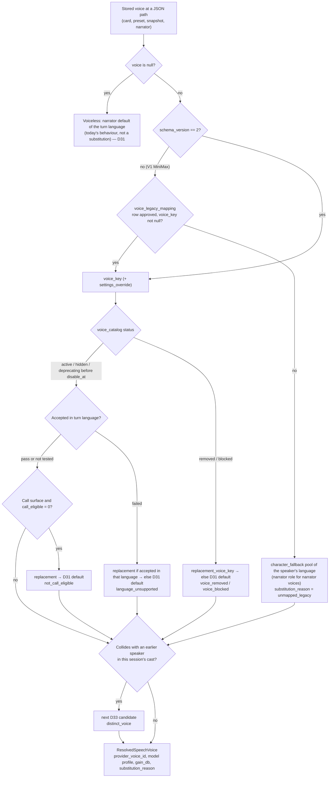
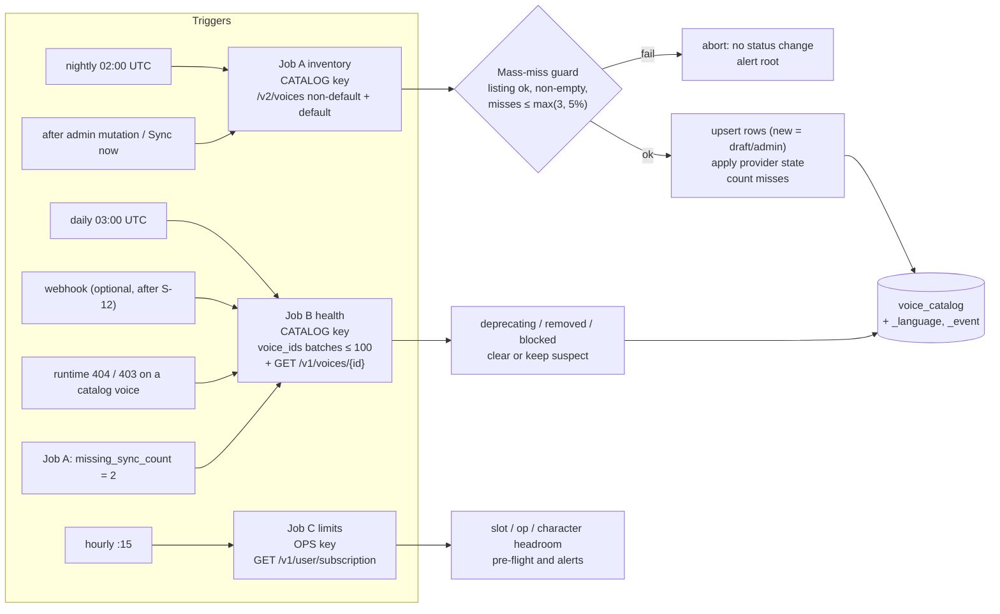
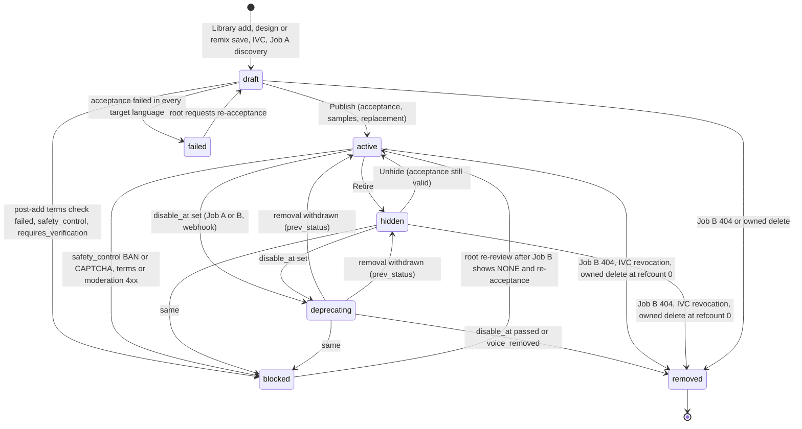
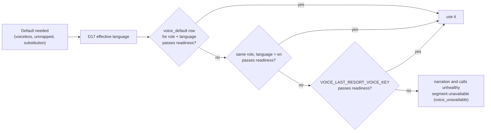

# Voice catalog and Voice Library design

- **Date:** 2026-10-12
- **Status:** Proposed (see [03](03_target_architecture_and_decisions.md) for sign-off status)

## Scope

This document designs the ElevenLabs voice **catalog** for magic-worlds. It covers where catalog voices come from, how they are identified, stored, synced, previewed, accepted, published, retired and replaced, which voice plays when none is assigned or the assigned one has gone, and the read API the SPA uses. It implements decisions D09, D10, D11, D19, D31, D33, D34, D35 and D38 of the decision record. It copies the canonical definitions of [03 §5.1, §5.2 and §5.10–§5.12](03_target_architecture_and_decisions.md) verbatim, marked as such.

The Voice Studio, presets and root console screens are in [05](05_voice_studio_and_admin_console.md). Narration and call synthesis are in [06](06_chat_narration_migration.md) and [07](07_realtime_calls_migration.md). The module-level plans are [08](08_backend_refactor_plan.md) (backend) and [09](09_frontend_refactor_plan.md) (frontend). The data rewrite is in [10](10_data_migration_and_rollout.md) and the legal texts are in [13](13_policy_privacy_and_compliance.md). This document links to them rather than repeating them.

**Related:** [README](README.md) · [03 decision record](03_target_architecture_and_decisions.md) (source of truth) · [01 current state](01_current_state.md) · [02 ElevenLabs capabilities](02_elevenlabs_capabilities.md) · [05](05_voice_studio_and_admin_console.md) · [06](06_chat_narration_migration.md) · [07](07_realtime_calls_migration.md) · [08](08_backend_refactor_plan.md) · [09](09_frontend_refactor_plan.md) · [10](10_data_migration_and_rollout.md) · [11](11_cost_plans_and_operations.md) · [12](12_best_practices_and_improvements.md) · [13](13_policy_privacy_and_compliance.md) · [14](14_staging_spike_and_contract_tests.md) · [15](15_implementation_plan_and_acceptance.md) · [16](16_risks_and_open_questions.md) · research [03](research/03_elevenlabs_voices_catalog_cloning_design.md), [08](research/08_voice_data_model_migration_surface.md), [10](research/10_gap_policy_licensing.md), [11](research/11_gap_catalog_api_semantics.md), [13](research/13_gap_codebase_checks.md), [14](research/14_cost_model.md)

**Conventions.**
- Decisions are cited as (D09), staging spikes as (S-11) and pending written confirmations from ElevenLabs as (L-2), all as defined in [03 §3, §6](03_target_architecture_and_decisions.md).
- A fact that still depends on a spike or a legal answer carries its id and is never stated as certain.
- Prices, plan limits and model facts are **as of 2026-10-12**.
- Text marked **(proposal)** is a detail this document adds where 03 is silent. It does not contradict 03, and every proposal is listed in §15.3 for confirmation.

---

## 1. Summary

1. **The catalog is ours.** A synced MySQL table, `voice_catalog`, is the source of truth. Users browse only our DB, never ElevenLabs; no provider call is made per user action (D10).
2. **Sources (D09).** Owned designed and remixed voices are the default. Curated Voice Library voices are always added to our account and pass strict filters: notice period ≥ 365 days, no live moderation, no custom rate, not famous, not child-like. They stay root-only until L-2 is answered in writing. IVC is root-only and requires a consent record. **Default (premade) voices are banned**: they expire on 2026-12-31.
3. **Identity (D11).** Every stored voice references the catalog through an opaque `voice_key`. Provider ids live only in the catalog, so removals, re-adds and renames are handled once, in one row.
4. **Health (D10, D19).** Three jobs keep the catalog in sync: Job A (inventory, nightly), Job B (health, daily and on demand) and Job C (limits, hourly). A mass-miss guard and per-voice confirmation prevent false removals. Runtime 404s mark a voice `suspect` and substitute its replacement immediately. Polling is primary; the webhook is an optional accelerator after S-12.
5. **Previews (D10, D18).** Catalog auditions play **our own** pre-rendered samples (`voice_sample_asset`). Upstream `preview_url` audio is never served to users before L-3 and is never hotlinked.
6. **Lifecycle (D19).** A voice moves through add → acceptance → publish → retire (`status=hidden`) or replace → removal. Library copies are never deleted from the console. Every published voice has a replacement.
7. **Defaults (D31, D33).** Default and fallback voices are `voice_default` rows per (role, language), not env ids. One last-resort key remains in env. Speakers with different stored voices never share a provider voice in one session.
8. **Acceptance (D09, D16, D06).** Fixed en/es scripts are rendered on Flash and v4 and scored on a 1–5 rubric. The loudness measurement yields `gain_db`, and publishing requires `call_eligible=1`.
9. **User API (D35).** `GET /voices/catalog` offers filters, cursor pagination, a `recommended_for` sort and a `?keys=` batch. From R1 every stored voice in a read DTO carries an `effective_voice` projection with badges.

### 1.1 What this replaces

| Piece | Today (MiniMax) | Target |
|---|---|---|
| User voice list | `GET /voice-presets/system-voices` proxies MiniMax system voices with a 5-minute in-process cache ([voice_presets.py:87-96](/home/andres/PycharmProjects/magic-worlds-api/src/routes/voice_presets.py), [minimax_voice_admin.py:46](/home/andres/PycharmProjects/magic-worlds-api/src/services/minimax_voice_admin.py)) | `GET /voices/catalog` served from `voice_catalog` (§12) |
| Reaching users | The picker reads only `groups.system`, so voices root designs or clones never reach users ([VoicePickerDialog.tsx:61](/home/andres/WebstormProjects/magic-worlds/src/features/voices/components/VoicePickerDialog.tsx)) | An explicit **Publish** step (§8.3) |
| Filters | Client-side search; the language is derived from the MiniMax id prefix ([SystemVoicePicker.tsx:16-34](/home/andres/WebstormProjects/magic-worlds/src/features/voices/components/SystemVoicePicker.tsx), [voiceLanguage.ts:15-21](/home/andres/WebstormProjects/magic-worlds/src/features/admin/voices/voiceLanguage.ts)) | Server-side filters on catalog columns and per-language rows (§12) |
| Auditions | Every audition synthesizes free text, unmetered ([voice_presets.py:99-118](/home/andres/PycharmProjects/magic-worlds-api/src/routes/voice_presets.py), [usePreviewVoice.ts:12-37](/home/andres/WebstormProjects/magic-worlds/src/features/voices/usePreviewVoice.ts)) | Own samples (free) plus metered fixed-text recipe renders (§7) |
| Admin delete | Calls the provider directly ([admin_voices.py:182-196](/home/andres/PycharmProjects/magic-worlds-api/src/routes/admin_voices.py)) | Soft retire; guarded delete for owned voices only (§8.7) |
| Default voice | Env `TTS_DEFAULT_VOICE_ID`; readiness checks only that it is non-empty ([config.py:205-208, 274-275](/home/andres/PycharmProjects/magic-worlds-api/src/services/tts_generation/config.py)) | `voice_default` rows plus `VOICE_LAST_RESORT_VOICE_KEY` (§9) |
| Voice object | Raw MiniMax `voice_id` plus recipe ([character.py:11-24](/home/andres/PycharmProjects/magic-worlds-api/src/models/character.py)) | `CharacterVoice` v2 with `voice_key` (§4.2) |

---

## 2. Goals and non-goals

### 2.1 Goals

| # | Goal | How the design meets it | Measured by |
|---|---|---|---|
| G-1 | **A voice sounds like the same character everywhere**: Standard narration, Expressive narration and calls | Acceptance on `eleven_flash_v2_5` and `eleven_v4`; `call_eligible=1` required to publish (D06, D09) | `voice_catalog_acceptance` rows; consistency score ≥ 4 |
| G-2 | **No turn fails because of one voice** | The resolver never raises; replacements and defaults are pre-chosen; runtime 404 → substitute (D19, D32, §5.10) | `voice_unavailable` < 0.5% of segments (D28 rollback trigger) |
| G-3 | **Users never reach the provider** | DB catalog, BFF-served samples, no hotlinking, no live Library browsing for users (D10) | No provider request on any `/voices/*` user route |
| G-4 | **Licence-safe sourcing** | Owned voices first; Library voices behind L-2 and filters; Default voices banned (D09) | Startup/CI guard; publish checklist |
| G-5 | **Stable identity despite provider churn** | `voice_key` indirection; display names are ours (D11) | Zero document rewrites on re-add, rename or removal |
| G-6 | **Explicit, probed defaults** | `voice_default` table plus readiness probes (D31, D04) | Readiness green; required rows present at R0 exit |
| G-7 | **Bounded cost and capacity** | Own samples, metered recipe previews, slot and op pre-flight (D18, D19) | Job C headroom; preview spend ≈ $16/month at 10k MAU [research 14 §7](research/14_cost_model.md) |
| G-8 | **Auditable** | `voice_catalog_event` for every transition and root action; consent records (D20) | Event per transition, with actor |
| G-9 | **Explicit language quality** | en/es curated; other languages get light acceptance and are badged, never silently substituted (D34) | `not_tested_language` badge coverage |

### 2.2 Non-goals

- **Users creating provider voices** (design, clone, remix). Personalisation goes through presets (D20, [05](05_voice_studio_and_admin_console.md)).
- **Users browsing the live Voice Library.** Only root does, through the console (D20). This keeps us away from the PUP §12 "proxy" line [research 10 §8.1](research/10_gap_policy_licensing.md).
- **PVC creation.** Commissioned PVCs arrive through sharing plus a Library add (D20).
- **Mirroring the Voice Library.** It holds 8,789 Spanish voices alone [research 11 §4.5](research/11_gap_catalog_api_semantics.md); we store only what root adds.
- **Serving upstream preview audio before L-3** (D10).
- **Auto-casting voiceless characters.** That is a P1 option, because `Character` has no gender field (D31).
- **Per-project catalogs.** The catalog is global per deployment; a `voice_catalog_scope` table is the future path ([03 §5.2](03_target_architecture_and_decisions.md)).
- **Per-character gain or pitch** (D15), adult/NSFW voice content (D26), and theme songs (D01).

---

## 3. Sourcing policy

### 3.1 Source matrix (D09)

| Source | `source_kind` | Policy (D09) | Uses a custom slot | Public before L-2? |
|---|---|---|---|---|
| Owned Voice Design (`eleven_ttv_v3`) | `designed` | **Allowed, preferred** for archetypes and edgy dark-fantasy narration. Must pass the v4 **and** Flash audition (designed voices may be less performative on v4). | Yes | **Yes** |
| Remix of an owned voice | `remixed` | Allowed | Yes | **Yes** |
| Remix of a Library voice (perpetual or not) | `remixed` (`parent_voice_key` → Library row) | Only when L-2 and L-12 are answered positively, L-16 is answered, and `terms_at_add.voice_mixing_allowed = true` was recorded at add time (C16) | Yes | No |
| ElevenLabs perpetual Library voices (`notice_period ≥ 4015`, including the Default replacements) | `library_perpetual` | **Allowed** after add and acceptance. Keep our own display names, because names drift. Ownership and permanence: L-12, S-27. | No | No (`visibility=admin`) |
| Curated community Library voices | `library_noticed` (notice 365–730) | Allowed only if every filter in §3.2 holds | No | No (`visibility=admin`) |
| Root-only IVC | `ivc` | **Allowed** with a consent record (D20; `chk_voice_catalog_ivc_consent`) | Yes | Not an L-2 question (not a Library voice), but D09's L-2 safe default names only designed voices and owned remixes, and D31 defaults exclude IVC. Publishing an IVC needs owner sign-off and a consent `scope` that covers public use **(proposal, P-15)** |
| Commissioned PVC shared to us | `pvc_shared` | **Allowed** with a written licence from the actor that covers this app's use and content scope [research 10 §8.2](research/10_gap_policy_licensing.md) | No | It arrives through a Library add, so it is `admin` until LEGAL clears it; L-2 is the safe default **(proposal)** |
| **Default / premade** | `premade_deprecated` | **Banned** (§3.3) | — | Never |
| Live-moderated, custom-rate, famous, child-like or sound-alike voices | — | **Banned**. They are never added; if one is detected after an add, it is set to `blocked` (§3.2). | — | Never |

### 3.2 Library eligibility filters

The admin Library browser calls `GET /v1/shared-voices` **live**, with the `ADMIN` key (which holds `voices_read`), and is root-only (D20). Unauthenticated enumeration is never automated [research 11 §11](research/11_gap_catalog_api_semantics.md). Several API filters **default to including** the voices we ban, so the BFF must send them explicitly and re-check the result [research 10 §7](research/10_gap_policy_licensing.md).

| Criterion (D09) | Browse: query sent by the BFF (enforced, not user-editable) | After add: check on our copy (`GET /v1/voices/{provider_voice_id}`) | Stored in |
|---|---|---|---|
| Added to our account | always `POST /v1/voices/add/{public_owner_id}/{voice_id}` | `sharing.status = copied` | `provider_voice_id`, `library_voice_id`, `public_owner_id`, `added_at` |
| `notice_period ≥ 365` | `min_notice_period_days=365` | `sharing.notice_period ≥ 365` | `notice_period_days`; `source_kind = library_perpetual` if ≥ 4015, else `library_noticed` |
| `rate = 1.0`, `fiat_rate` null | `include_custom_rates=false` | `sharing.rate == 1`, `sharing.fiat_rate is null` | `terms_at_add.rate`, `.fiat_rate` |
| Live moderation off **at add time** | `include_live_moderated=false` | `sharing.live_moderation_enabled == false` | `terms_at_add.live_moderation_enabled` |
| `sharing.category ≠ famous` | `category=high_quality` by default (or `professional`); the BFF refuses `famous` | `category ≠ famous` | `provider_category` |
| `safety_control` NONE or null | — | `safety_control ∈ {NONE, null}` | `safety_control` |
| Not child-like | Manual. The Library already bans child-like voices [research 03 §4.7](research/03_elevenlabs_voices_catalog_cloning_design.md), but we verify by ear. | Acceptance gate (§10.4) | `voice_catalog_acceptance.scores`, `metadata` |
| No public-figure name or description | Manual review, plus a deny-list check on `provider_name` and `description` **(proposal)** | Publish checklist (§8.3) | `voice_catalog_event` payload |
| Useful for en/es | `language=en` / `es` | `verified_languages` filtered by the model allow-list | `voice_catalog_language` |

Rules around the filters:
- **Our copy's terms are authoritative.** The owner's terms are locked when we add a voice. A re-add picks up the owner's **current** terms [research 11 §2.4, §10.1](research/11_gap_catalog_api_semantics.md). If the post-add check fails, the row is set to `status=blocked` with the reason in the event payload, and it is never published. The copy is not deleted (§8.7).
- `free_users_allowed` is irrelevant, because our workspace is paid [research 11 §10.4](research/11_gap_catalog_api_semantics.md).
- How a Live Moderation refusal surfaces is undocumented (L-6) [research 10 §3.4](research/10_gap_policy_licensing.md). Excluding moderated voices makes the question moot.
- `recording_quality ∈ {studio, good}` is a curation preference, not a rule [research 03 §12.1](research/03_elevenlabs_voices_catalog_cloning_design.md).

### 3.3 Default (premade) voices are banned

**Why** [research 11 §1](research/11_gap_catalog_api_semantics.md):
- **They expire on 2026-12-31.** The exact cut-off instant and time zone are not stated, so we plan for **2026-12-30 00:00 UTC**.
- **New accounts never have them.** Only accounts created before March 2026 have Default voices (S-1 records ours).
- **Post-expiry behaviour is undocumented.** Requests may fail (404 or 403) or silently switch to another voice. Both break character consistency.
- **Official samples are a trap.** The quickstart and the MCP server still use Default ids.
- **The official replacements are no shortcut.** None of the 16 confirmed replacements lists `eleven_v4` in `verified_languages`, and two have already been renamed.

**Enforcement:**

| Control | Rule |
|---|---|
| Job A | A **separate** `GET /v2/voices?voice_type=default` query tags premade voices `source_kind=premade_deprecated`, `visibility=admin`. The non-default query cannot see them (D10). `chk_voice_catalog_no_premade_public` makes them unpublishable. |
| Never used as | A published voice, a `voice_legacy_mapping` target or alternate, a `voice_default` row, a `replacement_voice_key`, or `VOICE_LAST_RESORT_VOICE_KEY` |
| Startup / CI guard | Rejects any of the above whose `provider_voice_id` is on the deny-list below, or whose `provider_category = premade` (D09) |
| Alert | From **2026-12-01**, an alert fires if any reference to a `premade_deprecated` row remains (D09) |
| Calendar test | T13 on 2027-01-01 records post-expiry behaviour for the incident playbook only [research 11 §9](research/11_gap_catalog_api_semantics.md) |

The deny-list holds the old Default ids from [research 11 §1.2](research/11_gap_catalog_api_semantics.md):

```text
CwhRBWXzGAHq8TQ4Fs17  Roger     EXAVITQu4vr4xnSDxMaL  Sarah     FGY2WhTYpPnrIDTdsKH5  Laura
IKne3meq5aSn9XLyUdCD  Charlie   JBFqnCBsd6RMkjVDRZzb  George    N2lVS1w4EtoT3dr4eOWO  Callum
SAz9YHcvj6GT2YYXdXww  River     SOYHLrjzK2X1ezoPC6cr  Harry     TX3LPaxmHKxFdv7VOQHJ  Liam
Xb7hH8MSUJpSbSDYk0k2  Alice     XrExE9yKIg1WjnnlVkGX  Matilda   bIHbv24MWmeRgasZH58o  Will
cgSgspJ2msm6clMCkdW9  Jessica   cjVigY5qzO86Huf0OWal  Eric      iP95p4xoKVk53GoZ742B  Chris
nPczCjzI2devNBz1zQrb  Brian     onwK4e9ZLuTAKqWW03F9  Daniel    pFZP5JQG7iQjIQuC4Bku  Lily
pqHfZKP75CvOlQylNhV4  Bill
```

The **replacement** voices (Darian, Talia, Eldrin and the others) are ordinary Library voices with `notice_period = 4015`. They are `library_perpetual` candidates, subject to L-2, L-12 and S-27 and to acceptance; nothing about them is special-cased.

### 3.4 Owned voices

| Kind | Flow (root console, `ADMIN` key; screens in [05](05_voice_studio_and_admin_console.md)) | Constraints |
|---|---|---|
| **Voice Design** | 1. `POST /v1/text-to-voice/design` (`eleven_ttv_v3`) returns 3 previews; keep their `audio_base_64` locally.<br>2. Save with `POST /v1/text-to-voice` in the **same session** (the `generated_voice_id` lifetime is undocumented, S-20).<br>3. Write labels `{language, accent, gender, age}`.<br>4. Store the chosen preview as a `design_preview` sample. | 1 slot per save; "design many, save few". No sound-alike prompts. No child-like designs in the public catalog [research 10 §8.5](research/10_gap_policy_licensing.md). |
| **Remix** | `POST /v1/text-to-voice/{voice_id}/remix`, then save as above; set `parent_voice_key` | Owned parents any time; Library parents only under the D09 remix rule (§3.1) |
| **IVC** | The consent record comes first (`voice_consent_record`, D20), then a multipart create. `requires_verification` → `blocked` until completed (S-22). | Samples stay encrypted and root-only while the voice exists. Records are kept for max(legal period, deletion + 5 years). Revocation follows §8.8. Third-party verification path: L-13. |
| **MiniMax custom voices** | Retired (D22). They cannot be re-created from local data: no audio, prompt or consent was ever stored [research 13 §2](research/13_gap_codebase_checks.md). | Re-created as an IVC only with off-platform audio plus fresh consent naming ElevenLabs |

### 3.5 The L-2 safe default and the demotion path

- **Until L-2 has a written answer**, every Library voice (perpetual or noticed) stays `visibility=admin`. The public catalog is **owned designed voices plus remixes of owned voices**. Library-derived remixes are **not** a safe default (D09).
- **"Hear" rule (proposal, derived from D09 and D31).** Until L-2, every voice a user can *hear* through the catalog machinery must be owned (`designed`, or `remixed` from an owned parent; `ivc` only under P-15), not only the voices they can pick. That covers published voices, `voice_default` rows (already owned-only per D31), `voice_legacy_mapping` targets and alternates, and `replacement_voice_key` targets. Otherwise users would hear Library voices through a mapping they never chose, which is the exposure L-2 asks about.
- **The launch target is reachable without the Library.** The ≥ 40 published voices must be reachable with owned designs alone (S-14 fallback, D09).
- **Demotion** applies if L-2 is answered negatively after Library voices went public, or if ElevenLabs withdraws permission (D09):
  1. set `status=hidden` (no new picks);
  2. existing references keep resolving;
  3. owners see the "Voice leaving" badge with a one-click switch to the owned `replacement_voice_key`;
  4. the D19 removal batch runs on a date LEGAL sets.

  Unchanged voices are validated by shape only, so existing cards stay savable (D32). **(proposal)** The date comes from `voice_catalog.metadata.demotion = {date, reason}`, never from `disable_at`, which only the sync jobs write. This is the one case where a `hidden` row shows `leaving` instead of `retired`.

### 3.6 Launch size and coverage

| Target (D09, D31, D34) | Value | Fallback |
|---|---|---|
| Public voices at R0 exit | **≥ 40**: ≥ 16 en and ≥ 16 es, all `call_eligible=1`, accepted, with own samples | S-14: design owned Spanish voices; lower the target to ≥ 10 per language (owner decides at R0 exit) |
| Archetype coverage | narrator, hero, villain, mentor, companion, creature, noble, across genders and the age buckets `young`, `middle_aged`, `old` | Gaps are filled with Voice Design |
| Owned narrators | ≥ 1 owned designed narrator **per language per gender** (≥ 4 for en/es). These serve as D31 defaults and D33 candidates. | — |
| `character_fallback` pool | ≥ 4 per language, mixed gender (D31) | — |
| Light languages (D34) | One `narrator` default each, which may be a multilingual en/es voice that passed light acceptance | — |

**Curation report (proposal).** The console reports a coverage grid per language (archetype × gender × age), counting published voices per cell. A 7 × 2 grid needs about 14 voices, plus age variety, to reach 16. After L-2, the Library has 218 Spanish and 126 English perpetual voices to draw from, before acceptance [research 11 §4.5](research/11_gap_catalog_api_semantics.md).

---

## 4. Identity model

### 4.1 `voice_key` indirection (D11)

- `voice_key` = `vk_` + 32 lower-case hex characters. It is generated randomly when the catalog row is created (for example `secrets.token_hex(16)`, 128 random bits) **(proposal)**, never derived from a provider id, and never reused. Catalog rows are **never hard-deleted**.
- **Stored voices carry no provider voice id.** `CharacterVoice` v2 holds `voice_key`. The resolver maps `voice_key → voice_catalog.provider_voice_id` on every synthesis, following `replacement_voice_key` when the voice is `removed`.
- **What the indirection absorbs, in one row and with no document rewrites:**
  - a Library re-add that returns a new id (S-11): update `provider_voice_id`;
  - provider renames: `provider_name` drifts while `display_name` stays ours;
  - removals: `replacement_voice_key`;
  - a future second provider: new rows with another `provider` value.
- **`voice_name` in a stored voice is a display cache only**; it is never trusted for synthesis. Read DTOs show the catalog `display_name` through `effective_voice` (§12.3), and the cache is refreshed on the next write of that voice.

### 4.2 `CharacterVoice` v2 (canonical, copied from 03 §5.1)

```jsonc
{
  "schema_version": 2,                 // required, literal 2 (discriminator)
  "provider": "elevenlabs",            // required, literal for now; future providers add values
  "voice_key": "vk_3f0c2a9e5b7d4c1a8e6f0b2d4a6c8e1f", // required, our catalog key
  "voice_name": "Eldrin",              // required, display cache only (never trusted for synthesis)
  "settings": {                        // optional; null/absent => catalog default_settings
    "stability": 0.5,                  // 0..1
    "similarity_boost": 0.75,          // 0..1
    "style": 0.0,                      // 0..1 (not user-editable; root/lab only)
    "use_speaker_boost": true,         // bool (not user-editable; root/lab only)
    "speed": 1.0                       // 0.7..1.2
  },
  "emotion": "calm",                   // optional: happy|sad|angry|fearful|disgusted|surprised|calm|null
  "language_code": "es",               // optional: ISO 639-1 lower-case (yue/zh allowed), or null
  "preset_id": null,                   // optional, display-only link (≤64)
  "preset_name": null                  // optional, display-only (≤255)
}
```

Rules:
- No `model_id`, no provider voice id, no `pitch`, no `vol`, no gain, no tag prefix and no free-text delivery.
- Card props (`tb_card_*`) serialize all keys, with `null` for unused ones. Snapshots serialize with `exclude_none`. Readers accept both.
- Within `settings`, `null` and absent mean the same thing: "use the catalog default". The resolver then falls back to ElevenLabs defaults (stability 0.5, similarity 0.75, style 0, speaker boost true, speed 1.0).
- Floats accept JSON integers (0, 1).
- **Legacy V1** is the current MiniMax shape `{voice_id, speed, vol, pitch, emotion, language_boost, preset_id, preset_name}` (`/home/andres/PycharmProjects/magic-worlds-api/src/models/character.py:11-24`). It is selected when `schema_version` is absent. Write rules for V1 are in §5.10 (after R5: accepted only when byte-identical to the stored value at the same path).

```ts
export type VoiceEmotion =
  | 'happy' | 'sad' | 'angry' | 'fearful' | 'disgusted' | 'surprised' | 'calm';

export interface VoiceSettingsV2 {
  stability?: number | null;        // 0..1
  similarity_boost?: number | null; // 0..1
  style?: number | null;            // 0..1
  use_speaker_boost?: boolean | null;
  speed?: number | null;            // 0.7..1.2
}

export interface CharacterVoiceV2 {
  schema_version: 2;
  provider: 'elevenlabs';
  voice_key: string;                // /^vk_[0-9a-f]{32}$/
  voice_name: string;               // 1..255
  settings?: VoiceSettingsV2 | null;
  emotion?: VoiceEmotion | null;
  language_code?: string | null;    // /^[a-z]{2,3}$/
  preset_id?: string | null;        // ≤64
  preset_name?: string | null;      // ≤255
}

/** Legacy MiniMax shape: never created by new code; preserved when unchanged (§5.10). */
export interface CharacterVoiceLegacyV1 {
  voice_id: string;
  speed?: number | null;
  vol?: number | null;
  pitch?: number | null;
  emotion?: VoiceEmotion | null;
  language_boost?: string | null;
  preset_id?: string | null;
  preset_name?: string | null;
}

export type StoredCharacterVoice = CharacterVoiceV2 | CharacterVoiceLegacyV1;
export const isVoiceV2 = (v: StoredCharacterVoice): v is CharacterVoiceV2 =>
  (v as CharacterVoiceV2).schema_version === 2;
```

FE parsers (`readCharacterVoice`, `snapshotVoice`, `voiceFromPreset`) must preserve the whole object for both shapes. They must never strip fields of either shape.

The pydantic field list is in [03 §5.1.3](03_target_architecture_and_decisions.md). Catalog eligibility is checked only when a voice is set or changed (`validate_voice_change`, D32, §5.5).

### 4.3 Resolution chain



Notes:
- The resolver follows **one** replacement hop, then the D31 chain. It never raises for one voice, and it substitutes per segment ([03 §5.10](03_target_architecture_and_decisions.md)).
- **Non-cohort route (R1–R4).** A non-cohort user's MiniMax job that meets a V2 voice uses `voice_legacy_fallback` (§4.4). The MiniMax default is used only when the voice has no reverse entry, which raises an alert (D21, D28).
- **`gain_db`.** The resolver reads it from `voice_catalog_acceptance` for (voice, model, effective language), falling back to the voice's `primary_language` row, else 0 **(proposal; D16 fixes only the per-(voice, model) intent)**.

### 4.4 Mapping and lookup tables

| Table or column | Maps | Written by | Read by | Lifetime |
|---|---|---|---|---|
| `voice_legacy_mapping` | MiniMax id → `voice_key`, ordered `alternate_voice_keys`, `settings_override`, `legacy_language` | Console Legacy-mapping module (curated by audition, D20) | Resolver (V1 values), the R5 one-shot rewrite ([10](10_data_migration_and_rollout.md)), the restricted MiniMax picker (approved ids only, D21) | Permanent (frozen V1 snapshots) |
| `voice_legacy_fallback` | `voice_key` → representative MiniMax id. `derived` = the most-referenced approved legacy id mapped to it; `curated` = a root choice of the same language, gender and age. | A derivation job plus console overrides | Non-cohort playback of V2 voices; every V2 voice after a rollback (D21) | R1–R4; dropped after R4 |
| `voice_default` | (role, language, rank) → `voice_key` | Console Defaults module (D31 checks) | Resolver, readiness probes | Permanent |
| `voice_catalog.replacement_voice_key` | voice → voice | Console (§8.5) | Resolver | Permanent |
| `voice_reference` | `voice_key` → referencing documents | Write services on save, plus a nightly scan (§5.6) | Impact view, delete guard | Permanent |

### 4.5 Legacy mapping curation rules

1. **Coverage (D21).** The mapping must cover 100% of the distinct MiniMax ids referenced in live data (G6 counts, run by DATA), plus every MiniMax system voice the restricted picker still offers. It is re-checked before R1, before each canary step, at R3 and before R5; any gap blocks that step. Persona voices are mapped but excluded from the coverage gates (D38).
2. **Only `approved` rows count.** The resolver treats `proposed` and `retired` rows as unmapped **(proposal; [research 08 §13](research/08_voice_data_model_migration_surface.md) uses approved only)**. A row with `voice_key = null` means "explicitly unmapped".
3. **Targets are chosen by audition.** The Acceptance module's side-by-side player compares the candidate with the MiniMax reference on language (`legacy_language`, from the id prefix or `language_boost`), gender, age and timbre. MiniMax reference clips can be rendered only while the MiniMax key is live, so before R4.
4. **Distinct-voice curation (D33).** DATA reports two metrics: **legacy ids per target voice**, and how often mapped ids co-occur in the same casts. A target that receives co-occurring legacy ids gets ordered `alternate_voice_keys` before R0 exit.
5. **Settings overrides (D15).** "Pitched-down" MiniMax presets may map to a deeper target, optionally with a `settings_override` (VoiceSettingsV2 shape).
6. **Languages other than en/es (D34)** map to multilingual targets that passed light acceptance in that language; if none exists, they map to the closest en/es voice by gender and age.
7. **MiniMax custom voices (D22)** map to audition-chosen targets, or go through the unmapped policy.
8. **Targets are owned until L-2** (§3.5).

---

## 5. Database schema

### 5.1 Table inventory

| Table | Purpose | Decision | Detailed in |
|---|---|---|---|
| `voice_catalog` | One row per provider voice we know | D10, D11 | §5.2 |
| `voice_catalog_language` | Per-language capability and own sample pointer | D10, D34 | §5.2, §11 |
| `voice_catalog_acceptance` | Acceptance results per (voice, model, language) | D09, D16 | §10 |
| `voice_catalog_event` | Audit log; webhook dedupe | D10, D19 | §6.8 |
| `voice_reference` | Reference tracking | D19 | §5.6 |
| `voice_legacy_mapping` | MiniMax id → `voice_key` | D21, D33 | §4.5 |
| `voice_consent_record` | IVC consent evidence | D20 | §3.4, [13](13_policy_privacy_and_compliance.md) |
| `voice_default` | Defaults per (role, language) | D31 | §9 |
| `voice_legacy_fallback` | Reverse mapping, R1–R4 | D21, D28 | §4.4 |
| `voice_preview_render` | Recipe preview cache and in-flight source | D18 | §7.5 |
| `voice_sample_asset` | Own catalog samples | D10 | §7.2 |
| `voice_review_flag`, `voice_migration_audit` | Review flags and rewrite audit | D15, D21 | [10](10_data_migration_and_rollout.md) |
| `voice_preset` v2 | Presets on catalog voices | D12 | [05](05_voice_studio_and_admin_console.md), [03 §5.3](03_target_architecture_and_decisions.md) |

### 5.2 Canonical DDL (copied verbatim from 03 §5.2)

Catalog core:

```sql
create table voice_catalog (
    voice_key               varchar(64)  character set utf8mb4 collate utf8mb4_bin primary key, -- 'vk_' + 32 hex
    provider                varchar(32)  character set utf8mb4 collate utf8mb4_bin not null default 'elevenlabs',
    provider_voice_id       varchar(64)  character set utf8mb4 collate utf8mb4_bin not null,  -- id used for synthesis (returned by add/save)
    source_kind             varchar(24)  character set utf8mb4 collate utf8mb4_bin not null,
        -- designed|remixed|ivc|pvc_shared|library_perpetual|library_noticed|premade_deprecated
    provider_category       varchar(24)  character set utf8mb4 collate utf8mb4_bin null,      -- generated|cloned|professional|high_quality|premade|famous
    library_voice_id        varchar(64)  character set utf8mb4 collate utf8mb4_bin null,
    public_owner_id         varchar(128) character set utf8mb4 collate utf8mb4_bin null,
    parent_voice_key        varchar(64)  character set utf8mb4 collate utf8mb4_bin null,      -- remix lineage
    provider_name           varchar(255) not null,                                            -- provider's name (drifts)
    display_name            varchar(255) not null,                                            -- ours
    description             text null,
    gender                  varchar(16)  character set utf8mb4 collate utf8mb4_bin null,      -- male|female|neutral
    age                     varchar(16)  character set utf8mb4 collate utf8mb4_bin null,      -- young|middle_aged|old
    accent                  varchar(64)  null,
    primary_language        varchar(8)   character set utf8mb4 collate utf8mb4_bin null,      -- ISO 639-1
    tags                    json null,                                                         -- our roleplay taxonomy
    provider_labels         json null,
    default_settings        json null,                                                         -- VoiceSettingsV2 shape
    notice_period_days      int null,
    disable_at              datetime null,
    sharing_status          varchar(24)  character set utf8mb4 collate utf8mb4_bin null,      -- enabled|disabled|copied|copied_disabled
    terms_at_add            json null,       -- {live_moderation_enabled, free_users_allowed, rate, fiat_rate, voice_mixing_allowed}
    added_at                datetime null,
    safety_control          varchar(24)  character set utf8mb4 collate utf8mb4_bin null,      -- NONE|BAN|CAPTCHA|ENTERPRISE_BAN|ENTERPRISE_CAPTCHA
    uses_custom_slot        tinyint(1) not null default 0,
    status                  varchar(16)  character set utf8mb4 collate utf8mb4_bin not null default 'draft',
        -- draft|active|hidden|deprecating|removed|blocked|failed
    suspect_since           datetime null,
    visibility              varchar(16)  character set utf8mb4 collate utf8mb4_bin not null default 'admin', -- admin|public|plan_gated (who may PICK; playback is never gated)
    min_plan                varchar(32)  character set utf8mb4 collate utf8mb4_bin null,      -- required when plan_gated; compared by plan rank
    call_eligible           tinyint(1) not null default 0,
    replacement_voice_key   varchar(64)  character set utf8mb4 collate utf8mb4_bin null,
    consent_record_id       varchar(64)  character set utf8mb4 collate utf8mb4_bin null,
    sort_rank               int not null default 1000,
    created_by_user_id      int null,
    last_synced_at          datetime null,
    last_seen_at            datetime null,
    missing_sync_count      int not null default 0,
    last_error_code         varchar(64) null,
    sync_hash               char(64) character set utf8mb4 collate utf8mb4_bin null,
    metadata                json null,
    created_at              datetime default CURRENT_TIMESTAMP not null,
    updated_at              datetime default CURRENT_TIMESTAMP not null on update CURRENT_TIMESTAMP,
    unique key uq_voice_catalog_provider (provider, provider_voice_id),
    key idx_voice_catalog_public (visibility, status, primary_language, gender, age, sort_rank),
    key idx_voice_catalog_disable (status, disable_at),
    fulltext key ftx_voice_catalog_text (display_name, description),
    constraint chk_voice_catalog_ivc_consent check (source_kind <> 'ivc' or consent_record_id is not null),
    constraint chk_voice_catalog_no_premade_public check (source_kind <> 'premade_deprecated' or visibility = 'admin'),
    constraint chk_voice_catalog_plan_gate check (visibility <> 'plan_gated' or min_plan is not null)
) engine = InnoDB default character set = utf8mb4 collate = utf8mb4_0900_ai_ci;

-- Per-language capability and own samples (from verified_languages, filtered by the model allow-list).
create table voice_catalog_language (
    voice_key           varchar(64) character set utf8mb4 collate utf8mb4_bin not null,
    language            varchar(8)  character set utf8mb4 collate utf8mb4_bin not null,
    locale              varchar(16) character set utf8mb4 collate utf8mb4_bin null,
    accent              varchar(64) null,
    model_ids           json not null,
    sample_asset_id     varchar(64) character set utf8mb4 collate utf8mb4_bin null,   -- own pre-rendered sample (voice_sample_asset.sample_asset_id)
    preview_source_key  varchar(512) null,                                            -- upstream URL minus timestamp
    preview_sha256      char(64) null,
    primary key (voice_key, language)
) engine = InnoDB default character set = utf8mb4 collate = utf8mb4_0900_ai_ci;

-- Acceptance protocol results per (voice, model, language) — G7.
create table voice_catalog_acceptance (
    voice_key        varchar(64) character set utf8mb4 collate utf8mb4_bin not null,
    model_id         varchar(64) character set utf8mb4 collate utf8mb4_bin not null,
    language         varchar(8)  character set utf8mb4 collate utf8mb4_bin not null,
    verdict          varchar(8)  character set utf8mb4 collate utf8mb4_bin not null,  -- pass|fail
    scores           json not null,   -- {timbre, naturalness, emotion_tags, accent, artefacts, consistency_vs_v4}
    integrated_lufs  double null,
    gain_db          double null,     -- <= 0 (attenuation only)
    script_version   varchar(16) not null,
    reviewed_by_user_id int not null,
    reviewed_at      datetime not null,
    primary key (voice_key, model_id, language)
) engine = InnoDB default character set = utf8mb4 collate = utf8mb4_0900_ai_ci;

create table voice_catalog_event (
    event_id     varchar(64) character set utf8mb4 collate utf8mb4_bin primary key,
    voice_key    varchar(64) character set utf8mb4 collate utf8mb4_bin null,
    event_type   varchar(40) character set utf8mb4 collate utf8mb4_bin not null,
        -- synced|added_from_library|designed|remixed|cloned|published|hidden|retired|removal_notice|
        -- removal_withdrawn|removed|suspect|replaced|deleted|webhook_received|sync_missing
    actor_user_id int null,
    payload      json null,
    dedupe_key   varchar(128) character set utf8mb4 collate utf8mb4_bin null,
    created_at   datetime default CURRENT_TIMESTAMP not null,
    unique key uq_voice_catalog_event_dedupe (dedupe_key),
    key idx_vce_voice (voice_key, created_at)
) engine = InnoDB default character set = utf8mb4 collate = utf8mb4_0900_ai_ci;

-- Reference tracking (written on save + nightly scan incl. frozen snapshots).
create table voice_reference (
    voice_key  varchar(64) character set utf8mb4 collate utf8mb4_bin not null,
    ref_type   varchar(32) character set utf8mb4 collate utf8mb4_bin not null, -- card|card_draft|card_version|preset|template_cast|session_snapshot
    ref_id     varchar(128) character set utf8mb4 collate utf8mb4_bin not null,
    updated_at datetime default CURRENT_TIMESTAMP not null on update CURRENT_TIMESTAMP,
    primary key (voice_key, ref_type, ref_id),
    key idx_voice_reference_ref (ref_type, ref_id)
) engine = InnoDB default character set = utf8mb4 collate = utf8mb4_0900_ai_ci;

-- Legacy MiniMax id -> catalog voice (read-time translation; curated by audition).
create table voice_legacy_mapping (
    legacy_provider     varchar(32)  character set utf8mb4 collate utf8mb4_bin not null,  -- 'minimax'
    legacy_voice_id     varchar(256) character set utf8mb4 collate utf8mb4_bin not null,
    voice_key           varchar(64)  character set utf8mb4 collate utf8mb4_bin null,      -- null = explicitly unmapped
    alternate_voice_keys json null,                                                        -- ordered candidates for the D33 distinct-voice rule
    settings_override   json null,                                                         -- VoiceSettingsV2 shape
    legacy_language     varchar(8)   character set utf8mb4 collate utf8mb4_bin null,      -- language of the MiniMax voice (D34, R5 default choice)
    status              varchar(16)  character set utf8mb4 collate utf8mb4_bin not null,  -- proposed|approved|retired
    reviewed_by_user_id int null,
    reviewed_at         datetime null,
    notes               text null,
    primary key (legacy_provider, legacy_voice_id)
) engine = InnoDB default character set = utf8mb4 collate = utf8mb4_0900_ai_ci;

create table voice_consent_record (
    consent_record_id   varchar(64) character set utf8mb4 collate utf8mb4_bin primary key,
    subject_name        varchar(255) not null,
    subject_contact     varchar(255) null,
    subject_is_adult    tinyint(1) not null,
    identity_check_method varchar(64) not null,   -- e.g. id_document_in_person|video_call|notarised
    jurisdiction        varchar(16) not null,       -- ISO 3166-1/-2 of the subject (BIPA, TX, WA rules)
    biometric_consent_version varchar(32) not null,
    consent_version     varchar(32) not null,
    scope               text not null,
    document_ref        varchar(512) null,      -- encrypted storage key of signed release
    sample_sha256       json not null,          -- array of sha256 of uploaded samples
    samples_ref         varchar(512) null,      -- encrypted root-only storage
    signed_at           datetime not null,
    revoked_at          datetime null,
    retain_until        datetime null,          -- max(legal period, voice deletion + 5 years)
    recorded_by_user_id int not null,
    created_at          datetime default CURRENT_TIMESTAMP not null
) engine = InnoDB default character set = utf8mb4 collate = utf8mb4_0900_ai_ci;
```

Added after review (defaults, reverse mapping, previews, samples):

```sql
-- Default and fallback voices (D31).
create table voice_default (
    role        varchar(24) character set utf8mb4 collate utf8mb4_bin not null,  -- narrator|character_fallback
    language    varchar(8)  character set utf8mb4 collate utf8mb4_bin not null,  -- ISO 639-1
    `rank`      int not null,                                                      -- 1 = primary; pool order for character_fallback
    voice_key   varchar(64) character set utf8mb4 collate utf8mb4_bin not null,
    updated_by_user_id int not null,
    updated_at  datetime default CURRENT_TIMESTAMP not null on update CURRENT_TIMESTAMP,
    primary key (role, language, `rank`),
    key idx_voice_default_voice (voice_key)
) engine = InnoDB default character set = utf8mb4 collate = utf8mb4_0900_ai_ci;

-- Reverse mapping for non-cohort playback and rollback (D21, D28). Dropped after R4.
create table voice_legacy_fallback (
    voice_key        varchar(64)  character set utf8mb4 collate utf8mb4_bin primary key,
    legacy_provider  varchar(32)  character set utf8mb4 collate utf8mb4_bin not null,  -- 'minimax'
    legacy_voice_id  varchar(256) character set utf8mb4 collate utf8mb4_bin not null,
    source           varchar(16)  character set utf8mb4 collate utf8mb4_bin not null,  -- derived|curated
    updated_at       datetime default CURRENT_TIMESTAMP not null on update CURRENT_TIMESTAMP
) engine = InnoDB default character set = utf8mb4 collate = utf8mb4_0900_ai_ci;

-- Recipe preview render cache and in-flight source (D18).
create table voice_preview_render (
    cache_key          char(64)    character set utf8mb4 collate utf8mb4_bin primary key,  -- sha256 per D18
    provider           varchar(32) character set utf8mb4 collate utf8mb4_bin not null,
    provider_voice_id  varchar(64) character set utf8mb4 collate utf8mb4_bin not null,
    model_id           varchar(64) character set utf8mb4 collate utf8mb4_bin not null,
    status             varchar(16) character set utf8mb4 collate utf8mb4_bin not null,     -- rendering|ready|failed
    storage_path       varchar(512) null,
    byte_size          int null,
    requested_by_user_id int not null,       -- first requester; in-flight counted on (user, status='rendering')
    ledger_entry_id    varchar(64) null,     -- null when the render was within the free allowance
    request_id         varchar(128) null,
    created_at         datetime default CURRENT_TIMESTAMP not null,
    completed_at       datetime null,
    key idx_voice_preview_inflight (requested_by_user_id, status)
) engine = InnoDB default character set = utf8mb4 collate = utf8mb4_0900_ai_ci;

-- Own catalog samples (D10). No tts_job foreign key.
create table voice_sample_asset (
    sample_asset_id  varchar(64) character set utf8mb4 collate utf8mb4_bin primary key,
    voice_key        varchar(64) character set utf8mb4 collate utf8mb4_bin not null,
    language         varchar(8)  character set utf8mb4 collate utf8mb4_bin not null,
    model_id         varchar(64) character set utf8mb4 collate utf8mb4_bin not null,
    kind             varchar(16) character set utf8mb4 collate utf8mb4_bin not null,   -- showcase|design_preview|acceptance
    script_version   varchar(16) null,
    storage_path     varchar(512) not null,
    content_sha256   char(64) not null,
    content_type     varchar(32) not null,
    created_by_user_id int not null,
    created_at       datetime default CURRENT_TIMESTAMP not null,
    key idx_voice_sample_voice (voice_key, language, kind)
) engine = InnoDB default character set = utf8mb4 collate = utf8mb4_0900_ai_ci;
```

The catalog is global per deployment. A per-project restriction, if ever needed, is a `voice_catalog_scope(voice_key, project_hash)` table. Catalog rows are never hard-deleted.

### 5.3 Application-level invariants

The write service and the console enforce these rules **(proposal)**. DATA may later add matching CHECKs, without renaming any column ([03 §5.2](03_target_architecture_and_decisions.md)).

| # | Invariant |
|---|---|
| I-1 | `draft` and `failed` rows always have `visibility = admin`. |
| I-2 | `status = active` with `visibility ∈ {public, plan_gated}` requires all of: `call_eligible = 1`; a `pass` row on `eleven_flash_v2_5` for every published language; a `showcase` sample per accepted (language, tier); `replacement_voice_key` set; and the source policy satisfied (§3.1, L-2). |
| I-3 | `replacement_voice_key` ≠ `voice_key`. Its target is `active`, `visibility = public` (not `plan_gated`, so every owner can switch to it), `call_eligible = 1`, the same `primary_language`, the same gender, and the same age bucket where one exists. Owned targets are preferred, and two-cycles are rejected. |
| I-4 | `source_kind ∈ {library_perpetual, library_noticed, pvc_shared}` ⇒ `library_voice_id`, `public_owner_id`, `terms_at_add` and `added_at` are not null. |
| I-5 | `uses_custom_slot = 1` ⇔ `source_kind ∈ {designed, remixed, ivc}`. |
| I-6 | Only the sync jobs write `provider_name`, `provider_labels`, `notice_period_days`, `disable_at`, `sharing_status`, `safety_control`, `last_seen_at` and `missing_sync_count`. Only root writes `display_name`, `description`, `tags`, `visibility`, `min_plan`, `sort_rank` and `replacement_voice_key`. |
| I-7 | `default_settings` validates as `VoiceSettingsV2` (the same pydantic model as §4.2). |
| I-8 | `tags` ⊆ the taxonomy in §12.2. |
| I-9 | Every accepted `gain_db` is in [−6, 0] (D16). |

### 5.4 Status × visibility matrix

`status` and `visibility` are independent columns. Retire changes `status` only (D19). The cells below say who can **pick** the voice and what a **reference** resolves to; playback is never gated by plan (D32).

| `status` ↓ / `visibility` → | `admin` | `public` | `plan_gated` (`min_plan` set) |
|---|---|---|---|
| `draft` | The normal state of a new row. Not listed and not pickable; root lab only. | Invalid (I-1) | Invalid (I-1) |
| `active` | Not listed; root-assigned only. Defaults, mapping targets and replacements may live here (before L-2 they must be owned). Plays normally. | Listed and pickable. Plays. | Listed; pickable at plan rank ≥ `min_plan`, otherwise shown with a lock. Plays for everyone. |
| `hidden` (retired) | Not listed; references play | Not listed; references play; owners see the `retired` badge | Same as `public` |
| `deprecating` | Not listed; references play until `disable_at` | Not listed; references play until `disable_at`; owners and players see `leaving` | Same as `public` |
| `removed` | References → `replacement_voice_key` → D31 default (`voice_removed`) | Same; `replaced` badge | Same |
| `blocked` | References → replacement → default (`voice_blocked`) | Same; `replaced` badge | Same |
| `failed` | Not publishable; root only | Invalid (I-1) | Invalid (I-1) |

`suspect_since` is a flag on top of any status. The voice keeps playing; on a runtime 404, that segment uses the replacement (§8.6). A reference to a `draft` or `failed` row cannot arise from a user write, because picks require `active`. If one appears through a root path, the resolver treats it like `blocked` with `substitution_reason = voice_unavailable` **(proposal; not listed in 03 §5.10, see §15.3)**.

### 5.5 Write rules and resolver matrix (canonical, copied from 03 §5.10)

**Write rules** (`validate_voice_change(old, new, actor)` in the write-service layer; pydantic does shape only):

| Write | Shape | Catalog eligibility + plan | V1 allowed? |
|---|---|---|---|
| New pick (picker, Studio, preset create, narrator or cast change, D36 refresh) | yes | yes | before R3: only a mapped id by a non-cohort user; else no |
| Save with the voice **unchanged** at that path (card, draft, preset, snapshot `PUT` untouched entries, card assistant) | yes | no | yes (byte-identical to stored) |
| Settings-only edit (same `voice_key`) | yes, ranges (D13) | no | V1 settings edits only before R3 for non-cohort users |
| Copies: clone of a public card, version restore, session creation from cards, template cast copy | yes | no | yes (as stored); after R5 sources are V2 anyway |
| Root writes (console, global presets) | yes | status and acceptance only (any visibility) | no |

Eligibility for a pick: `status = active` (not `hidden`, `deprecating`, `removed`, `blocked`, `failed`, `draft`), `visibility = public`, or `visibility = plan_gated` with plan rank(caller) ≥ rank(`min_plan`) (free < plus < pro; custom plans carry a rank), and an accepted Flash row for at least one language. `deprecating` voices cannot be newly picked (they are leaving).

**Resolver matrix** (any surface; per segment; never raises):

| Catalog state | Picker shows | Resolver plays | Badge to owner | Badge to players / session users |
|---|---|---|---|---|
| `active` + `public` | yes | the voice | — | — |
| `active` + `plan_gated`, caller below `min_plan` | yes, locked | the voice (playback never gated) | — | — |
| `active` + `admin` | no (root only) | the voice | — | — |
| `hidden` (retired) | no | the voice | "Voice retired: pick another anytime" (optional switch) | — |
| `deprecating` (`disable_at` set) | no | the voice until `disable_at` | "Voice leaving on {date}" + one-click switch | "Voice leaving on {date}" (info only) |
| `removed` or `blocked` | no | `replacement_voice_key` → D31 default (`voice_removed` / `voice_blocked`) | "Voice replaced by {name}" + switch | "Voice replaced" indicator |
| `suspect_since` set | unchanged | the voice; on a runtime 404 the replacement for that segment | — | "Voice replaced" on affected clips |
| Not accepted in the turn language | "Not tested in {language}" | the voice (no substitution) | — | — |
| Failed acceptance in the turn language | — | language replacement → D31 default (`language_unsupported`) | — | "Voice replaced" |
| `call_eligible = 0` on the call surface | n/a (publish requires eligibility) | replacement → D31 default (`not_call_eligible`) | — | "Call voice: {name}" in the call header |
| Expressive model unavailable or tier not allowed | — | same voice on Standard (`tier_fallback`) | — | "Standard voice" on the clip |
| Unmapped V1 | — | D31 `character_fallback` (narrator role for narrator voices) (`unmapped_legacy`) | "Voice needs re-selection" | "Voice replaced" |
| Collision within a cast | — | next D33 candidate (`distinct_voice`) | — | — |

### 5.6 Reference tracking (`voice_reference`)

| Aspect | Rule |
|---|---|
| Write on save (D19) | Card, draft and version saves (`card`, `card_draft`, `card_version`); preset saves (`preset`); adventure-template cast copies (`template_cast`); snapshot narrator or cast changes and D36 refreshes (`session_snapshot`). The write deletes the row for the old `voice_key` at the same `ref_id` and upserts the new one. |
| `ref_id` format (proposal) | `card_id`; `card_id:version`; `preset_id`; `template_id:cast_index`; `session_id:json_path`. Each fits `varchar(128)`. |
| Nightly scan | Rebuilds every `ref_type`, **frozen snapshots included** (D19), by inserting missing rows and deleting stale ones. It runs under its own lease, `GET_LOCK('voice_reference_scan', 0)`, because it is long and DB-heavy **(proposal)**. |
| V1 values (proposal) | Counted under the voice key they resolve to through an `approved` mapping, so impact views include legacy references during R1–R5. Unmapped V1 values are counted in a separate "unmapped" report for DATA. |
| Persona voices | Not written (D38: excluded from impact counts) |
| Impact view (D19, D20) | References per `ref_type`, distinct owners, up to 20 example references, and the D33 collision count: the number of session casts that already contain the proposed replacement next to the voice being replaced. Shown before Retire, Set replacement and Publish-removal. |
| Delete guard | An owned-voice delete requires a reference count of 0 **from a scan that completed after the delete was requested**, not only the incremental rows (§8.7). |

---

## 6. Sync jobs

### 6.1 Overview



All three jobs run inside the BFF lifespan, following the existing maintenance-loop pattern: `VoiceCallEngine.start_maintenance` ([engine.py:1062](/home/andres/PycharmProjects/magic-worlds-api/src/services/voice_orchestration/engine.py)) is started from the lifespan at [main.py:1035](/home/andres/PycharmProjects/magic-worlds-api/src/main.py). Schedule times are a **(proposal)**.

### 6.2 Job A: inventory

| Step | Rule (D10 unless noted) |
|---|---|
| 1. Lease | Take `GET_LOCK('voice_catalog_sync', 0)` (§6.5). If it is not acquired, skip this run. |
| 2. List | `GET /v2/voices?voice_type=non-default&page_size=100&include_total_count=false`, following `next_page_token` until `has_more=false`. Never use `GET /v1/voices`, which stops working above 500 voices [research 11 §7](research/11_gap_catalog_api_semantics.md). |
| 3. Mass-miss guard | **Abort without changing any status, and alert root**, when the listing call errors, returns empty, or more than `max(3, 5%)` of the known `active` voices are missing in one run. A key-level 401/403 opens the configuration breaker; it is never a voice event (D04, [03 §5.8](03_target_architecture_and_decisions.md)). |
| 4. Normalize | Filter `verified_languages[].model_id` through the catalog model allow-list. Map `eleven_turbo_v2_5 → eleven_flash_v2_5` and `eleven_turbo_v2 → eleven_flash_v2` first ([03 §5.4.1](03_target_architecture_and_decisions.md)); the probe also saw internal ids such as `eleven_v4_exp`. Compute `sync_hash` over the normalized payload, and skip writes when it is unchanged. |
| 5. Upsert | Key: `(provider, provider_voice_id)`. **New rows**: generate a `voice_key`; set `status=draft`, `visibility=admin`; set `display_name = provider_name` until root edits it; write event `synced`. **Existing rows**: update only the sync-owned columns (I-6), set `last_seen_at`, reset `missing_sync_count` to 0, and refresh `voice_catalog_language.model_ids`. |
| 6. Provider state | One shared function, `apply_provider_state`, used by both Jobs A and B **(proposal)**:<br>- `disable_at` set and in the future → `deprecating` (from `active` or `hidden`, keeping the previous status in `metadata.prev_status`);<br>- `safety_control ∈ {BAN, CAPTCHA, ENTERPRISE_BAN, ENTERPRISE_CAPTCHA}` or `requires_verification` → `blocked`;<br>- `disable_at` cleared while `deprecating` → back to `prev_status` (`removal_withdrawn`). |
| 7. Misses | A known row (not `removed`) absent from a **non-aborted** run gets `missing_sync_count += 1` and event `sync_missing`. At 2, it is queued for Job B. **Job A never sets `removed`.** |
| 8. Premade pass | A separate `voice_type=default` query writes `premade_deprecated` + `admin` rows (§3.3). |
| 9. Unknown clones | A `cloned` voice that appears without a consent record (for example one created in the dashboard, the S-22 fallback) gets **no row**, because `chk_voice_catalog_ivc_consent` forbids it. The job logs an event with the provider id, and root links a consent record in the console, which then creates the row **(proposal)**. |
| 10. Sharing check | Every catalog voice must be visible to the service-account group (D04). If none of the expected voices is visible, that is a configuration problem, not a voice event. |

### 6.3 Job B: health

| Aspect | Rule |
|---|---|
| Triggers | Daily; a webhook delivery; a runtime 404 or 403 on a catalog voice (single voice); `missing_sync_count = 2` from Job A; the root "Check now" action (D10, D19) |
| Scope | Every row not `removed`, with priority on `deprecating`, `suspect_since` set and missing voices |
| Calls | `GET /v2/voices?voice_ids=…` in batches of ≤ 100. Each voice absent from a **successful** batch, and each `deprecating` voice, is confirmed with `GET /v1/voices/{provider_voice_id}`. |
| Confirmation | **Only this job sets `removed`**: on a 404 from `GET /v1/voices/{id}`, or on absence from a `voice_ids` batch whose call succeeded (D10). A 200 clears `suspect_since` and `missing_sync_count`. |
| Updates | `disable_at`, `sharing_status`, `safety_control`, the sharing terms, `last_error_code`, through `apply_provider_state` |
| `disable_at` passed | → `removed` (D19 item 6) |
| 403 handling | Fewer than 3 distinct voices returning 403 within 10 minutes → `suspect`. At 3 or more, it is a key or group-sharing misconfiguration: open the config breaker and page ops; never a removal (D19 item 7). |
| On `removed` | Write event `removed` and alert root. From then on the resolver substitutes the replacement everywhere. A **reviewed** batch then rewrites live cards and presets ([10](10_data_migration_and_rollout.md)). |

### 6.4 Job C: limits

| Aspect | Rule |
|---|---|
| Cadence | Hourly, and after each slot- or op-consuming admin mutation |
| Call and key | `GET /v1/user/subscription` with the **`OPS` key**. It needs `user_read`, which only `OPS` holds; `CATALOG` has only `voices_read` and `models_read` ([03 §5.4.3](03_target_architecture_and_decisions.md)). |
| Fields | `voice_slots_used`, `voice_limit`, `voice_add_edit_counter`, `max_voice_add_edits`, `professional_voice_slots_used`, `professional_voice_limit`, `can_use_instant_voice_cloning`, character counters [research 03 §8.2](research/03_elevenlabs_voices_catalog_cloning_design.md) |
| Storage (proposal) | A process-local snapshot (the BFF is single-process, bug #19) for the console limits widget and alerts. **Every mutating admin action re-reads the subscription synchronously**, so a stale snapshot never authorises an add or a save. |
| Pre-flight | Refuse a Library add or a voice edit when fewer than **5 ops** remain (D19). Refuse a design, remix or IVC save when fewer than **2 slots** are free (a [research 03 §12.6](research/03_elevenlabs_voices_catalog_cloning_design.md) margin, **proposal**). |

### 6.5 Lease, scheduling and retries

- **One named lock.** Jobs A, B and C take `GET_LOCK('voice_catalog_sync', 0)` on a **dedicated connection taken out of the aiomysql pool for the whole job**, because a named lock belongs to its connection. The connection is returned after `RELEASE_LOCK`. If the connection drops, the lock is released (D10). The jobs therefore never overlap, and the design stays correct when bug #19 adds more processes.
- **Scheduled vs on-demand runs (proposal).** A scheduled run that cannot take the lock is skipped. An on-demand trigger (runtime 404/403, webhook, "Check now", `missing_sync_count = 2`) is **queued** as a single-voice Job B and runs as soon as the lock is free, so a long Job A never swallows a removal signal. The runtime substitution does not wait for it (§8.6).
- **One request in flight**, serially. Honour `Retry-After` when present (its presence is unverified, S-24). On 429 and 5xx, back off exponentially with jitter. Never retry a 4xx blindly.
- **Throttling.** Sync calls bypass the TTS concurrency pools; they are metadata calls. Whether non-TTS calls count against plan concurrency is unverified [research 11 §7](research/11_gap_catalog_api_semantics.md); T12 checks it.

### 6.6 Request budget and rate limits

ElevenLabs publishes **no per-endpoint rate limits** [research 11 §7](research/11_gap_catalog_api_semantics.md). Our budget for a 500-voice catalog:

| Job | Requests per run | Runs per day | Notes |
|---|---|---|---|
| A (non-default + default passes) | ≤ 6 + 1 | 1 (+ after mutations) | `page_size=100` |
| B (batches + confirmations) | ≤ 5 + N confirmations | 1 (+ triggers) | N is usually 0–3 |
| C | 1 | 24 (+ after mutations) | `OPS` key |
| Library browser (root, interactive) | ~1 per page | — | `ADMIN` key; offset paging, `page_size` ≤ 100 |
| Webhook verification | 0 provider calls | — | Enqueues Job B |

T12 (the sync loop run ten times back to back, [research 11 §9](research/11_gap_catalog_api_semantics.md)) records any 429 `detail.code` and headers before R0 exit; see [14](14_staging_spike_and_contract_tests.md).

### 6.7 Webhook accelerator (optional; S-12)

| Aspect | Rule |
|---|---|
| When | Only where public HTTPS ingress exists. The repo has none confirmed: the BFF binds directly, dev runs on LAN HTTP, and fal webhooks are already optional [research 13 §5](research/13_gap_codebase_checks.md). The webhook stays **disabled until S-12 passes**. |
| Route | `POST /webhooks/elevenlabs`, following the existing pattern of the fal route ([fal.py:13-18](/home/andres/PycharmProjects/magic-worlds-api/src/routes/webhooks/fal.py)): raw-body verification first, then a handler that is safe to replay, with redacted logs |
| Signature | HMAC-SHA256 over the raw bytes, compared with `hmac.compare_digest`. The SDK source signs `"<t>.<raw body>"` and sends `ElevenLabs-Signature: t=…,v0=…` [research 11 §5.3](research/11_gap_catalog_api_semantics.md), but the header format (`t=…,v0=…` vs `v1`) and the tolerance window (5 vs 30 minutes) are **[unverified]**; they are fixed from a captured delivery in S-12. The tolerance must cover the retry schedule unless retries are re-signed (D10). Secret: `ELEVENLABS_WEBHOOK_SECRET` [research 13 §5.2](research/13_gap_codebase_checks.md). |
| Dedupe | `voice_catalog_event.dedupe_key` = sha256(event type, voice id, `event_timestamp`), with event `webhook_received` |
| Action | **Only** enqueues Job B for the voice id found in `data`. If no id can be parsed, it runs a full Job B. It returns 200 fast. The payload schema is undocumented [research 11 §5.3](research/11_gap_catalog_api_semantics.md). |
| Subscription | `PATCH /v1/workspace/webhooks/{id}` with `events: ["voice_library_removal_notice"]` (the **complete** set) and `retry_enabled: true`, using the `OPS` key (`webhooks_write`) |
| Monitoring | `GET /v1/workspace/webhooks?include_usages=true`: alert on `is_auto_disabled` or a recent `most_recent_failure_timestamp` |
| Delivery guarantee | Retries are documented only for agent events, so we assume **at most one delivery**. Polling stays primary. |

### 6.8 Observability

**Metrics (proposal; names are illustrative):**

| Metric | Labels |
|---|---|
| `voice_catalog_sync_runs_total` | `job` (A/B/C), `outcome` (ok/aborted/error) |
| `voice_catalog_sync_duration_seconds` | `job` |
| `voice_catalog_voices` | `status`, `visibility`, `source_kind` |
| `voice_catalog_missing_voices` | — (after each run) |
| `voice_catalog_transitions_total` | `from`, `to` |
| `voice_catalog_provider_errors_total` | `job`, `http_status`, `detail_code` |
| `voice_catalog_suspect_voices` | — |
| `voice_catalog_deprecating_days_left` | `voice_key` (minimum per voice) |
| `voice_catalog_slots_free`, `voice_catalog_ops_left` | — |
| `voice_catalog_webhook_events_total` | `type`, `outcome` (ok/bad_signature/duplicate) |
| `voice_resolver_substitutions_total` | `reason` ([03 §5.4.2](03_target_architecture_and_decisions.md) substitution enum), `surface` |

**Alerts:**

| Alert | Condition | Severity |
|---|---|---|
| Mass-miss abort | Any aborted Job A run | Page root |
| Job freshness | No successful Job A or B for 36 h; no Job C for 3 h **(proposal)** | Warn |
| Deprecation | Any transition to `deprecating` | Console banner + email to root (D19 item 5) |
| Removal | Any transition to `removed` or `blocked` | Root alert |
| Deprecating without a replacement | `deprecating` and `replacement_voice_key` null or not eligible (I-3) | Warn |
| Runtime suspect | A voice receives `suspect_since` | Root alert (D19 item 7) |
| Config breaker | Key-level 401/403, or 403 on ≥ 3 distinct voices in 10 minutes | Page ops |
| Premade reference | From 2026-12-01, any reference to `premade_deprecated` (D09) | Page root |
| Capacity | `ops_left < 50` or `slots_free < 10` (warn); below the pre-flight limits (block) **(proposal)** | Warn |
| Webhook | `is_auto_disabled = true` | Warn |
| Default readiness | Any `voice_default` row fails its probe (D04) | Root alert; last resort failing marks narration and calls unhealthy |

**Audit.** Every status transition and root action writes `voice_catalog_event` with `actor_user_id` (null for jobs) and a payload, and changes to defaults are logged too (D31). §15.3 lists the event types this design needs beyond the list in the 03 DDL comment.

---

## 7. Previews and samples

### 7.1 Three kinds of audio

| Kind | Serves | Source | Cost to user | Key | Gate |
|---|---|---|---|---|---|
| **Catalog sample** | Picker, Studio and console auditions | Our own renders (`voice_sample_asset`) | Free; 60/min per user (D18) | `ADMIN` (render time only) | None |
| **Recipe preview** ("hear my recipe") | Studio and picker, with the user's settings | Fixed per-language texts rendered on demand, cached in `voice_preview_render` | Metered `voice_preview` op on cache misses (D18) | `PREVIEW` | None |
| **Upstream `preview_url`** | Root console only | ElevenLabs CDN or API preview | — | — | **L-3** for any user exposure |

### 7.2 Own samples (`voice_sample_asset`)

| Aspect | Rule |
|---|---|
| Kinds | `showcase`: the public audition, one per accepted (language, model). `design_preview`: kept `audio_base_64` from design or remix. `acceptance`: the protocol renders (§10), root-only. |
| Showcase content (proposal) | The D18 fixed **narration** text of that language, rendered with the voice's `default_settings` and no emotion, on each accepted tier's model (`eleven_flash_v2_5` for Standard, `eleven_v4` for Expressive), as `mp3_44100_64` (the preview format, [03 §5.4.1](03_target_architecture_and_decisions.md)). For the narration text, D18's free default-settings audition therefore returns exactly the audio a render would produce. |
| Rendering | With the `ADMIN` key, never `PREVIEW`, so a catalog re-render cannot starve user previews (D10). Renders use the admin share of the provider limiter (1 non-Flash slot, D02) and are counted in `voice_spend_daily` under the `admin` surface (D37). |
| Storage | Persistent owned audio with no `tts_job` FK. The path is chosen by BE, for example a `catalog-samples/` directory under the TTS storage root **(proposal)**. `content_sha256` is stored with the file. |
| Publish rule | **No voice is published without an own sample** for each of its accepted languages (D10). |
| Re-render triggers | A `default_settings` change; a new `provider_voice_id` (re-add); a change of model profile; a new version of the showcase text. A full re-render costs about **$5** (≈ 90k characters, list prices as of 2026-10-12) [research 14 §3.4](research/14_cost_model.md). |
| `voice_catalog_language.sample_asset_id` | Points at the **Standard** showcase for that language. The Expressive sample is looked up in `voice_sample_asset` by (voice, language, `kind=showcase`, `model_id`). |

### 7.3 Upstream `preview_url` rules until L-3

- **It is not served to users** (D10). Re-serving a Library owner's preview is not our Output under ToS §4 [research 10 §2.2](research/10_gap_policy_licensing.md).
- **Root may listen in the console**, proxied through the BFF. The SPA never hotlinks, not even for root: hotlinking leaks IPs and referrers and would need a CSP allowance [research 11 §4.4](research/11_gap_catalog_api_semantics.md).
- **Upstream URLs are not stable identifiers.** Store `preview_source_key` (the URL without its timestamp) and, when bytes are fetched, `preview_sha256`. Never store a raw `preview_url` as identity, and never construct preview URLs: the payload format is undocumented [research 11 §4.2](research/11_gap_catalog_api_semantics.md).
- **Previews are not health signals.** Old previews outlive their voices [research 11 §4.1](research/11_gap_catalog_api_semantics.md) (D10).
- **After a positive L-3**, upstream previews may be proxied with at most a **1-hour** cache (C12). Persistent re-hosting is allowed only if L-3 says so explicitly. S-13 measures URL stability.

### 7.4 Serving endpoint

`GET /voices/catalog/{voice_key}/preview.mp3?lang=&tier=&h=` (D10):

| Aspect | Rule |
|---|---|
| Auth | Any authenticated user, for any key the batch lookup would return (§12.2). `draft` and `failed` rows are served to root only. |
| Rate limit | 60 per minute per user (D18) |
| Headers | `Content-Type: audio/mpeg`, `Cache-Control: private, max-age=86400`. `h` is the content hash, so a new sample gets a new URL. |
| Selection | (lang, tier) → (lang, `standard`) → (`primary_language`, `standard`) → 404. Free callers get `standard` (Free hears Standard only, D05, D18). |
| Never | Synthesizes, or proxies upstream audio (before L-3) |

### 7.5 Recipe preview render cache (`voice_preview_render`)

The UX and metering details live in [05](05_voice_studio_and_admin_console.md) and the text pipeline in [06](06_chat_narration_migration.md). The catalog-side rules are:

- **Cache key** = `sha256(provider_voice_id, model_id, quantized effective settings, tag_prefix, language_code, text_id, output_format)`. Settings are quantized to 0.05 steps before both the key and the request (D18). Because the key holds `provider_voice_id` and `model_id`, a re-add or a model change misses naturally.
- **`text_id` carries the text version (proposal)**, for example `es.narration.v1`, so editing a fixed text can never serve stale audio.
- **The default-settings shortcut** (D18): when the quantized settings equal `default_settings` and no emotion is set, the own `showcase` sample is served; there is no render and no charge, whichever text is selected. **(proposal)** The UI then labels the clip as the showcase line, since the showcase uses the narration text (§7.2).
- **Lifecycle**: `rendering` → `ready` or `failed`. In-flight is counted on `(requested_by_user_id, status='rendering')`, and `voice_preview` allows `max_in_flight = 1` (D18).
- **Metering** on misses only: 3 free renders per day, then 1 credit each, with daily hard limits of 3, 10 and 20 for Free, Plus and Pro ([03 §5.9](03_target_architecture_and_decisions.md)). A per-user token bucket allows 6 per minute ([03 §5.13](03_target_architecture_and_decisions.md), D37).
- **Retention (proposal)**: purge renders that have not been served for 90 days. Purge every render and sample of a voice whose IVC consent is revoked, together with the D19 item 9 purge, subject to LEGAL confirmation.

---

## 8. Lifecycle

### 8.1 State machine



- **Visibility is orthogonal to status.** Publish sets it; Retire leaves it unchanged (D19).
- **`removed` is terminal** for the row's references: they resolve to the replacement. The row itself is kept forever.
- **Re-listing.** If a removed Library voice is re-listed and re-added, the same row gets the new `provider_voice_id` after fresh acceptance and new `terms_at_add`, so every reference follows **(proposal; D11 rationale)**.
- **Unblocking.** `blocked → active` is a root decision; it needs Job B to show `safety_control` NONE and a fresh acceptance **(proposal)**.

### 8.2 Add

```mermaid
sequenceDiagram
    participant R as Root (console)
    participant BFF as BFF /admin/voices/*
    participant EL as ElevenLabs (ADMIN key unless noted)
    participant DB as voice_catalog
    R->>BFF: browse Library (enforced filters, §3.2)
    BFF->>EL: GET /v1/shared-voices?min_notice_period_days=365&include_custom_rates=false&include_live_moderated=false&category=high_quality…
    R->>BFF: Add {public_owner_id, library_voice_id}
    BFF->>EL: GET /v1/user/subscription (OPS) — refuse if < 5 ops left
    BFF->>EL: POST /v1/voices/add/{public_owner_id}/{library_voice_id} {new_name, bookmarked:true}
    EL-->>BFF: {voice_id} (may differ from library id — S-11)
    BFF->>EL: GET /v1/voices/{voice_id}
    BFF->>BFF: check filters on our copy; capture terms_at_add
    BFF->>DB: insert draft/admin (or blocked + reason); event added_from_library
    BFF-->>R: row with acceptance pending
```

| Source | Notes |
|---|---|
| Library | Store the returned `provider_voice_id`, plus `library_voice_id`, `public_owner_id`, `terms_at_add` and `added_at` (D19 item 1). A 400 `voice_already_cloned` means the voice was already added: find the copy through `/v2/voices` by `sharing.original_voice_id` and **never re-add** [research 11 §2.4](research/11_gap_catalog_api_semantics.md). Whether an add consumes an op is unverified; budget 1 op per add (S-11). |
| Design or remix | Save in the same session (S-20). Insert `draft`/`admin` with `uses_custom_slot=1` and the `design_preview` sample; event `designed` or `remixed`. |
| IVC | The consent record must exist first; event `cloned`. `requires_verification` → `blocked` (S-22). |

### 8.3 Publish

The console Publish action, root-only, checks every item below. Failing items are listed in the dialog, and the action is idempotent.

- [ ] The source policy holds (§3.1). A Library source requires a positive L-2, plus L-12 for perpetual voices, and the public Library gate in [03 §6.3](03_target_architecture_and_decisions.md) (S-11, S-12 lifecycle checks).
- [ ] The `pass` rows on Flash (and on v4, for the Expressive tier) cover every language being published (§10).
- [ ] `call_eligible = 1` (D06, D09).
- [ ] A `showcase` sample exists per accepted (language, tier) (D10).
- [ ] `gain_db` is in [−6, 0] (D16).
- [ ] Display metadata has been reviewed: `display_name`, `description`, `gender`, `age`, `accent`, `primary_language` and `tags`. There is no public-figure name or description, and the voice is not child-like.
- [ ] `replacement_voice_key` is set and satisfies I-3.
- [ ] `safety_control` is NONE or null; `terms_at_add` passes §3.2 (Library sources only).
- [ ] `visibility` is `public`, or `plan_gated` with `min_plan`; `sort_rank` is set.

On success: `status=active`, the chosen visibility, and event `published`. Publishing never touches references.

### 8.4 Retire and unhide

- **Retire** sets `status=hidden`; visibility is unchanged (D19).
  - No new picks are allowed.
  - Every existing reference keeps resolving to the same voice.
  - Saves that leave the voice unchanged keep working, because they are checked for shape only (D32).
  - Owners see the `retired` badge with an optional switch.
  - The impact view is shown before root confirms.
- **Unhide (proposal)** returns the voice to `active`. It is allowed only while its acceptance rows and samples are still valid; event `hidden` is reversed by an `unhidden` event (§15.3).

### 8.5 Replace

| Step | Rule |
|---|---|
| Candidates | (1) Owned published voices of the same language, gender and age bucket, by `sort_rank`. (2) Seeds from `POST /v1/similar-voices` (D19 item 4), fed with our own showcase sample [research 03 §3.2](research/03_elevenlabs_voices_catalog_cloning_design.md). That endpoint returns **Voice Library** voices, so until L-2 they are only candidates for a future add (acceptance, then `admin` visibility), never a replacement target (§3.5). |
| Rules | I-3. Every published voice has one (D19 item 4); prefer owned (S-27 covers the ownership of the Default replacements). |
| Impact view | Shown before "Set replacement": references per `ref_type`, distinct owners, 20 examples, and the D33 collision count (§5.6) |
| Hedge (D19 item 8) | For the 10 most-referenced perpetual Library voices, root may remix an owned house variant (1 slot each) as a hedge against withdrawal. This is allowed only under the D09 Library remix rule (L-2, L-12 and L-16 answered, `voice_mixing_allowed = true`) and if S-20 confirms eligibility. |
| "Replace now" (removal only) | A **reviewed** batch rewrites live cards and presets to the replacement and writes audit rows. Frozen snapshots are never rewritten; the resolver substitutes there (D19 item 6, D21; procedure in [10](10_data_migration_and_rollout.md)). |
| Owner switch | One click on a `leaving`, `retired` or `replaced` badge writes the replacement `voice_key` and `voice_name` into the owner's card or preset as a **voice change** (eligibility checked, D32). It keeps `settings` and `emotion` and clears `preset_id`/`preset_name` when the preset's voice differs **(proposal; UI in [05](05_voice_studio_and_admin_console.md), [09](09_frontend_refactor_plan.md))**. |

### 8.6 Deprecation and removal detection

| Signal | Detected by | Action |
|---|---|---|
| `disable_at` set (notice period running) | Job B daily; Job A; webhook `voice_removal_notice` | `deprecating`. Root gets a console banner and an email; owners and players see `leaving` (D19 item 5). No end-user email. |
| `disable_at` cleared | Job A or B; webhook `voice_removal_notice_withdrawn` | Back to `prev_status`; event `removal_withdrawn` |
| `disable_at` passed, or `voice_removed` | Job B; webhook | `removed`; the resolver substitutes; the reviewed live rewrite follows |
| Missing from the inventory twice | Job A (non-aborted runs) → Job B confirmation | `removed` only on Job B's per-voice confirmation (D10) |
| Runtime 404 `voice_not_found`, 400 `invalid_voice_id`, WS 1008 "voice … does not exist" (exact shapes per transport: S-10; until then any 4xx or 1008 that names the voice counts) | Synthesis (narration, call, preview) | Mark `suspect`; queue Job B for that voice now; **use the replacement for that segment**; alert root; no blind retry (D19 item 7; [03 §5.8](03_target_architecture_and_decisions.md)) |
| Runtime 403 `voice_access_denied` | Synthesis | Fewer than 3 distinct voices in 10 minutes → as 404. At 3 or more → config breaker; page ops; never treated as removal. |
| `safety_control` BAN or CAPTCHA, or a 4xx mentioning terms, verification or moderation | Job B; synthesis | `blocked`; incident runbook ([11](11_cost_plans_and_operations.md)) |
| Instant removal (no notice, ElevenLabs takedown under VLA §8) | Only at runtime | As the runtime 404. L-10 asks whether notice-period access survives a removal by ElevenLabs; the safe default treats removal as instant. |

Polling is primary. With curated notice periods of ≥ 365 days, a daily check gives months of warning. Instant removals are caught only by runtime detection, which is why every published voice has a pre-chosen replacement [research 11 §5.4](research/11_gap_catalog_api_semantics.md).

### 8.7 Deletion rules

| Voice | Provider delete from the console | Catalog row |
|---|---|---|
| Library copy (`library_*`, `pvc_shared`) | **Never** (D19). A deleted copy cannot be re-added once its source has left the Library, and a re-add changes the terms [research 11 §2.4](research/11_gap_catalog_api_semantics.md). It uses no slot, so deleting frees nothing. | Kept forever |
| Owned (`designed`, `remixed`, `ivc`) | Only when the reference count is 0 from a fresh scan (§5.6), the status is not `deprecating` or `removed`, and root confirms twice (D19 item 3). Frees 1 slot. | Kept; `status=removed`; event `deleted` |
| `premade_deprecated` | Not possible (Default voices cannot be deleted) | Kept as `admin` |
| IVC with revoked consent | **Always**, within 7 days, regardless of references (§8.8) | Kept; `removed` |

### 8.8 IVC consent revocation (D19 item 9)

| Deadline | Action |
|---|---|
| Within 1 business day | `status=removed`. The resolver substitutes the replacement for **every** reference, frozen snapshots included (`substitution_reason = voice_removed`). |
| Within 7 days | Live cards and presets are rewritten to the replacement; `DELETE /v1/voices/{id}` with the `ADMIN` key, regardless of the reference count; encrypted source samples deleted |
| Within 30 days | Stored narration audio rendered with the voice is purged from `tts_asset` storage. The clip shows "audio no longer available" and the text is kept, unless counsel advises otherwise. **(proposal)** Its `voice_sample_asset` and `voice_preview_render` files are purged in the same sweep. |
| Retained | Only the consent record, with `revoked_at`, for `retain_until` |

LEGAL confirms the SLAs ([13](13_policy_privacy_and_compliance.md)).

### 8.9 Owner and player notifications

| Audience | Channel | Events |
|---|---|---|
| Root | Console banner and email (D19); alerts (§6.8) | `deprecating`, `removed`, `blocked`, `suspect`, mass-miss abort, capacity, default readiness |
| Card and preset owners | In-app badges only: `leaving` with a one-click switch, `retired`, `replaced` with a switch, `needs_reselect`, `review` (copy in §12.4) | The status of the voices they reference |
| Players and session users | Info-only badges: `leaving` (info), `replaced` indicator, `call_voice` | What they hear |
| Everyone in pickers | `house_voice`, `locked`, `not_tested_language`, the `language_scope` note | Catalog browsing |

- **No end-user email** is sent for voice lifecycle events (D19).
- **Placements** (picker row, Studio preset card, character editor, card preview modal, session cast list, clip menu, call header) follow the §12.4 inventory. The components are in [09](09_frontend_refactor_plan.md).
- **Picker disclosure copy** ("Voices are AI-generated. A voice may occasionally be retired; we will switch you to a similar voice and let you know.") is a LEGAL draft [research 10 §8.3](research/10_gap_policy_licensing.md); see [13](13_policy_privacy_and_compliance.md).

---

## 9. Defaults and fallbacks

### 9.1 Canonical definition (copied from 03 §5.11)

| Item | Definition |
|---|---|
| Storage | `voice_default(role, language, rank, voice_key)` (§5.2) |
| Roles | `narrator` (rank 1 used); `character_fallback` (ordered pool, ≥ 4 per language, mixed gender) |
| Eligibility (console write and readiness probe) | `source_kind ∈ {designed, remixed}` (Library only after L-2, L-12); `status = active`; `call_eligible = 1`; accepted on `eleven_flash_v2_5` and `eleven_v4` in that language; own sample present |
| Required at R0 exit | `en`, `es`: narrator + 4 character_fallback; each D34 light language: narrator |
| Selection chain | D17 effective language → `en` → `VOICE_LAST_RESORT_VOICE_KEY` (env; validated at startup) |
| Voiceless character (`voice = null`) | narrator default of the turn language (today's behaviour; not a substitution) |
| Unmapped legacy voice | `character_fallback` pool with the D33 rule; narrator role for narrator voices |
| Removed | `TTS_DEFAULT_VOICE_ID`, `VOICE_MINIMAX_TTS_VOICE_ID` |
| Readiness | probe each default with the `CATALOG` key (D04); a failing default is skipped in the chain and root is alerted; a failing last resort marks narration and calls unhealthy |

### 9.2 Selection chain



- **Roles.** `narrator` uses rank 1. `character_fallback` is an ordered pool; the D33 rule picks the first candidate that does not collide.
- **Eligibility** (the §9.1 row) is checked on console write and again by the readiness probes, so a default that later loses eligibility (retired, removed, re-acceptance failed) is skipped in the chain and alerted, never used silently.
- **Probes.** Every default is probed with `GET /v1/voices/{id}` using the `CATALOG` key (D04).
- **Audit.** Changing a default writes a `voice_catalog_event` (D31).

### 9.3 Voiceless characters

A character with `voice = null` (its card comment says narration then "uses the global default voice", [character.py:61-62](/home/andres/PycharmProjects/magic-worlds-api/src/models/character.py)) shares the **narrator default of the turn language**. That is today's behaviour, not a substitution, and it is not counted against the distinct-voice rule (D31, D33).

- `substitution_reason = default_voice` is recorded only when a default replaces a **non-null** voice (D31).
- Deterministic auto-casting from the `character_fallback` pool is a P1 option with owner sign-off. It needs a gender or age hint that `Character` does not have today ([character.py:43-62](/home/andres/PycharmProjects/magic-worlds-api/src/models/character.py)).

### 9.4 Cast distinct-voice rule (D33)

| Aspect | Rule |
|---|---|
| Scope | One session snapshot (the whole cast, not per turn) |
| Rule | Speakers whose **stored** voices differ (a different legacy id, a different `voice_key`, or one null and one not) never resolve to the same `provider_voice_id`. Identical stored voices, and voiceless characters sharing the narrator default, are exempt. |
| Order | Narrator first, then cast order in the snapshot |
| Candidates on collision | (1) The mapping's ordered `alternate_voice_keys`; (2) the `character_fallback` pool of that language; (3) public catalog voices with the same gender, age bucket and language, by `sort_rank`. Voices already used are skipped. `substitution_reason = distinct_voice`. |
| Cache | Per `(session_id, snapshot hash, catalog version)`, so it changes only when the snapshot or the catalog changes |
| Curation | DATA's legacy-ids-per-target and co-occurrence reports drive alternates before R0 exit (§4.5) |
| QA fixture | A 3-character cast whose three MiniMax ids map to one voice, plus a narrator mapped to the same voice |

**Catalog version (proposal).** A monotonic counter, bumped by any write that changes resolution: status, `provider_voice_id`, `replacement_voice_key`, `voice_default` or the mapping. The same value serves as the catalog list `ETag` (§12.2).

---

## 10. Acceptance protocol

### 10.1 When it runs

| Trigger | Scope |
|---|---|
| Before publishing any voice | en and/or es on `eleven_flash_v2_5` and `eleven_v4` |
| Before a voice becomes a mapping target, default or replacement | The same, plus a side-by-side with the MiniMax reference (mapping) |
| Light languages (D34) | One narration and one dialogue script, Flash and v4, on the narrator default and the 4 `character_fallback` voices |
| Re-acceptance | A new `provider_voice_id` (re-add); a new production model in a profile (for example `eleven_v4_turbo` for calls after S-18); a new `script_version` (root decides); unblocking; complaints or drift found by audit |

It runs in the console **Acceptance module**, an R0 deliverable, with the `ADMIN` key (D20). It renders through the production `SpeechTextPipeline` and model profiles, so it tests what users actually hear ([06](06_chat_narration_migration.md)).

### 10.2 Fixed scripts (draft `script_version = acc-1`; root curates)

Every script is synthetic and policy-safe, and none contains square brackets in its source text: tags come only from the server (D14).

| Script | en | es |
|---|---|---|
| Narration | "The rain had not stopped for three days. Beyond the broken gate, the old keep waited in silence, its windows dark and its banners torn by the wind." | "La lluvia no había cesado en tres días. Más allá de la puerta rota, la vieja fortaleza esperaba en silencio, con las ventanas oscuras y los estandartes rasgados por el viento." |
| Dialogue | "You came back. After everything that happened, you actually came back." | "Has vuelto. Después de todo lo que pasó, de verdad has vuelto." |
| Thought | "If he finds the letter before dawn, everything I have built will fall apart." | "Si encuentra la carta antes del amanecer, todo lo que he construido se vendrá abajo." |
| Numbers | "The caravan left on the 14th of March with 250 silver coins, 3 wagons and a map dated 1287." | "La caravana partió el 14 de marzo con 250 monedas de plata, 3 carretas y un mapa fechado en 1287." |

The numbers script deliberately contains digits. It exercises the sanitizer's en/es digit expansion and the `language_code` handling (D27, D17).

### 10.3 Render matrix per (voice, language)

| Render | `eleven_flash_v2_5` (Standard, calls) | `eleven_v4` (Expressive) |
|---|---|---|
| Narration | 1 | 1 |
| Dialogue, neutral | 1 | 1 |
| Dialogue × emotion | `calm` and `angry` (stability offsets, [03 §5.5.1](03_target_architecture_and_decisions.md)) | All 7 emotion tags, one render each |
| Thought | 1 (no tag; the −3 dB is client gain) | 1 with `[whispers]` (D16) |
| Numbers | 1 | 1 |

Renders are stored as `voice_sample_asset` rows with `kind=acceptance`. The side-by-side player compares Flash with v4, and the candidate with the reference voice: a MiniMax clip for mappings, or the brief for new designs (D20).

### 10.4 Rubric and verdict

| Score key (`scores` JSON) | 5 means | 1 means | Applies to |
|---|---|---|---|
| `timbre` | Matches the brief or reference unmistakably | Sounds like a different character | Both models |
| `naturalness` | Human-like prosody and pacing | Robotic, rushed or sing-song | Both |
| `emotion_tags` | Every tag audible and fitting; none read aloud or rendered as a sound effect (S-6) | Tags ignored or spoken | v4 (null on Flash) |
| `accent` | Native or intended accent for the language | Wrong accent or mispronunciation | Both |
| `artefacts` | None | Clicks, warble, volume jumps, cut-offs | Both |
| `consistency_vs_v4` | The Flash render sounds like the same person as v4 | Two different people | Flash row only |

**Verdict (proposal; owner and QA confirm the thresholds).**
- **`pass`** requires every applicable score ≥ 3, `artefacts` ≥ 4 and a mean ≥ 3.5.
- **Hard gates**: a child-like voice, a public-figure resemblance or an audible watermark problem → `fail`, whatever the scores.
- **Review**: one reviewer per row (`reviewed_by_user_id`). Voices that become `voice_default` rows get a second listen, recorded in the event payload.

### 10.5 Loudness and `gain_db` (D16)

1. **Measure.** Measure the integrated loudness (ITU-R BS.1770, gated) of the concatenated narration, neutral dialogue and numbers renders per (voice, model, language). Thought and emotion renders are excluded, because they are meant to differ.
2. **Target.** Per model, the target T is the loudness of the **quietest accepted voice**, nominally −18 LUFS.
3. **Gain.** `gain_db = min(0, T − L)`, rounded to 0.5 dB, and stored in `voice_catalog_acceptance`. Gain is attenuation only, so quiet voices are never boosted.
4. **Reject** a voice that would need more than −6 dB, that is, one more than 6 LU louder than T (D16).
5. **New quieter voice (proposal).** If a new voice is quieter than T, either lower T for that model and recompute every `gain_db` (a data-only update, logged), provided no existing voice then needs more than −6 dB, or reject the new voice.
6. **Tooling.** BE picks it (D20). The image has no numpy, pyloudnorm or ffmpeg, and `lameenc` only encodes [research 13 §6](research/13_gap_codebase_checks.md). Two options:
   - **(a)** render the acceptance clips as PCM, measure in-process, and encode the listening copy with the existing `lameenc` path in `to_thread`;
   - **(b)** run an offline meter and import its results.
7. **S-16.** It measures the spread over about 20 voices per model. If the spread exceeds 6 LU, or boosts are needed, phase 2 (server-side gain) is enabled (D16).

### 10.6 Call eligibility

`call_eligible = 1` requires, in the voice's `primary_language`:
- a `pass` on `eleven_flash_v2_5` **and** on the narration model `eleven_v4` (D06 item 7: "passes the acceptance rubric on both");
- `consistency_vs_v4 ≥ 4` on the Flash row (D09).

**(proposal, P-13)** The same must hold in every language the voice is published in. Publishing requires `call_eligible = 1` (D06), so every catalog pick sounds like itself in calls. Eligibility is recomputed on every acceptance write; a re-acceptance that fails clears it and writes an event.

The `not_call_eligible` substitution remains only for references that can still point at a non-eligible voice: legacy mappings made before a voice lost eligibility, root-assigned admin voices, and revoked eligibility (D06 item 7). S-15 (an R1 exit spike, [03 §6.3](03_target_architecture_and_decisions.md)) confirms the Flash/v4 consistency at scale. If it leaves fewer eligible voices than the launch target, the owner decides at R0 exit whether to publish non-eligible voices with a "Not available in calls: uses {replacement}" badge and a "Works in calls" filter (D06).

### 10.7 Results storage

- `voice_catalog_acceptance` has one row per `(voice_key, model_id, language)` (PK) with the verdict, scores, LUFS, `gain_db`, `script_version`, reviewer and time.
- **Re-acceptance overwrites the row.** History is kept in `voice_catalog_event` payloads (event type `acceptance_recorded`, §15.3).
- **Derived values:**
  - `voice_catalog.call_eligible` (§10.6);
  - `voice_catalog_language` rows, created at the first pass in that language;
  - the catalog DTO's `accepted_models`, mapped to tier names (`standard` = Flash pass, `expressive` = v4 pass), never model ids ([03 §5.12](03_target_architecture_and_decisions.md)).

### 10.8 Cost (list prices as of 2026-10-12: Flash $0.04/1K, v4 $0.08/1K characters)

| Item | Characters | Cost |
|---|---|---|
| One candidate, en + es (≈ 950 v4 + 530 Flash characters per language, tags included) | ≈ 3,000 | ≈ $0.19 |
| R0 curation, about 200 candidates | ≈ 600k | ≈ $39 |
| R0 curation with a 25% retake margin | ≈ 750k | ≈ $49 |
| Showcase samples, full catalog re-render [research 14 §3.4](research/14_cost_model.md) | ≈ 90k | ≈ $5 |
| Light acceptance per language (5 voices × 2 scripts × 2 models) | ≈ 2.2k | ≈ $0.13 |

These are estimates computed from the §10.2 script lengths and the §10.3 render matrix (7 emotion renders and one `[whispers]` render on v4, 2 emotion renders on Flash). The `ADMIN` key's `character_limit` is sized for one curation month plus one full re-render (§13). Its unit and behaviour are unverified (S-28), so the app-side `voice_spend_daily` counter is the authority (D37).

---

## 11. Language coverage and badges (D34)

| Tier | Languages | Acceptance | Catalog behaviour |
|---|---|---|---|
| Curated | `en`, `es` | Full protocol (§10) | D09 launch sizes; defaults required |
| Light | Every language with ≥ 1% of narrated segments in R0 telemetry (the turn `language` field ships in R0), or the language of a MiniMax voice referenced in live data; `fr`, `de`, `pt` and `it` are included by default | One narration and one dialogue script, Flash and v4, on the narrator default and the 4 `character_fallback` voices, chosen among multilingual en/es voices | A `narrator` default row; light scripts are written by QA |
| Others | Anything a model supports | None | Allowed and badged; codes the model does not support are omitted by the D17 allow-list (never an error) |

The resolver and the picker use `voice_catalog_acceptance` per (model, language):

| State in the turn or story language | Resolver | Picker and Studio |
|---|---|---|
| Accepted | Normal | — |
| Not tested | **Allowed, never substituted**, because substitution would change a voice the user chose | `not_tested_language` badge ("Not tested in {language}") when the user's preferred language or the card's last turn language is untested |
| Failed | Replacement if it is accepted in that language, else the D31 default (`language_unsupported`) | Shown with the `replaced` indicator to listeners |

**Language rows.**
- `voice_catalog_language.model_ids` holds the provider's **claims** (`verified_languages` after the allow-list).
- `voice_catalog_acceptance` holds **our verdict**.
- The DTO field `languages[].native` is true when `language = primary_language`.
- For owned voices, which have no `verified_languages`, rows are created by acceptance (§10.7).

The UI note `language_scope` ("Voices are tuned for English and Spanish; other languages may sound less natural.") appears in the Studio and the picker. MiniMax ids in other languages map to multilingual targets (§4.5).

---

## 12. User catalog API and effective voice (D35)

### 12.1 Canonical contract (copied from 03 §5.12)

**`GET /voices/catalog`** (authenticated; served from our DB only):
- Filters: `language` (ISO 639-1; matches `voice_catalog_language`), `accent`, `gender`, `age`, `tags` (roleplay taxonomy, any-of), `use_case`, `works_in_calls` (all published voices qualify while D06 requires eligibility), `q` (full-text on `display_name`, `description`), `recommended_for` (a card id: ranks by the card's tags and last turn language; gender/age only when the card's voice or tags carry them), `include_locked` (default true).
- Pagination: cursor (`after`), `limit` ≤ 50, stable order `sort_rank, display_name, voice_key`.
- Batch: `GET /voices/catalog?keys=vk_…,vk_…` (≤ 100) returns the same item shape, including non-public voices that the caller references (for badges), without filters.

Item DTO:

```jsonc
{
  "voice_key": "vk_…",
  "display_name": "Eldrin",
  "description": "…",
  "gender": "male", "age": "old", "accent": "british",
  "primary_language": "en",
  "languages": [ { "language": "en", "native": true,  "accent": "british", "accepted_models": ["standard", "expressive"], "sample_url": "/voices/catalog/vk_…/preview.mp3?lang=en&tier=standard&h=…" },
                 { "language": "es", "native": false, "accent": null,      "accepted_models": ["standard"],             "sample_url": "…" } ],
  "tags": ["narrator", "mentor"],
  "house_voice": true,                 // source_kind in designed|remixed|ivc
  "call_eligible": true,
  "status": "active",                  // active|hidden|deprecating|removed|blocked (non-active only in batch lookups)
  "disable_at": null,
  "locked": false, "min_plan": null,   // plan_gated and caller below min_plan
  "replacement": null                  // { voice_key, display_name } when deprecating/removed/blocked
}
```

`accepted_models` uses tier names, never provider model ids.

**Effective voice** (attached next to every stored voice in card, preset, snapshot and character-chat read DTOs from R1; computed for the caller's provider route):

```jsonc
"effective_voice": {
  "voice_key": "vk_…" ,                // null when the caller is routed to MiniMax
  "display_name": "Eldrin",
  "provider_route": "elevenlabs",      // elevenlabs|minimax
  "substitution_reason": "unmapped_legacy",  // §5.4.2 or null
  "flags": ["pitch_dropped"],          // from voice_review_flag, undismissed only
  "badges": ["leaving", "needs_reselect"]
}
```

`GET /voices/effective?ref_type=&ref_id=` returns the same for one document.

**Badge and copy inventory** (i18n keys under `voices.badge.*` / `voices.notice.*`; en shown, es required in the same release):

| Key | en copy | Where it appears | Who sees it |
|---|---|---|---|
| `leaving` | "Leaving on {date}" | picker row, Studio preset card, character editor voice field, card preview modal, session cast list | owners; players see it as info only |
| `needs_reselect` | "Voice needs re-selection" | character editor, Studio preset card, picker current-voice row | owners |
| `review` | "Review this voice: some settings changed" (dismissible) | Studio preset card, character editor | owners |
| `retired` | "Retired: pick another anytime" | character editor, Studio | owners |
| `replaced` | "Voice replaced" (tooltip: "{original} isn't available; using {name}") | narrated turn (clip menu), call header, chat header | everyone who hears it |
| `call_voice` | "Call voice: {name}" | call header | callers |
| `locked` | "Plus" / "Pro" lock + "Upgrade to pick this voice" | picker row | users below `min_plan` |
| `expressive_only` | "Expressive" | Studio controls, preview toggle | Plus/Pro |
| `standard_fallback` | "Standard voice" | narrated clip | everyone who hears it |
| `not_tested_language` | "Not tested in {language}" | picker row, Studio | users whose preferred or story language is untested |
| `house_voice` | "House voice" | picker row | everyone |
| `daily_limit` | "Daily voice limit reached. Narration resumes tomorrow." | narrated turn, narration controls | the user |
| `previews_left` | "{n} previews left today" | Studio, picker preview button | the user |
| `first_exposure` notice | "Voices have a new engine. We picked the closest match for your existing voices; you can change them anytime." | one-time banner (Studio, chat) | cohort users at first exposure |
| `language_scope` note | "Voices are tuned for English and Spanish; other languages may sound less natural." | Studio, picker | everyone |

**Shared FE helpers** (`src/shared`): `hasAssignedVoice(voice)`, `voiceIdentity(voice)`, `isSameVoice(a, b)`; a CI grep gate forbids `.voice_id` reads outside the V1 parser and these helpers from R0.

### 12.2 Implementation notes

| Topic | Rule |
|---|---|
| Visibility in lists | `status = active` and `visibility ∈ {public, plan_gated}`. `plan_gated` rows below the caller's plan rank appear with `locked: true` unless `include_locked=false`. |
| Envelope (proposal) | `{"items": [Item DTO…], "next_cursor": "<opaque>" \| null}` plus an `ETag` header holding the catalog version (§9.4). The SPA revalidates with `If-None-Match`, and the response is 304 when nothing changed. |
| Cursor (proposal) | Opaque base64 of the last item's sort tuple: `(sort_rank, display_name, voice_key)`, or `(score, sort_rank, display_name, voice_key)` under `recommended_for`. An invalid cursor → 422. |
| Filter backing | `language`: a row in `voice_catalog_language`. `accent`: `voice_catalog.accent` or the language row's `accent`. `gender`, `age`: catalog columns. `tags`: any-of over `tags`. `use_case`: `provider_labels.use_case` or a `use_case:*` tag **(proposal)**. `works_in_calls`: `call_eligible = 1`. `q`: `FULLTEXT(display_name, description)` in natural-language mode, with a `LIKE` fallback for tokens shorter than InnoDB's minimum token size. At a few hundred rows, filtering JSON columns in-process after an indexed prefilter on `idx_voice_catalog_public` is acceptable. |
| `recommended_for` (proposal) | Requires read access to the card (owner, or a public card); otherwise 404. Score per voice:<br>- **+3 per tag overlap.** The card's tags are its `category[].name` values ([character.py:51](/home/andres/PycharmProjects/magic-worlds-api/src/models/character.py), [category.py:6-9](/home/andres/PycharmProjects/magic-worlds-api/src/models/category.py); free text such as "Warrior"). They are mapped to voice tags through a root-curated synonym table, for example `warrior → hero`, `lich → villain, creature`.<br>- **+2** when the voice is accepted in the card's last turn language (else the caller's `preferred_language`).<br>- **+1 each** for gender and age, only when the card's current voice or tags carry them (D35).<br>Ties use the stable order. LLM-extracted traits are a later idea [research 03 §12.5](research/03_elevenlabs_voices_catalog_cloning_design.md). |
| `?keys=` batch | ≤ 100 keys; no filters; the same item shape. It returns rows with `status ∈ {active, hidden, deprecating, removed, blocked}`, including `admin`-visibility rows (users may hear them as defaults, mapping targets or replacements). It **never returns `draft` or `failed` rows**, which are simply omitted **(proposal for "voices the caller references", [03 §5.12](03_target_architecture_and_decisions.md))**. Keys are random 128-bit values, and the DTO contains display data only. |
| Taxonomy v1 (proposal) | **Role tags**: `narrator`, `hero`, `villain`, `mentor`, `companion`, `creature`, `noble` (the D09 and D18 archetypes). **Timbre tags**: `warm`, `deep`, `bright`, `soft`, `gravelly`, `raspy`, `ethereal`, `regal`. **Genre tags**: `fantasy`, `scifi`, `horror`, `modern`. i18n keys are `voices.tag.*` (en and es). |
| Errors | 422 on invalid filters, more than 100 keys or `limit > 50`; 404 on an unreadable `recommended_for` card |
| Cost | DB only. No provider call on any of these routes (D10). |

### 12.3 Effective voice (from R1)

- Every stored voice in card, preset, snapshot and character-chat **read** DTOs carries `effective_voice`, computed by the resolver for the **caller's** provider route (D35, R1).
  - **Cohort users** see the mapped ElevenLabs voice, flags and substitution reason.
  - **Non-cohort users** see the stored MiniMax voice, with `voice_key: null` and `provider_route: "minimax"`.
- `GET /voices/effective?ref_type=&ref_id=` returns the same projection for one document.
- `flags` come from undismissed `voice_review_flag` rows (D15). `badges` derive from §5.4 and §11.
- On a cohort user's **first exposure**, the one-time `first_exposure` notice explains the change.
- **The SPA shows the effective name and plays the effective sample**, so users see what they hear, even while their live documents are still V1 (until R5). The FE helpers `hasAssignedVoice`, `voiceIdentity` and `isSameVoice`, and the CI grep gate on `.voice_id`, replace V1-keyed checks such as `hasVoice` ([CallsPage.tsx:25-27](/home/andres/WebstormProjects/magic-worlds/src/features/call/components/CallsPage.tsx)) and `presetMatchesVoice` ([VoicePickerDialog.tsx:35](/home/andres/WebstormProjects/magic-worlds/src/features/voices/components/VoicePickerDialog.tsx)); see [09](09_frontend_refactor_plan.md).

### 12.4 Badges

The badge inventory is the canonical table copied in §12.1. Its keys live under `voices.badge.*` and `voices.notice.*`, and es is required in the same release. The table below is the rule that turns catalog state into badges **(proposal)**:

| Badge | Raised when |
|---|---|
| `leaving` | `status = deprecating` (date from `disable_at`), or a demotion date (§3.5) |
| `retired` | `status = hidden`, owner only |
| `replaced` | The resolver's `substitution_reason ∈ {voice_removed, voice_blocked, voice_unavailable, unmapped_legacy, language_unsupported}` for that reference |
| `needs_reselect` | An unmapped V1 value, or `voice_review_flag.needs_review` |
| `review` | An undismissed D15 flag |
| `call_voice` | `not_call_eligible` substitution on the call surface |
| `locked` | `plan_gated` and the caller is below `min_plan` |
| `house_voice` | `source_kind ∈ {designed, remixed, ivc}` |
| `not_tested_language` | §11 |
| `standard_fallback`, `expressive_only`, `daily_limit`, `previews_left` | Narration and Studio state ([05](05_voice_studio_and_admin_console.md), [06](06_chat_narration_migration.md)) |

### 12.5 Persona cards (D38)

| Aspect | Rule |
|---|---|
| Picker | Hidden in the editor for `role = "persona"` cards from R0 ([character.py:46](/home/andres/PycharmProjects/magic-worlds-api/src/models/character.py)); no new picks |
| Narration | None today. `speaker_voice_map` already skips personas ([chat_segments.py:111-127](/home/andres/PycharmProjects/magic-worlds-api/src/services/chat_segments.py)). |
| Stored values | Kept, and migrated silently by the same mapping (the R5 coverage rule applies, so the R5 checks hold) |
| Noise | No badges, notices or review flags. `effective_voice` is still computed but its `badges` and `flags` are empty **(proposal)**. |
| Gates and counts | Excluded from the mapping-coverage gates and the retire-impact counts; not written to `voice_reference` (§5.6) |
| Future | A feature that narrates the persona re-enables the picker |

### 12.6 Root catalog routes (summary)

These are root-only (`require_root_user`, [admin_voices.py:42-48](/home/andres/PycharmProjects/magic-worlds-api/src/routes/admin_voices.py)) and use the `ADMIN` key. Their request and response shapes and the screens are in [05](05_voice_studio_and_admin_console.md); [research 03 §12.7](research/03_elevenlabs_voices_catalog_cloning_design.md) is the starting point.

| Capability | Route family (illustrative) |
|---|---|
| Catalog manager | `GET/PATCH /admin/voices/catalog[/{voice_key}]`; `POST …/{voice_key}/publish`, `/retire`, `/unhide`, `/replacement`; `GET …/{voice_key}/impact` |
| Sync | `POST /admin/voices/sync` (Job A), `POST /admin/voices/catalog/{voice_key}/check` (Job B) |
| Library | `GET /admin/voices/library` (live, enforced filters), `POST /admin/voices/library/add` |
| Create | Design, design save, remix, IVC with consent, consent revoke |
| Acceptance | Batch render, score, loudness import, sample render |
| Defaults and mapping | `voice_default` CRUD with D31 checks; `voice_legacy_mapping` curation and coverage report |
| Limits | The Job C snapshot and a fresh read |

---

## 13. Capacity: slots, voice operations and characters

Plan limits are read from `GET /v1/user/subscription` and **never hard-coded**: legacy plans differ, and the Business figures conflict between pages (C11, D02). The values below are as of 2026-10-12 [research 14 §2.2, §6.3](research/14_cost_model.md).

| Plan | Custom voice slots | Voice add/edit ops per month | PVC slots | Role here |
|---|---|---|---|---|
| **Scale ($299/month)** | 660 | 1,040 | 3 | **Production** (D02) |
| Pro ($99/month) | 160 | 290 | 1 | Reference; possible staging plan |
| Creator ($22/month) | 30 | 95 | 1 | Possible staging plan (spikes T2–T8 only) |

| Demand | Launch | Per month (S / M / L) | Scale headroom |
|---|---|---|---|
| Slots: owned designs and remixes | ~40–60 (the owned-only launch, §3.5) | +5 / +10 / +20 | Years |
| Slots: IVC | ≤ 10 | +1 / +2 / +4 | — |
| Ops: Library adds (only after L-2) | ~100 (1 op each until S-11) | 10–40 | Comfortable |
| Ops: saves and edits | ~50 | included above | — |
| **Total at launch** | **≈ 50 slots, ≈ 150 ops** | | Fits ([research 14 §6.3](research/14_cost_model.md); D09) |

Budget rules:
- **Library voices use 0 slots.** Design, remix and IVC saves use 1 slot each and probably 1 op [research 11 §6.1](research/11_gap_catalog_api_semantics.md). Whether a Library add consumes an op is S-11; we budget 1.
- **Design many previews, save few.** A design call is billed only on its preview-text characters; the per-character design rate is unverified [research 11 §6.1](research/11_gap_catalog_api_semantics.md).
- **Ops reset** when the account receives new credits, monthly on Scale. A bulk Library import should therefore be spread over two billing months if it would leave fewer than 100 ops **(proposal)**.
- **Pre-flight and alert thresholds** are in §6.4 and §6.8.
- **The `ADMIN` key's `character_limit`** (proposal; the unit is unknown until S-28): about 1M characters during the R0 curation month (≈ 750k for acceptance with retakes, ≈ 90k for samples, the rest for lab and design), then about 300k a month. The app-side counter is authoritative (D37).
- **Staging.** Voices exist per workspace, so production acceptance runs in production with synthetic scripts and the `ADMIN` key. Staging is only for the spikes ([14](14_staging_spike_and_contract_tests.md)).

---

## 14. Catalog readiness checklist

**R0 exit**, the catalog part of [03 §6.3](03_target_architecture_and_decisions.md):
- [ ] S-1 recorded: plan tier, account creation date, existing voices (no reliance on Default voices).
- [ ] S-6 (tags used by the acceptance renders), S-11, S-13, S-14, S-16, S-20, S-27 and S-28 (the `ADMIN` key cap) closed, or their fallbacks applied. S-15 (Flash/v4 consistency at scale) follows at R1 exit.
- [ ] The L-3 answer, or its safe default (own samples only), applied.
- [ ] ≥ 40 published voices (≥ 16 en, ≥ 16 es; or the S-14 fallback target), all `call_eligible=1`, accepted, with own samples and replacements.
- [ ] Before L-2, every voice users can hear is owned (§3.5).
- [ ] `voice_default`: `narrator` plus ≥ 4 `character_fallback` for `en` and `es`; a `narrator` for each light language; all pass the D31 eligibility checks; `VOICE_LAST_RESORT_VOICE_KEY` validated.
- [ ] `voice_legacy_mapping` at 100% of referenced ids and of the ids the restricted picker offers, with D33 alternates. Reverse mapping at 100% of published voices.
- [ ] The Default-voice guard is in CI and at startup; no `premade_deprecated` row is referenced.
- [ ] Jobs A, B and C have run ≥ 7 days with no aborts; T12 recorded.
- [ ] The Acceptance console module is live; readiness probes are green.
- [ ] The catalog API and the sample endpoint serve from the DB only (a test asserts no provider call).

**Public Library voices** (any time; [03 §6.3](03_target_architecture_and_decisions.md)):
- [ ] L-2 answered positively in writing (plus L-12 for perpetual voices, L-16 for remixes).
- [ ] S-11 and S-12 lifecycle checks done.
- [ ] Every Library voice to publish passes §3.2 on our copy, and acceptance.
- [ ] Replacements are owned voices.

---

## 15. Open items

### 15.1 Staging spikes

| Id | What the catalog needs from it | Fallback if false |
|---|---|---|
| S-1 | Account tier, creation date, existing voices and webhooks | A new Scale workspace for production |
| S-6 | Emotion tags and `[whispers]` audible on v4, never read aloud (the `emotion_tags` score) | That emotion row maps to no tag; thought falls back to gain only |
| S-10 | Unknown or removed voice error shapes on HTTP, TTS WS and TTD WS (§8.6) | Any 4xx or 1008 that names the voice → `voice_unavailable` |
| S-11 | Whether add returns a different id; ops per add; re-add while listed | Already designed for both ids; budget ops; never delete copies |
| S-12 | Webhook payload, signature format and tolerance, retries | Polling only (already primary) |
| S-13 | Upstream preview URL stability | Own samples only (already primary) |
| S-14 | ≥ 16 en and ≥ 16 es voices pass on Flash and v4 | Design owned Spanish voices; target ≥ 10 per language |
| S-15 | Flash and v4 consistency ≥ 4 for accepted voices (R1 exit gate) | Narrow `call_eligible`; call-specific replacements; or v4 Turbo for calls (S-18). If too few are eligible: badge plus "Works in calls" filter (D06). |
| S-16 | LUFS spread ≤ 6 LU; attenuation suffices | Phase 2 server gain |
| S-20 | `generated_voice_id` lifetime; remix of perpetual Library copies | Save in the same session; remix owned voices only |
| S-22 | IVC verification without the dashboard | Dashboard IVC, then link consent and sync (§6.2 step 9) |
| S-24 | 429 shapes and `Retry-After` on catalog endpoints | Exponential backoff with jitter |
| S-27 | Default replacements are ElevenLabs-owned and perpetual | Treat them as `library_noticed` (admin until L-2; no remix) |
| S-28 | `character_limit` unit and behaviour (`ADMIN`, `OPS` keys) | App-side counters are the only enforced budget |

### 15.2 Written confirmations and owner decisions

| Id | Item | Safe default until answered |
|---|---|---|
| L-2 | May users select (and hear) Library voices we added? | Library voices `admin`; owned voices only (§3.5) |
| L-3 | May we persist and serve preview audio? | Own samples only; no upstream proxy |
| L-6 | Moderation and ban signal shapes; billing of refused requests | Treat as `voice_unavailable` / `unavailable` (03 §6.2); in the catalog, a moderation or ban 4xx on a voice sets `blocked` (§8.6), and live-moderated voices are never added (§3.2) |
| L-10 | Notice-period access after an ElevenLabs removal | Treat removal as instant (§8.6) |
| L-12 | Ownership and permanence of the Default replacements | Ordinary Library rules |
| L-13 | IVC verification for a third-party speaker | Dashboard-assisted IVC |
| L-16 | Rights in Library-derived remixes after withdrawal | No Library-derived remixes |
| Owner | D09 launch size and sourcing; D31 voiceless rule; D34 light-language rule and the 1% threshold | As recommended in 03 |
| LEGAL | IVC revocation SLAs; consent and biometric wording; picker disclosure copy | As drafted in D19 and D20 |

### 15.3 Proposals in this document that need confirmation (03 or DATA)

| # | Proposal | Where | Needs |
|---|---|---|---|
| P-1 | A reference to a `draft` or `failed` row resolves like `blocked` (`voice_unavailable`) | §5.4 | A row in 03 §5.10 |
| P-2 | Extra `voice_catalog_event` types: `acceptance_recorded`, `default_changed`, `unhidden`, `blocked`, `unblocked`, `demoted` (03's list lacks them; D31 already requires logging default changes) | §6.8, §8, §10.7 | An update to the 03 DDL comment |
| P-3 | Until L-2, mapping targets, alternates and replacements must also be owned (the "hear" rule) | §3.5 | Owner and LEGAL |
| P-4 | `voice_reference` skips persona voices; V1 references are counted under their mapped key | §5.6 | DATA |
| P-5 | Acceptance pass thresholds and hard gates | §10.4 | Owner and QA |
| P-6 | Catalog list envelope, cursor, `ETag`/catalog version, `?keys=` visibility rule, taxonomy v1, `recommended_for` scoring | §12.2, §9.4 | FE and BE |
| P-7 | A replacement target must be `public` (not `plan_gated`) | §5.3 I-3 | Owner |
| P-8 | The demotion date lives in `metadata.demotion`, not in `disable_at` | §3.5 | DATA |
| P-9 | Job C uses the `OPS` key; process-local subscription snapshot; synchronous re-read before mutations | §6.4 | BE |
| P-10 | Showcase text = the D18 narration text; `text_id` carries a version | §7.2, §7.5 | Owner (preview copy) |
| P-11 | `voice_preview_render` retention of 90 days; revocation purge covers samples and renders | §7.5, §8.8 | LEGAL and BE |
| P-12 | Slot pre-flight margin of < 2 free slots; capacity alert thresholds | §6.4, §6.8 | Ops |
| P-13 | Per-language reading of `call_eligible` (primary language plus every published language) | §10.6 | Owner |
| P-14 | `gain_db` lookup by (voice, model, effective language), falling back to the primary language | §4.3 | BE |
| P-15 | IVC voices are not public before L-2 without owner sign-off and a consent scope covering public use (D09's safe default names only designed voices and owned remixes) | §3.1 | Owner and LEGAL |
| P-16 | Scheduled sync runs skip on a held lease; on-demand single-voice Job B runs are queued | §6.5 | BE |

---

## Sources

- Decision record: [03 §2.4, §3, §4 (D06, D09–D11, D16, D18–D21, D31–D35, D38), §5.1–§5.12, §6](03_target_architecture_and_decisions.md).
- Research:
  - [11 Catalog API semantics](research/11_gap_catalog_api_semantics.md): Default expiry and replacement ids, add semantics, remix, previews, removal lifecycle, webhooks, pagination, the staging tests T1–T13.
  - [03 Voices, catalog, cloning, design](research/03_elevenlabs_voices_catalog_cloning_design.md): API fields, the Library browser, slots, the target catalog sketch.
  - [10 Policy and licensing](research/10_gap_policy_licensing.md): the VLA, Live Moderation, allowed sources, consent.
  - [08 Data model](research/08_voice_data_model_migration_surface.md): copy semantics, unmapped policy, what breaks.
  - [13 Codebase checks](research/13_gap_codebase_checks.md): clone audio, global presets, webhook ingress, loudness tooling.
  - [14 Cost model](research/14_cost_model.md): slots, ops, preview and re-render costs.
  - [09 Critic gaps](research/09_research_critic_gaps.md): G1–G7.
- Codebase (read-only, 2026-10-12):
  - [voice_presets.py](/home/andres/PycharmProjects/magic-worlds-api/src/routes/voice_presets.py), [minimax_voice_admin.py](/home/andres/PycharmProjects/magic-worlds-api/src/services/minimax_voice_admin.py), [admin_voices.py](/home/andres/PycharmProjects/magic-worlds-api/src/routes/admin_voices.py), [character.py](/home/andres/PycharmProjects/magic-worlds-api/src/models/character.py), [category.py](/home/andres/PycharmProjects/magic-worlds-api/src/models/category.py), [tts_generation/config.py](/home/andres/PycharmProjects/magic-worlds-api/src/services/tts_generation/config.py), [chat_segments.py](/home/andres/PycharmProjects/magic-worlds-api/src/services/chat_segments.py), [webhooks/fal.py](/home/andres/PycharmProjects/magic-worlds-api/src/routes/webhooks/fal.py), [voice_orchestration/engine.py](/home/andres/PycharmProjects/magic-worlds-api/src/services/voice_orchestration/engine.py), [main.py](/home/andres/PycharmProjects/magic-worlds-api/src/main.py);
  - [VoicePickerDialog.tsx](/home/andres/WebstormProjects/magic-worlds/src/features/voices/components/VoicePickerDialog.tsx), [SystemVoicePicker.tsx](/home/andres/WebstormProjects/magic-worlds/src/features/voices/components/SystemVoicePicker.tsx), [voiceLanguage.ts](/home/andres/WebstormProjects/magic-worlds/src/features/admin/voices/voiceLanguage.ts), [usePreviewVoice.ts](/home/andres/WebstormProjects/magic-worlds/src/features/voices/usePreviewVoice.ts), [CallsPage.tsx](/home/andres/WebstormProjects/magic-worlds/src/features/call/components/CallsPage.tsx).
