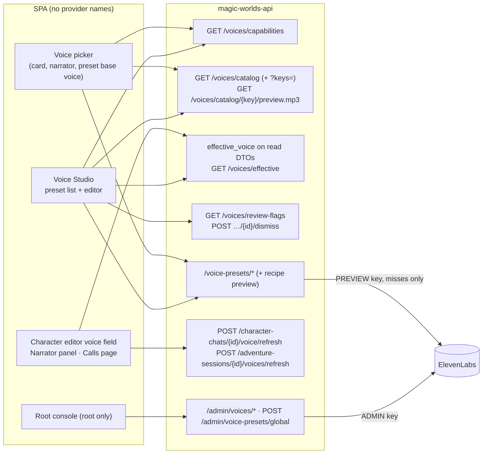
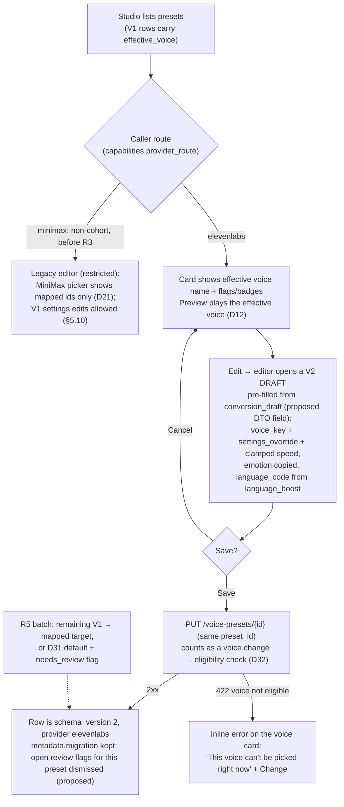
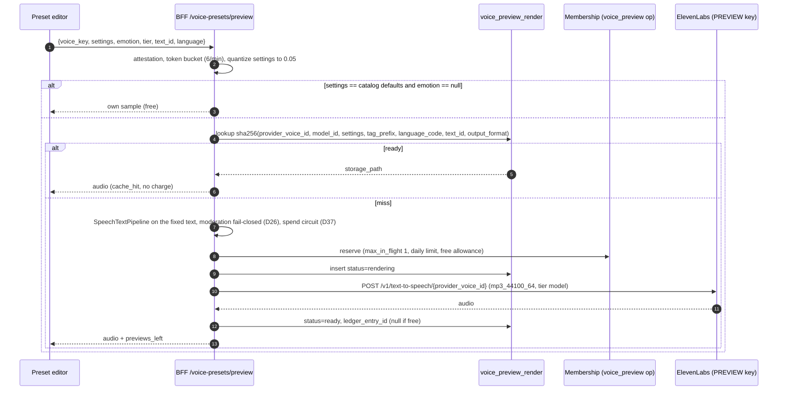
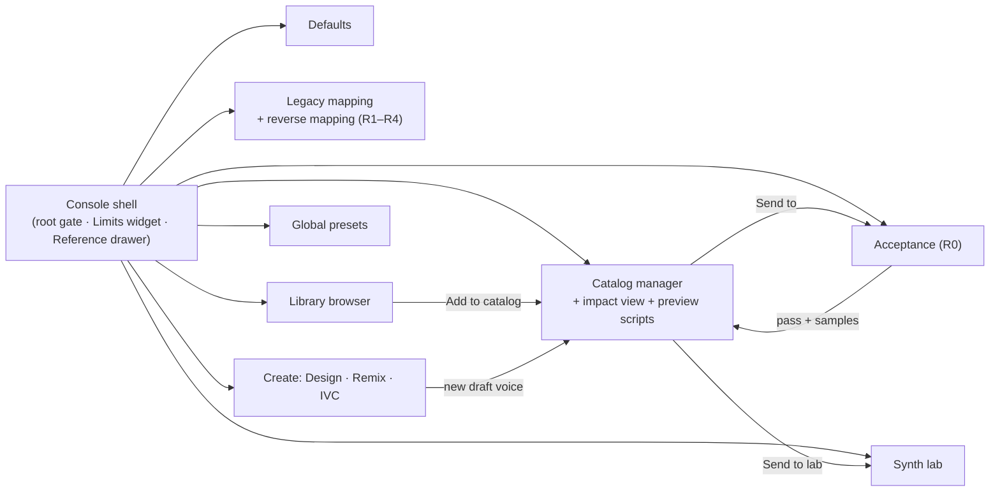
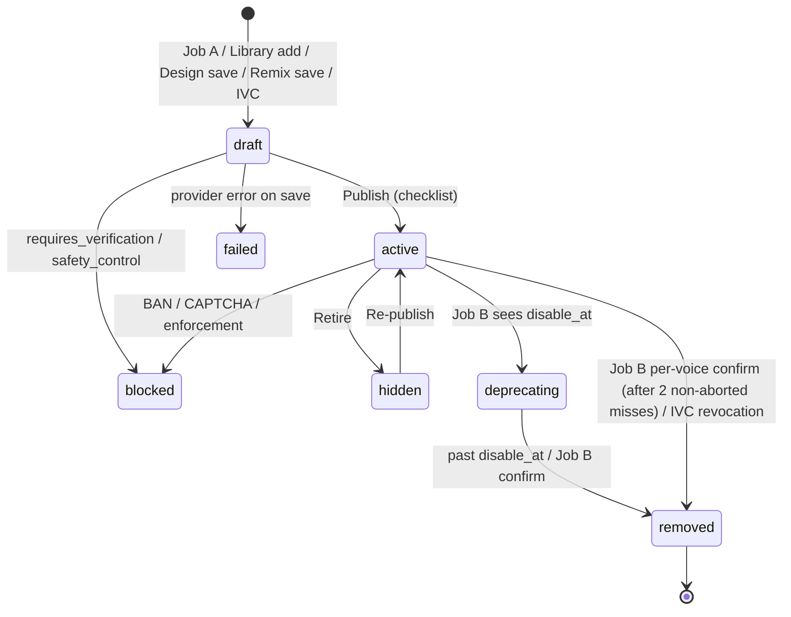
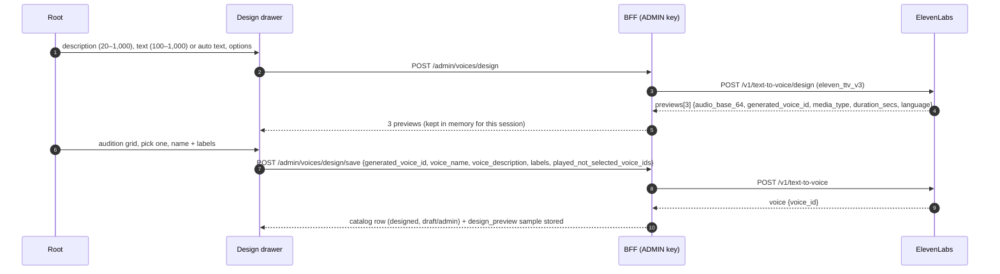

# Voice Studio, voice picker and root admin console redesign

> **Scope / status (reviewed 2026-10-14):** Voice design and dated evidence; product rollout is **WIP**. [00 — Current status and roadmap](00_current_status_and_roadmap.md) owns current implementation/flags/gaps. Later [03 §5.16](03_target_architecture_and_decisions.md#516-r0-implementation-decisions-2026-10-12) instructions and [15 §§11–13](15_implementation_plan_and_acceptance.md#11-minimax-voice-purge-2026-10-14) supersede MiniMax routing, cohorts, V1/maps and original rollout dates. Preserve earlier proposals and vendor facts as dated references; they are not proof of availability.

Date: 2026-10-12

Original proposal status (2026-10-12): Proposed (see 03 for sign-off status)

**Scope.** This document plans the voice UI after MiniMax is replaced by ElevenLabs. It covers four areas:
- the user **Voice Studio** (preset list and preset editor);
- the **voice picker** and every place that shows a voice: character editor, adventure narrator panel, calls page;
- the **root admin console**;
- the **copy and accessibility** work these screens need.

It translates the decisions in [03](03_target_architecture_and_decisions.md) into screens, controls, client contracts and acceptance criteria. Specifically:
- D05, D12–D18 and D20: tiers, preset schema, capabilities, emotion, pitch/volume, thoughts, language, previews and the console;
- D22: global presets;
- D31–D36 and D38: defaults, write rules, language scope, catalog API and badges, chat voice refresh, persona cards.

Several topics are owned elsewhere, and this document only summarises and links them:
- narration playback → [06](06_chat_narration_migration.md);
- call screens → [07](07_realtime_calls_migration.md);
- backend route implementation → [08](08_backend_refactor_plan.md);
- frontend sequencing → [09](09_frontend_refactor_plan.md);
- data migration → [10](10_data_migration_and_rollout.md);
- consent and privacy copy → [13](13_policy_privacy_and_compliance.md).

When a BFF route or DTO field is named here but is **not** in 03 §5, it is labelled *proposed*, and 08 or 09 fixes the final name.

**Workspace R1 alignment (2026-10-12).** Re-read against frontend `c7307c6` and backend `f37eefd`. Voice Studio, the preset editor, the catalog picker's catalog tab, previews and the root console stay **account-level** pages (`pageAccess.ts:42-43`: `voice-studio` and `admin-voices` never wait for the workspace handshake). They use the unscoped API client and send no `X-Workspace-Id`. Presets are account-level, so one preset serves every app workspace. Surfaces bound to a card or a session follow that document's workspace: the character editor, the narrator panel, the D36 refresh and the review flags of cards. In an archived workspace they are read-only (§7.9). The rules are 03 D39 and §5.15; the evidence is [research 15](research/15_workspace_r1_impact.md).

**Related**
- Plan set: [README](README.md) · [01 current state](01_current_state.md) · [02 ElevenLabs capabilities](02_elevenlabs_capabilities.md) · [03 target architecture and decisions](03_target_architecture_and_decisions.md) · [04 voice catalog and library](04_voice_catalog_and_library.md) · [06 chat narration](06_chat_narration_migration.md) · [07 realtime calls](07_realtime_calls_migration.md) · [08 backend plan](08_backend_refactor_plan.md) · [09 frontend plan](09_frontend_refactor_plan.md) · [10 data migration and rollout](10_data_migration_and_rollout.md) · [11 cost, plans and operations](11_cost_plans_and_operations.md) · [12 best practices](12_best_practices_and_improvements.md) · [13 policy, privacy and compliance](13_policy_privacy_and_compliance.md) · [14 staging spike and contract tests](14_staging_spike_and_contract_tests.md) · [15 implementation plan and acceptance](15_implementation_plan_and_acceptance.md) · [16 risks and open questions](16_risks_and_open_questions.md)
- Primary research: [01 TTS models and API](research/01_elevenlabs_tts_models_and_api.md) · [03 voices, catalog, cloning, design](research/03_elevenlabs_voices_catalog_cloning_design.md) · [07 frontend MiniMax inventory](research/07_frontend_minimax_inventory.md) · [08 voice data model](research/08_voice_data_model_migration_surface.md) · [10 policy and licensing](research/10_gap_policy_licensing.md) · [11 catalog API semantics](research/11_gap_catalog_api_semantics.md) · [12 model and protocol facts](research/12_gap_model_protocol_facts.md) · [13 codebase checks](research/13_gap_codebase_checks.md) · [14 cost model](research/14_cost_model.md) · [15 Workspace R1 impact](research/15_workspace_r1_impact.md)

Conventions:
- Decisions are cited as (D13), spikes as (S-3) and written confirmations as (L-2), all as defined in 03 §6.
- Prices and model facts are **as of 2026-10-12**.
- Code links use absolute paths with line numbers. Every path was checked on 2026-10-12.

---

## 1. Summary and design principles

### 1.1 What changes, in one paragraph

Today the Studio, picker and console are thin wrappers over MiniMax concepts:
- raw `voice_id` strings;
- speed, volume and pitch sliders;
- a `language_boost` select;
- free-text previews;
- hex audio;
- inline `<#x#>` markup.

The target UI is driven by the BFF:
- **Voices** come from our DB catalog (`GET /voices/catalog`, D35). The UI shows our display names, never provider ids.
- **Controls** come from `GET /voices/capabilities` (D13), so the SPA never hard-codes which knobs a model supports.
- **Previews** are owned samples or metered, fixed-text renders (D18).
- **Stored voices** are displayed through the resolver's `effective_voice` projection (D35), so users see what they hear during the dual-provider window.

All voice creation (design, remix, cloning, Library add) and all curation (acceptance, defaults, legacy mapping) live in a root-only console that uses the `ADMIN` key (D20). Users never create provider voices.

### 1.2 Principles

| # | Principle | Source |
|---|---|---|
| P1 | The SPA never names a provider in user copy and never shows provider voice ids. Stored voices are identified by `voice_key` (V2) or through `voiceIdentity()` (V1). | D11, D35; [research 07 §11.2](research/07_frontend_minimax_inventory.md#112-let-the-bff-describe-the-providers-capabilities) |
| P2 | Controls are capability-driven. A control is rendered only when `GET /voices/capabilities` lists it for the selected surface and tier. | D13 |
| P3 | Show the effective voice. Wherever a stored voice is shown, the UI renders `effective_voice.display_name` and its badges, not the stored id or the stored display cache. | D35 |
| P4 | Catalog auditions are free. Only recipe previews are metered: fixed texts, quantised settings, a shared cache, metering on misses only. | D10, D18 |
| P5 | Picking is gated; playback never is. Locked voices are visible, with a lock badge and an upgrade hint. | D32, §5.10 |
| P6 | A save never fails because of a voice the user did not touch. The UI never rewrites an untouched voice: V1 values pass through byte-for-byte. | D32, §5.1.2 |
| P7 | Root actions are explicit, previewed (impact view) and logged in `voice_catalog_event`. | D19, D20 |
| P8 | Every string goes through i18n with en and es in the same release, and keyboard and screen-reader use are first-class (§9, §10). | D35; [research 07 §11.8](research/07_frontend_minimax_inventory.md#118-hard-coded-english-found-in-the-voice-ui-fix-while-rewriting) |
| P9 | Account voice pages never take an app workspace; card and session voice controls follow their document's workspace and become read-only when it is archived. | D39, 03 §5.15 |

### 1.3 Phase map for these screens

The UI ships as one build per phase. Behaviour is selected at runtime from the caller's provider route (D28: "The SPA learns per-voice and per-surface capability from the BFF, never from build flags").

| Phase (D28) | Studio and picker | Root console |
|---|---|---|
| **R0** 2026-11-06 (still MiniMax) | Shared helpers and V1/V2 union parsers with the `.voice_id` grep gate (D35). The MiniMax picker is restricted to mapped ids (D21). The legacy preview is metered by `voice_preview` and takes a `text_id` instead of free text (*proposed*, consistent with D18 and the R0 content). The persona voice section is hidden (D38). The free-text preview textarea is removed. | Catalog manager, **Acceptance** (R0 deliverable), Defaults, Legacy mapping **with reverse-mapping curation** (`voice_legacy_fallback` must cover 100% of published voices at R0 exit, 03 §6.3), Library browser, Voice Design, Remix, Synth lab, Limits widget. MiniMax create and clone are frozen, because new MiniMax voices would be unmapped ids ([08 §5.4](08_backend_refactor_plan.md#54-removed-routes)). The MiniMax design and clone UI goes, and with it `voiceIdRules.ts`, `voiceLanguage.ts` and `MiniMaxReferenceDrawer.tsx` are deleted (D20; the same phase as [09 §4.3](09_frontend_refactor_plan.md)). |
| **R1** 2026-11-18 (internal cohort) | Cohort users get the new catalog picker, the V2 preset editor, the effective-voice projection, the first-exposure notice, review flags and the D36 refresh action. Non-cohort users keep the restricted legacy editor. | Global presets (ElevenLabs re-seed, D22). Reverse-mapping coverage re-run before each canary step (D21). |
| **R2** canary, **R3** 100% (2026-12-04) | The same UI for a growing cohort. At R3 everyone is on the new UI. MiniMax global presets are hidden (reversible). Review flags are computed for everyone. | — |
| **R4** 2026-12-18 | The legacy editor and legacy picker code paths (`src/features/voices/legacy/`) are deleted. | The legacy inventory and legacy audition routes (`/admin/voices/legacy/minimax/*`) and their UI are removed. |
| **R5** January 2027 | Every V1 preset is converted. The V2-only editor remains. | MiniMax global rows are deleted. |



---

## 2. Inventory: today's surfaces and what each becomes

Fate legend: **keep**, **rewrite** (same responsibility, new contract) or **delete**. "Phase" is when the change lands. The detailed per-line inventory is in [research 07 §4–§5](research/07_frontend_minimax_inventory.md#4-admin-voices-console-srcfeaturesadminvoices), and only the target is summarised here.

### 2.1 User-facing surfaces

| Surface | Today (MiniMax coupling) | Target | Fate | Phase |
|---|---|---|---|---|
| **Voice Studio page**: [`VoiceStudioPage.tsx`](/home/andres/WebstormProjects/magic-worlds/src/features/voices/components/VoiceStudioPage.tsx) | Speed, volume and pitch chips ([L21-29](/home/andres/WebstormProjects/magic-worlds/src/features/voices/components/VoiceStudioPage.tsx#L21-L29)). Loads the MiniMax system list on mount ([L63-76](/home/andres/WebstormProjects/magic-worlds/src/features/voices/components/VoiceStudioPage.tsx#L63-L76)). Preview sends the MiniMax recipe ([L78-89](/home/andres/WebstormProjects/magic-worlds/src/features/voices/components/VoiceStudioPage.tsx#L78-L89)). Shows `base_voice_name \|\| base_voice_id` ([L189](/home/andres/WebstormProjects/magic-worlds/src/features/voices/components/VoiceStudioPage.tsx#L189)). | Preset grid. Each card shows the effective voice name and badges (§7.6), with chips for stability, speed and emotion. The page also has a narration-tier setting, a usage strip (previews, characters and minutes left, §5.9 of 03), the first-exposure banner, the language-scope note and review-flag notices. Catalog data comes from `?keys=` batch lookups, not the full catalog. | rewrite | R1 (cohort) |
| **Preset editor**: `PresetEditor.tsx` (retired historical source: `/home/andres/WebstormProjects/magic-worlds/src/features/voices/components/PresetEditor.tsx`) | MiniMax recipe seed (L53-71 (retired historical source: `/home/andres/WebstormProjects/magic-worlds/src/features/voices/components/PresetEditor.tsx#L53-L71`)). Free-text preview (L82-93 (retired historical source: `/home/andres/WebstormProjects/magic-worlds/src/features/voices/components/PresetEditor.tsx#L82-L93`), L194-212 (retired historical source: `/home/andres/WebstormProjects/magic-worlds/src/features/voices/components/PresetEditor.tsx#L194-L212`)). Raw id in `<code>` (L171-172 (retired historical source: `/home/andres/WebstormProjects/magic-worlds/src/features/voices/components/PresetEditor.tsx#L171-L172`)). Hard-coded English errors (L156 (retired historical source: `/home/andres/WebstormProjects/magic-worlds/src/features/voices/components/PresetEditor.tsx#L156`), L161 (retired historical source: `/home/andres/WebstormProjects/magic-worlds/src/features/voices/components/PresetEditor.tsx#L161`), L196 (retired historical source: `/home/andres/WebstormProjects/magic-worlds/src/features/voices/components/PresetEditor.tsx#L196`)). | V2 editor: catalog voice card, capability-driven settings, emotion, read-only language, and the fixed-text preview panel with a tier toggle (§5, §6). Opens a V1 preset as a V2 draft (§4.4). Limits kept: name 255, description 2000. The 400-character preview limit is deleted. | rewrite | R1 |
| **Recipe controls**: `PresetRecipeControls.tsx` (retired historical source: `/home/andres/WebstormProjects/magic-worlds/src/features/voices/components/PresetRecipeControls.tsx`) | Speed 0.5–2, volume 0.1–10 and pitch ±12 sliders (L21-49 (retired historical source: `/home/andres/WebstormProjects/magic-worlds/src/features/voices/components/PresetRecipeControls.tsx#L21-L49`)). Emotion and language-boost selects (L51-63 (retired historical source: `/home/andres/WebstormProjects/magic-worlds/src/features/voices/components/PresetRecipeControls.tsx#L51-L63`)). Imports admin constants (L3-4 (retired historical source: `/home/andres/WebstormProjects/magic-worlds/src/features/voices/components/PresetRecipeControls.tsx#L3-L4`)). | `VoiceSettingsControls`, rendered from capabilities: stability, similarity and speed (Standard) or stability and similarity (Expressive), plus emotion. No language select. | rewrite (rename) | R1 |
| **Recipe model**: `recipe.ts` (retired historical source: `/home/andres/WebstormProjects/magic-worlds/src/features/voices/recipe.ts`) | `PresetRecipe {speed, volume, pitch, emotion, language_boost}` with admin defaults. | Replaced by `VoiceSettingsV2` (03 §5.1.2) and a `quantize()` helper in `features/voices/shared/settings.ts`. | delete | R1 |
| **Preview hook**: `usePreviewVoice.ts` (retired historical source: `/home/andres/WebstormProjects/magic-worlds/src/features/voices/usePreviewVoice.ts`) | Hex audio via the admin `hexAudio` import (L10 (retired historical source: `/home/andres/WebstormProjects/magic-worlds/src/features/voices/usePreviewVoice.ts#L10`)). `runPreview` has no abort or sequence guard (L22-37 (retired historical source: `/home/andres/WebstormProjects/magic-worlds/src/features/voices/usePreviewVoice.ts#L22-L37`)): this is the preview race. | Split into `useCatalogSample` (free, own samples) and `useRecipePreview` (metered, single in flight, abortable, exposes the remaining count) (D18, §6.7). | delete (split) | R0 (legacy text_id), R1 |
| **System voice picker**: `SystemVoicePicker.tsx` (retired historical source: `/home/andres/WebstormProjects/magic-worlds/src/features/voices/components/SystemVoicePicker.tsx`) | "MiniMax system voice catalog" (L16-17 (retired historical source: `/home/andres/WebstormProjects/magic-worlds/src/features/voices/components/SystemVoicePicker.tsx#L16-L17`)). Client-side filter and paging (L24-40 (retired historical source: `/home/andres/WebstormProjects/magic-worlds/src/features/voices/components/SystemVoicePicker.tsx#L24-L40`)). Raw id shown in `<code>`. Admin imports (L6-7 (retired historical source: `/home/andres/WebstormProjects/magic-worlds/src/features/voices/components/SystemVoicePicker.tsx#L6-L7`)). | `CatalogVoiceBrowser`: server filters, cursor paging, catalog badges, sample playback. Shared by the picker and the preset editor. A `LegacyVoiceList` mode (mapped MiniMax ids only) serves non-cohort users until R4. | rewrite (rename) | R0 (restricted legacy), R1 |
| **Voice picker dialog**: [`VoicePickerDialog.tsx`](/home/andres/WebstormProjects/magic-worlds/src/features/voices/components/VoicePickerDialog.tsx) | `voiceFromPreset` copies the MiniMax recipe ([L20-31](/home/andres/WebstormProjects/magic-worlds/src/features/voices/components/VoicePickerDialog.tsx#L20-L31)). `presetMatchesVoice` is keyed on `voice_id` ([L35-39](/home/andres/WebstormProjects/magic-worlds/src/features/voices/components/VoicePickerDialog.tsx#L35-L39)). `chooseSystem` writes `{voice_id}` only ([L88-91](/home/andres/WebstormProjects/magic-worlds/src/features/voices/components/VoicePickerDialog.tsx#L88-L91)). Paid preset preview ([L93-104](/home/andres/WebstormProjects/magic-worlds/src/features/voices/components/VoicePickerDialog.tsx#L93-L104)). Shows `preset_name \|\| voice_id` ([L133](/home/andres/WebstormProjects/magic-worlds/src/features/voices/components/VoicePickerDialog.tsx#L133)). | Tabs "My presets" and "Voice catalog". A current-voice row shows the effective voice and badges. Selection writes a complete `CharacterVoiceV2` (§7.5). `isSameVoice()` replaces the id match. A preset preview is a metered recipe preview (cache hits are free). | rewrite | R0 (helpers), R1 |
| **Character editor voice field**: [`CharacterCreator.tsx:782-808`](/home/andres/WebstormProjects/magic-worlds/src/features/creation/character/components/CharacterCreator.tsx#L782-L808) | Shows `preset_name \|\| voice_id` plus the raw `voice_id` in `<code>` ([L790-793](/home/andres/WebstormProjects/magic-worlds/src/features/creation/character/components/CharacterCreator.tsx#L790-L793)). Shown for persona cards too (role state at [L120](/home/andres/WebstormProjects/magic-worlds/src/features/creation/character/components/CharacterCreator.tsx#L120)). | Effective voice name plus owner badges (leaving, needs_reselect, review, retired) and the one-time D15 notice. Hidden when `role === 'persona'` (D38). Payload ([L249](/home/andres/WebstormProjects/magic-worlds/src/features/creation/character/components/CharacterCreator.tsx#L249)) unchanged: the stored value passes through untouched unless re-picked. | rewrite (display) | R0 (persona, helpers), R1 |
| **Narrator voice and narrate thoughts**: [`InteractionLeftPanel.tsx:171-177`](/home/andres/WebstormProjects/magic-worlds/src/features/interaction/components/InteractionLeftPanel.tsx#L171-L177) | `voice?.voice_id` display ([L240-244](/home/andres/WebstormProjects/magic-worlds/src/features/interaction/components/InteractionLeftPanel.tsx#L240-L244)); `SwitchRow` for thoughts ([L255](/home/andres/WebstormProjects/magic-worlds/src/features/interaction/components/InteractionLeftPanel.tsx#L255)). | Effective narrator voice, badges and "Change" (writes V2 `narrator_voice` through `PUT …/template-snapshot`, D21). The thoughts switch stays, with new helper copy on thought delivery (D16). The per-session tier toggle is specified in [06](06_chat_narration_migration.md). | rewrite (display) | R1 |
| **Calls page "Voice set" badge**: [`CallsPage.tsx:25-27`](/home/andres/WebstormProjects/magic-worlds/src/features/call/components/CallsPage.tsx#L25-L27) | `hasVoice` checks `voice?.voice_id`, which hides V2 voices. | `hasAssignedVoice(character.voice)` (D35). Call-header badges are in [07](07_realtime_calls_migration.md). | rewrite (one line) | R0 |

### 2.2 Root console surfaces (`src/features/admin/voices/**`)

| Module | Today | Target | Fate | Phase |
|---|---|---|---|---|
| [`AdminVoicesPage.tsx`](/home/andres/WebstormProjects/magic-worlds/src/features/admin/voices/components/AdminVoicesPage.tsx) | Root gate ([L14-38](/home/andres/WebstormProjects/magic-worlds/src/features/admin/voices/components/AdminVoicesPage.tsx#L14-L38)); MiniMax reference drawer button ([L51-58](/home/andres/WebstormProjects/magic-worlds/src/features/admin/voices/components/AdminVoicesPage.tsx#L51-L58)); create, lab and library panels ([L87-109](/home/andres/WebstormProjects/magic-worlds/src/features/admin/voices/components/AdminVoicesPage.tsx#L87-L109)); provider delete dialog ([L112-120](/home/andres/WebstormProjects/magic-worlds/src/features/admin/voices/components/AdminVoicesPage.tsx#L112-L120)) | Console shell: root gate (kept), module navigation (§8.1), Limits widget in the header, reference drawer. | rewrite | R0 |
| `SynthLabPanel.tsx` (retired historical source: `/home/andres/WebstormProjects/magic-worlds/src/features/admin/voices/components/SynthLabPanel.tsx`) + `SynthControls.tsx` (retired historical source: `/home/andres/WebstormProjects/magic-worlds/src/features/admin/voices/components/SynthControls.tsx`) | MiniMax model, emotion, format, sample-rate and language-boost selects; speed, volume and pitch sliders (SynthControls L33-93 (retired historical source: `/home/andres/WebstormProjects/magic-worlds/src/features/admin/voices/components/SynthControls.tsx#L33-L93`)); free-text voice id (SynthLabPanel L40 (retired historical source: `/home/andres/WebstormProjects/magic-worlds/src/features/admin/voices/components/SynthLabPanel.tsx#L40`)); hex audio (L42 (retired historical source: `/home/andres/WebstormProjects/magic-worlds/src/features/admin/voices/components/SynthLabPanel.tsx#L42`)); hard-coded English (L101-156) | Synth lab (§8.11): catalog voice select, allow-listed model aliases, `output_format`, `language_code`, all five settings per model, seed, normalisation, model-aware toolbar, request metadata. | rewrite | R0 |
| `TextArtifactToolbar.tsx` (retired historical source: `/home/andres/WebstormProjects/magic-worlds/src/features/admin/voices/components/TextArtifactToolbar.tsx`) | Inserts `<#0.4#>` (L11 (retired historical source: `/home/andres/WebstormProjects/magic-worlds/src/features/admin/voices/components/TextArtifactToolbar.tsx#L11`)), interjections (L12-16 (retired historical source: `/home/andres/WebstormProjects/magic-worlds/src/features/admin/voices/components/TextArtifactToolbar.tsx#L12-L16`)) and `word/(wɜːrd)` IPA (L17 (retired historical source: `/home/andres/WebstormProjects/magic-worlds/src/features/admin/voices/components/TextArtifactToolbar.tsx#L17`)) | `MarkupToolbar` with two modes: app markup v1 (translated by the pipeline) and model-native markup (§3.3). | rewrite | R0 |
| `VoiceCloneForm.tsx` (retired historical source: `/home/andres/WebstormProjects/magic-worlds/src/features/admin/voices/components/VoiceCloneForm.tsx`) | MiniMax two-step `file_id` upload, custom voice id, prompt audio and transcript, noise reduction on by default, volume normalisation, no consent (L43-150) | IVC form (§8.10): consent record first, then multipart samples. `remove_background_noise` defaults to off. Handles `requires_verification`. Revocation action. | rewrite | Optional feature (S-22, L-13) |
| `VoiceDesignForm.tsx` (retired historical source: `/home/andres/WebstormProjects/magic-worlds/src/features/admin/voices/components/VoiceDesignForm.tsx`) | One call, one voice (L47-51 (retired historical source: `/home/andres/WebstormProjects/magic-worlds/src/features/admin/voices/components/VoiceDesignForm.tsx#L47-L51`)); custom id field (L90-101 (retired historical source: `/home/andres/WebstormProjects/magic-worlds/src/features/admin/voices/components/VoiceDesignForm.tsx#L90-L101`)); single hex result (L113-123 (retired historical source: `/home/andres/WebstormProjects/magic-worlds/src/features/admin/voices/components/VoiceDesignForm.tsx#L113-L123`)) | Voice Design (§8.8): description, text (100–1,000 characters) or auto text, advanced options, **grid of 3 previews**, save one with name and labels in the same session. | rewrite | R0 |
| `VoiceCreatePanel.tsx` | Design/Clone mode chips | Create hub: Design · Remix · IVC (IVC hidden until its gates pass). | keep (add modes) | R0 |
| `VoiceLibraryPanel.tsx` (retired historical source: `/home/andres/WebstormProjects/magic-worlds/src/features/admin/voices/components/VoiceLibraryPanel.tsx`) + `VoiceRow.tsx` + `useVoiceStudio.ts` | MiniMax groups `voice_generation / voice_cloning / system` (L19 (retired historical source: `/home/andres/WebstormProjects/magic-worlds/src/features/admin/voices/components/VoiceLibraryPanel.tsx#L19`)); refresh race (useVoiceStudio L35-59 (retired historical source: `/home/andres/WebstormProjects/magic-worlds/src/features/admin/voices/hooks/useVoiceStudio.ts#L35-L59`)) | Replaced by the **Catalog manager** (§8.3), which lists our DB catalog, not the provider inventory. Loaders get an `AbortController`. | rewrite | R0 |
| `SystemVoiceBrowser.tsx` (retired historical source: `/home/andres/WebstormProjects/magic-worlds/src/features/admin/voices/components/SystemVoiceBrowser.tsx`) | "MiniMax system-voice inventory" (L18-21 (retired historical source: `/home/andres/WebstormProjects/magic-worlds/src/features/admin/voices/components/SystemVoiceBrowser.tsx#L18-L21`)); client filter (L28-45 (retired historical source: `/home/andres/WebstormProjects/magic-worlds/src/features/admin/voices/components/SystemVoiceBrowser.tsx#L28-L45`)) | **Library browser** (§8.7): live `/v1/shared-voices` with enforced curated filters, offset paging, and "Add to catalog". | rewrite | R0 |
| `MiniMaxReferenceDrawer.tsx` (retired historical source: `/home/andres/WebstormProjects/magic-worlds/src/features/admin/voices/components/MiniMaxReferenceDrawer.tsx`) | Hard-coded English MiniMax facts and links (L26-103 (retired historical source: `/home/andres/WebstormProjects/magic-worlds/src/features/admin/voices/components/MiniMaxReferenceDrawer.tsx#L26-L103`)); `eyebrow="MiniMax"` (L121 (retired historical source: `/home/andres/WebstormProjects/magic-worlds/src/features/admin/voices/components/MiniMaxReferenceDrawer.tsx#L121`)) | `VoiceReferenceDrawer` with i18n copy covering tiers, settings, the tag allow-list, markup, IVC guidance and slots. | delete (D20) | R0 (replaced in the same release) |
| [`constants.ts`](/home/andres/WebstormProjects/magic-worlds/src/features/admin/voices/constants.ts) | MiniMax vocabulary: limits (L14-23), `DEFAULT_TEST_TEXT` with `<#0.4#> (sighs)` (L29-30), `SynthSettings` (L38-58), model, emotion, format, sample-rate and language-boost options (L60-105), `INTERJECTION_TAGS` (L108), `KNOWN_VOICE_LANGUAGES` (L113-137), library filters (L142-162) | Only the design defaults survive (`DEFAULT_PROMPT`; `DEFAULT_PREVIEW_TEXT` at exactly 100 characters, the design minimum). Everything else comes from capabilities or the lab model list (A4 in §8.2, not yet in 08 §5.3). | rewrite (shrink) | R0–R4 |
| `hexAudio.ts` | Hex helpers (L1-37); `readAudioDuration` (L39-65) | Hex helpers deleted (ElevenLabs returns binary or base64). `readAudioDuration` moves to `features/voices/shared/audioFile.ts` for the IVC duration check. | rewrite | R1 |
| `voiceIdRules.ts`, `voiceLanguage.ts` (and their tests) | MiniMax custom-id rules (used by `VoiceCloneForm`); language from the id prefix (used by `SystemVoiceBrowser` and the user `SystemVoicePicker`, SystemVoicePicker.tsx:7 (retired historical source: `/home/andres/WebstormProjects/magic-worlds/src/features/voices/components/SystemVoicePicker.tsx#L7`)) | No custom ids. Language comes from the catalog. The restricted legacy picker (§2.1) keeps its id-prefix language filter until R4 only as code inside `src/features/voices/legacy/`, deleted with that folder. | delete (D20) | R0, with the MiniMax design and clone UI |
| `ControlSlider.tsx`, `CopyableVoiceId.tsx`, `AudioDropzone.tsx`, `VoiceResultCard.tsx` | Neutral (`VoiceResultCard` has a hard-coded "Send to lab", L52) | Move `ControlSlider` to `features/voices/shared` (P8). `AudioDropzone` gains `multiple`. `VoiceResultCard` gets an i18n fix. `CopyableVoiceId` stays root-only. | keep (move or fix) | R0 |

### 2.3 Shared module extraction (removes user → admin imports)

Today the user Studio imports admin constants, `ControlSlider` and `hexAudio` ([research 07 key finding 11](research/07_frontend_minimax_inventory.md#0-key-findings-read-first)). The target layout:

```text
src/shared/voice/
  voiceIdentity.ts        # hasAssignedVoice, voiceIdentity, isSameVoice (names fixed by D35) + isVoiceV2 re-export
  characterVoice.ts       # StoredCharacterVoice parser: preserves both shapes intact (03 §5.1.2)
src/shared/types/
  voice.types.ts          # + CharacterVoiceV2, VoiceSettingsV2, VoiceEmotion (03 §5.1.2)
  voiceCatalog.types.ts   # catalog item DTO, effective_voice, badges (03 §5.12)
  voicePreset.types.ts    # VoicePresetV1 | VoicePresetV2 union (§4.2)
src/features/voices/shared/
  settings.ts             # quantize(0.05), defaults resolution, capability helpers
  useVoiceCapabilities.ts # cached GET /voices/capabilities
  useCatalogSample.ts     # free own-sample playback (D10)
  useRecipePreview.ts     # metered recipe preview (D18)
  CatalogVoiceBrowser.tsx # filters + list; used by picker and preset editor
  VoiceSettingsControls.tsx
  VoiceBadges.tsx         # one component for every §5.12 badge
  EffectiveVoiceLabel.tsx # name + badges + tooltip for any stored voice
  ControlSlider.tsx       # moved from admin
  audioFile.ts            # readAudioDuration (moved from hexAudio.ts)
```

The CI gate from R0 forbids `.voice_id` reads outside the V1 parser and `voiceIdentity.ts` (D35).

---

## 3. MiniMax → ElevenLabs parameter mapping

### 3.1 Recipe fields (cards, presets, snapshots)

Stored fields follow `CharacterVoice` v2 ([03 §5.1](03_target_architecture_and_decisions.md#51-charactervoice-v2)). Migration writes nothing to live documents before R5 (D21): until then, the resolver maps at read time.

| MiniMax field (range today) | V2 field | Standard (`el_flash_v2_5`) | Expressive (`el_v4`) | Migration rule | Studio UI |
|---|---|---|---|---|---|
| `voice_id` (MiniMax system or custom id) | `voice_key` (`vk_` + 32 hex) → `voice_catalog.provider_voice_id` at resolve time | resolved | resolved | `voice_legacy_mapping` (approved) → `voice_key`. Unmapped, at read time: D31 `character_fallback` (narrator role for narrator voices), `substitution_reason = unmapped_legacy`. Unmapped live documents at R5: the D31 language default + a `needs_review` flag (D21) | Never shown. The UI shows `effective_voice.display_name`. |
| `speed` 0.5–2.0 | `settings.speed` 0.7–1.2 | sent | **stripped** (§5.6) | Clamped to 0.7–1.2; flagged `speed_clamped` when the original was outside (D15) | Slider 0.70–1.20, step 0.05, Standard only. Expressive shows the note "speed applies to Standard narration and calls" (D13). |
| `vol` / preset `volume` (0, 10] | — (dropped) | — | — | Original kept in `voice_migration_audit` and `metadata.migration`; flagged `vol_dropped` if `vol ∉ [0.8, 1.25]` (D15) | No control. Loudness is the per-voice catalog `gain_db ≤ 0` applied by the player (D16, S-16). |
| `pitch` −12..12 | — (dropped) | — | — | Flagged `pitch_dropped` if `\|pitch\| ≥ 3`. Curators may route "pitched" legacy voices to a deeper or brighter catalog voice through the mapping (D15) | No control. Timbre comes from the voice choice. |
| `emotion` (7 values; MiniMax "auto" = empty) | `emotion` (same 7 values or null) | stability offset (§5.5.1), never stored | prefix tag (§5.5.1) | Copied as is; "auto" or empty → null | Select "None" + 7, with a per-tier hint (§5.3). |
| `language_boost` (auto + 11 language names) | `language_code` (ISO 639-1, lower case; `yue`/`zh` allowed) | allow-listed (400 if unsupported, so filtered) | allow-listed | Single-language value → ISO code; `auto` → null (03 §5.7) | **No select.** Read-only primary language and accent, with the note "Your story's language is used when it's known" (D13, D17). |
| — | `settings.stability` 0–1 | sent | sent | null (catalog default) unless `settings_override` exists in the mapping | Slider 0.00–1.00, step 0.05 |
| — | `settings.similarity_boost` 0–1 | sent | sent | as above | Slider 0.00–1.00, step 0.05 |
| — | `settings.style` 0–1 | stripped | stripped | null | Not shown to users (stored default 0). Root lab only. |
| — | `settings.use_speaker_boost` bool | stripped (S-3) | stripped | null | Not shown to users (stored default true). Root lab only. |
| `preset_id`, `preset_name` | unchanged, display-only | — | — | kept | Shown as "From preset {name}" |
| Thought dimming `vol × 0.6`, floor 0.5 ([route_chat.py:1129-1134](/home/andres/PycharmProjects/magic-worlds-api/src/routes/user/route_chat.py#L1129-L1134)) | — (not a field) | −3 dB client gain | `[whispers]` + −3 dB client gain | — | Explained in the Studio and the narration panel. Demonstrated by the "thought" preview text (§5.4). |

Per-model allow-lists come from §5.6 and are finalised by **S-3** (for example, whether Flash honours `style` or `use_speaker_boost`). The UI never relies on them directly, because it renders whatever capabilities return.

The canonical emotion table (§5.5.1, `emotion_map_version = 1`, copied verbatim):

| `emotion` | Expressive (v4/v3/v4_turbo): prefix tag | Standard (Flash/multilingual_v2): stability offset | Tag source |
|---|---|---|---|
| null | none | 0 | — |
| `happy` | `[happily]` | −0.15 | documented [verified: https://elevenlabs.io/docs/overview/capabilities/text-to-speech/best-practices, via research/01 §5.2] |
| `sad` | `[sad]` | −0.10 | documented (same source) |
| `angry` | `[angry]` | −0.20 | documented (same source) |
| `surprised` | `[surprised]` | −0.10 | documented (same source) |
| `calm` | `[calm]` | +0.15 | docs and blog examples [research/01 §5.3] |
| `fearful` | `[nervously]` | −0.20 | free-form [unverified] |
| `disgusted` | `[disgusted]` | −0.10 | free-form [unverified] |

The offsets and the two free-form tags are unverified until **S-6**. If S-6 finds a tag unreliable, its row becomes "no tag". If S-6 finds the Standard offsets inaudible, the emotion control is shown on Expressive only (D13).

**Research proposals that 03 overrides**, which the UI must not reintroduce:
- `model_id` per preset, a free-text `delivery` field and `playback_gain`. These were proposed in [research 01 §15.4](research/01_elevenlabs_tts_models_and_api.md#154-parameter-mapping-characterpreset-recipe-charactervoice--voicepreset) and are rejected by D11 and D15.
- `[slowly]` / `[rushed]` tags standing in for speed on v4. Rejected: D13 strips speed and shows the note.
- A language-code select. Proposed in [research 07 §4.1](research/07_frontend_minimax_inventory.md#41-per-module-analysis); rejected by D13.
- Hotlinking `preview_url` in the picker. Proposed in [research 07 §11.3](research/07_frontend_minimax_inventory.md#113-catalog-browsing-without-paid-synthesis); rejected by D10: upstream audio is never hotlinked, and it reaches users only through a BFF proxy (≤ 1 h cache) after L-3 confirms it. Until then auditions are own samples only.

### 3.2 Synth-lab fields (root only, `admin_lab` surface)

| MiniMax lab control ([constants.ts:38-105](/home/andres/WebstormProjects/magic-worlds/src/features/admin/voices/constants.ts#L38-L105)) | ElevenLabs lab control | Values (as of 2026-10-12) | Notes |
|---|---|---|---|
| `model` (`speech-2.8-hd`, `speech-2.8-turbo`) | model alias (03 §5.4.1) | `el_flash_v2_5`, `el_v4`, `el_multilingual_v2` (lab only), `el_v3` (lab only); `el_v4_turbo` only if **S-2** confirms TTS HTTP | The list comes from the BFF: the registry plus `GET /v1/models`, filtered by the allow-list. A configured model missing from `/v1/models` is shown as unavailable. |
| `audio_format` × `sample_rate` (mp3/wav/flac × 8–44.1 kHz, incl. 32 kHz) | `output_format` (one value) | Default `mp3_44100_128` (narration). Also `mp3_44100_64` (calls and previews, 03 §5.4.1), `mp3_22050_32`, `mp3_44100_192`, `wav_44100` / `wav_24000` (lossless downloads) and `pcm_24000` ([research 01 §15.2](research/01_elevenlabs_tts_models_and_api.md#152-output-formats)) | 32 kHz MP3 does not exist on ElevenLabs (D08), and neither does FLAC ([research 01 §4.1](research/01_elevenlabs_tts_models_and_api.md#41-catalog)). 192 kbps MP3 needs Creator+ and 44.1 kHz PCM/WAV needs Pro+, so all of these are available on Scale (D02). |
| `emotion` select | Tag palette in the toolbar (§3.3) plus, optionally, the user-facing `emotion` enum, to hear exactly what users get | Allow-list tags (§5.5.2) on tag models. The enum applies the §5.5.1 mapping | Free-form tags are allowed in the model-native toolbar mode only (§3.3). |
| `language_boost` | `language_code` | ISO 639-1 from the model's `languages[]`; "Auto" = omitted | Disabled on `el_multilingual_v2` (never sent, 03 §5.6). |
| `speed` 0.5–2 | `voice_settings.speed` | 0.7–1.2 | Hidden for `el_v4`/`el_v3` (stripped). |
| `vol` (0, 10], `pitch` ±12 | — | — | Deleted. |
| — | `stability`, `similarity_boost`, `style`, `use_speaker_boost` | per §5.6 (`el_v3`: stability only; S-3 may turn it into a three-stop Creative/Natural/Robust control) | All five exist for `el_multilingual_v2`. |
| — | `seed`, `apply_text_normalization` | int (optional); `auto` (default), `on`, `off` | — |
| Hex audio result + `usage_characters` meta (SynthLabPanel.tsx:22-29 (retired historical source: `/home/andres/WebstormProjects/magic-worlds/src/features/admin/voices/components/SynthLabPanel.tsx#L22-L29`)) | Blob result + metadata | `request-id`, `character-cost` (if present, S-17), output format, duration | — |

### 3.3 Inline markup

Stored text uses only **app speech markup v1** (D27). The pipeline translates it per model at step 8 of the sanitizer (§5.5.3). This is the D27 table, copied verbatim:

| Markup | Flash / multilingual_v2 | v4 / v4_turbo / v3 |
|---|---|---|
| `<#x#>` | `<break time="xs"/>` (x ≤ 3; > 3 clamped) if S-26 passes; otherwise `…` | x < 0.5 → `…`; 0.5–1.5 → `[short pause]`; ≥ 1.5 → `[long pause]` |
| Interjections | **Stripped** | `[laughs]`, `[sighs]`, `[gasps]`, `[inhales deeply]`, `[exhales]`, `[hums]` |

Dependencies:
- §5.6 marks `<break>` as supported (≤ 3 s) on Flash over HTTP. **S-26** decides whether it is honoured on the Flash multi-context socket used by calls.
- **S-6** covers tag audibility.
- **S-5** covers digit normalisation next to markers.

Inline IPA (`word/(ipa)`, TextArtifactToolbar.tsx:17 (retired historical source: `/home/andres/WebstormProjects/magic-worlds/src/features/admin/voices/components/TextArtifactToolbar.tsx#L17`)) is **not** part of markup v1 and never appears in stored text. In the lab it is model-native ([research 01 §7.3](research/01_elevenlabs_tts_models_and_api.md#73-mapping-minimax-inline-ipa-wordipa)):

| Target | Lab toolbar insert |
|---|---|
| `el_v4` | `"/ipa/"`, replacing the word |
| `el_v3`, `el_v4_turbo` | hidden (no documented inline IPA) |
| `el_flash_v2_5`, `el_multilingual_v2` | hidden. Use respelling, or a pronunciation-dictionary alias (P1 feature, D29) |
| `eleven_flash_v2` (`<phoneme>`, English only) | not offered: it has no app alias in §5.4.1 |

The **lab toolbar has two modes** (*proposed*):
1. **App markup.** It inserts `<#0.4#>`, `(sighs)` and so on, and runs the full `SpeechTextPipeline`, so root hears exactly what narration or calls would send. The panel shows the post-step-9 text.
2. **Model-native.** It inserts `[sighs]`, `[short pause]`, `<break time="0.4s"/>` or `"/ipa/"` as allowed for the selected model, and hides inserts that do not apply.

Both modes run the **fail-closed moderation gate**. Lab text is refused when the classifier errors (D26 item 2). Free text exists only here (D18).

The default lab text changes from MiniMax syntax ([constants.ts:29-30](/home/andres/WebstormProjects/magic-worlds/src/features/admin/voices/constants.ts#L29-L30)) to app-markup text in app mode. In native mode, the example is rendered per model, for example `… [sighs] Speak carefully …` on v4.

---

## 4. Preset v2 schema, conversion and editing flow

### 4.1 Canonical DDL and DTO (03 §5.3, verbatim)

```sql
-- R0 (expand)
alter table voice_preset
    add column schema_version tinyint not null default 1,
    add column provider       varchar(32) character set utf8mb4 collate utf8mb4_bin not null default 'minimax',
    add column voice_key      varchar(64) character set utf8mb4 collate utf8mb4_bin null,
    add column settings       json null,
    add column language_code  varchar(8)  character set utf8mb4 collate utf8mb4_bin null,
    modify column base_voice_id varchar(255) character set utf8mb4 collate utf8mb4_bin null,
    modify column speed   float null,
    modify column volume  float null,
    modify column pitch   int   null,
    modify column language_boost varchar(64) character set utf8mb4 collate utf8mb4_bin null,
    add constraint chk_voice_preset_settings_object check (settings is null or json_schema_valid('{"type":"object"}', settings)),
    add constraint chk_voice_preset_shape check (
           (schema_version = 1 and provider = 'minimax' and base_voice_id is not null)
        or (schema_version = 2 and provider = 'elevenlabs' and voice_key is not null)
    ),
    add key idx_voice_preset_voice_key (voice_key);
-- base_voice_name is reused as the v2 display cache (voice_name); emotion keeps the same 7 values.
-- metadata.migration = {"legacy": {...}, "flags": ["pitch_dropped","vol_dropped","speed_clamped"], "needs_review": true}

-- R5 (contract). Precondition: the R5 --check run reports 0 rows with schema_version = 1
-- (every V1 preset converted: mapped, or D31 default + needs_review; D12, D21).
alter table voice_preset
    drop check chk_voice_preset_shape,
    drop column base_voice_id, drop column speed, drop column volume,
    drop column pitch, drop column language_boost,
    alter column schema_version set default 2,
    alter column provider set default 'elevenlabs',
    add constraint chk_voice_preset_shape check (schema_version = 2 and voice_key is not null);
```

API DTO (v2):

```jsonc
{
  "preset_id": "…",
  "name": "…",
  "description": "…",
  "voice_key": "vk_…",
  "voice_name": "…",
  "settings": { /* VoiceSettingsV2 */ },
  "emotion": null,
  "language_code": null,
  "is_global": false,
  "schema_version": 2,
  "provider": "elevenlabs"
}
```

### 4.2 Frontend types (derived; no new stored fields)

```ts
// src/shared/types/voicePreset.types.ts — union read model.
import type { VoiceSettingsV2, VoiceEmotion } from './voice.types'          // 03 §5.1.2
import type { EffectiveVoice } from './voiceCatalog.types'                   // 03 §5.12

/** Today's MiniMax row shape (selected when schema_version is absent or 1). Read-only after R1 for cohort users. */
export interface VoicePresetV1 {
  preset_id: string; name: string; description?: string | null
  base_voice_id: string; base_voice_name?: string | null
  speed?: number | null; volume?: number | null; pitch?: number | null
  emotion?: VoiceEmotion | null; language_boost?: string | null
  is_global: boolean; schema_version?: 1; provider?: 'minimax'
}

/** 03 §5.3 DTO, verbatim field names. */
export interface VoicePresetV2 {
  preset_id: string; name: string; description: string | null
  voice_key: string; voice_name: string
  settings: VoiceSettingsV2 | null
  emotion: VoiceEmotion | null
  language_code: string | null
  is_global: boolean
  schema_version: 2; provider: 'elevenlabs'
}

/** Every preset read DTO carries effective_voice from R1 (D35). */
export type VoicePreset = (VoicePresetV1 | VoicePresetV2) & { effective_voice?: EffectiveVoice | null }
export const isPresetV2 = (p: VoicePreset): p is VoicePresetV2 & { effective_voice?: EffectiveVoice | null } =>
  (p as VoicePresetV2).schema_version === 2
```

**Write payload** (*proposed*, owned by 08):
- `POST /voice-presets` and `PUT /voice-presets/{id}` take `{name, description, voice_key, settings, emotion}`.
- The server fills `voice_name` from `voice_catalog.display_name`, because the client's display cache is never trusted.
- `language_code` is not user-editable (D13). New presets store null, so the resolver uses the catalog `primary_language` at D17 step 2. Edits preserve the stored value, which may come from migration.
- `settings` stores **only the user-editable keys the user moved** (stability, similarity_boost, speed), or null for "voice defaults". `style` and `use_speaker_boost` are never written by users.
- Server checks:
  - range validation, 422 on violation (D13);
  - catalog eligibility only when `voice_key` differs from the stored one, or on a V1 → V2 conversion (D32, §5.10).

### 4.3 Preset → card copy

A preset is copied by value into a card ([research 08 §3.4](research/08_voice_data_model_migration_surface.md#34-copy-semantics)). `voiceFromPreset` (V2) builds:

```ts
const voiceFromPresetV2 = (p: VoicePresetV2): CharacterVoiceV2 => ({
  schema_version: 2, provider: 'elevenlabs',
  voice_key: p.voice_key, voice_name: p.voice_name,
  settings: p.settings ?? null, emotion: p.emotion ?? null,
  language_code: p.language_code ?? null,
  preset_id: p.preset_id, preset_name: p.name,
})
```

Presets are account-level, so the picker's "My presets" tab lists the same presets in every app workspace. The copy is by value, so archiving or copying a card to another workspace never touches the preset, and deleting a preset never changes a card (D39). Applying a preset is a "new pick" under §5.10, so its voice must be eligible (`visibility = public`, or `plan_gated` within the caller's plan). The picker therefore greys out presets whose voice is locked for the caller and shows the `locked` badge. The console warns root not to build global presets on `admin` voices (§8.12).

### 4.4 V1 → V2 conversion and editing flow (D12)



Rules:
- **The editor never builds the draft itself.** The settings override and alternates live in `voice_legacy_mapping`, server side. *Proposed:* for V1 rows, the preset read DTO for an `elevenlabs`-routed caller carries a `conversion_draft` (a `VoicePresetV2` shape without `preset_id`), computed by the resolver. 08 owns the name.
- **Unsaved drafts change nothing.** Previewing the draft is a normal recipe preview of the effective voice.
- **Global V1 presets are read-only for users.** A cohort user may duplicate one, which creates a user-owned V2 preset from its `conversion_draft`. Global V1 rows are hidden at R3 and deleted at R5 (D22).
- **Flags.** A converted preset that carried `pitch_dropped`, `vol_dropped` or `speed_clamped` shows the D15 notice in the editor until the user dismisses it or saves. *Proposed:* saving the converted draft dismisses that preset's open flags, because the user has listened and chosen.
- **Non-cohort users** before R3 keep the MiniMax editor with the restricted picker. Their V1 writes are accepted only with a mapped id (D32).

---

## 5. Studio controls per tier

### 5.1 Control matrix

| Control | Standard (`el_flash_v2_5`) | Expressive (`el_v4`, Plus/Pro opt-in) | Storage | Source |
|---|---|---|---|---|
| Stability | Slider 0–1, step 0.05. Labels "More expressive" ↔ "More consistent" | same | `settings.stability` | D13 |
| Similarity | Slider 0–1, step 0.05. Labels "Looser" ↔ "Closer to the voice" | same | `settings.similarity_boost` | D13 |
| Speed | Slider 0.70–1.20, step 0.05, value shown as "1.05×" | **hidden**, with the note "speed applies to Standard narration and calls" and a link "Show Standard controls" that switches the preview tier | `settings.speed` (kept when hidden) | D13 |
| Emotion | Select None + 7. Hint "Subtle on Standard voices" | Select None + 7. Each option is labelled by its effect, e.g. "Happy: adds a cheerful delivery" | `emotion` | D13, §5.5.1, S-6 |
| Style, speaker boost | not shown | not shown | absent (defaults 0 / true) | D13 |
| Language | read-only "Primary language: Spanish · Mexican accent", plus "Your story's language is used when it's known" | same | `language_code` (migration only) | D13, D17 |
| Thought delivery | not a control: the note "Thoughts are spoken a little quieter" | not a control: the note "Thoughts are whispered and a little quieter" | — | D16 |
| Preview tier | toggle Standard / Expressive (Plus/Pro), with the `expressive_only` badge "Expressive" on the Expressive option. Default = the user's narration tier. Free users see Standard only: no toggle (D18). The upgrade hint lives on the narration-tier switch (§5.6), not on a badge, because §5.12 shows `expressive_only` to Plus/Pro only | — | — | D05, D18, D35 |
| Reset | "Use voice defaults" sets `settings` to null | same | — | 03 §5.1.1 |

Defaults shown on the sliders:
- the catalog `default_settings` of the voice, else the ElevenLabs defaults (stability 0.5, similarity 0.75, speed 1.0) (03 §5.1.1);
- the editor marks a value that equals the default with a subtle "Voice default" tag, so users can see when a preview will be free (§6.3). It is worded differently from the existing global-preset badge "Default" (`voices.studio.defaultBadge`) to avoid two meanings for one word.

All values are **quantised to 0.05** in the UI, matching the server quantisation (D18), so the displayed value is exactly what is cached and rendered.

### 5.2 Capability-driven rendering

The editor asks `GET /voices/capabilities` (D13) which controls exist for the selected **surface** (`preview` mirrors the selected narration tier) and **tier**. D13 fixes the content: controls, ranges, defaults, `supports_emotion`, `supports_speed` and text limits. The shape below is a *proposal*, and 08/09 fix the names:

```ts
// GET /voices/capabilities — proposed response shape (provider-neutral; no model ids).
export interface VoiceControlSpec {
  key: 'stability' | 'similarity_boost' | 'speed' | 'style' | 'use_speaker_boost'
  kind: 'range' | 'boolean'
  min?: number; max?: number; step?: number      // speed: 0.7 / 1.2 / 0.05
  default: number | boolean
  user_editable: boolean                         // false for style, use_speaker_boost
}
export interface VoiceTierCapabilities {
  tier: 'standard' | 'expressive'
  allowed: boolean                               // plan allows it (Free: expressive = false)
  controls: VoiceControlSpec[]                   // only what the tier's profile sends (03 §5.6)
  supports_emotion: boolean
  supports_speed: boolean
  supports_audio_tags: boolean
  max_chars: number
}
export interface VoiceCapabilities {
  provider_route: 'elevenlabs' | 'minimax'       // caller's route during R1–R4; mirrors effective_voice.provider_route
  default_tier: 'standard' | 'expressive'        // user_preferences.narration_tier, clamped by plan (D05)
  surfaces: { narration: VoiceTierCapabilities[]; call: VoiceTierCapabilities[]; preview: VoiceTierCapabilities[] }
  emotions: VoiceEmotion[]                       // 7 values; empty if S-6 removes emotion everywhere
  preview_text_ids: Array<'narration' | 'dialogue' | 'thought'>
}
```

Rendering rules:
1. Render a control only if it appears in `controls` with `user_editable: true`.
2. Ignore unknown keys, so a new BFF release cannot break an old SPA.
3. Never show a provider or model name.
4. If the capabilities request fails, show the editor read-only with a retry, and never fall back to hard-coded ranges. The BFF still rejects bad values with 422 (D13).

The root synth lab uses a separate admin endpoint that lists models (§8.11), because `admin_lab` exposes model-specific fields and is root-only.

### 5.3 Emotion control

- **Expressive.** The option text says what the user will hear, for example "Sad: adds a sorrowful delivery". The server prepends the tag from §5.5.1. The user never sees or types brackets.
- **Standard.** The same options, with the hint "Subtle on Standard voices". The effect is only a stability offset that is never stored (§5.5.1).
- **If S-6 finds the Standard offset inaudible**, capabilities report `supports_emotion: false` for Standard. The select is then hidden on the Standard preview and shown only when Expressive is selected. The stored value is preserved either way.

### 5.4 Thought delivery

Thoughts use the speaking character's own voice. Expressive prefixes `[whispers]`, and every tier applies −3 dB (×0.708) in the player (D16).

There is no per-preset control. The Studio:
- shows the tier-specific note from §5.1;
- offers "Thought" as a fixed preview text (§6.2). The preview player applies `volume × 0.708` when `text_id = thought`, so the preview matches the narrated result;
- applies the catalog `gain_db` to every preview, as the narration player does (`volume = user_volume × 10^(gain_db/20) × thought_factor`, D16).

The "Narrate inner thoughts" switch in the narrator panel stays ([InteractionLeftPanel.tsx:255](/home/andres/WebstormProjects/magic-worlds/src/features/interaction/components/InteractionLeftPanel.tsx#L255)). It gains the same helper text.

### 5.5 Language

There is no language select (D13). The Studio and picker show:
- the voice's primary language and accent, read-only, from the catalog item;
- the `language_scope` note "Voices are tuned for English and Spanish; other languages may sound less natural." (D34);
- `not_tested_language` "Not tested in {language}" when the user's preferred language, or the card's last turn language, has no accepted row for this voice (D34). The voice is still allowed and never substituted.

The preview text language is chosen from the voice's accepted languages. The default follows D17 without a turn: the voice's `language_code`, then the catalog `primary_language`, then `user_preferences.preferred_language`. A small language chip set on the preview panel lets the user hear the other accepted language.

### 5.6 Narration tier in the Studio

D05 shows the user setting `user_preferences.narration_tier` in the Studio and in narration settings. The Studio header carries a `SwitchRow` "Expressive narration":
- **Plus and Pro.** The description reads "More emotional delivery. Uses 2× narration credits." The switch writes the preferences DTO.
- **Free.** The switch is disabled, with the upgrade hint `voices.tier.upgradeHint` "Available on Plus and Pro." (*proposed* placement; D05 "Free users get Flash only").

The per-session override lives in the narration panel ([06](06_chat_narration_migration.md)) and is stored in `session_voice_setting`, never in the snapshot (D05). The preference is account-level, one value for every app workspace. The session override is written in the session's workspace (`X-Workspace-Id`, `new_work`) and is disabled when that workspace is archived (D39).

### 5.7 Studio page wireframe

```text
┌ PageHeader: Voices ─────────────────────────────── [Refresh] [New preset] ┐
│ (one-time) first_exposure banner …                              [Dismiss] │
│ Expressive narration [switch]  ·  Previews left today: 3  ·  Narration … │
│ language_scope note                                                       │
├───────────────────────────────────────────────────────────────────────────┤
│ Review notices (one per flagged preset/card, dismissible)                 │
├───────────────────────────────────────────────────────────────────────────┤
│ Preset grid (Card):                                                       │
│  ┌ "Gruff mentor" ─────────────┐  ┌ "Court herald" [Default] ─┐          │
│  │ Voice: Eldrin  [Leaving 12/31]│  │ Voice: Mara              │          │
│  │ Stability 0.40 · Speed 1.05× │  │ Calm                      │          │
│  │ [▶ Preview] [Edit] [⋯]       │  │ [▶ Preview] [Duplicate]   │          │
│  └──────────────────────────────┘  └───────────────────────────┘          │
└───────────────────────────────────────────────────────────────────────────┘
Editor = Drawer (size lg): Name · Description · Voice card [Change] ·
  Settings (capability-driven) · Emotion · Language (read-only) ·
  Preview panel [Standard|Expressive] [Narration|Dialogue|Thought] [▶ 3 left] · Save
```

---

## 6. Preview policy UX (D18)

### 6.1 Two kinds of preview

| | Catalog audition | Recipe preview ("Hear my recipe") |
|---|---|---|
| Where | Picker rows, Studio voice card, preset editor voice card, console browse | Preset editor, Studio preset card, picker "My presets" |
| What plays | Own pre-rendered sample (`voice_sample_asset`) for `(voice, language, tier)` | Render of fixed text `text_id` with the recipe on the selected tier's model |
| Endpoint | `GET /voices/catalog/{voice_key}/preview.mp3?lang=&tier=` (the item's `sample_url`), `Cache-Control: private, max-age=86400`, content hash in the URL | Rewritten `POST /voice-presets/preview` (*proposed* path, owned by 08; it replaces [voice_presets.py:99-118](/home/andres/PycharmProjects/magic-worlds-api/src/routes/voice_presets.py#L99-L118)) |
| Cost to user | free | cache hit: free. Miss: free allowance, then credit (table below) |
| Rate limit | 60/min per user | token bucket 6/min, `max_in_flight` 1, daily hard limit |
| Provider key | none at play time (sample rendered once with `ADMIN`) | `PREVIEW` (small hard cap) |
| Default-settings shortcut | — | quantised settings equal the catalog defaults and no emotion → the own sample is served (free) |

Metering (D18, verbatim):

| Plan | Free renders per day | Then | Daily hard limit |
|---|---|---|---|
| free | 3 | — | 3 |
| plus | 3 | 1 credit each | 10 |
| pro | 3 | 1 credit each | 20 |

Cost context (as of 2026-10-12): the full preview policy costs about $16/month at 10k MAU ([research 14 §5.3](research/14_cost_model.md#53-previews-usd-per-month-the-cost-of-the-preview-policy)). The per-user tail is in 03 §5.9.

### 6.2 Fixed texts

- 3 texts per language, ≤ 150 characters each, chosen by `text_id`:
  - `narration` (a narrator line);
  - `dialogue` (an in-character line);
  - `thought` (an inner thought).
- When the voice carries an archetype tag (narrator, hero, villain, mentor, companion, creature, noble), an optional per-archetype dialogue line replaces the generic dialogue line.
- Root curates the texts in the console (§8.3, "Preview scripts").
- The editor shows the exact text under the player. This serves as a transcript (§10) and shows what is being judged.
- **Cache-key caveat.** The D18 cache key includes `text_id` but not the text itself. Editing a text therefore needs a new `text_id` value (for example a version suffix), or a purge of the matching `voice_preview_render` rows. Otherwise users hear stale audio. **Decided for R0 ([03 §5.16](03_target_architecture_and_decisions.md) I-4):** the texts are code-owned constants, `text_id` stays the kind (`narration`, `dialogue`, `thought`), and a server `PREVIEW_TEXTS_VERSION` enters the cache key, so an edit bumps it. The console "Preview scripts" editor moves to R1.

### 6.3 Remaining-count UX

| State | Button | Helper (live region, polite) |
|---|---|---|
| Default settings, no emotion | "▶ Preview" | "Free: voice sample" |
| Free renders left (n ≥ 1) | "▶ Preview" | `previews_left` "{n} previews left today" |
| Plus/Pro, free renders used, under the hard limit | "▶ Preview · 1 credit" | "{n} previews left today". The first credit render per session asks for one-time confirmation (*proposed*). |
| Hard limit reached | disabled | "Daily preview limit reached. Previews reset tomorrow." |
| In flight | "Stop" (aborts the client wait; the server render still completes and is cached) | "Generating preview…" |
| Cache hit | "▶ Preview" | the count does not change. The response says `cache_hit` (*proposed*) |

The remaining count comes from the usage DTO (D24, §5.9) and is refreshed from each preview response.

The client cannot predict a cache hit, because the key includes the provider voice id. That is why the count is shown before the request and corrected after it.

### 6.4 Errors

| Response | UI |
|---|---|
| 428 `attestation_required` (D26) | Opens the blocking attestation prompt. Retries the preview after acceptance. |
| 429 (token bucket) | "Too many previews at once. Try again in a moment." Retries automatically once after `Retry-After` if present. |
| Daily limit (hard) | Button disabled. Count shows 0. |
| Insufficient credits (Plus/Pro after the free 3) | "Not enough credits for another preview." plus a link to the membership page |
| 409 `voice_unavailable` | "This voice is not available right now." plus "Pick another voice" |
| 503 `moderation_unavailable` | "Preview is temporarily unavailable." (retryable). Fixed texts make blocks unlikely, but the pipeline still runs. |
| `tier_used = standard` when Expressive was asked (*proposed* response field) | Plays, with the `standard_fallback` badge "Standard voice" |

### 6.5 Sequence



### 6.6 Request and response (proposed shapes)

```ts
// POST /voice-presets/preview — proposed (08 owns names). Replaces the free-text, unmetered endpoint.
export interface RecipePreviewRequest {
  voice_key: string
  settings?: VoiceSettingsV2 | null      // user-editable keys only; server quantises
  emotion?: VoiceEmotion | null
  tier: 'standard' | 'expressive'        // Free: standard only (server clamps)
  text_id: 'narration' | 'dialogue' | 'thought'
  language?: string | null               // one of the voice's accepted languages
}
export interface RecipePreviewResponse {
  audio_url: string                      // protected media path, fetched as an authed blob
  cache_hit: boolean
  charged_credits: 0 | 1
  previews_left: number
  tier_used: 'standard' | 'expressive'
  gain_db: number                        // catalog per-voice attenuation (D16), applied by the player
  text: string                           // the fixed text, for display
}
```

`/voices/catalog/` must be added to `PROTECTED_MEDIA_PATH_PREFIXES` in [mediaUrl.ts:3-9](/home/andres/WebstormProjects/magic-worlds/src/infrastructure/api/mediaUrl.ts#L3-L9) if the sample route is authenticated, so that samples load through [`useAuthenticatedMediaUrl`](/home/andres/WebstormProjects/magic-worlds/src/infrastructure/api/useAuthenticatedMediaUrl.ts) and never as a bare `<audio src>`.

### 6.7 Hooks (fix for the preview race)

```ts
// useRecipePreview — one request in flight, latest wins, abortable, exclusive audio focus.
export function useRecipePreview() {
  const seq = useRef(0)
  const ctrl = useRef<AbortController | null>(null)
  const [state, setState] = useState<{ status: 'idle' | 'loading' | 'playing' | 'error'; left?: number; error?: string }>({ status: 'idle' })

  const run = useCallback(async (req: RecipePreviewRequest) => {
    ctrl.current?.abort()
    const mine = ++seq.current
    ctrl.current = new AbortController()
    setState(s => ({ ...s, status: 'loading', error: undefined }))
    try {
      const res = await apiService.previewRecipe(req, { signal: ctrl.current.signal })
      if (mine !== seq.current) return                       // a newer request superseded this one
      const blob = await apiService.fetchProtectedMediaBlob(res.audio_url, { signal: ctrl.current.signal })
      if (mine !== seq.current) return
      playExclusive(blob, { gainDb: res.gain_db, thought: req.text_id === 'thought' }) // claimAudioFocus()
      setState({ status: 'playing', left: res.previews_left })
    } catch (e) {
      if (isAbort(e) || mine !== seq.current) return
      setState(s => ({ ...s, status: 'error', error: mapPreviewError(e) }))
    }
  }, [])

  useEffect(() => () => ctrl.current?.abort(), [])
  return { ...state, run, stop: () => ctrl.current?.abort() }
}
```

`playExclusive` uses [`claimAudioFocus`](/home/andres/WebstormProjects/magic-worlds/src/ui/components/audio/audioFocus.ts), so a preview pauses the playlist or narration, and vice versa. `useCatalogSample` follows the same pattern without metering. Object URLs are revoked on stop and on unmount.

---

## 7. Voice picker UX

### 7.1 Entry points

| Entry point | Writes | Notes |
|---|---|---|
| Character editor "Choose/Change voice" | `card.voice` (V2) | Hidden for persona cards (D38). `recommended_for = card id` when editing an existing card; the request carries the card's workspace (D39). Disabled inside `ReadOnlyFieldset` when the workspace is archived (already the case today). |
| Narrator panel "Change" | `snapshot.narrator_voice` (V2) through `PUT …/template-snapshot` | Untouched cast entries keep their stored V1 values byte-for-byte (D21, D32). The snapshot parser must preserve them ([09](09_frontend_refactor_plan.md)). Saved with the session's workspace client, and disabled when that workspace is archived; neither is true today (D39, [09 §4.11](09_frontend_refactor_plan.md)). |
| Preset editor "Change voice" | preset `voice_key` | Embedded `CatalogVoiceBrowser` (no presets tab) |
| D36 refresh | not the picker: a server action (§7.8) | — |

### 7.2 Layout

```text
Modal (size lg) "Choose a voice"
  Current voice row: EffectiveVoiceLabel + badges + [▶ sample] [Remove voice]
  Tabs: [My presets] [Voice catalog]
  Voice catalog:
    Search (q) · Language · Gender · Age · Accent · Tags (archetypes) · [Works in calls]* · [Show locked ✓]
    Sort: Recommended for this character (when recommended_for is set) | Default order
    List (role=listbox):
      Row: Name · description (1 line) · chips gender/age/accent · language chips with tiers
           badges: house_voice, locked, not_tested_language
           [▶ sample (lang)] [Use]
    [Load more] (cursor)  ·  "{count} voices shown"
  Footer note: language_scope
```

\* "Works in calls" is hidden while every published voice is call-eligible (D06). It appears only under the S-15 fallback.

### 7.3 Filters → API

| UI filter | `GET /voices/catalog` param | Values |
|---|---|---|
| Search | `q` | full text on `display_name`, `description` |
| Language | `language` | ISO 639-1. The default is the user's preferred language, and "Any" clears it |
| Gender / Age | `gender` / `age` | catalog enums `male\|female\|neutral` / `young\|middle_aged\|old` |
| Accent | `accent` | Options need a facet source: *proposed* optional `facets` in the first page's response, else the filter is hidden (open item §12) |
| Archetype | `tags` (any-of) | roleplay taxonomy: narrator, hero, villain, mentor, companion, creature, noble |
| Use case | `use_case` | supported by 03 §5.12; not shown in the first picker release (*proposed*: archetype tags cover the roleplay need) |
| Works in calls | `works_in_calls` | S-15 fallback only |
| Recommended | `recommended_for` | card id (existing cards only) |
| Show locked | `include_locked` | default true |
| Paging | `after`, `limit` | `limit` ≤ 50. Stable order `sort_rank, display_name, voice_key` |

Badges for lists of cards and presets come from the batch lookup `GET /voices/catalog?keys=` (≤ 100), which includes non-public voices the caller references (D35).

### 7.4 Row and selection behaviour

- **No provider ids**, ever. The row shows our `display_name`.
- **Tier chips.** Each language shows the tier chips from `languages[].accepted_models` (tier names, never model ids).
- **Locked rows** (`locked: true`) stay focusable and can be auditioned. "Use" is disabled with "Upgrade to pick this voice" (the `locked` badge). Playback is never gated (D32).
- **Use.** Writes the V2 object and closes. Eligibility is re-checked on save (D32). A 422 shows an inline error on the voice field: "This voice can't be picked right now. Choose another."
- **Current voice detection.** `isSameVoice(current, candidate)`; for presets, `preset_id` equality first (D35).

### 7.5 What the picker writes

```ts
// Catalog pick: settings null = catalog defaults; language_code null (D13/D17).
const voiceFromCatalog = (item: CatalogVoiceItem): CharacterVoiceV2 => ({
  schema_version: 2, provider: 'elevenlabs',
  voice_key: item.voice_key, voice_name: item.display_name,
  settings: null, emotion: null, language_code: null,
  preset_id: null, preset_name: null,
})
// Preset pick: voiceFromPresetV2 (§4.3). A V1 preset seen by a cohort user is applied via its conversion_draft.
```

During R0–R3, a **non-cohort** caller (`provider_route = 'minimax'`) sees the legacy list, restricted to mapped ids (D21). It writes V1 `{voice_id, …}` exactly as today. This mode is deleted at R4.

### 7.6 Effective voice display

Every place that shows a stored voice uses `EffectiveVoiceLabel`. It renders:
1. `effective_voice.display_name`. Before the projection exists (R0), or when it is absent, it falls back to `voice_name` (V2) or `preset_name` (V1). It never falls back to a raw id;
2. `effective_voice.badges` through `VoiceBadges`;
3. a tooltip for `substitution_reason`. For `replaced`: "{original} isn't available; using {name}".

The first-exposure notice (D35) is a one-time banner in the Studio and in chat for cohort users: "Voices have a new engine. We picked the closest match for your existing voices; you can change them anytime." Its dismissal is stored server-side (*proposed*), so it does not reappear on another device. A per-browser fallback in `localStorage` is acceptable only if 08 declines a server flag.

### 7.7 Badge placement

The keys and copy are canonical (03 §5.12). Their i18n inventory is in §9.3. Placement:

| Badge | Picker row | Picker current row | Studio preset card | Character editor | Narrator panel | Narrated clip / chat header / call header | Badge tone (*proposed*, per the design system) |
|---|---|---|---|---|---|---|---|
| `leaving` | — | ✓ | ✓ | ✓ | ✓ (info) | session cast list (info) | `neutral` + clock icon |
| `needs_reselect` | — | ✓ | ✓ | ✓ | ✓ | — | `danger` |
| `review` | — | — | ✓ (dismissible) | ✓ (dismissible) | — | — | `ember` |
| `retired` | — | ✓ | ✓ | ✓ | ✓ | — | `neutral` |
| `replaced` | — | — | — | — | ✓ | ✓ ([06](06_chat_narration_migration.md), [07](07_realtime_calls_migration.md)) | `glass` + info icon |
| `call_voice` | — | — | — | — | — | call header ([07](07_realtime_calls_migration.md)) | `neutral` |
| `locked` | ✓ | — | — | — | — | — | `glass` + lock icon |
| `expressive_only` | — | — | tier toggle | — | — | — | `arcane` (AI-side expressiveness) |
| `standard_fallback` | — | — | preview result | — | — | narrated clip | `neutral` |
| `not_tested_language` | ✓ | ✓ | ✓ | — | — | — | `neutral` |
| `house_voice` | ✓ | — | — | — | — | — | `ember` outline (`Tag`) |
| `daily_limit` | — | — | usage strip | — | — | narrated turn, narration controls | `danger` |
| `previews_left` | preview button | — | preview button | — | — | — | text, not a badge |

Placement notes against the canonical 03 §5.12 inventory:
- §5.12 lists "picker row" for `leaving`. Because `deprecating` voices cannot be newly picked and are not listed (03 §5.10), the picker shows `leaving` only on the **current-voice row**.
- `leaving` also appears on the **card preview modal** (owners and players, info only) and the session cast list, which have no column above.
- `not_tested_language` on the current-voice row is an addition to §5.12 (*proposed*), so owners see it where they confirm a pick.

### 7.8 Re-selection prompts, review flags and "Use the card's current voice"

**Owner prompts.** These are one-click actions next to the badge:

| Badge | Action | Write |
|---|---|---|
| `leaving` | "Switch to {replacement}" (from the catalog `replacement`) | V2 with `replacement.voice_key`. The current `settings` and `emotion` are kept (*proposed*: tuned values usually transfer, and the user can re-tune) |
| `needs_reselect` | "Choose a voice" opens the picker. "Keep for now" closes the prompt (the flag remains) | picker write |
| `retired` | "Pick another" (optional) | picker write |
| `review` (D15 flags) | The notice "This voice used settings the new voice engine doesn't support. Listen and adjust, or pick another voice." with [▶ Listen] [Adjust] [Dismiss] | `POST /voices/review-flags/{id}/dismiss` |

Review flags come from `GET /voices/review-flags`, filtered to undismissed rows. The list is account-level and spans every app workspace. Each card item carries `organization` and shows a `WorkspaceOriginLabel`; "Adjust" opens the card in its workspace (read-only when archived, where only Listen and Dismiss stay active). Preset items have no origin (D39). They also appear inline through `effective_voice.flags`. Flags are computed at R1 for cohort users' documents and at R3 for everyone. R5 adds `needs_review` (D15). Persona voices never get flags or badges (D38).

**D36 refresh: "Use the card's current voice".**
- **Where.** The chat or adventure header, and the menu of the "voice replaced" indicator (call header included), shown when the effective voice differs from the source card's current voice.
- **Character chat.** `POST /character-chats/{id}/voice/refresh`.
- **Adventure.** `POST /adventure-sessions/{id}/voices/refresh`, with the cast card ids or all of them. The menu lists the affected cast members with checkboxes, pre-selected where a substitution is active. The narrator is changed through the narrator panel, not here.
- **409 while a stream or call is active.** "Finish the current reply or call first, then try again." The action stays available.
- **Workspace (D39).** The source card is resolved only in the session's app workspace. A card that was deleted, copied elsewhere or is in another workspace gives 409 `voice_source_unavailable`: "The original card isn't in this workspace anymore." The session keeps its voice. In an archived workspace the action is hidden; the server returns 409 `WORKSPACE_ARCHIVED`.
- **Success.** Toast "Voice updated". The header indicator disappears once the effective voice matches.
- **Retry fallback.** If BE cannot exclude voice paths from retry byte-equality, retries of pre-refresh failed turns return `CHAT_RETRY_CONFLICT`. The UI then explains: "This turn was written before the voice change and can't be retried." (D36 fallback.)

Indicator placement in turns and calls is specified in [06](06_chat_narration_migration.md) and [07](07_realtime_calls_migration.md).

### 7.9 App workspaces (D39)

| Surface | Scope | Archived app workspace |
|---|---|---|
| Voice Studio, preset editor, recipe preview, catalog browser and samples, tier preference | account | not affected |
| Character editor voice field and picker | the card's workspace | read-only (`ReadOnlyFieldset`); samples still play |
| Narrator panel, per-session tier toggle, cast refresh | the session's workspace | read-only; stored voice and badges still shown |
| Review-flag list | account, with origin per card item | Listen and Dismiss only |
| Root console | account (root) | — |

A card copied to another workspace keeps its voice object verbatim, including V1 `preset_id`/`preset_name` (Workspace R1 copy). It is a shape-only copy (D32): saving the copy without touching the voice never fails eligibility.

---

## 8. Root admin console

### 8.1 Information architecture

All modules are behind the existing root gate ([AdminVoicesPage.tsx:14-38](/home/andres/WebstormProjects/magic-worlds/src/features/admin/voices/components/AdminVoicesPage.tsx#L14-L38)). They call `/admin/voices/*` and `POST /admin/voice-presets/global`, served with the `ADMIN` key and its scopes: `voices_read`, `voices_write`, `voice_generation`, `create_instant_voice_clone`, `add_voice_from_voice_library`, `text_to_speech`, `pronunciation_dictionaries_read`, `pronunciation_dictionaries_write` (03 §5.4.3).

Every mutating action writes `voice_catalog_event` with `actor_user_id` (D20). Only console actions call the provider; user-facing reads are served from our DB with no per-user provider call (03 §2.4).

Keys per call (03 §5.4.3):

| Call | Key |
|---|---|
| Console mutations, Library browse/add, Design, Remix, IVC, acceptance and sample renders, synth lab | `ELEVENLABS_KEY_ADMIN_VOICES` |
| Job A / Job B ("Sync now"), cached `GET /v1/models` for the lab model list | `ELEVENLABS_KEY_CATALOG` (`voices_read`, `models_read`) |
| Job C `GET /v1/user/subscription` (Limits widget) | `ELEVENLABS_KEY_OPS` (`user_read`, the "subscription probe") |



Layout: `PageHeader` (eyebrow "Root") with the Limits widget in the `actions` slot. Module navigation uses a `Chip` group (`role="tablist"`). Each module is a section, and heavy forms open in `Drawer size="xl"`.

### 8.2 Module → API matrix

The BFF routes are copied from [08 §5.3](08_backend_refactor_plan.md#53-root-admin-routes), which owns the root route list; [09 §2.1](09_frontend_refactor_plan.md) implements against the same list. 03 fixes only `POST /admin/voice-presets/global` (D12); every other path is an 08 proposal. ElevenLabs endpoints are as verified in research 03 and 11.

| Module | BFF routes (08 §5.3) | ElevenLabs endpoints | Tables written | Phase |
|---|---|---|---|---|
| Catalog manager | `GET /admin/voices/catalog`<br/>`PATCH /admin/voices/catalog/{voice_key}` (metadata, tags, publish, hide or retire = `status=hidden`, replacement, `visibility`, `min_plan`, `sort_rank`)<br/>`GET /admin/voices/catalog/{voice_key}/impact`<br/>`POST /admin/voices/sync` `{job: "A"\|"B"\|"C", voice_keys?}`<br/>`DELETE /admin/voices/catalog/{voice_key}` (owned, 0 references, two-step confirm token) | Job A `GET /v2/voices?voice_type=non-default&page_size=100&include_total_count=false` (+ separate `voice_type=default`); Job B `GET /v1/voices/{id}` / `voice_ids` batches ≤ 100; `POST /v1/similar-voices` (A1); `DELETE /v1/voices/{id}` | `voice_catalog`, `voice_catalog_language`, `voice_catalog_event`, `voice_reference` (read) | R0 |
| Acceptance | `POST /admin/voices/acceptance/renders` `{voice_key, model_ids, languages, script_version}`<br/>`PUT /admin/voices/acceptance/{voice_key}/{model_id}/{language}` `{verdict, scores, integrated_lufs?}`<br/>`POST /admin/voices/catalog/{voice_key}/samples` (showcase re-render) | `POST /v1/text-to-speech/{voice_id}` (`eleven_flash_v2_5`, `eleven_v4`) | `voice_catalog_acceptance`, `voice_sample_asset`, `voice_catalog.call_eligible` | R0 |
| Defaults | `GET /admin/voices/defaults`<br/>`PUT /admin/voices/defaults/{role}/{language}` `{voice_keys: [...]}` | — | `voice_default` | R0 |
| Legacy mapping | `GET /admin/voices/legacy-mapping`<br/>`PUT /admin/voices/legacy-mapping/minimax/{legacy_voice_id}`<br/>`GET /admin/voices/legacy-mapping/coverage`<br/>Reverse: `GET /admin/voices/legacy-fallback`, `PUT /admin/voices/legacy-fallback/{voice_key}`<br/>Audition (R0–R4): `GET /admin/voices/legacy/minimax/voices`, `POST /admin/voices/legacy/minimax/test` | — (the legacy audition is today's MiniMax test route, [admin_voices.py:91](/home/andres/PycharmProjects/magic-worlds-api/src/routes/admin_voices.py#L91), moved at R0 and deleted at R4, [08 §5.4](08_backend_refactor_plan.md#54-removed-routes)) | `voice_legacy_mapping`, `voice_legacy_fallback` | R0 (forward and reverse; both at 100% for R0 exit) |
| Library browser | `GET /admin/voices/library` (enforced filters)<br/>`POST /admin/voices/library/add` | `GET /v1/shared-voices`; `POST /v1/voices/add/{public_owner_id}/{voice_id}` | `voice_catalog` (draft/admin), `voice_catalog_event` | R0 |
| Voice Design | `POST /admin/voices/design`<br/>`POST /admin/voices/design/save` | `POST /v1/text-to-voice/design`; `POST /v1/text-to-voice` | `voice_catalog` (designed), `voice_sample_asset` (`design_preview`) | R0 |
| Remix | `POST /admin/voices/catalog/{voice_key}/remix`, then `POST /admin/voices/design/save` | `POST /v1/text-to-voice/{voice_id}/remix`; `POST /v1/text-to-voice` | `voice_catalog` (remixed, `parent_voice_key`) | R0 |
| IVC | `POST /admin/voices/consents` (step 1: consent record and signed release)<br/>`POST /admin/voices/ivc` (multipart + `consent_record_id`)<br/>`POST /admin/voices/consents/{id}/revoke` | `POST /v1/voices/add`; `DELETE /v1/voices/{id}` on revocation | `voice_consent_record`, `voice_catalog` (ivc) | Optional (S-22, L-13) |
| Synth lab | `POST /admin/voices/test` (the MiniMax path, reused by the ElevenLabs lab from R0; returns `audio/mpeg`) | `POST /v1/text-to-speech/{voice_id}`; `GET /v1/models` (A4) | — (optional event) | R0 |
| Global presets | **`POST /admin/voice-presets/global`** (D12)<br/>`PUT /admin/voice-presets/global/{preset_id}`<br/>`DELETE /admin/voice-presets/global/{preset_id}` | — | `voice_preset` (`is_global=1`) | R1 |
| Limits widget | `GET /admin/voices/limits`<br/>`GET /admin/voices/runtime-settings`<br/>`PUT /admin/voices/runtime-settings/{setting_key}` (the console writes only `daily_budget_chars`, D37) | Job C `GET /v1/user/subscription` | `voice_runtime_setting.daily_budget_chars` | R0 |

**Console needs with no 08 §5.3 route yet.** These are proposals for 08 to adopt (tracked in §12). Until 08 adopts one, the module uses the fallback, and no other route name is used.

| # | Need | Basis | Proposed addition to 08 §5.3 | Fallback until adopted |
|---|---|---|---|---|
| A1 | Replacement candidates for "Set replacement" | D19 item 4 (candidates seeded with `POST /v1/similar-voices`) | `GET /admin/voices/catalog/{voice_key}/replacement-candidates`: the BFF seeds `POST /v1/similar-voices` with the voice's own sample and filters the result to catalog voices | Root picks from the catalog list filtered to the same language, gender and age, and saves with `PATCH /admin/voices/catalog/{voice_key}` |
| A2 | Root-only upstream preview of a catalog voice | D10 (root listens to upstream previews in the console only) | `GET /admin/voices/catalog/{voice_key}/upstream-preview` | The detail drawer plays own samples only |
| A3 | Preview-script curation | D18 ("Root curates them") | `GET /admin/voices/preview-texts`, `PUT /admin/voices/preview-texts` | Texts ship as R0 seed data and are read through the user route `GET /voices/preview-texts` ([08 §5.1](08_backend_refactor_plan.md#51-new-user-routes), proposed there); an edit is a data change |
| A4 | Lab model list: allow-listed aliases joined with `GET /v1/models`, with availability | D20 synth lab ("any allow-listed model"), 03 §5.6 | `GET /admin/voices/test/models` | The lab lists the 03 §5.6 aliases named in §8.11; an unavailable model surfaces as the `POST /admin/voices/test` error |
| A5 | Global-preset list that includes hidden legacy rows | D22 (legacy rows read-only, hidden at R3, shown again on rollback before R4) | `GET /admin/voice-presets/global` | `GET /voice-presets` already returns `is_global = 1` rows ([models.py:15099](/home/andres/PycharmProjects/magic-worlds-api/src/database/mysql/models.py#L15099)). Rows hidden at R3 drop out of it, so without A5 the read-only "Legacy" list (§8.12) works only until R3 |
| A6 | D33 collision count for a candidate replacement | D20 impact view ("the collision count the change would cause") | Optional `replacement_voice_key` query parameter on `GET /admin/voices/catalog/{voice_key}/impact` (same route) | The count is computed for the stored `replacement_voice_key` |

The detail drawer reads its row from `GET /admin/voices/catalog`, and acceptance progress shows in the background-task drawer (§8.4), so neither needs a route of its own.

These routes are replaced:
- [admin_voices.py](/home/andres/PycharmProjects/magic-worlds-api/src/routes/admin_voices.py): design L75, test L91, clone-file L107, clone L150, list L166, delete L182;
- the user routes [voice_presets.py](/home/andres/PycharmProjects/magic-worlds-api/src/routes/voice_presets.py): `GET /system-voices` L87 (replaced by `/voices/catalog`) and `POST /preview` L99 (rewritten, §6).

### 8.3 Catalog manager

**List.** Server-filtered by `status`, `visibility`, `source_kind`, `primary_language`, `call_eligible`, acceptance state and `q`. The columns are:
- display name and provider name (drift visible);
- source kind;
- status and visibility;
- languages with per-model acceptance ticks;
- `call_eligible`;
- reference count;
- `disable_at`;
- `suspect_since`.

Root may see `provider_voice_id` through `CopyableVoiceId`. This is the only place it appears.

**Detail drawer.** Root edits display metadata through `PATCH /admin/voices/catalog/{voice_key}`:
- `display_name`, `description`;
- `gender`, `age`, `accent`, `primary_language`;
- `tags` (the roleplay taxonomy);
- `sort_rank`;
- `default_settings` (stability, similarity, speed; style and speaker boost here only);
- `min_plan` (required for `plan_gated`);
- `replacement_voice_key`.

Root may listen to **upstream previews** here only (D10, root-only; route A2 in §8.2). Own samples are listed per language and tier.

**Actions and preconditions:**

| Action | Preconditions (checked by BFF; shown as a checklist) | Result |
|---|---|---|
| Publish (`visibility ∈ {public, plan_gated}`, `status=active`) | Accepted on Flash for ≥ 1 language; `call_eligible = 1` (D06); an own sample for each accepted language (D10); `replacement_voice_key` set (same language, gender and age bucket; D19 item 4); `source_kind` allowed for public use (Library kinds only after **L-2**; never `premade_deprecated`); from R0 exit until R4, a `voice_legacy_fallback` entry (100% reverse coverage of published voices is an R0-exit gate, D21) | `published` event |
| Retire | Impact view confirmed | `status=hidden` (D19 item 3) |
| Re-publish | as Publish | `status=active` |
| Set replacement | Impact view; candidates from `POST /v1/similar-voices` (seeded with the voice's own sample) filtered to catalog voices (route A1 in §8.2) | `replaced` event |
| Provider delete | Owned voice (`designed`/`remixed`/`ivc`), reference count 0, status not `deprecating`/`removed`, **double confirmation** (D19; the two-step confirm token of `DELETE /admin/voices/catalog/{voice_key}`). Library copies are never provider-deleted | `deleted` event; the row is kept (never hard-deleted) |
| Sync now | — | Enqueues Job A, B or C; mass-miss guard results shown (D10) |

**Impact view.** D19 and D20 require it before Retire, Set replacement or a removal publish. It shows:
- reference counts per `ref_type` (`card`, `card_draft`, `card_version`, `preset`, `template_cast`, `session_snapshot`);
- distinct owners;
- up to 20 example references;
- the **D33 collision count** the change would cause.

Persona-card references are excluded (D38).

**Preview scripts sub-panel** (implements D18 "Root curates them"; route A3 in §8.2):
- per language: `narration`, `dialogue`, `thought`, ≤ 150 characters each;
- optional per-archetype dialogue lines;
- a character counter;
- a rendered sample on the default voice;
- a warning that editing a text requires a new `text_id` value (§6.2).



### 8.4 Acceptance (R0 deliverable)

1. **Queue.** Root selects voices (draft or active) and the languages to test. The light-acceptance option (one narration and one dialogue script, Flash and v4) is for D34 languages.
2. **Batch render.** The fixed scripts (narration, dialogue, thought, numbers), with `script_version`, are rendered per `(voice, model, language)` on `eleven_flash_v2_5` and `eleven_v4` with the `ADMIN` key. Progress appears in the background-task drawer.
3. **Side-by-side player.** Flash vs v4 of the same voice, and candidate vs reference voice. Each player has its own labelled controls and plays exclusively.
4. **Rubric form.** One radio group (1–5) per score key: `timbre`, `naturalness`, `emotion_tags`, `accent`, `artefacts`, `consistency_vs_v4`. The verdict is an explicit pass or fail per row. *Proposed:* the form warns when any score is < 3; the owner sets formal thresholds.
5. **Loudness.** Integrated LUFS is measured server-side, or imported from an offline meter (D20). The form shows `gain_db = min(0, target − measured)` against the nominal −18 LUFS target of the quietest accepted voice. Voices needing more than **−6 dB** are flagged (D16, **S-16**).
6. **Call eligibility.** `call_eligible = 1` requires a Flash pass plus `consistency_vs_v4 ≥ 4` (D09).
7. **Samples.** On acceptance, the own showcase samples (`voice_sample_asset.kind = showcase`) are rendered per accepted language and model.

Writes go to `voice_catalog_acceptance` (`verdict`, `scores`, `integrated_lufs`, `gain_db`, `script_version`, `reviewed_by_user_id`, `reviewed_at`).

The R0 exit target is **≥ 40 published voices, ≥ 16 per language** (D09; **S-14**, whose fallback is ≥ 10 per language through owned designs). The module shows progress towards it.

### 8.5 Defaults (D31, 03 §5.11)

The view is a grid of language × role:
- `narrator` rank 1;
- `character_fallback` ranks 1..n, with ≥ 4 per language and mixed gender.

Each cell is a catalog select with live **readiness checks**:
- `source_kind ∈ {designed, remixed}` (Library voices only after L-2 and L-12);
- `active`;
- `call_eligible = 1`;
- accepted on `eleven_flash_v2_5` **and** `eleven_v4` for that language;
- an own sample present.

Required rows at R0 exit: en and es each need a narrator plus 4 fallbacks, and each D34 light language needs a narrator. The module shows a red "missing" state until these exist.

`VOICE_LAST_RESORT_VOICE_KEY` is shown read-only (it is an env value validated at startup). Changes are logged in `voice_catalog_event`. Voiceless characters keep sharing the narrator default, which is copy in the reference drawer, not a control.

### 8.6 Legacy mapping (03 §5.2, D21, D33)

- **Table.** One row per distinct MiniMax id: `legacy_voice_id`, reference counts, `legacy_language`, `status` (`proposed|approved|retired`), the target `voice_key`, ordered `alternate_voice_keys`, `settings_override` (VoiceSettingsV2 shape), `notes` and the reviewer.
- **Audition.** The legacy voice is rendered through `POST /admin/voices/legacy/minimax/test` (today's MiniMax root test route, moved at R0 and deleted at R4, 08 §5.4), next to the target's own sample. Root also hears the target with `settings_override` applied, through the lab.
- **Coverage report.** It covers 100% of referenced ids and of the ids the restricted MiniMax picker offers, plus the **legacy-ids-per-target** metric and co-occurrence in casts (D33). Targets with co-occurring legacy ids need alternates before R0 exit.
- **Reverse mapping** (used R1–R4, curated from R0). `voice_legacy_fallback` lists every published voice with its `derived` (most-referenced approved legacy id mapped to it) or `curated` (same language, gender and age) legacy id. Coverage of published voices must be 100% at R0 exit, which is the R1 entry gate (D21, 03 §6.3). A publish during R1–R4 therefore needs a reverse entry (§8.3). The table is dropped after R4.

### 8.7 Library browser (D09, D19)

- **Live** `GET /v1/shared-voices`, authenticated with `ADMIN` (unauthenticated calls return ≤ 3 voices; [research 03 §4.1](research/03_elevenlabs_voices_catalog_cloning_design.md#41-get-v1shared-voices)). Paging is offset-based (`page`, `page_size` ≤ 100).
- **Enforced filters**, not editable: `min_notice_period_days ≥ 365`, `include_custom_rates=false`, `include_live_moderated=false`. `category=famous` is excluded.
- **Root filters:** language, locale, gender, age, accent, use case, search, sort (`created_date`, `usage_character_count_1y`, `trending`, `cloned_by_count`).
- **Row.** Name, description, labels, `notice_period`, `rate`/`fiat_rate`, `free_users_allowed`, `verified_languages` filtered to the allow-listed models (03 §5.4.1), and an upstream preview that is root-only and never re-served to users (D10).
- **"Add to catalog".**
  - The D09 checklist is shown, and the BFF re-checks it at add time:
    - `notice_period ≥ 365`;
    - `rate = 1.0` and `fiat_rate` null;
    - `live_moderation_enabled = false`;
    - category is not famous;
    - `safety_control` NONE or null.
  - Two items are root attestations:
    - "not child-like";
    - "no public-figure name or description".
  - Preflight: refused when fewer than **5** voice ops remain (Job C).
  - The call is `POST /v1/voices/add/{public_owner_id}/{voice_id}` with `new_name`.
  - The BFF stores `provider_voice_id` (returned; it may differ, [research 03 §4.2](research/03_elevenlabs_voices_catalog_cloning_design.md#42-post-v1voicesaddpublic_user_idvoice_id-add-to-our-account)), `library_voice_id`, `public_owner_id`, `terms_at_add` and `added_at`.
  - `source_kind` is `library_perpetual` (notice ≥ 4015) or `library_noticed` (365–730). The new row is `draft`/`admin`.
- **L-2 safe default:** Library voices stay `visibility=admin`. The Publish button shows "Blocked until L-2" for Library kinds.
- Adding uses no slot and probably 1 op (as of 2026-10-12; **S-11**).

### 8.8 Voice Design (D20)



**Form fields:**

| Field | Values |
|---|---|
| `voice_description` | Required, 20–1,000 characters, with the prompt template hint from [research 03 §7.1](research/03_elevenlabs_voices_catalog_cloning_design.md#71-post-v1text-to-voicedesign-generate-previews) |
| `text` | 100–1,000 characters, or the `auto_generate_text` toggle. `DEFAULT_PREVIEW_TEXT` is exactly 100 characters today |
| `model_id` | fixed at `eleven_ttv_v3` |
| Advanced | `loudness` (−1..1, 0 ≈ −24 LUFS, default 0.5; it also affects the saved voice), `seed` (reproducible designs), `guidance_scale` (default 5; high values can sound robotic), `quality`, `should_enhance` |
| `stream_previews` | not used: the drawer needs the `audio_base_64` previews to keep them as `design_preview` samples |
| `reference_audio_base64` + `prompt_strength` | **hidden** (*proposed*). Designing from a real person's recording is cloning-like and would need the IVC consent record. Open for LEGAL (§12) |

**Previews.** The **grid of 3** has labelled players, duration and language. Previews are kept until save, with an optional download. Save is the same session only: the `generated_voice_id` lifetime is undocumented, and **S-20** measures whether it survives ≥ 60 min.

**Save:**
- name and labels (language, accent, gender, age), with the unchosen ids sent as `played_not_selected_voice_ids`;
- the result is `source_kind=designed`, a `draft`/`admin` row, and a `design_preview` sample.

**Costs (as of 2026-10-12):** design is charged for the preview-text characters once per call (three previews per call); the USD rate per design character is not listed, so it is estimated at $0.008–$0.08 per call [unverified] ([research 11 §6.1](research/11_gap_catalog_api_semantics.md#61-design-limits-and-cost)). Saving uses **1 custom slot** and probably 1 voice op [inference]. Scale has 660 slots and 1,040 ops per month ([research 11 §6.2](research/11_gap_catalog_api_semantics.md#62-slots-operations-and-concurrency-per-plan)); the console reads the live values from Job C. The slot meter shows the effect before save.

**Policy:**
- a required checkbox "This prompt does not describe or imitate a real person" (D20: no sound-alike prompts);
- the reminder that child-like voices are banned (D09; [research 03 §4.7](research/03_elevenlabs_voices_catalog_cloning_design.md#47-discovery-features-worth-using-in-the-admin-browser)).

### 8.9 Remix

- **Input:** a catalog voice with `source_kind ∈ {designed, remixed}`.
  - `ivc` only if its consent `scope` covers derivatives (*proposed*; LEGAL).
  - Library voices only under the **D09 Library remix rule**: L-2, L-12 and L-16 answered, and `terms_at_add.voice_mixing_allowed = true`. Otherwise the button is disabled with the reason.
  - The docs conflict on whether Library voices can be remixed at all: the remix pages allow Library voices with an infinite notice period, while the playground guide says no ([research 03 §4.5](research/03_elevenlabs_voices_catalog_cloning_design.md#45-when-a-library-voice-is-removed-owner-stops-sharing), [research 11 §3](research/11_gap_catalog_api_semantics.md#3-voice-remix-c16)). Finite-notice Library voices are not remixable. **S-20** tests it on our account.
- **Fields:**
  - `voice_description` (the change, e.g. "older and raspier");
  - text (100–1,000 characters) or auto text;
  - `guidance_scale` (default **2**);
  - prompt strength Low / Medium / High / Max;
  - `loudness`, `seed`.
- **Flow:** previews grid (3 previews per call) → save through the design save (`POST /v1/text-to-voice`, a new provider voice; the original is never modified) → `source_kind=remixed`, `parent_voice_key` set. 1 slot (inferred from the design save, [research 11 §3](research/11_gap_catalog_api_semantics.md#3-voice-remix-c16)). Billed on the test-script length, like Design. Remix quality is comparable to an IVC.
- **Use:** remix replaces MiniMax pitch hacks with first-class variants (D15).

### 8.10 Instant voice clone (IVC) with consent

IVC is an optional feature (03 §6.3), shown only when its gates are met: S-22 for verification, and L-13 for third-party speakers. Users never clone (D20).

**Step 1: consent record.** The form maps to `voice_consent_record` and is saved with `POST /admin/voices/consents`. Every field is required unless marked:

| UI field | Column | Control |
|---|---|---|
| Speaker's legal name | `subject_name` | Input |
| Contact (optional) | `subject_contact` | Input |
| Speaker is 18 or older | `subject_is_adult` | Checkbox. Unchecked blocks the flow (PUP §1) |
| Identity check method | `identity_check_method` | Select: ID document in person · video call · notarised |
| Speaker's jurisdiction | `jurisdiction` | ISO 3166-1/-2 select (BIPA, TX and WA rules; LEGAL) |
| Biometric consent version | `biometric_consent_version` | Select from LEGAL-published versions |
| Consent text version | `consent_version` | Select. The text names ElevenLabs and the app's use, with no Library sharing and the revocation terms (D20) |
| Scope | `scope` | Textarea, prefilled with the LEGAL standard scope |
| Signed release (upload) | `document_ref` | File → encrypted storage |
| Signed on | `signed_at` | Date |
| Recorded by | `recorded_by_user_id` | the current root (read-only) |

**Step 2: samples.**
- `AudioDropzone multiple`.
- Guidance (as of 2026-10-12, [research 03 §5](research/03_elevenlabs_voices_catalog_cloning_design.md#5-instant-voice-cloning-ivc)): **1–2 minutes** of clean single-speaker audio, nothing gained above 3 minutes, MP3 ≥ 128 kbps (192 recommended), −23 to −18 dB RMS, true peak −3 dB.
- The duration check uses `readAudioDuration`.
- SHA-256 is computed per file and stored in `sample_sha256`.
- Samples are stored encrypted and root-only (`samples_ref`) while the voice exists.

**Step 3: create.**
- The SPA calls `POST /admin/voices/ivc` (multipart + `consent_record_id`). The BFF's provider request is `POST /v1/voices/add` (multipart): `name`, repeated `files`, `remove_background_noise` (**default off**), `description`, and `labels` limited to language, accent, gender and age.
- The response is `{voice_id, requires_verification}`. `requires_verification = true` → the row is `blocked`, with the instruction "Complete verification in the provider dashboard with the speaker present" (**S-22**, **L-13**). The API documents no IVC verification endpoint, so how verification completes without the dashboard is [unverified] ([research 03 §5](research/03_elevenlabs_voices_catalog_cloning_design.md#5-instant-voice-cloning-ivc)). S-22 fallback: root creates the IVC in the dashboard, Job A syncs it as `ivc`, and root attaches the consent record before Publish.
- The `chk_voice_catalog_ivc_consent` CHECK guarantees a consent record.
- IVCs are never shared to the Library.

**Revoke consent** (D19 item 9; overrides the delete lock; `POST /admin/voices/consents/{id}/revoke`):

| Deadline | What happens | UI |
|---|---|---|
| Within 1 business day | `status=removed`; the resolver substitutes the replacement everywhere, frozen snapshots included (`voice_removed`) | A confirm dialog shows the impact view and requires a replacement voice. Step 1 is ticked on success |
| Within 7 days | Live cards and presets rewritten; provider voice deleted (`DELETE /v1/voices/{id}`) regardless of reference count; encrypted samples deleted | A progress checklist with timestamps |
| Within 30 days | Stored audio rendered with the voice purged from `tts_asset` (the clip shows "audio no longer available") | Checklist |
| Retention | The consent record is kept with `revoked_at` until `retain_until` = max(legal period, deletion + 5 years) | Read-only record view |

LEGAL confirms the SLAs (D19).

### 8.11 Synth lab

- **Voice.** A catalog select covering all statuses and visibilities, searchable. "Send to lab" from any module prefills it. No raw id field: Job A imports every account voice as a draft/admin row.
- **Model.** Alias select from the lab model list (A4 in §8.2, a proposed addition to 08 §5.3): the registry joined with `GET /v1/models`, allow-listed. A model missing from `/v1/models` is shown as unavailable. Renders go through `POST /admin/voices/test` (08 §5.3).
- **Per-model fields**, following 03 §5.6:
  - `el_flash_v2_5`: stability, similarity, speed;
  - `el_v4`: stability, similarity;
  - `el_multilingual_v2`: all five, no `language_code`;
  - `el_v3`: stability (S-3 may turn it into a three-stop control).
- **Common fields:** `output_format`, `language_code`, `seed`, `apply_text_normalization`.
- **Text.**
  - A free-text area with a per-model character counter. The maximum comes from `/v1/models`: v4 10,000, v3 5,000, Flash 40,000 (we cap narration at 1,200, but the lab may use the model maximum). **R0 build:** the lab caps text at 5,000 characters and each model at its profile's `max_chars` (1,200), with only the two app MP3 formats; the SPA reads the limit from capabilities and shows `text_over_model_limit` ([03 §5.16 I-30](03_target_architecture_and_decisions.md)).
  - The two-mode markup toolbar (§3.3).
  - Moderation is fail-closed (D26).
- **Result.** `VoiceResultCard`: player, download, `request-id`, `character-cost` (S-17), format and duration. "Compare" pins up to 3 results side by side.
- **Key.** Requests go through the `ADMIN` key on the `admin_lab` surface and count in `voice_spend_daily` under `admin`.

### 8.12 Global presets (D12, D22)

- **List** of `is_global=1` presets with their effective voice and badges (route A5 in §8.2).
- **Create and edit** V2 only, through `POST /admin/voice-presets/global` (D12), `PUT /admin/voice-presets/global/{preset_id}` and `DELETE /admin/voice-presets/global/{preset_id}` (08 §5.3). The editor is the user preset editor in "global" mode.
- **Warning** when the voice is not `public`: users could not apply the preset, because applying is a new pick (§5.10).
- **Seed plan:** one narrator and two archetypes per language for en and es (D22 example), built on accepted, call-eligible voices.
- **Legacy rows.** MiniMax global rows are listed read-only as "Legacy". They are hidden at R3 by a reversible flag (shown again on rollback before R4) and deleted at R5. Today's production count is unknown (G6; DATA runs the query).
- **Deleting a global preset** never breaks cards, because presets are copied by value.

### 8.13 Limits widget

A compact header widget with a details drawer:

| Metric | Source | Alert state |
|---|---|---|
| Custom voice slots `voice_slots_used / voice_limit` | Job C (`GET /v1/user/subscription`) | ≥ 90% |
| Voice ops `voice_add_edit_counter / max_voice_add_edits` | Job C | < 5 remaining (Library add refused) |
| Characters this period | Job C | per [11](11_cost_plans_and_operations.md) |
| Per-surface spend today (narration, call, preview, admin) | `voice_spend_daily` | 50% / 80% / 95% / 100% of the daily budget (D37) |
| Per-key usage against its `character_limit` (D20 "per-key usage") | OPS key; source and unit fixed by **S-28** | shown as "unknown unit" until S-28 passes |
| Daily budget | `voice_runtime_setting.daily_budget_chars` | "Raise budget" action through `PUT /admin/voices/runtime-settings/daily_budget_chars` (D37: root can raise the budget in the console) |
| Last sync runs (A/B/C) and mass-miss aborts | job logs | abort = red |

As of 2026-10-12, Scale has 660 custom slots, 1,040 ops/month and 3 PVC slots (a legacy Scale subscription has 1 PVC slot, [research 03 §8.2](research/03_elevenlabs_voices_catalog_cloning_design.md#82-slots-quotas-and-plan-limits)). Launch needs about 150 ops and about 50 slots (D09). The widget reads live values (`voice_slots_used`, `voice_limit`, `voice_add_edit_counter`, `max_voice_add_edits`) and never hard-codes them.

The rollout switches (`rollout_mode`, kill switches) are out of scope here; see [10](10_data_migration_and_rollout.md) and [11](11_cost_plans_and_operations.md).

### 8.14 Console-wide rules

- **Loaders** use `AbortController` and ignore stale responses. This fixes the refresh race in useVoiceStudio.ts:35-59 (retired historical source: `/home/andres/WebstormProjects/magic-worlds/src/features/admin/voices/hooks/useVoiceStudio.ts#L35-L59`) (D30).
- **No hex audio.** Previews are base64 → Blob (design and remix) or BFF media paths.
- **Errors** use the 03 §5.8 categories. Key-level 401/403 shows a configuration banner and is never treated as a voice event.
- **Copy.** All console copy is in i18n (§9.4). The root-only console may name the provider where it is operationally necessary (Library, IVC terms, the reference drawer). User-facing copy never does (P1).

---

## 9. i18n and copy inventory (en/es)

Files:
- [en.ts](/home/andres/WebstormProjects/magic-worlds/src/app/i18n/locales/en.ts) (5,897 lines);
- [es.ts](/home/andres/WebstormProjects/magic-worlds/src/app/i18n/locales/es.ts). The es line is usually en + 10 ([research 07 §7](research/07_frontend_minimax_inventory.md#7-i18n-keys-ents--ests)).

Interpolation uses the repo's `{{…}}` syntax and i18next plurals (`_one`/`_other`). The canonical copy's `{n}` becomes `{{count}}`.

### 9.1 Remove

| Key (en line) | Reason | Phase |
|---|---|---|
| `voices.recipe.volume` (5826), `voices.recipe.pitch` (5827) | dropped (D15) | R1 (V2 editor). Legacy editor copies kept until R4 |
| `voices.recipe.languageBoost` (5829) | no language select (D13) | R1 / R4 |
| `voices.studio.chipVolume` (5865), `chipPitch` (5866) | dropped (D15) | R1 / R4 |
| `voices.editor.previewLineLabel` and other free-text preview keys | free-text preview removed (D18) | R0 |
| `admin.voices.voiceIdRules.*` (5277-5281) | no custom ids (D20); deleted with `voiceIdRules.ts` | R0 |
| `admin.voices.design.customIdLabel/customIdHelper` (5352-5353) | no custom ids | R0 |
| `admin.voices.clone.voiceIdLabel/voiceIdHelper`, `volumeNormalization*`, `preview*`, `prompt*`, `transcript*`, `resultCaveat` (5369-5388), `errors.promptDuration` | MiniMax clone concepts | R0 (IVC rewrite) |
| `admin.voices.synth.fields.volume/pitch/sampleRate`, `synth.emotion.*`, `synth.sampleRate.*`, `synth.format.flac`, `synth.languageBoost.*` (5411-5455) | MiniMax lab | R0 |
| `admin.voices.language.other_*`, `admin.voices.library.types.system.*` (5310) | MiniMax id prefixes and groups | R0 |

### 9.2 Rewrite or rename

| Key (en line) | New copy (en) | Notes |
|---|---|---|
| `voices.recipe.emotion` (5828) | "Emotion" (kept), plus a new hint key | es "Emoción" |
| `voices.picker.systemVoices` (5837) | "Voice catalog" | es "Catálogo de voces" |
| `voices.systemPicker.*` (5879-5892) → `voices.catalog.*` | e.g. `searchAria` (5881) "Search voices" | provider-neutral |
| `creation.character.fieldsForm.voiceTooltip` (3531) | "The voice used when this character's turns are read aloud. Pick a voice from the catalog or one of your saved presets." | removes "system voice" |
| `docs.guides.voicePresets.tune.body` (1400) | "Use stability, similarity, speed and emotion to shape the result. Small changes are easier to compare." | [DocsPage.test.tsx:87](/home/andres/WebstormProjects/magic-worlds/src/features/docs/components/DocsPage.test.tsx#L87) asserts the old string and must change in the same commit; assistant knowledge follows i18n |
| `interaction.narration.narrateThoughts` (4795) | kept, plus a new `narrateThoughtsHelp` (D16 copy) | — |
| `interaction.narration.usesDefault` (4799) | kept ("Uses the default voice") | voiceless characters share the narrator default (D31) |
| `call.page.voiceSet` (5728) | kept | logic switches to `hasAssignedVoice` |
| `admin.voices.page.subtitle` (5240), `admin.voices.access.rootOnly` (5246) | "Curate, test and publish the voice catalog." / "The voice console is limited to root users." | remove MiniMax |
| `admin.voices.artifacts.*` (5288-5291) | → `admin.voices.markup.*` (app markup / model-native, pause, laugh, sigh, IPA) | §3.3 |
| `legal.pages.privacy.sections.voice.body1` (2047), `interaction.voiceConsent.disclosures.processing` (4823) | owned by [13](13_policy_privacy_and_compliance.md) (consent version bump, D25) | not in this doc |

### 9.3 Add: user-facing (`voices.*`)

**Badges and notices.** The 03 §5.12 inventory, copied verbatim. The keys go under `voices.badge.*` / `voices.notice.*`, and es is required in the same release. Full key paths, identical to [09 §5.1](09_frontend_refactor_plan.md):
- each badge row is `voices.badge.<key>`, so `effective_voice.badges[]` maps straight to a key;
- the two notice rows are `voices.notice.first_exposure` and `voices.notice.language_scope`;
- the D15 one-time notice (copy in "Other new user keys" below) is `voices.notice.reviewFlag`. It is the dismissible notice of the `review` row, shown next to the `voices.badge.review` badge.

| Key | en copy | Where it appears | Who sees it |
|---|---|---|---|
| `leaving` | "Leaving on {date}" | picker row, Studio preset card, character editor voice field, card preview modal, session cast list | owners; players see it as info only |
| `needs_reselect` | "Voice needs re-selection" | character editor, Studio preset card, picker current-voice row | owners |
| `review` | "Review this voice: some settings changed" (dismissible) | Studio preset card, character editor | owners |
| `retired` | "Retired: pick another anytime" | character editor, Studio | owners |
| `replaced` | "Voice replaced" (tooltip: "{original} isn't available; using {name}") | narrated turn (clip menu), call header, chat header | everyone who hears it |
| `call_voice` | "Call voice: {name}" | call header | callers |
| `locked` | "Plus" / "Pro" lock + "Upgrade to pick this voice" | picker row | users below `min_plan` |
| `expressive_only` | "Expressive" | Studio controls, preview toggle | Plus/Pro |
| `standard_fallback` | "Standard voice" | narrated clip | everyone who hears it |
| `not_tested_language` | "Not tested in {language}" | picker row, Studio | users whose preferred or story language is untested |
| `house_voice` | "House voice" | picker row | everyone |
| `daily_limit` | "Daily voice limit reached. Narration resumes tomorrow." | narrated turn, narration controls | the user |
| `previews_left` | "{n} previews left today" | Studio, picker preview button | the user |
| `first_exposure` notice | "Voices have a new engine. We picked the closest match for your existing voices; you can change them anytime." | one-time banner (Studio, chat) | cohort users at first exposure |
| `language_scope` note | "Voices are tuned for English and Spanish; other languages may sound less natural." | Studio, picker | everyone |

**es drafts** (for LOC review):

| Key | es draft |
|---|---|
| `leaving` | "Se retira el {{date}}" |
| `needs_reselect` | "Vuelve a elegir la voz" |
| `review` | "Revisa esta voz: cambiaron algunos ajustes" |
| `retired` | "Retirada: elige otra cuando quieras" |
| `replaced` / tooltip | "Voz reemplazada" / "{{original}} no está disponible; se usa {{name}}" |
| `call_voice` | "Voz de llamada: {{name}}" |
| `locked` | "Mejora tu plan para elegir esta voz" |
| `expressive_only` | "Expresiva" |
| `standard_fallback` | "Voz estándar" |
| `not_tested_language` | "Sin probar en {{language}}" |
| `house_voice` | "Voz de la casa" |
| `daily_limit` | "Alcanzaste el límite diario de voz. La narración se reanuda mañana." |
| `previews_left_one` / `_other` | "Te queda {{count}} vista previa hoy" / "Te quedan {{count}} vistas previas hoy" |
| `first_exposure` | "Las voces tienen un nuevo motor. Elegimos la opción más parecida para tus voces actuales; puedes cambiarlas cuando quieras." |
| `language_scope` | "Las voces están afinadas para inglés y español; en otros idiomas pueden sonar menos naturales." |

**Other new user keys** (en; es drafts follow in the same PR):

| Key | en copy | Source |
|---|---|---|
| `voices.notice.reviewFlag` | "This voice used settings the new voice engine doesn't support. Listen and adjust, or pick another voice." (the `review` row's notice; same key as 09 §5.2) | D15 |
| `voices.recipe.stability` / `.stabilityLow` / `.stabilityHigh` | "Stability" / "More expressive" / "More consistent" | D13 |
| `voices.recipe.similarity` / `.similarityLow` / `.similarityHigh` | "Similarity" / "Looser" / "Closer to the voice" | D13 |
| `voices.recipe.speedNote` | "Speed applies to Standard narration and calls." | D13 |
| `voices.recipe.showStandardControls` | "Show Standard controls" | §5.1 |
| `voices.recipe.emotionNone` / `.emotionHintStandard` | "None" / "Subtle on Standard voices" | D13 |
| `voices.recipe.emotionEffect.{happy…disgusted}` | e.g. "Happy: adds a cheerful delivery" | §5.3 |
| `voices.recipe.languageLabel` / `.languageNote` | "Primary language: {{language}} · {{accent}}" / "Your story's language is used when it's known." | D13 |
| `voices.recipe.thoughtNoteStandard` / `.thoughtNoteExpressive` | "Thoughts are spoken a little quieter." / "Thoughts are whispered and a little quieter." | D16 |
| `voices.recipe.useDefaults` / `.defaultTag` | "Use voice defaults" / "Voice default" | §5.1 |
| `voices.tier.label` / `.standard` / `.expressive` / `.expressiveHelp` / `.upgradeHint` | "Narration quality" / "Standard" / "Expressive" / "More emotional delivery. Uses 2× narration credits." / "Available on Plus and Pro." | D05 |
| `voices.preview.textIds.{narration,dialogue,thought}` | "Narration" / "Dialogue" / "Thought" | D18 |
| `voices.preview.freeSample` / `.costsCredit` / `.confirmCredit` / `.limitReached` / `.rateLimited` / `.noCredits` / `.unavailable` / `.generating` / `.stop` | "Free: voice sample" / "1 credit" / "Previews now cost 1 credit each. Continue?" / "Daily preview limit reached. Previews reset tomorrow." / "Too many previews at once. Try again in a moment." / "Not enough credits for another preview." / "Preview is temporarily unavailable." / "Generating preview…" / "Stop" | D18, §6.4 |
| `voices.catalog.filters.{language,gender,age,accent,archetype,showLocked,any}` and `voices.catalog.gender.*`, `voices.catalog.age.*`, `voices.catalog.archetype.*` | labels | §7.3 |
| `voices.catalog.filters.worksInCalls` / `voices.badge.not_call_eligible` | "Works in calls" / the D06 fallback badge copy. Added only if the D06 S-15 fallback is chosen at R0 exit; same keys as 09 §5.2 and 03 §5.12 | D06, §7.3 |
| `voices.catalog.recommended` / `.loadMore` / `.count_one/_other` / `.use` / `.playSample` | "Recommended for this character" / "Load more" / "{{count}} voice shown" / "{{count}} voices shown" / "Use" / "Play sample of {{name}}" | §7 |
| `voices.picker.eligibilityError` | "This voice can't be picked right now. Choose another." | D32 |
| `voices.prompt.switchTo` / `.chooseVoice` / `.keepForNow` / `.pickAnother` | "Switch to {{name}}" / "Choose a voice" / "Keep for now" / "Pick another" | §7.8 |
| `voices.refresh.action` / `.busy` / `.done` / `.retryConflict` | "Use the card's current voice" / "Finish the current reply or call first, then try again." / "Voice updated" / "This turn was written before the voice change and can't be retried." | D36 |
| `interaction.narration.narrateThoughtsHelp` | "Thoughts use the character's voice, a little quieter (whispered on Expressive)." | D16 |
| `voices.usage.previews` / `.narration` / `.calls` | "Previews left today: {{count}}" / "Narration left today: {{count}} characters" / "Call time left today: {{minutes}} min" | 03 §5.9 |

### 9.4 Add: root console (`admin.voices.*`)

These namespaces are rewritten wholesale. The key lists are indicative, and the final keys land with the components:
- `admin.voices.nav.{catalog,acceptance,defaults,mapping,library,create,lab,presets}`
- `admin.voices.catalog.{columns.*,filters.*,actions.{publish,retire,republish,setReplacement,providerDelete,syncNow,sendToLab,sendToAcceptance},publishChecklist.*,impact.{title,byRefType,owners,examples,collisions},status.*,visibility.*,sourceKind.*,previewScripts.*}`
- `admin.voices.acceptance.{queue,run,scripts.*,rubric.{timbre,naturalness,emotion_tags,accent,artefacts,consistency_vs_v4},verdict.{pass,fail},loudness.{lufs,gainDb,tooQuiet},callEligible,progress}`
- `admin.voices.defaults.{narrator,fallback,readiness.*,missing,lastResort}`
- `admin.voices.mapping.{columns.*,status.{proposed,approved,retired},alternates,settingsOverride,coverage.*,legacyPerTarget,reverse.*}`
- `admin.voices.library.{enforcedFilters,checklist.*,attest.{notChildLike,noPublicFigure},add,opsPreflight,blockedUntilL2}`
- `admin.voices.design.{description,descriptionHelp,text,autoText,advanced.*,previews,choose,save,noSoundAlike,slotCost,sessionOnly}`
- `admin.voices.remix.{change,strength.{low,medium,high,max},guidance,libraryRuleBlocked}`
- `admin.voices.ivc.{consent.*,samples.*,guidance,requiresVerification,revoke.{title,steps.*,confirm}}`
- `admin.voices.lab.{voice,model,modelUnavailable,outputFormat,languageCode,auto,settings.*,seed,normalization.*,text,markup.{app,native,pause,laugh,sigh,ipa},moderationRefused,compare,meta.*}`
- `admin.voices.presets.{global,legacy,notPublicWarning}`
- `admin.voices.limits.{slots,ops,characters,spend,budget,raiseBudget,syncRuns}`
- `admin.voices.reference.*`, replacing the hard-coded `MiniMaxReferenceDrawer` copy.

The VoiceResultCard "Send to lab" string moves to i18n (D30: hard-coded English in the voice UI is fixed in the migration).

---

## 10. Accessibility requirements

These follow the design-system rules: the global ember focus ring, labels, focus order, keyboard operability and ARIA roles. Storybook a11y is `test: 'todo'`, so these requirements are checked by tests and review.

| Area | Requirement |
|---|---|
| Sliders (`ControlSlider`) | A native `input[type=range]` with a visible `<label>`. `aria-valuetext` gives a meaningful value, for example "Stability 0.40, more expressive" or "Speed 1.05 times". Step 0.05; arrow keys ±0.05, PageUp/PageDown ±0.25, Home/End to the limits. The numeric value is also shown as text. A hidden speed slider (Expressive) is removed from the tab order, not just visually hidden. |
| Emotion and tier | `Select` with a label. The preview tier toggle is a `role="radiogroup"` of two options (Plus/Pro only). The disabled "Expressive narration" switch for Free users exposes its reason through `aria-describedby` (upgrade hint). |
| Audio controls | Every play button has an accessible name with the voice and text, e.g. "Play sample of Eldrin, Spanish". The button toggles `aria-pressed` while playing. Only one audio plays at a time (`claimAudioFocus`). No autoplay on open. The fixed preview text is visible next to the player and serves as its transcript. |
| Live regions | The remaining-preview count, preview status ("Generating preview…") and errors are announced through one `aria-live="polite"` region per editor. Blocking errors (attestation, limit) use `role="alert"`. |
| Badges | Text is always present; colour and icon never carry meaning alone. Icons are `aria-hidden`. Tooltip content (e.g. `replaced` "{original} isn't available; using {name}") is also in the badge's accessible description, so it can be reached without hover. |
| Picker list | Filters come first in the DOM. The result list is a `role="listbox"` with roving focus (arrow keys move, Enter selects "Use", Space plays the sample) or a list of rows with two buttons each, consistently. "Load more" is a real button; there is no infinite scroll without a button. The count is announced after loading ("24 voices shown"). |
| Locked rows | Focusable, with "Use" as `aria-disabled="true"` and the reason in `aria-describedby`. Audition stays enabled. |
| Modals and drawers | The `Modal` and `Drawer` primitives give a focus trap, Esc to close and focus return to the trigger. The editor drawer title states the preset name. Unsaved changes ask for confirmation on close. |
| Notices | Review and first-exposure banners are regions with headings. Dismiss buttons name what they dismiss ("Dismiss review notice for Gruff mentor"). Dismissal moves focus to the next notice or the page heading. |
| D36 refresh | The header action is a button with its full label (no icon-only button). The 409 message is announced. |
| Console forms | The rubric is a `fieldset`/`legend` per score with radio inputs 1–5. The IVC consent form has required markers, an error summary at the top linked to fields, and file inputs reachable by keyboard (`AudioDropzone` also accepts click/Enter). Side-by-side players carry distinct labels ("Flash render", "Expressive render"). Tables have header cells and a caption. |
| Motion | Waveforms and shimmer respect `prefers-reduced-motion`. No flashing indicators. |
| Language | Each preview text is wrapped with `lang` set to its language (e.g. `lang="es"`), so screen readers pronounce it correctly. |
| Target size | Play, Use and dismiss controls are ≥ 24×24 px. Row actions do not rely on hover. |

---

## 11. Screen-level acceptance criteria

Each criterion should be covered by a Vitest + Testing Library test, unless it is marked (manual) or (Storybook). `pnpm build` must stay green, and `pnpm typecheck:stories` runs after story changes.

### 11.1 Cross-cutting

- **AC-X1.** No user-facing screen renders a provider voice id, a model id or a provider name. A test asserts that no `<code>` with `voice_id` exists in the Studio, picker, character editor and narrator panel.
- **AC-X2.** The CI grep gate fails on `.voice_id` outside the V1 parser and `src/shared/voice/voiceIdentity.ts` (D35).
- **AC-X3.** Parsers preserve both shapes. Round-tripping a card or snapshot with a V1 voice through the editor without touching the voice yields a byte-identical voice object (D32).
- **AC-X4.** Every new string exists in en and es (i18n parity test).

### 11.2 Voice Studio

- **AC-S1.** For a cohort user, each preset card shows `effective_voice.display_name` and its badges. V1 presets show the effective voice, not `base_voice_id`.
- **AC-S2.** The one-time first-exposure banner shows once per user, and dismissal persists.
- **AC-S3.** The usage strip shows the previews left, narration characters left and call minutes left from the usage DTO.
- **AC-S4.** The "Expressive narration" switch is enabled for Plus and Pro, writes `narration_tier`, and is disabled for Free with the upgrade hint.
- **AC-S5.** The review notice (D15 copy) appears for each undismissed flag. Dismiss calls `POST /voices/review-flags/{id}/dismiss` and removes the notice.
- **AC-S6.** Global presets show the existing "Default" badge (`voices.studio.defaultBadge`) and offer Duplicate, but not Edit or Delete. MiniMax global presets are absent after R3.

### 11.3 Preset editor

- **AC-E1.** Controls render from capabilities only:
  - Standard shows stability, similarity and speed;
  - Expressive shows stability and similarity, plus the speed note and "Show Standard controls";
  - no volume, pitch or language select exists.
- **AC-E2.** Speed is bounded at 0.70–1.20 and every slider snaps to 0.05. A value outside the range coming from the server is displayed clamped and flagged, not silently saved.
- **AC-E3.** The emotion select offers None + 7. The Standard hint "Subtle on Standard voices" is visible on Standard. With `supports_emotion: false` for Standard, the select is hidden on Standard and the stored value survives a save.
- **AC-E4.** Language is read-only and shows the language-scope note. "Not tested in {language}" appears when applicable.
- **AC-E5.** Saving a new preset sends `{name, description, voice_key, settings, emotion}`, where `settings` is null until a slider moves and never contains `style` or `use_speaker_boost`.
- **AC-E6.** Opening a V1 preset as a cohort user opens a V2 draft from `conversion_draft`. Save issues `PUT` with the same `preset_id`. A 422 eligibility error shows the inline voice error.
- **AC-E7.** A non-cohort user (before R3) gets the legacy editor, whose picker lists only mapped ids.
- **AC-E8.** No free-text preview input exists.

### 11.4 Previews

- **AC-P1.** A catalog audition plays the own sample (`sample_url`), never an upstream URL, and decrements nothing.
- **AC-P2.** With default settings and no emotion, the recipe preview button says "Free: voice sample".
- **AC-P3.** Rapid clicks produce at most one in-flight request, and only the latest response plays (the race fixed). Unmount aborts.
- **AC-P4.** The `previews_left` count is shown before the request and updated from the response. A cache hit leaves it unchanged.
- **AC-P5.** Plus or Pro users past the free allowance see "1 credit" and a one-time confirmation. At the hard limit the button is disabled with the limit copy.
- **AC-P6.** A 428 opens the attestation prompt. A 429 shows the rate-limit copy. `tier_used = standard` shows the `standard_fallback` badge.
- **AC-P7.** A thought preview plays at ×0.708 relative to the other texts. The catalog `gain_db` is applied (unit test on the volume computation).
- **AC-P8.** Free users see no preview tier toggle and every request carries `tier: 'standard'`. Plus/Pro users see the toggle, defaulting to their `narration_tier`, with the `expressive_only` badge on the Expressive option.

### 11.5 Voice picker

- **AC-K1.** Filters map to the §7.3 query parameters. Paging uses the cursor with `limit ≤ 50`. "Load more" appends.
- **AC-K2.** Locked rows are visible and auditionable, "Use" is disabled with "Upgrade to pick this voice", and they are keyboard-reachable.
- **AC-K3.** "Use" writes a complete `CharacterVoiceV2` (§7.5). A preset pick writes `preset_id` and `preset_name`.
- **AC-K4.** The current-voice row detects matches with `isSameVoice` for V1 and V2 values.
- **AC-K5.** "Recommended for this character" appears only when editing an existing card.
- **AC-K6.** Owner prompts work: `leaving` → "Switch to {name}" writes the replacement `voice_key`; `needs_reselect` → picker.

### 11.6 Character editor, narrator panel, calls page

- **AC-C1.** The voice field is hidden when `role === 'persona'` (D38).
- **AC-C2.** The voice field shows the effective voice and owner badges. It shows no raw id.
- **AC-C3.** The narrator panel shows the effective narrator voice. "Change" writes V2 `narrator_voice` only, and other snapshot voices stay byte-identical.
- **AC-C4.** The narrate-thoughts switch shows the D16 helper text.
- **AC-C5.** The Calls page "Voice set" badge appears for V1 and V2 voices (`hasAssignedVoice`).
- **AC-C6.** D36: the header action appears when the effective voice differs from the card's current voice. A 409 shows the busy copy, and success hides the indicator.
- **AC-C7.** D39: in an archived workspace the voice field, the narrator "Change" action, the tier toggle and the refresh action are disabled or hidden; samples and stored clips still play. The narrator save uses the session's workspace client. `voice_source_unavailable` shows its copy.
- **AC-C8.** D39: Voice Studio, presets and previews send no `X-Workspace-Id`, and the Studio renders without waiting for the workspace handshake. Review-flag items show their origin.

### 11.7 Root console

- **AC-R1.** Non-root users see the access-denied state, and no `/admin/voices/*` request is made.
- **AC-R2.** Catalog manager:
  - Publish is disabled until every checklist item passes;
  - Library kinds show "Blocked until L-2" while L-2 is open;
  - Retire and Set replacement require the impact view (per-ref-type counts, owners, up to 20 examples, D33 collisions);
  - Provider delete requires ownership, 0 references and a double confirmation, and is absent for Library copies.
- **AC-R3.** Acceptance:
  - renders Flash and v4 side by side;
  - the rubric has the six score keys;
  - pass or fail is explicit;
  - `gain_db ≤ 0` is shown and voices needing more than −6 dB are flagged;
  - `call_eligible` is set only with a Flash pass and consistency ≥ 4;
  - samples are rendered on acceptance.
- **AC-R4.** Defaults blocks saving an ineligible voice with the failing readiness item named, and shows "missing" for required rows.
- **AC-R5.** Legacy mapping shows coverage, the legacy-ids-per-target metric and the alternates editor. Forward coverage (referenced ids and the ids the restricted picker offers) and reverse coverage (published voices) both reach 100% at R0 exit (manual gate, 03 §6.3).
- **AC-R6.** The Library browser always sends the enforced filters. Add re-checks the D09 terms, requires both root attestations, and is refused with < 5 ops.
- **AC-R7.** Voice Design enforces 20–1,000 / 100–1,000 characters, shows 3 previews, saves exactly one with `played_not_selected_voice_ids`, and warns that the pick must be saved in the same session.
- **AC-R8.** Remix is enabled only for eligible inputs, with the D09 rule reason shown otherwise. Saved remixes carry `parent_voice_key`.
- **AC-R9.** IVC cannot submit without every required consent field, with `subject_is_adult = true` and ≥ 1 sample. `requires_verification` leads to a `blocked` row and instructions. Revoke shows the 1-day / 7-day / 30-day checklist.
- **AC-R10.** The synth lab shows only the controls the selected model supports (03 §5.6). Moderation refusal shows its copy. Results show `request-id` and `character-cost` when present.
- **AC-R11.** Global presets can only be created as V2 through `POST /admin/voice-presets/global`. A warning appears for non-public voices.
- **AC-R12.** The Limits widget shows slots, ops, spend versus budget, per-key usage (unit labelled unknown until S-28) and the last sync runs. "Raise budget" writes `daily_budget_chars` through `PUT /admin/voices/runtime-settings/{setting_key}`.
- **AC-R13.** Every mutating console action produces a `voice_catalog_event` with `actor_user_id` (BE test; the UI shows the event in the voice's history tab).

### 11.8 Tests and stories to touch

| File | Change |
|---|---|
| `VoiceStudioPage.test.tsx`, `VoicePickerDialog.test.tsx` | Rewrite the fixtures to V2 plus a V1-with-effective-voice case (today they carry the MiniMax recipe and `audio_hex`, [research 07 §9.2](research/07_frontend_minimax_inventory.md#92-tests-testtsx)) |
| New: `PresetEditor.test.tsx`, `useRecipePreview.test.ts`, `CatalogVoiceBrowser.test.tsx`, `VoiceBadges.test.tsx`, `voiceIdentity.test.ts` | AC-E*, AC-P*, AC-K*, AC-X3 |
| `AdminVoicesPage.test.tsx`, `SystemVoiceBrowser.test.tsx`, `VoiceCloneForm.test.tsx` | Rewrite for the modules. Delete with the MiniMax components |
| `voiceIdRules.test.ts`, `voiceLanguage.test.ts`, `hexAudio.test.ts` (hex part) | Delete with their modules (`voiceIdRules` and `voiceLanguage` at R0, §2.2) |
| `DocsPage.test.tsx:87` | Update the asserted `tune` copy |
| Stories: `PresetRecipeControls`, `SystemVoicePicker`, `SystemVoiceBrowser`, `TextArtifactToolbar`, `VoiceResultCard`, `ControlSlider`, `AudioDropzone` | Rewrite or rename to the new components, and add `VoiceBadges` and `EffectiveVoiceLabel` stories covering every badge (follow the ui-storybook skill) |

---

## 12. Open items, spikes and legal dependencies affecting these screens

| Item | Affects | Safe default until resolved |
|---|---|---|
| **S-3**: per-model settings allow-lists (Flash `style`/speaker boost, v3 stability) | Capability controls (§5.2), lab fields (§8.11) | Controls follow capabilities. Users see only stability, similarity and speed |
| **S-6**: tag audibility; is the Standard emotion offset audible? | Emotion control (§5.3), thought note | Emotion shown on both tiers with the Standard hint. If inaudible → Expressive only |
| **S-16**: LUFS spread ≤ 6 LU; attenuation-only gain | Acceptance loudness step, preview gain | Attenuation only; flag voices needing more than −6 dB |
| **S-20**: `generated_voice_id` lifetime; remix of Library copies | Design save timing, Remix eligibility | Save in the same session; remix owned voices only |
| **S-22** / **L-13**: IVC verification without the dashboard; third-party speakers | IVC module | IVC hidden or dashboard-assisted; `requires_verification` → `blocked` |
| **S-26**: `<break>` on the Flash multi-context socket | Markup translation preview in the lab (calls) | Pauses on calls translate to `…` |
| **S-2**: v4 / v4_turbo on TTS HTTP | Lab model list | `el_v4_turbo` hidden in the lab |
| **S-11**, **S-14**, **S-15**: Library add semantics; ≥ 16 voices per language; Flash↔v4 consistency | Library add, Acceptance target, "Works in calls" filter | Owned designs only; ≥ 10 per language fallback; the filter hidden unless S-15 fails |
| **S-17**: `character-cost` header | Lab result metadata | Show when present |
| **S-28**: per-key `character_limit` unit, reset and error | Limits widget per-key row | App-side spend circuit is the enforced budget; per-key unit shown as unknown |
| **L-2** (+ L-12, L-16): public Library voices and Library remixes | Publish button for Library kinds; Remix | Library voices `visibility=admin`; no Library remixes |
| **L-3**: persisting or serving upstream preview audio | Picker auditions | Own samples only; upstream previews root-only |
| LEGAL: consent text, biometric wording, revocation SLAs (D19, D20) | IVC form and revocation | IVC not enabled until the texts exist |
| LEGAL: reference-audio Voice Design and remix of IVC voices (*raised here*) | Design advanced options; Remix inputs | Reference audio hidden; IVC remix disabled |
| Owner: D18 preview limits; D15 "flag + notice"; D20 console scope; D05 tiering and Free = Standard only; D34 light-language rule | Preview UX, review notices, console, tier switch, language badges | As specified in 03 |
| 08: final route and field names marked *proposed* (`conversion_draft`, the preview response fields, `provider_route` in capabilities, the first-exposure server flag, catalog `facets`) | All screens | Names in this document |
| 08 §5.3: adopt the console additions A1–A6 (§8.2): replacement candidates, upstream preview, preview-script curation, lab model list, global-preset list with legacy rows, candidate-specific collision count. The console routes themselves are 08 §5.3's names | Catalog manager, Synth lab, Global presets | The fallbacks in the §8.2 table; no other route names are used |
| 08: preview text versioning versus the D18 cache key (§6.2) | Preview scripts editor | A text edit requires a new `text_id` value |
| G6: production count of `is_global` presets | Global presets module | Treat as unknown; list read-only |
| Copy for `voice_source_unavailable` (en/es) | D36 refresh | "The original card isn't in this workspace anymore." |
