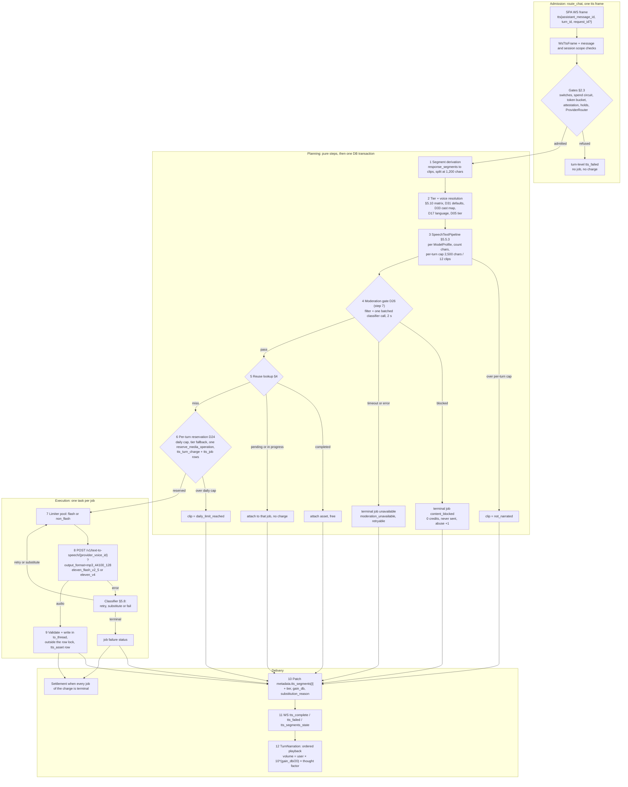
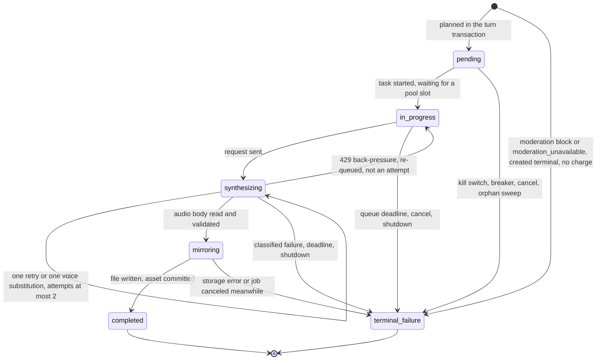

# Chat narration on ElevenLabs

- **Date:** 2026-10-12
- **Status:** Proposed (see [03](03_target_architecture_and_decisions.md) for sign-off status)

## Scope

This plan moves chat narration (adventure, character and group chats) from MiniMax to ElevenLabs. It follows one narrated turn from end to end:
- the `tts` WebSocket frame;
- segment derivation;
- tier and voice resolution;
- the shared `SpeechTextPipeline` and its moderation gate;
- reuse;
- the per-turn credit reservation;
- one ElevenLabs request per segment;
- storage and the `tts_segments` metadata patch;
- WebSocket delivery and playback in `TurnNarration`.

It also specifies the fixes for the narration bugs that D30 places in the migration (#3, #5, #6, #7, #8, #10, #11, #12, #16), and for the frontend bugs that ship in the same release (#2, and #4 with its wrong-turn attach).

Other plan documents cover the neighbouring work:
- realtime calls: [07](07_realtime_calls_migration.md);
- catalog, acceptance and `gain_db` measurement: [04](04_voice_catalog_and_library.md);
- the work breakdown: [08](08_backend_refactor_plan.md) and [09](09_frontend_refactor_plan.md).

[03](03_target_architecture_and_decisions.md) is the source of truth. Decisions are cited as (D05), spikes as (S-3) and legal items as (L-1). Tables marked "verbatim" are copied unchanged from 03 §5.

Code was read on 2026-10-12 in the working trees of `magic-worlds-api` and `magic-worlds`. Line numbers can drift, so search by the symbol named next to each link. Prices and model facts are as of 2026-10-12. No code was changed.

**Related.**
- [README](README.md): index and reading guide.
- [01](01_current_state.md): the current MiniMax stack and the bug list.
- [02](02_elevenlabs_capabilities.md): ElevenLabs capabilities.
- [03](03_target_architecture_and_decisions.md): decisions D01–D38 and the canonical definitions (§5).
- Plan documents:
  - [04](04_voice_catalog_and_library.md): catalog and Voice Library;
  - [05](05_voice_studio_and_admin_console.md): Voice Studio and admin console;
  - [07](07_realtime_calls_migration.md): realtime calls;
  - [08](08_backend_refactor_plan.md): backend plan;
  - [09](09_frontend_refactor_plan.md): frontend plan;
  - [10](10_data_migration_and_rollout.md): data migration and rollout;
  - [11](11_cost_plans_and_operations.md): cost and operations;
  - [12](12_best_practices_and_improvements.md): best practices and backlog;
  - [13](13_policy_privacy_and_compliance.md): policy and privacy;
  - [14](14_staging_spike_and_contract_tests.md): staging spike and contract tests;
  - [15](15_implementation_plan_and_acceptance.md): implementation plan;
  - [16](16_risks_and_open_questions.md): risks and open questions.
- Research notes:
  - [research 00](research/00_current_tts_review.md): baseline review and bugs;
  - [research 01](research/01_elevenlabs_tts_models_and_api.md): TTS models and API;
  - [research 02](research/02_elevenlabs_streaming_dialogue_realtime_agents.md): streaming and Text to Dialogue;
  - [research 05](research/05_elevenlabs_platform_pricing_limits_policy.md): limits, timeouts and retries;
  - [research 06](research/06_backend_minimax_inventory.md): backend inventory;
  - [research 08](research/08_voice_data_model_migration_surface.md): data model;
  - [research 12](research/12_gap_model_protocol_facts.md): model and protocol facts;
  - [research 13](research/13_gap_codebase_checks.md): codebase checks;
  - [research 14](research/14_cost_model.md): cost model.

## 1. Summary

**Shape of the target.**
- Each narrated segment is one `POST /v1/text-to-speech/{provider_voice_id}` request, so every character keeps its own voice and settings (D05).
  - Standard tier uses `eleven_flash_v2_5`.
  - Expressive tier uses `eleven_v4`.
  - Output is `mp3_44100_128`.
- Text to Dialogue and word-level timestamps are later options (§10).
- Before anything is sent:
  - the turn is split into clips of at most 1,200 characters, capped at 2,500 characters and 12 clips per turn;
  - each clip is resolved to a catalog voice that never fails the turn (§5.10, D31, D33);
  - the text is sanitized by one shared pipeline (D14, D27);
  - the text passes a fail-closed moderation gate (D26).
- Credits are reserved **once per turn**, for reuse misses only, and settled when every job of the turn is terminal. Failed segments are refunded, and daily character caps are hard (D24, §5.9). This fixes free re-synthesis (#5) and the missing refund (#7).
- There is one retry layer, and it never retries after the first response byte (#12).
  - Jobs that a restart or crash leaves behind are terminalized and refunded (#8).
  - Audio is written off the event loop and outside the row lock (#11).
  - Speaker names no longer trip secret redaction (#6).
- The player:
  - applies the per-voice `gain_db` and a −3 dB thought factor (D16);
  - skips failed clips instead of waiting forever (#3);
  - recovers from external pauses (#2);
  - keeps live narration state across hydration (#4);
  - polls with bounds.

**Sign-off status.** The numbers and rules here follow the recommended options of D05 (tiering), D24 (prices and caps), D26 (content policy), D31 (voiceless characters share the narrator default) and D37 (budget guards). Each of those still needs owner sign-off (03 §3). If the owner changes one, this plan follows 03.

**Bugs handled here** (numbering from [research 00](research/00_current_tts_review.md), placement from D30):

| Bug | D30 placement | Fixed in |
|---|---|---|
| #2 multi-voice player stuck on Pause | Separate, same FE release | §9.3 |
| #3 one failed segment halts the turn | Migration | §9.4 (player), §6 (failure categories) |
| #4 hydration erases narration; late poll attaches to the wrong turn | Separate | §9.5 |
| #5 free re-synthesis | Migration | §5.6 |
| #6 character names break narration | Migration | §8 |
| #7 no refund on failure | Migration | §5.6 |
| #8 stuck jobs | Migration | §7.2, §7.3, §7.4 |
| #10 voice validation mismatch | Migration | §2.5 |
| #11 event-loop blocking | Migration | §7.5 |
| #12 duplicate charges on retry | Migration | §6.3, §6.4 |
| #16 sanitizer false positives | Migration | §2.6, §8 |
| Polling forever without backoff (research 00, "Lower") | Not in D30 | §9.6 |

**What ships when** (dates from D28):

| Phase | Narration content |
|---|---|
| **R0** (2026-11-06, still MiniMax) | Provider-neutral work only:<br/>- per-turn reservation, settlement, refunds and caps (`tts_turn_charge`, `daily_quantity_limit`, in-flight per turn);<br/>- clip splitting and the display states `daily_limit_reached` / `not_narrated`;<br/>- `SpeechTextPipeline` with fail-closed moderation and the attestation frame;<br/>- a resolver that never raises;<br/>- the single retry layer (the MiniMax adapter's own loop is removed);<br/>- startup and stale sweeps, graceful shutdown, off-loop storage;<br/>- the redaction rewrite;<br/>- the §5.14 widening;<br/>- `ProviderRouter` and budget guards;<br/>- the turn `language` field;<br/>- FE fixes #2, #3, #4, polling and the new types.<br/>The Free narration regression (2,500 characters a day, D24) lands here for everyone. |
| **R1** (2026-11-18) | ElevenLabs adapter live for the internal cohort. Tier setting and per-session toggle, `gain_db`, substitution indicators. Staff traffic only. |
| **R2** (2026-11-25 → 2026-12-04) | Canary at 5%, 25%, then 50%. The R2 entry gate (03 §6.3) requires:<br/>- L-1, L-4 and L-8 answered;<br/>- S-8 and S-21 measured;<br/>- external counsel sign-off (D25);<br/>- ToS, `user_attestation` and the WS attestation frame live (D26);<br/>- privacy copy naming both providers;<br/>- budget guards live (D37). |
| **R3** (2026-12-04) | 100% on ElevenLabs. |
| **R4** (2026-12-18) | MiniMax narration code removed: the adapter, `_dim_voice_for_thought`, the MiniMax code tables and the `MINIMAX_AUDIO_API_KEY` log line. The alias `speech_2_8_turbo` stays read-only for history rows. |

## 2. End-to-end flow

### 2.1 Flow diagram



### 2.2 Steps: today vs target

| # | Step | Today | Target | Decisions |
|---|---|---|---|---|
| 0 | WS frame | `WsTtsFrame` is strict (`extra="forbid"`) with `assistant_message_id`, `turn_id` and an optional `request_id` ([route_chat.py:212](/home/andres/PycharmProjects/magic-worlds-api/src/routes/user/route_chat.py)) | Unchanged. An optional `trigger: "auto" \| "manual"` is proposed (§12, item 6) | D37 |
| 1 | Gates | Only "engine not configured" ([route_chat.py:1345](/home/andres/PycharmProjects/magic-worlds-api/src/routes/user/route_chat.py)) | §2.3 | D26, D28, D37 |
| 2 | Segments | `_narrated_segments`: one clip over the limit rejects the whole turn ([route_chat.py:1174](/home/andres/PycharmProjects/magic-worlds-api/src/routes/user/route_chat.py)) | Split at 1,200; caps 2,500 / 12; display states (§2.4) | D24 |
| 3 | Resolution | `_build_segment_voice_resolver` raises on one bad voice, so the turn becomes INVALID ([route_chat.py:1137](/home/andres/PycharmProjects/magic-worlds-api/src/routes/user/route_chat.py)); `build_resolved_voice` ([registry.py:71](/home/andres/PycharmProjects/magic-worlds-api/src/services/tts_generation/registry.py)) | `VoiceResolver`, never raises (§2.5) | D05, D17, D31, D32, D33 |
| 4 | Text | `normalize_tts_text` passes brackets and Markdown through ([registry.py:248](/home/andres/PycharmProjects/magic-worlds-api/src/services/tts_generation/registry.py)) | `SpeechTextPipeline` (§2.6) | D14, D27 |
| 5 | Moderation | None | Fail-closed gate (§2.7) | D26 |
| 6 | Reuse | `find_reusable_chat_job` ([models.py:8650](/home/andres/PycharmProjects/magic-worlds-api/src/database/mysql/models.py)) before quota ([engine.py:226](/home/andres/PycharmProjects/magic-worlds-api/src/services/tts_generation/engine.py)) | Same order; hash v2 (§4) | §5.6 |
| 7 | Reservation | `_enforce_quota` for segment 0 only ([route_chat.py:1433](/home/andres/PycharmProjects/magic-worlds-api/src/routes/user/route_chat.py), [engine.py:318](/home/andres/PycharmProjects/magic-worlds-api/src/services/tts_generation/engine.py)); ledger ids discarded | One reservation per turn, settled (§5) | D24 |
| 8 | Provider call | MiniMax T2A with nested retries ([minimax_adapter.py:130](/home/andres/PycharmProjects/magic-worlds-api/src/services/tts_generation/minimax_adapter.py), [engine.py:525](/home/andres/PycharmProjects/magic-worlds-api/src/services/tts_generation/engine.py)) | ElevenLabs TTS HTTP, one retry layer (§3, §6) | D05, §5.6, §5.8 |
| 9 | Storage | Hex decode and fsync on the loop, inside the row lock ([engine.py:611](/home/andres/PycharmProjects/magic-worlds-api/src/services/tts_generation/engine.py), [storage.py:117](/home/andres/PycharmProjects/magic-worlds-api/src/services/tts_generation/storage.py)) | Raw bytes, `to_thread`, outside the lock (§7.5) | D30 #11 |
| 10 | Metadata | `_metadata_patch_for_job` ([chat_tts_delivery.py:503](/home/andres/PycharmProjects/magic-worlds-api/src/services/chat_tts_delivery.py)) | Adds `tier`, `gain_db`, `substitution_reason`; capped clips get entries (§2.8) | D16, D36 |
| 11 | Delivery | `build_tts_failed_frame`, `_broadcast` ([chat_tts_delivery.py:471](/home/andres/PycharmProjects/magic-worlds-api/src/services/chat_tts_delivery.py)) | §5.8 frames, code allow-list (§6) | §5.8 |
| 12 | Playback | `TurnNarration` / `MultiClipNarration` ([TurnNarration.tsx:184](/home/andres/WebstormProjects/magic-worlds/src/features/interaction/components/TurnNarration.tsx)) | §9 | D16, D30 |
| 13 | Settlement | None | When the turn's jobs are terminal (§5.4, §7.6) | D24 |

### 2.3 Admission gates

The gates run after today's message and session scope checks and before any planning. A refused request creates no job and no charge. It produces a turn-level `tts_failed` frame without `segment_index`.

| Order | Gate | Rule | When it fails |
|---|---|---|---|
| 1 | Kill switch | `voice_runtime_setting.tts_engine_enabled`, read with a TTL of 60 s or less (D28) | `status:"unavailable"`, `error.code:"narration_paused"` [proposed, §12 item 7] |
| 2 | Standard narration breaker | §6.5 | same as gate 1 |
| 3 | Global spend circuit | At 100%, new narration is refused. At 95%, only auto-narration is paused (§5.13). | 100%: same as gate 1. 95%: auto requests get `error.code:"auto_narration_paused"` [proposed]; manual requests pass. The BFF can tell auto from manual only after §12 item 6. |
| 4 | Per-user token bucket | 6 turns/min, burst 10, in-process (§5.13) | `status:"rate_limited"` with `retry_after_seconds` |
| 5 | Attestation | Current `age_18_plus` and `terms_of_service` rows in `user_attestation` (D26) | The §5.8 frame `attestation_required` with `action:"attest"` |
| 6 | Free eligibility | Verified email and an account at least 24 h old (§5.13) | `error.code:"voice_not_eligible"` [proposed] |
| 7 | Voice hold or abuse disable | Minor-report hold of at most 48 h; abuse thresholds (D26 items 6 and 6a) | `error.code:"voice_restricted"` [proposed] |
| 8 | Provider route | `ProviderRouter` (D28): `rollout_mode`, `canary_percent`, cohort. Before R2 entry only the internal cohort reaches ElevenLabs (L-1). | Continues on the MiniMax or the ElevenLabs path. Steps 1–7 and 10–13 are shared; steps 8–9 differ. |

Membership limits (daily requests, in-flight, credits, daily characters) are checked at reservation (§5), not here, because only reuse misses are charged.

### 2.4 Segment derivation and caps

**Input.** The input is the message's `response_segments`, accepted only when `response_segments_status == "completed"` (as today).
- The parse limits `_MAX_SEGMENTS = 32` and `_MAX_SEGMENT_CHARS = 4,000` stay ([chat_segments.py:15](/home/andres/PycharmProjects/magic-worlds-api/src/services/chat_segments.py)).
- Thoughts are included only when the snapshot's `narrate_thoughts` is true ([route_chat.py:1154](/home/andres/PycharmProjects/magic-worlds-api/src/routes/user/route_chat.py)).
- `strip_think_reasoning` runs first ([errors.py:79](/home/andres/PycharmProjects/magic-worlds-api/src/services/tts_generation/errors.py)).
- A malformed segment is skipped and logged. Today one malformed segment returns `[]` for the whole turn.

**Split.** A segment longer than 1,200 characters is split into consecutive clips. The rules:
- Split points are tried in this order: paragraph break, sentence end (`. ! ? …`, plus closing quotes), clause punctuation (`, ; : —`), then whitespace.
- A split never lands inside a markup v1 token. A clip always has at least one word.
- The length used for splitting is the step-6 text, with each markup v1 placeholder counted at 24 characters. That is an upper bound for its step-8 form, such as `<break time="3.0s"/>` (20 characters) or `[inhales deeply]` (16).
- 1,200 is far below the model limits of 40,000 (Flash) and 10,000 (v4) (§5.6), so the over-estimate is harmless.
- Split clips keep the speaker, kind and voice of their segment.

Clips that are empty after sanitizing (for example a segment that was only an OOC block) are dropped before indexing. `segment_index` is the clip ordinal in presentation order, as today. `segment_count` counts every clip, including capped ones.

**Per-turn cap.** The cap is applied after the pipeline has produced the exact counted characters, which are the step-8 text without step-9 prefix tags (D24 item 1). Clips are walked in order. The first clip that would make the total exceed 2,500 characters, or whose index is 12 or higher, becomes `not_narrated`, and so does every later clip. No clip is truncated. The daily cap is applied later, at reservation (§5.2).

```python
def apply_turn_cap(clips: list[Clip]) -> None:
    total, capped = 0, False
    for c in clips:                                   # presentation order
        if capped or c.segment_index >= 12 or total + c.counted_chars > 2_500:
            capped = True
            c.display_status = "not_narrated"         # no job, no charge, no moderation call
            continue
        total += c.counted_chars
```

If the tier later falls back from Expressive to Standard (§5.2 step 4), steps 5 and 8–10 are recomputed for Standard, and the cap is applied again. Flash `<break>` forms are longer than the v4 forms.

### 2.5 Tier and voice resolution

**Tier** (D05):
- **Requested tier:** `session_voice_setting.tier_override`, else `user_preferences.narration_tier`, else `standard`.
- **Plan clamp:** Free resolves to `standard`. A Plus or Pro user who downgraded falls back to `standard` with `substitution_reason = tier_fallback`.
- **Health:** when the `narration:v4` breaker is open (§6.5), or `el_v4` is missing from `GET /v1/models` at startup, clips fall back to `standard` with `tier_fallback`.
- **Daily cap fit:** decided at reservation (§5.2 step 4).
- `eleven_multilingual_v2` is never a fallback.

**Voice** (per clip; one model for write, read and resolve, which fixes #10):
1. **Stored voice.**
   - `narrator` clips use the snapshot `narrator_voice`.
   - `speech` and `thought` clips use the speaking character's voice: the cast entry, or `snapshot.character.voice` in character chats.
   - An unknown speaker or a `null` voice uses the narrator default of the turn language. That is not a substitution (D31).
2. **Parse** with the §5.1 V1/V2 union. Read-side normalization trims ids and turns `""` into `null`. Today `CharacterVoice` accepts `language_boost:""` and a `voice_id` with surrounding spaces, but `build_resolved_voice` rejects them ([research 00](research/00_current_tts_review.md) #10). A value that still fails the shape check resolves to the D31 default with `substitution_reason = default_voice` (D31: "whenever a default is used for a non-null voice"), instead of raising. `voice_unavailable` is reserved for runtime provider errors (below).
3. **Cast map** (D33): computed over the whole snapshot (narrator first, then cast order) and cached per `(session_id, snapshot hash, catalog version)`. A clip takes its speaker's entry.
4. **Catalog state:** apply the §5.10 matrix below. A V1 id goes through `voice_legacy_mapping` first. During R1–R4, non-cohort users meeting a V2 voice get its reverse-mapped MiniMax id (`voice_legacy_fallback`, D28).
5. **Language:** the §5.7 policy below. The effective code is guarded by the `GET /v1/models` allow-list and goes into the reuse hash.
6. **Settings.**
   - Source order: `voice.settings`, then the catalog `default_settings`, then the ElevenLabs defaults (stability 0.5, similarity 0.75, speed 1.0; 03 §5.1.1).
   - Fields not supported by the model are stripped (§5.6).
   - Emotion handling depends on the tier (§5.5.1).
7. **Loudness:** `gain_db` comes from `voice_catalog_acceptance` for `(voice_key, provider_model_id, effective language)`, else the voice's `primary_language` row, else 0 (§12 item 11).

The output is the 03 §2.1 shape: `ResolvedSpeechVoice{provider, provider_voice_id, model_profile, effective_settings, tag_prefix, language_code, gain_db, substitution_reason}`.

**Runtime substitution.** On a voice-scoped provider error (404 `voice_not_found`, 400 `invalid_voice_id`, 403 `voice_access_denied`), the job:
1. marks the catalog voice `suspect`, which triggers Job B ([04](04_voice_catalog_and_library.md));
2. re-resolves that clip with `replacement_voice_key`, then the D31 default, skipping voices already in the cast map;
3. retries **once in the same job**: same `job_id`, same reservation, `substitution_reason = voice_unavailable`.

The job row's `voice_id_hash` is updated before the second attempt. If no substitute exists, or the substitute also fails, the job ends `unavailable` with `error.code = voice_unavailable`.

Resolver matrix (03 §5.10, verbatim):

| Catalog state | Picker shows | Resolver plays | Badge to owner | Badge to players / session users |
|---|---|---|---|---|
| `active` + `public` | yes | the voice | — | — |
| `active` + `plan_gated`, caller below `min_plan` | yes, locked | the voice (playback never gated) | — | — |
| `active` + `admin` | no (root only) | the voice | — | — |
| `hidden` (retired) | no | the voice | "Voice retired: pick another anytime" (optional switch) | — |
| `deprecating` (`disable_at` set) | no | the voice until `disable_at` | "Voice leaving on {date}" + one-click switch | "Voice leaving on {date}" (info only) |
| `removed` or `blocked` | no | `replacement_voice_key` → D31 default (`voice_removed` / `voice_blocked`) | "Voice replaced by {name}" + switch | "Voice replaced" indicator |
| `suspect_since` set | unchanged | the voice; on a runtime 404 the replacement for that segment | — | "Voice replaced" on affected clips |
| Not accepted in the turn language | "Not tested in {language}" | the voice (no substitution) | — | — |
| Failed acceptance in the turn language | — | language replacement → D31 default (`language_unsupported`) | — | "Voice replaced" |
| `call_eligible = 0` on the call surface | n/a (publish requires eligibility) | replacement → D31 default (`not_call_eligible`) | — | "Call voice: {name}" in the call header |
| Expressive model unavailable or tier not allowed | — | same voice on Standard (`tier_fallback`) | — | "Standard voice" on the clip |
| Unmapped V1 | — | D31 `character_fallback` (narrator role for narrator voices) (`unmapped_legacy`) | "Voice needs re-selection" | "Voice replaced" |
| Collision within a cast | — | next D33 candidate (`distinct_voice`) | — | — |

Defaults (03 §5.11, verbatim):

| Item | Definition |
|---|---|
| Storage | `voice_default(role, language, rank, voice_key)` (§5.2) |
| Roles | `narrator` (rank 1 used); `character_fallback` (ordered pool, ≥ 4 per language, mixed gender) |
| Eligibility (console write and readiness probe) | `source_kind ∈ {designed, remixed}` (Library only after L-2, L-12); `status = active`; `call_eligible = 1`; accepted on `eleven_flash_v2_5` and `eleven_v4` in that language; own sample present |
| Required at R0 exit | `en`, `es`: narrator + 4 character_fallback; each D34 light language: narrator |
| Selection chain | D17 effective language → `en` → `VOICE_LAST_RESORT_VOICE_KEY` (env; validated at startup) |
| Voiceless character (`voice = null`) | narrator default of the turn language (today's behaviour; not a substitution) |
| Unmapped legacy voice | `character_fallback` pool with the D33 rule; narrator role for narrator voices |
| Removed | `TTS_DEFAULT_VOICE_ID`, `VOICE_MINIMAX_TTS_VOICE_ID` |
| Readiness | probe each default with the `CATALOG` key (D04); a failing default is skipped in the chain and root is alerted; a failing last resort marks narration and calls unhealthy |

Language policy (03 §5.7, verbatim):

| Step | Source | Notes |
|---|---|---|
| 1 | Turn language: the new `language` field (ISO 639-1) in the turn-metadata graph output, stored on the assistant message | For calls: the chat's last known turn language |
| 2 | Voice `language_code` (CharacterVoice v2, else the catalog `primary_language` when the voice is single-language) | Migrated from `language_boost` only when it names one language; `auto` → null |
| 3 | `user_preferences.preferred_language` (server value) | en/es today |
| 4 | Omit | Provider auto-detect |
| Guard | Per-model allow-list from `GET /v1/models`; overrides `yue`, `zh` for v4_turbo | Never sent to multilingual_v2; never sent unsupported to Flash |
| Format | Lower-case ISO 639-1, no region; `yue`/`zh` exceptions | Never 639-3 (`spa`) or `es-ES` |
| Hash | The effective value enters reuse hash v2 | — |
| STT | The same chain supplies Groq's `language` hint, replacing the global `VOICE_STT_LANGUAGE` | — |

On ElevenLabs the guard matters. Flash returns 400 for an unsupported code, while v3 accepts it ([research 12 §5](research/12_gap_model_protocol_facts.md)). CT-07 confirms the behaviour per model (S-4).

**Order relative to 03 §2.2.** The 03 §2.2 diagram draws the `SpeechTextPipeline` before the resolver. This plan resolves first, because pipeline steps 5, 8 and 9 and the counted characters depend on the `ModelProfile` and on the language. The moderation input is not affected (§12 item 12).

### 2.6 SpeechTextPipeline

One shared module serves narration, calls and previews (D14). It replaces `normalize_tts_text` ([registry.py:248](/home/andres/PycharmProjects/magic-worlds-api/src/services/tts_generation/registry.py)) and the call sanitizer's narration-relevant rules ([transcript_sanitizer.py](/home/andres/PycharmProjects/magic-worlds-api/src/services/voice_orchestration/transcript_sanitizer.py)).

Today `[Chapter 2]` or a bracketed OOC note would reach v4 as an audio tag, because v3/v4 treat any `[…]` as an instruction and document no escape ([research 12 §7](research/12_gap_model_protocol_facts.md), [research 13 §9](research/13_gap_codebase_checks.md)).

Emotion mapping (03 §5.5.1, verbatim):

| `emotion` | Expressive (v4/v3/v4_turbo): prefix tag | Standard (Flash/multilingual_v2): stability offset | Tag source |
|---|---|---|---|
| null | none | 0 | — |
| `happy` | `[happily]` | −0.15 | documented [verified: https://elevenlabs.io/docs/overview/capabilities/text-to-speech/best-practices, via research/01 §5.2] |
| `sad` | `[sad]` | −0.10 | documented (same source) |
| `angry` | `[angry]` | −0.20 | documented (same source) |
| `surprised` | `[surprised]` | −0.10 | documented (same source) |
| `calm` | `[calm]` | +0.15 | docs and blog examples [research/01 §5.3] |
| `fearful` | `[nervously]` | −0.20 | free-form [unverified] |
| `disgusted` | `[disgusted]` | −0.10 | free-form [unverified] |

The Standard offset is applied as `effective_stability = clamp(base + offset, 0, 1)`; it is never stored. The offsets are [unverified] starting points, tuned in S-6.

Server tag allow-list (03 §5.5.2, verbatim). Only the server emits tags, only these, and only on profiles with `supports_audio_tags=true`:
- emotion: `[happily]`, `[sad]`, `[angry]`, `[surprised]`, `[calm]`, `[nervously]`, `[disgusted]`;
- thought: `[whispers]`;
- pauses (from markup v1): `[short pause]`, `[long pause]`;
- interjections (from markup v1): `[laughs]`, `[sighs]`, `[gasps]`, `[inhales deeply]`, `[exhales]`, `[hums]`.

Composition order for a segment: `[thought tag] [emotion tag] text`, for example `[whispers] [sad] …`. At most two prefix tags.

Sanitizer rules (03 §5.5.3, `sanitizer_version = 1`, verbatim). Applied to all text bound for TTS (narration, calls, previews), in this order:
1. Strip `<think>…</think>` (existing) and the chat XML wrappers. Reject other XML/HTML-shaped tags (fail closed), except markup v1 `<#x#>`.
1a. **Tokenize markup v1**: replace each valid `<#x#>` pause and each interjection of the D27 set with an opaque placeholder token (a private-use Unicode code point plus an index) and keep the originals in a side list. Steps 2–7 never see markup v1, and they leave placeholder tokens untouched.
2. Markdown links and images → visible text. Remove emphasis, headings, list bullets, code fences and inline code markers.
3. Drop OOC blocks: `[OOC …]`, `[ooc: …]`, `((…))`, `(OOC …)`, case-insensitive.
4. Every remaining `[ … ]`: remove the brackets and keep the inner words, adding a comma or period boundary when needed. Empty brackets are removed. Nested brackets are flattened.
5. On profiles without tag support: remove every `[`, `]`, `{`, `}`, `<`, `>` character from the non-placeholder text.
6. Normalize whitespace; remove zero-width characters and NUL (existing). Expand residual digits per D27 for en and es, in non-placeholder text only.
7. Moderation gate (D26), on the text with placeholders removed. Fail closed.
8. Translate markup v1 per model (D27): each placeholder becomes its model-specific form (`<break time="xs"/>`, `…`, `[short pause]`, `[laughs]`, or nothing). This is the only step that may introduce `<`, `>`, `[` or `]`.
9. Prepend allow-listed tags (§5.5.2).
10. Hash the final text into `normalized_text_sha256` for reuse. Billed and capped characters (D24) are counted on the step-8 text without step-9 prefix tags.

Fixture cases QA must cover:
- `[Chapter 2]`
- `[OOC: brb]`
- `[link](http://x)`
- `[whispers]` injected through card or user text (must be neutralized)
- `[quoted instruction marker]`
- `*emphasis*`
- `<#0.4#>`
- `<#0.4#>` next to digits in the surrounding text (for example `He waited <#0.4#> 3 seconds`), on both Flash and v4: the marker must survive steps 5–6 and the digits must be expanded
- `(laughs)`
- "bearer of bad news"
- a literal `<` or `[` in user text next to a placeholder (must not merge with it)

Markup v1 translation (D27, verbatim):

| Markup | Flash / multilingual_v2 | v4 / v4_turbo / v3 |
|---|---|---|
| `<#x#>` | `<break time="xs"/>` (x ≤ 3; > 3 clamped) if S-26 passes; otherwise `…` | x < 0.5 → `…`; 0.5–1.5 → `[short pause]`; ≥ 1.5 → `[long pause]` |
| Interjections | **Stripped** | `[laughs]`, `[sighs]`, `[gasps]`, `[inhales deeply]`, `[exhales]`, `[hums]` |

**How narration uses the pipeline.**
- Steps 1–4 and 6 do not depend on the model. Steps 5, 8 and 9 take the clip's `ModelProfile`, so the pipeline runs after resolution (§2.5).
- All steps except 7 are pure functions, so the planner computes them for every clip before the moderation call. The counted characters exist before moderation and the per-turn cap can skip clips that would never be sent. Step 7 still gates everything that reaches ElevenLabs.
- Tag prefixes come only from `ResolvedSpeechVoice.tag_prefix`, built from the §5.5.1 row of the voice's `emotion` and from `[whispers]` for thoughts. Stored text never carries tags, so card, lorebook or user text cannot inject one (step 4 neutralizes them).
- Digits: the three chat graphs spell out numbers in the story language (D27). Step 6 expands what remains for en and es. `apply_text_normalization:"auto"` is sent anyway (S-5, CT-08).
- Prompt rule (D14): [adventure_chat.v2.json](/home/andres/PycharmProjects/magic-worlds-api/src/agent_graphs/runtime/adventure_chat.v2.json), [character_chat.v2.json](/home/andres/PycharmProjects/magic-worlds-api/src/agent_graphs/runtime/character_chat.v2.json) and [character_group_chat.v2.json](/home/andres/PycharmProjects/magic-worlds-api/src/agent_graphs/runtime/character_group_chat.v2.json) gain a "do not use square brackets" rule. The graph hashes change in new execution records.
- #16: the pipeline has no plain-word fatal markers. "bearer of bad news" is spoken, and a long run of letters is not treated as base64. Secret detection is not a TTS-text concern; the text never leaves the BFF except to the classifier and to ElevenLabs.

### 2.7 Moderation gate

The gate is fail-closed and synchronous, and runs before any ElevenLabs request (D26).
- **Input:** the step-6 text, with placeholders removed, of every clip that survived the per-turn cap.
- **Layers:**
  - (a) a deterministic en/es keyword and pattern filter;
  - (b) the `magic_llm` `moderation` profile, in **one batched call per turn** with a 2 s timeout (S-29). Its provider is one already named in the privacy copy (D25).
- **Outcomes per clip:**
  - Pass: the clip goes on to reuse.
  - Blocked: a terminal `tts_job` row is written in the planning transaction with `status = content_blocked`, `turn_charge_id = null` and 0 credits, and nothing is sent. `voice_abuse_counter` is incremented (`moderation_block`, or `moderation_block_severe` for the minors and sexual-violence categories) and the D26 6a thresholds apply.
  - Classifier timeout or error: every clip of the batch gets a terminal job `unavailable` with `error.code = moderation_unavailable`, retryable. Moderation runs before the reservation, so nothing was charged. D26's "refunded" therefore holds trivially, and the user's retry is charged only for misses.
- **Verdict cache.** The cache is in-process: an LRU keyed by `(sha256(moderation input), moderation policy version)`, with a 24 h TTL. It holds pass and block verdicts.
  - A retry of a partly failed turn does not call the classifier again for clips already judged.
  - A repeated request for a blocked clip does not increment the abuse counter twice. It increments only on a fresh block for `(assistant_message_id, segment_index)`.
  - A replay of an already narrated turn costs one classifier call only after a restart or once the 24 h TTL has expired. Reuse runs after moderation, as 03 orders it. Every ElevenLabs asset was moderated when it was created.
- **Never overwrite success.** A failure entry from this request never replaces a `completed` metadata entry for the same `segment_index` (§2.8).
- The moderation path is tested with mocks only (D26). Adult narration stays off until L-5 is answered. L-6 decides how ElevenLabs-side moderation and ban signals map (§6.2).

### 2.8 Storage, metadata and WebSocket delivery

**Asset.** One `tts_asset` row per completed job, with:
- `content_type = 'audio/mpeg'`;
- `output_format = 'mp3'` (the family that the reuse query matches, §4.2). The SPA keeps only assets with `content_type === 'audio/mpeg'` and a `/tts/assets/….mp3` URL ([chatTtsTurnState.ts:320](/home/andres/WebstormProjects/magic-worlds/src/features/interaction/utils/chatTtsTurnState.ts));
- the content `sha256`, the byte size, and `duration_ms` from MP3 frame parsing.

The exact provider format (`mp3_44100_128`) is recorded in the job summary and enters the reuse hash. Files stay on `local_fs` under `TTS_STORAGE_ROOT`. Retention is bug #9 and handled separately.

**Job summary.** Typed, allow-listed keys only:
- `provider_request_id`;
- `character_cost`;
- `x_region`;
- `tier`;
- `gain_db`;
- `substitution_reason`;
- `provider_output_format`;
- the `segment` identity object (§8).

No text, voice settings or headers beyond these are stored. Logs never contain text (§5.8).

**Metadata entry** (`adventure_message.metadata.tts_segments[i]`, written by `patch_assistant_metadata`, [models.py:18965](/home/andres/PycharmProjects/magic-worlds-api/src/database/mysql/models.py)). Today's entry shape is `{segment_index, segment_count, kind, speaker_id, speaker_name, job_id, status, url, assets, error}` ([research 08 §7.4](research/08_voice_data_model_migration_surface.md)). The new fields:

```jsonc
{
  "segment_index": 2, "segment_count": 5,
  "kind": "thought", "speaker_id": "…", "speaker_name": "Tracey",
  "job_id": "…", "status": "completed",
  "url": "/tts/assets/….mp3",
  "assets": [{ "asset_id": "…", "url": "/tts/assets/….mp3", "content_type": "audio/mpeg",
               "output_format": "mp3", "file_size_bytes": 61440, "duration_ms": 3840 }],
  "error": null,
  "tier": "expressive",                     // new (D05): effective tier of this clip
  "gain_db": -2.5,                          // new (D16): ≤ 0; absent on MiniMax clips
  "substitution_reason": "distinct_voice",  // new (D36, §5.4.2) or null
  "voice_name": "Eldrin",                   // new [proposed]: effective voice display name
  "original_voice_name": "Mara"             // new [proposed]: only when substituted (§5.12 tooltip)
}
```

A capped clip gets an entry with no job:

```jsonc
{ "segment_index": 4, "segment_count": 5, "kind": "narrator", "speaker_id": null, "speaker_name": null,
  "job_id": null, "status": "daily_limit_reached", "url": null, "assets": [], "error": null, "tier": null }
```

Display-only states (03 §5.4.2, verbatim row):

| Enum | Values |
|---|---|
| `tts_segments[].status` additions | `daily_limit_reached`, `not_narrated` (per-turn cap) — display-only segment states, never `tts_job` statuses |

**Patch rules.**
- A `completed` entry is never replaced by a failure entry for the same `segment_index`. A newer `job_id` replaces an older one only if the older job is terminal.
- Patches are skipped when the message changed after planning (§7.4, §12 item 9). Editing a message drops these sidecars today ([models.py:19277](/home/andres/PycharmProjects/magic-worlds-api/src/database/mysql/models.py)).
- A segment-identity validation failure never drops a completed clip (§8).

**Frames.**
- `tts_job`, `tts_complete` and `tts_failed` keep their shapes, and their segment fields gain optional `tier`, `gain_db`, `substitution_reason`, `voice_name` and `original_voice_name`.
- Statuses are unchanged (§5.14). Older SPA builds copy only the fields they know ([chatTtsTurnState.ts:105](/home/andres/WebstormProjects/magic-worlds/src/features/interaction/utils/chatTtsTurnState.ts)).
- Capped clips have no failure frame (§5.8). The live UI learns about them through a new frame [proposed, §12 item 5]:

```jsonc
{ "type": "tts_segments_state", "assistant_message_id": 123, "turn_id": "…",
  "segments": [ { "segment_index": 4, "segment_count": 5, "kind": "narrator",
                  "speaker_id": null, "speaker_name": null, "status": "daily_limit_reached" } ] }
```

Unknown frame types are ignored by every SPA build ([interaction.types.ts:190](/home/andres/WebstormProjects/magic-worlds/src/shared/types/interaction.types.ts)), so older builds learn the state at the next hydration.

**Side effects at completion.**
- `voice_spend_daily(usage_day, 'narration', model_id)` gains the request's characters and the list-price estimate (§5.13).
- The "Narration failed" notification ([notifications.py:149](/home/andres/PycharmProjects/magic-worlds-api/src/services/notifications.py)) moves to settlement. It is sent once per turn, only when at least one clip failed and the user's socket is gone (§12 item 10).

## 3. The ElevenLabs request per segment

### 3.1 Transport and common fields

```http
POST {ELEVENLABS_BASE_URL}/v1/text-to-speech/{provider_voice_id}?output_format=mp3_44100_128
xi-api-key: {ELEVENLABS_KEY_NARRATION}
Content-Type: application/json
Accept: audio/mpeg
```

**Body fields.**
- **Always sent:**
  - `text`, the step-9 text;
  - `model_id`;
  - `voice_settings`, holding only the fields allowed by §5.6;
  - `seed`;
  - `apply_text_normalization: "auto"`.
- **Sent when allowed:** `language_code`, only when allowed by §5.7.
- **Never sent:**
  - `enable_logging` (the flag stays unset until ZRM, D25);
  - `previous_request_ids` and `next_request_ids` (ZRM-incompatible, D25);
  - `previous_text` and `next_text` (off until S-17, §3.5);
  - `pronunciation_dictionary_locators` (P1, D29);
  - `use_pvc_as_ivc`;
  - `optimize_streaming_latency` (deprecated).

**Seed.** `seed = int.from_bytes(sha256(job_id.encode()).digest()[:4], "big")`, a stable 32-bit value per job (D05). Retries and voice substitutions inside the job reuse it. The seed is not in the reuse hash: a completed asset is reused whatever seed produced it.

**Endpoint.** The job uses the non-streaming convert endpoint, because it stores a complete file and the SPA plays authenticated blobs after completion. `/stream` would only help progressive playback, which is not in scope. v4 on TTS HTTP is documented and was probed live ([research 12 §1](research/12_gap_model_protocol_facts.md), C7). S-2 / CT-02 confirm it on our account, together with the `request-id` and `character-cost` headers.

Capability matrix (03 §5.6, verbatim):

| Model profile | Transport | Settings **sent** (others stripped) | Speed | Audio tags | `<break>` | `language_code` | Max chars per request | Concurrency pool |
|---|---|---|---|---|---|---|---|---|
| `el_flash_v2_5` (narration/standard, preview) | TTS HTTP | `stability`, `similarity_boost`, `speed` | 0.7–1.2 | no | yes (≤ 3 s) | allow-listed only (400 if unsupported) | 40,000 (we cap 1,200) | `flash` |
| `el_flash_v2_5` (call) | TTS multi-context WS | same, first message of each context only | 0.7–1.2 | no | S-26 | allow-listed, query parameter | streamed | `flash` (generation time only) |
| `el_v4` (narration/expressive, preview) | TTS HTTP | `stability`, `similarity_boost` | stripped | yes | no | allow-listed | 10,000 (we cap 1,200) | `non_flash` |
| `el_v4_turbo` (call option) | TTD WS (1 voice) | `stability`, first message only | stripped | yes | no | allow-listed (`yue`, `zh` ok) | streamed | TTD session per call |
| `el_multilingual_v2` (lab only) | TTS HTTP | all five; `style` 0–1 | 0.7–1.2 | no | yes | **never sent** | 10,000 | `non_flash` |
| `el_v3` (lab only) | TTS HTTP | `stability` | stripped | yes | no | allow-listed | 5,000 | `non_flash` |

Common request fields: `seed`, `apply_text_normalization: "auto"`, `output_format` per §5.4.1. No `previous_request_ids`. `previous_text`/`next_text` are off until S-17. The authoritative per-model `max_chars` and language lists come from `GET /v1/models` (`maximum_text_length_per_request`, `languages[]`) at startup. A configured model missing from that response fails readiness.

Aliases, profiles and formats (03 §5.4.1, verbatim rows):

| Enum | Values |
|---|---|
| `tts_job.model_alias` (app alias → `provider_model_id`) | `el_flash_v2_5` → `eleven_flash_v2_5`; `el_v4` → `eleven_v4`; `el_v4_turbo` → `eleven_v4_turbo`; `el_multilingual_v2` → `eleven_multilingual_v2`; `el_v3` → `eleven_v3`; legacy `speech_2_8_turbo` → `speech-2.8-turbo` |
| Default model profiles | `narration/standard` → `el_flash_v2_5`; `narration/expressive` → `el_v4` (fallback: `narration/standard`, billed at Standard weight); `call` → `el_flash_v2_5` (flagged option `el_v4_turbo` via TTD WS); `preview` → the profile of the selected tier; `admin_lab` → any allow-listed model |
| Output formats | narration and stored: `mp3_44100_128`; calls: `mp3_44100_64`; previews: `mp3_44100_64` |

Keys (03 §5.4.3, verbatim rows):

| Env var | Surface | Scopes | `character_limit` |
|---|---|---|---|
| `ELEVENLABS_KEY_NARRATION` | narration jobs | `text_to_speech` | ~65% of monthly budget |
| `ELEVENLABS_BASE_URL` | all | — | default `https://api.elevenlabs.io`; ops switch `https://api.us.elevenlabs.io` |

Model ids live in the capability registry, never in code (D05). Settings behaviour per model rests on S-3 (CT-05):
- v4 accepts `style` and `speed` and ignores them;
- Multilingual v2 rejects speed outside 0.7–1.2 with 400 `invalid_voice_settings`;
- Flash out-of-range speed is [unverified].

These facts come from [research 12 §4.2](research/12_gap_model_protocol_facts.md). The resolver clamps speed to 0.7–1.2 and never relies on server clamping.

### 3.2 Segment kind × tier

| Kind | Voice | Standard: `eleven_flash_v2_5` | Expressive: `eleven_v4` | Player volume factor |
|---|---|---|---|---|
| `narrator` | Snapshot `narrator_voice`, else the D31 narrator default of the turn language | `voice_settings{stability: clamp(base + offset), similarity_boost, speed}`. No tags; every bracket character removed (step 5). Pauses become `<break time="xs"/>` (S-26) or `…`; interjections are stripped. | `voice_settings{stability: base, similarity_boost}`; no speed or style. Prefix `[emotion]` from the narrator recipe. Pauses become `…` / `[short pause]` / `[long pause]`; interjections become tags. | `10^(gain_db/20)` |
| `speech` | The speaking character's voice from the D33 cast map; voiceless characters use the narrator default | Same as narrator, with the character's recipe | Prefix `[emotion]` from the character's recipe | `10^(gain_db/20)` |
| `thought` | The same character's own voice (D16) | Same as speech. **No tag.** | Prefix `[whispers] [emotion]` (at most two tags) | `10^(gain_db/20) × 0.708` (−3 dB) |

**Emotion source.**
- The emotion is the voice recipe's `emotion` (CharacterVoice v2, 03 §5.1.1).
- Response segments carry no per-line emotion today ([chat_segments.py](/home/andres/PycharmProjects/magic-worlds-api/src/services/chat_segments.py)), so a character speaks with its recipe emotion on every line.
- Per-line emotion would need a graph change. It belongs in the backlog ([12](12_best_practices_and_improvements.md)).

**Thought dimming.**
- MiniMax thought dimming (`vol × 0.6`, floor 0.5, [route_chat.py:1129](/home/andres/PycharmProjects/magic-worlds-api/src/routes/user/route_chat.py)) is not ported, because ElevenLabs has no per-request volume ([research 01 §8](research/01_elevenlabs_tts_models_and_api.md)).
- On Standard, a thought is told apart only by the client gain. On Expressive, `[whispers]` is added.
- If S-6 shows that `[whispers]` is unreliable, thoughts fall back to gain only (03 §6.1).

### 3.3 Request examples

Standard speech, recipe `{stability 0.5, similarity_boost 0.75, speed 1.1, emotion "angry"}`, turn language `es`:

```jsonc
// POST /v1/text-to-speech/{provider_voice_id}?output_format=mp3_44100_128
{
  "text": "¡Fuera de mi taberna, ahora mismo!",
  "model_id": "eleven_flash_v2_5",
  "voice_settings": { "stability": 0.30, "similarity_boost": 0.75, "speed": 1.1 },  // 0.5 + (−0.20)
  "language_code": "es",                       // in Flash's GET /v1/models list
  "seed": 2873149906,                          // sha256(job_id)[:4]
  "apply_text_normalization": "auto"
}
```

Expressive thought, recipe `{stability 0.45, similarity_boost 0.8, speed 0.9, emotion "sad"}`, source text `She never came back. <#0.8#> Not once.`:

```jsonc
{
  "text": "[whispers] [sad] She never came back. [short pause] Not once.",
  "model_id": "eleven_v4",
  "voice_settings": { "stability": 0.45, "similarity_boost": 0.8 },   // speed stripped; no offset on Expressive
  "language_code": "en",
  "seed": 912337401,
  "apply_text_normalization": "auto"
}
```

Standard narrator, emotion `calm`, source text `The gate creaked open [whispers] <#0.8#> Nothing moved.` with `[whispers]` injected through card text (step 4 keeps the word, step 5 removes any bracket):

```jsonc
{
  "text": "The gate creaked open, whispers. <break time=\"0.8s\"/> Nothing moved.",  // `…` instead of <break> if S-26 fails
  "model_id": "eleven_flash_v2_5",
  "voice_settings": { "stability": 0.65, "similarity_boost": 0.75, "speed": 1.0 },   // 0.5 + 0.15
  "seed": 3141592653,
  "apply_text_normalization": "auto"           // language_code omitted: no turn, voice or user language
}
```

Expressive narrator with an interjection, source text `(laughs) Fair enough.`, no emotion:

```jsonc
{
  "text": "[laughs] Fair enough.",                 // a translated interjection, not a prefix tag
  "model_id": "eleven_v4",
  "voice_settings": { "stability": 0.5, "similarity_boost": 0.75 },
  "language_code": "en",
  "seed": 1618033988,
  "apply_text_normalization": "auto"
}
```

Billed and capped characters exclude the step-9 prefix tags (D24 item 1). In the second example, 44 characters are counted (`She never came back. [short pause] Not once.` is the step-8 text), not the 61 characters sent. Whether ElevenLabs bills our tags is S-17; we charge users by our own count (D24 item 10).

### 3.4 Response handling

**Success** requires all of the following:
- HTTP 200;
- `Content-Type: audio/mpeg`;
- a non-empty body no larger than `TTS_MAX_OUTPUT_BYTES`;
- a body that starts with an ID3 header or an MP3 frame sync.

Anything else is `upstream_contract` (§5.8). Validation and hashing run in `to_thread` (§7.5).

**Headers** ([research 01 §2.6](research/01_elevenlabs_tts_models_and_api.md), [research 12 §11](research/12_gap_model_protocol_facts.md)):

| Header | Use |
|---|---|
| `request-id` (then `x-request-id`, then `detail.request_id`) | Stored as `provider_request_id`; logged; given to support |
| `x-trace-id` | Logged |
| `character-cost` | Stored as `character_cost`; daily reconciliation only (D24 item 10, D37). Presence on HTTP TTS is S-17 / CT-16. |
| `x-region` | Logged; region drift alert |
| `current-concurrent-requests`, `maximum-concurrent-requests` | Limiter metrics; pool sizing (D02) |
| `Retry-After` | Honoured when present, capped at 5 s (§6.3). Undocumented (S-24 / CT-16). |
| `x-character-count`, `history-item-id` | Not used: there is no official source |

**Error bodies.** The normal shape is `{"detail": {"type", "code", "message", "status" (legacy), "request_id", "param"}}`. FastAPI 422 bodies use `detail: [{loc, msg, type}]`. The classifier matches `detail.code` first, then `detail.status` (§5.8).

### 3.5 Request stitching

Stitching stays **off**.
- **`previous_request_ids` and `next_request_ids` are never used.** They are unavailable under ZRM, which D25 keeps open. They also serialize same-voice clips, and v3 does not support them ([research 01 §10.2](research/01_elevenlabs_tts_models_and_api.md)).
- **`previous_text` and `next_text` are off until three conditions hold:**
  - S-17 shows that they are not billed, or are billed predictably;
  - CT-19 shows that `eleven_v4` accepts them (v3 is reported to reject `previous_text`);
  - a listening test on the acceptance scripts shows an audible gain at the boundaries between different speakers.

  When enabled, they would carry the neighbouring clip texts of the same turn, at most 300 characters each, after step 6. Those texts change the audio, so they must enter reuse hash v2. That is a §5.6 change in 03 (§12 item 8).

### 3.6 Concurrency and timeouts

| Item | Value | Source |
|---|---|---|
| Pools | `flash` 24 of 30; `non_flash` 12 of 15, of which narration Expressive ≤ 10 | D02. In-process until bug #19 (D37). |
| Today | One global `asyncio.Semaphore(global_concurrency)`, `TTS_GLOBAL_CONCURRENCY=3` ([engine.py:94](/home/andres/PycharmProjects/magic-worlds-api/src/services/tts_generation/engine.py)) | Replaced by the pool limiter |
| Per-turn parallelism | At most 3 jobs of one turn in flight, dispatched in `segment_index` order, so clip 0 is ready first | [proposed]; tuned with S-21 |
| Connect / first byte / total | 5 s / 15 s / 45 s (Flash) or 60 s (v4) | [research 05 §9.5](research/05_elevenlabs_platform_pricing_limits_policy.md) |
| Queue wait for a slot | ≤ 60 s, then `rate_limited` | [proposed] |
| Job hard deadline | 180 s from dispatch; then the task is cancelled and the job ends `timeout` | Replaces the 120 s `created_at` cutoff (§7.3) |
| Generation speed | Flash about 1.5 s and v4 about 4 s per 1K characters, so a 1,200-character clip takes about 1.8 s or 4.8 s (as of 2026-10-12) | S-21 |
| Rate-limited pool shrink | 429 `rate_limit_exceeded` shrinks the pool by 1 for 60 s | [research 05 §9.5](research/05_elevenlabs_platform_pricing_limits_policy.md) |

## 4. Reuse

### 4.1 Hash inputs

Reuse hash v2 (03 §5.6, verbatim). `voice_signature_sha256` is computed over:
- `provider`, `provider_model_id`, resolved `provider_voice_id`;
- effective (post-strip) settings;
- effective `language_code`;
- the composed tag prefix;
- `emotion_map_version`, `sanitizer_version`;
- `output_format`;
- pronunciation dictionary version ids (P1).

**Concrete values for narration:**
- `provider = "elevenlabs"`;
- `provider_model_id` from the registry;
- the post-substitution `provider_voice_id`;
- the settings actually sent, with stability after the emotion offset (rounded to 3 decimals);
- the language code actually sent, or `null`;
- the tag prefix (`"[whispers] [sad]"` or `""`);
- `emotion_map_version = 1`, `sanitizer_version = 1`;
- `output_format = "mp3_44100_128"`;
- `[]` for dictionaries until P1.

The input is canonical JSON with sorted keys. It replaces today's MiniMax signature ([registry.py:104](/home/andres/PycharmProjects/magic-worlds-api/src/services/tts_generation/registry.py)) and fills `tts_job.voice_id_hash`. `normalized_text_sha256` is the SHA-256 of the step-9 text (step 10).

**Deliberately excluded:**

| Excluded | Why |
|---|---|
| `seed` | Derived from `job_id`; including it would make every job unique |
| `gain_db` | Applied by the player; re-measuring a voice must not invalidate audio |
| Thought factor | Applied by the player |
| `speaker_name`, `speaker_id` | Identity metadata, not audio inputs |
| `substitution_reason`, tier label | Already implied by `provider_voice_id` and `provider_model_id` |

### 4.2 Lookup

`find_reusable_chat_job` ([models.py:8650](/home/andres/PycharmProjects/magic-worlds-api/src/database/mysql/models.py)) keys:
- user, project, group;
- `adventure_id`, `assistant_message_id`, `turn_id`, `segment_index`;
- `model_alias`, `provider_model_id`, `voice_id_hash`, `normalized_text_sha256`;
- `provider`, a new predicate. The hash already includes it, so the existing `idx_tts_job_reuse` ([db.sql:694](/home/andres/PycharmProjects/magic-worlds-api/src/database/mysql/db.sql)) still serves the query.

It matches either of these:
- a job in `pending`, `in_progress`, `synthesizing` or `mirroring`; the request attaches to it and is not charged;
- a `completed` job with a live asset where `content_type='audio/mpeg' AND output_format='mp3'`; the asset is attached for free.

The lookup runs inside the planning transaction, under the per-message lock (`lock_assistant_message_for_tts`, [models.py:8577](/home/andres/PycharmProjects/magic-worlds-api/src/database/mysql/models.py)). A double click or a second tab therefore attaches to the first request's jobs instead of creating a second charge.

### 4.3 What reuse does not cover

- **Across turns or messages:** `assistant_message_id` and `segment_index` are keys, as today.
- **Across providers:** MiniMax assets never match ElevenLabs keys. A cohort user keeps the MiniMax clips already stored in metadata. Retrying a failed clip of an old turn produces an ElevenLabs clip in the same turn; mixed turns are expected during R1–R4.
- **Across pipeline changes:** a bump of `sanitizer_version` or `emotion_map_version`, a voice re-mapping, or a split change misses and re-synthesizes. That re-synthesis is charged as a normal miss.
- **After a message edit:** the sidecars are dropped and the text differs, so every clip misses.

## 5. Billing per turn

### 5.1 Plan numbers

Membership numbers (03 §5.9, verbatim):

| Operation | Unit | Free | Plus | Pro |
|---|---|---|---|---|
| `tts_generation` Standard | 1 credit / 400 chars, rounded **per turn** (min 1 per charged turn) | ✓ | ✓ | ✓ |
| `tts_generation` Expressive | 1 credit / 200 chars, same rounding (mixed turns: `ceil(Σstd/400 + Σexpr/200)`) | — | ✓ (opt-in) | ✓ (opt-in) |
| Daily narration cap, `daily_quantity_limit` (Standard-equivalent chars; Expressive counts 2×; hard, PAYG cannot exceed it) | chars/day | 2,500 | 8,000 | 20,000 |
| Per-turn cap | chars / segments / chars per segment | 2,500 / 12 / 1,200 (never more than the remaining daily cap) | same | same |
| `tts_generation` `daily_request_limit` (now counts **turns**) | turns/day | 20 | 100 | 500 (seed values unchanged; meaning changed) |
| `tts_generation` `max_in_flight` (now counts **open turn charges**) | turns | 1 | 2 | 4 |
| `voice_call` | 1 credit / 10 s billed audio (unchanged); `daily_quantity_limit` in seconds | 3 min/day | 10 min/day | 10 min/day |
| `voice_preview` (new; cache misses only) | 3 free renders/day, then 1 credit each | 3/day | 10/day | 20/day |
| Refunds | at turn settlement, for failed segments | ✓ | ✓ | ✓ |

**Provider cost** (as of 2026-10-12):
- List prices are Flash $0.04 and v4 $0.08 per 1K characters. The v4 promotion ("72% off until Oct 12") ends today and is still displayed. Every number here is sized at list price, never from promo-era allowances (D02, C15).
- A typical 1,000-character turn costs $0.040 (Standard, 3 credits) or $0.080 (Expressive, 5 credits).
- [research 14 §4.1](research/14_cost_model.md) uses slightly higher effective rates ($0.0420 and $0.0865 per turn). With those rates, the recommended mix (option E) is 9% below MiniMax for narration ([research 14 §4.1](research/14_cost_model.md)) and 13% below for the full stack ([research 14 §5.5](research/14_cost_model.md)).
- **Caveat (D26).** The "−13%" claim must not be used until BILL adds two things. The first is the per-turn moderation classifier call, whose unit cost is [unverified] until BE picks the profile. The second is the +25% list-price sensitivity of [research 14 §9](research/14_cost_model.md), under which the recommended stack costs more than MiniMax does today.
- Narration tail exposure at the caps is $3.00, $9.60 and $24.00 per month for Free, Plus and Pro (Flash list price, 03 §5.9).
- The Free cap of 2,500 characters a day replaces today's 20 narrations a day (seed `('free', 'tts_generation', 20, 1, 1)`, [db.sql:923](/home/andres/PycharmProjects/magic-worlds-api/src/database/mysql/db.sql)). That is an explicit product regression for the owner (D24).

### 5.2 Charge algorithm

D24 items 1–6, 9 and 10, verbatim (items 7 and 8 concern calls and previews):

1. **Build** segments (per-turn cap: 2,500 characters, ≤ 12 segments, ≤ 1,200 characters per segment). Characters are counted on the final sanitized text without our prefix tags.
2. **Reuse first**, per segment, before any reservation (today's order, `/home/andres/PycharmProjects/magic-worlds-api/src/services/tts_generation/engine.py:226-258`): a completed hit attaches the asset for free; a pending or in-progress hit attaches to that job with no new charge. Only misses continue.
3. **Reserve once per turn**, in one transaction, for all missed segments: `credits = ceil(Σ standard_chars / 400 + Σ expressive_chars / 200)` (rounded **per turn**, minimum 1 when there is at least one miss). This is one `reserve_media_operation` call, so `daily_request_limit` counts **turns**, and one row in `tts_turn_charge` (§5.2) holds the reservation, the ledger id, the reserved characters per tier and the usage day. Each missed segment's `tts_job` row carries the `turn_charge_id`.
4. **Daily cap** is checked in the same transaction against `Σ reserved_chars` (Standard-equivalent, Expressive × 2) of the user's `tts_turn_charge` rows for the usage day. Cap-crossing rule: segments are taken in presentation order while they fit; the first segment that would cross the cap and every later one are marked `daily_limit_reached` (not narrated, never partially), with the copy in §5.12. If the Expressive cost does not fit but the Standard cost does, the turn falls back to Standard first (D05).
5. **In-flight** for `tts_generation` counts **distinct non-terminal turn charges**, not jobs, so segment 2 of a turn is never refused while segment 1 is pending (today's query counts jobs, `/home/andres/PycharmProjects/magic-worlds-api/src/database/mysql/models.py:2098-2105`).
6. **Settlement** when every segment of the charge is terminal: `final = ceil(Σ completed standard_chars / 400 + Σ completed expressive_chars / 200)`, 0 if none completed; refund `reserved − final` to the original ledger entry; reduce the charge's counted characters to the completed ones (so failed segments do not consume the daily cap). A stale-charge sweep settles charges whose jobs were terminalized by the stuck-job sweep (bug #8).
9. **Caps are hard.** PAYG wallet credits pay for usage inside the caps; they never buy past the per-turn cap, the daily character cap, the daily call minutes or the preview limit. The absolute per-user daily ceiling is the sum of the plan's caps (§5.9 exposure table).
10. Settlement against `character-cost` is logged for reconciliation only. The user is charged by our own character count.

**How this plan reads the algorithm.**
- **Step 4:** "`Σ reserved_chars`" is the DDL column `counted_chars`, summed over open and settled charges of the usage day. The usage day is the membership usage day of the reservation.
- **Mixed tiers:** a turn mixes tiers only when individual clips fall back (`tier_fallback`, §2.5). `tts_turn_charge.tier` records the turn's effective tier; `reserved_std_chars` and `reserved_expr_chars` record the actual split.
- **Partial fit:** when neither the Expressive nor the Standard cost of the whole turn fits, the turn stays on its tier and takes clips in order while they fit. A rule that picks the tier narrating more clips would need a 03 change (§12 item 13).
- **Retries:** reserving a retry of failed clips is a new turn charge, so it counts against `daily_request_limit` again. A charge that settles at 0 is refunded whole, which also returns the accepted count (`refund_credit_ledger`, [models.py:3159](/home/andres/PycharmProjects/magic-worlds-api/src/database/mysql/models.py)).

### 5.3 Schema

`tts_turn_charge` and related changes (03 §5.2, verbatim):

```sql
-- Per-turn narration charge (D24). One reservation per turn; settlement refunds failed segments.
create table tts_turn_charge (
    turn_charge_id     char(36) character set utf8mb4 collate utf8mb4_bin primary key,
    user_id            int not null,
    usage_day          date not null,                -- membership usage day of the reservation
    -- + the same app-scope columns as tts_job (DATA copies them)
    assistant_message_id bigint not null,
    turn_id            bigint not null,
    tier               varchar(16) not null,         -- standard|expressive (effective, after D05 fallback)
    reserved_std_chars int not null,
    reserved_expr_chars int not null,
    counted_chars      int not null,                 -- Standard-equivalent chars counted against the daily cap
    credits_reserved   int not null,
    credits_final      int null,
    ledger_entry_id    varchar(64) not null,
    status             varchar(16) not null,         -- open|settled
    created_at         datetime default CURRENT_TIMESTAMP not null,
    settled_at         datetime null,
    key idx_tts_turn_charge_day (user_id, usage_day),
    key idx_tts_turn_charge_open (user_id, status)
) engine = InnoDB default character set = utf8mb4 collate = utf8mb4_0900_ai_ci;
-- tts_job gains: turn_charge_id char(36) null (FK to tts_turn_charge), billed_chars int null,
--                tier varchar(16) null, substitution_reason varchar(32) null.

-- Per-session tier override, outside template_snapshot (D05).
create table session_voice_setting (
    session_id     bigint primary key,           -- adventure_session id (character chats included)
    tier_override  varchar(16) character set utf8mb4 collate utf8mb4_bin null,   -- standard|expressive|null
    updated_at     datetime default CURRENT_TIMESTAMP not null on update CURRENT_TIMESTAMP
) engine = InnoDB default character set = utf8mb4 collate = utf8mb4_0900_ai_ci;
```

```sql
-- Column additions (R0 expand):
-- alter table user_preferences add column narration_tier varchar(16) not null default 'standard';   -- standard|expressive
-- alter table membership_plan_limit add column daily_quantity_limit int null;
--     -- tts_generation: Standard-equivalent chars/day; voice_call: seconds/day; null elsewhere
```

**Two mismatches with the code** (open items for a 03 §5.2 change):
- **`turn_id`:** `tts_turn_charge.turn_id` is `bigint`, but `tts_job.turn_id` is `char(36)`, checked by the pattern `^[A-Za-z0-9][A-Za-z0-9_-]{0,35}$` ([db.sql:632](/home/andres/PycharmProjects/magic-worlds-api/src/database/mysql/db.sql)), and the WS frame carries `turn_id` as a string. Proposal: `char(36)` with the same check (§12 item 3).
- **Ledger ids:** `ledger_entry_id varchar(64)` holds one id, but `reserve_media_operation` with a `credit_cost` writes up to three ledger rows (included, PAYG free, PAYG billed) and returns `ledger_ids: list[int]` ([models.py:2929](/home/andres/PycharmProjects/magic-worlds-api/src/database/mysql/models.py)). Proposal: `ledger_ids json not null` (§12 item 1).

Widening list (03 §5.14, verbatim rows used by narration):

| Validator | Change |
|---|---|
| `tts_job.provider` CHECK (`/home/andres/PycharmProjects/magic-worlds-api/src/database/mysql/db.sql:670`) and registry `Literal["minimax"]` (`registry.py:24`) | add `elevenlabs` |
| `tts_job.status` ENUM and `chk_tts_job_lifecycle` | **unchanged** (no new public status, §5.8) |
| `tts_job` new columns | `turn_charge_id`, `billed_chars`, `tier`, `substitution_reason` |
| `models/tts.py` `model_alias` Literal; `tts_generation/engine.py:980` and `chat_tts_delivery.py:536` alias checks [research/13] | accept the §5.4.1 alias set (incl. legacy `speech_2_8_turbo`) |
| `MEMBERSHIP_MEDIA_OPERATIONS`, `count_in_flight` (`models.py:2061-2117`, `:2943`) | add `voice_preview` with a branch over `voice_preview_render`; `tts_generation` branch counts open `tts_turn_charge` rows |
| `membership_plan_limit` | `daily_quantity_limit` column; `voice_preview` seed rows |
| FE `TERMINAL_STATUSES`, `tts_failed` union (`chatTtsTurnState.ts:21-32`, `interaction.types.ts:212`) | unchanged statuses; new `error.code` values and segment states `daily_limit_reached`, `not_narrated` |

Two more strict models must widen in R0; neither is in the 03 list:
- `TtsErrorPublic` is strict, with fields `category`, `detail`, `code` and `retry_after_seconds` ([tts.py:32](/home/andres/PycharmProjects/magic-worlds-api/src/models/tts.py)). It must gain `retryable` and `action` for the §5.8 frames.
- The `tts_job` public projection must expose `tier`, `gain_db` and `substitution_reason`.

### 5.4 Planning and settlement transactions

Planning runs in **one** `transaction_cursor`. `reserve_media_operation` accepts the caller's cursor, and its `_lock_limits` takes a per-user, per-operation lock ([models.py:2929](/home/andres/PycharmProjects/magic-worlds-api/src/database/mysql/models.py)). Two turns of one user therefore cannot both pass the daily-cap check.

```python
async with transaction_cursor() as (_conn, cur):
    await lock_assistant_message_for_tts(cur, assistant_message_id)            # models.py:8577
    write_terminal_jobs(cur, blocked + moderation_unavailable)                 # §2.7, no charge
    hits = {c: await find_reusable_chat_job(cur, reuse_key(c)) for c in passed}
    misses = [c for c in passed if hits[c] is None]
    if misses:
        await ensure_and_lock_limits(cur, user_id, "tts_generation")          # same lock reserve uses
        used = await sum_counted_chars(cur, user_id, usage_day)               # open + settled charges
        plan = fit_daily_cap(misses, daily_quantity_limit - used, tier)       # Expressive -> Standard first,
                                                                               # then in-order fit; re-run steps 5, 8-10
        if plan.taken:
            credits = max(1, ceil(plan.std_chars / 400 + plan.expr_chars / 200))
            res = await reserve_media_operation(user_id=user_id, operation="tts_generation",
                                                cursor=cur, credit_cost=credits)
            if res["outcome"] != "reserved":
                raise TurnRefused(map_membership_outcome(res))                # rollback; today's codes
            charge_id = str(uuid4())
            # 03 §5.2 column: ledger_entry_id (one id). reserve returns up to 3 ledger_ids;
            # until §12 item 1 is decided in 03, all of them must be persisted with the charge.
            insert_turn_charge(cur, charge_id, plan, credits, ledger_ids=res["ledger_ids"], status="open")
            for c in plan.taken:
                insert_tts_job(cur, c, provider="elevenlabs", turn_charge_id=charge_id,
                               billed_chars=c.counted_chars, tier=c.tier,
                               substitution_reason=c.substitution_reason)
        mark_display(plan.over_cap, "daily_limit_reached")
# after commit: start job tasks; patch metadata for hits, capped clips and terminal jobs; send frames
```

**Settlement** is idempotent. It runs after each terminal transition of a job that has a `turn_charge_id`, and from the sweep (§7.6):

```python
async with transaction_cursor() as (_conn, cur):
    charge = await select_charge_for_update(cur, turn_charge_id)       # status must be 'open'
    jobs = await select_jobs(cur, turn_charge_id)
    if charge is None or any(j.status in NON_TERMINAL for j in jobs):
        return
    std = sum(j.billed_chars for j in jobs if j.status == "completed" and j.tier == "standard")
    expr = sum(j.billed_chars for j in jobs if j.status == "completed" and j.tier == "expressive")
    final = ceil(std / 400 + expr / 200) if std + expr > 0 else 0
    if final == 0:
        await refund_credit_ledger(user_id=..., operation="tts_generation",
                                   ledger_ids=charge.ledger_ids, reason="tts_turn_failed", cursor=cur)
    elif charge.credits_reserved > final:
        await refund_credit_ledger_partial(ledger_ids=charge.ledger_ids,           # new primitive (§12 item 2)
                                           credits=charge.credits_reserved - final, cursor=cur)
    await update_charge(cur, turn_charge_id, credits_final=final,
                        counted_chars=std + 2 * expr, status="settled", settled_at=utc_now())
```

**`refund_credit_ledger_partial`** is a new primitive. Today's `refund_credit_ledger` refunds whole ledger rows and returns the accepted count. The partial refund must:
- return credits only, without changing the accepted count, so the turn still counts against `daily_request_limit`;
- refund in the order PAYG billed, then PAYG free, then included, so real money returns first;
- be idempotent per `(turn_charge_id)`.

### 5.5 Worked examples

| # | Situation | Planning | Settlement | Net |
|---|---|---|---|---|
| A | Typical: 4 clips, 1,000 chars, Standard, all misses | Reserve `ceil(1000/400)` = 3; counted 1,000 | All completed: final 3 | 3 credits |
| B | Same turn on Expressive; clip 3 (250 chars) fails with 503 twice | Reserve `ceil(1000/200)` = 5; counted 2,000 | Final `ceil(750/200)` = 4; refund 1; counted 1,500 | 4 credits |
| C | 2 clips, 600 chars, Standard; both fail | Reserve 2 | Final 0: whole-row refund; the turn leaves `daily_request_limit`; counted 0 | 0 |
| D | Retry of A after clip 2 (300 chars) failed: clips 0, 1 and 3 are completed hits | Hits attach for free; reserve `ceil(300/400)` = 1 | Final 1. The first charge had settled at `ceil(700/400)` = 2. | 3 credits in total, the same as a clean first run |
| E | Free user at 2,100 of 2,500; clips of 300, 300 and 200 chars | Clip 0 fits (2,400). Clip 1 would reach 2,700, so clips 1 and 2 become `daily_limit_reached` (clip 2 is never skipped ahead). Reserve 1. | Final 1 | 1 credit; "Daily voice limit reached" |
| F | Plus user at 6,500 of 8,000; Expressive turn of 1,200 chars | 2,400 equivalent does not fit; Standard 1,200 fits, so the whole turn is Standard with `tier_fallback`. Reserve 3. | Final 3 | 3 credits; "Standard voice" on each clip |
| G | 14 response segments, 3,100 chars | Clips past 2,500 chars or past index 11 become `not_narrated`; they are not moderated and not charged | — | Charged for the narrated part only |
| H | Two tabs request the same turn | The second request waits on the message lock, then finds pending jobs and attaches | One charge | No double charge |
| I | Free user; auto-narrate fires for turn N+1 while turn N is still open | `max_in_flight` 1 refuses the reservation (today's quota code) | — | The FE queues auto-narrate until turn N's clips are terminal (§9.4) |

### 5.6 Fixes for free re-synthesis (#5) and no refund (#7)

**#5 root cause.** Only segment 0 enforces quota (`enforce_quota=(clip["segment_index"] == 0)`, [route_chat.py:1433](/home/andres/PycharmProjects/magic-worlds-api/src/routes/user/route_chat.py)). The reuse check runs before quota ([engine.py:226](/home/andres/PycharmProjects/magic-worlds-api/src/services/tts_generation/engine.py) vs [engine.py:257](/home/andres/PycharmProjects/magic-worlds-api/src/services/tts_generation/engine.py)). When segment 0 is a reuse hit, segments 1..N are synthesized for free and without an in-flight cap.

**#5 fix.** Every miss in the turn is in the single reservation (§5.4), whatever its index. The `enforce_quota` parameter and the per-clip `_enforce_quota` call are removed.

**#7 root cause.** TTS never refunds. `_enforce_quota` discards the ledger ids it receives ([engine.py:318](/home/andres/PycharmProjects/magic-worlds-api/src/services/tts_generation/engine.py), [research 13 §4.2](research/13_gap_codebase_checks.md)), and jobs that end `failed`, `timeout` or `unavailable` keep their charge.

**#7 fix.** The charge keeps its ledger ids, and settlement refunds `reserved − final` (§5.4). A stale-charge sweep (§7.6) covers the cases where the process died before settlement (bug #8).

**In-flight.** `count_in_flight` for `tts_generation` counts jobs today ([models.py:2098](/home/andres/PycharmProjects/magic-worlds-api/src/database/mysql/models.py)). It changes to counting `tts_turn_charge` rows with `status = 'open'`, so Plus (2) can run a 12-clip turn.

### 5.7 Budget guards

Guards (03 §5.13, verbatim rows used by narration):

| Guard | Rule |
|---|---|
| Global daily spend circuit | Counter `voice_spend_daily` (our characters × list price, all surfaces). Daily budget = monthly budget ÷ 30 × 1.5 (`voice_runtime_setting.daily_budget_chars`). 50% and 80% → alert; 95% → auto-narration paused (manual play continues); 100% → new narration and new calls refused as `unavailable`, live calls continue as text; root can raise the budget in the console. |
| Per-user token buckets | narration enqueue: 6 turns/min, burst 10; call start: 3/10 min; recipe preview: 6/min (catalog auditions: 60/min, D18). In-process until bug #19 is fixed. |
| Reconciliation | Daily, `OPS` key: our counters vs `GET /v1/user/subscription` and usage analytics; drift > 5% alerts; the report feeds the PAYG cap re-sizing (D02). |
| Provider-side caps | Per-key `character_limit` (§5.4.3) and the PAYG spend cap: last line of defence only; unit and behaviour from S-28. |
| Abuse counter | `voice_abuse_counter`; thresholds in D26 item 6a. |
| Free accounts | voice requires attestation, a verified email and account age ≥ 24 h; ≤ 3 new Free voice accounts per device or IP per day. |

**Narration specifics.**
- The spend counter grows after each 2xx response by the length of the request text, prefix tags included, because that is what ElevenLabs is assumed to bill (S-17).
- A key `character_limit` hit is a provider billing error. It opens the billing breaker and is never shown as the user's quota (§6.2).
- The 95% auto-narration pause needs the BFF to tell auto requests from manual ones (§12 item 6).

## 6. Errors and retries

### 6.1 Public mapping

From 03 §5.8, verbatim:
- **New internal categories:** `voice_unavailable`, `attestation_required` and `moderation_unavailable` in `TtsErrorCategory` and `VoiceErrorCategory`. They are **not** new public job statuses: `tts_job.status` is a closed ENUM guarded by `chk_tts_job_lifecycle` (`/home/andres/PycharmProjects/magic-worlds-api/src/database/mysql/db.sql:637,679`), and the SPA's terminal set is closed (`/home/andres/WebstormProjects/magic-worlds/src/features/interaction/utils/chatTtsTurnState.ts:21-32`), including in older SPA builds during the canary.
- **Public mapping** (job rows, `/tasks`, the chat WebSocket):

  | Internal category | Public `tts_job.status` | `error.code` | Chat WS frame | HTTP (non-WS surfaces) |
  |---|---|---|---|---|
  | `voice_unavailable` (only when no substitute exists, which D31's last resort makes exceptional) | `unavailable` | `voice_unavailable` | `tts_failed{assistant_message_id, turn_id, segment_index, status:"unavailable", error:{code:"voice_unavailable", retryable:false}}` | 409 |
  | `attestation_required` | none (no job is created) | `attestation_required` | `tts_failed{assistant_message_id, turn_id, status:"unavailable", error:{code:"attestation_required", retryable:false, action:"attest"}}` | 428 |
  | `moderation_unavailable` | `unavailable` | `moderation_unavailable` | `tts_failed{…, status:"unavailable", error:{code:"moderation_unavailable", retryable:true}}` | 503 |
  | moderation block | `content_blocked` (existing) | `content_blocked` | existing `tts_failed` with `content_blocked` | — |
  | daily or per-turn cap | none (segment not enqueued) | `daily_limit_reached` / `not_narrated` | `tts_segments[i].status` set, no failure frame | — |

  Older SPA builds see only existing statuses and treat them as terminal. Calls send the equivalent `voice_error{code}` frames with existing `VoiceErrorCategory` names on the wire (`tts_unavailable` + `code`).
- **Matching rules:**
  - match `detail.code` first, then legacy `detail.status`;
  - log `request-id`, `x-request-id`, `detail.request_id` and `x-trace-id`;
  - never log text.

The categories extend `TtsErrorCategory` ([errors.py:11](/home/andres/PycharmProjects/magic-worlds-api/src/services/tts_generation/errors.py)). `TTS_PUBLIC_FAILURE_STATUSES` ([errors.py:29](/home/andres/PycharmProjects/magic-worlds-api/src/services/tts_generation/errors.py)) keeps today's set.

### 6.2 Provider signals

Provider-signal table (03 §5.8, verbatim; the Narration column applies here):

| Provider signal | Narration (`TtsErrorCategory`) | Calls (`VoiceErrorCategory`) | Retry class | Refund | Side effects |
|---|---|---|---|---|---|
| Our pre-TTS moderation block | `content_blocked` | sentence skipped; `tts_unavailable` if the turn is fully blocked | none | 0 charged | abuse score +1 |
| 400 `invalid_voice_settings`, `validation_error`, unsupported `language_code`, `text_too_long` | `invalid` | `upstream_contract` | none | yes | alert: resolver bug |
| 400 `unsupported_model` (HTTP or WS handshake); 403 TTD for a non-dialogue model | `unavailable` | `tts_unavailable` | none | yes | config breaker open; page ops |
| 404 `voice_not_found`, 400 `invalid_voice_id`, WS close 1008 "voice … does not exist", 403 `voice_access_denied` | `voice_unavailable` | `voice_unavailable` | none (substitute replacement on the next attempt) | yes | catalog `suspect`, Job B now, alert root; check group sharing |
| Any 4xx whose message mentions terms, verification, moderation or ban; `safety_control` BAN or CAPTCHA | `voice_unavailable` (voice-scoped) or `unavailable` | same | none | yes | voice `blocked`; incident runbook |
| 401 `invalid_api_key`, 403 `insufficient_permissions`, `model_access_denied`, IP denied | `unavailable` | `tts_unavailable` | none | yes | config breaker; page ops |
| 401 `quota_exceeded`, 402 `payment_required` / `insufficient_credits`, key `character_limit` reached | `unavailable` | `tts_unavailable` | none | yes | billing breaker; page ops (never shown as the user's quota) |
| 429 `concurrent_limit_exceeded` / `too_many_concurrent_requests` | re-queue behind the limiter; after exhaustion `rate_limited` | `tts_unavailable` | back-pressure (not counted as an attempt) | yes if final | shrink pool |
| 429 `rate_limit_exceeded` | `rate_limited` | `tts_unavailable` | backoff from 1 s, honour `Retry-After` ≤ 5 s | yes if final | — |
| 429 `system_busy`; 500/502/503/504; connect errors before any byte | retry once (narration only), then `unavailable` | `tts_unavailable` (no retry; reconnect once) | transient | yes if final | breaker counts |
| Read timeout after the first byte, or provider timeout | `timeout` (no retry) | `tts_timeout` | none | yes | — |
| WS 1008 `input_timeout_exceeded` | internal reconnect | internal reconnect | — | — | keepalive bug metric |
| TTD protocol error `{message, error, code, param}` then close | n/a | `tts_stream_interrupted` (reconnect with fresh contexts) | once | partial | — |
| Non-audio body, empty body, size over `TTS_MAX_OUTPUT_BYTES`, malformed alignment | `upstream_contract` | `upstream_contract` | none | yes | — |
| Unclassified 4xx | `failed` | `tts_unavailable` | none | yes | alert |

**Open spikes and legal items.**
- S-10 / CT-10 confirm the voice error shapes on HTTP.
- S-24 / CT-16 confirm the 429 bodies and headers.
- L-6 confirms the moderation and ban signal shapes, and whether refused requests are billed.

Until L-6 is answered, the "terms, verification, moderation or ban" row is matched by message keywords, as the table says. "Refund" in the table means the user's credits at settlement (§5.4).

### 6.3 Retry policy (one layer)

**Who retries.** The engine owns every retry; the adapter performs exactly one HTTP request per call. Today there are two layers:
- `MiniMaxTtsAdapter.synthesize` retries internally, including on `httpx.TimeoutException` ([minimax_adapter.py:130](/home/andres/PycharmProjects/magic-worlds-api/src/services/tts_generation/minimax_adapter.py));
- `_synthesize_with_attempts` retries `TimeoutError` and four categories after `asyncio.sleep(0.01)` ([engine.py:525](/home/andres/PycharmProjects/magic-worlds-api/src/services/tts_generation/engine.py), [engine.py:46](/home/andres/PycharmProjects/magic-worlds-api/src/services/tts_generation/engine.py)).

Together they allow up to 4 paid provider calls for one clip. R0 removes the adapter loop on the MiniMax path as well.

| Class | Signals | Action | Counts toward `provider_attempt_count` (max 2) | Seed |
|---|---|---|---|---|
| Back-pressure | 429 `concurrent_limit_exceeded` / `too_many_concurrent_requests` | Back to the pool queue with a 250–500 ms jitter; shrink the pool. Gives up after 60 s of total queue wait with `rate_limited`. | No | Same |
| Rate | 429 `rate_limit_exceeded` | One retry after `max(1 s, Retry-After ≤ 5 s)` ± 20%; pool −1 for 60 s | Yes | Same |
| Transient | 429 `system_busy`; 500, 502, 503, 504; connect error or reset **before any response byte** | One retry after 0.5 s ± 20% (or `Retry-After` ≤ 5 s); then `unavailable` with `provider_unavailable` | Yes | Same |
| After first byte | Read timeout, reset or truncation once the body started; total timeout | **No retry.** `timeout` | — | — |
| Voice-scoped | 404 `voice_not_found`, 400 `invalid_voice_id`, 403 `voice_access_denied` | No retry on the same voice; one attempt with the substitute (§2.5) | Yes | Same (same `job_id`) |
| Terminal | Everything else in §6.2 | No retry | — | — |

**Bounds.** A job makes at most 2 generating requests. Back-pressure re-queues are not generations. Every job ends within the 180 s hard deadline (§3.6).

**User retry.** A user retry re-sends the `tts` frame for the turn. Completed clips reuse for free, and only the failed clips are reserved again (example D in §5.5). The FE offers it only for retryable codes (§6.6).

### 6.4 No duplicate charges (#12)

| Invariant | How it holds |
|---|---|
| The user is charged per turn from our own counts | §5.2; provider retries never change `credits_reserved` |
| No second provider request after a response body started | §6.3 "After first byte"; removes today's `TimeoutError` retry ([engine.py:525](/home/andres/PycharmProjects/magic-worlds-api/src/services/tts_generation/engine.py)) |
| One retry layer | Adapter loop removed (§6.3) |
| Rate-limit codes never retried at once | Today's 10–50 ms backoff on usage-limit codes ([research 05 §9.5](research/05_elevenlabs_platform_pricing_limits_policy.md)) is replaced by ≥ 1 s and `Retry-After` |
| Double requests attach | Message lock + reuse in the planning transaction (§4.2, example H) |
| Settlement and refunds are idempotent | Charge row `status = 'open'` under `for update`; `refund_credit_ledger` skips refunded rows |
| Restarts never re-run paid work silently | Startup sweep terminalizes and refunds; the user re-requests and pays only for misses (§7.2) |
| Retries sound the same | Same `seed` and same settings in the job |

Remaining exposure: ElevenLabs may bill a request that returned 5xx, or a body we rejected as `upstream_contract`. That is a provider cost, not a user charge. Reconciliation (§5.7) measures it, and L-6 / S-17 answer it.

### 6.5 Circuit breakers

From 03 §5.8, verbatim:

**Circuit breakers:** one per path (narration, call TTS, preview, admin), process-local while the BFF is single-process (bug #19, D37). Open after 5 transient failures in 30 s and cool down for 30 s with a half-open probe. While a breaker is open:
- narration fails fast and is refunded;
- auto-narrate pauses;
- new calls are refused;
- live calls continue as text.

**Narration detail** [proposed]. The narration path keeps two breaker instances, `narration:flash` and `narration:v4`, with the same thresholds.
- An open `narration:v4` breaker does not fail Expressive turns. They fall back to Standard with `tier_fallback`, which is the D05 rule "the Expressive model is unhealthy".
- An open `narration:flash` breaker fails narration fast.

Config and billing breakers open on the first matching signal (§6.2) and close only by an ops action or a successful half-open probe.

### 6.6 Public error codes

**Today's problem.** Public codes are filtered through `_PRIVATE_ERROR_CODE_MARKERS` ([engine.py:52](/home/andres/PycharmProjects/magic-worlds-api/src/services/tts_generation/engine.py)) and `_safe_public_error_code` ([errors.py:210](/home/andres/PycharmProjects/magic-worlds-api/src/services/tts_generation/errors.py)). The marker list contains `"voice"` and `"trace"`, so `voice_unavailable` would be suppressed.

**Fix.** Codes become an explicit enum. Anything outside it becomes `failed`.

| `error.code` | Public status | `retryable` | Origin |
|---|---|---|---|
| `voice_unavailable` | `unavailable` | false | §5.8 |
| `attestation_required` | none (turn frame) | false, `action:"attest"` | §5.8 |
| `moderation_unavailable` | `unavailable` | true | §5.8 |
| `content_blocked` | `content_blocked` | false | §5.8 |
| `daily_limit_reached`, `not_narrated` | segment state | false | §5.8 |
| `rate_limited` | `rate_limited` | true, with `retry_after_seconds` | 429 after exhaustion; token bucket |
| `provider_unavailable` | `unavailable` | true | Transient after retry; open breakers; config and billing errors |
| `provider_timeout` | `timeout` | true | Read or total timeout |
| `invalid_request` | `invalid` | false | 400 validation (resolver bug alert) |
| `upstream_contract` | `failed` | true | Bad audio body |
| `storage_error` [proposed] | `failed` | true | Local write or validation timeout (§7.5) |
| `interrupted` | `unavailable` | true | Restart or orphan sweep (§7) |
| `canceled` | `unavailable` | true | Message edited, kill switch while queued (§7.4) |
| Today's membership codes | `quota_exceeded` | unchanged | `reserve_media_operation` outcomes |
| `narration_paused`, `auto_narration_paused`, `voice_not_eligible`, `voice_restricted` | `unavailable` (turn frame) | true, true, false, false | Gates (§2.3) [proposed, §12 item 7] |

`detail` is fixed public copy per code, never provider text.

## 7. Job lifecycle

### 7.1 States



`terminal_failure` is one of today's public statuses: `failed`, `invalid`, `unavailable`, `rate_limited`, `timeout` or `content_blocked` (§5.14, unchanged). `quota_exceeded` stays in the ENUM and in the SPA terminal set, but no narration job reaches it after R0: membership is decided at the turn reservation, before any job row exists (§5.4). `mirroring`, which was used for MiniMax URL mirroring, now means "storing". After every terminal transition of a charged job, settlement is attempted (§7.6).

### 7.2 Startup terminalization

The engine is created during application startup ([main.py:918](/home/andres/PycharmProjects/magic-worlds-api/src/main.py)). Before the chat WebSocket accepts `tts` frames, it runs one **global** sweep:
1. Every non-terminal `tts_job`, for any user, becomes `unavailable` with `error.code = interrupted`. Single process: no task can be alive after a restart (bug #19).
2. Every `open` `tts_turn_charge` whose jobs are all terminal is settled (§7.6).
3. Metadata patches and `tts_failed` frames are written for the affected clips. The SPA learns about them on reconnect and hydration.

When #19 lands, step 1 changes to a lease: `worker_id` plus `heartbeat_at` on the job, and only jobs with expired heartbeats are swept ([08](08_backend_refactor_plan.md)).

### 7.3 Stale sweep

**Today.** `_terminalize_stale_jobs` runs only on that user's next enqueue ([engine.py:130](/home/andres/PycharmProjects/magic-worlds-api/src/services/tts_generation/engine.py), [engine.py:296](/home/andres/PycharmProjects/magic-worlds-api/src/services/tts_generation/engine.py)). It marks `timeout` every non-terminal job whose `created_at` is older than 120 s ([models.py:8775](/home/andres/PycharmProjects/magic-worlds-api/src/database/mysql/models.py)). A job still running after 120 s, for example one queued behind the semaphore, has its paid audio discarded. Jobs of users who never return stay non-terminal forever.

**Target.** A periodic global task runs every 60 s:
- **Orphans:** a non-terminal job whose `job_id` is not in the engine's live task registry (`self._tasks`, [engine.py:95](/home/andres/PycharmProjects/magic-worlds-api/src/services/tts_generation/engine.py)), and whose `updated_at` is more than 30 s old (the grace period covers the gap between insert and task registration), becomes `unavailable` / `interrupted`.
- **Overdue live tasks:** a registered task past the 180 s hard deadline is cancelled through the registry. Its job becomes `timeout` / `provider_timeout`.
- The per-user call at enqueue and the `created_at` cutoff are removed. `TTS_MAX_JOB_AGE_SECONDS` becomes the hard deadline.
- Every swept job triggers settlement of its charge.

### 7.4 Cancellation and shutdown

**Kill switch or breaker while queued.** Jobs waiting for a pool slot fail fast with `unavailable`. The code is `canceled` for the kill switch and `provider_unavailable` for a breaker. They are refunded at settlement.

**Message edited or deleted while jobs are in flight.** The edit path drops the TTS sidecars ([models.py:19277](/home/andres/PycharmProjects/magic-worlds-api/src/database/mysql/models.py)). The new rules:
- The edit marks the message's non-terminal jobs `unavailable` / `canceled` in the same transaction as the edit.
- A queued task sees the terminal row and exits.
- A request already in flight finishes. Its finalize step (§7.5) finds the job terminal, deletes the file and patches nothing. The provider cost is sunk; the user is refunded.
- Every metadata patch also checks a message version recorded at planning (`updated_at`, or a content hash), so a late patch cannot resurrect `tts_segments` on an edited message. The exact edit paths are listed in [08](08_backend_refactor_plan.md) (§12 item 9).

**Shutdown.** Today `TtsGenerationEngine.shutdown` cancels the tasks without terminalizing them ([engine.py:182](/home/andres/PycharmProjects/magic-worlds-api/src/services/tts_generation/engine.py); called from [main.py:1060](/home/andres/PycharmProjects/magic-worlds-api/src/main.py)). The target sequence:
1. Stop intake. New `tts` frames get `narration_paused`.
2. Wait up to 10 s for in-flight provider requests, so paid audio is kept.
3. Cancel the remaining tasks.
4. Mark their jobs `unavailable` / `interrupted`.
5. Settle the affected charges.
6. `cancel_tracked_tasks` for delivery ([chat_tts_delivery.py:243](/home/andres/PycharmProjects/magic-worlds-api/src/services/chat_tts_delivery.py)).
7. Close the HTTP client.

The startup sweep (§7.2) covers a crash that skips this sequence.

### 7.5 Storage I/O off the event loop (#11)

**Today.** `_finalize_completion` calls `save_provider_audio(hex_payload=…)` inside `transaction_cursor` while it holds the job row lock ([engine.py:580](/home/andres/PycharmProjects/magic-worlds-api/src/services/tts_generation/engine.py), [engine.py:611](/home/andres/PycharmProjects/magic-worlds-api/src/services/tts_generation/engine.py)). Inside that call:
- the hex payload is validated and decoded in about four passes ([storage.py:191](/home/andres/PycharmProjects/magic-worlds-api/src/services/tts_generation/storage.py));
- `_atomic_write` runs with fsync, synchronously on the event loop ([storage.py:117](/home/andres/PycharmProjects/magic-worlds-api/src/services/tts_generation/storage.py), [storage.py:224](/home/andres/PycharmProjects/magic-worlds-api/src/services/tts_generation/storage.py)).

`provider_url_hash` is the SHA-256 of the hex text.

**Target.**
1. ElevenLabs returns raw bytes, so there is no hex.
2. `await asyncio.wait_for(asyncio.to_thread(store_mp3, data, path), 10)` validates the body (§3.4), computes the SHA-256 and duration, and writes atomically with fsync. No DB lock is held.
3. A short transaction then locks the job row and checks that it is still `mirroring`, not canceled. It inserts `tts_asset`, marks the job `completed` with `billed_chars`, `tier`, `gain_db` and `substitution_reason`, and commits.
4. If the job became terminal in the meantime, the file is removed with `to_thread(unlink)`.
5. On a storage timeout or error, the job ends `failed` and the partial file is removed. The code is `upstream_contract` for a body that fails validation, or `storage_error` [proposed, §6.6] for a write failure.

`provider_url_hash` becomes the content SHA-256 of the bytes.

### 7.6 Settlement trigger and stale-charge sweep

- **Trigger:** after the commit of any terminal transition of a job with a `turn_charge_id`, the engine calls `settle_charge_if_complete(turn_charge_id)` (§5.4).
- **Stale-charge sweep:** it runs with the stale sweep every 60 s. It settles `open` charges whose jobs are all terminal. It also settles charges older than 5 minutes that have no jobs at all, which can only happen through a bug; those are fully refunded and alerted.
- **Metrics:** open charges older than 10 minutes (alert at > 0), and refunds per day by code.

## 8. Speaker names and redaction (#6)

**Failure chain today.**
1. The job summary passes through `_safe_summary` ([engine.py:879](/home/andres/PycharmProjects/magic-worlds-api/src/services/tts_generation/engine.py)), which runs `redact_tts_sensitive_text` on every string value. That calls the shared `redact_sensitive_text`, whose pattern `[A-Za-z0-9_\-:.]*trace[A-Za-z0-9_\-:.]*` ([image_generation/errors.py:31](/home/andres/PycharmProjects/magic-worlds-api/src/services/image_generation/errors.py)) turns the speaker name "Tracey" into `[redacted]`.
2. `_validated_optional_segment_text` rejects `[redacted]`, URLs and any value containing a `_PRIVATE_TEXT_MARKERS` entry ([chat_tts_delivery.py:687](/home/andres/PycharmProjects/magic-worlds-api/src/services/chat_tts_delivery.py), [chat_tts_delivery.py:28](/home/andres/PycharmProjects/magic-worlds-api/src/services/chat_tts_delivery.py)). The marker list holds plain words: `minimax`, `secret`, `bearer `, `authorization`, `base64`, `/home/`, `trace_id`.
3. `safe_segment_meta` returns `None` ([chat_tts_delivery.py:108](/home/andres/PycharmProjects/magic-worlds-api/src/services/chat_tts_delivery.py)), `_with_segment` raises ([chat_tts_delivery.py:137](/home/andres/PycharmProjects/magic-worlds-api/src/services/chat_tts_delivery.py)), and the completion is dropped after the provider was paid ([research 00](research/00_current_tts_review.md) #6).

**Fix.**

| Change | Detail |
|---|---|
| Identity is not secret | `segment_index`, `segment_count`, `kind`, `speaker_id` and `speaker_name` live in a typed `segment` object in the job summary and the metadata entry. They are validated by **shape only**: type, at most 160 characters, no control characters, NFC-normalized, `speaker_id` in the public card-id format. They never pass through secret redaction. These values are already shown in the chat transcript. |
| Redaction keys on secret shapes | Free text (error details, provider messages, log fields) is redacted with patterns for secret **shapes** only: `KEY=value` for our env var names, `Authorization:` headers, `Bearer <token>` followed by a token-like run, URLs, `data:` URIs, long hex or base64 runs of at least 64 characters without spaces, and absolute paths under the storage root. Plain words are never markers. "minimax" is removed from every list (D30). The `trace` substring pattern is narrowed to `x-trace-id`-style key/value pairs. |
| Summary typing | `_safe_summary` gets an allow-list of keys with typed validators (§2.8) instead of redacting every string value. Unknown keys are dropped. |
| Failure is not loss | If the segment object still fails validation, the clip is stored with `speaker_name = null`, the patch proceeds and a counter is incremented. A completed clip is never dropped for metadata reasons. |
| Error codes | §6.6 enum replaces `_PRIVATE_ERROR_CODE_MARKERS` ([engine.py:52](/home/andres/PycharmProjects/magic-worlds-api/src/services/tts_generation/engine.py)) |
| Logs | Never contain text (§5.8). IDs and hashes only. |

**Related false positive.** The chat-segment parser drops a segment containing the plain word `bearer ` or `password` (`_SENSITIVE_MARKERS`, [chat_segments.py:18](/home/andres/PycharmProjects/magic-worlds-api/src/services/chat_segments.py)). That is a display-layer guard outside this migration and is listed for [12](12_best_practices_and_improvements.md).

**Test names.** Each name must narrate, patch and deliver unchanged:
- "Tracey";
- "Minimaxine";
- "Secretary Vex";
- "Bearer of Light";
- "Base64";
- "Authorization Clerk";
- "/home/ward";
- a 160-character name.

A real `Authorization: Bearer sk-…` in a provider error detail must still be redacted.

## 9. Frontend: TurnNarration and turn state

### 9.1 Types and parsing

| Change | Where |
|---|---|
| `ChatTtsSegmentClip` gains `tier?: 'standard' \| 'expressive'`, `gain_db?: number \| null`, `substitution_reason?: SubstitutionReason \| null`, `voice_name?`, `original_voice_name?` | [interaction.types.ts:141](/home/andres/WebstormProjects/magic-worlds/src/shared/types/interaction.types.ts) |
| Segment status union `ChatTtsSegmentStatus = TtsLifecycleStatus \| 'daily_limit_reached' \| 'not_narrated'`. `TtsLifecycleStatus` and `TERMINAL_STATUSES` stay unchanged (§5.14). | [interaction.types.ts:102](/home/andres/WebstormProjects/magic-worlds/src/shared/types/interaction.types.ts), [chatTtsTurnState.ts:21](/home/andres/WebstormProjects/magic-worlds/src/features/interaction/utils/chatTtsTurnState.ts) |
| `ChatTtsError` gains `retryable?: boolean` and `action?: 'attest'`. `safeError` keeps them; today it drops every extra field. | [interaction.types.ts:128](/home/andres/WebstormProjects/magic-worlds/src/shared/types/interaction.types.ts), [chatTtsTurnState.ts:339](/home/andres/WebstormProjects/magic-worlds/src/features/interaction/utils/chatTtsTurnState.ts) |
| `ChatTtsSegmentFrameFields` gains the new optional fields. `clipFromSegmentFrame` copies them, and `gain_db` is clamped to [−24, 0]. | [interaction.types.ts:157](/home/andres/WebstormProjects/magic-worlds/src/shared/types/interaction.types.ts), [chatTtsTurnState.ts:105](/home/andres/WebstormProjects/magic-worlds/src/features/interaction/utils/chatTtsTurnState.ts) |
| A turn-level `tts_failed` (no `segment_index`, `job_id: null`) sets a turn error, not a clip | `upsertChatTtsFrame` |
| New `tts_segments_state` frame [proposed] merges display states by `segment_index` | `useAdventureChatSocket` / `chatTtsTurnState.ts` |
| Hydration (`storedMessagesToTurns`) validates `tts_segments` entries instead of casting them | [chatSessionConfig.ts:71](/home/andres/WebstormProjects/magic-worlds/src/features/interaction/chatSessionConfig.ts) |

### 9.2 Volume and loudness

Today narration plays through bare `HTMLAudioElement`s with no volume ([TurnNarration.tsx:125](/home/andres/WebstormProjects/magic-worlds/src/features/interaction/components/TurnNarration.tsx) and `ensureAudio`). The playlist volume is applied only to the playlist element ([AudioPlaylistProvider.tsx:302](/home/andres/WebstormProjects/magic-worlds/src/app/providers/AudioPlaylistProvider.tsx)), and the context exposes `volume` and `muted` ([AudioPlaylistProvider.tsx:449](/home/andres/WebstormProjects/magic-worlds/src/app/providers/AudioPlaylistProvider.tsx)).

Target, per clip, before `play()` and on every volume change (D16):

```ts
const { volume, muted } = usePlaylist()
const gain = typeof clip.gain_db === 'number' ? 10 ** (clip.gain_db / 20) : 1
const thought = clip.kind === 'thought' && typeof clip.gain_db === 'number' ? 0.708 : 1
audio.volume = muted ? 0 : Math.min(1, Math.max(0, volume * gain * thought))
```

The thought factor applies only to clips that carry `gain_db`, that is, ElevenLabs clips. MiniMax clips were already dimmed by the server (`vol × 0.6`, [route_chat.py:1129](/home/andres/PycharmProjects/magic-worlds-api/src/routes/user/route_chat.py)). Applying the factor to them would dim them twice during R1–R4.

The single-clip player uses the same formula. Phase 2 (server gain via PCM and `lameenc`) is only needed if S-16 shows a spread above 6 LU, or shows that some voices need a boost (D16).

### 9.3 Stuck Pause (#2)

**Cause.**
- The `pause` listener ignores pauses while `wantPlayRef` is true ([TurnNarration.tsx:216](/home/andres/WebstormProjects/magic-worlds/src/features/interaction/components/TurnNarration.tsx)).
- When another source takes audio focus, `claimAudioFocus` pauses this element ([audioFocus.ts](/home/andres/WebstormProjects/magic-worlds/src/ui/components/audio/audioFocus.ts)), but `isPlaying` stays true.
- The toggle then calls `pause()` on an already-paused element. No event fires, and the button never recovers ([TurnNarration.tsx:293](/home/andres/WebstormProjects/magic-worlds/src/features/interaction/components/TurnNarration.tsx)).

**Fix.**
- `isPlaying` follows element events only: `play` and `playing` set it true; `pause`, `ended` and `error` set it false.
- Intent is tracked separately. An external pause, meaning a `pause` event while intent is "play" and not caused by a clip transition, clears the intent.
- The toggle decides from `audio.paused`, not from React state.
- The blob fetch `.catch(() => {})` (in `loadAndPlay`) sets a clip error, so the button shows Retry instead of spinning.

### 9.4 Failed segment (#3)

**Cause.** `loadAndPlay` sets `waiting` when the clip has no URL, and that includes terminal failures ([TurnNarration.tsx:225](/home/andres/WebstormProjects/magic-worlds/src/features/interaction/components/TurnNarration.tsx)). The resume effect waits for a URL that never comes ([TurnNarration.tsx:267](/home/andres/WebstormProjects/magic-worlds/src/features/interaction/components/TurnNarration.tsx)).

**Fix.** Each clip gets a playback class:

| Clip state | Player action |
|---|---|
| Has URL | Play |
| Non-terminal (`pending` … `mirroring`) | Wait. The wait is bounded by §9.6, then the clip is treated as a retryable failure. |
| Terminal failure, `daily_limit_reached`, `not_narrated`, `content_blocked` | **Skip** to the next clip; the caption notes the skip |

**After the last clip:**
- If any skipped clip is retryable (`error.retryable`, or a status in `failed`, `timeout`, `rate_limited`, `unavailable` without a non-retryable code), a "Retry n" control re-sends the `tts` frame. Reuse makes the completed clips free.
- `daily_limit_reached` shows the `daily_limit` copy once per turn, with no retry until the next usage day.
- `failedAll` ([TurnNarration.tsx:291](/home/andres/WebstormProjects/magic-worlds/src/features/interaction/components/TurnNarration.tsx)) keeps its all-failed Retry button.

**Auto-narrate.** For Free (`max_in_flight` 1), auto-narrate sends the next turn's frame only when every clip of the previous narrated turn is settled. The wait is at most the §9.6 deadline (example I in §5.5).

**Attestation.** `attestation_required` opens the same blocking attestation prompt as the HTTP 428 surfaces (D26). After acceptance, the frame is re-sent once.

### 9.5 Hydration merge and wrong-turn attach (#4)

**Cause 1: hydration erases narration.**
- `adoptServerTurns` calls `mergeHydratedTtsTurns(imageMerged, textMerged)` ([InteractionCenterPanel.tsx:333](/home/andres/WebstormProjects/magic-worlds/src/features/interaction/components/InteractionCenterPanel.tsx)).
- `textMerged` comes from `mergeHydratedChatTurns`, which spreads the hydrated turn over the live one (`preserveMissingChatMetadata`, [chatTurnMerge.ts:81](/home/andres/WebstormProjects/magic-worlds/src/features/interaction/utils/chatTurnMerge.ts)).
- Both arguments therefore carry the server's TTS state. Live clips, job ids and pending state are lost on tab focus, reconnect or `onDone`.

**Fix 1.**
- Carry each live turn's TTS fields from `turnsRef.current` onto `imageMerged` by turn identity (`assistantMessageId`, then `turnId`).
- Fold in the hydrated projection with `mergeHydratedTtsTurns(liveCarried, hydrated)` ([chatTtsTurnState.ts:86](/home/andres/WebstormProjects/magic-worlds/src/features/interaction/utils/chatTtsTurnState.ts)). Its terminal-precedence merge then sees live state on the left, as its comment intends.
- Segments merge by `segment_index`, and a different `job_id` wins only if the existing one is terminal. This matches the server patch rules (§2.8).

**Cause 2: a late poll attaches audio to the wrong turn.**
- `findTurnIndex` falls back to the last AI turn when an id-carrying lookup misses ([chatTtsTurnState.ts:283](/home/andres/WebstormProjects/magic-worlds/src/features/interaction/utils/chatTtsTurnState.ts)).
- Poll results carry only `job_id`, so a late poll for an older turn attaches its audio to the newest reply.

**Fix 2.**
- Poll results update only the turn whose clips hold that `job_id`.
- TTS frames always carry `assistant_message_id`, so they match by it or by `turn_id`.
- An unmatched frame is buffered for up to 5 s, keyed by `assistant_message_id`, applied if that turn appears, and otherwise dropped with a debug log.
- There is no last-AI fallback for TTS.

### 9.6 Polling bounds

**Today.** `pollNonTerminalTtsJobs` ([InteractionCenterPanel.tsx:396](/home/andres/WebstormProjects/magic-worlds/src/features/interaction/components/InteractionCenterPanel.tsx)) runs every 3 s for as long as any job is non-terminal ([InteractionCenterPanel.tsx:694](/home/andres/WebstormProjects/magic-worlds/src/features/interaction/components/InteractionCenterPanel.tsx)). There is no backoff and no end. The pending watchdog (`TTS_PENDING_WATCHDOG_MS = 15_000`, [InteractionCenterPanel.tsx:96](/home/andres/WebstormProjects/magic-worlds/src/features/interaction/components/InteractionCenterPanel.tsx)) stays.

**Target.**
- **Schedule:** each job is polled after 3 s, 6 s and 12 s, then every 30 s.
- **Skip when frames flow:** a job is not polled while the socket is connected and a frame for that job arrived in the last 20 s.
- **Deadline:** 10 minutes after the clip entered `pending`.
  - The server ends every job within 180 s, and within about 90 s after a crash (§7.3), so the deadline only covers lost frames.
  - Past the deadline, the clip is shown locally as a retryable failure with `error.code = "client_timeout"`. That code is never persisted.
  - Polling of that job stops.
- **Focus:** polling pauses while the page is unfocused, as today.

### 9.7 Indicators and copy

Copy used on narrated turns (03 §5.12, verbatim rows):

| Key | en copy | Where it appears | Who sees it |
|---|---|---|---|
| `replaced` | "Voice replaced" (tooltip: "{original} isn't available; using {name}") | narrated turn (clip menu), call header, chat header | everyone who hears it |
| `standard_fallback` | "Standard voice" | narrated clip | everyone who hears it |
| `daily_limit` | "Daily voice limit reached. Narration resumes tomorrow." | narrated turn, narration controls | the user |

**Behaviour.**
- **"Voice replaced":** shown when any clip has a `substitution_reason` other than `tier_fallback`; `default_voice` from a voiceless character does not occur, because that is not a substitution. Its menu offers "Use the card's current voice" (D36): `POST /character-chats/{id}/voice/refresh` or `POST /adventure-sessions/{id}/voices/refresh`.
- **"Standard voice":** shown on clips with `tier_fallback`.
- **`not_narrated`:** 03 has no copy key. Proposed `voices.notice.not_narrated`: "Only the first part of this reply was narrated." (§12 item 4).
- **"AI voice" label:** shown on every narrated turn (D26 item 7). Its key is also missing from §5.12 (§12 item 4).
- **Narration controls:** show `narration_chars_used` / `narration_chars_limit` from the usage DTO (D24).
- **Studio:** the Standard/Expressive setting and the per-session toggle (`session_voice_setting`) are specified in [05](05_voice_studio_and_admin_console.md) and [09](09_frontend_refactor_plan.md).
- **Locales:** en and es ship in the same release ([en.ts](/home/andres/WebstormProjects/magic-worlds/src/app/i18n/locales/en.ts), [es.ts](/home/andres/WebstormProjects/magic-worlds/src/app/i18n/locales/es.ts)).

**Accessibility.** Today a failed narration looks idle ([research 00](research/00_current_tts_review.md), "Lower"). The Retry and skip states get distinct labels and the `danger` tone, and the caption is a polite live region.

**Older builds.** Older SPA builds see only existing statuses. `useAppVersionCheck` ([useAppVersionCheck.ts:46](/home/andres/WebstormProjects/magic-worlds/src/app/hooks/useAppVersionCheck.ts)) prompts a reload after deploy.

## 10. Later options

### 10.1 Text to Dialogue

[research 02 §13.3](research/02_elevenlabs_streaming_dialogue_realtime_agents.md) proposed one `POST /v1/text-to-dialogue/with-timestamps` request per turn. D05 rejected it for now (option D):

| Reason | Fact |
|---|---|
| Per-character recipes are lost | TTD has one global `settings{stability, similarity}`; `inputs[]` is only `{text, voice_id}` ([research 12 §1](research/12_gap_model_protocol_facts.md), C6) |
| Below our turn cap | TTD should stay at or below 2,000 total characters, or streams "can terminate early" ([research 12 §3](research/12_gap_model_protocol_facts.md)); our per-turn cap is 2,500 |
| No Standard tier | TTD is documented for v3/v4 only; the TTD WS returns 403 for Flash ([research 12 §2](research/12_gap_model_protocol_facts.md)) |
| All-or-nothing retries | A failure re-synthesizes the whole turn: $0.0890 vs $0.0865 per 1,000-character turn, about +3% (as of 2026-10-12, [research 14 §4.1](research/14_cost_model.md)) |
| One language per request | A single `language_code` for all inputs; per-segment TTS can set it per clip ([research 12 §5.2](research/12_gap_model_protocol_facts.md)) |
| No per-segment reuse | The reuse key would become the whole turn |

**What would make it viable:**
- TTD gains per-input settings and a limit at or above our turn cap;
- product prefers cross-speaker prosody over per-character recipes, for Expressive only.

**What would change.** `tts_segments` would hold one clip per turn, with `voice_segments` as a sidecar. The SPA already handles a one-clip list ([research 08 §7.4](research/08_voice_data_model_migration_surface.md)).

### 10.2 Word highlight

Word highlight is D29 P2: karaoke text that follows the audio.

| Item | Detail |
|---|---|
| Endpoint | `POST /v1/text-to-speech/{voice_id}/with-timestamps` returns JSON with `audio_base64`, `alignment` and `normalized_alignment` in seconds ([research 01 §2.2](research/01_elevenlabs_tts_models_and_api.md)); v4 returned 200 live ([research 12 §2](research/12_gap_model_protocol_facts.md)) |
| Tag characters | v4 alignment includes tag characters with non-zero duration: `[quietly, under his breath]` spanned 0.62 s ([research 12 §7](research/12_gap_model_protocol_facts.md)). Prefix tags and translated pauses must be removed from the timeline. |
| Offset map | The spoken text differs from the displayed text: Markdown, brackets and OOC are removed, and digits are expanded (`normalized_alignment`). Highlighting needs a map from step-9 offsets back to display offsets, emitted by the pipeline as a side output. |
| Storage | An alignment sidecar per asset (JSON next to the MP3), plus a retention rule (bug #9) |
| UI | A karaoke component synced to `timeupdate` across the clip chain |

**Why not now:**
- it adds a pipeline output, a storage format and a UI;
- base64 JSON is about 33% larger than the MP3;
- whether timestamps change billing is [unverified];
- none of it is needed to remove MiniMax.

The pipeline should keep its step boundaries clean so the offset map can be added later.

## 11. Acceptance criteria and tests

### 11.1 Acceptance criteria

**Billing.**
1. A 4-clip Standard turn with no reuse makes exactly one `reserve_media_operation` call, writes one `tts_turn_charge` and 4 jobs carrying its id, and reserves `ceil(chars/400)` credits.
2. With segment 0 a completed hit and segments 1–3 misses, the reservation covers exactly segments 1–3 (#5).
3. A failed clip is refunded at settlement, and `counted_chars` drops to the completed characters (#7). An all-failed turn is refunded whole and leaves `daily_request_limit`.
4. A Plus user (in-flight 2) can narrate two 12-clip turns at once. A third is refused with today's in-flight code.
5. Daily-cap crossing marks the first crossing clip and every later one `daily_limit_reached`. An Expressive turn falls back to Standard when only Standard fits (examples E and F).
6. Clips beyond 2,500 characters or index 11 are `not_narrated`. No clip is truncated, and capped clips are neither moderated nor charged.
7. Replaying a fully narrated turn makes zero provider calls and zero reservations.

**Requests.**

8. **Request hygiene:**
   - No Flash request contains `[`, `]`, `{`, `}`, `<` or `>`, except a translated `<break>`.
   - No v4 request contains `speed` or `style`.
   - No request contains `previous_request_ids`, `next_request_ids`, `previous_text`, `next_text` or `enable_logging`.
   - `language_code` is never outside the `GET /v1/models` allow-list.
   - `seed` is stable per job.

**Moderation.**

9. A blocked clip makes no HTTP call to ElevenLabs (the mock transport asserts zero calls), costs 0 credits and increments the abuse counter once. A classifier timeout yields `unavailable` / `moderation_unavailable` with nothing reserved.

**Retries.**

10. **Retries:**
    - Back-pressure re-queues and is not counted as an attempt.
    - 429 `rate_limit_exceeded` with `Retry-After: 3` waits about 3 s and retries once.
    - A read timeout after the first byte is not retried.
    - No job makes more than 2 generating requests.

**Voices.**

11. A 404 `voice_not_found` marks the voice `suspect` and completes the clip with the replacement in the same job (`voice_unavailable` reason). A second 404 ends `unavailable` / `voice_unavailable`.
12. One malformed cast voice does not fail the turn (#10). A 3-character cast whose MiniMax ids map to one voice resolves to 3 distinct voices (D33).

**Lifecycle.**

13. After a simulated crash, startup terminalizes every non-terminal job as `interrupted` and settles its charges. A job queued for 150 s is not swept while its task is alive (#8).
14. Writing a 2 MB clip does not block the event loop: loop lag stays under 50 ms during the write, and no DB row lock is held during file I/O (#11).

**Redaction.**

15. The §8 names narrate and patch unchanged, and real secrets in error details are still redacted (#6).

**Frontend.**

16. **Frontend:**
    - Pause recovers after a focus steal (#2).
    - A failed middle clip is skipped and offered for Retry (#3).
    - Hydration during narration keeps live clips (#4).
    - A late poll never attaches to another turn.
    - Polling backs off and stops at the deadline.
    - Clip volume follows the D16 formula, and is never applied twice to MiniMax clips.

**Compatibility.**

17. Every frame validates against the pre-R0 SPA union (statuses unchanged), and older builds ignore `tts_segments_state`.

### 11.2 Backend tests

Test files are under `/home/andres/PycharmProjects/magic-worlds-api/tests/`.

| File | Status | Cases |
|---|---|---|
| `services/test_speech_text_pipeline.py` | New | Every §5.5.3 fixture on Flash and v4; digits en/es; placeholder survival; tag composition; counted vs hashed text |
| `services/test_narration_planner.py` | New | Derivation and split points; per-turn cap; tier resolution and fallbacks; §5.10 matrix rows; D31 chain; D33 cast fixture; never raises |
| `services/test_tts_turn_charge.py` | New | Reservation in one transaction; daily cap crossing; examples A–I; partial and full refund; idempotent settlement; concurrent turns of one user; stale-charge sweep |
| `services/test_moderation_gate.py` | New, mocks only | Block, pass, timeout; batching; verdict cache; abuse counter once |
| `services/test_tts_elevenlabs_adapter.py` | New (replaces `test_tts_minimax_adapter.py` at R4) | Request shape per kind × tier; headers parsed; body validation; table-driven §6.2 classification from recorded bodies |
| `services/test_tts_engine.py` | Update | Single retry layer; attempt bound; voice substitution; deadlines; startup and stale sweeps; shutdown terminalization; `to_thread` storage; cancel on edit |
| `services/test_tts_reuse_query.py` | Update | Hash v2 inputs and exclusions; `provider` predicate; mp3 asset family |
| `services/test_tts_privacy.py` | Update | §8 names; secret shapes still redacted; no text in logs; code enum |
| `services/test_segment_voice_resolver.py` | Update | Becomes the resolver contract (V1/V2 union, normalization) |
| `services/test_chat_narrative_transport.py` | Update | Multi-segment runner end to end (D30 QA gap) |
| `test_chat_tts_delivery.py` | Update | Entry fields `tier`, `gain_db`, `substitution_reason`; capped entries; patch rules; `tts_segments_state` |
| `test_chat_quota_errors.py` | Update | Turn-level frames: attestation, gates, membership outcomes |
| `services/test_tts_storage.py` | Update | Raw bytes, validation, atomic write off-loop, cleanup on terminal job |
| `services/test_tts_live_minimax_contract.py` | Removed at R4 | Replaced by the ElevenLabs contract suite behind an env flag ([14](14_staging_spike_and_contract_tests.md)) |

### 11.3 Frontend tests

| File | Status | Cases |
|---|---|---|
| `src/features/interaction/components/TurnNarration.test.tsx` | New (D30 QA gap) | Focus steal and pause recovery; failed and capped clips skipped; Retry n; fetch error; gain and thought factor; legacy clip without `gain_db`; indicators |
| `src/features/interaction/utils/chatTtsTurnState.test.ts` | Update | No last-AI fallback; buffered unmatched frames; `safeError` keeps `retryable` and `action`; display states; segment merge rules |
| `src/features/interaction/components/InteractionCenterPanel.test.tsx` | Update | Hydration with the real call-site inputs (research 00 test gap); polling backoff and deadline; auto-narrate queueing |
| `src/features/interaction/utils/chatTurnMerge.test.ts` | Update | Live TTS fields carried across `mergeHydratedChatTurns` |
| `src/features/interaction/hooks/useAdventureChatSocket.test.tsx` | Update | `tts_segments_state`; turn-level `tts_failed`; attestation prompt flow |

### 11.4 Staging and contract tests

Run in the paid staging workspace with synthetic, policy-safe text ([14](14_staging_spike_and_contract_tests.md)):

| Test | Closes | Gate |
|---|---|---|
| CT-01 | `maximum_text_length_per_request`, language lists, concurrency groups | R0 exit (S-4) |
| CT-02 | v4 on TTS HTTP; `request-id`, `character-cost` | R0 exit (S-2) |
| CT-05 | Settings per model (Flash speed bounds) | R0 exit (S-3) |
| CT-07, CT-08 | `language_code` per model; Flash normalization | R0 exit (S-4, S-5) |
| CT-09 + listening test | Tags audible, stripped brackets natural, `[whispers]` | R0 exit (S-6) |
| CT-10 | Unknown voice error shape | R1 exit (S-10) |
| CT-16 | `character-cost` on HTTP TTS and whether tags are billed (S-17); 429 shapes, concurrency headers, `Retry-After` (S-24) | R1 exit for S-17. S-24 has no phase gate in 03 §6.3; until it runs, backoff ignores the headers (its fallback). |
| CT-19 | `previous_text` on v4 | Stitching only (§3.5) |
| S-26 | `<break time>` honoured on Flash | Optional (03 §6.3). Until it passes, Flash pauses are sent as `…` (D27). |
| S-16 | LUFS spread, `gain_db` | R0 exit |
| S-21 | Generation speed and pool sizing | R2 entry |
| S-29 | Classifier p95 ≤ 2 s per narration batch | R0 exit |

### 11.5 Rollout metrics

Narration rollback triggers from D28, measured over 1 h:

| Metric | Threshold |
|---|---|
| narration `tts_failed` rate | > 2% (or > 2× baseline) |
| `voice_unavailable` | > 0.5% of segments |
| narration job p95 | > 2× baseline |
| moderation `moderation_unavailable` | > 1% of segments |
| shared-card voice substitution rate (non-cohort plays of V2 voices without a reverse entry, plus resolver substitutions on shared cards) | > 1% of segments |
| account events | any key disable, voice ban or enforcement email |

**Additional dashboards:**
- open charges older than 10 minutes;
- refunds per code;
- `tier_fallback` share;
- `daily_limit_reached` share per plan;
- classifier latency;
- provider attempts per job;
- the `character-cost` vs our-count drift.

## 12. Open items

| # | Item | Proposal | Needs 03 change |
|---|---|---|---|
| 1 | `tts_turn_charge.ledger_entry_id` holds one id; the reservation returns up to three `ledger_ids` | `ledger_ids json not null` | Yes, §5.2 |
| 2 | No partial-refund primitive; `refund_credit_ledger` refunds whole rows and returns the accepted count | `refund_credit_ledger_partial` (credits only, PAYG billed first, idempotent per charge) | No (BE, [08](08_backend_refactor_plan.md)); BILL review ([11](11_cost_plans_and_operations.md)) |
| 3 | `tts_turn_charge.turn_id bigint` vs `tts_job.turn_id char(36)` and the string WS field | `char(36)` with the `tts_job` check | Yes, §5.2 |
| 4 | No copy keys for `not_narrated` and the "AI voice" label | `voices.notice.not_narrated` "Only the first part of this reply was narrated."; `voices.badge.ai_voice` "AI voice" | Yes, §5.12 |
| 5 | No live signal for capped clips (§5.8 says "no failure frame") | `tts_segments_state` frame | Yes, §5.8 |
| 6 | The BFF cannot tell auto-narrate from manual play for the 95% pause | Optional `trigger: "auto" \| "manual"` on `WsTtsFrame` (default manual, so older builds fail open; 100% still refuses). `WsTtsFrame` is strict (`extra="forbid"`), so the BFF must accept the field before any SPA build sends it. | Yes, §5.13 and §5.14 |
| 7 | No public codes for the kill switch, open breaker, spend circuit, Free eligibility, holds and abuse disable | `narration_paused`, `auto_narration_paused`, `voice_not_eligible`, `voice_restricted` (turn-level `tts_failed`, status `unavailable`); plus `storage_error` (job status `failed`) for local write failures (§7.5) | Yes, §5.8 |
| 8 | Stitching would change audio without changing the reuse hash | Add the context texts to hash v2 when S-17 and CT-19 allow enabling them | Yes, §5.6 (later) |
| 9 | Late patches can resurrect `tts_segments` on an edited message | Cancel jobs on edit and guard patches by a message version recorded at planning | No ([08](08_backend_refactor_plan.md) lists the edit paths) |
| 10 | "Narration failed" notifications per job | One per turn at settlement, only when the user is offline | No |
| 11 | `gain_db` is per `(voice, model, language)`; which row applies | Effective language, then `primary_language`, then 0 dB | Confirm in [04](04_voice_catalog_and_library.md); D16 wording |
| 12 | 03 §2.2 draws the `SpeechTextPipeline` before the resolver | Resolve first (steps 5, 8 and 9 and the counted characters need the `ModelProfile`); update the §2.2 diagram | Yes, §2.2 (diagram only) |
| 13 | Partial-fit tier choice when neither tier fits the remaining daily cap | Choose the tier that narrates more clips in order | Yes, D24 item 4 (minor) |
| 14 | `TtsErrorPublic` and the public job projection are strict and lack the new fields | Add `retryable`, `action`, `tier`, `gain_db`, `substitution_reason` in R0 | Yes, §5.14 (add rows) |
| 15 | Per-turn parallelism (3), queue wait (60 s), hard deadline (180 s), polling deadline (10 min) | Values in §3.6 and §9.6 | No; tune with S-21 |
