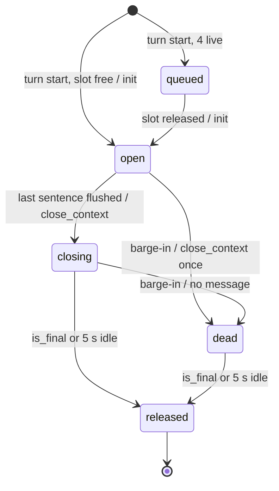
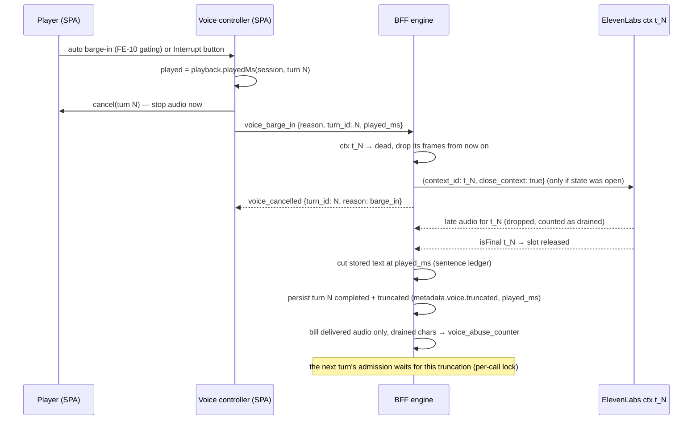

# Realtime voice calls on ElevenLabs

Date: 2026-10-12
Status: Proposed (see 03 for sign-off status)

## Scope

This document covers the realtime 1:1 character call path (`/character-chats/{id}/ws-voice` plus `/voice-segments`) after MiniMax is removed. Text-to-speech moves to one ElevenLabs multi-context WebSocket per call on `eleven_flash_v2_5`; Groq stays for speech-to-text. The document turns the call decisions in [03](03_target_architecture_and_decisions.md) into a protocol, a barge-in and persistence contract, wire-frame changes, a latency budget, an error policy and tests: chiefly D06, D07 and D08, with D24–D28, D30, D31, D36 and D37 where they touch calls.

Out of scope, with a short summary and link where needed:
- chat narration ([06](06_chat_narration_migration.md));
- the voice catalog and call eligibility curation ([04](04_voice_catalog_and_library.md), [05](05_voice_studio_and_admin_console.md));
- the file-by-file backend and frontend work lists ([08](08_backend_refactor_plan.md), [09](09_frontend_refactor_plan.md));
- rollout mechanics ([10](10_data_migration_and_rollout.md)), cost and operations ([11](11_cost_plans_and_operations.md)) and policy ([13](13_policy_privacy_and_compliance.md));
- the spike scripts themselves ([14](14_staging_spike_and_contract_tests.md)).

Conventions:
- Decisions are cited as (D06), staging spikes as (S-7), written confirmations as (L-1) and contract tests as (CT-12), all as defined in 03 §6 and [research 12 §13](research/12_gap_model_protocol_facts.md). Levers from the latency review use the separate prefix LAT-nn (defined in §6.4), never L-n.
- Anything marked **[spike]** or **[legal]** depends on an open item and is not certain. Anything marked **(proposal)** is a design detail this document adds. Each one is consistent with 03, but the owning doc (08 or 09) still has to confirm it.
- Prices and model facts are as of 2026-10-12.

**Workspace R1 alignment (2026-10-12).** Re-read against backend `f37eefd` and frontend `c7307c6` (content schema `2026_10_workspace_r1`). Workspace R1 changes no call mechanics this document designs. It adds a workspace selector and admission intents to the call routes, keeps supersede, quotas and the one-call rule account-wide, and stores call audio as `tts_job` rows in the session's workspace. The rules are 03 D39 and §5.15; the evidence is [research 15 §3](research/15_workspace_r1_impact.md). Section 9.6 sums up what calls must keep.

**Related:**
- [README](README.md)
- [01 Current state](01_current_state.md)
- [02 ElevenLabs capabilities](02_elevenlabs_capabilities.md)
- [03 Target architecture and decisions](03_target_architecture_and_decisions.md) (source of truth)
- [06 Chat narration](06_chat_narration_migration.md)
- [08 Backend plan](08_backend_refactor_plan.md)
- [09 Frontend plan](09_frontend_refactor_plan.md)
- [10 Data migration and rollout](10_data_migration_and_rollout.md)
- [11 Cost and operations](11_cost_plans_and_operations.md)
- [12 Best practices](12_best_practices_and_improvements.md)
- [13 Policy and privacy](13_policy_privacy_and_compliance.md)
- [14 Staging spike](14_staging_spike_and_contract_tests.md)
- [15 Implementation plan](15_implementation_plan_and_acceptance.md)
- [16 Risks](16_risks_and_open_questions.md)
- Research:
  - [00 current TTS review](research/00_current_tts_review.md)
  - [02 streaming, dialogue, realtime and agents](research/02_elevenlabs_streaming_dialogue_realtime_agents.md)
  - [05 platform, pricing and limits](research/05_elevenlabs_platform_pricing_limits_policy.md)
  - [12 model and protocol facts](research/12_gap_model_protocol_facts.md)
  - [14 cost model](research/14_cost_model.md)
  - [15 Workspace R1 impact](research/15_workspace_r1_impact.md)
- Earlier reviews:
  - [voice calls review 2026-10-11](../voice-calls-review-2026-10-11.md)
  - [voice calls latency review 2026-10-11](../voice-calls-latency-review-2026-10-11.md)

---

## 1. Target pipeline

### 1.1 Diagram

```mermaid
flowchart LR
    subgraph BR["Browser (SPA)"]
        MIC["Mic + AEC"] --> VAD["VAD worklet<br/>16 kHz PCM16 mono<br/>550 ms end-of-speech"]
        VAD --> WAV["WAV segment"]
        PB["VoicePlaybackBuffer<br/>MSE / ManagedMediaSource / Blob"]
    end
    WAV -- "POST /voice-segments (multipart)" --> SEG
    subgraph BFF["magic-worlds-api voice engine"]
        SEG["Segment validation<br/>silence floor"] --> STT["SpeechToTextProvider<br/>Groq whisper-large-v3<br/>language hint (D17)"]
        STT --> TSAN["Transcript sanitizer"]
        TSAN --> ADM["Admission, STT billing"]
        ADM --> LLM["callbot LLM<br/>api.magic_llm, streamed"]
        LLM --> SB["SentenceBuffer<br/>+ sentence ledger"]
        SB --> PIPE["SpeechTextPipeline<br/>sanitize, markup v1 placeholders"]
        PIPE --> MOD{"Moderation<br/>sync, fail-closed<br/>300 ms (D26)"}
        MOD -- "pass" --> XL["Markup → Flash<br/>break or …, interjections stripped"]
        MOD -- "block / timeout" --> SKIP["No TTS for this sentence<br/>text stays on screen"]
        XL --> FA["Flush-ahead gate<br/>≤ 3 sentences / ≈ 8 s past played_ms"]
        FA --> ADP["StreamingSpeechProvider<br/>ElevenLabs adapter"]
        ADP --> FP["Whole-frame MP3 parser<br/>tail carry, delivered-audio billing"]
        FP --> DEL["delivery.py<br/>voice_audio_chunk"]
    end
    ADP -- "1 WSS per call, 1 context per turn<br/>eleven_flash_v2_5, mp3_44100_64" --> EL[("ElevenLabs TTS<br/>multi-stream-input")]
    EL -- "audio + alignment, isFinal" --> ADP
    DEL -- "WS /ws-voice: voice_audio_chunk (base64 MP3)" --> PB
    PB -. "voice_barge_in {turn_id, played_ms}" .-> FA
```



The call sequence at the provider boundary is in 03 §2.3. This document does not repeat it. §2.3 below gives the per-turn detail.

### 1.2 What changes against today

| Stage | Today (MiniMax, [research 00 Path B](research/00_current_tts_review.md)) | Target | Decision |
|---|---|---|---|
| Uplink, VAD, WAV POST | client VAD worklet, 16 kHz PCM16 WAV multipart | unchanged | D07 |
| STT | Groq `whisper-large-v3`; global `VOICE_STT_LANGUAGE` hint ([stt_groq_client.py:58-59](/home/andres/PycharmProjects/magic-worlds-api/src/services/voice_orchestration/stt_groq_client.py)) | Groq behind `SpeechToTextProvider`; `language` from the D17 chain | D07 |
| Sentence splitting | `SentenceBuffer`: `.!?` + whitespace, 160 soft cap ([sentence_buffer.py:17](/home/andres/PycharmProjects/magic-worlds-api/src/services/voice_orchestration/sentence_buffer.py)); 120 ms idle flush and a 4-sentence TTS queue ([engine.py:63,66](/home/andres/PycharmProjects/magic-worlds-api/src/services/voice_orchestration/engine.py)) | `SentenceBuffer` and the idle flush kept; it also records a sentence ledger (span, audio offset). The flush-ahead gate (§2.5) takes over the role of the 4-sentence queue | D06 |
| Sanitizer | `validate_spoken_text` + `normalize_text_for_tts`; digits kept for MiniMax ([transcript_sanitizer.py:126,170](/home/andres/PycharmProjects/magic-worlds-api/src/services/voice_orchestration/transcript_sanitizer.py)) | shared `SpeechTextPipeline` (§5.5.3 steps), en/es digit expansion, markup translated per model | D27 |
| Moderation | async per-turn classifier only | synchronous, fail-closed, per sentence, before any flush; the async layer stays | D26 |
| TTS transport | one prewarmed MiniMax socket per turn, plus a private socket for overlapping sentences ([streaming_tts_minimax.py:244,268](/home/andres/PycharmProjects/magic-worlds-api/src/services/voice_orchestration/streaming_tts_minimax.py)) | one ElevenLabs multi-context socket per call; one context per turn | D06 |
| Model | `speech-2.8-turbo` | `eleven_flash_v2_5` (`el_flash_v2_5`); `el_v4_turbo` only behind S-18 | D06 |
| Audio | MP3 32 kHz mono, hex → base64 | `mp3_44100_64`; `sample_rate`, `codec`, `channels` sent as data | D08 |
| Barge-in | the turn's MiniMax socket is closed; the full text is persisted with truncated audio (bug #17) | context marked dead, its frames dropped, `close_context` sent once; the stored text is cut at `played_ms` | D06, D30 |
| Billing parser | `billed_audio_bytes` advanced before parsing ([engine.py:1579-1599](/home/andres/PycharmProjects/magic-worlds-api/src/services/voice_orchestration/engine.py)) | whole frames only; the tail carries into the next slice | D08 |
| Consent | one `VOICE_CONSENT_VERSION` per process ([config.py:26,308-312](/home/andres/PycharmProjects/magic-worlds-api/src/services/voice_orchestration/config.py)) | per provider: `minimax_streaming → voice-v1`, `elevenlabs_streaming → voice-v2` | D25 |
| Daily minutes | env `VOICE_DAILY_MINUTES_PER_USER` ([config.py:27,96](/home/andres/PycharmProjects/magic-worlds-api/src/services/voice_orchestration/config.py)) | `membership_plan_limit.daily_quantity_limit` (seconds) per plan; the env stays as a global upper bound | D24 |

### 1.3 Provider seam

The engine talks only to the neutral `StreamingSpeechProvider` (03 §2.1). Only `providers/elevenlabs/*` knows URLs, header names and close reasons (D03: raw `websockets`, no SDK). Sketch:

```python
class AudioChunk(BaseModel):            # yielded by the adapter (03 §2.1)
    context_id: str
    seq: int
    bytes: bytes
    codec: Literal["mp3"]
    sample_rate: Literal[22050, 24000, 44100]
    channels: Literal[1]
    alignment: CharAlignment | None     # addition to 03 §2.1 (proposal): chars + start/duration ms, chunk-relative (research 12 §8.2)

class StreamingSpeechProvider(Protocol):
    async def open_call(self, call: CallTtsConfig) -> None: ...            # opens and prewarms the socket
    async def begin_turn(self, turn_id: str, voice: ResolvedSpeechVoice) -> None: ...
    async def push_text(self, turn_id: str, sentence: str) -> None: ...    # one flushed sentence
    async def end_turn(self, turn_id: str) -> None: ...                    # close_context after last flush
    async def cancel_turn(self, turn_id: str) -> None: ...                 # mark dead, drop, close_context once
    async def close_call(self) -> None: ...                                # close_socket
    def chunks(self) -> AsyncIterator[AudioChunk]: ...
```

It replaces `StreamingTtsClient` ([streaming_tts_minimax.py:87-105](/home/andres/PycharmProjects/magic-worlds-api/src/services/voice_orchestration/streaming_tts_minimax.py)). Its `prepare_turn`/`synthesize`/`cancel`/`close_turn` calls in the engine map onto `begin_turn`/`push_text`/`cancel_turn`/`end_turn`. The mapping is not one to one for audio: `synthesize` returns a per-sentence iterator today, while the new seam has one `chunks()` stream per call, demultiplexed by `context_id`. The provider is chosen at `start_call` by `ProviderRouter` and stored on `voice_session.tts_provider` (D28).

---

## 2. Multi-context WebSocket protocol

### 2.1 Connection

| Item | Value | Source |
|---|---|---|
| URL | `wss://api.elevenlabs.io/v1/text-to-speech/{provider_voice_id}/multi-stream-input?model_id=eleven_flash_v2_5&output_format=mp3_44100_64&inactivity_timeout=180&sync_alignment=true&apply_text_normalization=auto[&language_code=…]` | D06 item 1 |
| Auth | `xi-api-key` header with `ELEVENLABS_KEY_CALLS` (scope `text_to_speech`, about 30% `character_limit`). Never in the URL, never sent to the browser. | 03 §5.4.3 |
| Base host | `ELEVENLABS_BASE_URL` (default `api.elevenlabs.io`; ops switch `api.us.elevenlabs.io`). The WS host follows it. | 03 §5.4.3, [research 05 §9.3](research/05_elevenlabs_platform_pricing_limits_policy.md) |
| When | Opened at call accept, after the workspace admission (`new_work`, §9.6), attestation, consent and quota admission, in parallel with the first STT, so the handshake is off the first turn's critical path | D06 item 1, D39 |
| How many | One per call. The voice is in the path, and a 1:1 call has one voice. | D06 |
| `language_code` | Resolved once at call start (§5.6). Sent only if the model allow-list contains it. Fixed for the socket. | D17, 03 §5.7 |
| Not sent | `enable_logging` (stays default until ZRM, D25 item 3), `auto_mode` and `enable_ssml_parsing` (launch). Both may be added only as S-8 or S-26 outcomes. | D25, §2.4 |
| Timeouts (starting points) | connect 3 s; first audio 3 s after a context's first flush; 5 s between chunks | [research 05 §9.5](research/05_elevenlabs_platform_pricing_limits_policy.md); tuned in S-8 |
| Logged on open | handshake `request-id` / `x-request-id` / `x-trace-id` and `x-region` when present; never text | 03 §5.8 matching rules |

A handshake that returns HTTP 400 `unsupported_model` is a configuration error. It is never retried and it opens the config breaker. This is the expected result if anyone sets a v4-family model on this socket (CT-03, [research 12 §2](research/12_gap_model_protocol_facts.md)).

### 2.2 Message catalogue

Client to ElevenLabs. Every message carries `context_id` except `close_socket`.

```jsonc
// 1. Context init: first message of a context (sent at voice_turn_start, see 2.3)
{"context_id": "t_8f1c…", "text": " ",
 "voice_settings": {"stability": 0.45, "similarity_boost": 0.8, "speed": 1.0}}
// 2. One sentence that passed moderation, already translated for Flash (trailing space)
{"context_id": "t_8f1c…", "text": "La puerta se abrió despacio. ", "flush": true}
// 3. Keepalive: sent when the context has had no other message for 15 s; never before message 1
{"context_id": "t_8f1c…", "text": ""}
// 4. End of turn, or barge-in (sent once per context)
{"context_id": "t_8f1c…", "close_context": true}
// 5. Call end
{"close_socket": true}
```

ElevenLabs to client. Accept both casings ([research 12 §8.2](research/12_gap_model_protocol_facts.md)):

```jsonc
{"audio": "<base64 mp3>", "alignment": {"chars": [...], "charStartTimesMs": [...], "charDurationsMs": [...]},
 "normalizedAlignment": {...}, "contextId": "t_8f1c…"}      // or context_id, char_start_times_ms, …
{"isFinal": true, "contextId": "t_8f1c…"}                   // or is_final, context_id
```

Rules:
- Ignore `is_final_audio_for_turn` for lifecycle. It is not in the TTS AsyncAPI, and on TTD it arrives once per generation batch ([research 12 §8.2](research/12_gap_model_protocol_facts.md)).
- `voice_settings` appear only in message 1, and only the Flash allow-list (§5.5). A settings change mid-socket is a 1008 (CT-18).
- No in-band error frame is documented on TTS sockets. Errors arrive as a close (usually 1008 with a text reason). A defensive parser still maps a JSON `error` field if one appears ([research 12 §8.6](research/12_gap_model_protocol_facts.md)).
- Unknown fields are ignored (D03: we validate only the fields we rely on).

### 2.3 Per-turn context lifecycle

| Engine event | Message to ElevenLabs | Context state |
|---|---|---|
| `voice_turn_start` published, live slot free | init (1) with `ctx = "t_" + turn_id` | `open` |
| `voice_turn_start` published, no slot free (4 live) | none; the turn waits | `queued` |
| Sentence passes the pipeline and the flush-ahead gate (§2.5) | text + `flush:true` (2); the ledger entry is created | `open` |
| No message to this context for 15 s while `open` | keepalive (3) | `open` |
| LLM completed and the last sentence flushed (normal end) | `close_context` (4) | `closing` |
| Barge-in or supersede while `open` | `close_context` (4) once; frames for `ctx` dropped from now on | `dead` |
| Barge-in while `closing` | **no message** (already closed); frames dropped | `dead` |
| `is_final`/`isFinal` for `ctx`, or 5 s with no frame after the last audio frame (5 s after `close_context` if no audio ever arrived, e.g. every sentence blocked) | none | `released` (slot free) |
| Call end | `close_socket` (5) | all `released` |



- Context ids are never reused within a connection (D06 item 2).
- The turn's audio counts as complete at `is_final` or at the 5 s idle timeout. The design works whether or not `is_final` arrives without `close_context` (S-7 **[spike]**).
- The server sends `voice_audio_final` / `voice_turn_end` ([engine.py:1785-1798](/home/andres/PycharmProjects/magic-worlds-api/src/services/voice_orchestration/engine.py)) after that point, not when the LLM ends.

### 2.4 Text sending strategy

| Option | How it works | Fits our pipeline? | Verdict |
|---|---|---|---|
| **Sentence buffer + `flush:true` per sentence** | `SentenceBuffer` emits whole sentences. Each is sanitized, moderated and translated, then sent with `flush` (the guide's "flush at sentence end", [research 02 §5](research/02_elevenlabs_streaming_dialogue_realtime_agents.md)). | Yes. Moderation (D26), the sanitizer and markup translation (D27) all work per sentence, and nothing unchecked reaches ElevenLabs. | **Adopted (D06).** |
| Word-level streaming + `chunk_length_schedule=[50]` / `try_trigger_generation` | The SDK pattern: text is pushed as LLM tokens arrive and the server decides when to generate ([research 02 §6](research/02_elevenlabs_streaming_dialogue_realtime_agents.md)). | No. Partial sentences cannot be moderated fail-closed before they are sent, and the markup cannot be validated. | Rejected. research 02 §6.3 and §13.2 proposed it; D06 overrides that and keeps `SentenceBuffer`. |
| `auto_mode=true` | A query parameter; the vendor says it "automatically handles generation triggers" and lists it as a latency practice ([research 02 §4, §11](research/02_elevenlabs_streaming_dialogue_realtime_agents.md)). Older guidance tying it to whole sentences is unverified. | Possible on top of per-sentence flush. | S-8 tuning knob only. |

Because every sentence ends with an explicit `flush`, the server-side chunk schedule mostly decides how a long sentence is split into generation batches. Launch uses no `generation_config` (server default `[120,160,250,290]`). S-8 A/B tests three arms: default; `chunk_length_schedule:[50]` in the init message; `auto_mode=true` **[spike]**. The arm with the best first-audio p50 that does not degrade prosody wins.

### 2.5 Flush-ahead window

Text that has been flushed is generated and, per S-25, probably billed even after a barge-in ([research 12 §8.5](research/12_gap_model_protocol_facts.md)). The window bounds that waste (D06 item 2):

```python
MAX_SENTENCES_AHEAD = 3
MAX_AUDIO_AHEAD_MS = 8_000

def may_flush(ctx: TurnContext, played_ms: int) -> bool:
    unheard = [s for s in ctx.ledger if s.flushed and not s.started_before(played_ms)]
    generated_ahead_ms = ctx.generated_audio_ms - played_ms
    return len(unheard) < MAX_SENTENCES_AHEAD and generated_ahead_ms < MAX_AUDIO_AHEAD_MS
```

- The first three sentences of a turn are flushed as soon as they are ready, so first audio is never gated.
- Sentences that fail the gate wait in `SentenceBuffer`. The gate is re-evaluated on every `played_ms` report and every audio frame.
- **`played_ms` source (proposal).** A new optional client frame `voice_playback {turn_id, played_ms}`, sent **every 500 ms** while the turn is audible. The name and the `_VOICE_FRAME_MODELS` registration are owned by [08 §5.8](08_backend_refactor_plan.md). 08 requires a report at least every 1 s; the 500 ms cadence ([09 §1.7](09_frontend_refactor_plan.md)) meets that and is the single cadence for 07, 08 and 09. `voice_ping` runs every 25 s ([voiceSocket.ts:19](/home/andres/WebstormProjects/magic-worlds/src/infrastructure/api/voiceSocket.ts)), which is too slow. Without reports (an older SPA, or a stalled player), the server uses a conservative estimate: `max(0, now − first_chunk_sent_at − 500 ms)`, capped at the delivered audio. It errs toward flushing slightly more, never toward stalling.
- The BFF must accept the new frame before the SPA sends it. `VoiceBargeInFrame`-style strict models reject unknown frames (expand first, as in 03 §5.14).

### 2.6 Live contexts and queueing

- At most **4 live contexts** per socket; ElevenLabs allows 5 ([research 12 §8.10](research/12_gap_model_protocol_facts.md)). `open`, `closing` and `dead` all count until `released`, because the slot is held until final, about 5 s after `close_context` (D06 item 2).
- In a 1:1 call, several live contexts only happen with rapid barge-ins or supersedes (C2 in the calls review) or slow finals. When all 4 are taken, the new turn's first sentence waits for a release.
- **Queue bound (proposal).** If the wait exceeds the 3 s first-audio timeout, the adapter closes the socket and opens a fresh one, which starts with 5 free slots. This counts as the call's one reconnect (§2.8). The wait time is a metric: a non-zero p95 means S-7 or the slot hold is worse than assumed.
- The fifth slot is never used for normal traffic. It is headroom against miscounting (a release observed late, or a missed final).

### 2.7 Keepalive and inactivity

| Concern | Rule |
|---|---|
| Live context | Keepalive `{"context_id", "text": ""}` every ≤ 15 s with no other message to that context, **only after its init** (keepalive before init → later 1008, S-7 **[spike]**) |
| Between turns (no live context) | No keepalive. `inactivity_timeout=180` covers the socket, and the call idle timeout defaults to 120 s ([config.py:29](/home/andres/PycharmProjects/magic-worlds-api/src/services/voice_orchestration/config.py)). Config validation should keep the call idle timeout below 180 s (proposal); otherwise the adapter re-prewarms the socket when the call has been idle for 150 s. |
| `input_timeout_exceeded` (1008) | Internal reconnect and a keepalive-bug metric (03 §5.8). It should never happen if the rules above hold. |
| Our own WS to the browser | Unchanged: 25 s heartbeat, liveness 50 s ([voiceSocket.ts:19-20](/home/andres/WebstormProjects/magic-worlds/src/infrastructure/api/voiceSocket.ts)) |

### 2.8 Reconnect

D06 item 5, with these details:

1. On a 1008 close, or on any unexpected close while a context is `open`, the adapter reconnects **once** with the same URL.
2. It re-creates the active context: same `ctx` id, which is legal on a new connection; init plus the same settings.
3. It replays the **unacknowledged** sentences. A sentence is unacknowledged when it was flushed but no alignment character of it has been received. A partially received sentence is not replayed, so the user never hears a duplicate; its tail is lost.
4. `dead` and `closing` contexts are not re-created. Their remaining audio is abandoned.
5. On a second failure during the same turn, the TTS leg ends for the rest of the call: `voice_error{category:"tts_stream_interrupted", fatal:false}`. The call continues in text (`voice_assistant_delta` only), and STT keeps working.
6. The reconnect budget resets after a turn completes with audio (proposal).
7. A close whose reason names an unknown voice is not retried; it follows §10.3.

### 2.9 Adapter checklist (from [research 12 §12.3](research/12_gap_model_protocol_facts.md))

- [ ] Route by model family: Flash to this socket. A v4-family model is a config error here; it goes to TTD WS only behind S-18.
- [ ] Accept `context_id`/`contextId` and `is_final`/`isFinal`. End a context only on `is_final` or the 5 s idle rule.
- [ ] Never change `voice_settings` on an open socket. Never send any message to a context after its `close_context`.
- [ ] Keep running alignment offsets per context; alignment times are relative to each chunk. Use `alignment`, not `normalizedAlignment`, for cutting text.
- [ ] Drop frames of `dead` contexts before billing and before forwarding.
- [ ] Never log text; log request ids, the region and close codes and reasons.

---

## 3. Barge-in

### 3.1 Today

- `_cancel_turn` sets the cancel event, closes the turn's MiniMax socket and marks the turn cancelled in delivery ([engine.py:1239-1258](/home/andres/PycharmProjects/magic-worlds-api/src/services/voice_orchestration/engine.py)).
- `_cancel_turn` returns early once `voice_turn_end` was published ([engine.py:1240](/home/andres/PycharmProjects/magic-worlds-api/src/services/voice_orchestration/engine.py)). Because the server forwards audio faster than real time, a barge-in while the client is still playing a finished turn is a no-op.
- The turn was already persisted with the full `collected_text` ([engine.py:1801-1821](/home/andres/PycharmProjects/magic-worlds-api/src/services/voice_orchestration/engine.py)). That is bug #17.
- The client frame carries no position: `{ type: 'voice_barge_in'; reason: 'barge_in' }` ([voice.types.ts:102](/home/andres/WebstormProjects/magic-worlds/src/shared/types/voice.types.ts); BE model [route_voice_call.py:143-147](/home/andres/PycharmProjects/magic-worlds-api/src/routes/user/route_voice_call.py), strict, `extra="forbid"`).

### 3.2 Target sequence



### 3.3 Client contract (proposal, owned by 09)

```ts
// voice.types.ts: VoiceSocketClientFrame additions (all optional, backward compatible)
| { type: 'voice_barge_in'; reason: 'barge_in'; turn_id?: string; played_ms?: number }
| { type: 'voice_playback'; turn_id: string; played_ms: number }
```

- `played_ms` is the position in **that turn's** audio timeline: 0 at the turn's first frame, clamped by the server to `[0, delivered_ms]`.
- `VoicePlaybackBuffer` gains `playedMs(voiceSessionId, turnId): number | null`:
  - MSE / ManagedMediaSource: `audio.currentTime` relative to the turn's start in the SourceBuffer timeline;
  - Blob groups: the summed durations of finished groups plus `currentTime`.
- `sendBargeIn` ([useVoiceCallController.ts:526-541](/home/andres/WebstormProjects/magic-worlds/src/features/interaction/hooks/useVoiceCallController.ts)) reads `playedMs` **before** `playbackRef.current?.cancel(...)`, then sends both fields.
- Gating rules from the calls review stay as they are: FE-10 auto barge-in (AEC, 3 s warm-up, ≥ 500 ms speech while audible), the manual Interrupt button always works, and the stale-chunk drop after barge-in (FE-06).
- Order of deployment: the BFF model (`VoiceBargeInFrame` gains `turn_id: str | None`, `played_ms: int | None`, `ge=0`) ships before the SPA sends the fields. An older SPA keeps working without them (§3.5 fallback).

### 3.4 Sentence ledger

`SentenceBuffer` records one ledger entry per emitted sentence. This is the D06 truncation basis.

```python
@dataclass
class LedgerEntry:
    index: int
    span: tuple[int, int]          # [start, end) in the STORED (pre-sanitizer) turn.collected_text
    sent_chars: int                # characters actually flushed (post-translation); 0 if blocked
    status: Literal["pending", "flushed", "blocked", "skipped"]
    audio_start_ms: int | None     # cumulative offset in the context's audio timeline
    audio_end_ms: int | None
```

- `audio_start_ms` comes from alignment. The first character of the sentence's sent text is located in the running alignment, and per-chunk times are added to the context's running offset.
- If alignment is missing or malformed, the offset comes from MP3 frame durations, apportioned by characters across the flushed sentences (D06: "from alignment, else from MP3 frame durations"). This is approximate. 03 §5.8 classifies malformed alignment as `upstream_contract` (no retry), and the category stays that. On the call path it is raised with `fatal:false`, recorded as a metric, and the turn continues on the frame-duration fallback, because the audio itself is valid (proposal; 08 confirms).
- Sentences blocked by moderation or skipped by a TTS failure have no audio. They take the running offset at their position, with zero duration, so they are kept exactly when the next spoken sentence is kept.
- `SentenceBuffer` never splits inside `<#x#>` or an interjection ([sentence_buffer.py:125-132](/home/andres/PycharmProjects/magic-worlds-api/src/services/voice_orchestration/sentence_buffer.py)), so spans always cover whole markers (D27).

### 3.5 Truncation and persistence

**Rule (D06 item 3).** The stored content is `collected_text[:span.end]` of the last ledger entry whose `audio_start_ms < played_ms`. It includes the partially heard sentence. Sentences never flushed, or flushed but not started, are dropped. The turn stays `completed`; `metadata.voice` gains `truncated: true` and `played_ms`. Untruncated ElevenLabs turns write `truncated: false, played_ms: null`.

| Case | Behaviour |
|---|---|
| Barge-in after the LLM finished (common: replies finish in 1–3 s, playback lasts longer) | The turn store already persisted the message as `completed` with the full text when the LLM finished (the call audio asset follows after the audio ends, [engine.py:1801-1821](/home/andres/PycharmProjects/magic-worlds-api/src/services/voice_orchestration/engine.py)). The engine applies a one-shot truncation update: content plus `metadata.voice.{truncated, played_ms}`, validated by the widened callbot validator (03 §5.14). It applies only while that assistant message is the chat's latest, and it is idempotent per `turn_id`. |
| Barge-in after `voice_turn_end` was published, while the client still plays | Same as above. The **truncation window** stays open from turn start until the client's progress shows the end of playback, or `delivered_ms` + 2 s of wall clock after `voice_audio_final` (proposal). `_cancel_turn`'s early return ([engine.py:1240](/home/andres/PycharmProjects/magic-worlds-api/src/services/voice_orchestration/engine.py)) is split into two parts: TTS cancel (skipped) and truncation (still applied). |
| Barge-in while the LLM is still streaming | Today the runner yields `interrupted` with `content=''` ([llm_turn_runner.py:219-224](/home/andres/PycharmProjects/magic-worlds-api/src/services/voice_orchestration/llm_turn_runner.py)). Target: if the heard prefix is non-empty, persist `completed` with that prefix. The store requires `interrupted ⇒ content == ''` and `completed ⇒ content.strip() != ''` plus full graph metadata ([conversation_turn_store.py:366-397,581-610](/home/andres/PycharmProjects/magic-worlds-api/src/database/mysql/conversation_turn_store.py)), so BE picks one of two paths in 08: (a) a store path that finishes a cancelled callbot execution as `completed`-truncated with the usage so far; or (b) stop TTS but let the LLM finish (text not spoken, bounded by its timeout), then apply the truncation update. **Adopted: (a)** ([03 §5.16](03_target_architecture_and_decisions.md) I-51). |
| Nothing heard (`played_ms` before the first sentence's start, or no audio delivered) | `interrupted` with empty content: today's contract, unchanged. A `completed` turn cannot have empty content. |
| `played_ms` absent (older SPA, supersede without a barge-in frame) | Use the latest `voice_playback` if present, else `delivered_ms` as an upper bound. This keeps more text than was heard, but never less than delivered audio. |
| `turn_id` absent | Applies to the current turn only (today's semantics). |

**Consequences for the next turn.**
- The next turn's admission takes a per-call lock that waits for a pending truncation, so the LLM history sees the truncated text. This is the same idea as ElevenAgents' `agent_response_correction` ([research 02 §13.2](research/02_elevenlabs_streaming_dialogue_realtime_agents.md)).
- Open for BE (08): whether `response_display_text` and `response_segments` in the stored metadata are truncated together with `content`. The recommendation is yes, so that display, history replay and export agree.

**Wire (proposal).** `voice_turn_end` keeps `status: 'completed'` and gains optional `truncated: true` and `kept_chars: number`. The SPA can then dim the unheard tail in [CallTranscriptView.tsx](/home/andres/WebstormProjects/magic-worlds/src/features/call/components/CallTranscriptView.tsx) instead of showing text the character "never said". The UI treatment is decided in 09.

**Stored call audio.** `_persist_call_audio_asset` stores the **delivered** whole frames (not the drained audio) at 44.1 kHz. The message metadata carries `played_ms`, so any replay can stop where the user stopped it (§4.3).

### 3.6 Billing of drained audio (S-25)

| Quantity | Definition | Who pays | Where it goes |
|---|---|---|---|
| Delivered audio | Whole MP3 frames forwarded to the client for live contexts | User: 1 credit / 10 s (D24) | `voice_session.consumed_seconds`, ledger |
| Drained characters | `sent_chars` of sentences flushed to a context that became `dead`, minus those whose audio was fully delivered before the barge-in | Us. ElevenLabs probably bills flushed text after `close_context` (**[spike] S-25**, CT-11/CT-12 on Flash). | `voice_spend_daily` (row `surface = 'call'`, provider cost) and a `voice_abuse_counter` row with `kind = 'drained_call_chars'` (03 §5.2; the D26 item 6a threshold, "drained call characters over 20k" rolling 7 days) |
| Unflushed text | Sentences still in `SentenceBuffer` | Nobody: never sent | — |

The flush-ahead window caps drain at about 3 sentences or 8 s of audio per barge-in. research 14 already budgets +10% TTS characters for barge-in waste ([research 14 §3.3](research/14_cost_model.md)). If S-25 shows the drain is not billed, the counter still runs: it is also an abuse signal.

---

## 4. Output format and playback

### 4.1 Format

- **`mp3_44100_64`** for call streaming and stored call assets (D08). ElevenLabs has no 32 kHz MP3, and 64 kb/s is about 8 KB/s per call.
- The vendor lists `mp3_44100_64` among the low-latency call formats ([research 02 §11](research/02_elevenlabs_streaming_dialogue_realtime_agents.md)).
- PCM + AudioWorklet (`pcm_24000`) is deferred. It is revisited only if S-8 misses the target because of MSE priming (D08).

### 4.2 Sample rate as data: wire changes

Backend ([delivery.py](/home/andres/PycharmProjects/magic-worlds-api/src/services/voice_orchestration/delivery.py)):
- `send_audio_chunk(..., sample_rate: int = 32_000)` ([delivery.py:150-160](/home/andres/PycharmProjects/magic-worlds-api/src/services/voice_orchestration/delivery.py)) and `voice_audio_chunk_frame` ([delivery.py:342-356](/home/andres/PycharmProjects/magic-worlds-api/src/services/voice_orchestration/delivery.py)) take `codec`, `sample_rate` and `channels` from `AudioChunk`; no defaults.
- The `ValueError` unless 32 kHz mono becomes the 03 §5.14 set: {22050, 24000, 44100}, plus legacy 32000 on read.
- `voice_ready_frame` ([delivery.py:212-216](/home/andres/PycharmProjects/magic-worlds-api/src/services/voice_orchestration/delivery.py)) advertises the call's audio format and its effective voice (proposal), so the SPA knows both before the first chunk.

Frontend type ([voice.types.ts:164-174](/home/andres/WebstormProjects/magic-worlds/src/shared/types/voice.types.ts)):

```ts
/** 32000 is legacy MiniMax, accepted on read only (03 §5.14). */
export type VoiceAudioSampleRate = 22050 | 24000 | 44100 | 32000

export type VoiceSubstitutionReason =   // 03 §5.4.2, verbatim
    | 'unmapped_legacy' | 'voice_removed' | 'voice_unavailable' | 'voice_blocked'
    | 'not_call_eligible' | 'default_voice' | 'distinct_voice' | 'language_unsupported' | 'tier_fallback'

| {
    type: 'voice_audio_chunk'
    voice_session_id: string
    turn_id: string
    seq: number
    content_type: 'audio/mpeg'
    codec: 'mp3'                                        // D08
    sample_rate: VoiceAudioSampleRate                   // D08 (was the literal 32000)
    channels: 1
    gain_db?: number                                    // ≤ 0, D16
    substitution_reason?: VoiceSubstitutionReason | null // D36
    data_b64: string
    is_final: false
}

// voice_ready additions (proposal)
audio_format?: { codec: 'mp3'; content_type: 'audio/mpeg'; sample_rate: VoiceAudioSampleRate; channels: 1 }
voice?: EffectiveVoice   // the 03 §5.12 effective-voice shape, computed for surface `call`
```

Compatibility: the SPA does not check `sample_rate` at runtime today. Its stale-frame logic uses only `turn_id` and `seq` ([voiceSocket.ts:400-415](/home/andres/WebstormProjects/magic-worlds/src/infrastructure/api/voiceSocket.ts)), and its MP3 parser already knows MPEG-1 at 44.1 kHz ([voicePlaybackBuffer.ts:662](/home/andres/WebstormProjects/magic-worlds/src/features/interaction/audio/voicePlaybackBuffer.ts)). Older SPA builds in the canary therefore play ElevenLabs audio unchanged; the type change is for correctness.

### 4.3 Stored call assets

`_persist_call_audio_asset` ([engine.py:2361-2466](/home/andres/PycharmProjects/magic-worlds-api/src/services/voice_orchestration/engine.py), lines at `f37eefd`) stores each call turn's audio as a `tts_job` row plus a `tts_asset`. It calls `create_pending_job(source="call_character_tts", provider="minimax", model_alias="speech_2_8_turbo", provider_model_id="speech-2.8-turbo", …, workspace_id=…, continuation=True)` (`:2419-2444`) and hard-codes `sample_rate=32_000` and `hex_payload=audio_bytes.hex()`. Since Workspace R1, each such job also writes a `tb_content_operation_context` row and a `tts` row in `tb_workspace_media`. Target:
- the values come from the session's provider and model profile (`elevenlabs`, `el_flash_v2_5`, `eleven_flash_v2_5`, 44100);
- bytes are written off the event loop and outside the row lock (bug #11, D30);
- `tts_job.provider` accepts `elevenlabs`, and so do `create_pending_job`'s allowed set (`models.py:8935`) and the asset-parent provider check (`models.py:766`) (03 §5.14 widening, R0);
- unchanged from Workspace R1: `workspace_id` is the session's, `continuation=True` (persistence completes even if the workspace is archived after the turn), and the job has no `turn_charge_id`, because calls are billed per second (D24, D39).

### 4.4 MP3 frame alignment (S-9) and the billing parser

ElevenLabs does not promise frame-aligned chunks. Treat them as unaligned ([research 12 §8.9](research/12_gap_model_protocol_facts.md)). Today `bill_delivered_tts` sets `billed_audio_bytes = len(assistant_audio)` before `_mp3_duration_ms(pending)` parses the slice ([engine.py:1583-1587](/home/andres/PycharmProjects/magic-worlds-api/src/services/voice_orchestration/engine.py), parser [engine.py:2286-2306](/home/andres/PycharmProjects/magic-worlds-api/src/services/voice_orchestration/engine.py)). That loses about one frame (≈ 26 ms at 44.1 kHz) per slice and risks a false sync. The fix ships regardless of S-9 (D08):

```python
def mp3_whole_frames(data: bytes) -> tuple[int, int]:
    """Return (duration_ms, consumed_bytes) for the leading run of whole frames."""

class DeliveredAudioMeter:
    def __init__(self) -> None:
        self.carry = b""; self.billed_ms = 0
    def add(self, chunk: bytes) -> int:            # returns newly billable ms
        buf = self.carry + chunk
        ms, used = mp3_whole_frames(buf)
        self.carry = buf[used:]                    # partial frame waits for the next chunk
        self.billed_ms += ms
        return ms
    def finish(self) -> int:                       # turn end: parse the remainder as is
        ms, _ = mp3_whole_frames(self.carry); self.carry = b""; self.billed_ms += ms
        return ms
```

- One meter per live context. Frames of `dead` contexts never enter it.
- The billing cadence moves from "after each sentence" ([engine.py:1651-1659](/home/andres/PycharmProjects/magic-worlds-api/src/services/voice_orchestration/engine.py)) to "at each ledger sentence boundary or every 2 s of forwarded audio, whichever comes first, and at turn end" (proposal). This keeps the BE-22 invariant from the calls review: at most one unbilled sentence (or 2 s) in flight.
- The idempotency key format stays `voice_call:{voice_session_id}:tts:{turn_id}:{billing_index}`.

### 4.5 Frontend `VoicePlaybackBuffer`

| Change | Where | Why |
|---|---|---|
| None for 44.1 kHz decode or the whole-frame cut | [voicePlaybackBuffer.ts:668-709](/home/andres/WebstormProjects/magic-worlds/src/features/interaction/audio/voicePlaybackBuffer.ts) | Already plays only whole frames ([research 12 §12.2](research/12_gap_model_protocol_facts.md)) |
| `playedMs(voiceSessionId, turnId)` | new method next to `cancel` ([:160](/home/andres/WebstormProjects/magic-worlds/src/features/interaction/audio/voicePlaybackBuffer.ts)) | §3.3, §2.5 |
| Progress emitter (every 500 ms while audible) | controller | feeds `voice_playback` (§2.5) |
| `gain_db` → `volume = user_volume × 10^(gain_db/20)` | element volume | D16 loudness attenuation |
| Drop the 32 kHz literal from the types | `voice.types.ts` | D08 |
| Seq-gap skip in `drainInOrder` ([:273-281](/home/andres/WebstormProjects/magic-worlds/src/features/interaction/audio/voicePlaybackBuffer.ts)) | — | bug #15: **separate** (D30), not part of this migration |

---

## 5. Voice resolution for calls

### 5.1 Source and resolver

- The call voice is read from the chat's **frozen** `template_snapshot.character.voice` only ([route_voice_call.py:404-421](/home/andres/PycharmProjects/magic-worlds-api/src/routes/user/route_voice_call.py); D36). Today it goes through `build_resolved_voice` ([route_voice_call.py:22](/home/andres/PycharmProjects/magic-worlds-api/src/routes/user/route_voice_call.py)). Target: `VoiceResolver` with surface `call`, returning `ResolvedSpeechVoice{provider, provider_voice_id, model_profile, effective_settings, tag_prefix, language_code, gain_db, substitution_reason}` (03 §2.1).
- The fallback `default_voice_id = config.minimax_tts_voice_id` ([engine.py:512](/home/andres/PycharmProjects/magic-worlds-api/src/services/voice_orchestration/engine.py)) is removed along with `VOICE_MINIMAX_TTS_VOICE_ID` (D31).
- Resolution happens **once at call start**; the socket URL contains the voice. The result is frozen for the call. Proposal: store it in `voice_session.metadata.call_voice` = `{voice_key, provider_voice_id, model_profile, language_code, substitution_reason, settings_sha256}`. `voice_session` has no voice columns ([db.sql:250-295](/home/andres/PycharmProjects/magic-worlds-api/src/database/mysql/db.sql)), and `metadata` is `json not null`. Resume (contract C5 of the calls review) reuses it.
- "Use the card's current voice" (`POST /character-chats/{id}/voice/refresh`) is refused with 409 while a call is active (D36). A refreshed voice applies from the next call.

### 5.2 Eligibility and substitution

| Situation | Result for the call | `substitution_reason` | Call header copy (03 §5.12) |
|---|---|---|---|
| Published catalog voice (publishing requires `call_eligible=1`, D06 item 7) | that voice on Flash | null | — |
| Legacy mapping to a voice that later lost eligibility; root-assigned admin voice; revoked eligibility | `replacement_voice_key`, else the D31 language default | `not_call_eligible` | "Call voice: {name}" |
| Unmapped legacy MiniMax id | D31 `character_fallback` pool with the D33 rule (03 §5.10) | `unmapped_legacy` | "Voice replaced: {name}" (D36) |
| Removed / blocked / unavailable voice | replacement, else default | `voice_removed` / `voice_blocked` / `voice_unavailable` | "Voice replaced: {name}" |
| Voice failed acceptance in the call language (D34) | replacement for that language, else default | `language_unsupported` | "Voice replaced: {name}" |
| `voice = null` (voiceless character) | narrator default of the call language (D31; not a substitution) | null | — |

The header also shows the "AI voice" label (D26 item 7). `voice_audio_chunk.substitution_reason` repeats the reason on every chunk (D36). `voice_ready.voice` (proposal, §4.2) lets the header render before audio arrives.

`CallsPage.hasVoice` ([CallsPage.tsx:25-27](/home/andres/WebstormProjects/magic-worlds/src/features/call/components/CallsPage.tsx)) reads V1 `voice_id`. It moves to the shared `hasAssignedVoice` helper in R0 (D35), or V2 voices would hide the call button.

### 5.3 Same character, different models (S-15)

- Under D06 item 7, one voice identity is gated by acceptance. A voice is `call_eligible=1` only if it passes the rubric on **both** `eleven_flash_v2_5` and the narration models. So a picked catalog voice sounds like itself in calls.
- **[spike] S-15:** the consistency score must be ≥ 4. If S-15 leaves too few eligible voices, the D06 fallback applies: publish non-eligible voices with the badge "Not available in calls: uses {replacement}" and a "Works in calls" filter. The owner decides at R0 exit.
- Free users hear Flash in narration and calls alike, so for them consistency is exact. Expressive (v4) narration users hear a flatter Flash rendering in calls. The owner signs off on that trade-off (D06 open items).
- research 02 notes that a v4 clone "may sound quite different" from other models. That is why acceptance renders both.

### 5.4 Settings sent on Flash (03 §5.6, verbatim row)

| Model profile | Transport | Settings **sent** (others stripped) | Speed | Audio tags | `<break>` | `language_code` | Max chars per request | Concurrency pool |
|---|---|---|---|---|---|---|---|---|
| `el_flash_v2_5` (call) | TTS multi-context WS | same, first message of each context only | 0.7–1.2 | no | S-26 | allow-listed, query parameter | streamed | `flash` (generation time only) |

"Same" means `stability`, `similarity_boost` and `speed` (the narration/standard row).
- `style` and `use_speaker_boost` are stripped. The vendor's latency advice (`style: 0`, speaker boost off, [research 02 §11](research/02_elevenlabs_streaming_dialogue_realtime_agents.md)) is therefore already partly met. Whether a voice's stored defaults still apply them server-side is measured in S-8, not changed here.
- Settings are fixed per context and identical across the call's contexts. That avoids the CT-18 1008 even if a future adapter reuses settings across turns.

### 5.5 Markup and numbers on Flash (D27)

| Markup v1 in stored text | Sent to Flash |
|---|---|
| `<#x#>` | `<break time="xs"/>` (x ≤ 3; > 3 clamped) if S-26 passes **[spike]**; otherwise `…` |
| `(laughs) (sighs) (gasps) (inhale) (exhale) (humming)` | stripped; `CALLBOT_INTERJECTIONS_ENABLED` forced off while `supports_audio_tags=false` |
| Digits | spelled out by the callbot prompt ([callbot_chat.v2.json:32](/home/andres/PycharmProjects/magic-worlds-api/src/agent_graphs/runtime/callbot_chat.v2.json)); residual digits expanded by the sanitizer for en and es; `apply_text_normalization=auto` in the URL (C17, S-5) |

If S-26 passes only with `enable_ssml_parsing=true`, that parameter joins the URL.

### 5.6 Language

- Step 1 of 03 §5.7 for calls is **"the chat's last known turn language"**. The callbot writes no turn metadata (`turn_metadata_status = not_requested`, [conversation_turn_store.py:398](/home/andres/PycharmProjects/magic-worlds-api/src/database/mysql/conversation_turn_store.py)), so the value comes from the chat's most recent non-call turn. After that: the voice's `language_code`, then `user_preferences.preferred_language`, then omit.
- It is applied through the per-model allow-list from `GET /v1/models`: lower-case ISO 639-1, no region. Flash returns 400 on an unsupported code (S-4).
- The same value is Groq's `language` hint (§7).
- It is fixed for the call. A language switch mid-call is spoken with the start-of-call `language_code`. Re-opening the socket on a detected switch is a later option, not part of this migration.

---

## 6. Latency

### 6.1 Budget

The stage numbers come from the [latency review](../voice-calls-latency-review-2026-10-11.md) (estimates, not production measurements). The ElevenLabs column comes from vendor guidance ([research 02 §11](research/02_elevenlabs_streaming_dialogue_realtime_agents.md)) and must be measured in S-8 **[spike]**.

| # | Stage | Today (MiniMax) | Target with ElevenLabs | Changed by this migration? |
|---|---|---|---|---|
| 1 | End-of-speech detection | about 0.55–0.70 s with the 550 ms window (LAT-03 step 1 applied; the review's 0.80–0.95 s was for 800 ms) | same | no (Smart Turn not started) |
| 2 | WAV encode + upload | < 0.05 s local; 0.1–0.6 s mobile | same | no (only Scribe, §7, removes it) |
| 3 | Route | 0.02–0.06 s | same | no |
| 4 | Pre-STT DB | 0.01–0.03 s | same | no |
| 5 | Groq STT | 0.3–0.8 s (P99 1.54 s) | same | no (language hint helps accuracy, not speed) |
| 6 | STT billing | 0.01–0.04 s | same | no |
| 7 | Admission | 0.1–0.3 s | same (consent lookup is keyed by provider, same query) | no |
| 8 | `api.magic_llm` overhead | 0.2–1.0 s | same | no |
| 9 | LLM TTFT | 0.3–0.8 s | same | no |
| 10 | First sentence ready | 0.2–0.8 s (LAT-01 applied: 120 ms idle flush) | same | no |
| 10m | **Moderation of sentence 1** (new) | — | ≤ 300 ms timeout; S-29 target ≤ 300 ms p95 | **added** (D26) |
| 11 | TTS first audio | 0.5–1.4 s (review estimate; the per-turn prewarm of LAT-02 now overlaps part of the connect with the LLM) | warm socket TTFB about 100–150 ms (NA/EU), plus about 50 ms if queued; **D06: p50 ≤ 250 ms, p95 ≤ 600 ms, moderation included** | **yes** |
| 12 | Frame transport, MSE append, decoder priming | 0.05–0.15 s | same order: MP3 frames at 44.1 kHz are 26 ms (about 209 bytes at 64 kb/s); the first whole frame is appendable at once | small |
| — | **Mouth-to-ear** | **2.5–7 s** (4–10 s for one-sentence replies before LAT-01) | **1.6–2.5 s** for option A1 ([research 02 §10.3](research/02_elevenlabs_streaming_dialogue_realtime_agents.md), unmeasured) | stage 11 replaced; 10m added |

Reading:
- The migration removes the single largest provider stage (11) and adds one bounded stage (10m). Sentences after the first are moderated while the previous one generates or plays, so 10m applies once per turn (D26).
- The migration **alone does not reach** the latency review's 1.1–1.5 s target (Twilio 1,115 ms, Pipecat 1,293 ms). That needs the levers in §6.4. D06 requires only the first-audio target and **no regression** of "user stops speaking → first audio" against the MiniMax baseline measured in R0.

### 6.2 Targets and triggers

| Metric (measured at the BFF, production region) | Target | Source | Rollback trigger (1 h window) |
|---|---|---|---|
| First audio after the first sanitized sentence is ready, moderation included | p50 ≤ 250 ms; p95 ≤ 600 ms | D06 item 6, S-8 | p50 > 400 ms (D28) |
| 1008 closes across 200 scripted barge-ins | 0 | D06 item 6 | — |
| End-of-speech → first audio | not worse than the R0 MiniMax baseline | D06 item 6 | — |
| Call TTS failure rate | — | — | > 3% (D28) |
| Moderation of call sentences | ≤ 300 ms p95 | S-29 (R0 exit gate) | — |
| Context queue wait (§2.6) | p95 = 0 | this doc | — |

### 6.3 Measurement

- Existing events stay: `voice_turn_admitted`, `voice_stt_completed`, `voice_llm_first_delta`, `voice_tts_first_sentence` (with milestone `boundary` / `idle` / `turn_end`), `voice_tts_first_audio`, `voice_first_assistant_audio`. They are emitted in [engine.py:1485-1758](/home/andres/PycharmProjects/magic-worlds-api/src/services/voice_orchestration/engine.py) through `VoiceObservabilityRecorder.record` ([observability.py:65-78](/home/andres/PycharmProjects/magic-worlds-api/src/services/voice_orchestration/observability.py)).
- New dimensions: `tts_provider`, `model_profile`, `x-region`.
- New events (proposal): `voice_tts_moderation_ms`, `voice_tts_context_queued_ms`, `voice_tts_reconnect`, `voice_tts_drained_chars`, `voice_turn_truncated` (with `played_ms` and `kept_chars`, never text).
- Client marks are still missing (LAT-12 partial). The SPA should report first-audible time per turn so the end-to-end number includes stage 12. That work is owned by 09.

### 6.4 Latency levers and where they live

**Lever ids.** LAT-nn is finding L-nn in §3 of the [latency review](../voice-calls-latency-review-2026-10-11.md) (LAT-01…LAT-12). It is renamed here because L-n is reserved for the written confirmations in 03 §6.2. For example, LAT-12 is the review's observability lever, and L-12 is the legal item on Default-replacement ownership.

| Lever (LAT id) | Status 2026-10-11 | In this migration? |
|---|---|---|
| LAT-02 prewarm | per-turn only | **Yes**: one socket per call, opened at accept |
| Colocation with the ElevenLabs serving region (US, NL, SG; `api.us` pin) | — | **Yes**: S-8 runs in the production region; `x-region` logged |
| Owned designed (synthetic) or IVC voices over PVC ([research 02 §11](research/02_elevenlabs_streaming_dialogue_realtime_agents.md)) | — | Yes by catalog policy (D09/D31; Default voices are banned) |
| LAT-03 Smart Turn / adaptive end-of-speech | 550 ms applied; Smart Turn not started | No: separate |
| LAT-06 STT model and language hint | deferred | Partly: the D17 hint (accuracy). The model change is separate. |
| LAT-07 `transcript_final` before admission | deferred | No |
| LAT-10 binary frames, persistent MediaSource, PCM | partly | No: PCM only as the S-8 fallback (D08) |
| Scribe v2 Realtime (removes stages 2 and 5) | — | No: S-19 stage 2 (§7) |
| Calls review rec #8 preemptive generation | — | No |

### 6.5 If S-8 misses

1. Tune `chunk_length_schedule` and `auto_mode` (§2.4).
2. PCM `pcm_24000` + AudioWorklet player (D08), about 48 KB/s per call.
3. `eleven_v4_turbo` on the TTD socket (S-18, §8.3).

These follow the S-8 fallback order in 03 §6.1. Region pinning and queue-wait fixes are tried before step 1 because they are free.

---

## 7. Speech-to-text

### 7.1 Launch: keep Groq (D07)

- `whisper-large-v3` batch per uplink segment, behind `SpeechToTextProvider`. `voice_session.stt_provider` stays `groq`; `elevenlabs_scribe` is reserved (03 §5.4.1).
- The `language` hint comes from the D17 chain (§5.6), replacing the process-wide `VOICE_STT_LANGUAGE` ([config.py:47,89](/home/andres/PycharmProjects/magic-worlds-api/src/services/voice_orchestration/config.py); request field at [stt_groq_client.py:58-59](/home/andres/PycharmProjects/magic-worlds-api/src/services/voice_orchestration/stt_groq_client.py)).
- Groq costs $0.111/h with a 10 s minimum per request, about $0.00093 per call-minute ([research 14 §4.2](research/14_cost_model.md)).
- Bug #18 (an STT failure loses the utterance) stays separate (D30).

### 7.2 Scribe v2 Realtime: evaluation criteria (S-19)

| Criterion | Pass if | Test |
|---|---|---|
| Commit-to-final latency | p50 < 300 ms | CT-17 harness with manual commit at our `speech_end` |
| Spanish WER | no worse than Groq on our en/es set (with keyterms) | WER set, same audio through both |
| Session rollover | sessions survive or roll over cleanly past the undocumented cap (10 min claimed); `session_time_limit_exceeded` handled | CT-17 (75 min run) |
| Idle behaviour | close after about 15 s of silence avoided with silence frames; billing for silence understood | CT-17 |
| `language_code` | `es` accepted; `spa` and `es-ES` behaviour recorded (region suffixes rejected) | CT-17 |
| Concurrency | one realtime session per call fits Scale's 45 at the large base peak (12–18 calls); the heavy scenario (36–54) exceeds it ([research 14 §6.2](research/14_cost_model.md)). Whether an idle open session counts is unverified, so assume it does | load test |
| Privacy | written position on voice audio in ElevenLabs history without ZRM (D25, L-9) | — |

### 7.3 What would change if Scribe is adopted (stage 2, not at launch)

| Area | Change |
|---|---|
| Uplink | WAV POST `/voice-segments` replaced by binary PCM16 16 kHz frames (100 ms) on our WS; the worklet already resamples to 16 kHz |
| Turn detection | Our VAD still emits `speech_start`/`speech_end`; `speech_end` → `commit` (manual); `commit_strategy=vad` and turn prediction tried later |
| Barge-in | Scribe partials during playback can trigger barge-in (with a minimum-words guard), complementing FE-10 |
| Context | `keyterms` from character, world and lorebook names (≤ 50, ≤ 20 chars); `previous_text` on the first chunk only |
| Data model | `voice_session.stt_provider = elevenlabs_scribe`. The callbot validator check `stt_provider == 'groq'` ([conversation_turn_store.py:395](/home/andres/PycharmProjects/magic-worlds-api/src/database/mysql/conversation_turn_store.py)) needs a widening that 03 §5.14 does not list yet. |
| Keys | `ELEVENLABS_KEY_CALLS` gains `speech_to_text` (03 §5.4.3) |
| Cost | K2 $0.0243/call-minute (+$0.0056; +30% on calls); K2v (VAD-gated) $0.0204 ([research 14 §4.2](research/14_cost_model.md)). Scribe v2 Realtime is $0.39/h; keyterms add $0.08/h, which K2 does not include ([research 12 §10](research/12_gap_model_protocol_facts.md)) |
| Privacy and consent | User voice audio goes to ElevenLabs. The consent copy names the STT processor (D25), so the copy and its version change; 13 owns that. |
| Latency | Removes stage 2 and replaces stage 5 with commit-to-final; research 02 §10.3 estimates mouth-to-ear for option B at 1.1–1.8 s |

The relay through our BFF is recommended over a direct browser connection ([research 02 §9](research/02_elevenlabs_streaming_dialogue_realtime_agents.md)): keys stay server-side and billing stays ours.

---

## 8. Agents platform, Speech Engine and v4 Turbo dialogue WS

### 8.1 Options compared

Costs are per wall-clock call-minute from [research 14 §4.2](research/14_cost_model.md). Mouth-to-ear figures are estimates from [research 02 §10.3](research/02_elevenlabs_streaming_dialogue_realtime_agents.md).

| Option | What it is | $/call-min | Mouth-to-ear | Why not now |
|---|---|---|---|---|
| **A1 / K1 (adopted)** | Flash multi-context TTS WS + Groq | **$0.0188** (−32% vs K0 $0.0277) | 1.6–2.5 s | — |
| A2 / K3g | `eleven_v4_turbo` on the TTD WS + Groq | $0.0193 | 1.6–2.6 s | S-18 not run; TTD protocol errors close the whole connection; fixed 20 s timeout; one session per connection |
| B / K2 | A1 + Scribe v2 Realtime | $0.0243 (K2v $0.0204) | 1.1–1.8 s | S-19; privacy (audio to ElevenLabs without ZRM); concurrency |
| K3 | v4 Turbo TTD + Scribe | $0.0249 | — | both of the above |
| C1 ElevenAgents (custom LLM) | ElevenLabs owns transport, ASR, turns and TTS; it calls our LLM adapter | about $0.08 + our LLM | 1.0–1.6 s (unmeasured) | wall-clock billing breaks our credit model; hosted transcripts; transport rewrite; lock-in |
| C2 / K4 Speech Engine | Inverted WS: ElevenLabs connects to our server for text | **$0.0800** ($0.16 burst) | 1.0–1.6 s (unmeasured) | rejected (D06 item 9), see 8.2 |

### 8.2 Speech Engine: rejected (D06)

- Cost is 3.2–4.3× DIY: 3.2–3.6× like-for-like, up to 4.3× against keeping Groq (C18, [research 14 §4.2](research/14_cost_model.md)). It bills wall-clock minutes, while our credits bill audio seconds.
- It needs public ingress: an inverted WebSocket into our BFF.
- Per-character voices are unproven: `supported_voices` is untested, and only `first_message` can be overridden (CT-20).
- Privacy defaults are `record_voice: true` and `retention_days: -1` ([research 12 §9](research/12_gap_model_protocol_facts.md)); we would have to override them and verify the override.
- It is a young product. Revisit only if CT-20 passes and the price changes.

### 8.3 v4 Turbo on the TTD multi-context WS: the upgrade path (S-18)

The model is enabled only behind `VOICE_CALL_MODEL_PROFILE=expressive_turbo`, and only if S-18 passes: drained-audio billing is acceptable, and the context limit, slot hold and session-pool headroom are manageable (CT-11, CT-13, CT-14) **[spike]**. Protocol differences the adapter would have to handle ([research 12 §8.3-8.5](research/12_gap_model_protocol_facts.md)):

| Aspect | Flash, TTS multi-context (launch) | `el_v4_turbo`, TTD multi-context (option) |
|---|---|---|
| Endpoint | `/v1/text-to-speech/{voice}/multi-stream-input` | `/v1/text-to-dialogue/multi-stream-input` |
| Voice | in the path | `voices:[id]` in each context's first message, exactly 1 |
| Settings | `stability`, `similarity_boost`, `speed` | `stability` only, first message (03 §5.6) |
| Audio tags | no | yes: markup v1 translated to the v4 column of D27, so interjections can come back |
| Timeout | `inactivity_timeout` up to 180 s | fixed 20 s; `{"keep_alive": true}` with `context_id` |
| `close_context` | flushed text keeps generating; unflushed text probably dropped (**[spike]** CT-12) | flushes the remaining text too, so more drain per barge-in |
| Message to a closing context | [unverified] | protocol error that **closes the connection** |
| Errors | 1008 close with a reason | `{message, error, code, param}` then close; reconnect with fresh contexts (`tts_stream_interrupted`, once) |
| Metering | `flash` pool, generation time only | one TTD session per open connection (Scale 105); `too_many_concurrent_requests` when exhausted |
| Voice consistency | accepted on Flash and the narration models | needs acceptance renders on `eleven_v4_turbo` as well |
| `language_code` | allow-list | allow-list; `yue`, `zh` ok |

### 8.4 Revisit triggers

- S-8 misses after steps 1–2 of §6.5.
- The owner wants expressive calls for paying tiers.
- ElevenLabs ships v4-family support on the TTS sockets. The handshake would stop returning `unsupported_model`; CT-03 re-run.
- Speech Engine pricing drops below about 1.5× DIY and CT-20 passes.

---

## 9. Billing, quotas and consent

### 9.1 What the user pays (D24)

| Item | Rule |
|---|---|
| Unit | `voice_call`: 1 credit / 10 s billed audio, unchanged ([engine.py:59](/home/andres/PycharmProjects/magic-worlds-api/src/services/voice_orchestration/engine.py)). Billed audio = STT ms + **delivered** TTS ms (§4.4). |
| Daily limit | `membership_plan_limit.daily_quantity_limit` for `voice_call`, in seconds. The env `VOICE_DAILY_MINUTES_PER_USER` stays as a global upper bound. |
| Plans (03 §5.9) | `voice_call` · 1 credit / 10 s billed audio (unchanged); `daily_quantity_limit` in seconds · Free 3 min/day · Plus 10 min/day · Pro 10 min/day |
| Caps | Hard. PAYG wallet credits never buy past the daily call minutes (D24 item 9). |
| Usage DTO | `call_seconds_used`, `call_seconds_limit` (D24). `voice_ready.limits.remaining_daily_seconds` is derived from them. |
| Drained audio | Never billed to the user (§3.6) |
| Text-only continuation (breaker open, TTS leg ended) | Only STT ms are billed |

### 9.2 What we pay, and how we meter it

- Our provider-cost meter counts **characters flushed** to ElevenLabs, drained ones included, into `voice_spend_daily` at list price (D37). WebSocket responses carry no `character-cost` header ([research 12 §11](research/12_gap_model_protocol_facts.md)). Reconciliation against `GET /v1/user/subscription` and usage analytics runs daily on the `OPS` key, and drift > 5% alerts (03 §5.13). `character-cost` from HTTP paths is for reconciliation only (S-17).
- Unit cost: K1 $0.0188 per call-minute; call TTS ≈ $0.01875/min in the 03 §5.9 exposure table. Monthly tail per user maxing calls: Free $1.69, Plus and Pro $5.63.
- The per-key `character_limit` on `ELEVENLABS_KEY_CALLS` (about 30%) is a last line of defence. Its unit, reset and error are **[spike] S-28**. When it is reached, the billing breaker opens (§10.1).

### 9.3 Quotas and guards on call start

| Guard | Rule | Source |
|---|---|---|
| One call per user | unchanged (`busy`); per account across workspaces: a new call supersedes a live call in any workspace (`_supersede_active_voice_calls`, [route_voice_call.py:462-498](/home/andres/PycharmProjects/magic-worlds-api/src/routes/user/route_voice_call.py)) | [quota.py:239](/home/andres/PycharmProjects/magic-worlds-api/src/services/voice_orchestration/quota.py), D39 |
| Global concurrency | `VOICE_GLOBAL_CONCURRENCY` default 8, max 64 ([config.py:31,38](/home/andres/PycharmProjects/magic-worlds-api/src/services/voice_orchestration/config.py)); research 05 §11.4 suggests 24 on Scale, sized from STT and a load test. It binds at a 12–18 call peak (large scenario). | D02, [research 14 §6.2](research/14_cost_model.md) |
| Provider pool | 03 §5.6 puts call TTS in the `flash` pool, which ElevenLabs meters on generation time only. The app limiter's `flash` pool is 24 of Scale's 30 (D02). Generation on the socket cannot be observed per request, so the adapter holds no limiter permit per socket (proposal). Calls rely on the 6 unallocated slots plus back-pressure on 429 concurrent, and are sized from STT and load tests (D02). | 03 §5.6, D02 |
| Call-start token bucket | 3 per 10 min per user, in-process until bug #19 | 03 §5.13 |
| Global daily spend circuit | At 100%: new calls refused as `unavailable`; live calls continue as text | 03 §5.13 |
| Free accounts | attestation, verified email, account age ≥ 24 h; ≤ 3 new Free voice accounts per device or IP per day | 03 §5.13 |
| Attestation | HTTP 428 `attestation_required` on call start | D26 item 3 |
| Breaker open (call TTS path) | new calls refused; live calls continue as text | 03 §5.8 |

### 9.4 Consent version per provider (D25)

- `ProviderRouter` picks the provider at `start_call`. The required consent version follows it: `minimax_streaming → voice-v1`, `elevenlabs_streaming → voice-v2`.
- `require_current_voice_consent(*, user_id, scope, config)` ([admission.py:96-107](/home/andres/PycharmProjects/magic-worlds-api/src/services/voice_orchestration/admission.py)) gains a `provider` argument. `POST /character-chats/{id}/voice-consent` ([route_voice_call.py:613-625](/home/andres/PycharmProjects/magic-worlds-api/src/routes/user/route_voice_call.py); intent `read`, the chat is validated in its workspace, consent itself is account-level) stores the version for the caller's routed provider instead of `config.consent_version`.
- The accepted version is persisted on `voice_session.consent_version` ([db.sql:418](/home/andres/PycharmProjects/magic-worlds-api/src/database/mysql/db.sql)).
- Proposal: the `consent_required` error and `VoiceConsentResponse` carry the required `consent_version`, so the SPA shows ElevenLabs copy only to cohort users (non-cohort users never see it, D25 item 7).
- The copy names ElevenLabs (TTS), Groq (STT) and the moderation classifier's provider, and never promises 24 h deletion ([13](13_policy_privacy_and_compliance.md)). [CallTranscriptView.tsx](/home/andres/WebstormProjects/magic-worlds/src/features/call/components/CallTranscriptView.tsx) still says "MiniMax TTS" in a doc comment and is cleaned up with the copy.
- After R4 only `voice-v2` exists. The R2 entry gate requires the `voice-v2` copy live and counsel sign-off **[legal]** (03 §6.3).

### 9.5 History and privacy

- Whether multi-context WS TTS creates history items is **[spike] S-23** (an R1 exit gate). If it does, call sentences join the sweep volume (oldest-item SLO < 48 h).
- Text never contains user identifiers, and no request-id stitching is used (D25), so ZRM can be switched on later without a code change (L-9 **[legal]**).

### 9.6 Workspace scope (D39)

Calls keep Workspace R1's rules unchanged ([research 15 §3](research/15_workspace_r1_impact.md), 03 §5.15):

| Step | Selector | Intent | Archived workspace |
|---|---|---|---|
| `ws-voice` connect | `?workspace_id=` (required before any call traffic) | — | — |
| New call (`start_call`) | same | `new_work` | refused: `voice_error`, code `WORKSPACE_ARCHIVED` |
| Resume | same | `control_admitted` | works |
| Segment upload | `X-Workspace-Id` | `new_work` | refused |
| Voice consent | `X-Workspace-Id` | `read` | works (consent is account-level) |
| End | `X-Workspace-Id` | `control_admitted` | works |
| History, transcripts | `X-Workspace-Id` | `read` | works |
| Archive while a call is live | — | — | 409 `WORKSPACE_ACTIVE_CALL` |

- **Account-wide:** supersede, the one-call rule, `voice_usage_day`, `voice_quota_reservation`, the call in-flight count (`models.py:2251-2258`), the call-start token bucket, the spend circuit and the provider routing cohort. None of them becomes per workspace.
- **Inherited:** `voice_session` has no `workspace_id`; it inherits the workspace through `adventure_session` (`fk_voice_session_adventure_scope`). The migration adds none.
- **LLM turns** in a call are admitted through `execute_conversation_turn` with `ContentOrigin(workspace_id=…)`. That needs an active workspace, which holds because a workspace with a live call cannot be archived.
- **The voice is the session's.** `_resolve_snapshot_voice` reads the session snapshot ([route_voice_call.py:426-443](/home/andres/PycharmProjects/magic-worlds-api/src/routes/user/route_voice_call.py)); a "Use the card's current voice" refresh resolves the source card only in the session's workspace (D36).
- **Frontend gaps fixed in R0** (in files this plan already changes, [09](09_frontend_refactor_plan.md)):
  - `voiceSocket.ts` ignores close codes 4404 and 4422 (`voiceCloseLabel` `:33-46`, `onclose` `:297-345`), so it reconnects in a loop and never fires `workspace:required`;
  - the `CharacterChatSidebar` "Call" button is not read-only gated;
  - `CallScreen` has no up-front read-only check;
  - `voiceCallLabels.ts` has no label for `WORKSPACE_ACTIVE_CALL` or `CHAT_SESSION_NOT_FOUND`.

---

## 10. Error handling and resilience

### 10.1 Mapping (03 §5.8, call-relevant rows verbatim)

| Provider signal | Calls (`VoiceErrorCategory`) | Retry class | Side effects |
|---|---|---|---|
| Our pre-TTS moderation block | sentence skipped; `tts_unavailable` if the turn is fully blocked | none | abuse score +1 |
| 400 `invalid_voice_settings`, `validation_error`, unsupported `language_code`, `text_too_long` | `upstream_contract` | none | alert: resolver bug |
| 400 `unsupported_model` (HTTP or WS handshake); 403 TTD for a non-dialogue model | `tts_unavailable` | none | config breaker open; page ops |
| 404 `voice_not_found`, 400 `invalid_voice_id`, WS close 1008 "voice … does not exist", 403 `voice_access_denied` | `voice_unavailable` | none (substitute replacement on the next attempt) | catalog `suspect`, Job B now, alert root; check group sharing |
| Any 4xx whose message mentions terms, verification, moderation or ban; `safety_control` BAN or CAPTCHA | same (as narration: `voice_unavailable` (voice-scoped) or `unavailable`) | none | voice `blocked`; incident runbook |
| 401 `invalid_api_key`, 403 `insufficient_permissions`, `model_access_denied`, IP denied | `tts_unavailable` | none | config breaker; page ops |
| 401 `quota_exceeded`, 402 `payment_required` / `insufficient_credits`, key `character_limit` reached | `tts_unavailable` | none | billing breaker; page ops (never shown as the user's quota) |
| 429 `concurrent_limit_exceeded` / `too_many_concurrent_requests` | `tts_unavailable` | back-pressure (not counted as an attempt) | shrink pool |
| 429 `rate_limit_exceeded` | `tts_unavailable` | backoff from 1 s, honour `Retry-After` ≤ 5 s | — |
| 429 `system_busy`; 500/502/503/504; connect errors before any byte | `tts_unavailable` (no retry; reconnect once) | transient | breaker counts |
| Read timeout after the first byte, or provider timeout | `tts_timeout` | none | — |
| WS 1008 `input_timeout_exceeded` | internal reconnect | — | keepalive bug metric |
| TTD protocol error `{message, error, code, param}` then close | `tts_stream_interrupted` (reconnect with fresh contexts) | once | — |
| Non-audio body, empty body, size over `TTS_MAX_OUTPUT_BYTES`, malformed alignment | `upstream_contract` | none | — |
| Unclassified 4xx | `tts_unavailable` | none | alert |

On the wire, calls send `voice_error{code}` with the existing `VoiceErrorCategory` names (`tts_unavailable` + `code`). `voice_unavailable`, `attestation_required` and `moderation_unavailable` are internal categories; they travel as `code` ([errors.py:8-30](/home/andres/PycharmProjects/magic-worlds-api/src/services/voice_orchestration/errors.py), FE union [voice.types.ts:35-57](/home/andres/WebstormProjects/magic-worlds/src/shared/types/voice.types.ts)). The exact `code` string format (03 uses the category names; [errors.py:72-78](/home/andres/PycharmProjects/magic-worlds-api/src/services/voice_orchestration/errors.py) currently derives `VOICE_<CATEGORY>`) is fixed in 08. [voiceCallLabels.ts:94-107](/home/andres/WebstormProjects/magic-worlds/src/features/interaction/voiceCallLabels.ts) gains copy for the new codes.

### 10.2 Call behaviour per class

| Class | During a live turn | For the call |
|---|---|---|
| Sentence-level: moderation block | Skip that sentence's TTS; its text stays on screen; abuse score +1. Only a fully blocked turn sends `voice_error{tts_unavailable, fatal:false}` (03 §5.8) | continues with voice |
| Sentence-level: classifier timeout or error | Skip that sentence's TTS (fail closed, D26); text stays on screen; `voice_error{tts_unavailable, code: moderation_unavailable, fatal:false}` at most once per turn (proposal) | continues with voice |
| Sentence-level: first-audio timeout (3 s) of one sentence | Skip that sentence's audio; text stays on screen; `voice_error{tts_timeout, fatal:false}` at most once per turn (research 05 §9.5 "voice degraded") | continues with voice |
| Asynchronous per-turn classifier flags the turn (second layer, D26) | end the TTS leg | voice ends for the call; text continues |
| Transient socket loss (1008, 5xx-equivalent close, `system_busy`) | reconnect once (§2.8) | a second failure ends the TTS leg; text continues |
| Voice-scoped (`voice_unavailable`, ban) | end the TTS leg for this voice | see §10.3 |
| Account or config (`unsupported_model`, 401/403, quota, billing) | end the TTS leg; breaker opens | new calls refused while the breaker is open |
| Back-pressure (429 concurrent) | the first sentence waits, bounded by the 3 s first-audio timeout, then is skipped | continues |

Circuit breaker (03 §5.8): one for the call TTS path, process-local while bug #19 stands. It opens after 5 transient failures in 30 s and cools down for 30 s with a half-open probe. While open, new calls are refused and live calls continue as text.

### 10.3 Unknown or removed voice (S-10)

- On the TTS WS the socket **opens** (101) and then closes with 1008 "A voice with voice_id X does not exist." ([research 12 §8.8](research/12_gap_model_protocol_facts.md)). So the error appears after the prewarm, usually before the first turn.
- Handling:
  1. Classify as `voice_unavailable`. Mark the catalog voice `suspect`, run Job B now and alert root (03 §5.8).
  2. Do not reconnect with the same voice.
  3. Re-resolve once with the replacement or default (`substitution_reason = voice_unavailable`), re-open the socket and update `voice_session.metadata.call_voice` (proposal). Tell the SPA through `voice_audio_chunk.substitution_reason`, so the header shows "Voice replaced: {name}".
  4. If no substitute resolves, end the TTS leg; the call continues as text.
- **[spike] S-10 fallback:** any 4xx or 1008 whose reason mentions the voice is treated as `voice_unavailable` (CT-10, T4).

### 10.4 429s (S-24)

- 429 codes are `rate_limit_exceeded`, `concurrent_limit_exceeded` and `system_busy`; `quota_exceeded` has been observed as 401 ([research 12 §11](research/12_gap_model_protocol_facts.md)).
- The `current-concurrent-requests` and `maximum-concurrent-requests` headers are logged when present.
- On the WS path we expect a 429 only at the handshake (a call start or reconnect), as an HTTP error on the upgrade. How a concurrency overrun shows up mid-socket is undocumented (it may queue, or close with 1008) **[spike] S-24 / CT-16**; until then an unexpected close follows §2.8. Calls never retry a 429 inside a turn beyond the single reconnect.
- If CT-16 shows no `Retry-After`, use exponential backoff with jitter, ignoring headers (S-24 fallback).

### 10.5 Provider outage

| Signal | Action |
|---|---|
| Call TTS failure > 3% or call first-audio p50 > 400 ms over 1 h (D28 triggers); a breaker that keeps re-opening is an operator signal for the same decision | D28 rollback: before R4, route the cohort back to MiniMax with `rollout_mode` (TTL ≤ 60 s, no restart). The provider is pinned on `voice_session.tts_provider` at `start_call`, so live calls finish on their provider (as text if their TTS leg ended) and only new calls move. After R4, rollback means text-only calls |
| Regional degradation | `ELEVENLABS_BASE_URL` → `https://api.us.elevenlabs.io` (ops switch, research 05 §9.3). It applies to new sockets only. |
| Account event (key disabled, enforcement email, voice ban) | rollback trigger; incident runbook; per-user voice kill switch (D26 item 8) |
| Kill switches | `tts_engine_enabled=false`: live calls continue as text, no new TTS legs. **Superseded:** `tts_engine_enabled` governs narration only, and calls go text-only through the spend circuit ([03 §5.16](03_target_architecture_and_decisions.md) I-67). `voice_mode_enabled=false`: no new calls. Both live in `voice_runtime_setting`, read with TTL ≤ 60 s. Never restart to switch: a restart drops every live call (bug #19). |

ElevenLabs offers no self-serve SLA, and a TTS or STT degradation (usually latency, not a hard outage) is to be expected about every 2–4 weeks ([research 05 §9.1-9.2](research/05_elevenlabs_platform_pricing_limits_policy.md)). Text-only continuation is therefore a normal path to test, not an edge case.

### 10.6 Bugs from research 00: fixed here or separately (D30)

| Bug | Call impact | Where fixed |
|---|---|---|
| #10 voice validation mismatch | one bad voice breaks TTS | **Migration**: one model for write, read and resolve (§5.1) |
| #11 event-loop blocking (hex validation, fsync) | call asset persistence ([engine.py:2391](/home/andres/PycharmProjects/magic-worlds-api/src/services/voice_orchestration/engine.py)) | **Migration**: bytes off-loop (§4.3) |
| #12 duplicate charges on retry | retries | **Migration**: new retry classes; no retry after the first byte (§10.1) |
| #16 sanitizer false positives ("bearer of bad news", 160-letter runs) | fatal turn errors | **Migration**: shared `SpeechTextPipeline` ([transcript_sanitizer.py:18](/home/andres/PycharmProjects/magic-worlds-api/src/services/voice_orchestration/transcript_sanitizer.py)) |
| #17 barge-in persists full text with truncated audio | history disagrees with what was heard | **Migration**: §3.5 |
| MP3 per-sentence billing parser | about 26 ms lost per slice; false sync | **Migration**: §4.4 |
| 32 kHz literals | ElevenLabs has no 32 kHz MP3 | **Migration**: §4.2 |
| #13 transient auth outage ends the call ([useVoiceCallController.ts:124-131](/home/andres/WebstormProjects/magic-worlds/src/features/interaction/hooks/useVoiceCallController.ts)) | — | Separate |
| #14 reconnect guard never true ([useVoiceCallController.ts:455](/home/andres/WebstormProjects/magic-worlds/src/features/interaction/hooks/useVoiceCallController.ts)) | — | Separate |
| #15 seq gap stalls playback ([voicePlaybackBuffer.ts:273-281](/home/andres/WebstormProjects/magic-worlds/src/features/interaction/audio/voicePlaybackBuffer.ts)) | — | Separate |
| #18 STT failure loses the utterance | — | Separate (Groq kept) |
| #19 single process | limiter, breakers and buckets in-process | Separate; in-process until fixed (D37) |

---

## 11. Tests and acceptance criteria

### 11.1 Backend unit and integration tests (mocks only; moderation always mocked, D26)

- [ ] Adapter: builds the D06 URL exactly. The `xi-api-key` header is present and the key never appears in a URL or a log.
- [ ] Adapter: parses both casings for audio and final frames; ignores `is_final_audio_for_turn`; ignores unknown fields.
- [ ] Adapter: no keepalive before a context's init; keepalive at ≤ 15 s idle; never a message after `close_context`; `voice_settings` only in the init.
- [ ] Context pool: a fifth simultaneous turn queues; a release frees the slot at `is_final` or after 5 s idle; a queue wait > 3 s triggers one reconnect.
- [ ] Moderation (mocked, D26): a blocked sentence and a classifier timeout are never sent to ElevenLabs, their text still reaches `voice_assistant_delta`, and a fully blocked turn's context receives no text before its `close_context`.
- [ ] Flush-ahead: the fourth unheard sentence waits; `voice_playback` releases it; the fallback estimate is used without reports.
- [ ] Barge-in: frames of a `dead` context are neither forwarded nor billed; `close_context` is sent exactly once (and not at all if the context was `closing`).
- [ ] Truncation, one case each: barge-in mid-sentence; after LLM completion; after `voice_turn_end`; while the LLM streams; nothing heard; `played_ms` absent. Each asserts content, `metadata.voice.truncated`/`played_ms` and the status.
- [ ] Truncation keeps whole markup v1 markers and blocked sentences by position (§3.4).
- [ ] Next-turn admission waits for a pending truncation; the history payload contains the truncated text.
- [ ] Billing meter: chunks split mid-frame at every byte offset of a 3-frame fixture bill exactly the whole-frame duration; no false sync on a payload containing `0xFFE` inside frame data.
- [ ] Reconnect: replays only unacknowledged sentences; a second failure sends `tts_stream_interrupted` and the turn continues as text.
- [ ] Unknown-voice close → substitution, one re-open and `substitution_reason` on the chunks.
- [ ] Error mapping: one test per row of §10.1.
- [ ] Consent: a cohort user with only `voice-v1` gets `consent_stale` (03 §5.16 I-67; was `consent_required`); a non-cohort user is unaffected; `voice_session.consent_version` is stored.
- [ ] Validators (03 §5.14): `elevenlabs_streaming` accepted; sample rates {22050, 24000, 44100} accepted and 32000 accepted on read only; the callbot voice key set accepts `truncated` and `played_ms`.
- [ ] Asset persistence: 44.1 kHz, provider and model from the session, bytes written off-loop.
- [ ] Asset persistence (D39): the `tts_job` row keeps the session's `workspace_id`, `continuation=True` and no `turn_charge_id`; it writes one operation-context row and one `tts` media association; persistence completes when the workspace is archived right after the turn (`test_call_audio_provider`, 08 §9.4).
- [ ] Workspace (D39): start and segment upload refused in an archived workspace; resume, end and consent work; a new call in workspace B supersedes a live call in workspace A; archive with a live call returns `WORKSPACE_ACTIVE_CALL`.

### 11.2 Frontend tests

- [ ] `VoicePlaybackBuffer.playedMs` for the MSE and Blob paths: monotonic, per turn, `null` for an unknown turn.
- [ ] `sendBargeIn` sends `turn_id` and `played_ms` read **before** `cancel`.
- [ ] `voice_playback` frames: every 500 ms while audible, none while silent.
- [ ] `voice_audio_chunk` at 44100 plays through MSE and the Blob fallback (existing fixtures re-encoded at 44.1 kHz, 64 kb/s).
- [ ] `gain_db` applied to volume; `substitution_reason` and `voice_ready.voice` render "Voice replaced: {name}" / "Call voice: {name}" and the "AI voice" label.
- [ ] `hasAssignedVoice` replaces `CallsPage.hasVoice` (V2 voices show the call button).
- [ ] `FORBIDDEN_CLIENT_PAYLOAD_KEYS` ([voiceSocket.ts:64-79](/home/andres/WebstormProjects/magic-worlds/src/infrastructure/api/voiceSocket.ts)) also blocks `xi_api_key`, `xi-api-key` and `single_use_token` (hardening).
- [ ] Story files touched by the header copy pass `pnpm typecheck:stories`.
- [ ] `voiceSocket`: close 4404 and 4422 are terminal (no reconnect); 4422 dispatches `workspace:required`; labels exist for `WORKSPACE_ACTIVE_CALL` and `CHAT_SESSION_NOT_FOUND` (D39).
- [ ] The "Call" button in `CharacterChatSidebar` and `CallScreen` are disabled in a read-only workspace (D39).

### 11.3 Staging contract tests (synthetic policy-safe text only; scripts in [14](14_staging_spike_and_contract_tests.md))

| CT | Closes | Pass condition for this design |
|---|---|---|
| CT-03 | v4 rejection on TTS sockets | Flash 101; v4 family 400 `unsupported_model` |
| CT-07 | `language_code` on Flash (S-4) | `es` accepted; behaviour for `spa`/`es-ES` recorded |
| CT-10 | unknown voice (S-10) | 1008 with a reason mentioning the voice |
| CT-11 / CT-12 on Flash | drained billing; unflushed text; casing; `is_final` (S-7, S-25) | recorded. The design holds either way; S-25 decides only the cost line. |
| CT-14 | inactivity (S-7) | close at about 180 s with `input_timeout_exceeded`; keepalive keeps the socket open |
| CT-15 | MP3 alignment (S-9) | run at `mp3_44100_64` as well as the CT default `mp3_44100_128`; recorded; the meter bills correctly on both aligned and unaligned captures |
| CT-16 | headers, 429 (S-24) | header presence recorded |
| CT-18 | settings change (S-7) | 1008 confirms "settings only in the init" |
| CT-17 + WER set | Scribe (S-19) | §7.2 criteria (optional feature) |
| CT-11, CT-13, CT-14 on TTD | v4 Turbo (S-18) | §8.3 (optional feature) |
| CT-20 | Speech Engine | informational only |
| S-23 run | history items from multi-context WS | recorded; the sweep is sized accordingly |
| S-26 run | `<break>` on the multi-context socket, with and without `enable_ssml_parsing` | pass → breaks; fail → `…` |

### 11.4 Load and latency (S-8, production region)

- The script follows [research 02 §13.4](research/02_elevenlabs_streaming_dialogue_realtime_agents.md) and the research 05 §11.4 Locust recipe: N concurrent synthetic calls, 3–5 sentences per turn and 200 scripted barge-ins at random offsets.
- It measures first audio after the first sentence is ready (moderation included), queue waits, 1008 counts, reconnects, drained characters and end-of-speech → first audio against the R0 MiniMax baseline.
- It runs the §2.4 A/B arms.

### 11.5 Acceptance checklist per gate (03 §6.3)

**R0 exit (still MiniMax):**
- [ ] §5.14 widenings deployed: the `tts_provider` guard ([config.py:153-155](/home/andres/PycharmProjects/magic-worlds-api/src/services/voice_orchestration/config.py)), the callbot validators, the sample-rate validators and the `VoiceBargeInFrame` optional fields.
- [ ] MiniMax baseline latency recorded: end-of-speech → first audio, p50 and p95.
- [ ] S-29 passed: classifier ≤ 300 ms p95 per call sentence, or the self-hosted classifier selected.
- [ ] S-28 closed or on its fallback: the `ELEVENLABS_KEY_CALLS` cap semantics are known, else app-side guards (D37) are the only enforced budget.
- [ ] (proposal) Whole-frame billing meter live on MiniMax: it is provider-neutral and fixes the parser before the switch.
- [ ] (proposal) Sentence ledger and `played_ms` truncation live on MiniMax, using MP3 frame durations for offsets. Truncation does not depend on the provider, so bug #17 can be fixed before R1.
- [ ] Call-eligible defaults present (D31); readiness probe green.
- [ ] Workspace R1 deployed first; the call-audio widening (`create_pending_job` provider set, asset-parent check, `voice_session` insert guard `models.py:6027-6033`) deployed; the FE call gaps of §9.6 fixed (D39).

**R1 exit (staff cohort on ElevenLabs):**
- [ ] S-7, S-9, S-10, S-15, S-17, S-23 and S-25 closed or on their documented fallbacks.
- [ ] 7 days with call TTS failure ≤ 3% and first-audio p50 ≤ 400 ms; no account events.
- [ ] Zero `input_timeout_exceeded` closes (the keepalive rules hold).
- [ ] Truncated turns verified by hand on 20 barge-ins: stored text equals what was heard, to sentence granularity.

**R2 entry:**
- [ ] S-8 met in the production region: p50 ≤ 250 ms, p95 ≤ 600 ms, no 1008 in 200 barge-ins, no end-to-end regression.
- [ ] S-21; L-1, L-4 and L-8 answered **[legal]**; counsel sign-off; `voice-v2` consent copy live; privacy copy naming both providers published for all users; ToS, `user_attestation` and the 428 / WS error frame live (D26); budget guards live; history sweep within its SLO (D25).

**R4:**
- [ ] `streaming_tts_minimax.py`, the MiniMax constants in `config.py` (`:25`, `:91`, `:93`), `minimax_tts_voice_id` and the MiniMax literals in `_persist_call_audio_asset` (`engine.py:2419-2444`) removed.
- [ ] `sentence_buffer.py` **stays**. D06 keeps it, overriding the research 02 §13.2 removal list.

---

## 12. Open items affecting calls

| ID | What is open | Effect if it fails | Gate |
|---|---|---|---|
| S-7 | `is_final` after `flush`; casing; keepalive-before-init and settings-change 1008s | fallback: single-context `stream-input` socket per turn, prewarmed | R1 exit |
| S-8 | latency target in the production region | §6.5 ladder | R2 entry |
| S-9 | MP3 frame alignment | none: the meter ships regardless | R1 exit |
| S-10 | unknown-voice error shapes | treat any 4xx or 1008 mentioning the voice as `voice_unavailable` | R1 exit |
| S-15 | Flash/v4 consistency ≥ 4 | narrow `call_eligible`; call replacements; badge fallback; owner decision | R1 exit (owner at R0) |
| S-17 | `character-cost` semantics | meter by our own count (already the case) | R1 exit |
| S-18 | v4 Turbo on the TTD multi-context socket | stay on Flash | optional |
| S-19 | Scribe v2 Realtime | keep Groq | optional |
| S-23 | WS history items; sweep throughput | bulk deletion or ZRM talks earlier | R1 exit |
| S-24 | 429 headers | backoff with jitter | — |
| S-25 | drained-audio billing on Flash | accept the drained cost; flush-ahead bounds it | R1 exit |
| S-26 | `<break>` on the WS | `…` | optional |
| S-28 | per-key cap semantics | app-side guards only | R0 exit |
| S-29 | classifier latency per call sentence | self-hosted classifier | R0 exit |
| L-1, L-4, L-8 | commercial use reading; click-wrap sufficiency; higher-risk use | no non-staff traffic | R2 entry |
| L-6 | moderation and ban signal shapes; billing of refused requests | treat as `voice_unavailable` / `unavailable` | — |
| L-9 | ZRM eligibility | history sweep | — |
| Owner | consistency trade-off (Expressive narration vs Flash calls); S-15 badge fallback | — | R0 exit |
| BE (08) | mid-stream barge-in persistence path (§3.5 option a vs b); truncating `response_display_text` and `response_segments`; the `code` string format | — | R0 |
| FE (09) | `voice_playback` frame (name per 08 §5.8, every 500 ms); transcript treatment of the unheard tail; client first-audible marks | — | R0 |
| Q-33 | Workspace R1 production deploy date | R0 cannot start its migration; the call widenings wait | R0 entry |
| Q-34 | FE workspace gaps on call surfaces (§9.6) | a closed or archived workspace can loop the voice socket | R0 exit |
