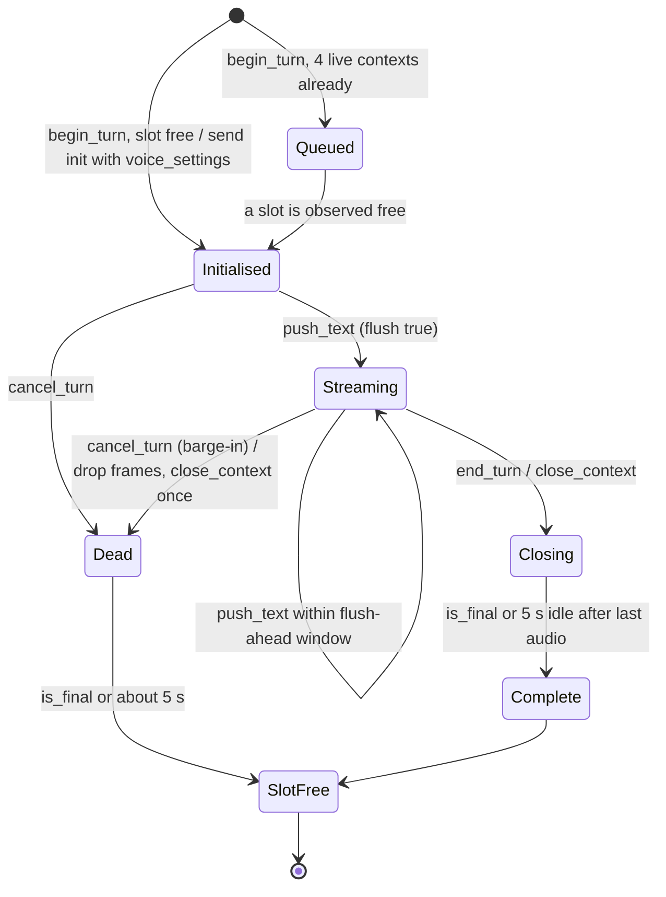
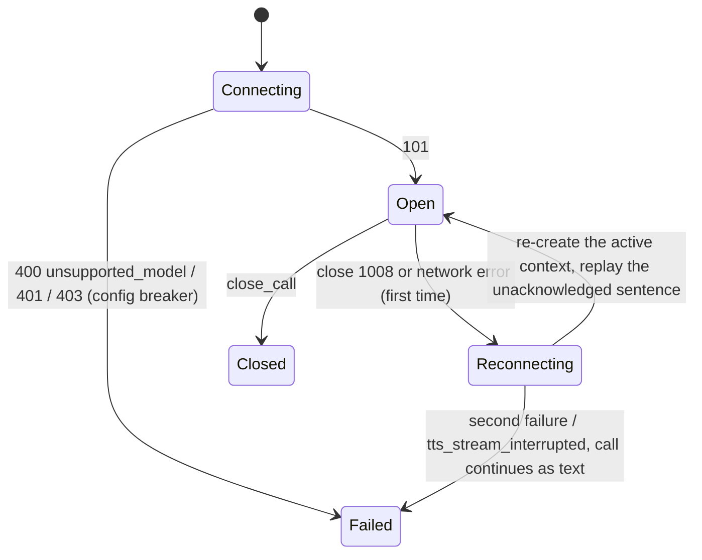
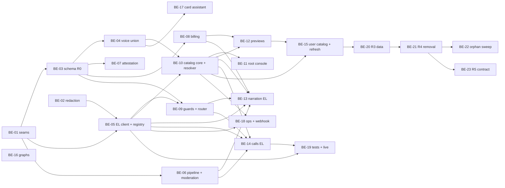

# Backend refactor plan (magic-worlds-api)

- **Date:** 2026-10-12
- **Status:** Proposed (see 03 for sign-off status)
- **Scope:** This is the backend implementation plan for replacing MiniMax speech with ElevenLabs in `magic-worlds-api`. It covers:
  - the target package layout and the provider-neutral interfaces;
  - a file-by-file disposition;
  - configuration, readiness probes and database migrations;
  - API routes and WebSocket frames;
  - pydantic changes, error mapping and retries;
  - observability, tests, and the sequencing into releases and PRs.

  Every decision comes from [03](03_target_architecture_and_decisions.md), which this plan never contradicts. The plan does not cover:
  - frontend work ([09](09_frontend_refactor_plan.md));
  - data-migration runbooks ([10](10_data_migration_and_rollout.md));
  - pricing ([11](11_cost_plans_and_operations.md));
  - legal copy ([13](13_policy_privacy_and_compliance.md)).

  Theme songs are unchanged (D01).
- **Related:** [README](README.md) · [01](01_current_state.md) · [03](03_target_architecture_and_decisions.md) · [04](04_voice_catalog_and_library.md) · [05](05_voice_studio_and_admin_console.md) · [06](06_chat_narration_migration.md) · [07](07_realtime_calls_migration.md) · [09](09_frontend_refactor_plan.md) · [10](10_data_migration_and_rollout.md) · [11](11_cost_plans_and_operations.md) · [12](12_best_practices_and_improvements.md) · [13](13_policy_privacy_and_compliance.md) · [14](14_staging_spike_and_contract_tests.md) · [15](15_implementation_plan_and_acceptance.md) · [16](16_risks_and_open_questions.md)
  - Evidence: [research 06](research/06_backend_minimax_inventory.md), [research 08](research/08_voice_data_model_migration_surface.md), [research 12](research/12_gap_model_protocol_facts.md) and [research 13](research/13_gap_codebase_checks.md).

**Conventions used in this plan:**

| Convention | Meaning |
|---|---|
| (Dnn) | A decision in [03 §4](03_target_architecture_and_decisions.md). |
| (S-n) | A staging spike in 03 §6.1. |
| (L-n) | A pending written confirmation in 03 §6.2. |
| **[spike]** / **[legal]** | The fact depends on that spike or confirmation and is not yet settled. |
| "proposed here" | A name or shape this plan introduces because 03 leaves it open. Each one is listed in §11. |
| "03 §n" vs "§n" | "03 §5.8" is a section of the decision record; a bare "§5.8" is a section of this plan. Text copied verbatim from 03 keeps 03's own section numbers. |
| Dates, prices and model facts | As of 2026-10-12. |

All backend paths are under `/home/andres/PycharmProjects/magic-worlds-api`.

---

## 0. Summary

| Area | Today | Target | First release |
|---|---|---|---|
| **Provider seams** | MiniMax-shaped Protocols inside MiniMax modules ([minimax_adapter.py:114-119](/home/andres/PycharmProjects/magic-worlds-api/src/services/tts_generation/minimax_adapter.py)) | Neutral package `src/services/speech/` with Protocols. Adapters live in `speech/providers/elevenlabs/*`. | R0 |
| **Narration** | One MiniMax T2A HTTP request per segment; hex; credits charged for segment 0 only | `POST /v1/text-to-speech/{provider_voice_id}`: Flash Standard, v4 Expressive (D05). Bytes; one charge per turn with refunds (D24). | R0 code, R1 traffic |
| **Calls** | MiniMax WebSocket per turn plus a private socket per sentence; 32 kHz | One ElevenLabs multi-context socket per call; one context per turn; barge-in truncation; `mp3_44100_64` (D06, D08) | R0 code, R1 traffic |
| **Catalog** | Live MiniMax lists | DB `voice_catalog` plus Jobs A/B/C; own samples; root console API (D09, D10, D19, D20) | R0 |
| **Voice identity** | `CharacterVoice` V1 (`voice_id`) | V1/V2 union. V2 uses `voice_key`, with resolver and change-only eligibility (D11, D32). | R0 |
| **Text** | Two normalizers | One `SpeechTextPipeline` (sanitizer v1, markup v1, fail-closed moderation) (D14, D26, D27) | R0 |
| **Guards** | Process-global env flags | DB `voice_runtime_setting`, `ProviderRouter`, spend circuit, buckets, limiter, breakers (D28, D37) | R0 |
| **Removal** | `MINIMAX_*`, `VOICE_MINIMAX_*`, `TTS_DEFAULT_VOICE_ID` | Key revoked, code deleted, `voice_legacy_fallback` dropped | R4 (2026-12-18) |
| **Contract** | V1 data in live cards and presets | Rewrite at 100% coverage; drop the preset legacy columns | R5 (January 2027) |

---

## 1. Target package layout

### 1.1 Module tree

New code goes into one provider-neutral package. The MiniMax modules stay at their current paths until R4 and are wrapped by thin legacy adapters, which keeps test churn small before R4.

```text
src/services/speech/                      # NEW, provider-neutral
├── __init__.py
├── types.py                              # SynthesisRequest/Result, AudioChunk, ModelProfile, ResolvedSpeechVoice, ProviderError
├── interfaces.py                         # Protocols (§1.3); the only place seams are declared
├── capabilities.py                       # VoiceCapabilityRegistry: static 03 §5.6 table + GET /v1/models merge
├── resolver.py                           # VoiceResolver (03 §5.10 matrix, D31 defaults, D33 cast rule, D34 language)
├── voice_write.py                        # validate_voice_change(old, new, actor) (D32)
├── text_pipeline.py                      # SpeechTextPipeline (sanitizer_version=1, markup v1 tokenizer/translator)
├── emotion_map.py                        # emotion_map_version=1, tag allow-list (03 §5.5)
├── moderation.py                         # ModerationGate: deterministic filter + magic_llm "moderation" profile client
├── router.py                             # ProviderRouter (cohort, D28)
├── runtime_settings.py                   # voice_runtime_setting reader, TTL ≤ 60 s
├── attestation.py                        # user_attestation checks (D26)
├── limiter.py                            # ProviderLimiter: pools flash / non_flash (+ sub-budgets) (D02)
├── breakers.py                           # per-path circuit breakers (03 §5.8)
├── token_buckets.py                      # per-user buckets (03 §5.13)
├── spend_circuit.py                      # voice_spend_daily circuit (D37)
├── mp3_frames.py                         # whole-frame parser → (duration_ms, consumed_bytes) (D08)
├── metrics.py                            # structured counters/histograms over the observability recorder (§8)
├── providers/
│   ├── __init__.py                       # build_speech_providers(config) → ProviderSet (factory used by main.py)
│   ├── elevenlabs/
│   │   ├── config.py                     # ElevenLabsConfig: six scoped keys, base URL, https/wss only
│   │   ├── http_client.py                # ElevenLabsHttp: one httpx.AsyncClient per key scope
│   │   ├── tts_http.py                   # ElevenLabsSpeechSynthesis (SpeechSynthesisProvider)
│   │   ├── tts_multicontext_ws.py        # ElevenLabsMultiContextStream (StreamingSpeechProvider)
│   │   ├── catalog.py                    # ElevenLabsVoiceCatalog (VoiceCatalogProvider)
│   │   ├── errors.py                     # ElevenLabsErrorClassifier (ProviderErrorClassifier, 03 §5.8)
│   │   └── webhook.py                    # HMAC verifier, compare_digest (signature format [spike] S-12)
│   └── minimax/                          # LEGACY shims over the existing modules; deleted at R4
│       ├── synthesis.py                  # wraps tts_generation/minimax_adapter.py as SpeechSynthesisProvider
│       └── streaming.py                  # wraps voice_orchestration/streaming_tts_minimax.py as StreamingSpeechProvider
├── catalog/
│   ├── service.py                        # user reads, eligibility, effective-voice projection (D35)
│   ├── sync_jobs.py                      # Jobs A/B/C + lease (D10)
│   ├── samples.py                        # voice_sample_asset render (ADMIN key) + serving (D10)
│   ├── previews.py                       # recipe previews: voice_preview_render, quantization (D18)
│   ├── references.py                     # voice_reference writes + nightly scan (D19)
│   ├── defaults.py                       # voice_default chain + last resort (D31)
│   ├── legacy_mapping.py                 # voice_legacy_mapping + voice_legacy_fallback (D21)
│   ├── acceptance.py                     # acceptance renders, loudness → gain_db (D16, D20)
│   └── admin.py                          # library add, design/save, remix, IVC + consent, revoke (D19, D20)
├── billing/
│   ├── turn_charge.py                    # tts_turn_charge reserve / settle / stale sweep (D24)
│   ├── preview_meter.py                  # voice_preview op metering (D18)
│   └── call_billing.py                   # 1 credit / 10 s on whole frames; per-plan seconds (D24 item 7)
└── ops/
    ├── history_sweep.py                  # OPS key, delete history > 24 h, SLO (D25) [spike] S-23
    └── reconciliation.py                 # daily counter vs subscription/analytics, drift > 5 % alert (D37)
```

**Kept engines.** The existing engines stay and are re-plumbed onto the seams:
- `tts_generation/engine.py`, the job state machine;
- `voice_orchestration/engine.py`, the call engine;
- `chat_tts_delivery.py`, the chat frames;
- `voice_orchestration/delivery.py`, the voice frames.

**Import boundary.** Only `speech/providers/elevenlabs/*` may contain:
- provider URLs;
- header names (`xi-api-key`, `request-id`, `character-cost`);
- `detail.code` strings.

Everything else sees neutral types (03 §2.1). A static guard test enforces this (§9.7).

### 1.2 Responsibilities

| Module | Responsibility | Replaces | Decisions |
|---|---|---|---|
| `interfaces.py`, `types.py` | Neutral seams and value types | `TtsProvider` ([minimax_adapter.py:114-119](/home/andres/PycharmProjects/magic-worlds-api/src/services/tts_generation/minimax_adapter.py)); `StreamingTtsClient` and the related Protocols ([streaming_tts_minimax.py:87-122](/home/andres/PycharmProjects/magic-worlds-api/src/services/voice_orchestration/streaming_tts_minimax.py)) | 03 §2.1 |
| `providers/elevenlabs/http_client.py` | Raw `httpx.AsyncClient` per key scope:<br/>- headers;<br/>- capture of `request-id` / `x-request-id` / `x-trace-id` / `character-cost` / concurrency headers;<br/>- no internal retries | `MiniMaxT2AProvider` transport | D03, D04 |
| `providers/elevenlabs/tts_http.py` | One synthesis per segment. Validates the MP3 body. Returns bytes. | `minimax_adapter.py` | D05 |
| `providers/elevenlabs/tts_multicontext_ws.py` | One socket per call:<br/>- contexts per turn;<br/>- `flush`;<br/>- `close_context`;<br/>- keepalive;<br/>- reconnect once;<br/>- casing tolerance | `streaming_tts_minimax.py` | D06 |
| `providers/elevenlabs/catalog.py` | `/v2/voices`, `/v1/voices/{id}`, `/v1/shared-voices`, add, design, save, remix, IVC, delete, subscription, models | `minimax_voice_admin.py` | D10, D19, D20 |
| `providers/elevenlabs/errors.py` | 03 §5.8 classifier: `ProviderError{category, retry_class, voice_scoped, request_id}` | MiniMax code tables ([minimax_adapter.py:17-22](/home/andres/PycharmProjects/magic-worlds-api/src/services/tts_generation/minimax_adapter.py)) | 03 §5.8 |
| `capabilities.py` | Maps (surface, tier) to a `ModelProfile`. Per-model allow-lists. Health per surface. Neutral `GET /voices/capabilities`. | Registry literals ([registry.py:21-32](/home/andres/PycharmProjects/magic-worlds-api/src/services/tts_generation/registry.py)) | D13, 03 §5.6 |
| `resolver.py` | Stored voice (V1 or V2) → `ResolvedSpeechVoice`. Substitutes and never raises. Applies the D33 cast map. | `build_resolved_voice` ([registry.py:71-101](/home/andres/PycharmProjects/magic-worlds-api/src/services/tts_generation/registry.py)); `_build_segment_voice_resolver` ([route_chat.py:1137](/home/andres/PycharmProjects/magic-worlds-api/src/routes/user/route_chat.py)); `_resolve_snapshot_voice` ([route_voice_call.py:404](/home/andres/PycharmProjects/magic-worlds-api/src/routes/user/route_voice_call.py)) | D11, D31–D34 |
| `voice_write.py` | Change-only eligibility checks (status, visibility, plan rank, acceptance) | Length-only id checks (bug #10) | D32 |
| `text_pipeline.py`, `emotion_map.py` | 03 §5.5.3 steps 1–10, emotion tags and offsets | `normalize_tts_text` ([registry.py:248](/home/andres/PycharmProjects/magic-worlds-api/src/services/tts_generation/registry.py)); `normalize_text_for_tts` ([transcript_sanitizer.py:170-228](/home/andres/PycharmProjects/magic-worlds-api/src/services/voice_orchestration/transcript_sanitizer.py)) | D14, D27 |
| `moderation.py` | Synchronous, fail-closed gate. Runs per narration batch (2 s) and per call sentence (300 ms). | (none) | D26 |
| `router.py`, `runtime_settings.py` | Per-job and per-call provider choice from `rollout_mode` and `canary_percent`, with TTL ≤ 60 s | One provider per process ([main.py:920-939](/home/andres/PycharmProjects/magic-worlds-api/src/main.py)) | D28 |
| `billing/*` | Per-turn reservation, settlement and refunds; preview meter; call seconds per plan | `_enforce_quota` per job ([engine.py:318](/home/andres/PycharmProjects/magic-worlds-api/src/services/tts_generation/engine.py)); segment-0 metering ([route_chat.py:1433](/home/andres/PycharmProjects/magic-worlds-api/src/routes/user/route_chat.py)) | D18, D24 |
| `spend_circuit.py`, `limiter.py`, `breakers.py`, `token_buckets.py` | D37 guards. Everything is in-process until bug #19, except counters, which live in MySQL. | `TTS_GLOBAL_CONCURRENCY`, `VOICE_GLOBAL_CONCURRENCY` (MiniMax only after R1) | D02, D37 |
| `catalog/*` | Catalog source of truth, sync, samples, previews, references, defaults, mapping, acceptance, admin actions | `minimax_voice_admin.py`; `/voice-presets/system-voices` | D09, D10, D18–D22, D31 |
| `mp3_frames.py` | Whole-frame duration with tail carry | `_mp3_duration_ms` ([voice_orchestration/engine.py:2286](/home/andres/PycharmProjects/magic-worlds-api/src/services/voice_orchestration/engine.py)) | D08 |
| `ops/*` | History sweep and reconciliation (OPS key) | (none) | D25, D37 |

### 1.3 Interface sketches

These are sketches. Names that 03 §2.1 fixes are used verbatim; all other names are proposed here.

```python
# src/services/speech/types.py
from __future__ import annotations
from dataclasses import dataclass
from typing import Literal, Mapping

Provider = Literal["elevenlabs", "minimax"]              # "minimax" is read-only legacy; route removed at R4
Surface = Literal["narration", "call", "preview", "admin_lab"]
Tier = Literal["standard", "expressive"]
Transport = Literal["tts_http", "tts_multi_ws", "ttd_ws"]
Pool = Literal["flash", "non_flash", "ttd_session"]
RetryClass = Literal["none", "transient", "back_pressure", "rate_limited", "reconnect"]
SubstitutionReason = Literal[
    "unmapped_legacy", "voice_removed", "voice_unavailable", "voice_blocked",
    "not_call_eligible", "default_voice", "distinct_voice", "language_unsupported", "tier_fallback",
]

@dataclass(frozen=True, slots=True)
class ModelProfile:
    alias: str                                # 03 §5.4.1 app alias, e.g. "el_flash_v2_5"
    provider: Provider
    provider_model_id: str                    # e.g. "eleven_flash_v2_5" (never hard-coded outside the registry table)
    transport: Transport
    settings_sent: frozenset[str]             # 03 §5.6 "Settings sent"; everything else is stripped
    speed_range: tuple[float, float] | None   # None = speed stripped
    supports_audio_tags: bool
    supports_break: bool | None               # None = pending S-26 (calls)
    language_allow_list: frozenset[str] | None  # None = never send language_code (multilingual_v2)
    max_chars: int                            # min(GET /v1/models value, our cap)
    pool: Pool
    output_format: str                        # "mp3_44100_128" | "mp3_44100_64"

@dataclass(frozen=True, slots=True)
class ResolvedSpeechVoice:                    # 03 §2.1 field list + tier/voice_key for metadata
    provider: Provider
    provider_voice_id: str
    model_profile: ModelProfile
    effective_settings: Mapping[str, float | bool]
    tag_prefix: str                           # "" when none; composed per 03 §5.5.2
    language_code: str | None
    gain_db: float                            # <= 0 (D16)
    substitution_reason: SubstitutionReason | None
    voice_key: str | None = None              # None on the MiniMax route
    tier: Tier = "standard"

@dataclass(frozen=True, slots=True)
class SynthesisRequest:
    text: str                                 # pipeline step-9 output
    voice: ResolvedSpeechVoice
    seed: int                                 # stable 32-bit hash of job_id (D05)
    output_format: str
    surface: Surface

@dataclass(frozen=True, slots=True)
class SynthesisResult:                        # 03 §2.1
    bytes: bytes
    content_type: Literal["audio/mpeg"]
    sample_rate: int
    bitrate: int
    request_id: str | None
    billed_characters: int | None             # character-cost header; reconciliation only ([spike] S-17)
    alignment: Mapping[str, object] | None = None

@dataclass(frozen=True, slots=True)
class AudioChunk:                             # 03 §2.1: AudioChunk{context_id, seq, bytes, codec, sample_rate, channels}
    context_id: str
    seq: int
    bytes: bytes
    codec: Literal["mp3"]
    sample_rate: int
    channels: int
    is_final: bool = False
    alignment: Mapping[str, object] | None = None

@dataclass(frozen=True, slots=True)
class ProviderError(Exception):               # 03 §2.1: ProviderError{category, retry_class, voice_scoped, request_id}
    category: str                             # TtsErrorCategory / VoiceErrorCategory value (§7)
    retry_class: RetryClass
    voice_scoped: bool
    request_id: str | None
    http_status: int | None = None
    provider_code: str | None = None          # detail.code or legacy detail.status (never logged with text)
    retry_after_seconds: float | None = None
    breaker: Literal["config", "billing", "transient"] | None = None
```

```python
# src/services/speech/interfaces.py
from typing import AsyncIterator, Protocol, Sequence

class SpeechSynthesisProvider(Protocol):
    provider: Provider
    async def synthesize(self, request: SynthesisRequest) -> SynthesisResult: ...
    async def aclose(self) -> None: ...

class SpeechCall(Protocol):                   # one per voice_session; 03 §2.1 method names
    async def begin_turn(self, turn_id: str, voice: ResolvedSpeechVoice) -> str: ...  # returns context_id "t_"+turn_id
    async def push_text(self, turn_id: str, sentence: str) -> None: ...                # flush:true per moderated sentence
    async def end_turn(self, turn_id: str) -> None: ...                                # close_context after last flush
    async def cancel_turn(self, turn_id: str) -> None: ...                             # drop frames by context_id, close_context once
    def chunks(self) -> AsyncIterator[AudioChunk]: ...                                 # only live contexts; dead ones filtered
    async def close_call(self) -> None: ...

class StreamingSpeechProvider(Protocol):
    provider: Provider
    async def open_call(self, *, voice_session_id: str, voice: ResolvedSpeechVoice) -> SpeechCall: ...  # prewarm at accept

class SpeechToTextProvider(Protocol):         # Groq today; RealtimeSpeechToTextProvider declared, unimplemented until S-19 (D07)
    async def transcribe(self, wav: bytes, *, language: str | None) -> str: ...

class VoiceCatalogProvider(Protocol):         # 03 §2.1 method list
    async def list_account_voices(self, *, voice_type: str, page_token: str | None) -> "VoicePage": ...
    async def get_voices(self, ids: Sequence[str]) -> Sequence["ProviderVoice"]: ...
    async def search_library(self, filters: "LibraryFilters") -> "LibraryPage": ...
    async def add_library_voice(self, public_owner_id: str, voice_id: str, *, new_name: str) -> str: ...
    async def design_previews(self, request: "DesignRequest") -> Sequence["DesignPreview"]: ...
    async def save_generated_voice(self, generated_voice_id: str, *, name: str, labels: Mapping[str, str]) -> str: ...
    async def remix(self, voice_id: str, request: "RemixRequest") -> Sequence["DesignPreview"]: ...
    async def create_ivc(self, request: "IvcRequest") -> "IvcResult": ...       # surfaces requires_verification
    async def delete_owned_voice(self, voice_id: str) -> None: ...
    async def subscription_limits(self) -> "SubscriptionLimits": ...
    async def list_models(self) -> Sequence["ProviderModel"]: ...

class ProviderErrorClassifier(Protocol):
    def classify_http(self, status: int, headers: Mapping[str, str], body: bytes) -> ProviderError: ...
    def classify_ws_close(self, code: int, reason: str, *, handshake_status: int | None) -> ProviderError: ...
    def classify_exception(self, exc: BaseException, *, after_first_byte: bool) -> ProviderError: ...

class VoiceCapabilityRegistry(Protocol):
    def profile(self, surface: Surface, tier: Tier) -> ModelProfile: ...
    def by_alias(self, alias: str) -> ModelProfile: ...
    def healthy(self, surface: Surface, tier: Tier) -> bool: ...
    async def refresh_from_models(self) -> None: ...      # GET /v1/models with the CATALOG key
    def public_capabilities(self) -> "CapabilitiesDto": ...

class VoiceResolver(Protocol):
    def resolve(self, stored: "StoredCharacterVoice | None", *, surface: Surface, tier: Tier,
                ctx: "ResolveContext") -> ResolvedSpeechVoice: ...          # never raises
    def resolve_cast(self, snapshot: Mapping[str, object], *, ctx: "ResolveContext") -> "CastMap": ...  # D33
    def effective_voice(self, stored: "StoredCharacterVoice | None", *, route: Provider,
                        ctx: "ResolveContext") -> "EffectiveVoiceDto": ...  # 03 §5.12

class ModerationGate(Protocol):
    async def check(self, units: Sequence[str], *, surface: Surface, user_id: int) -> Sequence["ModerationVerdict"]: ...

class SpeechTextPipeline(Protocol):
    def sanitize(self, text: str, *, language: str | None) -> "SanitizedText": ...           # steps 1–6
    async def moderate(self, items: Sequence["SanitizedText"], *, surface: Surface, user_id: int) -> Sequence["ModerationVerdict"]: ...  # step 7
    def render(self, item: "SanitizedText", *, voice: ResolvedSpeechVoice, emotion: str | None,
               kind: Literal["narration", "dialogue", "thought"]) -> "PreparedText": ...   # steps 8–10

class ProviderRouter(Protocol):
    async def provider_for(self, *, user_id: int, user_hash: str, user_type: str, surface: Surface) -> Provider: ...
```

### 1.4 ElevenLabs HTTP client

| Item | Rule | Source |
|---|---|---|
| Library | `httpx.AsyncClient` (already a dependency), one instance per key scope (§3.2). No SDK at runtime; SDK 2.71.0 is a contract oracle only. | D03 |
| Base URL | `ELEVENLABS_BASE_URL`, https only. WebSocket URLs are derived from it (`https`→`wss`). | 03 §5.4.3 |
| Auth header | `xi-api-key`. Never logged; redaction patterns are added first (§8.2). | D04 |
| Timeouts | Connect 3 s (value proposed here); read `TTS_TIMEOUT_SECONDS`; pool timeout = queue wait budget. No retries inside the client (unlike the SDK's 2 blind retries); retries are orchestrated per surface (§7.4). | D03, 03 §5.8 |
| Narration request | `POST /v1/text-to-speech/{provider_voice_id}?output_format=mp3_44100_128`. Body: `{text, model_id, voice_settings (stripped), language_code?, seed, apply_text_normalization:"auto"}`. Never send `previous_request_ids`. `previous_text`/`next_text` stay off until S-17. | D05, 03 §5.6 |
| `enable_logging` | Not sent (provider default) until ZRM; the `ELEVENLABS_ENABLE_LOGGING` adapter flag stays unset. | D25 item 3 |
| Response validation | Reject with `upstream_contract` when the status is 200 but any of these hold:<br/>- `content-type` is not `audio/mpeg`;<br/>- the body is empty;<br/>- the size exceeds `TTS_MAX_OUTPUT_BYTES`;<br/>- the first bytes are not an MP3 sync word or an `ID3` tag. | 03 §5.8 |
| Headers captured | `request-id` → `x-request-id` → body `detail.request_id`; `x-trace-id`; `character-cost`; `current-concurrent-requests`; `maximum-concurrent-requests`; `Retry-After` (honoured only if present, [spike] S-24) | [research 12 §11](research/12_gap_model_protocol_facts.md) |
| Error body | `{"detail": {type, code, message, status (legacy), request_id, param}}`. Match `code` first, then `status`. | 03 §5.8 |
| Event loop | Bytes are written to storage via `asyncio.to_thread`, outside the `tts_job` row-lock transaction. This fixes bug #11. | 03 §2.2, [research 13 §6](research/13_gap_codebase_checks.md) |

Example narration request (Expressive, after the pipeline):

```jsonc
// POST {ELEVENLABS_BASE_URL}/v1/text-to-speech/{provider_voice_id}?output_format=mp3_44100_128
{
  "text": "[whispers] [sad] The candle went out.",
  "model_id": "eleven_v4",
  "voice_settings": { "stability": 0.5, "similarity_boost": 0.75 },   // v4: speed/style stripped (03 §5.6)
  "language_code": "en",                                                // only per D17 + allow-list
  "seed": 2873461923,
  "apply_text_normalization": "auto"
}
```

### 1.5 ElevenLabs multi-context WebSocket client

**Socket.** One socket per call, opened at call accept to prewarm (D06):

`wss://…/v1/text-to-speech/{provider_voice_id}/multi-stream-input?model_id=eleven_flash_v2_5&output_format=mp3_44100_64&inactivity_timeout=180&sync_alignment=true&apply_text_normalization=auto[&language_code=…]`

It authenticates with the `xi-api-key` header.

```jsonc
// client → server
{"context_id": "t_<turn_id>", "text": " ", "voice_settings": {"stability": 0.5, "similarity_boost": 0.75, "speed": 1.0}} // init: first message of a context
{"context_id": "t_<turn_id>", "text": "The door creaked open. ", "flush": true}  // one sanitized, moderated sentence
{"context_id": "t_<turn_id>", "text": ""}                                      // keepalive ≤ 15 s, only after init
{"context_id": "t_<turn_id>", "close_context": true}                           // turn end or barge-in: frees the slot only
{"close_socket": true}                                                         // call end
// server → client (accept both casings)
{"audio": "<base64>", "alignment": {}, "contextId": "t_<turn_id>"}            // or "context_id"
{"isFinal": true, "contextId": "t_<turn_id>"}                                  // or "is_final"
```

**Context lifecycle (per turn):**



**Socket lifecycle:**



| Rule | Value | Source |
|---|---|---|
| Context id | `"t_" + turn_id`, never reused | D06 |
| Settings | First message of each context only. Never change settings mid-socket. | D06, CT-18 [spike] S-7 |
| Live contexts | ≤ 4 of 5. Closed contexts count until their slot is observed free (≈ 5 s). A new turn queues instead of opening a sixth. | D06, [research 12 §8.5](research/12_gap_model_protocol_facts.md) |
| Flush-ahead window | ≤ 3 sentences or ≈ 8 s of generated audio beyond the last reported `played_ms`. Further sentences wait in `SentenceBuffer`. | D06 |
| Completion | `is_final`/`isFinal`, or 5 s idle after the last audio frame. Ignore `is_final_audio_for_turn` for lifecycle. | D06, [research 12 §8.2](research/12_gap_model_protocol_facts.md) |
| Keepalive | Every ≤ 15 s, per live context, only after its init message | D06 |
| Barge-in | Mark the context dead, then drop its frames, then send `close_context` once. Persist `completed` with truncated text (§6.5). Bill delivered audio only. Drained characters go to `voice_abuse_counter` (`drained_call_chars`). Billing of drained audio is [spike] S-25. | D06, D37 |
| Truncation data | For each flushed sentence, `SentenceBuffer` records its span in the **stored** text and its cumulative audio start offset. The offset comes from alignment, or else from MP3 frame durations. | D06 |
| 1008 | Reconnect once and replay. On a second failure → `tts_stream_interrupted`. `input_timeout_exceeded` increments a keepalive-bug metric. | D06, 03 §5.8 |
| Chunks | Treat as unaligned MP3 ([spike] S-9). The parser carries the tail. | D08, [research 12 §12.1](research/12_gap_model_protocol_facts.md) |
| Upgrade | `VOICE_CALL_MODEL_PROFILE=expressive_turbo` selects TTD multi-context v4_turbo only after S-18 passes. Not built in R0–R3 beyond the switch. | D06 item 8 |
| Interjections | `CALLBOT_INTERJECTIONS_ENABLED` is forced off while the call profile has `supports_audio_tags=false` | D27 |

### 1.6 Capability registry

- **Static table.** The registry is built from the 03 §5.6 table (copied verbatim below), then merged at startup with `GET /v1/models` using the CATALOG key. The merge reads `maximum_text_length_per_request` and `languages[]`.
- **Missing models.** A configured model that is missing from `/v1/models` marks its surface and tier unhealthy:
  - Expressive falls back to Standard;
  - a missing Standard model makes narration unhealthy.
- **Aliases.** They live only in the registry table. Code never names `eleven_*`.

**Capability matrix** (verbatim from 03 §5.6):

| Model profile | Transport | Settings **sent** (others stripped) | Speed | Audio tags | `<break>` | `language_code` | Max chars per request | Concurrency pool |
|---|---|---|---|---|---|---|---|---|
| `el_flash_v2_5` (narration/standard, preview) | TTS HTTP | `stability`, `similarity_boost`, `speed` | 0.7–1.2 | no | yes (≤ 3 s) | allow-listed only (400 if unsupported) | 40,000 (we cap 1,200) | `flash` |
| `el_flash_v2_5` (call) | TTS multi-context WS | same, first message of each context only | 0.7–1.2 | no | S-26 | allow-listed, query parameter | streamed | `flash` (generation time only) |
| `el_v4` (narration/expressive, preview) | TTS HTTP | `stability`, `similarity_boost` | stripped | yes | no | allow-listed | 10,000 (we cap 1,200) | `non_flash` |
| `el_v4_turbo` (call option) | TTD WS (1 voice) | `stability`, first message only | stripped | yes | no | allow-listed (`yue`, `zh` ok) | streamed | TTD session per call |
| `el_multilingual_v2` (lab only) | TTS HTTP | all five; `style` 0–1 | 0.7–1.2 | no | yes | **never sent** | 10,000 | `non_flash` |
| `el_v3` (lab only) | TTS HTTP | `stability` | stripped | yes | no | allow-listed | 5,000 | `non_flash` |

**Reuse hash v2.** `voice_signature_sha256` is stored in `tts_job.voice_id_hash`. The reuse index already includes `model_alias`, `provider_model_id` and `voice_id_hash` ([db.sql:694](/home/andres/PycharmProjects/magic-worlds-api/src/database/mysql/db.sql)), so reuse never crosses providers. The hash is computed over:
- `provider`, `provider_model_id`, the resolved `provider_voice_id`;
- the effective (post-strip) settings;
- the effective `language_code`;
- the composed tag prefix;
- `emotion_map_version` and `sanitizer_version`;
- `output_format`;
- dictionary versions (P1).

Settings allow-lists for Flash `style`/`use_speaker_boost` are [spike] S-3.

### 1.7 Catalog service and sync jobs

| Job | Schedule | Key | Calls | Effect | Guards |
|---|---|---|---|---|---|
| **A: inventory** | Nightly, after admin mutations, and on demand | CATALOG | `GET /v2/voices?voice_type=non-default&page_size=100&include_total_count=false`, plus a separate `voice_type=default` query | Upsert rows. New rows are `draft`/`admin`. Premade voices are tagged `premade_deprecated` and admin-only. | **Mass-miss guard:** abort without status changes if the call errors, returns empty, or misses more than `max(3, 5%)` of active voices. Two non-aborted misses set `missing_sync_count=2` and queue Job B. A key-level 401/403 opens the config breaker. |
| **B: health** | Daily, on webhook, and on a runtime 404/403 | CATALOG | `GET /v1/voices/{id}` or `voice_ids` batches of ≤ 100 | Updates `disable_at`, `sharing_status`, `safety_control` and terms. Only a per-voice confirmation sets `removed`. | 403 `voice_access_denied` from ≥ 3 distinct voices in 10 min → config breaker, never removal (D19) |
| **C: limits** | Hourly | OPS (`user_read`) | `GET /v1/user/subscription` | Slots, ops and character headroom for the console and for library-add pre-flight (refused when fewer than 5 ops remain) | — |

- **Lease.** `GET_LOCK('voice_catalog_sync', 0)` is held on a dedicated connection taken out of the aiomysql pool for the whole job. Jobs run serially, with one request in flight, and honour `Retry-After` (D10).
- **Scheduler.** A lifespan loop following the existing precedents:
  - `VoiceCallEngine.start_maintenance` ([voice_orchestration/engine.py:1062](/home/andres/PycharmProjects/magic-worlds-api/src/services/voice_orchestration/engine.py), started at [main.py:1035](/home/andres/PycharmProjects/magic-worlds-api/src/main.py));
  - the resource-task loop ([resource_tasks.py:113](/home/andres/PycharmProjects/magic-worlds-api/src/services/resource_tasks.py)).
- **Every mutation** writes a `voice_catalog_event` row. A Job A run writes one `synced` event. Webhook events are deduplicated by `dedupe_key`.
- **Previews.** Own samples live in `voice_sample_asset` and are rendered with the ADMIN key. They are served by `GET /voices/catalog/{voice_key}/preview.mp3?lang=&tier=` with `Cache-Control: private, max-age=86400` and a content hash in the URL. **Upstream `preview_url` is never served to users until [legal] L-3** (D10).
- **Runtime 404.** A 404 on a catalog voice sets `suspect_since`, enqueues Job B for that voice, uses the replacement for that segment, and alerts root (D19 item 7).
- **IVC consent revocation** follows D19 item 9:
  - within 1 business day: `status=removed` and forced substitution everywhere;
  - within 7 days: rewrite live cards and presets, then delete the provider voice and the encrypted samples;
  - within 30 days: purge the `tts_asset` files rendered with that voice.

### 1.8 SpeechTextPipeline and moderation hook

The pipeline runs 03 §5.5.3 in order, with `sanitizer_version = 1` and `emotion_map_version = 1`:

| Step | Implementation note |
|---|---|
| 1 | Reuse `<think>` stripping. Fail closed on XML except markup v1 `<#x#>`, as in [transcript_sanitizer.py:46-52,116-123](/home/andres/PycharmProjects/magic-worlds-api/src/services/voice_orchestration/transcript_sanitizer.py). |
| 1a | Tokenize markup v1 into private-use code point + index placeholders. Keep the originals in a side list. |
| 2–6 | Markdown → text; OOC drop; bracket unwrap; on non-tag profiles strip `[]{}<>`; whitespace; digit expansion for en/es ([spike] S-5). |
| 7 | `ModerationGate.check` runs on text with placeholders removed. Fail closed:<br/>- block → `content_blocked`, 0 credits, `voice_abuse_counter.moderation_block` +1;<br/>- timeout or error → `unavailable` with `error.code = moderation_unavailable`, refunded. |
| 8 | Per-model translation (D27 table). `<break>` on calls is [spike] S-26; until then pauses become `…`. |
| 9 | Prepend at most 2 allow-listed tags, on tag profiles only, in the order `[whispers] [emotion]` (`[whispers]` only for `kind = thought`, D16). On Standard profiles there is no tag: emotion is a stability offset `clamp(base + offset, 0, 1)`, never stored, and thoughts carry only `kind = thought` so the player applies −3 dB (D16). |
| 10 | `normalized_text_sha256` covers the final text. Billed characters are counted on the step-8 text **without** step-9 tags. |

**Moderation gate:**

| Item | Rule |
|---|---|
| Layers | (a) A deterministic keyword and pattern filter per category, en/es first. (b) The published `moderation` profile in `api.magic_llm`, resolved like other profiles; no env model id. |
| Timeouts | Narration: one batched call per turn, 2 s. Calls: one call per sentence, 300 ms. Sentence N is classified while N−1 plays ([spike] S-29). |
| Fallback if S-29 misses | A self-hosted small classifier for calls. The fail-closed rule is unchanged. |
| Tests | Mocks only (D26). |
| Where it runs | Narration enqueue (before any reservation), each call sentence before `push_text`, recipe previews (fixed texts; verdict cached per `text_id` × version), and root lab free text |

### 1.9 Voice resolver and write validation

**Resolver.** It applies the 03 §5.10 matrix per segment and never raises. Order of operations:
1. V1 → `voice_legacy_mapping` (approved) → `voice_key`, plus `settings_override`.
2. `voice_key` → `voice_catalog`. Follow `replacement_voice_key` for `removed`/`blocked`.
3. Language acceptance (D34).
4. `call_eligible` on the call surface.
5. Tier → `ModelProfile`, falling back to Standard when Expressive is unhealthy or not allowed (D05).
6. Strip settings per profile.
7. Emotion → tag or offset.
8. `gain_db` from `voice_catalog_acceptance` for (voice, model, language).
9. Cast map (D33):
   - order: narrator first, then cast order;
   - candidates: the mapping's `alternate_voice_keys`, then the `character_fallback` pool, then same gender/age/language catalog voices;
   - cache key: `(session_id, snapshot hash, catalog version)`.

**Defaults** (D31) follow the chain: D17 language → `en` → `VOICE_LAST_RESORT_VOICE_KEY`. Voiceless characters use the narrator default and get no `substitution_reason`. A non-null voice replaced by a default records `default_voice`.

**MiniMax route (R1–R4).** A non-cohort user meeting a V2 voice gets `voice_legacy_fallback`. A V1 voice resolves exactly as today.

**Write validation** (`validate_voice_change(old, new, actor)`, D32):
- **Shape** is checked on every read and write by pydantic. Pydantic does no I/O.
- **Eligibility** is checked only when the voice at a path is set or changed:
  - `status = active`;
  - `visibility = public`, or `plan_gated` with rank(caller) ≥ rank(`min_plan`);
  - an accepted Flash row for at least one language.
- **Copies** (clone, version restore, session create, untouched snapshot `PUT` entries, card assistant) are shape-only.
- **V1 writes** (03 §5.10): a **new** V1 pick is allowed only before R3, as an approved mapped id by a non-cohort user; a V1 settings-only edit likewise only before R3 for non-cohort users; an unchanged V1 value is always accepted. **After R5:** accepted only when byte-identical to the stored value at the same path.

### 1.10 Billing: turn charge, previews and calls

The D24 algorithm (canonical text in [03 D24](03_target_architecture_and_decisions.md)), as backend pseudo-code:

```python
async def enqueue_turn_narration(turn, user, ctx) -> TurnPlan:
    segs = build_segments(turn, max_turn_chars=2_500, max_segments=12, max_segment_chars=1_200)   # step 1
    prepared = pipeline_prepare(segs)                     # sanitize + one batched moderation call (fail closed)
    resolved = [resolver.resolve(s.voice, surface="narration", tier=effective_tier(ctx), ctx=ctx) for s in prepared]
    hits, pending_hits, misses = await reuse_lookup(resolved)  # step 2: BEFORE any reservation (engine.py:226-258 order)
    async with transaction_cursor() as (_c, cur):
        fit = fit_daily_cap(misses, remaining=await counted_chars_today(cur, user),   # step 4: Σ counted_chars of
                            plan_cap=daily_quantity_limit(user, "tts_generation"))     # the day's tts_turn_charge rows
        # Expressive that does not fit but Standard does → whole turn falls back to Standard first (D05, tier_fallback)
        if fit.charged:
            credits = max(1, ceil(fit.std_chars / 400 + fit.expr_chars / 200))       # step 3, rounded per turn
            res = await MembershipModel.reserve_media_operation(user_id=user.id, operation="tts_generation",
                                                                cursor=cur, credit_cost=credits)
            charge = await TurnChargeRepo.open(cur, credits_reserved=credits, counted_chars=fit.std_chars + 2 * fit.expr_chars,
                                               reserved_std_chars=fit.std_chars, reserved_expr_chars=fit.expr_chars,
                                               ledger_ids=res["ledger_ids"], tier=fit.tier)   # EVERY id, never only [0] (§4.9)
            await TtsJobRepo.insert_pending(cur, fit.charged, turn_charge_id=charge.turn_charge_id)
        mark_display_state(fit.over_daily_cap, "daily_limit_reached")   # never partially narrated
        mark_display_state(fit.over_turn_cap, "not_narrated")
    spend_circuit.record("narration", ...)                              # §1.11

async def settle(turn_charge_id):  # runs when every job of the charge is terminal; also run by the stale sweep (bug #8)
    final = ceil(Σ completed std/400 + Σ completed expr/200)  # 0 if none completed
    settle_media_reservation(charge.ledger_ids, final)       # refunds reserved - final across ALL ledger ids
    counted_chars := completed Standard-equivalent chars; status := "settled"
```

| Item | Backend change |
|---|---|
| In-flight | The `count_in_flight` `tts_generation` branch counts open `tts_turn_charge` rows, not jobs (today it counts jobs, [models.py:2098-2105](/home/andres/PycharmProjects/magic-worlds-api/src/database/mysql/models.py)). |
| Daily request limit | One `reserve_media_operation` call per turn, so `daily_request_limit` counts turns. Seeds are unchanged at 20/100/500; their meaning changes. In code it is an included-operations allowance (past it, PAYG pays), so the hard bound is the daily character cap enforced in the same transaction (D24 items 4 and 9). |
| **Partial refund gap** | `refund_credit_ledger` flips whole reservation rows to `refunded` ([models.py:3159](/home/andres/PycharmProjects/magic-worlds-api/src/database/mysql/models.py)), and a reservation writes one ledger row per non-zero `credit_source` and returns them all as `ledger_ids` ([models.py:3085-3110](/home/andres/PycharmProjects/magic-worlds-api/src/database/mysql/models.py)). D24 needs `reserved − final` refunds.<br/>**Interim rule, the same as [06 §5.4](06_chat_narration_migration.md), until PA-17 / Q-24 amends 03 §5.2:** the charge persists **every** id in `res["ledger_ids"]` (storage in §4.9) and settlement refunds across all of them. Nothing keeps only the first id.<br/>Proposed here: a new primitive `MembershipModel.settle_media_reservation(ledger_ids, final_credits)` that refunds the delta in reverse spend order (PAYG billed, then PAYG free, then included), credits only, idempotent per `turn_charge_id`. 06 §5.4 sketches the same primitive as `refund_credit_ledger_partial`; BE-08 picks one name. `final = 0` uses the existing full refund over all ids. BILL signs off on the ledger representation (§11). |
| Calls | `debit_operation_credits` post-hoc, 1 credit per 10 s of billed audio, computed with `mp3_frames.parse(buffer) → (duration_ms, consumed_bytes)`. Advance by consumed bytes only and parse the remainder at turn end. Per-plan seconds come from `membership_plan_limit.daily_quantity_limit` for `voice_call` (180/600/600). `VOICE_DAILY_MINUTES_PER_USER` stays as the global upper bound. |
| Previews | `voice_preview` op. Cache hits are free. Free renders call `reserve_media_operation(credit_cost=0)`, which counts in-flight only and writes no ledger row. The 4th and later renders cost 1 credit. The daily hard limit (3/10/20) is enforced by `preview_meter` counting the caller's `voice_preview_render` rows of the usage day, because zero-cost reservations do not count toward `daily_request_limit`. |
| Usage DTO | `MembershipResponse` ([route_auth.py:262](/home/andres/PycharmProjects/magic-worlds-api/src/routes/user/route_auth.py)) gains `narration_chars_used`, `narration_chars_limit`, `call_seconds_used`, `call_seconds_limit`, `previews_left`. |
| Caps vs PAYG | Hard. PAYG never buys past a cap (D24 item 9). |
| Reconciliation | `character-cost` is logged per job for reconciliation only ([spike] S-17). Users are charged by our own count. |

### 1.11 Budget guards: spend circuit, limiter, breakers, token buckets

| Guard | Implementation | State |
|---|---|---|
| Spend circuit | Upserts into `voice_spend_daily(usage_day, surface, model_id)` (chars and list-price micros) per settled segment, call slice, preview and admin render. Budget = `voice_runtime_setting.daily_budget_chars`. Thresholds:<br/>- 50% / 80% → alert;<br/>- 95% → set `auto_narration_paused`;<br/>- 100% → refuse new narration and calls as `unavailable` (live calls continue as text). | MySQL |
| Limiter | `flash` 24 of 30. `non_flash` 12 of 15: Expressive 10, preview 1, admin 1. `async with limiter.slot(pool, budget)`. A concurrency 429 shrinks the effective pool. | In-process (bug #19) |
| Breakers | One per path (narration, call TTS, preview, admin). Opens after 5 transient failures in 30 s; 30 s cool-down; half-open probe. Config and billing breakers are separate (§7.5). | In-process |
| Token buckets | Narration enqueue 6 turns/min, burst 10. Call start 3 per 10 min. Recipe preview 6/min. Catalog auditions 60/min. | In-process |
| Abuse counter | `voice_abuse_counter` kinds: `moderation_block`, `moderation_block_severe`, `drained_call_chars`, `preview_limit_hit`, `minor_report`. Thresholds 3 / 10 / 25 (D26 item 6a). | MySQL |
| Free rules | Voice needs attestation, a verified email, account age ≥ 24 h, and ≤ 3 new Free voice accounts per device or IP per day. If `api.auth` exposes no verified flag, the BFF tracks verification itself. | MySQL plus auth |

### 1.12 Provider router, runtime settings and consent

| Item | Rule |
|---|---|
| Cohort | Set by `rollout_mode`:<br/>- `off` → everyone on MiniMax, internal cohort included;<br/>- `internal` → `user_type ∈ {root, admin}` plus an allow-list;<br/>- `canary` → `hash(user_hash) % 100 < canary_percent`;<br/>- `all`. |
| Narration | Provider chosen per job. Persisted on `tts_job.provider`. |
| Calls | Provider chosen at `start_call` ([voice_orchestration/engine.py:538](/home/andres/PycharmProjects/magic-worlds-api/src/services/voice_orchestration/engine.py)) and persisted on `voice_session.tts_provider` and `voice_session.consent_version`. |
| Consent version | `minimax_streaming → voice-v1`, `elevenlabs_streaming → voice-v2`. `require_current_voice_consent` takes the provider ([admission.py:96](/home/andres/PycharmProjects/magic-worlds-api/src/services/voice_orchestration/admission.py)). |
| Settings cache | TTL ≤ 60 s. Env values are boot defaults only. A change needs no restart, which matters because a restart drops every live call (bug #19). |
| Kill switches | `tts_engine_enabled`, `voice_mode_enabled`, `rollout_mode=off`. After R4, a kill switch means text-only. |

### 1.13 Periodic jobs

| Job | Cadence | Key | Module | Release |
|---|---|---|---|---|
| Catalog Jobs A/B/C | §1.7 | CATALOG / OPS | `catalog/sync_jobs.py` | R0 |
| `voice_reference` nightly scan, including frozen snapshots | Nightly | none | `catalog/references.py` | R0 |
| Stale turn-charge sweep and stuck-job terminalize | Every minute; also at shutdown | none | `billing/turn_charge.py` | R0 |
| History sweep (delete items > 24 h; SLO oldest < 48 h, alert 36 h, page 72 h; 4 in flight) | Continuous, small batches | OPS | `ops/history_sweep.py` | R1 ([spike] S-23) |
| Reconciliation (drift > 5% alerts) | Daily | OPS | `ops/reconciliation.py` | R1 |
| Default-voice reference alert (fires from 2026-12-01 if any premade reference remains, D09) | Daily | none | `catalog/defaults.py` | R0 |
| Orphan sweep (mark → remove file → delete row) | Once, after R4 + 14 days | none | `scripts/voice_migration/orphan_sweep.py` | 2027-01-01 |

---

## 2. File-by-file disposition

This table is built from [research 06 §11](research/06_backend_minimax_inventory.md). Line-level items are in that checklist; this table groups them per file.

Phases:
- **R0** = expand and widen, still on MiniMax;
- **R1** = ElevenLabs code live for the cohort;
- **R4** = MiniMax deletion;
- **R5** = contract.

### 2.1 Config, credentials and startup

| File | Today | Action | New file | Phase |
|---|---|---|---|---|
| [minimax_credentials.py](/home/andres/PycharmProjects/magic-worlds-api/src/services/minimax_credentials.py) | Loads `MINIMAX_AUDIO_API_KEY` | delete | `speech/providers/elevenlabs/config.py` (six scoped keys) | add R0; delete R4 |
| [tts_generation/config.py](/home/andres/PycharmProjects/magic-worlds-api/src/services/tts_generation/config.py) | MiniMax base URL, model, key; http allowed; issue codes (`:25-92`, `:179-282`) | modify | — | R0: neutral fields; R4: drop MiniMax |
| [voice_orchestration/config.py](/home/andres/PycharmProjects/magic-worlds-api/src/services/voice_orchestration/config.py) | WS URL, `VOICE_MINIMAX_*`, `minimax_streaming` guard (`:153-156`), consent version, STT language | modify | — | R0: widen guard, per-provider consent map; R4: drop MiniMax |
| [main.py](/home/andres/PycharmProjects/magic-worlds-api/src/main.py) | Imports `:83`, `:101`; `app.state.minimax_tts_provider` `:920-939`; admin state `:947-953`; readiness `isinstance` `:1483` | modify | factory `speech/providers/__init__.py`; neutral `app.state` names `speech_synthesis_provider`, `speech_streaming_provider`, `voice_catalog_provider` | R0 |

### 2.2 Narration

| File | Today | Action | New file | Phase |
|---|---|---|---|---|
| [tts_generation/minimax_adapter.py](/home/andres/PycharmProjects/magic-worlds-api/src/services/tts_generation/minimax_adapter.py) | MiniMax T2A, hex, `TtsProvider` Protocol `:114-119` | replace (Protocol moved R0; module deleted R4) | `speech/providers/elevenlabs/tts_http.py`; legacy shim `speech/providers/minimax/synthesis.py` | R0, R4 |
| [tts_generation/registry.py](/home/andres/PycharmProjects/magic-worlds-api/src/services/tts_generation/registry.py) | `TtsRegistryModel` literals `:21-32`, `ResolvedVoice`, `build_resolved_voice` `:71`, `voice_signature_sha256` `:104`, `to_provider_payload` `:206`, `normalize_tts_text` `:248` | replace | `speech/capabilities.py`, `speech/resolver.py`, `speech/text_pipeline.py` | R0: widen `Literal`; R1: switch; R4: delete |
| [tts_generation/engine.py](/home/andres/PycharmProjects/magic-worlds-api/src/services/tts_generation/engine.py) | Reuse `:226-258`; per-job `_enforce_quota` `:318`; storage inside the row lock `:611-639`; `save_provider_audio(hex)` `:626`; alias checks `:980`, `:997` | modify | uses `billing/turn_charge.py`, bytes, off-lock storage | R0 |
| [tts_generation/storage.py](/home/andres/PycharmProjects/magic-worlds-api/src/services/tts_generation/storage.py) | Hex decode; synchronous `_atomic_write` | modify | bytes; `asyncio.to_thread` | R0 |
| [tts_generation/errors.py](/home/andres/PycharmProjects/magic-worlds-api/src/services/tts_generation/errors.py) | `TtsErrorCategory`; MiniMax secret markers | modify | add `voice_unavailable`, `attestation_required`, `moderation_unavailable`; EL patterns | R0 |
| [tts_generation/\_\_init\_\_.py](/home/andres/PycharmProjects/magic-worlds-api/src/services/tts_generation/__init__.py) | MiniMax exports | modify | — | R0, R4 |
| [chat_tts_delivery.py](/home/andres/PycharmProjects/magic-worlds-api/src/services/chat_tts_delivery.py) | `tts_failed` `:284`, `:471-489`; alias check `:536`; `"minimax"` substring markers `:28-49` (bug #6) | modify | new segment fields and display states (§5.7) | R0 |
| [chat_segments.py](/home/andres/PycharmProjects/magic-worlds-api/src/services/chat_segments.py) | Segment metadata | modify | — | R0 |
| [route_chat.py](/home/andres/PycharmProjects/magic-worlds-api/src/routes/user/route_chat.py) | Text cap `:155`; thought `vol×0.6` `:1129-1134`; resolver `:1137`; `_narrated_segments` `:1174`; `_handle_chat_tts_request` `:1224`; segment-0 quota `:1433` | modify | per-turn charge, pipeline, attestation frame, tier; `_dim_voice_for_thought` removed (thoughts keep the character's voice, `[whispers]` on Expressive, −3 dB applied by the player from `kind = thought`, D16) | R0 (R1 traffic) |
| [routes/tts.py](/home/andres/PycharmProjects/magic-worlds-api/src/routes/tts.py) | Dead forbidden-fields constant `:26-37` | modify (delete dead code) | — | R0 |
| [media_tasks.py](/home/andres/PycharmProjects/magic-worlds-api/src/services/media_tasks.py), [models/task.py](/home/andres/PycharmProjects/magic-worlds-api/src/models/task.py), [notifications.py](/home/andres/PycharmProjects/magic-worlds-api/src/services/notifications.py) | Strict `TtsJobPublic` alias | modify (widen) | — | R0 |

### 2.3 Calls

| File | Today | Action | New file | Phase |
|---|---|---|---|---|
| [streaming_tts_minimax.py](/home/andres/PycharmProjects/magic-worlds-api/src/services/voice_orchestration/streaming_tts_minimax.py) | MiniMax WS per turn and per sentence; Protocols `:87-122`; hex; 32 kHz | replace | `speech/providers/elevenlabs/tts_multicontext_ws.py`; shim `speech/providers/minimax/streaming.py` | R0, R4 |
| [voice_orchestration/engine.py](/home/andres/PycharmProjects/magic-worlds-api/src/services/voice_orchestration/engine.py) | Default voice `:512`; `start_call` `:538`; `tts_provider` `:611`; billing `:1572-1599`; `_mp3_duration_ms` `:2286`; call-audio persistence `:2346-2415` | modify | contexts per turn, flush-ahead, barge-in truncation; parser moved to `speech/mp3_frames.py` | R0: parser fix, widen; R1: EL |
| [delivery.py](/home/andres/PycharmProjects/magic-worlds-api/src/services/voice_orchestration/delivery.py) | 32 kHz defaults `:159`, `:349`; guard `:352`; `voice_ready` `:212-240` | modify | format and `gain_db` fields (§5.8) | R0 |
| [voice_orchestration/errors.py](/home/andres/PycharmProjects/magic-worlds-api/src/services/voice_orchestration/errors.py) | `VoiceErrorCategory`; `_SECRET_PATTERNS` `:58-69`; `code` derived from category | modify | explicit `code` override; EL patterns | R0 |
| [observability.py](/home/andres/PycharmProjects/magic-worlds-api/src/services/voice_orchestration/observability.py) | `SAFE_OBSERVABILITY_FIELDS` `:18`; forbidden markers | modify | §8.2 | R0 |
| [transcript_sanitizer.py](/home/andres/PycharmProjects/magic-worlds-api/src/services/voice_orchestration/transcript_sanitizer.py) | `<#x#>`; `normalize_text_for_tts` `:170-228`; false positives (bug #16) | modify (TTS normalization moves to the pipeline; transcript validation stays) | `speech/text_pipeline.py` | R0 |
| [sentence_buffer.py](/home/andres/PycharmProjects/magic-worlds-api/src/services/voice_orchestration/sentence_buffer.py) | No-split rules | modify | placeholders; per-sentence stored span and audio offset | R0, R1 |
| [callbot_execution.py](/home/andres/PycharmProjects/magic-worlds-api/src/services/voice_orchestration/callbot_execution.py) | `tts_provider` `:124`; interjection policy `:54-60` | modify | forced off when the profile has no tags | R0 |
| [admission.py](/home/andres/PycharmProjects/magic-worlds-api/src/services/voice_orchestration/admission.py) | Single consent version `:96-107` | modify | per-provider version, attestation check | R0 |
| [stt.py](/home/andres/PycharmProjects/magic-worlds-api/src/services/voice_orchestration/stt.py), [stt_groq_client.py](/home/andres/PycharmProjects/magic-worlds-api/src/services/voice_orchestration/stt_groq_client.py) | `SttClient` Protocol `:85`; global `VOICE_STT_LANGUAGE` | rename and modify | `SpeechToTextProvider` with a `language` hint from the D17 chain | R0 |
| [quota.py](/home/andres/PycharmProjects/magic-worlds-api/src/services/voice_orchestration/quota.py) | Env daily minutes | modify | per-plan seconds (`daily_quantity_limit`) | R0 |
| [route_voice_call.py](/home/andres/PycharmProjects/magic-worlds-api/src/routes/user/route_voice_call.py) | `media_source_mp3` `:113`; `VoiceBargeInFrame` `:143-147`; `_resolve_snapshot_voice` `:404`; consent `:484`, `:574`; WS `:889` | modify | resolver, barge-in `played_ms`, 428 | R0, R1 |

### 2.4 Text, prompts and graphs

| File | Today | Action | New file | Phase |
|---|---|---|---|---|
| [callbot_chat.v2.json](/home/andres/PycharmProjects/magic-worlds-api/src/agent_graphs/runtime/callbot_chat.v2.json) | MiniMax pause and interjection guidance `:32`; digits allowed | modify (spell out numbers; markup v1 unchanged, D27) | new graph version | R0 |
| [adventure_chat.v2.json](/home/andres/PycharmProjects/magic-worlds-api/src/agent_graphs/runtime/adventure_chat.v2.json), [character_chat.v2.json](/home/andres/PycharmProjects/magic-worlds-api/src/agent_graphs/runtime/character_chat.v2.json), [character_group_chat.v2.json](/home/andres/PycharmProjects/magic-worlds-api/src/agent_graphs/runtime/character_group_chat.v2.json) | Turn metadata without language | modify (add turn `language`, ISO 639-1, D17; spell out numbers) | — | R0 |
| [builtin_agents.v1.json](/home/andres/PycharmProjects/magic-worlds-api/src/agent_graphs/builtin_agents.v1.json), [builtin_agent_graphs.py](/home/andres/PycharmProjects/magic-worlds-api/src/services/builtin_agent_graphs.py) | Graph hashes and versions | modify (regenerate) | — | R0 |
| [system_prompts.py](/home/andres/PycharmProjects/magic-worlds-api/src/services/system_prompts.py) | Interjection section `:155-159`, `:668-681` | modify (gated by the profile tag flag) | — | R0 |

### 2.5 Catalog, admin, presets and voice identity

| File | Today | Action | New file | Phase |
|---|---|---|---|---|
| [minimax_voice_admin.py](/home/andres/PycharmProjects/magic-worlds-api/src/services/minimax_voice_admin.py) | MiniMax design, clone, test, list, delete; MiniMax copy in `public_detail` | replace | `speech/providers/elevenlabs/catalog.py`, `speech/catalog/admin.py` | R0: design and clone frozen (a new MiniMax voice would break the D21 coverage gate); list and test kept for curation; R4: delete |
| [routes/admin_voices.py](/home/andres/PycharmProjects/magic-worlds-api/src/routes/admin_voices.py) | `/admin/voices` design `:75`, test `:91`, clone-file `:107`, clone `:150`, list `:166`, delete `:182` | replace | rewritten with the §5.3 routes; MiniMax list and test move under `/admin/voices/legacy/minimax/*` | R0 |
| [models/admin_voice.py](/home/andres/PycharmProjects/magic-worlds-api/src/models/admin_voice.py) | MiniMax DTOs (hex, sample rates, emotions) | replace | `src/models/voice_catalog.py` (new admin and user DTOs) | R0; delete R4 |
| [routes/voice_presets.py](/home/andres/PycharmProjects/magic-worlds-api/src/routes/voice_presets.py) | CRUD; `/system-voices` `:87`; unmetered `/preview` `:99` returning admin DTOs | modify | §5.2 | R0: metering and mapped-only; R1: V2 |
| [models/voice_preset.py](/home/andres/PycharmProjects/magic-worlds-api/src/models/voice_preset.py) | V1 payloads | modify (V1/V2 union) | — | R0 |
| [services/voice_presets/\_\_init\_\_.py](/home/andres/PycharmProjects/magic-worlds-api/src/services/voice_presets/__init__.py) | Empty package | modify | `voice_presets/service.py` (row parse V1/V2, skip and log bad rows, write validation) | R0 |
| [models/character.py](/home/andres/PycharmProjects/magic-worlds-api/src/models/character.py) | `CharacterVoice` V1, strict `extra=forbid` `:11-41` | modify | `StoredCharacterVoice` union (§6.1) | R0 |
| [route_adventure_session.py](/home/andres/PycharmProjects/magic-worlds-api/src/routes/user/route_adventure_session.py) | Narrator voice validation `:92`, `:120`; `PUT …/template-snapshot` `:1620` | modify | per-path change detection; refresh route | R0, R1 |
| [route_character_chat.py](/home/andres/PycharmProjects/magic-worlds-api/src/routes/user/route_character_chat.py) | No voice edit route | modify | `POST /character-chats/{id}/voice/refresh` | R1 |
| [route_auth.py](/home/andres/PycharmProjects/magic-worlds-api/src/routes/user/route_auth.py) | Preferences `:2316`; `PROFILE_CARD_OPERATIONS` `:273`; strict membership DTOs | modify | `narration_tier`, usage fields, `voice_preview` | R0 |
| [assistants/card.py](/home/andres/PycharmProjects/magic-worlds-api/src/services/assistants/card.py) | Card assistant erases `voice` ([research 08 §17.1](research/08_voice_data_model_migration_surface.md)) | modify (preserve the voice byte-for-byte) | — | R0 (before R5 at the latest) |
| (new) | — | add | `src/routes/voices.py` (catalog, preview, capabilities, effective, review flags, preview texts) | R0 (root), R1 (cohort) |
| (new) | — | add | `src/routes/user/route_attestations.py` | R0 |
| (new) | — | add | `src/routes/webhooks/elevenlabs.py` (mounted only when enabled) | R0, disabled until S-12 |

### 2.6 Database, models and membership

| File | Today | Action | New file | Phase |
|---|---|---|---|---|
| [db.sql](/home/andres/PycharmProjects/magic-worlds-api/src/database/mysql/db.sql) | `tts_job` CHECK `:670`; preset `:1279-1309`; seeds `:909-942`; revision `2026_10_image_profiles` | modify | §4 | R0, R4, R5 |
| [bootstrap.py](/home/andres/PycharmProjects/magic-worlds-api/src/database/mysql/bootstrap.py) | `CONTENT_SCHEMA_REVISION` `:17`; upgrade chain `:1699-1709`; seed contract `_membership_seed_issues` `:1108` | modify | — | R0, R4, R5 |
| [models.py](/home/andres/PycharmProjects/magic-worlds-api/src/database/mysql/models.py) | Ops `:57-67`; `count_in_flight` `:2062`; reserve `:2929`; refund `:3159`; `voice_session` validator `:5343-5348`; `tts_job` provider `:8497-8502`; asset provider `:8990-8996`; `VoicePresetModel` `:14858` | modify | `voice_preview` op and branch; turn-charge in-flight; widened sets; settle primitive | R0 |
| (new) | — | add | `src/database/mysql/voice_catalog_models.py` (repositories for every new table) | R0 |
| [conversation_turn_store.py](/home/andres/PycharmProjects/magic-worlds-api/src/database/mysql/conversation_turn_store.py) | `tts_provider` checks `:395`, `:604`; callbot validators `:383-397`, `:580-605`; retry byte-equality `:124-137`, `:241-252` | modify | §6.5 | R0 |
| [card_body.py](/home/andres/PycharmProjects/magic-worlds-api/src/database/mysql/card_body.py) | `props.voice` validation | modify (union) | — | R0 |
| [membership_admin_models.py](/home/andres/PycharmProjects/magic-worlds-api/src/database/mysql/membership_admin_models.py) | Op-set validation `:123-130` | modify (`voice_preview`; editable `daily_quantity_limit`, custom plans included) | — | R0 |
| [models/tts.py](/home/andres/PycharmProjects/magic-worlds-api/src/models/tts.py) | `model_alias: Literal["speech_2_8_turbo"]`; strict `TtsErrorPublic` | modify | §6.3 | R0 |
| `scripts/migrations/` | Latest `20261012_image_profiles.py`, `20261012_resource_tasks.py` | add | §4.2 scripts | R0, R4, R5 |

### 2.7 Redaction outside the voice modules

| File | Today | Action | New file | Phase |
|---|---|---|---|---|
| [image_generation/errors.py](/home/andres/PycharmProjects/magic-worlds-api/src/services/image_generation/errors.py) | MiniMax patterns `:24-32` | modify (shared redaction helper with EL patterns) | — | R0 |
| [chat_image_delivery.py](/home/andres/PycharmProjects/magic-worlds-api/src/services/chat_image_delivery.py) | Substring markers `:23-41` | modify (regex) | — | R0 |

### 2.8 Theme songs (unchanged, D01)

| File | Today | Action | New file | Phase |
|---|---|---|---|---|
| [theme_song_generation/config.py](/home/andres/PycharmProjects/magic-worlds-api/src/services/theme_song_generation/config.py) and the `minimax_music_3` alias, graphs and tests | fal-hosted `minimax/music-3` | **no change**. Excluded from "MiniMax removal" greps and guards. | — | — |
| [.env.example:474-475](/home/andres/PycharmProjects/magic-worlds-api/.env.example) | Stale comment claiming theme songs use the MiniMax key | modify (fix the comment) | — | R0 |

### 2.9 Env, compose and backend docs

| File | Today | Action | New file | Phase |
|---|---|---|---|---|
| [.env.example](/home/andres/PycharmProjects/magic-worlds-api/.env.example) | MiniMax sections `:383-405`, `:407-459`, `:492-498`, `:654` | modify | §3 | R0 add; R4 remove |
| [docker-compose.yml](/home/andres/PycharmProjects/magic-worlds-api/docker-compose.yml) | MiniMax env passthrough | modify | — | R0, R4 |
| [pytest.ini](/home/andres/PycharmProjects/magic-worlds-api/pytest.ini) | `live_minimax_provider` marker `:5`, `:11` | modify | `live_elevenlabs_provider` (marker and `addopts` exclusion) | R0; MiniMax marker removed R4 |
| Local operator `.env` (untracked) | Sets `MINIMAX_AUDIO_API_KEY`, `TTS_DEFAULT_VOICE_ID`, `VOICE_MINIMAX_TTS_VOICE_ID` ([research 06 §11.11](research/06_backend_minimax_inventory.md)) | modify (ops step) | provision the six `ELEVENLABS_KEY_*`, `VOICE_LAST_RESORT_VOICE_KEY` | R0 add; R4 remove MiniMax values after key revocation |
| Local `.tts_storage/` | Legacy MiniMax MP3 assets referenced by `tts_asset` rows | **keep** (D23); only the reviewed post-R4 orphan sweep touches it | — | R4 + 14 days |
| Backend `docs/*.md` (list in [research 06 §11.9](research/06_backend_minimax_inventory.md)) | MiniMax envelope, hex, 32 kHz, preset routes | modify | — | R1, R4 |

---

## 3. Configuration and environment

### 3.1 Removed

| Env var | Today | Replacement | Removed at |
|---|---|---|---|
| `MINIMAX_AUDIO_API_KEY` | [.env.example:393](/home/andres/PycharmProjects/magic-worlds-api/.env.example), `:424` | Six `ELEVENLABS_KEY_*` (§3.2) | R4 (key revoked, D28) |
| `MINIMAX_BASE_URL` | `:392`, `:423` | `ELEVENLABS_BASE_URL` | R4 |
| `MINIMAX_VOICE_ADMIN_TIMEOUT_SECONDS`, `MINIMAX_VOICE_CLONE_TIMEOUT_SECONDS`, `MINIMAX_VOICE_CLONE_MAX_UPLOAD_BYTES` | `:398`, `:402`, `:404` | `ELEVENLABS_ADMIN_TIMEOUT_SECONDS`, `VOICE_IVC_MAX_UPLOAD_BYTES` (proposed here) | R4 |
| `VOICE_MINIMAX_TTS_WS_URL` | `:497` | Derived from `ELEVENLABS_BASE_URL` | R4 |
| `VOICE_MINIMAX_TTS_VOICE_ID`, `TTS_DEFAULT_VOICE_ID` | `:498`, `:425` | `voice_default` rows plus `VOICE_LAST_RESORT_VOICE_KEY` (D31). Until R4 they are read only on the MiniMax route. | R4 |
| `VOICE_TTS_PROVIDER` | `:496` | `ProviderRouter` plus `voice_runtime_setting.rollout_mode` | R4 (ignored from R0) |
| `VOICE_CONSENT_VERSION` | `:481` | Per-provider code map (`voice-v1`/`voice-v2`, D25). Validated equal to `voice-v1` until R4. | R4 |
| `VOICE_STT_LANGUAGE` | `:490` | D17 chain (03 §5.7 STT row) | R4 (ignored from R0) |
| `RUN_MINIMAX_PROVIDER_CONTRACT_TESTS` | `:654` | `RUN_ELEVENLABS_PROVIDER_CONTRACT_TESTS` | R4 |
| `RUN_VOICE_TTS_PROVIDER_CONTRACT_TESTS` | `:532` | Kept (provider-neutral `live_tts_provider` gate); its only test file today is MiniMax-specific and is replaced by the ElevenLabs live suite (§9.6) | — (comment at `:540` updated at R4) |

### 3.2 Added

API keys (verbatim from 03 §5.4.3; production service account; staging uses user keys with the same scopes):

| Env var | Surface | Scopes | `character_limit` |
|---|---|---|---|
| `ELEVENLABS_KEY_NARRATION` | narration jobs | `text_to_speech` | ~65% of monthly budget |
| `ELEVENLABS_KEY_CALLS` | call TTS (+ STT if Scribe is adopted) | `text_to_speech` (+ `speech_to_text`) | ~30% |
| `ELEVENLABS_KEY_PREVIEW` | user recipe previews only; readiness probe | `text_to_speech` | hard cap ~2% |
| `ELEVENLABS_KEY_CATALOG` | Jobs A/B, models | `voices_read`, `models_read` | minimal |
| `ELEVENLABS_KEY_ADMIN_VOICES` | root console, acceptance renders, catalog sample renders | `voices_read`, `voices_write`, `voice_generation`, `create_instant_voice_clone`, `add_voice_from_voice_library`, `text_to_speech`, `pronunciation_dictionaries_read`, `pronunciation_dictionaries_write` | small cap (sized for one full catalog render) |
| `ELEVENLABS_KEY_OPS` | reconciliation, history sweep, webhooks, subscription probe | `user_read`, `workspace_analytics_full_read`, `speech_history_read`, `speech_history_write`, `webhooks_write` | smallest non-zero value until S-28 says what 0 means |
| `ELEVENLABS_BASE_URL` | all | — | default `https://api.elevenlabs.io`; ops switch `https://api.us.elevenlabs.io` |

Key rules (D04):
- never `permissions: "all"`;
- never grant `publish_voice_to_voice_library`, `share_voice_externally`, `create_user_api_key`, `service_account_write` or `terms_of_service_accept`;
- IP allow-list on the BFF egress;
- rotate quarterly and on any incident;
- the per-key `character_limit` unit, reset and error are [spike] S-28.

Other added variables:

| Env var | Default | Meaning | Source |
|---|---|---|---|
| `VOICE_LAST_RESORT_VOICE_KEY` | (required once ElevenLabs is enabled) | `vk_…`, validated at startup like any default | D31 |
| `VOICE_CALL_MODEL_PROFILE` | `standard` (value name proposed here) | `expressive_turbo` enables v4_turbo over TTD only after S-18 | D06 |
| `ELEVENLABS_ENABLE_LOGGING` | unset | Must stay unset until ZRM is granted | D25 |
| `ELEVENLABS_WEBHOOK_ENABLED`, `ELEVENLABS_WEBHOOK_SECRET` | `false`, unset | Mounts `/webhooks/elevenlabs`. Stays disabled until S-12. | D10, [research 13 §5.2](research/13_gap_codebase_checks.md) |
| `ELEVENLABS_POOL_FLASH`, `ELEVENLABS_POOL_NON_FLASH`, `ELEVENLABS_POOL_EXPRESSIVE`, `ELEVENLABS_POOL_PREVIEW`, `ELEVENLABS_POOL_ADMIN` | 24, 12, 10, 1, 1 | Starting limiter sizes (names proposed here). The effective pool is also capped by `maximum-concurrent-requests` and Job C data: numbers are read, not hard-coded (D02). | D02 |
| `ELEVENLABS_ADMIN_TIMEOUT_SECONDS`, `VOICE_IVC_MAX_UPLOAD_BYTES` | 60, 20971520 | Admin and IVC limits (names proposed here) | D20 |
| `VOICE_INTERNAL_COHORT_USER_IDS` | empty | R1 allow-list in addition to root/admin (proposed here; see §11) | D28 |
| `RUN_ELEVENLABS_PROVIDER_CONTRACT_TESTS`, `ELEVENLABS_CONTRACT_VOICE_ID`, `ELEVENLABS_CONTRACT_VOICE_ID_2` | 0, unset, unset | Live tests (§9.6) | D03 |

**No env var selects a model.** Model ids live in the capability registry (D05). The moderation classifier is a published `magic_llm` profile (D26).

### 3.3 Kept, with changed meaning

| Env var | New meaning |
|---|---|
| `TTS_ENGINE_ENABLED`, `VOICE_MODE_ENABLED` | Boot defaults for `voice_runtime_setting.tts_engine_enabled` / `voice_mode_enabled` |
| `TTS_TIMEOUT_SECONDS` | ElevenLabs HTTP read timeout |
| `TTS_PROVIDER_MAX_ATTEMPTS` | Max 2: one transient retry, narration only (§7.4) |
| `TTS_MAX_TEXT_CHARS` | Hard upper bound ≥ the per-turn cap of 2,500 (D24) |
| `TTS_GLOBAL_CONCURRENCY`, `VOICE_GLOBAL_CONCURRENCY` | MiniMax route only; ElevenLabs uses the pools. Removed at R4. |
| `VOICE_DAILY_MINUTES_PER_USER` | Global upper bound over the per-plan seconds (D24 item 7) |
| `CALLBOT_INTERJECTIONS_ENABLED` | Forced off at runtime while the call profile has no tags (D27) |
| `TTS_MAX_OUTPUT_BYTES`, `TTS_STORAGE_ROOT`, `TTS_MAX_JOB_AGE_SECONDS`, `TTS_ACK_TARGET_SECONDS`, `TTS_MIRROR_TIMEOUT_SECONDS`, `VOICE_STT_*` (except language) | Unchanged |

### 3.4 Code constants (not env)

| Constant | Value | Source |
|---|---|---|
| Per-turn caps | 2,500 chars / 12 segments / 1,200 per segment | D24 |
| Live contexts, flush-ahead, keepalive, idle-final | 4; 3 sentences or 8 s; ≤ 15 s; 5 s | D06 |
| WS `inactivity_timeout` | 180 | D06 |
| Moderation timeouts | 300 ms per sentence; 2 s per batch | D26 |
| Settings quantization for previews | 0.05 | D18 |
| Runtime-settings TTL | ≤ 60 s | D28 |
| Breaker | 5 failures in 30 s; 30 s cool-down | 03 §5.8 |
| `sanitizer_version`, `emotion_map_version` | 1, 1 | 03 §5.5 |
| Output formats | narration `mp3_44100_128`; calls and previews `mp3_44100_64` | 03 §5.4.1 |

### 3.5 `voice_runtime_setting`

| `setting_key` | `value_json` | Boot default | Read by |
|---|---|---|---|
| `rollout_mode` | `"off" \| "internal" \| "canary" \| "all"` | `"off"` | `ProviderRouter` |
| `canary_percent` | int 0–100 | 0 | `ProviderRouter` |
| `tts_engine_enabled` | bool | `TTS_ENGINE_ENABLED` | narration enqueue |
| `voice_mode_enabled` | bool | `VOICE_MODE_ENABLED` | call admission |
| `daily_budget_chars` | int (monthly budget ÷ 30 × 1.5) | set by root at R0 | spend circuit |
| `auto_narration_paused` | bool | false | auto-narrate path (manual play continues) |

- **Bootstrap.** If a row is missing, the migration inserts it from the env boot default. The `updated_by_user_id` column is not null; a `0` system actor is proposed here (§11).
- **Writes** happen only through the root route `PUT /admin/voices/runtime-settings` (§5.3), which writes a `voice_catalog_event` audit row.

### 3.6 Readiness probes and health

Readiness probes (verbatim from D04):

| Probe | Key | Failure effect |
|---|---|---|
| `GET /v1/models` lists every configured model | `CATALOG` (`models_read`) | the affected surface/tier is unhealthy (Expressive → Standard fallback; Standard missing → narration unhealthy) |
| Every `voice_default` voice and `VOICE_LAST_RESORT_VOICE_KEY` exist (`GET /v1/voices/{id}`) | `CATALOG` (`voices_read`) | missing default → next default in the D31 chain + root alert; last resort missing → narration and calls unhealthy |
| Subscription active, character headroom | `OPS` (`user_read`) | alert; billing breaker if inactive |
| `text_to_speech` keys valid | `PREVIEW` only: a 1-character Flash synthesis on the last-resort voice, at most once per process start | preview unhealthy; `NARRATION` and `CALLS` are not probed with synthesis (their first real request is the check; the config breaker in §5.8 handles 401/403) |

**Health wiring:**
- `_check_tts_engine` ([main.py:1458](/home/andres/PycharmProjects/magic-worlds-api/src/main.py); the `isinstance` at `:1483` is replaced by a Protocol check) and `_check_voice_call` ([main.py:1499](/home/andres/PycharmProjects/magic-worlds-api/src/main.py)) report per-surface health: narration, call, preview, catalog, ops.
- **A failed probe never aborts startup** (D04).
- New issue codes (proposed here):
  - `elevenlabs_key_missing:<scope>`;
  - `elevenlabs_models_probe_failed`;
  - `elevenlabs_model_missing:<alias>`;
  - `voice_default_missing:<role>:<lang>`;
  - `voice_last_resort_missing`;
  - `elevenlabs_subscription_inactive`;
  - `elevenlabs_preview_probe_failed`.
- [test_config_hygiene.py](/home/andres/PycharmProjects/magic-worlds-api/tests/test_config_hygiene.py) asserts the codes.

**Startup guard** (D09): reject a configured `VOICE_LAST_RESORT_VOICE_KEY`, or any `voice_default` row, that resolves to:
- a voice of `category=premade`;
- an id on the old-Default list;
- `source_kind=premade_deprecated`.

---

## 4. Database migrations

### 4.1 Conventions

| Rule | Detail |
|---|---|
| Location | `scripts/migrations/<yyyymmdd>_<name>.py`, appended after [20261012_image_profiles.py](/home/andres/PycharmProjects/magic-worlds-api/scripts/migrations/20261012_image_profiles.py), and after `20261012_resource_tasks.py` if that lands first ([research 06 §11.11](research/06_backend_minimax_inventory.md)) |
| Parity | Every DDL change updates [db.sql](/home/andres/PycharmProjects/magic-worlds-api/src/database/mysql/db.sql), bumps `CONTENT_SCHEMA_REVISION` ([bootstrap.py:17](/home/andres/PycharmProjects/magic-worlds-api/src/database/mysql/bootstrap.py)) and extends the upgrade chain ([bootstrap.py:1699-1709](/home/andres/PycharmProjects/magic-worlds-api/src/database/mysql/bootstrap.py)). [test_schema_bootstrap.py](/home/andres/PycharmProjects/magic-worlds-api/tests/test_schema_bootstrap.py) covers it. |
| Lockstep ops | Adding `voice_preview` is a one-way startup contract ([research 13 §4.4](research/13_gap_codebase_checks.md)):<br/>- the migration inserts limit rows for **every** plan, custom plans included, before the new build boots;<br/>- a reverse script exists only for a rollback before R1 (D28). |
| Expand and contract | R0 is expand-only. R4 removes MiniMax-only objects. R5 contracts. Rollback from R1 on is route-only. |
| Data wipe | Every new user-owned table is added to `DELETE /user/data` coverage ([test_user_data_wipe.py:63](/home/andres/PycharmProjects/magic-worlds-api/tests/models/test_user_data_wipe.py)), except legal records whose retention LEGAL sets (`user_attestation`, `voice_consent_record`; see §11). |

### 4.2 Ordered migration plan

| # | Script (name proposed here) | Release | Phase | Content (in order) | Revision |
|---|---|---|---|---|---|
| 1 | `2026MMDD_voice_r0_expand.py` | R0 | expand | (a) Catalog tables (§4.3, in 03 §5.2 order).<br/>(b) Billing and guard tables: `tts_turn_charge` (plus the interim `tts_turn_charge_ledger` unless PA-17 is accepted first, §4.9), `session_voice_setting`, `voice_runtime_setting` + seed rows, `voice_abuse_counter`, `voice_spend_daily`.<br/>(c) `user_attestation` (§4.5).<br/>(d) Column adds and CHECK widening (§4.4).<br/>(e) `voice_preset` v2 expand (§4.6).<br/>(f) Membership seeds (§4.7). | `2026_11_voice_r0` |
| 2 | (reserved) `2026MMDD_voice_r0b.py` | R0 | expand | Only if R0 discovers more DDL | `2026_11_voice_r0b` |
| — | No DDL | R1–R3 | — | Data only:<br/>- runtime settings;<br/>- mapping curation;<br/>- R3 hide of MiniMax global presets via `metadata.legacy_hidden = true` (reversible flag, D22) | — |
| 3 | `2026MMDD_voice_r4_cleanup.py` | R4 | contract | Drop `voice_legacy_fallback`. Change defaults: `tts_job.provider` → `'elevenlabs'`, `voice_session.tts_provider` → `'elevenlabs_streaming'`. The `minimax` CHECK values stay (D23). | `2026_12_voice_r4` |
| 4 | `scripts/voice_migration/rewrite_voices.py --check/--apply` | R5 | data | One-shot rewrite of cards, drafts, versions and presets at 100% coverage. One `voice_migration_audit` row per JSON path. Timestamps preserved (D21). | — |
| 5 | `2027MMDD_voice_r5_contract.py` | R5 | contract | 03 §5.3 R5 preset DDL. Precondition: `--check` reports 0 rows with `schema_version = 1`. | `2027_01_voice_r5` |

### 4.3 R0 expand: new tables (canonical DDL)

The DDL below is verbatim from 03 §5.2. Column names are canonical. Types and indexes may be refined by DATA without renaming (see §4.9).

<details>
<summary>03 §5.2 DDL (verbatim)</summary>

```sql
create table voice_catalog (
    voice_key               varchar(64)  character set utf8mb4 collate utf8mb4_bin primary key, -- 'vk_' + 32 hex
    provider                varchar(32)  character set utf8mb4 collate utf8mb4_bin not null default 'elevenlabs',
    provider_voice_id       varchar(64)  character set utf8mb4 collate utf8mb4_bin not null,  -- id used for synthesis (returned by add/save)
    source_kind             varchar(24)  character set utf8mb4 collate utf8mb4_bin not null,
        -- designed|remixed|ivc|pvc_shared|library_perpetual|library_noticed|premade_deprecated
    provider_category       varchar(24)  character set utf8mb4 collate utf8mb4_bin null,      -- generated|cloned|professional|high_quality|premade|famous
    library_voice_id        varchar(64)  character set utf8mb4 collate utf8mb4_bin null,
    public_owner_id         varchar(128) character set utf8mb4 collate utf8mb4_bin null,
    parent_voice_key        varchar(64)  character set utf8mb4 collate utf8mb4_bin null,      -- remix lineage
    provider_name           varchar(255) not null,                                            -- provider's name (drifts)
    display_name            varchar(255) not null,                                            -- ours
    description             text null,
    gender                  varchar(16)  character set utf8mb4 collate utf8mb4_bin null,      -- male|female|neutral
    age                     varchar(16)  character set utf8mb4 collate utf8mb4_bin null,      -- young|middle_aged|old
    accent                  varchar(64)  null,
    primary_language        varchar(8)   character set utf8mb4 collate utf8mb4_bin null,      -- ISO 639-1
    tags                    json null,                                                         -- our roleplay taxonomy
    provider_labels         json null,
    default_settings        json null,                                                         -- VoiceSettingsV2 shape
    notice_period_days      int null,
    disable_at              datetime null,
    sharing_status          varchar(24)  character set utf8mb4 collate utf8mb4_bin null,      -- enabled|disabled|copied|copied_disabled
    terms_at_add            json null,       -- {live_moderation_enabled, free_users_allowed, rate, fiat_rate, voice_mixing_allowed}
    added_at                datetime null,
    safety_control          varchar(24)  character set utf8mb4 collate utf8mb4_bin null,      -- NONE|BAN|CAPTCHA|ENTERPRISE_BAN|ENTERPRISE_CAPTCHA
    uses_custom_slot        tinyint(1) not null default 0,
    status                  varchar(16)  character set utf8mb4 collate utf8mb4_bin not null default 'draft',
        -- draft|active|hidden|deprecating|removed|blocked|failed
    suspect_since           datetime null,
    visibility              varchar(16)  character set utf8mb4 collate utf8mb4_bin not null default 'admin', -- admin|public|plan_gated (who may PICK; playback is never gated)
    min_plan                varchar(32)  character set utf8mb4 collate utf8mb4_bin null,      -- required when plan_gated; compared by plan rank
    call_eligible           tinyint(1) not null default 0,
    replacement_voice_key   varchar(64)  character set utf8mb4 collate utf8mb4_bin null,
    consent_record_id       varchar(64)  character set utf8mb4 collate utf8mb4_bin null,
    sort_rank               int not null default 1000,
    created_by_user_id      int null,
    last_synced_at          datetime null,
    last_seen_at            datetime null,
    missing_sync_count      int not null default 0,
    last_error_code         varchar(64) null,
    sync_hash               char(64) character set utf8mb4 collate utf8mb4_bin null,
    metadata                json null,
    created_at              datetime default CURRENT_TIMESTAMP not null,
    updated_at              datetime default CURRENT_TIMESTAMP not null on update CURRENT_TIMESTAMP,
    unique key uq_voice_catalog_provider (provider, provider_voice_id),
    key idx_voice_catalog_public (visibility, status, primary_language, gender, age, sort_rank),
    key idx_voice_catalog_disable (status, disable_at),
    fulltext key ftx_voice_catalog_text (display_name, description),
    constraint chk_voice_catalog_ivc_consent check (source_kind <> 'ivc' or consent_record_id is not null),
    constraint chk_voice_catalog_no_premade_public check (source_kind <> 'premade_deprecated' or visibility = 'admin'),
    constraint chk_voice_catalog_plan_gate check (visibility <> 'plan_gated' or min_plan is not null)
) engine = InnoDB default character set = utf8mb4 collate = utf8mb4_0900_ai_ci;

-- Per-language capability and own samples (from verified_languages, filtered by the model allow-list).
create table voice_catalog_language (
    voice_key           varchar(64) character set utf8mb4 collate utf8mb4_bin not null,
    language            varchar(8)  character set utf8mb4 collate utf8mb4_bin not null,
    locale              varchar(16) character set utf8mb4 collate utf8mb4_bin null,
    accent              varchar(64) null,
    model_ids           json not null,
    sample_asset_id     varchar(64) character set utf8mb4 collate utf8mb4_bin null,   -- own pre-rendered sample (voice_sample_asset.sample_asset_id)
    preview_source_key  varchar(512) null,                                            -- upstream URL minus timestamp
    preview_sha256      char(64) null,
    primary key (voice_key, language)
) engine = InnoDB default character set = utf8mb4 collate = utf8mb4_0900_ai_ci;

-- Acceptance protocol results per (voice, model, language) — G7.
create table voice_catalog_acceptance (
    voice_key        varchar(64) character set utf8mb4 collate utf8mb4_bin not null,
    model_id         varchar(64) character set utf8mb4 collate utf8mb4_bin not null,
    language         varchar(8)  character set utf8mb4 collate utf8mb4_bin not null,
    verdict          varchar(8)  character set utf8mb4 collate utf8mb4_bin not null,  -- pass|fail
    scores           json not null,   -- {timbre, naturalness, emotion_tags, accent, artefacts, consistency_vs_v4}
    integrated_lufs  double null,
    gain_db          double null,     -- <= 0 (attenuation only)
    script_version   varchar(16) not null,
    reviewed_by_user_id int not null,
    reviewed_at      datetime not null,
    primary key (voice_key, model_id, language)
) engine = InnoDB default character set = utf8mb4 collate = utf8mb4_0900_ai_ci;

create table voice_catalog_event (
    event_id     varchar(64) character set utf8mb4 collate utf8mb4_bin primary key,
    voice_key    varchar(64) character set utf8mb4 collate utf8mb4_bin null,
    event_type   varchar(40) character set utf8mb4 collate utf8mb4_bin not null,
        -- synced|added_from_library|designed|remixed|cloned|published|hidden|retired|removal_notice|
        -- removal_withdrawn|removed|suspect|replaced|deleted|webhook_received|sync_missing
    actor_user_id int null,
    payload      json null,
    dedupe_key   varchar(128) character set utf8mb4 collate utf8mb4_bin null,
    created_at   datetime default CURRENT_TIMESTAMP not null,
    unique key uq_voice_catalog_event_dedupe (dedupe_key),
    key idx_vce_voice (voice_key, created_at)
) engine = InnoDB default character set = utf8mb4 collate = utf8mb4_0900_ai_ci;

-- Reference tracking (written on save + nightly scan incl. frozen snapshots).
create table voice_reference (
    voice_key  varchar(64) character set utf8mb4 collate utf8mb4_bin not null,
    ref_type   varchar(32) character set utf8mb4 collate utf8mb4_bin not null, -- card|card_draft|card_version|preset|template_cast|session_snapshot
    ref_id     varchar(128) character set utf8mb4 collate utf8mb4_bin not null,
    updated_at datetime default CURRENT_TIMESTAMP not null on update CURRENT_TIMESTAMP,
    primary key (voice_key, ref_type, ref_id),
    key idx_voice_reference_ref (ref_type, ref_id)
) engine = InnoDB default character set = utf8mb4 collate = utf8mb4_0900_ai_ci;

-- Legacy MiniMax id -> catalog voice (read-time translation; curated by audition).
create table voice_legacy_mapping (
    legacy_provider     varchar(32)  character set utf8mb4 collate utf8mb4_bin not null,  -- 'minimax'
    legacy_voice_id     varchar(256) character set utf8mb4 collate utf8mb4_bin not null,
    voice_key           varchar(64)  character set utf8mb4 collate utf8mb4_bin null,      -- null = explicitly unmapped
    alternate_voice_keys json null,                                                        -- ordered candidates for the D33 distinct-voice rule
    settings_override   json null,                                                         -- VoiceSettingsV2 shape
    legacy_language     varchar(8)   character set utf8mb4 collate utf8mb4_bin null,      -- language of the MiniMax voice (D34, R5 default choice)
    status              varchar(16)  character set utf8mb4 collate utf8mb4_bin not null,  -- proposed|approved|retired
    reviewed_by_user_id int null,
    reviewed_at         datetime null,
    notes               text null,
    primary key (legacy_provider, legacy_voice_id)
) engine = InnoDB default character set = utf8mb4 collate = utf8mb4_0900_ai_ci;

create table voice_consent_record (
    consent_record_id   varchar(64) character set utf8mb4 collate utf8mb4_bin primary key,
    subject_name        varchar(255) not null,
    subject_contact     varchar(255) null,
    subject_is_adult    tinyint(1) not null,
    identity_check_method varchar(64) not null,   -- e.g. id_document_in_person|video_call|notarised
    jurisdiction        varchar(16) not null,       -- ISO 3166-1/-2 of the subject (BIPA, TX, WA rules)
    biometric_consent_version varchar(32) not null,
    consent_version     varchar(32) not null,
    scope               text not null,
    document_ref        varchar(512) null,      -- encrypted storage key of signed release
    sample_sha256       json not null,          -- array of sha256 of uploaded samples
    samples_ref         varchar(512) null,      -- encrypted root-only storage
    signed_at           datetime not null,
    revoked_at          datetime null,
    retain_until        datetime null,          -- max(legal period, voice deletion + 5 years)
    recorded_by_user_id int not null,
    created_at          datetime default CURRENT_TIMESTAMP not null
) engine = InnoDB default character set = utf8mb4 collate = utf8mb4_0900_ai_ci;

create table voice_migration_audit (
    run_id      char(36) not null,
    table_name  varchar(64) not null,
    row_key     varchar(64) not null,
    json_path   varchar(255) not null,
    old_voice   json not null,
    new_voice   json null,
    outcome     varchar(24) not null,   -- mapped|defaulted_review|skipped_active_stream|flagged_review
    applied_at  datetime not null default current_timestamp,
    primary key (run_id, table_name, row_key, json_path)
) engine = InnoDB default character set = utf8mb4 collate = utf8mb4_0900_ai_ci;
-- ===== Added after review (2026-10-12) =====

-- Default and fallback voices (D31).
create table voice_default (
    role        varchar(24) character set utf8mb4 collate utf8mb4_bin not null,  -- narrator|character_fallback
    language    varchar(8)  character set utf8mb4 collate utf8mb4_bin not null,  -- ISO 639-1
    `rank`      int not null,                                                      -- 1 = primary; pool order for character_fallback
    voice_key   varchar(64) character set utf8mb4 collate utf8mb4_bin not null,
    updated_by_user_id int not null,
    updated_at  datetime default CURRENT_TIMESTAMP not null on update CURRENT_TIMESTAMP,
    primary key (role, language, `rank`),
    key idx_voice_default_voice (voice_key)
) engine = InnoDB default character set = utf8mb4 collate = utf8mb4_0900_ai_ci;

-- Reverse mapping for non-cohort playback and rollback (D21, D28). Dropped after R4.
create table voice_legacy_fallback (
    voice_key        varchar(64)  character set utf8mb4 collate utf8mb4_bin primary key,
    legacy_provider  varchar(32)  character set utf8mb4 collate utf8mb4_bin not null,  -- 'minimax'
    legacy_voice_id  varchar(256) character set utf8mb4 collate utf8mb4_bin not null,
    source           varchar(16)  character set utf8mb4 collate utf8mb4_bin not null,  -- derived|curated
    updated_at       datetime default CURRENT_TIMESTAMP not null on update CURRENT_TIMESTAMP
) engine = InnoDB default character set = utf8mb4 collate = utf8mb4_0900_ai_ci;

-- Per-document review flags and dismissal (D15, D21).
create table voice_review_flag (
    flag_id        bigint auto_increment primary key,
    owner_user_id  int not null,
    ref_type       varchar(32)  character set utf8mb4 collate utf8mb4_bin not null,   -- card|card_draft|preset|template_cast
    ref_id         varchar(128) character set utf8mb4 collate utf8mb4_bin not null,
    json_path      varchar(255) not null,
    flags          json not null,          -- ["pitch_dropped","vol_dropped","speed_clamped","needs_review","voice_changed"]
    created_at     datetime default CURRENT_TIMESTAMP not null,
    dismissed_at   datetime null,
    unique key uq_voice_review_flag (ref_type, ref_id, json_path),
    key idx_voice_review_flag_owner (owner_user_id, dismissed_at)
) engine = InnoDB default character set = utf8mb4 collate = utf8mb4_0900_ai_ci;

-- Recipe preview render cache and in-flight source (D18).
create table voice_preview_render (
    cache_key          char(64)    character set utf8mb4 collate utf8mb4_bin primary key,  -- sha256 per D18
    provider           varchar(32) character set utf8mb4 collate utf8mb4_bin not null,
    provider_voice_id  varchar(64) character set utf8mb4 collate utf8mb4_bin not null,
    model_id           varchar(64) character set utf8mb4 collate utf8mb4_bin not null,
    status             varchar(16) character set utf8mb4 collate utf8mb4_bin not null,     -- rendering|ready|failed
    storage_path       varchar(512) null,
    byte_size          int null,
    requested_by_user_id int not null,       -- first requester; in-flight counted on (user, status='rendering')
    ledger_entry_id    varchar(64) null,     -- null when the render was within the free allowance
    request_id         varchar(128) null,
    created_at         datetime default CURRENT_TIMESTAMP not null,
    completed_at       datetime null,
    key idx_voice_preview_inflight (requested_by_user_id, status)
) engine = InnoDB default character set = utf8mb4 collate = utf8mb4_0900_ai_ci;

-- Own catalog samples (D10). No tts_job foreign key.
create table voice_sample_asset (
    sample_asset_id  varchar(64) character set utf8mb4 collate utf8mb4_bin primary key,
    voice_key        varchar(64) character set utf8mb4 collate utf8mb4_bin not null,
    language         varchar(8)  character set utf8mb4 collate utf8mb4_bin not null,
    model_id         varchar(64) character set utf8mb4 collate utf8mb4_bin not null,
    kind             varchar(16) character set utf8mb4 collate utf8mb4_bin not null,   -- showcase|design_preview|acceptance
    script_version   varchar(16) null,
    storage_path     varchar(512) not null,
    content_sha256   char(64) not null,
    content_type     varchar(32) not null,
    created_by_user_id int not null,
    created_at       datetime default CURRENT_TIMESTAMP not null,
    key idx_voice_sample_voice (voice_key, language, kind)
) engine = InnoDB default character set = utf8mb4 collate = utf8mb4_0900_ai_ci;

-- Per-turn narration charge (D24). One reservation per turn; settlement refunds failed segments.
create table tts_turn_charge (
    turn_charge_id     char(36) character set utf8mb4 collate utf8mb4_bin primary key,
    user_id            int not null,
    usage_day          date not null,                -- membership usage day of the reservation
    -- + the same app-scope columns as tts_job (DATA copies them)
    assistant_message_id bigint not null,
    turn_id            bigint not null,
    tier               varchar(16) not null,         -- standard|expressive (effective, after D05 fallback)
    reserved_std_chars int not null,
    reserved_expr_chars int not null,
    counted_chars      int not null,                 -- Standard-equivalent chars counted against the daily cap
    credits_reserved   int not null,
    credits_final      int null,
    ledger_entry_id    varchar(64) not null,
    status             varchar(16) not null,         -- open|settled
    created_at         datetime default CURRENT_TIMESTAMP not null,
    settled_at         datetime null,
    key idx_tts_turn_charge_day (user_id, usage_day),
    key idx_tts_turn_charge_open (user_id, status)
) engine = InnoDB default character set = utf8mb4 collate = utf8mb4_0900_ai_ci;
-- tts_job gains: turn_charge_id char(36) null (FK to tts_turn_charge), billed_chars int null,
--                tier varchar(16) null, substitution_reason varchar(32) null.

-- Per-session tier override, outside template_snapshot (D05).
create table session_voice_setting (
    session_id     bigint primary key,           -- adventure_session id (character chats included)
    tier_override  varchar(16) character set utf8mb4 collate utf8mb4_bin null,   -- standard|expressive|null
    updated_at     datetime default CURRENT_TIMESTAMP not null on update CURRENT_TIMESTAMP
) engine = InnoDB default character set = utf8mb4 collate = utf8mb4_0900_ai_ci;

-- DB-backed rollout switches, read with TTL <= 60 s (D28).
create table voice_runtime_setting (
    setting_key    varchar(64) character set utf8mb4 collate utf8mb4_bin primary key,
        -- rollout_mode (off|internal|canary|all), canary_percent, tts_engine_enabled, voice_mode_enabled,
        -- daily_budget_chars, auto_narration_paused
    value_json     json not null,
    updated_by_user_id int not null,
    updated_at     datetime default CURRENT_TIMESTAMP not null on update CURRENT_TIMESTAMP
) engine = InnoDB default character set = utf8mb4 collate = utf8mb4_0900_ai_ci;

-- Abuse counters (D26, D37); rolling windows are computed over day rows.
create table voice_abuse_counter (
    user_id        int not null,
    usage_day      date not null,
    kind           varchar(32) not null,      -- moderation_block|moderation_block_severe|drained_call_chars|preview_limit_hit|minor_report
    count          int not null default 0,
    primary key (user_id, usage_day, kind)
) engine = InnoDB default character set = utf8mb4 collate = utf8mb4_0900_ai_ci;

-- Global daily spend counter for the circuit (D37).
create table voice_spend_daily (
    usage_day      date not null,
    surface        varchar(16) not null,      -- narration|call|preview|admin
    model_id       varchar(64) not null,
    chars          bigint not null default 0,
    est_cost_usd_micros bigint not null default 0,   -- at list price
    primary key (usage_day, surface, model_id)
) engine = InnoDB default character set = utf8mb4 collate = utf8mb4_0900_ai_ci;

-- Column additions (R0 expand):
-- alter table user_preferences add column narration_tier varchar(16) not null default 'standard';   -- standard|expressive
-- alter table membership_plan_limit add column daily_quantity_limit int null;
--     -- tts_generation: Standard-equivalent chars/day; voice_call: seconds/day; null elsewhere
-- tts_job / voice_session / tts_asset widenings: see §5.14.
```

</details>

### 4.4 R0 expand: column changes and CHECK widening

The changes below implement the 03 §5.2 comments and the 03 §5.14 list. MySQL refuses to drop and re-add a CHECK with the same name in one `ALTER`, so they are two statements.

```sql
-- 1. tts_job identity CHECK: today ends with "and provider = 'minimax'" (db.sql:661-671)
alter table tts_job drop check chk_tts_job_identity;
alter table tts_job add constraint chk_tts_job_identity check (
        regexp_like(job_id, '^[A-Za-z0-9][A-Za-z0-9_-]{0,35}$')
    and regexp_like(turn_id, '^[A-Za-z0-9][A-Za-z0-9_-]{0,35}$')
    and regexp_like(voice_id_hash, '^[0-9a-f]{64}$')
    and regexp_like(normalized_text_sha256, '^[0-9a-f]{64}$')
    and (provider_trace_id_hash is null or regexp_like(provider_trace_id_hash, '^[0-9a-f]{64}$'))
    and provider in ('minimax', 'elevenlabs')
);
-- 2. tts_job new columns (03 §5.2 comment). tts_job.status ENUM and chk_tts_job_lifecycle are UNCHANGED (03 §5.8).
alter table tts_job
    add column turn_charge_id      char(36)    character set utf8mb4 collate utf8mb4_bin null,
    add column billed_chars        int null,
    add column tier                varchar(16) character set utf8mb4 collate utf8mb4_bin null,
    add column substitution_reason varchar(32) character set utf8mb4 collate utf8mb4_bin null,
    add constraint fk_tts_job_turn_charge foreign key (turn_charge_id) references tts_turn_charge (turn_charge_id)
        on delete no action on update no action,
    add key idx_tts_job_turn_charge (turn_charge_id);
-- 3. user_preferences and membership_plan_limit (03 §5.2 comments, verbatim)
alter table user_preferences add column narration_tier varchar(16) not null default 'standard';   -- standard|expressive
alter table membership_plan_limit add column daily_quantity_limit int null;
```

**What the new and changed columns hold:**

| Item | Rule |
|---|---|
| `tts_job.provider` default | Stays `'minimax'` until R4. The router sets the value explicitly. |
| Provider request id and region | Stored in `tts_job.result_summary` JSON as `{provider_request_id, region, billed_characters}`. The trace id is hashed into the existing `provider_trace_id_hash`. Never store text (D25 item 5). |
| `tts_asset.provider_url_hash` | `sha256(bytes)` for ElevenLabs rows; legacy rows hold `sha256(hex)`. The semantic break is documented, not migrated. |
| `tts_asset.sample_rate`, `channels`, `bitrate` | Already columns; they become data (44100/1/128000 or 64000) (D08) |
| `voice_session.consent_version` | Already exists. It is now written per provider (D25 item 7). |

### 4.5 R0 expand: `user_attestation`

D26 item 3 fixes the column list (`user_id, project_hash, user_group_hash, kind, version, accepted_at, revoked_at, method`). 03 does not fix the types or the `method` values. **This section holds the single authoritative DDL for `user_attestation` in the document set**, because 08 owns the backend schema. [13 §3.2](13_policy_privacy_and_compliance.md) owns the capture flow, the enforcement points and versioning, and refers here for the schema; any copy elsewhere must match this one.

| Choice | Value | Basis |
|---|---|---|
| Scope columns, FK actions, scope check | Same as `voice_consent` | [db.sql:195-206](/home/andres/PycharmProjects/magic-worlds-api/src/database/mysql/db.sql) |
| `version` | `varchar(64)`, one current version per `kind` from env | Same width as `voice_consent.consent_version` (`VOICE_CONSENT_VERSION`, [config.py:26](/home/andres/PycharmProjects/magic-worlds-api/src/services/voice_orchestration/config.py)) |
| `method` | `signup_password` (sign-up form, posted right after registration); `signup_oauth` (first blocking prompt of an OAuth-created account); `reprompt` (blocking prompt for existing users and after a version bump) | [research 10 §8.4](research/10_gap_policy_licensing.md); the D26 item 3 capture paths |

```sql
create table user_attestation (
    user_id          int not null,
    project_hash     varchar(64) character set utf8mb4 collate utf8mb4_bin not null,
    user_group_hash  varchar(64) character set utf8mb4 collate utf8mb4_bin not null,
    kind             varchar(32) character set utf8mb4 collate utf8mb4_bin not null,   -- age_18_plus | terms_of_service
    version          varchar(64) character set utf8mb4 collate utf8mb4_bin not null,   -- per-kind env version, like VOICE_CONSENT_VERSION
    accepted_at      datetime default CURRENT_TIMESTAMP not null,
    revoked_at       datetime null,
    method           varchar(32) character set utf8mb4 collate utf8mb4_bin not null,   -- signup_password | signup_oauth | reprompt
    primary key (user_id, project_hash, user_group_hash, kind, version),
    constraint fk_user_attestation_user foreign key (user_id) references tb_user (user_id) on delete no action on update no action,
    constraint chk_user_attestation_kind check (kind in ('age_18_plus', 'terms_of_service')),
    constraint chk_user_attestation_method check (method in ('signup_password', 'signup_oauth', 'reprompt')),
    constraint chk_user_attestation_scope_nonempty check (char_length(project_hash) > 0 and length(project_hash) = length(trim(project_hash)) and char_length(user_group_hash) > 0 and length(user_group_hash) = length(trim(user_group_hash)))
) engine = InnoDB default character set = utf8mb4 collate = utf8mb4_0900_ai_ci;
```

The types, the `method` values and the retention on user data wipe still need LEGAL confirmation (§11 #6, [16](16_risks_and_open_questions.md) Q-29). If counsel wants stronger evidence (IP address, user agent, a hash of the copy shown), D26 must be amended first (CN-1).

### 4.6 R0 expand: `voice_preset` v2

The DDL below is verbatim from 03 §5.3 and covers both R0 and R5.

```sql
-- R0 (expand)
alter table voice_preset
    add column schema_version tinyint not null default 1,
    add column provider       varchar(32) character set utf8mb4 collate utf8mb4_bin not null default 'minimax',
    add column voice_key      varchar(64) character set utf8mb4 collate utf8mb4_bin null,
    add column settings       json null,
    add column language_code  varchar(8)  character set utf8mb4 collate utf8mb4_bin null,
    modify column base_voice_id varchar(255) character set utf8mb4 collate utf8mb4_bin null,
    modify column speed   float null,
    modify column volume  float null,
    modify column pitch   int   null,
    modify column language_boost varchar(64) character set utf8mb4 collate utf8mb4_bin null,
    add constraint chk_voice_preset_settings_object check (settings is null or json_schema_valid('{"type":"object"}', settings)),
    add constraint chk_voice_preset_shape check (
           (schema_version = 1 and provider = 'minimax' and base_voice_id is not null)
        or (schema_version = 2 and provider = 'elevenlabs' and voice_key is not null)
    ),
    add key idx_voice_preset_voice_key (voice_key);
-- base_voice_name is reused as the v2 display cache (voice_name); emotion keeps the same 7 values.
-- metadata.migration = {"legacy": {...}, "flags": ["pitch_dropped","vol_dropped","speed_clamped"], "needs_review": true}

-- R5 (contract). Precondition: the R5 --check run reports 0 rows with schema_version = 1
-- (every V1 preset converted: mapped, or D31 default + needs_review; D12, D21).
alter table voice_preset
    drop check chk_voice_preset_shape,
    drop column base_voice_id, drop column speed, drop column volume,
    drop column pitch, drop column language_boost,
    alter column schema_version set default 2,
    alter column provider set default 'elevenlabs',
    add constraint chk_voice_preset_shape check (schema_version = 2 and voice_key is not null);
```

**Backend notes:**
- The R0 `modify column … null` statements drop the old `not null default` values on `speed`, `volume` and `pitch`.
- `VoicePresetModel` ([models.py:14858](/home/andres/PycharmProjects/magic-worlds-api/src/database/mysql/models.py)) must then write V1 values explicitly.
- `_from_row` skips and logs a bad row instead of failing the list (D12).

### 4.7 R0 seeds and data

| Table | Rows | Values |
|---|---|---|
| `membership_plan_limit` (`voice_preview`, new op) | One per plan, custom plans included | `daily_request_limit` 3/10/20, `max_in_flight` 1, `credit_cost` 1 (free/plus/pro; values proposed here). In today's `reserve_media_operation` ([models.py:2929](/home/andres/PycharmProjects/magic-worlds-api/src/database/mysql/models.py)) `daily_request_limit` is an **included-operations allowance**: past it, the reservation spends PAYG instead of failing. It is therefore not the D18 hard limit; `preview_meter` enforces 3/10/20 (§1.10). |
| `membership_plan_limit.daily_quantity_limit` | `tts_generation` | 2,500 / 8,000 / 20,000 Standard-equivalent chars |
| | `voice_call` | 180 / 600 / 600 seconds |
| | others | null |
| `membership_plan_limit` (`tts_generation`) | unchanged | `daily_request_limit` 20/100/500 (now turns), `max_in_flight` 1/2/4 (now open turn charges) |
| Custom plans | backfill | Proposed here: copy the values of the `pro` row until root edits. BILL confirms (§11). |
| `voice_runtime_setting` | 6 keys | §3.5 boot defaults, `rollout_mode = "off"` |
| `bootstrap.py` seed tuples, `MEMBERSHIP_OPERATIONS`, `MEMBERSHIP_MEDIA_OPERATIONS`, `PROFILE_CARD_OPERATIONS` | add `voice_preview` | Same deploy as the migration (lockstep) |

### 4.8 R3–R5 steps

| Release | Step | Kind |
|---|---|---|
| R1, each canary step, R3, before R5 | Re-run the mapping coverage query; any gap blocks the step | data check |
| R3 | MiniMax global presets get `metadata.legacy_hidden = true`, which is reversible until R4. List queries filter on it. | data |
| R4 | Migration 3 (§4.2). Delete MiniMax code. `minimax` stays in CHECKs and literals for history (D23). | DDL + code |
| R4 + 14 days | Reviewed orphan sweep: assets without an adventure, files without rows, and assets referenced by no `tts_segments` or `tts_summary` | data |
| R5 | `rewrite_voices.py --check` → owner review → `--apply` (batched, audit rows) → migration 5. MiniMax global preset rows are deleted (D22). | data + DDL |

### 4.9 Type notes for DATA

These are type refinements, which 03 §5.2 allows. They are not renames.

| Column | Canonical sketch | Existing column it joins to | Recommendation |
|---|---|---|---|
| `tts_turn_charge.turn_id` | `bigint` | `tts_job.turn_id char(36)` (regex id) | `char(36) … utf8mb4_bin` |
| `session_voice_setting.session_id` | `bigint` | `adventure_session.adventure_id int` | `int`, FK to `adventure_session` with cascade |
| `tts_turn_charge` app scope | "+ the same app-scope columns as tts_job" | `project_hash`, `user_group_hash`, `adventure_id` | Copy these three with the `tts_job` types |
| `tts_turn_charge.ledger_entry_id` | `varchar(64) not null` (one id) | `membership_credit_ledger.ledger_id bigint`; a reservation writes one row per non-zero `credit_source` and returns them all as `ledger_ids` ([models.py:3085-3110](/home/andres/PycharmProjects/magic-worlds-api/src/database/mysql/models.py)) | **Interim rule, the same as [06 §5.4](06_chat_narration_migration.md), until PA-17 / Q-24 amends 03 §5.2: persist every id and settle across all of them.**<br/>- If PA-17 is accepted before Migration 1 runs: `ledger_ids json not null` replaces the column.<br/>- Otherwise: keep `ledger_entry_id` exactly as 03 defines it (it holds the first id) and add the side table `tts_turn_charge_ledger` below, which holds **every** id, the first included.<br/>- The repository exposes `TurnCharge.ledger_ids: list[int]` in both cases, so the pseudo-code in §1.10 and 06 §5.4 does not change.<br/>- The ledger's own `reference_id` cannot link the siblings: `reserve_media_operation` does not write it ([models.py:3091-3101](/home/andres/PycharmProjects/magic-worlds-api/src/database/mysql/models.py)) and it is not indexed ([db.sql:799](/home/andres/PycharmProjects/magic-worlds-api/src/database/mysql/db.sql)). |
| `voice_preview_render.ledger_entry_id` | `varchar(64) null` | `membership_credit_ledger.ledger_id bigint` | Keep the name and the single id. A paid render reserves 1 credit, which comes from exactly one `credit_source` ([models.py:2298-2304](/home/andres/PycharmProjects/magic-worlds-api/src/database/mysql/models.py)), so it writes exactly one ledger row; free renders write none (null). |
| `voice_abuse_counter.kind`, `voice_spend_daily.surface`/`model_id` | no collation | — | Add `utf8mb4_bin` like the other enum-like columns |

Interim side table (only while 03 §5.2 keeps the single `ledger_entry_id`; dropped in favour of `ledger_ids json` if PA-17 is accepted later):

```sql
create table tts_turn_charge_ledger (
    turn_charge_id  char(36) character set utf8mb4 collate utf8mb4_bin not null,
    ledger_id       bigint not null,
    primary key (turn_charge_id, ledger_id),
    unique key uq_tts_turn_charge_ledger_ledger (ledger_id),
    constraint fk_tts_turn_charge_ledger_charge foreign key (turn_charge_id) references tts_turn_charge (turn_charge_id) on delete cascade,
    constraint fk_tts_turn_charge_ledger_ledger foreign key (ledger_id) references membership_credit_ledger (ledger_id) on delete no action on update no action
) engine = InnoDB default character set = utf8mb4 collate = utf8mb4_0900_ai_ci;
```

---

## 5. API routes and WebSocket frames

All user routes are authenticated through the existing user dependency. All `/admin/*` routes use `require_root_user` ([admin_voices.py:42-48](/home/andres/PycharmProjects/magic-worlds-api/src/routes/admin_voices.py)) and the ADMIN key.

### 5.1 New user routes

| Method and path | Request | Response | Errors | Release |
|---|---|---|---|---|
| `GET /voices/catalog` | `language, accent, gender, age, tags, use_case, works_in_calls, q, recommended_for, include_locked, after, limit≤50` | `{items: CatalogItem[], next_cursor}`. Order: `sort_rank, display_name, voice_key`. | 400 invalid filter | R0 (root), R1 (cohort), R3 (all) |
| `GET /voices/catalog?keys=vk_…,…` (≤ 100) | — | `{items: CatalogItem[]}`. Includes non-public voices the caller references; no filters. | 400 | same |
| `GET /voices/catalog/{voice_key}/preview.mp3?lang=&tier=&h=` | — | `audio/mpeg` own sample; `Cache-Control: private, max-age=86400` | 404; 429 (bucket 60/min) | R0 |
| `GET /voices/capabilities` | — | Per surface and tier: controls, ranges, defaults, `supports_emotion`, `supports_speed`, text limits (D13). No provider names. | — | R0 |
| `GET /voices/effective?ref_type=&ref_id=` | — | `{ref_type, ref_id, voices: [{json_path, effective_voice}]}` | 404 | R1 |
| `GET /voices/review-flags` | — | `{items: [{flag_id, ref_type, ref_id, json_path, flags, created_at}]}` (undismissed) | — | R1 |
| `POST /voices/review-flags/{id}/dismiss` | — | 204 | 404 | R1 |
| `GET /voices/preview-texts?language=` (proposed here) | — | `{items: [{text_id, kind: "narration"\|"dialogue"\|"thought", text}]}` | — | R0 |
| `POST /user/attestations` | `{kind: "age_18_plus"\|"terms_of_service", version, method: "signup_password"\|"signup_oauth"\|"reprompt"}` (§4.5) | 201 `{kind, version, accepted_at}` | 409 stale version | R0 |
| `GET /user/attestations` (proposed here) | — | `{required: [{kind, version}], accepted: [{kind, version, accepted_at}]}` | — | R0 |
| `PUT /adventure-sessions/{id}/voice-settings` (proposed here) | `{tier_override: "standard"\|"expressive"\|null}` | `{tier_override, effective_tier}` | 403 plan; 404 | R1 |
| `POST /character-chats/{id}/voice/refresh` | — | Updated chat DTO with `effective_voice` | 409 stream or call active; 422 ineligible | R1 |
| `POST /adventure-sessions/{id}/voices/refresh` | `{card_ids: string[] \| null}` (null = all cast) | Updated session DTO | 409; 422 | R1 |

### 5.2 Changed user routes

| Route | Change | Release |
|---|---|---|
| `POST /voice-presets/preview` ([voice_presets.py:99](/home/andres/PycharmProjects/magic-worlds-api/src/routes/voice_presets.py)) | Free text removed. Request: `{voice_key \| legacy_voice_id, settings, emotion, text_id, tier}` (V1 body on the MiniMax route). Response: `{cache_key, url, cached, previews_left}` with the audio at `GET /voice-presets/preview/{cache_key}.mp3` (path proposed here). Metered (`voice_preview`); bucket 6/min. Errors: 428 `attestation_required`, 429 limit, 503 `moderation_unavailable`. Stops returning the admin hex DTO. | R0 |
| `GET /voice-presets/system-voices` (`:87`) | Restricted to approved mapped MiniMax ids (D21). Removed at R4. | R0, R4 |
| `GET/POST/PUT/DELETE /voice-presets[/{id}]` | The DTO is a V1/V2 union. The V2 DTO is verbatim in §5.6. Writes run `validate_voice_change`. V1 creates are allowed only as mapped picks by non-cohort users before R3. Responses carry `effective_voice` from R1. | R0, R1 |
| `GET`/`PATCH /user/preferences` ([route_auth.py:2316](/home/andres/PycharmProjects/magic-worlds-api/src/routes/user/route_auth.py)) | Adds `narration_tier`. `UserPreferencesUpdate` makes both fields optional, with at least one required. Expressive needs Plus or Pro. | R0 |
| `GET /user/me` membership | Usage fields (§1.10); `voice_preview` in `limits` and in the profile cards | R0 |
| Card, preset, snapshot and character-chat read DTOs | `effective_voice` next to each stored voice | R1 |
| `PUT /adventure-sessions/{id}/template-snapshot` ([route_adventure_session.py:1620](/home/andres/PycharmProjects/magic-worlds-api/src/routes/user/route_adventure_session.py)) | Per-path change detection. Changed paths are stored as V2 with eligibility checks. Untouched entries are kept byte-for-byte. | R0 |
| `POST /character-chats/{session_id}/voice-consent` ([route_voice_call.py:574](/home/andres/PycharmProjects/magic-worlds-api/src/routes/user/route_voice_call.py)) | Version chosen per routed provider; 428 `attestation_required` | R0, R1 |
| WS `/character-chats/{session_id}/ws-voice` `voice_start` | Router decides the provider. Consent per provider. Attestation is checked again: `voice_error` (§5.8). | R1 |

### 5.3 Root admin routes

These replace the MiniMax routes in [admin_voices.py](/home/andres/PycharmProjects/magic-worlds-api/src/routes/admin_voices.py). Paths follow [research 03 §12.7](research/03_elevenlabs_voices_catalog_cloning_design.md) plus the 03 D20 modules. Paths not named in 03 are proposed here.

| Module (D20) | Routes | Notes |
|---|---|---|
| Catalog manager | `GET /admin/voices/catalog`<br/>`PATCH /admin/voices/catalog/{voice_key}`<br/>`GET /admin/voices/catalog/{voice_key}/impact`<br/>`POST /admin/voices/sync` `{job: "A"\|"B"\|"C", voice_keys?}`<br/>`DELETE /admin/voices/catalog/{voice_key}` | `PATCH` covers display metadata, tags, publish, hide or retire (`status=hidden`), replacement, `visibility`, `min_plan` and `sort_rank`. Publish requires acceptance, an own sample per accepted language and `call_eligible=1`. Impact returns per-`ref_type` counts, distinct owners, 20 examples and the D33 collision count. Delete applies only to owned voices with 0 references, not `deprecating`/`removed`, and needs a two-step confirm token. Library copies are never provider-deleted. |
| Library browser | `GET /admin/voices/library`<br/>`POST /admin/voices/library/add` | Live `/v1/shared-voices` with the D09 filters enforced. Add uses `POST /v1/voices/add/{public_owner_id}/{voice_id}`, stores `terms_at_add`, and is refused when fewer than 5 ops remain. Rows start as `draft`/`admin`. |
| Voice Design | `POST /admin/voices/design`<br/>`POST /admin/voices/design/save` | `eleven_ttv_v3`, 3 previews kept locally, saved in the same session ([spike] S-20) |
| Remix | `POST /admin/voices/catalog/{voice_key}/remix` | Owned voices; Library voices only under the D09 remix rule ([legal] L-2, L-12, L-16) |
| IVC and consent | `POST /admin/voices/consents`<br/>`POST /admin/voices/ivc` (multipart + `consent_record_id`)<br/>`POST /admin/voices/consents/{id}/revoke` | `requires_verification` → `blocked` ([spike] S-22). Revoke runs D19 item 9. |
| Synth lab | `POST /admin/voices/test` | Any allow-listed model, all settings, free text. Moderated. Returns `audio/mpeg`. |
| Acceptance | `POST /admin/voices/acceptance/renders` `{voice_key, model_ids, languages, script_version}`<br/>`PUT /admin/voices/acceptance/{voice_key}/{model_id}/{language}` `{verdict, scores, integrated_lufs?}` | Server-side loudness, or import from an offline meter. Computes `gain_db ≤ 0`. Flags voices needing more than −6 dB. Writes `voice_sample_asset` showcase samples on pass. |
| Samples | `POST /admin/voices/catalog/{voice_key}/samples` | Re-render showcase samples (ADMIN key) |
| Defaults | `GET /admin/voices/defaults`<br/>`PUT /admin/voices/defaults/{role}/{language}` `{voice_keys: [...]}` | D31 eligibility checked on write; logged in `voice_catalog_event` |
| Legacy mapping | `GET /admin/voices/legacy-mapping`<br/>`PUT /admin/voices/legacy-mapping/minimax/{legacy_voice_id}`<br/>`GET /admin/voices/legacy-mapping/coverage` | Coverage report plus the legacy-ids-per-target metric |
| Reverse mapping | `GET /admin/voices/legacy-fallback`<br/>`PUT /admin/voices/legacy-fallback/{voice_key}` | R1 entry needs 100% coverage of published voices. Dropped at R4. |
| Limits | `GET /admin/voices/limits` | Job C data, per-key usage, spend circuit state |
| Runtime settings | `GET /admin/voices/runtime-settings`<br/>`PUT /admin/voices/runtime-settings/{setting_key}` | Audited |
| Global presets | `POST /admin/voice-presets/global` (named in 03)<br/>`PUT /admin/voice-presets/global/{preset_id}`<br/>`DELETE /admin/voice-presets/global/{preset_id}` | V2 only, on catalog voices |
| Legacy MiniMax (R0–R4) | `GET /admin/voices/legacy/minimax/voices`<br/>`POST /admin/voices/legacy/minimax/test` | Curation auditions only. Deleted at R4. |

### 5.4 Removed routes

| Route | Removed at | Replacement |
|---|---|---|
| `POST /admin/voices/clone-file`, `POST /admin/voices/clone` (MiniMax) | R0 (frozen), code R4 | `POST /admin/voices/ivc` |
| `POST /admin/voices/design` (MiniMax semantics) | R0 | ElevenLabs design (same path, new contract) |
| `POST /admin/voices/test` (MiniMax) | R0 (moved) | `/admin/voices/legacy/minimax/test` until R4; the path is reused by the ElevenLabs lab |
| `GET /admin/voices` | R0 | `GET /admin/voices/catalog` |
| `DELETE /admin/voices/{voice_type}/{voice_id}` | R0 | `DELETE /admin/voices/catalog/{voice_key}` |
| `GET /voice-presets/system-voices` | R4 | `GET /voices/catalog` |

### 5.5 Webhook

| Item | Rule |
|---|---|
| Route | `POST /webhooks/elevenlabs` in `src/routes/webhooks/elevenlabs.py`. Mounted next to `fal_webhook_router` ([routes/\_\_init\_\_.py:26,62](/home/andres/PycharmProjects/magic-worlds-api/src/routes/__init__.py)) only when `ELEVENLABS_WEBHOOK_ENABLED=true`. No user auth. |
| Verify | HMAC-SHA256 over the raw body with `hmac.compare_digest`, timestamp window, modelled on the api.auth Stripe verifier. The header format (`t=…,v0=…` vs `v1`) and tolerance are [spike] S-12 ([research 13 §5.1](research/13_gap_codebase_checks.md)). The route stays disabled until S-12. |
| Events | `voice_removal_notice`, `voice_removal_notice_withdrawn`, `voice_removed` |
| Effect | Insert `voice_catalog_event(event_type='webhook_received', dedupe_key=…)`. On a duplicate, return 200 with no effect. The only action is to enqueue Job B. |
| Responses | 2xx on accepted or duplicate; 401 on a bad signature (rate-limited logging); never 5xx for payload problems (the provider does not retry 4xx) |

### 5.6 DTO shapes

**CatalogItem** (verbatim from 03 §5.12):

```jsonc
{
  "voice_key": "vk_…",
  "display_name": "Eldrin",
  "description": "…",
  "gender": "male", "age": "old", "accent": "british",
  "primary_language": "en",
  "languages": [ { "language": "en", "native": true,  "accent": "british", "accepted_models": ["standard", "expressive"], "sample_url": "/voices/catalog/vk_…/preview.mp3?lang=en&tier=standard&h=…" },
                 { "language": "es", "native": false, "accent": null,      "accepted_models": ["standard"],             "sample_url": "…" } ],
  "tags": ["narrator", "mentor"],
  "house_voice": true,                 // source_kind in designed|remixed|ivc
  "call_eligible": true,
  "status": "active",                  // active|hidden|deprecating|removed|blocked (non-active only in batch lookups)
  "disable_at": null,
  "locked": false, "min_plan": null,   // plan_gated and caller below min_plan
  "replacement": null                  // { voice_key, display_name } when deprecating/removed/blocked
}
```

**Effective voice** (verbatim from 03 §5.12):

```jsonc
"effective_voice": {
  "voice_key": "vk_…" ,                // null when the caller is routed to MiniMax
  "display_name": "Eldrin",
  "provider_route": "elevenlabs",      // elevenlabs|minimax
  "substitution_reason": "unmapped_legacy",  // §5.4.2 or null
  "flags": ["pitch_dropped"],          // from voice_review_flag, undismissed only
  "badges": ["leaving", "needs_reselect"]
}
```

**Preset API DTO v2** (verbatim from 03 §5.3):

```jsonc
{
  "preset_id": "…",
  "name": "…",
  "description": "…",
  "voice_key": "vk_…",
  "voice_name": "…",
  "settings": { /* VoiceSettingsV2 */ },
  "emotion": null,
  "language_code": null,
  "is_global": false,
  "schema_version": 2,
  "provider": "elevenlabs"
}
```

**Capabilities** (shape proposed here; provider-neutral, D13):

```jsonc
{
  "surfaces": {
    "narration": {
      "standard":   { "controls": ["stability", "similarity_boost", "speed", "emotion"],
                      "ranges": { "speed": [0.7, 1.2] }, "defaults": { "stability": 0.5, "similarity_boost": 0.75, "speed": 1.0 },
                      "supports_emotion": true, "supports_speed": true, "max_turn_chars": 2500, "healthy": true },
      "expressive": { "controls": ["stability", "similarity_boost", "emotion"], "supports_speed": false, "healthy": true }
    },
    "call":    { "standard": { "controls": ["stability", "similarity_boost", "speed"], "healthy": true } },
    "preview": { "text_ids_per_language": 3, "max_chars": 150 }
  }
}
```

### 5.7 Chat WebSocket frames

The public mapping is defined in §7.1. The changes are:

| Frame | Change | Old SPA builds |
|---|---|---|
| `tts` (client) | Unchanged | — |
| `tts_failed` | `error` keeps `{category, detail, code, retry_after_seconds}` and gains `retryable: bool` and `action: "attest" \| null`. `category` equals the public status. New `code` values: `voice_unavailable`, `attestation_required`, `moderation_unavailable`. The attestation frame has no `job_id` (the existing no-job path, [chat_tts_delivery.py:284](/home/andres/PycharmProjects/magic-worlds-api/src/services/chat_tts_delivery.py)). | They see only existing statuses and treat them as terminal (03 §5.14) |
| `tts_queued` / `tts_complete` / `tts_failed` segment fields and `metadata.tts_segments[i]` | Add `tier`, `gain_db`, `substitution_reason`. `kind` already exists ([chat_tts_delivery.py:503-526](/home/andres/PycharmProjects/magic-worlds-api/src/services/chat_tts_delivery.py)). | Extra keys are ignored by the SPA parser ([09](09_frontend_refactor_plan.md) confirms) |
| `metadata.tts_segments[i].status` | Display-only `daily_limit_reached` and `not_narrated`, with `job_id: null`, no failure frame, and no `tts_job` row | Shown as not narrated |

Example attestation frame (03 §5.8 shape):

```jsonc
{"type": "tts_failed", "adventure_id": 42, "assistant_message_id": 9001, "turn_id": "t-…", "job_id": null,
 "status": "unavailable", "status_url": null, "result_url": null,
 "error": {"category": "unavailable", "detail": "Confirm your age to use voice.", "code": "attestation_required",
           "retry_after_seconds": null, "retryable": false, "action": "attest"}}
```

### 5.8 Voice WebSocket frames

| Frame | Direction | Change | Release |
|---|---|---|---|
| `voice_ready` | server | Adds `audio: {content_type: "audio/mpeg", codec: "mp3", sample_rate, channels}` and `effective_voice` (§5.6 shape, for the "Call voice" or "Voice replaced" header). Built at [delivery.py:212](/home/andres/PycharmProjects/magic-worlds-api/src/services/voice_orchestration/delivery.py). | R0 (format), R1 (voice) |
| `voice_audio_chunk` | server | `sample_rate` ∈ {22050, 24000, 44100} (+ 32000 legacy). Adds `codec`, `gain_db`, `substitution_reason`. The 32 kHz guard at [delivery.py:352](/home/andres/PycharmProjects/magic-worlds-api/src/services/voice_orchestration/delivery.py) is removed in the same release as FE `voice.types.ts`. | R0 |
| `voice_barge_in` | client | 03's `interrupt {turn_id, played_ms}` maps onto the existing strict frame ([route_voice_call.py:143-147](/home/andres/PycharmProjects/magic-worlds-api/src/routes/user/route_voice_call.py)). It gains optional `turn_id` and `played_ms` (int ≥ 0). Without them the server estimates `played_ms` from sent audio and elapsed time. | R0 |
| `voice_playback` (proposed here) | client | `{turn_id, played_ms}` every ≤ 1 s while audio plays. Feeds the D06 flush-ahead window. It must be registered in `_VOICE_FRAME_MODELS` ([route_voice_call.py:163-170](/home/andres/PycharmProjects/magic-worlds-api/src/routes/user/route_voice_call.py)). Older SPA builds never send it, so the server falls back to its estimate. | R0 |
| `voice_error` | server | Keeps existing categories. `code` may be set explicitly instead of the derived `VOICE_<CATEGORY>`: `{category: "tts_unavailable", code: "voice_unavailable" \| "moderation_unavailable" \| "attestation_required"}`. The FE type is `code?: string`. | R0 |
| `voice_turn_end` | server | Adds `truncated` and `played_ms`, mirroring `metadata.voice` | R1 |

---

## 6. Pydantic model changes

### 6.1 CharacterVoice v2 and the stored union

The tables below are verbatim from 03 §5.1.3.

`CharacterVoiceV2(BaseModel)`, `model_config = ConfigDict(strict=True, extra="forbid")`:

| Field | Type | Required | Validation |
|---|---|---|---|
| `schema_version` | `Literal[2]` | yes | — |
| `provider` | `Literal["elevenlabs"]` | yes | — |
| `voice_key` | `str` | yes | `^vk_[0-9a-f]{32}$` (shape only; the model does no I/O). Catalog eligibility is checked by the write-service layer only when the voice is set or changed (§5.10) |
| `voice_name` | `str` | yes | stripped, 1–255 |
| `settings` | `VoiceSettingsV2 \| None` | no | see below |
| `emotion` | `Literal["happy","sad","angry","fearful","disgusted","surprised","calm"] \| None` | no | — |
| `language_code` | `str \| None` | no | `^[a-z]{2,3}$` |
| `preset_id` | `str \| None` | no | ≤ 64 |
| `preset_name` | `str \| None` | no | ≤ 255 |

`VoiceSettingsV2(BaseModel)`, strict, `extra="forbid"`. Every field is optional and nullable:

| Field | Type | Range |
|---|---|---|
| `stability` | `float` | `ge=0, le=1` |
| `similarity_boost` | `float` | `ge=0, le=1` |
| `style` | `float` | `ge=0, le=1` |
| `use_speaker_boost` | `bool` | — |
| `speed` | `float` | `ge=0.7, le=1.2` |

Floats accept `int` input.

Backend sketch:

```python
# src/models/character.py
class MiniMaxVoiceV1(BaseModel):                       # today's CharacterVoice (:11-41), renamed; behaviour unchanged
    model_config = ConfigDict(extra="forbid", strict=True)
    voice_id: str; speed: float | None = None; vol: float | None = None; pitch: int | None = None
    emotion: VoiceEmotion | None = None; language_boost: str | None = None
    preset_id: str | None = None; preset_name: str | None = None

# No int→float coercion helper is needed: pydantic 2.11.7 (pinned in requirements.txt) strict mode already
# accepts int for float fields and rejects bool, which is exactly 03 §5.1.3's "floats accept int" rule.

def _voice_tag(v: object) -> str:
    return "v2" if isinstance(v, Mapping) and v.get("schema_version") == 2 or getattr(v, "schema_version", None) == 2 else "v1"

StoredCharacterVoice = Annotated[
    Union[Annotated[MiniMaxVoiceV1, Tag("v1")], Annotated[CharacterVoiceV2, Tag("v2")]],
    Discriminator(_voice_tag),
]
CharacterVoice = MiniMaxVoiceV1          # temporary alias for imports; removed at R5
```

| Rule | Detail |
|---|---|
| Strict mode and ints | Pydantic 2.11.7 strict mode accepts `int` for `float` fields and rejects `bool` (checked locally on 2026-10-12), so `{"stability": 1}` validates and `{"stability": true}` does not, with no extra validator. `models/test_character_voice_union.py` pins this so a pydantic upgrade cannot silently change it. |
| Serialization | Card props serialize all keys, with null. Snapshots use `exclude_none` (03 §5.1.1). Readers accept both. |
| One model everywhere | The same models validate write, read and resolve (fixes bug #10). Eligibility is never checked on read. |

### 6.2 Write-service validation

```python
# src/services/speech/voice_write.py
async def validate_voice_change(old: StoredCharacterVoice | None, new: StoredCharacterVoice | None,
                                actor: Actor, *, cohort: bool, phase: Phase) -> None:
    if new is None or same_stored_value(old, new):        # unchanged (byte-identical at that path) → shape only
        return
    if isinstance(new, MiniMaxVoiceV1):
        # new pick or settings-only edit of a V1 value: only before R3, non-cohort, approved mapping (03 §5.10)
        # (after R5 an unchanged value already returned above, which is the only V1 write left)
        if phase >= Phase.R3 or cohort or not await legacy_mapping.is_approved(new.voice_id):
            raise VoiceWriteError("voice_v1_not_allowed")  # 422
        return
    if old is not None and voice_identity(old) == voice_identity(new):  # settings-only edit → ranges already checked
        return
    entry = await catalog.get(new.voice_key)
    if actor.is_root:                                       # root writes: status + acceptance only, any visibility
        require(entry.status == "active" and entry.has_flash_acceptance)
        return
    require(entry.status == "active")
    require(entry.visibility == "public" or (entry.visibility == "plan_gated" and plan_rank(actor) >= plan_rank(entry.min_plan)))
    require(entry.has_flash_acceptance)                     # accepted Flash row for ≥ 1 language
```

**Call sites:**
- card create and update ([card_body.py](/home/andres/PycharmProjects/magic-worlds-api/src/database/mysql/card_body.py));
- preset create and update (`voice_presets/service.py`);
- snapshot `PUT` per voice path;
- D36 refresh routes;
- global presets.

Copies (clone, version restore, session creation, card assistant) are shape-only.

### 6.3 `extra="forbid"` traps

| Model | File | Trap | Fix |
|---|---|---|---|
| `CharacterVoice` (strict) | [character.py:11-41](/home/andres/PycharmProjects/magic-worlds-api/src/models/character.py) | Pre-R0 builds reject V2 | Union in R0. From R1, never roll the build back below R0 (D28). |
| `TtsJobPublic.model_alias: Literal["speech_2_8_turbo"]` | [models/tts.py](/home/andres/PycharmProjects/magic-worlds-api/src/models/tts.py) | One ElevenLabs job breaks `/tasks` and notifications | Accept the 03 §5.4.1 alias set in R0 |
| `TtsErrorPublic` | same | Adding `retryable` and `action` without declaring them fails | Declare them as optional fields |
| `TtsAssetPublic` | same | `output_format: Literal["mp3"]`; sample rate 8k–48k | Already compatible (MP3, 44.1 kHz) |
| `VoiceBargeInFrame` and `_VOICE_FRAME_MODELS` | [route_voice_call.py:143-170](/home/andres/PycharmProjects/magic-worlds-api/src/routes/user/route_voice_call.py) | New fields or types are rejected | Optional fields; register `voice_playback` |
| `UserPreferencesUpdate` | [route_auth.py:313](/home/andres/PycharmProjects/magic-worlds-api/src/routes/user/route_auth.py) | `preferred_language` is required | Both fields optional, at least one present |
| `MembershipResponse`, `PROFILE_CARD_OPERATIONS`, monthly op-set check | [route_auth.py:262-282](/home/andres/PycharmProjects/magic-worlds-api/src/routes/user/route_auth.py) | The exact op set must match | Add `voice_preview` and the usage fields in the same deploy as the migration |
| Admin DTOs reused by user preset routes | [voice_presets.py:87,99](/home/andres/PycharmProjects/magic-worlds-api/src/routes/voice_presets.py) | Studio shares the admin wire contract ([research 06 §11.11](research/06_backend_minimax_inventory.md)) | Separate studio DTOs in `src/models/voice_catalog.py` |
| Callbot turn validators | [conversation_turn_store.py:383-397,580-605](/home/andres/PycharmProjects/magic-worlds-api/src/database/mysql/conversation_turn_store.py) | `tts_provider` value and voice key set are fixed | §6.5 |
| `voice_session` row validator | [models.py:5343-5348](/home/andres/PycharmProjects/magic-worlds-api/src/database/mysql/models.py) | `minimax_streaming` only | Union |
| `voice_audio_chunk_frame` guard | [delivery.py:342-353](/home/andres/PycharmProjects/magic-worlds-api/src/services/voice_orchestration/delivery.py) | 32 kHz only | Accepted rate set |
| `VoicePresetModel` `_WRITE_FIELDS` | [models.py:14858](/home/andres/PycharmProjects/magic-worlds-api/src/database/mysql/models.py) | New columns are not writable | Add V2 columns; `metadata` stays excluded |

### 6.4 Snapshot models

| Location | Read | Write |
|---|---|---|
| `adventure_session.template_snapshot` (cast `voice`, `narrator_voice`, codex cards) and `character.voice` | Union. The resolver translates V1 at read time; snapshots are never rewritten by the system (D21). | Only changed voice paths, stored as V2 (snapshot `PUT`, D36 refresh) |
| `tb_card_body` / `tb_card_draft` / `tb_card_version` `props.voice` | Union (`CARD_PROPS` unchanged, D11) | `validate_voice_change`; R5 rewrite |
| `voice_preset` rows | `_from_row` parses V1 or V2; skips and logs bad rows | V2 from R1 for cohort users. A V1 → V2 conversion is a voice change (D12). |
| Persona cards | Union | Kept and migrated silently; excluded from coverage gates (D38) |

### 6.5 Turn store and session widenings (R0)

R0 widening list (verbatim from 03 §5.14):

| Validator | Change |
|---|---|
| `tts_job.provider` CHECK (`/home/andres/PycharmProjects/magic-worlds-api/src/database/mysql/db.sql:670`) and registry `Literal["minimax"]` (`registry.py:24`) | add `elevenlabs` |
| `tts_job.status` ENUM and `chk_tts_job_lifecycle` | **unchanged** (no new public status, §5.8) |
| `tts_job` new columns | `turn_charge_id`, `billed_chars`, `tier`, `substitution_reason` |
| `models/tts.py` `model_alias` Literal; `tts_generation/engine.py:980` and `chat_tts_delivery.py:536` alias checks [research/13] | accept the §5.4.1 alias set (incl. legacy `speech_2_8_turbo`) |
| `voice_orchestration/config.py` `tts_provider` guard | accept `elevenlabs_streaming` |
| `conversation_turn_store.py` callbot `validate_output` and `finish` (`:383-397`, `:580-605`) | `tts_provider ∈ {minimax_streaming, elevenlabs_streaming}`; voice key set adds `truncated`, `played_ms` (D06) |
| `voice_session.tts_provider`, `adventure_message.metadata.voice.tts_provider` | union per §5.4.1 |
| Sample-rate validators (`delivery.py:159,342-353`, `registry.py:29`, FE `voice.types.ts:165-170`) | {22050, 24000, 44100} + legacy 32000 on read |
| `MEMBERSHIP_MEDIA_OPERATIONS`, `count_in_flight` (`models.py:2061-2117`, `:2943`) | add `voice_preview` with a branch over `voice_preview_render`; `tts_generation` branch counts open `tts_turn_charge` rows |
| `membership_plan_limit` | `daily_quantity_limit` column; `voice_preview` seed rows |
| `CharacterVoice` readers (BE `character.py:11-41`, FE `cardTransforms.ts:57-72`, `adventureSnapshot.ts:81-96`) | V1/V2 union (§5.1) |
| Retry byte-equality (`conversation_turn_store.py:124-137,241-252`) | voice paths excluded (D36) |
| FE `TERMINAL_STATUSES`, `tts_failed` union (`chatTtsTurnState.ts:21-32`, `interaction.types.ts:212`) | unchanged statuses; new `error.code` values and segment states `daily_limit_reached`, `not_narrated` |

**Backend additions to the list:**
- **Barge-in persistence.** The turn is persisted as `completed` with sentence-truncated content. `metadata.voice` gains `truncated: bool` and `played_ms: int | null` (fixes bug #17). `interrupted` keeps `content == ''` (D06).
- **Retry comparison.** It canonicalizes both snapshots with every voice object removed. An R0 test asserts that the LLM graph payload is identical with and without voices. If that test cannot pass, the fallback is to accept 409 `CHAT_RETRY_CONFLICT`, with a message (D36).

---

## 7. Error mapping and retries

### 7.1 Internal categories and public mapping

New internal categories `voice_unavailable`, `attestation_required` and `moderation_unavailable` are added to `TtsErrorCategory` ([tts_generation/errors.py](/home/andres/PycharmProjects/magic-worlds-api/src/services/tts_generation/errors.py)) and `VoiceErrorCategory` ([voice_orchestration/errors.py](/home/andres/PycharmProjects/magic-worlds-api/src/services/voice_orchestration/errors.py)). They are **not** public job statuses.

Public mapping (verbatim from 03 §5.8):

| Internal category | Public `tts_job.status` | `error.code` | Chat WS frame | HTTP (non-WS surfaces) |
|---|---|---|---|---|
| `voice_unavailable` (only when no substitute exists, which D31's last resort makes exceptional) | `unavailable` | `voice_unavailable` | `tts_failed{assistant_message_id, turn_id, segment_index, status:"unavailable", error:{code:"voice_unavailable", retryable:false}}` | 409 |
| `attestation_required` | none (no job is created) | `attestation_required` | `tts_failed{assistant_message_id, turn_id, status:"unavailable", error:{code:"attestation_required", retryable:false, action:"attest"}}` | 428 |
| `moderation_unavailable` | `unavailable` | `moderation_unavailable` | `tts_failed{…, status:"unavailable", error:{code:"moderation_unavailable", retryable:true}}` | 503 |
| moderation block | `content_blocked` (existing) | `content_blocked` | existing `tts_failed` with `content_blocked` | — |
| daily or per-turn cap | none (segment not enqueued) | `daily_limit_reached` / `not_narrated` | `tts_segments[i].status` set, no failure frame | — |

Calls send the equivalent `voice_error{code}` frames, using existing `VoiceErrorCategory` names on the wire (§5.8).

### 7.2 Provider signal table

Verbatim from 03 §5.8:

| Provider signal | Narration (`TtsErrorCategory`) | Calls (`VoiceErrorCategory`) | Retry class | Refund | Side effects |
|---|---|---|---|---|---|
| Our pre-TTS moderation block | `content_blocked` | sentence skipped; `tts_unavailable` if the turn is fully blocked | none | 0 charged | abuse score +1 |
| 400 `invalid_voice_settings`, `validation_error`, unsupported `language_code`, `text_too_long` | `invalid` | `upstream_contract` | none | yes | alert: resolver bug |
| 400 `unsupported_model` (HTTP or WS handshake); 403 TTD for a non-dialogue model | `unavailable` | `tts_unavailable` | none | yes | config breaker open; page ops |
| 404 `voice_not_found`, 400 `invalid_voice_id`, WS close 1008 "voice … does not exist", 403 `voice_access_denied` | `voice_unavailable` | `voice_unavailable` | none (substitute replacement on the next attempt) | yes | catalog `suspect`, Job B now, alert root; check group sharing |
| Any 4xx whose message mentions terms, verification, moderation or ban; `safety_control` BAN or CAPTCHA | `voice_unavailable` (voice-scoped) or `unavailable` | same | none | yes | voice `blocked`; incident runbook |
| 401 `invalid_api_key`, 403 `insufficient_permissions`, `model_access_denied`, IP denied | `unavailable` | `tts_unavailable` | none | yes | config breaker; page ops |
| 401 `quota_exceeded`, 402 `payment_required` / `insufficient_credits`, key `character_limit` reached | `unavailable` | `tts_unavailable` | none | yes | billing breaker; page ops (never shown as the user's quota) |
| 429 `concurrent_limit_exceeded` / `too_many_concurrent_requests` | re-queue behind the limiter; after exhaustion `rate_limited` | `tts_unavailable` | back-pressure (not counted as an attempt) | yes if final | shrink pool |
| 429 `rate_limit_exceeded` | `rate_limited` | `tts_unavailable` | backoff from 1 s, honour `Retry-After` ≤ 5 s | yes if final | — |
| 429 `system_busy`; 500/502/503/504; connect errors before any byte | retry once (narration only), then `unavailable` | `tts_unavailable` (no retry; reconnect once) | transient | yes if final | breaker counts |
| Read timeout after the first byte, or provider timeout | `timeout` (no retry) | `tts_timeout` | none | yes | — |
| WS 1008 `input_timeout_exceeded` | internal reconnect | internal reconnect | — | — | keepalive bug metric |
| TTD protocol error `{message, error, code, param}` then close | n/a | `tts_stream_interrupted` (reconnect with fresh contexts) | once | partial | — |
| Non-audio body, empty body, size over `TTS_MAX_OUTPUT_BYTES`, malformed alignment | `upstream_contract` | `upstream_contract` | none | yes | — |
| Unclassified 4xx | `failed` | `tts_unavailable` | none | yes | alert |

`voice_unavailable` on calls is carried as `category: tts_unavailable, code: voice_unavailable` on the wire (§5.8).

### 7.3 Classifier rules

| Order | Rule |
|---|---|
| 1 | Transport exceptions:<br/>- connect, DNS or TLS failure **before** any byte → transient;<br/>- read timeout **after** the first byte → `timeout`, no retry (fixes bug #12). |
| 2 | WS handshake HTTP status, then the close code plus a reason regex: 1008 with "does not exist" → voice-scoped; 1008 `input_timeout_exceeded` → reconnect; other 1008 → reconnect once. |
| 3 | HTTP status plus `detail.code`, then legacy `detail.status` (`too_many_concurrent_requests`, `system_busy`). |
| 4 | Message keywords (terms, verification, moderation, ban) → `blocked` when voice-scoped, else `unavailable`. Shapes are [legal] L-6. |
| 5 | 403 `voice_access_denied` from ≥ 3 distinct voices in 10 min → config breaker, not voice events (D19 item 7). |
| 6 | Everything else → unclassified (`failed` / `tts_unavailable`, alert). |

**Logged on every classification:**
- `http_status`;
- `provider_code`;
- `provider_request_ref` (from `request-id` / `x-request-id` / `detail.request_id`);
- `provider_trace_ref` (from `x-trace-id`).

The text and the body are never logged.

### 7.4 Retry policy per surface

| Surface | Transient (5xx, `system_busy`, connect) | 429 rate | 429 concurrency | After first byte | Voice 404 | Attempts |
|---|---|---|---|---|---|---|
| Narration | Retry once, same seed, same job | Backoff from 1 s with jitter, `Retry-After` ≤ 5 s ([spike] S-24) | Re-queue behind the limiter; not an attempt | No retry → `timeout` | One substitution attempt on the replacement, with `substitution_reason=voice_unavailable`, not counted as a retry; else `voice_unavailable` | `TTS_PROVIDER_MAX_ATTEMPTS` = 2 |
| Calls | No retry; reconnect once and replay the unacknowledged sentence | Sentence skipped for TTS; text continues | Turn queued (context pool) | Continue the stream | Substitute for the next turn; end the TTS leg if no substitute | — |
| Preview | No automatic retry; refund; the user may retry | 429 to the client | Wait in the `preview` sub-pool (1) | Fail and refund | Use the catalog replacement sample | 1 |
| Admin and lab | None; the error is shown to root | Shown | Wait in the `admin` sub-pool (1) | Fail | Shown | 1 |
| Catalog jobs | Next tick | Honour `Retry-After`; pause the job | Serial anyway | — | — (it is the detector) | — |
| History sweep | Next batch | Halve parallelism | — | — | — | — |

**No double charges.** Retries reuse the job and its turn charge. Refunds are idempotent via ledger ids. Settlement runs once per charge (`status` `open` → `settled` under a row lock). This covers bug #12.

### 7.5 Circuit breakers

| Breaker | Opens on | Effect while open | Closes |
|---|---|---|---|
| Transient, one per path (narration, call TTS, preview, admin) | 5 transient failures in 30 s | Narration fails fast and is refunded; auto-narrate pauses; new calls are refused; live calls continue as text | 30 s cool-down, then a half-open probe |
| Config, per key scope | 401/403 key errors; `unsupported_model`; mass 403 | The surface is unhealthy; page ops | Manual reset by root, or a successful readiness probe |
| Billing (global) | `quota_exceeded`, 402, key `character_limit` ([spike] S-28) | Narration, calls and previews refused as `unavailable`. Never shown as the user's quota. | Job C shows headroom; root resets |

All breakers are process-local while the BFF is single-process (bug #19).

---

## 8. Observability

### 8.1 Event fields

| Event | Fields (all names pass the §8.2 marker check) |
|---|---|
| `tts_job_submitted` / `tts_job_terminal` | `user_id`, `adventure_id`, `turn_id`, `segment_index`, `status`, `category`, `provider`, `model`, `surface`, `tier`, `voice_key`, `substitution_reason`, `billed_chars`, `provider_billed_chars`, `latency_ms`, `ttfb_ms`, `retry_class`, `http_status`, `provider_code`, `provider_request_ref`, `region` |
| `turn_charge_reserved` / `turn_charge_settled` | `user_id`, `turn_id`, `tier`, `credits_reserved`, `credits_final`, `counted_chars`, `segment_count`, `daily_limit_segments` |
| `voice_turn_audio` | `voice_session_id`, `turn_id`, `seq`, `ttfb_ms`, `moderation_ms`, `live_contexts`, `queue_wait_ms`, `chunk_count`, `dropped_chunks`, `duration_ms`, `consumed_seconds`, `output_format`, `sample_rate` |
| `voice_barge_in` | `voice_session_id`, `turn_id`, `played_ms`, `truncated`, `drained_chars` |
| `voice_ws_close` | `voice_session_id`, `close_code`, `category`, `retry_class`, `milestone` (`reconnected` \| `interrupted`) |
| `moderation_verdict` | `surface`, `moderation_outcome` (`allow` \| `block` \| `unavailable`), `moderation_ms`, `unit_count` (never the text or category detail) |
| `catalog_sync` | `job` (`A` \| `B` \| `C`), `status` (`ok` \| `aborted_mass_miss` \| `breaker`), `voice_count`, `missing_count` |
| `breaker_state` / `spend_circuit` | `breaker`, `surface`, `status`, `budget_pct` |

### 8.2 `SAFE_OBSERVABILITY_FIELDS` and redaction

The current set ([observability.py:18](/home/andres/PycharmProjects/magic-worlds-api/src/services/voice_orchestration/observability.py)) is:
- `user_id`, `adventure_id`, `voice_session_id`, `seq`, `turn_id`;
- `status`, `category`, `latency_ms`, `duration_ms`, `consumed_seconds`;
- `provider`, `model`, `retry_after_seconds`, `chunk_count`, `dropped_chunks`, `milestone`.

| Change | Fields |
|---|---|
| **Add** | `surface`, `tier`, `voice_key`, `substitution_reason`, `ttfb_ms`, `moderation_ms`, `moderation_outcome`, `played_ms`, `truncated`, `drained_chars`, `billed_chars`, `provider_billed_chars`, `credits_reserved`, `credits_final`, `counted_chars`, `live_contexts`, `queue_wait_ms`, `close_code`, `retry_class`, `http_status`, `provider_code`, `provider_request_ref`, `provider_trace_ref`, `region`, `output_format`, `sample_rate`, `segment_index`, `segment_count`, `unit_count`, `breaker`, `budget_pct`, `job`, `voice_count`, `missing_count` |
| **Forbidden markers** (unchanged) | `transcript`, `content`, `prompt`, `audio`, `bytes`, `base64`, `hex`, `url`, `token`, `authorization`, `api_key`, `trace_id`, `voice_id`, `request_body`, `response_body`. So use `ttfb_ms`, not `first_audio_ms`; use `output_format`, not `content_type` or `audio_format`; never log `provider_voice_id`. |
| **Redaction patterns** (D04) | Add `xi-api-key:`, `sk_…`, `sutkn_…`, `ELEVENLABS_KEY_*=` and `elevenlabs.io` URLs to:<br/>- [voice_orchestration/errors.py:58-69](/home/andres/PycharmProjects/magic-worlds-api/src/services/voice_orchestration/errors.py);<br/>- [image_generation/errors.py:24-32](/home/andres/PycharmProjects/magic-worlds-api/src/services/image_generation/errors.py);<br/>- `tts_generation/errors.py`;<br/>- the engine private markers ([tts_generation/engine.py:52-69](/home/andres/PycharmProjects/magic-worlds-api/src/services/tts_generation/engine.py), `:888`: add `audio_base_64`). |
| **Bug #6** | `_PRIVATE_TEXT_MARKERS` ([chat_tts_delivery.py:28-49](/home/andres/PycharmProjects/magic-worlds-api/src/services/chat_tts_delivery.py)) becomes regex secret patterns. No plain words such as "minimax", so character names stop breaking narration. |

### 8.3 Metrics and alerts

No metrics library is installed today (see `requirements.txt`). `speech/metrics.py` derives counters and histograms from the structured events. Rollback thresholds are also computed from `tts_job` and `voice_session` rows. The exporter choice belongs to ops (§11).

| Metric | Kind | Alert or rollback threshold (D28, D37) |
|---|---|---|
| Narration `tts_failed` rate | ratio per 1 h | > 2% or > 2× baseline → roll the cohort back |
| `voice_unavailable` share of segments | ratio | > 0.5% |
| Call first-audio p50 / p95 (`ttfb_ms`, moderation included) | histogram | p50 > 400 ms → rollback. Targets ≤ 250 / ≤ 600 ms ([spike] S-8). |
| Call TTS failure rate | ratio | > 3% |
| Narration job p95 | histogram | > 2× baseline |
| `moderation_unavailable` share | ratio | > 1% |
| Shared-card substitution rate | ratio | > 1% |
| Account events (key disabled, voice ban, enforcement email) | counter | any → rollback |
| Spend circuit `budget_pct` | gauge | 50% and 80% alert; 95% pause; 100% refuse |
| Breaker state per path and key | gauge | config or billing open → page |
| Pool utilisation and concurrency 429s | gauge, counter | sustained 429 → shrink the pool, alert |
| `input_timeout_exceeded` closes | counter | any → keepalive bug |
| Catalog `aborted_mass_miss`, `suspect` voices | counter | any → root alert |
| History sweep oldest-item age | gauge | 36 h alert, 72 h page |
| Reconciliation drift | gauge | > 5% alert |
| Reverse-mapping misses (non-cohort V2 voice without an entry) | counter | any → alert (R1 entry requires 100%) |

---

## 9. Tests

The baseline inventory is in [research 06 §8](research/06_backend_minimax_inventory.md). All paths are under `tests/`.

### 9.1 Deleted or replaced (MiniMax-specific)

| File | Action | Replacement | Phase |
|---|---|---|---|
| [voice/test_minimax_streaming_tts.py](/home/andres/PycharmProjects/magic-worlds-api/tests/voice/test_minimax_streaming_tts.py) | delete | `voice/test_elevenlabs_multicontext_ws.py` | add R0; delete R4 |
| [services/test_minimax_voice_admin.py](/home/andres/PycharmProjects/magic-worlds-api/tests/services/test_minimax_voice_admin.py) | delete | `services/test_elevenlabs_catalog_provider.py`, `routes/test_admin_voice_catalog.py` | R0, R4 |
| [services/test_tts_minimax_adapter.py](/home/andres/PycharmProjects/magic-worlds-api/tests/services/test_tts_minimax_adapter.py) | delete | `services/test_elevenlabs_tts_http.py` | R0, R4 |
| [voice/test_live_minimax_tts_contract.py](/home/andres/PycharmProjects/magic-worlds-api/tests/voice/test_live_minimax_tts_contract.py), [services/test_tts_live_minimax_contract.py](/home/andres/PycharmProjects/magic-worlds-api/tests/services/test_tts_live_minimax_contract.py) | delete | `live/test_elevenlabs_contract.py` (§9.6) | R0, R4 |
| [services/test_minimax_credentials.py](/home/andres/PycharmProjects/magic-worlds-api/tests/services/test_minimax_credentials.py) | delete | `services/test_elevenlabs_config.py` | R0, R4 |
| [services/test_tts_adapter_static_guard.py](/home/andres/PycharmProjects/magic-worlds-api/tests/services/test_tts_adapter_static_guard.py) | replace | `services/test_speech_import_boundary.py` (§9.7) | R0 |

### 9.2 Rewritten

| File | Why |
|---|---|
| [test_config_hygiene.py](/home/andres/PycharmProjects/magic-worlds-api/tests/test_config_hygiene.py), [services/test_tts_config.py](/home/andres/PycharmProjects/magic-worlds-api/tests/services/test_tts_config.py), [voice/test_voice_config_readiness.py](/home/andres/PycharmProjects/magic-worlds-api/tests/voice/test_voice_config_readiness.py), [test_startup.py](/home/andres/PycharmProjects/magic-worlds-api/tests/test_startup.py) | Env names, issue codes, per-scope probes, degrade-not-abort |
| [services/test_tts_registry.py](/home/andres/PycharmProjects/magic-worlds-api/tests/services/test_tts_registry.py), [services/test_segment_voice_resolver.py](/home/andres/PycharmProjects/magic-worlds-api/tests/services/test_segment_voice_resolver.py), [services/test_tts_voice_override.py](/home/andres/PycharmProjects/magic-worlds-api/tests/services/test_tts_voice_override.py) | Become capability and resolver tests (03 §5.10 matrix, D33 fixture) |
| [voice/test_transcript_sanitizer.py](/home/andres/PycharmProjects/magic-worlds-api/tests/voice/test_transcript_sanitizer.py), [voice/test_sentence_buffer.py](/home/andres/PycharmProjects/magic-worlds-api/tests/voice/test_sentence_buffer.py) | Shared pipeline. The 03 §5.5.3 fixture list is mandatory. Spans and offsets. |
| [voice/test_voice_call_billing.py](/home/andres/PycharmProjects/magic-worlds-api/tests/voice/test_voice_call_billing.py), [voice/test_voice_barge_in.py](/home/andres/PycharmProjects/magic-worlds-api/tests/voice/test_voice_barge_in.py), [voice/test_voice_delivery.py](/home/andres/PycharmProjects/magic-worlds-api/tests/voice/test_voice_delivery.py), [voice/test_voice_quota_consent.py](/home/andres/PycharmProjects/magic-worlds-api/tests/voice/test_voice_quota_consent.py) | Tail-carry billing, truncation, rates, per-provider consent and attestation |
| [routes/test_voice_presets.py](/home/andres/PycharmProjects/magic-worlds-api/tests/routes/test_voice_presets.py), [models/test_voice_preset_model.py](/home/andres/PycharmProjects/magic-worlds-api/tests/models/test_voice_preset_model.py), [services/test_voice_presets_data.py](/home/andres/PycharmProjects/magic-worlds-api/tests/services/test_voice_presets_data.py), [routes/test_admin_voices.py](/home/andres/PycharmProjects/magic-worlds-api/tests/routes/test_admin_voices.py) | V1/V2 union, metering, root routes |

### 9.3 Updated (literal widening)

| File | Change |
|---|---|
| [services/test_tts_engine.py](/home/andres/PycharmProjects/magic-worlds-api/tests/services/test_tts_engine.py), [services/test_tts_storage.py](/home/andres/PycharmProjects/magic-worlds-api/tests/services/test_tts_storage.py), [services/test_tts_reuse_query.py](/home/andres/PycharmProjects/magic-worlds-api/tests/services/test_tts_reuse_query.py), [models/test_tts_models.py](/home/andres/PycharmProjects/magic-worlds-api/tests/models/test_tts_models.py), [models/test_tts_persistence_contract.py](/home/andres/PycharmProjects/magic-worlds-api/tests/models/test_tts_persistence_contract.py), [routes/test_tts_routes.py](/home/andres/PycharmProjects/magic-worlds-api/tests/routes/test_tts_routes.py) | Bytes, aliases, provider, turn charge |
| [test_chat_tts_delivery.py](/home/andres/PycharmProjects/magic-worlds-api/tests/test_chat_tts_delivery.py), [routes/test_chat_tts_request_enqueue.py](/home/andres/PycharmProjects/magic-worlds-api/tests/routes/test_chat_tts_request_enqueue.py) | New frames and display states; attestation frame |
| [services/test_notification_service.py:45](/home/andres/PycharmProjects/magic-worlds-api/tests/services/test_notification_service.py), [test_character_chat_routes.py:1024-1025](/home/andres/PycharmProjects/magic-worlds-api/tests/test_character_chat_routes.py), [routes/test_adventure_character_contracts.py](/home/andres/PycharmProjects/magic-worlds-api/tests/routes/test_adventure_character_contracts.py), [models/test_public_dto_strictness.py](/home/andres/PycharmProjects/magic-worlds-api/tests/models/test_public_dto_strictness.py) | Aliases, prompt contract, V2 voices, strict DTO additions |
| [test_schema_bootstrap.py](/home/andres/PycharmProjects/magic-worlds-api/tests/test_schema_bootstrap.py), [voice/test_voice_schema_bootstrap.py](/home/andres/PycharmProjects/magic-worlds-api/tests/voice/test_voice_schema_bootstrap.py), [models/test_user_data_wipe.py](/home/andres/PycharmProjects/magic-worlds-api/tests/models/test_user_data_wipe.py), [models/test_voice_session_model.py](/home/andres/PycharmProjects/magic-worlds-api/tests/models/test_voice_session_model.py) | New tables, CHECKs, revision, wipe coverage |
| [test_membership_profile_cards.py](/home/andres/PycharmProjects/magic-worlds-api/tests/test_membership_profile_cards.py), [routes/test_admin_membership.py](/home/andres/PycharmProjects/magic-worlds-api/tests/routes/test_admin_membership.py) | `voice_preview`, `daily_quantity_limit`, usage fields |
| [services/test_tts_privacy.py](/home/andres/PycharmProjects/magic-worlds-api/tests/services/test_tts_privacy.py), [voice/test_voice_privacy_sentinels.py](/home/andres/PycharmProjects/magic-worlds-api/tests/voice/test_voice_privacy_sentinels.py), [voice/test_voice_observability_privacy.py](/home/andres/PycharmProjects/magic-worlds-api/tests/voice/test_voice_observability_privacy.py) | ElevenLabs sentinels; new safe fields |
| [voice/test_call_audio_persistence.py](/home/andres/PycharmProjects/magic-worlds-api/tests/voice/test_call_audio_persistence.py), [voice/test_voice_engine_happy_path.py](/home/andres/PycharmProjects/magic-worlds-api/tests/voice/test_voice_engine_happy_path.py), [voice/test_voice_turn_latency.py](/home/andres/PycharmProjects/magic-worlds-api/tests/voice/test_voice_turn_latency.py) | 44.1 kHz, bytes, context fakes |

### 9.4 New

| Test module | Covers |
|---|---|
| `services/test_turn_charge.py` | D24 steps 1–10:<br/>- reuse before reserve;<br/>- one reservation per turn;<br/>- in-flight per charge;<br/>- cap-crossing order;<br/>- Expressive → Standard fallback;<br/>- partial refund;<br/>- stale sweep (bugs #5, #7, #8) |
| `services/test_preview_meter.py` | Free 3, then credit; hard limit 3/10/20; cache hit free; quantization; default auditions free (#1) |
| `services/test_spend_circuit.py`, `services/test_token_buckets.py`, `services/test_breakers.py`, `services/test_provider_limiter.py` | D37 thresholds, 03 §5.8 breakers, pools and sub-budgets |
| `services/test_text_pipeline.py` | Every 03 §5.5.3 fixture; markup v1 per model; tags ≤ 2; billed count without tags; bug #16 |
| `services/test_moderation_gate.py` | Fail-closed block, timeout and error per surface (mocks only); abuse counter |
| `services/test_voice_resolver_matrix.py` | Every 03 §5.10 row; D33 fixture (3 characters plus a narrator mapped to one voice); D34 rows; reverse mapping |
| `services/test_voice_write_validation.py` | 03 §5.10 write rules; copy flows with retired, gated and removed voices (D32) |
| `models/test_character_voice_union.py` | V1/V2 discriminator; strict int→float; `extra=forbid`; shape on read/write/resolve (#10) |
| `services/test_catalog_sync_jobs.py` | Mass-miss abort; two-miss → Job B; per-voice confirmation; premade tagging; lease; `Retry-After` |
| `services/test_mp3_frames.py` | Unaligned chunk splits at every offset; tail carry; false-sync resistance (D08) |
| `services/test_retry_snapshot_voice_exclusion.py` | Graph payload identical with and without voices; retry passes after a voice-only change (D36) |
| `routes/test_voices_catalog.py`, `routes/test_attestations.py`, `routes/test_voice_refresh.py`, `routes/test_webhook_elevenlabs.py` | User routes, 428, 409 refresh, HMAC, dedupe |
| `services/test_card_assistant_voice.py` | The card assistant keeps `voice` byte-identical |
| `voice/test_flush_ahead_and_contexts.py` | ≤ 4 live contexts, queueing, flush-ahead, keepalive-after-init, 1008 reconnect and replay |

### 9.5 Fakes

| Fake | Replaces | Behaviour |
|---|---|---|
| `fakes/elevenlabs_http.py` | `FakeMiniMaxTtsProvider` ([fakes/tts.py:83](/home/andres/PycharmProjects/magic-worlds-api/tests/fakes/tts.py)) | `httpx.MockTransport` router. Returns:<br/>- scripted MP3 bytes plus `request-id`, `character-cost` and concurrency headers;<br/>- every 03 §5.8 error envelope (`detail.code` and legacy `detail.status`);<br/>- 429 with and without `Retry-After`;<br/>- non-audio bodies;<br/>- delays for timeout-after-first-byte. |
| `fakes/elevenlabs_ws.py` | [fakes/voice.py:119-190](/home/andres/PycharmProjects/magic-worlds-api/tests/fakes/voice.py), [fakes/voice_runtime.py:396](/home/andres/PycharmProjects/magic-worlds-api/tests/fakes/voice_runtime.py) | In-process multi-context server behind an injectable `connect` factory:<br/>- contexts and the 5-context limit;<br/>- `flush`, `close_context` with late frames and an ≈ 5 s slot hold (time is virtual);<br/>- `isFinal`/`is_final` and `contextId`/`context_id` casing toggles;<br/>- 1008 on settings change, keepalive-before-init and unknown voice;<br/>- inactivity close;<br/>- unaligned MP3 chunking at configurable offsets;<br/>- alignment payloads. |
| `fakes/moderation.py` | — | Scripted verdicts, latency and timeouts |
| `fakes/speech.py` | `fakes/tts.py` provider fakes | `FakeSpeechSynthesisProvider` and `FakeStreamingSpeechProvider` implementing the Protocols, for engine tests |
| Sentinels | `SENTINEL_MINIMAX_*` ([fakes/tts.py:23-26](/home/andres/PycharmProjects/magic-worlds-api/tests/fakes/tts.py)) | Add `SENTINEL_ELEVENLABS_KEY = "sk_…"`, `sutkn_…`, the `xi-api-key` header and `api.elevenlabs.io` URLs. Privacy tests assert none of them leaks. |
| Fixtures | [conftest.py:247-329](/home/andres/PycharmProjects/magic-worlds-api/tests/conftest.py) (rename); dead fixture `:192-216` (delete) | Neutral names |

### 9.6 Live contract tests

- **Marker.** A new marker `live_elevenlabs_provider` in [pytest.ini](/home/andres/PycharmProjects/magic-worlds-api/pytest.ini) (registered under `markers` and added to the `addopts` exclusion list on line 5, like `live_fal_provider`; `--strict-markers` is on). The provider-neutral `live_tts_provider` / `live_stt_provider` markers stay; only their MiniMax test files go.
- **Gate.** The tests require `RUN_ELEVENLABS_PROVIDER_CONTRACT_TESTS=1` and a staging key with synthetic, policy-safe text only.
- **Budget.** The "every run" subset uses a few hundred characters of Flash and v4. The whole staging spike, manual tests included, is estimated under $10 (03 §6.1); staging keys carry tiny `character_limit` caps (D04).
- **Sources.** CT ids come from [research 12 §13](research/12_gap_model_protocol_facts.md) and T ids from research 11 §9.

| Live test | CT / T | Asserts | Runs |
|---|---|---|---|
| `test_models_probe` | CT-01 | Configured models present; `maximum_text_length_per_request`; languages | Every run (free) |
| `test_narration_http_v4_flash` | CT-02 | 200 `audio/mpeg`; `request-id`; `character-cost` presence recorded | Every run |
| `test_ws_rejects_v4` | CT-03 | Handshake 400 `unsupported_model` → config category | Every run |
| `test_settings_matrix` | CT-05 | Strip lists match 03 §5.6 ([spike] S-3) | Manual |
| `test_language_codes` | CT-07 | Allow-list behaviour ([spike] S-4) | Manual |
| `test_unknown_voice_all_surfaces` | CT-10 | 404 / 1008 mapping to `voice_unavailable` | Every run |
| `test_multicontext_lifecycle` | CT-12, CT-14, CT-18 | Casing, `is_final` after close, keepalive, 1008 on settings change | Every run, except the CT-14 185 s idle case (manual) |
| `test_mp3_alignment` | CT-15 | Records alignment; the parser is correct either way | Manual |
| `test_headers_and_429` | CT-16 | `Retry-After` and concurrency headers ([spike] S-24) | Manual |
| `test_library_add_and_health` | T2–T4 | Id returned, op cost, Job B confirmation ([spike] S-11) | Manual, ADMIN key |

### 9.7 Static guards

| Guard | Rule |
|---|---|
| Import boundary | Outside `src/services/speech/providers/elevenlabs/`, no file contains `elevenlabs.io`, `xi-api-key`, `character-cost`, or provider `detail.code` literals such as `voice_not_found`. |
| MiniMax removal (R4) | `grep -i minimax src/` returns only the theme-song allow-list (D01), the read-only legacy literals (`speech_2_8_turbo`, `minimax_streaming`, `minimax` in CHECKs and the V1 parser) and `voice_legacy_mapping`. |
| Premade guard | Configured defaults and the last-resort key never resolve to premade or old-Default ids (D09). |
| No `eleven_*` model ids | Only in the capability registry table. |
| Membership lockstep | `MEMBERSHIP_OPERATIONS`, `bootstrap.py` seeds, `db.sql` seeds and `PROFILE_CARD_OPERATIONS` contain the same op set. |

---

## 10. Sequencing

### 10.1 Releases R0–R5

Dates and gates are from D28 and 03 §6.3.

| Release | Target | Backend content | Exit / entry gates (03 §6.3) |
|---|---|---|---|
| **R0 Prepare** (MiniMax still serves everyone) | 2026-11-06 | **Schema and validators:**<br/>- migration 1;<br/>- V1/V2 readers;<br/>- the 03 §5.14 widening;<br/>- `voice_preview` lockstep.<br/>**Seams and adapters:**<br/>- seams and the capability registry;<br/>- ElevenLabs config, HTTP and WS clients (dark).<br/>**Text and policy:**<br/>- pipeline plus fail-closed moderation;<br/>- attestation, 428 and the WS frame.<br/>**Billing:**<br/>- per-turn charge, settlement and refunds;<br/>- per-plan caps and usage fields;<br/>- preview metering on MiniMax.<br/>**Catalog:**<br/>- catalog tables, Jobs A/B/C, references, defaults, mapping, reverse mapping;<br/>- root console API including Acceptance;<br/>- MiniMax picker mapped-only; MiniMax design and clone frozen.<br/>**Rollout and guards:**<br/>- `ProviderRouter` with `rollout_mode=off`;<br/>- D37 guards;<br/>- MP3 tail-carry billing fix;<br/>- graph `language` field;<br/>- card-assistant voice fix;<br/>- baseline latency and error metrics. | 7 days with no regression. **Spikes:** S-1, S-2, S-3, S-4, S-5, S-6, S-11, S-13, S-14, S-16, S-20, S-27, S-28, S-29. **Legal:** L-1 sent with L-9; L-3 answered or its safe default applied. **Privacy and access:** training opt-out verified with a dated screenshot (production and staging); dashboard seats limited and recorded. **Readiness:**<br/>- ≥ 40 published voices (call-eligible, accepted, own samples);<br/>- `voice_default` rows per 03 §5.11;<br/>- 100% mapping coverage (referenced ids and the restricted picker's ids) with D33 alternates;<br/>- 100% reverse mapping of published voices;<br/>- Acceptance console module live;<br/>- readiness probes green. |
| **R1 Internal** | 2026-11-18 | `rollout_mode=internal`:<br/>- ElevenLabs narration and calls for root, admin and the allow-list;<br/>- consent `voice-v2`;<br/>- effective-voice projection;<br/>- refresh routes;<br/>- review flags;<br/>- history sweep and reconciliation running. | Exit: S-7, S-9, S-10, S-15, S-17, S-23, S-25; 7 days within thresholds; coverage re-run green |
| **R2 Canary** | 2026-11-25 → 2026-12-04 | `canary_percent` 5 → 25 → 50, each step ≥ 3 days; coverage re-run per step | Entry:<br/>- S-8 (production region) and S-21;<br/>- **L-1, L-4 and L-8 answered**;<br/>- counsel sign-off;<br/>- ToS, click-wrap and attestation live;<br/>- privacy copy naming both providers published for **all** users;<br/>- consent `voice-v2` copy live;<br/>- budget guards live;<br/>- sweep within SLO. |
| **R3 100%** | 2026-12-04 | `rollout_mode=all`; MiniMax global presets hidden (reversible); review flags for everyone | Entry: every canary step within thresholds; coverage green; PAYG cap re-sized. Exit: 14 days with no rollback. |
| **R4 Revoke** | 2026-12-18 | Revoke the MiniMax key. Delete MiniMax code, env, tests and the legacy shims. Migration 3. Remove `/voice-presets/system-voices` and the legacy admin routes. | — |
| **R4 + 14 days** | 2027-01-01 | Orphan sweep (D23) | — |
| **R5 Contract** | January 2027 | Rewrite tool (`--check` → `--apply`); migration 5; V1 writes only when byte-identical | Audit table kept one release cycle |

**Rollback.** Rollback is route-only (`rollout_mode=off`). From R1, a build never goes below R0. The reverse membership-op script exists only before R1.

### 10.2 PR breakdown

| PR | Title | Contents | Depends on | Release |
|---|---|---|---|---|
| BE-01 | Neutral seams | `speech/types.py`, `interfaces.py`; Protocols moved; MiniMax shims; `app.state` neutral names; no behaviour change | — | R0 |
| BE-02 | Redaction and observability | EL secret patterns, regex markers (bug #6), safe fields, metrics recorder, sentinels | — | R0 |
| BE-03 | Schema R0 and validator widening | Migration 1, `db.sql`, revision, upgrade chain, 03 §5.14 Python validators, `voice_preview` op constants and seeds, `daily_quantity_limit`, repositories | BE-01 | R0 (first deploy) |
| BE-04 | Voice identity union | `StoredCharacterVoice`, preset V1/V2 parsing, `validate_voice_change`, snapshot per-path writes, turn-store widening, retry exclusion and graph-payload test, alias widening (`TtsJobPublic`, `/tasks`) | BE-03 | R0 |
| BE-05 | ElevenLabs config, HTTP client, classifier, registry | Six keys, probes, health codes, `/v1/models` merge, 03 §5.8 classifier, breakers (dark) | BE-01, BE-02 | R0 |
| BE-06 | SpeechTextPipeline and moderation | Sanitizer v1, markup v1, emotion map, moderation gate (mocked), transcript sanitizer delegation (bug #16) | BE-01 | R0 |
| BE-07 | Attestation | `user_attestation` repo, `POST`/`GET /user/attestations`, 428, chat and voice WS frames, Free rules | BE-03 | R0 |
| BE-08 | Billing | Turn charge, settle primitive, stale sweep and shutdown terminalize (bug #8), in-flight per charge, call per-plan seconds, usage DTO; segment-0 path removed (bugs #5, #7) | BE-03 | R0 |
| BE-09 | Guards and router | Runtime settings, `ProviderRouter`, spend circuit, buckets, limiter pools, consent per provider | BE-03, BE-05 | R0 |
| BE-10 | Catalog core | Catalog service, Jobs A/B/C with lease, references scan, defaults, legacy mapping, reverse mapping, resolver (03 §5.10, D33, D34), effective-voice projection | BE-04, BE-05 | R0 |
| BE-11 | Root console API | §5.3 routes, acceptance and loudness, samples, IVC and consent and revoke, library add, design and remix, global presets, MiniMax routes moved and frozen | BE-10 | R0 |
| BE-12 | Previews | `voice_preview_render`, preview texts, quantization, metering on MiniMax and ElevenLabs (bug #1), system voices restricted to mapped ids | BE-08, BE-10 | R0 |
| BE-13 | Narration on ElevenLabs | `tts_http.py`, engine bytes and off-lock storage (bug #11), reuse hash v2, tiers (`narration_tier`, session setting route), segment fields and display states, retry classes (bug #12) | BE-05, BE-06, BE-08, BE-09, BE-10 | R0 code; R1 traffic |
| BE-14 | Calls on ElevenLabs | Multi-context client, contexts and queueing, flush-ahead, barge-in truncation (bug #17), `mp3_frames` tail carry, voice frame changes, STT language chain, interjection forcing | BE-05, BE-06, BE-09, BE-10 | R0 (parser fix live on MiniMax); R1 traffic |
| BE-15 | User catalog and refresh API | `/voices/*` routes, review flags, D36 refresh routes, presets v2 DTOs | BE-10, BE-12 | R0 (root) / R1 |
| BE-16 | Graphs | Turn `language` field (three graphs), numbers spelled out, hash regeneration | — | R0 |
| BE-17 | Card assistant fix | Preserve `voice` | BE-04 | R0 |
| BE-18 | Ops jobs and webhook | History sweep, reconciliation, `/webhooks/elevenlabs` (disabled) | BE-05, BE-10 | R0 / R1 |
| BE-19 | Tests and live contracts | Fakes, live marker and suite, static guards | BE-05, BE-14 | R0 |
| BE-20 | R3 switch-over data | Hide MiniMax global presets (reversible), review flags for everyone | BE-15 | R3 |
| BE-21 | MiniMax removal | Delete modules, shims, env, tests, legacy routes; migration 3; docs | R3 + 14 days without rollback | R4 |
| BE-22 | Orphan sweep | Mark → remove file → delete row, reviewed | BE-21 | R4 + 14 days |
| BE-23 | Contract | Rewrite tool, migration 5, V1 write rule tightening | BE-21 | R5 |

### 10.3 PR dependency graph



### 10.4 Bug placement (D30, backend rows)

| Bug | Fixed in |
|---|---|
| #1 unmetered preview | BE-12 |
| #3 failed segment halts player (backend side: categories, `retryable`) | BE-13 |
| #5 free re-synthesis, #7 no refund | BE-08 |
| #6 character names break narration | BE-02 |
| #8 stuck jobs | BE-08 |
| #10 voice validation mismatch | BE-04 |
| #11 event-loop blocking | BE-13 (the storage change can land on MiniMax in R0) |
| #12 duplicate charges on retry | BE-05, BE-13 |
| #16 sanitizer false positives | BE-06 |
| #17 barge-in full text | BE-14 |
| Card assistant erases `voice` | BE-17 |
| MP3 per-sentence billing parser; 32 kHz literals | BE-14, BE-04 |
| Preview and admin races (backend side) | BE-11, BE-12 |
| #9, #18, #19 | Separate. The limiter, breakers and buckets stay in-process until #19 is fixed. |

---

## 11. Open items

| # | Item | Owner | Blocks |
|---|---|---|---|
| 1 | Names proposed here: `PUT /adventure-sessions/{id}/voice-settings`, `GET /voices/preview-texts`, `GET /user/attestations`, `GET /voice-presets/preview/{cache_key}.mp3`, the `voice_playback` client frame, the admin sub-paths in §5.3, and the `VOICE_CALL_MODEL_PROFILE` default value `standard` | BE with FE ([09](09_frontend_refactor_plan.md)) | R0 API freeze |
| 2 | Where the R1 internal allow-list lives: env `VOICE_INTERNAL_COHORT_USER_IDS` (needs a restart) vs a new `voice_runtime_setting` key (needs a 03 §5.2 update) | Owner, BE | R1 |
| 3 | Partial-refund primitive (`settle_media_reservation` here, `refund_credit_ledger_partial` in [06 §5.4](06_chat_narration_migration.md); one name) and the ledger-id storage: PA-17 `ledger_ids json` vs the interim `ledger_entry_id` + `tts_turn_charge_ledger` (§4.9). Either way every id is persisted and refunded ([16](16_risks_and_open_questions.md) Q-24, PA-17). | BILL, BE | R0 (BE-08) |
| 4 | Type refinements in §4.9 (`turn_id`, `session_id`, ledger id, collations) | DATA | Migration 1 |
| 5 | `daily_quantity_limit` and `voice_preview` backfill for custom plans | BILL | Migration 1 |
| 6 | Confirm the `user_attestation` column types and `method` values proposed in §4.5 (the authoritative sketch), and retention on user data wipe; same question for `voice_consent_record` ([16](16_risks_and_open_questions.md) Q-29) | LEGAL, BE | R0 |
| 7 | `voice_runtime_setting.updated_by_user_id` for system-seeded rows (proposed `0`) | DATA | Migration 1 |
| 8 | Webhook signature format and tolerance | BE (S-12) | Enabling the webhook |
| 9 | Moderation `moderation` profile choice, unit cost and latency | BE, BILL (S-29) | R0 exit |
| 10 | Per-key `character_limit` unit, reset and error | Ops (S-28) | R0 exit |
| 11 | Metrics exporter (no metrics library today) | Ops | R1 dashboards |
| 12 | Which three graphs carry the turn `language` field (adventure, character and group chat assumed) | BE | BE-16 |
| 13 | Server-side loudness library vs offline meter import for Acceptance (S-16) | BE | R0 exit |
