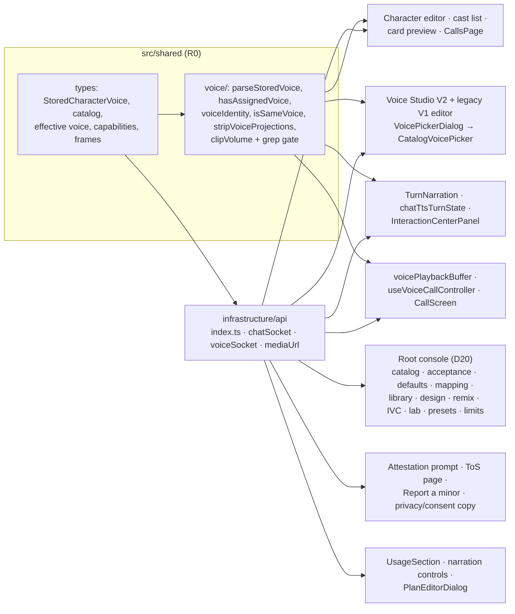
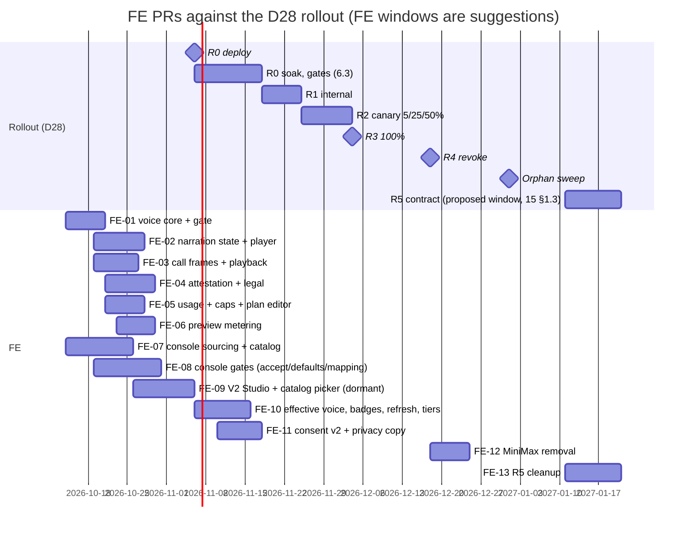

# Frontend refactor plan (magic-worlds SPA)

> **Scope / status (reviewed 2026-10-14):** Voice design and dated evidence; product rollout is **WIP**. [00 — Current status and roadmap](00_current_status_and_roadmap.md) owns current implementation/flags/gaps. Later [03 §5.16](03_target_architecture_and_decisions.md#516-r0-implementation-decisions-2026-10-12) instructions and [15 §§11–13](15_implementation_plan_and_acceptance.md#11-minimax-voice-purge-2026-10-14) supersede MiniMax routing, cohorts, V1/maps and original rollout dates. Preserve earlier proposals and vendor facts as dated references; they are not proof of availability.

Date: 2026-10-12
Original proposal status (2026-10-12): Proposed (see 03 for sign-off status)

**Scope.** This is the frontend work plan for the MiniMax → ElevenLabs voice migration, covering the React 19 SPA in `/home/andres/WebstormProjects/magic-worlds`. It turns the decisions in [03](03_target_architecture_and_decisions.md) into concrete changes, release by release, for:

- shared types, the API layer and the shared voice helpers;
- every voice surface (root console, Voice Studio, picker, character editor, adventure narration, chat narration, calls, legal and usage);
- i18n, Storybook and tests;
- the order of work across R0–R5, with a suggested PR breakdown.

It does not restate backend, data, cost or policy work; it links to the docs that own those. The BFF stays the only thing the SPA talks to: the SPA never calls ElevenLabs and never holds a provider key (03 §2.5). Prices and model facts are as of 2026-10-12.

**Related.**
- Overview: [README](README.md), [01 current state](01_current_state.md), [02 ElevenLabs capabilities](02_elevenlabs_capabilities.md).
- Source of truth: [03 target architecture and decisions](03_target_architecture_and_decisions.md).
- Voice surfaces: [04 voice catalog and library](04_voice_catalog_and_library.md), [05 Voice Studio and admin console](05_voice_studio_and_admin_console.md), [06 chat narration migration](06_chat_narration_migration.md), [07 realtime calls migration](07_realtime_calls_migration.md).
- Sibling plans: [08 backend refactor plan](08_backend_refactor_plan.md), [10 data migration and rollout](10_data_migration_and_rollout.md), [11 cost, plans and operations](11_cost_plans_and_operations.md), [12 best practices and improvements](12_best_practices_and_improvements.md), [13 policy, privacy and compliance](13_policy_privacy_and_compliance.md), [14 staging spike and contract tests](14_staging_spike_and_contract_tests.md), [15 implementation plan and acceptance](15_implementation_plan_and_acceptance.md), [16 risks and open questions](16_risks_and_open_questions.md).
- Research: [research 15 (Workspace R1 impact)](research/15_workspace_r1_impact.md), [research 07 (frontend inventory)](research/07_frontend_minimax_inventory.md), [research 08 (data model and migration surface)](research/08_voice_data_model_migration_surface.md), [research 13 (codebase gap checks)](research/13_gap_codebase_checks.md), [research 00 (current TTS review)](research/00_current_tts_review.md), [research 03 (catalog, cloning and design)](research/03_elevenlabs_voices_catalog_cloning_design.md), [research 10 (policy and licensing)](research/10_gap_policy_licensing.md).

**Conventions.**

| Marker | Meaning |
|---|---|
| (Dnn) | A decision in [03](03_target_architecture_and_decisions.md) |
| (S-n) | A staging spike, 03 §6.1 |
| (L-n) | A pending legal or sales confirmation, 03 §6.2 |
| **Proposal ([08])** | A frontend proposal for a wire shape that 03 does not fix. The backend confirms or changes it in [08](08_backend_refactor_plan.md) before the FE PR merges |
| R0…R5 | Rollout phases (D28) |

Code links are absolute and were verified against the working tree on 2026-10-12. The tree has uncommitted changes, so line numbers can drift; re-check them when a PR starts.

**Workspace R1 alignment (2026-10-12).** Re-read against frontend `c7307c6`. The `apiService` line numbers in §2.1 were refreshed to that commit, and §2.1 gains a scope rule: account-level calls use the unscoped singleton, and session- or card-bound calls use the session's or card's workspace client (`apiService.withWorkspace(id)`, `useSessionWorkspace`). §4.11 lists the workspace gaps on voice surfaces that R0 fixes. The rules are 03 D39 and §5.15; the evidence is [research 15 §9](research/15_workspace_r1_impact.md).

**Alignment with sibling plans.** Routes and frames not fixed by 03 are owned by the backend plan, [08 §5](08_backend_refactor_plan.md). This plan uses 08's names wherever 08 defines them, and the sibling proposals only where 08 is silent:

| Topic | Source used here | Note |
|---|---|---|
| User and root routes, preview request/response, `voice_ready` / `voice_barge_in` / `voice_error` changes, client progress frame | [08 §5.1–5.8](08_backend_refactor_plan.md) | §1.7, §2.1. 05 §8.2 and 07 §4.2/§5 sketch slightly different names; 08 wins |
| V1 preset `conversion_draft`, preset write payload, console module navigation | [05 §4.2–4.4, §8.1](05_voice_studio_and_admin_console.md) | 08 does not define them; [08] confirms |
| Optional `trigger` on the chat `tts` frame | [06](06_chat_narration_migration.md) (proposal) | 08 §5.7 keeps `tts` unchanged; open item §11 |
| Capabilities DTO fields the client needs beyond 08 §5.6 (`provider_route`, `tiers_allowed`, `consent_version_required`, `status`) | this plan (proposal) | Not yet in 08; open item §11 |
| Shared module layout, grep gate | this plan | 05 §2.3's `characterVoice.ts` is this plan's `parseStoredVoice.ts` |

---

## 0. Summary

1. **R0 ships the reading half first.** The R0 build of the SPA (target 2026-11-06, D28) must:
   - read both voice shapes (V1 MiniMax and V2 `voice_key`) without losing any field;
   - route every V1-keyed check through three shared helpers, guarded by a grep gate (D35);
   - stop stripping voice fields (D11, D30);
   - widen frame types (D08, §5.14);
   - handle attestation 428 and the WebSocket attestation frame (D26);
   - show caps, previews left and budget pauses (D24, D18, D37).

   After R1, the build may never roll back below this R0 build. Older builds would erase V2 voices on save (D28).
2. **The root console rebuild is on the R0 critical path.** The R0 exit gate needs at least 40 published voices, `voice_default` rows, 100% legacy mapping and a live Acceptance module (03 §6.3). Root can only produce those through the new console (D20).
3. **User-facing ElevenLabs UI ships dormant in R0+ builds.** It switches on per user from server data, not from build flags:
   - `provider_route` on `effective_voice` and in the capabilities DTO;
   - the required consent version.

   There is no new `VITE_*` flag (D28).
4. **Non-cohort users keep the MiniMax Studio editor until R4.** It is restricted to mapped ids by the BFF (D21, D12). Cohort users get the V2 Studio, the catalog picker, tiers, effective-voice display, badges and the D36 refresh action.
5. **Narration player fixes.** The player is rewritten for:
   - per-clip state (bug #3, a migration fix; #2 is a separate bug that D30 schedules in the same FE release because `TurnNarration` is touched);
   - per-clip loudness, `user_volume × 10^(gain_db/20) × thought_factor` (D16);
   - "Standard voice", "Voice replaced" and "AI voice" indicators (D05, D36, D26).
6. **Call fixes.**
   - `sample_rate`, `codec` and `channels` become data (D08).
   - `gain_db` is applied (D16).
   - Barge-in reports `played_ms` (D06).
   - Consent copy follows the provider version (D25).
   - Call frontend bugs #13–#15 stay out of scope (D30).
7. **R4 deletes the MiniMax UI and copy.** The V1 parser stays forever (D11, D21).
8. **Workspace R1 (D39).** Catalog, Studio, presets, previews, attestation and preferences stay account-level, on the unscoped client. Narration, refresh, session tier and calls use the session's workspace client. Voice surfaces become read-only in an archived workspace, and the voice socket handles close codes 4404 and 4422 (§4.11).



---

## 1. Types (`src/shared/types`)

### 1.1 CharacterVoice v2: canonical (03 §5.1.2, verbatim)

This lives in [voicePreset.types.ts](/home/andres/WebstormProjects/magic-worlds/src/shared/types/voicePreset.types.ts#L1-L60). It replaces the MiniMax-shaped `CharacterVoice` at [voicePreset.types.ts:8-18](/home/andres/WebstormProjects/magic-worlds/src/shared/types/voicePreset.types.ts#L8-L18) and the `AdminVoiceEmotion` import at [line 6](/home/andres/WebstormProjects/magic-worlds/src/shared/types/voicePreset.types.ts#L6).

```ts
export type VoiceEmotion =
  | 'happy' | 'sad' | 'angry' | 'fearful' | 'disgusted' | 'surprised' | 'calm';

export interface VoiceSettingsV2 {
  stability?: number | null;        // 0..1
  similarity_boost?: number | null; // 0..1
  style?: number | null;            // 0..1
  use_speaker_boost?: boolean | null;
  speed?: number | null;            // 0.7..1.2
}

export interface CharacterVoiceV2 {
  schema_version: 2;
  provider: 'elevenlabs';
  voice_key: string;                // /^vk_[0-9a-f]{32}$/
  voice_name: string;               // 1..255
  settings?: VoiceSettingsV2 | null;
  emotion?: VoiceEmotion | null;
  language_code?: string | null;    // /^[a-z]{2,3}$/
  preset_id?: string | null;        // ≤64
  preset_name?: string | null;      // ≤255
}

/** Legacy MiniMax shape: never created by new code; preserved when unchanged (§5.10). */
export interface CharacterVoiceLegacyV1 {
  voice_id: string;
  speed?: number | null;
  vol?: number | null;
  pitch?: number | null;
  emotion?: VoiceEmotion | null;
  language_boost?: string | null;
  preset_id?: string | null;
  preset_name?: string | null;
}

export type StoredCharacterVoice = CharacterVoiceV2 | CharacterVoiceLegacyV1;
export const isVoiceV2 = (v: StoredCharacterVoice): v is CharacterVoiceV2 =>
  (v as CharacterVoiceV2).schema_version === 2;
```

> FE parsers (`readCharacterVoice`, `snapshotVoice`, `voiceFromPreset`) must preserve the whole object for both shapes. They must never strip fields of either shape. (03 §5.1.2)

**FE consequences:**
- `Character.voice` ([character.types.ts:40-41](/home/andres/WebstormProjects/magic-worlds/src/shared/types/character.types.ts#L40-L41)) becomes `StoredCharacterVoice`.
- `SnapshotCard.voice` and `narrator_voice` ([adventure.types.ts:75-76](/home/andres/WebstormProjects/magic-worlds/src/shared/types/adventure.types.ts#L75-L76), [104-107](/home/andres/WebstormProjects/magic-worlds/src/shared/types/adventure.types.ts#L104-L107)) become `StoredCharacterVoice | null`.
- A deprecated alias `export type CharacterVoice = StoredCharacterVoice` keeps the R0 diff small. It is removed in the R5 cleanup PR (FE-13, §9.3).

### 1.2 Read-only projections next to stored voices (D35, D15)

The `effective_voice` object (03 §5.12, verbatim):

```jsonc
"effective_voice": {
  "voice_key": "vk_…" ,                // null when the caller is routed to MiniMax
  "display_name": "Eldrin",
  "provider_route": "elevenlabs",      // elevenlabs|minimax
  "substitution_reason": "unmapped_legacy",  // §5.4.2 or null
  "flags": ["pitch_dropped"],          // from voice_review_flag, undismissed only
  "badges": ["leaving", "needs_reselect"]
}
```

The FE mirrors it in a new `voiceCatalog.types.ts`, exported from the barrel [index.ts](/home/andres/WebstormProjects/magic-worlds/src/shared/types/index.ts):

```ts
/** 03 §5.4.2 — values verbatim. */
export type VoiceSubstitutionReason =
  | 'unmapped_legacy' | 'voice_removed' | 'voice_unavailable' | 'voice_blocked'
  | 'not_call_eligible' | 'default_voice' | 'distinct_voice' | 'language_unsupported' | 'tier_fallback';

/** 03 §5.12 badge inventory keys (badge-type entries only; `daily_limit`, `previews_left` and the notices are
 *  rendered from other fields). 03 does not enumerate which keys `effective_voice.badges[]` carries versus which the
 *  SPA derives from catalog fields (`locked`, `house_voice`, `not_tested_language`); [08] fixes that split. */
export type VoiceBadgeKey =
  | 'leaving' | 'needs_reselect' | 'review' | 'retired' | 'replaced' | 'call_voice'
  | 'locked' | 'expressive_only' | 'standard_fallback' | 'not_tested_language' | 'house_voice';

export interface EffectiveVoice {
  voice_key: string | null;
  display_name: string;
  provider_route: 'elevenlabs' | 'minimax';
  substitution_reason: VoiceSubstitutionReason | null;
  flags: string[];          // e.g. 'pitch_dropped' | 'vol_dropped' | 'speed_clamped' | 'needs_review'
  badges: VoiceBadgeKey[];  // unknown values are ignored by the UI (forward compatible)
}
```

| Stored field | Projection field | Status |
|---|---|---|
| card `voice`, character-chat `snapshot.character.voice`, cast entry `voice`, preset | `effective_voice` (sibling key) | Fixed by 03 §5.12 |
| adventure `narrator_voice` | sibling name not fixed by 03 | **Proposal ([08]):** `effective_narrator_voice` |

Projections are **read-only**. BFF write models are `extra="forbid"` ([research 07 §12.8 item 214](research/07_frontend_minimax_inventory.md)), so the SPA strips every projection key before a write (§3.2 `stripVoiceProjections`).

### 1.3 Preset v2 (03 §5.3 API DTO, verbatim)

```jsonc
{
  "preset_id": "…",
  "name": "…",
  "description": "…",
  "voice_key": "vk_…",
  "voice_name": "…",
  "settings": { /* VoiceSettingsV2 */ },
  "emotion": null,
  "language_code": null,
  "is_global": false,
  "schema_version": 2,
  "provider": "elevenlabs"
}
```

FE types. These replace [voicePreset.types.ts:20-60](/home/andres/WebstormProjects/magic-worlds/src/shared/types/voicePreset.types.ts#L20-L60).

```ts
export interface VoicePresetV2 {
  preset_id: string; name: string; description: string | null;
  voice_key: string; voice_name: string;
  settings: VoiceSettingsV2 | null; emotion: VoiceEmotion | null; language_code: string | null;
  is_global: boolean; schema_version: 2; provider: 'elevenlabs';
  effective_voice?: EffectiveVoice;           // read-only (D35)
}
/** Today's MiniMax row, readable until R5 (D12). Field names as today. Same name as 05 §4.2. */
export interface VoicePresetV1 {
  preset_id: string; name: string; description: string | null;
  base_voice_id: string; base_voice_name: string | null;
  speed: number | null; volume: number | null; pitch: number | null;
  emotion: VoiceEmotion | null; language_boost: string | null;
  is_global: boolean; schema_version?: 1; provider?: 'minimax';
  effective_voice?: EffectiveVoice;
  /** Proposal (05 §4.4, [08] owns the name): for `elevenlabs`-routed callers, the server-computed V2 draft
   *  (from voice_legacy_mapping) that pre-fills the editor (D12). The SPA never builds the draft itself. */
  conversion_draft?: Omit<VoicePresetV2, 'preset_id' | 'effective_voice'> | null;
}
export type VoicePreset = VoicePresetV2 | VoicePresetV1;
/** Proposal (05 §4.2): the server fills voice_name from the catalog; language_code is not user-editable (D13);
 *  settings carries only user-editable keys (stability, similarity_boost, speed) or null. */
export type VoicePresetV2Write = Pick<VoicePresetV2, 'name' | 'description' | 'voice_key' | 'settings' | 'emotion'>;
```

### 1.4 Catalog DTOs (03 §5.12, verbatim item)

```jsonc
{
  "voice_key": "vk_…",
  "display_name": "Eldrin",
  "description": "…",
  "gender": "male", "age": "old", "accent": "british",
  "primary_language": "en",
  "languages": [ { "language": "en", "native": true,  "accent": "british", "accepted_models": ["standard", "expressive"], "sample_url": "/voices/catalog/vk_…/preview.mp3?lang=en&tier=standard&h=…" },
                 { "language": "es", "native": false, "accent": null,      "accepted_models": ["standard"],             "sample_url": "…" } ],
  "tags": ["narrator", "mentor"],
  "house_voice": true,                 // source_kind in designed|remixed|ivc
  "call_eligible": true,
  "status": "active",                  // active|hidden|deprecating|removed|blocked (non-active only in batch lookups)
  "disable_at": null,
  "locked": false, "min_plan": null,   // plan_gated and caller below min_plan
  "replacement": null                  // { voice_key, display_name } when deprecating/removed/blocked
}
```

```ts
export type NarrationTier = 'standard' | 'expressive';              // 03 §5.4.1
export interface CatalogVoiceLanguage {
  language: string; native: boolean; accent: string | null;
  accepted_models: NarrationTier[];  // tier names, never provider model ids (03 §5.12)
  sample_url: string;                // relative BFF path; fetched as an authed blob (§2.3)
}
export interface CatalogVoice {
  voice_key: string; display_name: string; description: string | null;
  gender: string | null; age: string | null; accent: string | null; primary_language: string;
  languages: CatalogVoiceLanguage[]; tags: string[]; house_voice: boolean; call_eligible: boolean;
  status: 'active' | 'hidden' | 'deprecating' | 'removed' | 'blocked';
  disable_at: string | null; locked: boolean; min_plan: 'plus' | 'pro' | string | null;
  replacement: { voice_key: string; display_name: string } | null;
}
export interface CatalogQuery {      // filters verbatim from 03 §5.12
  language?: string; accent?: string; gender?: string; age?: string; tags?: string[]; use_case?: string;
  works_in_calls?: boolean; q?: string; recommended_for?: string; include_locked?: boolean;
  after?: string; limit?: number;    // limit ≤ 50
}
/** Page envelope as proposed in 08 §5.1. The `?keys=` batch returns `{ items }` only. */
export interface CatalogPage { items: CatalogVoice[]; next_cursor: string | null }
```

### 1.5 Capabilities DTO (D13; envelope is a proposal)

D13 fixes the content: per surface and tier, which controls exist, their ranges and defaults, `supports_emotion`, `supports_speed` and text limits. [08 §5.6](08_backend_refactor_plan.md) proposes the wire layout (`surfaces.{surface}.{tier}` with `controls` as a key list plus `ranges`, `defaults`, `healthy`). The SPA keeps the **view model** below and maps 08's wire shape into it in one adapter (`toVoiceCapabilities`), so a wire rename touches one file. The fields under "client switches" are **not in 08 yet**: they are this plan's request so that one TTL-cached call drives every switch the client needs (§7, §11).

```ts
export type VoiceSurface = 'narration' | 'call' | 'preview' | 'admin_lab';   // 03 §5.4.1
export type VoiceControlKey = 'stability' | 'similarity_boost' | 'style' | 'use_speaker_boost' | 'speed';
export interface VoiceControlSpec {
  key: VoiceControlKey; min?: number; max?: number; step?: number;
  default: number | boolean; user_editable: boolean;   // style/use_speaker_boost: false (D13)
}
export interface VoiceSurfaceCapabilities {
  surface: VoiceSurface; tier: NarrationTier | null;
  controls: VoiceControlSpec[]; supports_emotion: boolean; supports_speed: boolean; max_chars: number;
}
export interface VoiceCapabilities {                     // client view model
  surfaces: VoiceSurfaceCapabilities[];                  // D13, mapped from 08 §5.6 (`healthy: false` on Expressive → note that turns fall back to Standard, D05)
  // ---- client switches: Proposal, not yet in 08 ----
  provider_route: 'elevenlabs' | 'minimax';              // caller's route (D28 cohort)
  tiers_allowed: NarrationTier[];                         // plan-clamped (D05)
  narration_tier: NarrationTier;                          // user_preferences.narration_tier (D05)
  consent_version_required: 'voice-v1' | 'voice-v2';     // D25
  status: { narration_available: boolean; calls_available: boolean; auto_narration_paused: boolean }; // D28 kill switches, D37
}
```

Rules:
- Ranges come from the DTO, never from constants in code. A control is rendered only when the DTO lists it with `user_editable: true`; unknown keys are ignored.
- If the capabilities call fails, the editor is read-only with a retry; there is no hard-coded fallback range (same rule as 05 §5.2). The BFF still rejects out-of-range writes with 422 (D13).
- The final per-model allow-lists depend on **S-3**.
- If **S-6** finds the Standard emotion offset inaudible, `supports_emotion` is `false` on the Standard tier, and the Studio shows emotion on Expressive only (D13).

### 1.6 Narration frames and clips (`interaction.types.ts`)

The changes below follow §5.8 and §5.14 of 03. **`TtsLifecycleStatus` and the `tts_failed` status union are unchanged** ([interaction.types.ts:102-114](/home/andres/WebstormProjects/magic-worlds/src/shared/types/interaction.types.ts#L102-L114), [210-212](/home/andres/WebstormProjects/magic-worlds/src/shared/types/interaction.types.ts#L210-L212)).

| Type | Change | Source |
|---|---|---|
| `ChatTtsError` ([128-133](/home/andres/WebstormProjects/magic-worlds/src/shared/types/interaction.types.ts#L128-L133)) | Add `retryable?: boolean \| null` and `action?: 'attest' \| null`. `code` gains `voice_unavailable`, `attestation_required`, `moderation_unavailable`, `content_blocked` (03 §5.8), plus the turn-level gate codes proposed in 06/08 (`narration_paused`, `auto_narration_paused`, `voice_not_eligible`, `voice_restricted`); unknown codes fall back to the category copy | 03 §5.8; 08 §5.7 |
| `ChatTtsSegmentClip` ([141-154](/home/andres/WebstormProjects/magic-worlds/src/shared/types/interaction.types.ts#L141-L154)) | Add `tier?: NarrationTier`, `gain_db?: number \| null`, `substitution_reason?: VoiceSubstitutionReason \| null`, `voice_display_name?: string \| null` (**Proposal ([08])**, for the "Voice replaced" tooltip). `status` widens to `TtsLifecycleStatus \| TtsSegmentDisplayState` | D05, D16, D36, §5.4.2 |
| New `TtsSegmentDisplayState` | `'daily_limit_reached' \| 'not_narrated'`. Display-only and never a job status; terminal for the player | 03 §5.4.2, §5.8 |
| `ChatTtsSegmentFrameFields` ([155-163](/home/andres/WebstormProjects/magic-worlds/src/shared/types/interaction.types.ts#L155-L163)) | Add the same `tier`, `gain_db` and `substitution_reason` fields | D16, D36 |
| Client `tts` frame ([195](/home/andres/WebstormProjects/magic-worlds/src/shared/types/interaction.types.ts#L195)) | **Proposal ([06](06_chat_narration_migration.md); 08 §5.7 keeps it unchanged):** optional `trigger: 'auto' \| 'manual'` (default manual, so older builds fail open), so the BFF can refuse auto requests while auto-narration is paused (D37; 06 answers them with `error.code: "auto_narration_paused"`) and still serve manual play. `WsTtsFrame` is `extra="forbid"` ([route_chat.py:212-218](/home/andres/PycharmProjects/magic-worlds-api/src/routes/user/route_chat.py#L212-L218)), so the BE widens it first. Until then the SPA also skips auto sends client-side (§4.5) | D37 |

The attestation frame is fixed by 03 §5.8:

```jsonc
tts_failed{assistant_message_id, turn_id, status:"unavailable", error:{code:"attestation_required", retryable:false, action:"attest"}}
```

### 1.7 Call frames (`voice.types.ts`): sample rate as data (D08)

| Type | Today | Change |
|---|---|---|
| `voice_audio_chunk` ([voice.types.ts:164-174](/home/andres/WebstormProjects/magic-worlds/src/shared/types/voice.types.ts#L164-L174)) | `content_type: 'audio/mpeg'`, `sample_rate: 32000` (literal, [line 170](/home/andres/WebstormProjects/magic-worlds/src/shared/types/voice.types.ts#L170)), `channels: 1` | `sample_rate: 22050 \| 24000 \| 44100 \| 32000` (32000 legacy, read-only), `codec?: 'mp3'` (optional on read so frames from older BFF builds still parse; 08 §5.8 adds it in R0), `channels: 1`, `gain_db?: number \| null`, `substitution_reason?: VoiceSubstitutionReason \| null` (D08, D16, D36, 03 §5.14) |
| Client `voice_barge_in` ([voice.types.ts:102](/home/andres/WebstormProjects/magic-worlds/src/shared/types/voice.types.ts#L102)) | `{ type: 'voice_barge_in'; reason: 'barge_in' }` | Keep the wire name; add optional `turn_id?: string` and `played_ms?: number` (08 §5.8, 07 §5; 03 §2.3 draws it as `interrupt {turn_id, played_ms}`). Without them the server estimates `played_ms`. `VoiceBargeInFrame` is `extra="forbid"` ([route_voice_call.py:143-147](/home/andres/PycharmProjects/magic-worlds-api/src/routes/user/route_voice_call.py#L143-L147)), so the **BE widens it first**; the SPA sends the fields only after that |
| New client progress frame | none | **Proposal (08 §5.8):** `{ type: 'voice_playback'; turn_id: string; played_ms: number }`; 08 asks for one every ≤ 1 s, 07 §3 calls it `voice_playback_progress` at ≤ 500 ms. The SPA sends every 500 ms while the turn is audible, which satisfies both. D06 bounds flush-ahead by "the client's last reported `played_ms`" |
| `voice_ready` ([voice.types.ts:129-135](/home/andres/WebstormProjects/magic-worlds/src/shared/types/voice.types.ts#L129-L135)) | session, limits, upload URL | **Proposal (08 §5.8):** `audio?: { content_type: 'audio/mpeg'; codec: 'mp3'; sample_rate; channels: 1 }` (R0) and `effective_voice?: EffectiveVoice` (R1, computed for the `call` surface) for the "Call voice: {name}" / "Voice replaced" header before audio arrives (D06, D08, 03 §5.12). 07 §4.2 sketches the same as `audio_format` / `voice` |
| `VoiceErrorCategory` ([voice.types.ts:35](/home/andres/WebstormProjects/magic-worlds/src/shared/types/voice.types.ts#L35)) | provider-neutral | Unchanged on the wire. Calls send `tts_unavailable` plus `code` (03 §5.8); call-start attestation arrives the same way, as `voice_error{category:"tts_unavailable", code:"attestation_required"}`, because call start is the `ws-voice` handshake where HTTP 428 is impossible ([13 §3.2](13_policy_privacy_and_compliance.md)). Add `code?: string` to `voice_error` if missing, and handle `attestation_required` by **code** |
| `VoiceCallLimits.remaining_daily_seconds` ([line 109](/home/andres/WebstormProjects/magic-worlds/src/shared/types/voice.types.ts#L109)) | env-wide | Same field. The value becomes per-plan (D24 item 7) |

### 1.8 Preferences, membership, attestation, review flags

| Type | Change | Source |
|---|---|---|
| `UserPreferences` / `UserPreferencesUpdate` ([auth.types.ts:170-178](/home/andres/WebstormProjects/magic-worlds/src/shared/types/auth.types.ts#L170-L178)) | Add `narration_tier: NarrationTier`. Update becomes partial (`preferred_language?`, `narration_tier?`) | D05 |
| `Membership` ([auth.types.ts:141-150](/home/andres/WebstormProjects/magic-worlds/src/shared/types/auth.types.ts#L141-L150)) | Add the usage fields `narration_chars_used`, `narration_chars_limit`, `call_seconds_used`, `call_seconds_limit`, `previews_left`. **Decided ([03 §5.16](03_target_architecture_and_decisions.md) I-1):** flat on `membership`, as 08 §1.10 says; the nested `membership.voice_usage` read stays only as a fallback. `limits` gains the `voice_preview` key | D24, D18 |
| `MembershipPlanLimit` ([billing.types.ts:298-302](/home/andres/WebstormProjects/magic-worlds/src/shared/types/billing.types.ts#L298-L302)) | Add `daily_quantity_limit: number \| null` (characters for `tts_generation`, seconds for `voice_call`) | D24 |
| New `attestation.types.ts` | `AttestationKind = 'age_18_plus' \| 'terms_of_service'`; `AttestationRecord { kind, version, accepted_at }`; **Proposal (08 §5.1):** `AttestationStatus { required: { kind, version }[]; accepted: AttestationRecord[] }`; the SPA derives "missing" | D26 |
| New `VoiceReviewFlag` | `{ flag_id, ref_type, ref_id, json_path, flags: string[], created_at, organization: WorkspaceOrganization \| null }` (undismissed only; 08 §5.1). `organization` is server-owned and null for presets (D39) | D15, D39 |
| `adminVoice.types.ts` (whole file, 1-126 (retired historical source: `/home/andres/WebstormProjects/magic-worlds/src/shared/types/adminVoice.types.ts#L1-L126`)) | Rewritten provider-neutral as `adminVoiceCatalog.types.ts` (§4.3). The MiniMax `base_resp`, `audio_hex` and 32 kHz types go. A minimal `LegacySystemVoice { id, name }` stays until R4 | D20 |

---

## 2. API layer

### 2.1 `apiService` methods ([index.ts](/home/andres/WebstormProjects/magic-worlds/src/infrastructure/api/index.ts))

Phase is the release of the FE build that carries the method. "Proposal" rows depend on [08]. Line numbers are at `c7307c6`.

**Workspace scope (D39, 03 §5.15).** The exported `apiService` singleton is unscoped. `apiService.withWorkspace(id)` ([index.ts:548-560](/home/andres/WebstormProjects/magic-worlds/src/infrastructure/api/index.ts#L548-L560)) returns a frozen client that adds `X-Workspace-Id`.
- **Account** (unscoped singleton, no selector): catalog, `?keys=`, samples, capabilities, preview texts, presets, recipe preview, review flags, `?ref_type=preset` effective voice, attestations, preferences, TTS audio blobs, root console.
- **Session** (the session's client from `useSessionWorkspace`, never the committed workspace's): session voice settings, refresh, snapshot writes, consent, call segments and end, TTS job polling, call history and transcripts.
- **Card** (the card's workspace client): `recommended_for` and `?ref_type=card|card_draft|card_version`. A public card needs no selector.

| Method | Path | Today | Action | Phase |
|---|---|---|---|---|
| `listVoiceCatalog(query)` (new) | `GET /voices/catalog` | — | Add (D35, 03 §5.12). Account scope; with `recommended_for` an owned card needs its workspace client (422 without, 404 if the card is in another workspace) | R0 (dormant) |
| `getVoiceCatalogByKeys(keys)` (new) | `GET /voices/catalog?keys=` (≤ 100) | — | Add. Batch badge lookups for lists (D35) | R0 |
| `getVoiceCapabilities()` (new) | `GET /voices/capabilities` | — | Add. Mapped to the §1.5 view model; 60 s TTL cache (§7) | R0 |
| `getPreviewTexts(language)` (new) | `GET /voices/preview-texts?language=` (08 §5.1) | — | Add. Fixed `text_id`s per language for the recipe-preview chooser (D18) | R0 |
| `getEffectiveVoice(refType, refId)` (new) | `GET /voices/effective?ref_type=&ref_id=` → `{ref_type, ref_id, voices: [{json_path, effective_voice}]}` (08 §5.1) | — | Add (D35). `preset`: unscoped; card, draft, version and session refs: the document's workspace client | R1 |
| `listVoiceReviewFlags()` / `dismissVoiceReviewFlag(id)` (new) | `GET /voices/review-flags`, `POST /voices/review-flags/{id}/dismiss` | — | Add (D15). Account list, unscoped. Each item carries `organization` (null for presets); show it with `WorkspaceOriginLabel`, and open card flags in their workspace (read-only when archived) | R1 |
| `previewVoice` ([index.ts:2336](/home/andres/WebstormProjects/magic-worlds/src/infrastructure/api/index.ts#L2336)) | `POST /voice-presets/preview` | Free text, hex audio, unmetered | **Change.** No free text (D18). **Proposal (08 §5.2):** request `{ voice_key \| legacy_voice_id, settings, emotion, text_id, tier }` (V1 body on the MiniMax route), response `{ cache_key, url, cached, previews_left }` with the audio at `GET /voice-presets/preview/{cache_key}.mp3`, fetched as an authed blob (§2.3). 05 §6.6 sketches extra response fields (`tier_used`, `gain_db`, `text`); the player needs `gain_db`, so the FE asks 08 to add it (§11). Handle 428, 429 and 503 `moderation_unavailable` | R0 |
| `listSystemVoices` ([index.ts:2329](/home/andres/WebstormProjects/magic-worlds/src/infrastructure/api/index.ts#L2329)) | `GET /voice-presets/system-voices` | MiniMax system list | Keep for non-cohort users. The BFF restricts it to mapped ids from R0 (D21). **Delete at R4** | R0 → R4 |
| `listVoicePresets` / `createVoicePreset` / `updateVoicePreset` / `deleteVoicePreset` ([2297](/home/andres/WebstormProjects/magic-worlds/src/infrastructure/api/index.ts#L2297) / [2304](/home/andres/WebstormProjects/magic-worlds/src/infrastructure/api/index.ts#L2304) / [2313](/home/andres/WebstormProjects/magic-worlds/src/infrastructure/api/index.ts#L2313) / [2322](/home/andres/WebstormProjects/magic-worlds/src/infrastructure/api/index.ts#L2322)) | `/voice-presets` | V1 payloads | **Change** types to the `VoicePreset` union. Writes send `VoicePresetV2Write`; for non-cohort users before R4 they send the V1 payload. Saving a V1 preset as V2 keeps its `preset_id` (D12). Strip projections | R0 / R1 |
| `getUserPreferences` / `updateUserPreferences` ([1902](/home/andres/WebstormProjects/magic-worlds/src/infrastructure/api/index.ts#L1902) / [1909](/home/andres/WebstormProjects/magic-worlds/src/infrastructure/api/index.ts#L1909)) | `GET`/`PATCH /user/preferences` | language only | Add `narration_tier` (D05); the update body becomes partial (08 §5.2: both optional, at least one) | R0 types (08 ships the field in R0); UI R1 |
| `setSessionNarrationTier(sessionId, tier)` (new) | **Proposal (08 §5.1):** `PUT /adventure-sessions/{id}/voice-settings` `{ tier_override: 'standard' \| 'expressive' \| null }` → `{ tier_override, effective_tier }`. 08 names no character-chat route yet (§11) | — | Add. Writes `session_voice_setting`, never the snapshot (D05). Session client; 409 `WORKSPACE_ARCHIVED` when archived | R1 |
| `refreshChatVoice(chatId)` (new) | `POST /character-chats/{id}/voice/refresh` | — | Add. Session client. Handle 409 while a stream or call is active (D36), 409 `WORKSPACE_ARCHIVED`, and 409 `voice_source_unavailable` when the source card is not in the session's workspace (D39) | R1 |
| `refreshAdventureVoices(sessionId, cardIds?)` (new) | `POST /adventure-sessions/{id}/voices/refresh` | — | Add (D36). Same scope and errors as `refreshChatVoice` | R1 |
| `updateAdventureSnapshot` ([4467](/home/andres/WebstormProjects/magic-worlds/src/infrastructure/api/index.ts#L4467)) | `PUT …/template-snapshot` | Sends the whole snapshot | Keep. Run `stripVoiceProjections` first. Untouched V1 entries must stay byte-identical (D32). Narrator-voice saves must use the **session's** client: today `DataProvider.saveInProgressSnapshot` ([DataProvider.tsx:642-656](/home/andres/WebstormProjects/magic-worlds/src/app/providers/DataProvider.tsx#L642-L656)) uses the committed workspace's (§4.11) | R0 |
| `getCharacter` ([3690](/home/andres/WebstormProjects/magic-worlds/src/infrastructure/api/index.ts#L3690)), `getAdventureSession` ([3771](/home/andres/WebstormProjects/magic-worlds/src/infrastructure/api/index.ts#L3771)), `getCharacterChat` ([4529](/home/andres/WebstormProjects/magic-worlds/src/infrastructure/api/index.ts#L4529)) | card and session reads | `any` | Keep. Responses carry `effective_voice` from R1, read through the shared parser | R0 |
| `submitAttestations(items)` (new) | `POST /user/attestations` | — | Add. Called right after registration and from the blocking prompt (D26) | R0 |
| `getAttestationStatus()` (new) | **Proposal (08 §5.1):** `GET /user/attestations` → `{required, accepted}` | — | Add. Decides whether the blocking prompt shows for existing and OAuth users (D26) | R0 |
| `reportMinor(body)` (new) | **Proposal ([08]/[13]):** `POST /reports/minor` | — | Add. Contact page, D26 item 6 | R2 ([15] R2-BE-02; contract not yet in 08) |
| `saveVoiceConsent` ([3891](/home/andres/WebstormProjects/magic-worlds/src/infrastructure/api/index.ts#L3891)) | `POST /character-chats/{id}/voice-consent` | Fixed version | Keep path. Handle 428 `attestation_required`. The copy shown depends on `consent_version_required` (D25) | R0 / R1 |
| `uploadVoiceSegment` ([3901](/home/andres/WebstormProjects/magic-worlds/src/infrastructure/api/index.ts#L3901)), `endVoiceCall` ([3934](/home/andres/WebstormProjects/magic-worlds/src/infrastructure/api/index.ts#L3934)), `getRecentVoiceCalls` ([4568](/home/andres/WebstormProjects/magic-worlds/src/infrastructure/api/index.ts#L4568)), `getVoiceCallTranscript` ([4584](/home/andres/WebstormProjects/magic-worlds/src/infrastructure/api/index.ts#L4584)) | call HTTP | neutral | Keep. Call workspace's client (`useVoiceCallController.ts:212-219`) | — |
| `getTtsJob` ([3954](/home/andres/WebstormProjects/magic-worlds/src/infrastructure/api/index.ts#L3954)), `fetchTtsAudioBlob` ([3967](/home/andres/WebstormProjects/magic-worlds/src/infrastructure/api/index.ts#L3967)), `fetchProtectedMediaBlob` ([3971](/home/andres/WebstormProjects/magic-worlds/src/infrastructure/api/index.ts#L3971)) | jobs, blobs | neutral | Keep. `TtsJobPublicResponse` gains the §1.6 clip fields. `getTtsJob` uses the session's client; blobs stay unscoped (no selector on binary assets) | R0 |
| `waitForTts` ([4024](/home/andres/WebstormProjects/magic-worlds/src/infrastructure/api/index.ts#L4024)), `getCharacterChatCalls` ([4576](/home/andres/WebstormProjects/magic-worlds/src/infrastructure/api/index.ts#L4576)) | — | Dead code | **Delete** ([research 07 items 56, 58](research/07_frontend_minimax_inventory.md)) | R0 |
| `getMembershipPlan` ([2147](/home/andres/WebstormProjects/magic-worlds/src/infrastructure/api/index.ts#L2147)), `createMembershipPlan` / `updateMembershipPlan` (2157 / 2165) | `/admin/billing/plans` | 3 limit fields | Carry `daily_quantity_limit` (D24) | R0 |
| `getUserProfile` ([1882](/home/andres/WebstormProjects/magic-worlds/src/infrastructure/api/index.ts#L1882)) | `GET /user/me` | membership | Carries the D24 usage fields | R0 |

**Root console methods.** These replace `listAdminVoices` ([1963](/home/andres/WebstormProjects/magic-worlds/src/infrastructure/api/index.ts#L1963)), `designAdminVoice` ([1973](/home/andres/WebstormProjects/magic-worlds/src/infrastructure/api/index.ts#L1973)), `deleteAdminVoice` ([1982](/home/andres/WebstormProjects/magic-worlds/src/infrastructure/api/index.ts#L1982)), `testAdminVoice` ([1995](/home/andres/WebstormProjects/magic-worlds/src/infrastructure/api/index.ts#L1995)), `uploadAdminVoiceCloneSample` ([2435](/home/andres/WebstormProjects/magic-worlds/src/infrastructure/api/index.ts#L2435)) and `cloneAdminVoice` ([2453](/home/andres/WebstormProjects/magic-worlds/src/infrastructure/api/index.ts#L2453)). Paths are copied from [08 §5.3](08_backend_refactor_plan.md), which builds on [research 03 §12.7](research/03_elevenlabs_voices_catalog_cloning_design.md). Only `POST /admin/voice-presets/global` is fixed by 03 (D12); every other path is a proposal of 08. ([05 §8.2](05_voice_studio_and_admin_console.md) sketches a few different sub-paths, e.g. `lab/synthesize`, `legacy-mappings`, `budget`; 08's names win.) Method names are FE suggestions. Audio comes back as `audio/mpeg` or base64, never hex.

| Methods (FE) | BFF paths (08 §5.3) | Module (D20) | Phase |
|---|---|---|---|
| `listAdminCatalog`, `updateAdminCatalogVoice` (metadata, tags, publish, hide/retire = `status=hidden`, replacement, visibility, `min_plan`, `sort_rank`), `getAdminCatalogImpact`, `syncAdminCatalog`, `deleteAdminCatalogVoice` (two-step confirm token) | `GET /admin/voices/catalog`, `PATCH /admin/voices/catalog/{voice_key}`, `GET …/{voice_key}/impact`, `POST /admin/voices/sync {job, voice_keys?}`, `DELETE /admin/voices/catalog/{voice_key}` | Catalog manager + impact view (D19, D20) | R0 |
| `renderAcceptance`, `putAcceptanceVerdict`, `renderCatalogSamples` | `POST /admin/voices/acceptance/renders`, `PUT /admin/voices/acceptance/{voice_key}/{model_id}/{language}`, `POST /admin/voices/catalog/{voice_key}/samples` | Acceptance | R0 |
| `getVoiceDefaults`, `putVoiceDefaults(role, language, voiceKeys)` | `GET /admin/voices/defaults`, `PUT /admin/voices/defaults/{role}/{language}` | Defaults (D31) | R0 |
| `listLegacyMapping`, `putLegacyMapping`, `getLegacyMappingCoverage` | `GET /admin/voices/legacy-mapping`, `PUT …/legacy-mapping/minimax/{legacy_voice_id}`, `GET …/legacy-mapping/coverage` | Legacy mapping (D21, D33) | R0 |
| `listLegacyFallback`, `putLegacyFallback` | `GET /admin/voices/legacy-fallback`, `PUT …/legacy-fallback/{voice_key}` | Reverse mapping (D21; dropped at R4) | R0 |
| `listLegacyMiniMaxVoices`, `testLegacyMiniMaxVoice` | `GET /admin/voices/legacy/minimax/voices`, `POST /admin/voices/legacy/minimax/test` | Mapping auditions (R0–R4) | R0 → R4 |
| `listAdminLibrary`, `addAdminLibraryVoice` | `GET /admin/voices/library`, `POST /admin/voices/library/add` | Library browser | R0 |
| `designAdminVoice`, `saveAdminDesign` | `POST /admin/voices/design`, `POST /admin/voices/design/save` | Voice Design | R0 |
| `remixAdminVoice` | `POST /admin/voices/catalog/{voice_key}/remix` | Remix | R0 |
| `createAdminConsent`, `createAdminIvc`, `revokeAdminConsent` | `POST /admin/voices/consents`, `POST /admin/voices/ivc` (multipart + `consent_record_id`), `POST /admin/voices/consents/{id}/revoke` | IVC | R0 build, optional feature (S-22, L-13) |
| `testAdminVoice` | `POST /admin/voices/test` (path reused by the ElevenLabs lab) | Synth lab | R0 |
| `createGlobalPreset`, `updateGlobalPreset`, `deleteGlobalPreset` | **`POST /admin/voice-presets/global`** (D12), `PUT/DELETE /admin/voice-presets/global/{preset_id}` | Global presets (D12, D22) | R0 build; re-seed before R3 hides MiniMax globals (05 marks the module R1) |
| `getVoiceLimits`, `getRuntimeSettings`, `putRuntimeSetting` | `GET /admin/voices/limits`, `GET /admin/voices/runtime-settings`, `PUT …/runtime-settings/{setting_key}` (UI offers the daily-budget raise only, D37, 03 §5.13) | Limits widget | R0 |

### 2.2 Error mapping in the API layer

| Signal | Where | FE handling |
|---|---|---|
| HTTP 428 `attestation_required` | voice consent (`POST /character-chats/{id}/voice-consent`), recipe preview | Throw a typed `AttestationRequiredError`. The `AttestationProvider` opens the blocking prompt and retries once on success (D26) |
| `voice_error{category:"tts_unavailable", code:"attestation_required"}` | call WebSocket (call start is the `ws-voice` handshake, so no 428 is possible; [13 §3.2](13_policy_privacy_and_compliance.md)) | Same prompt; the call ends cleanly (treated as terminal by code, §4.6); the user restarts the call after attesting |
| `tts_failed` with `error.code: "attestation_required", action: "attest"` | chat WebSocket | The same prompt. The clip stays idle, not failed (03 §5.8) |
| `error.code: "moderation_unavailable"`, `retryable: true` | narration | Clip shows "Narration is briefly unavailable" plus a retry (03 §5.8) |
| `error.code: "voice_unavailable"` | narration (409 on HTTP) | Clip failed, no retry. "Voice replaced" path via refresh (D36) |
| `status: "content_blocked"` | narration | Existing terminal state. Copy unchanged |
| Segment status `daily_limit_reached` / `not_narrated` | hydration / frames | Display state (§4.5). Never a failure toast |
| 409 on refresh | D36 routes | Toast: "Finish the current reply or call first" |
| 422 on a voice write | card, preset, snapshot | Map `detail` codes to "This voice can't be picked right now" (eligibility, D32). Never shown for unchanged voices, by D32 design |
| 429 on preview | recipe preview | "{n} previews left today" becomes 0, and the button is disabled (D18) |
| 429 from a per-user token bucket (D37, 03 §5.13: narration 6 turns/min, call start 3/10 min, recipe preview 6/min) | narration enqueue (existing `rate_limited` status), call start, preview | "You're going a bit fast. Try again in a moment." Never shown as the user's daily quota. Body shape: **Proposal ([08])** |
| Voice refused for a Free account that is not yet eligible (attested, verified email, account age ≥ 24 h; D37, [13 §3.5](13_policy_privacy_and_compliance.md)) | narration, call start, preview | Inline explanation of the missing prerequisite (verify email / try again after 24 h). Error code: **Proposal ([08])** |
| `unavailable` at 100% of the global daily budget (D37) | new narration, call start | "Voice is unavailable right now. Text keeps working." Live calls continue as text (03 §5.8) |
| 409 `WORKSPACE_ARCHIVED`; turn-level `tts_failed` with `error.code: "workspace_archived"`; `voice_error` code `WORKSPACE_ARCHIVED` (D39) | voice settings, refresh, snapshot writes; narration reuse misses; call start and segments | Existing `workspaceActivity.chat.workspaceArchived` / `workspaceActivity.call.workspaceArchived` copy. Never a generic failure, never retried |
| 409 `voice_source_unavailable` (D39) | refresh | "The original card isn't in this workspace anymore." The session keeps its voice |
| 409 `WORKSPACE_ACTIVE_CALL` | archive while a call is live | Existing `workspaceUi.errors.activeCall`; add the label to `voiceCallLabels.ts` |

### 2.3 Sockets and media helpers

| File | Change | Phase |
|---|---|---|
| [mediaUrl.ts:3-9](/home/andres/WebstormProjects/magic-worlds/src/infrastructure/api/mediaUrl.ts#L3-L9) `PROTECTED_MEDIA_PATH_PREFIXES` | Add `/voices/catalog/` (sample MP3s, `Cache-Control: private`, D10), plus `/voice-presets/preview/` for recipe-preview audio (08 §5.2). Samples are fetched as authed blobs and **never hotlinked** (D10) | R0 |
| [voiceSocket.ts:33-46, 297-345](/home/andres/WebstormProjects/magic-worlds/src/infrastructure/api/voiceSocket.ts#L297-L345) `voiceCloseLabel`, `onclose` | Know only 1000, 4401, 4403 and 4408. A 4404 or 4422 close falls through to resume or reconnect and can loop. **Fix (D39):** treat 4404 (`CHAT_SESSION_NOT_FOUND`) and 4422 (`WORKSPACE_REQUIRED`) as terminal, and dispatch `workspace:required` on 4422, as `chatSocket.ts:225-238` does | R0 |
| [voiceSocket.ts:48-63](/home/andres/WebstormProjects/magic-worlds/src/infrastructure/api/voiceSocket.ts#L48-L63) `SERVER_FRAME_TYPES` | Unchanged set. Chunk validation accepts the widened `sample_rate` and new optional fields | R0 |
| [voiceSocket.ts:65-80](/home/andres/WebstormProjects/magic-worlds/src/infrastructure/api/voiceSocket.ts#L65-L80) `FORBIDDEN_CLIENT_PAYLOAD_KEYS` | Add `xi_api_key` and `xi-api-key` (`audio_base64` is already at line 68) | R0 |
| [voiceSocket.ts:202](/home/andres/WebstormProjects/magic-worlds/src/infrastructure/api/voiceSocket.ts#L202) `sendBargeIn` | Send `turn_id` and `played_ms` once the BE accepts them. Add `sendPlayback` for the `voice_playback` frame (proposal, §1.7) | R0 code, enabled when the BE widens |
| [chatSocket.ts:333](/home/andres/WebstormProjects/magic-worlds/src/infrastructure/api/chatSocket.ts#L333) `sendTts` | Optional `trigger` argument (proposal, §1.6) | R0 |

---

## 3. Shared voice module and the grep gate

### 3.1 Layout (`src/shared/voice/`, new)

| File | Exports |
|---|---|
| `parseStoredVoice.ts` (05 §2.3 calls it `characterVoice.ts`) | `parseStoredVoice(raw): StoredCharacterVoice \| null`. This is the **V1 parser** and, with `voiceIdentity.ts`, the only place that reads `voice_id`. It also exports, for the MiniMax-route editor until R4: `legacyVoiceId(v)`, `makeLegacyV1Voice(id, extra)` and `toLegacySystemVoice(entry): LegacySystemVoice` (§1.8), which adapts the MiniMax system-voice DTO (`AdminVoiceEntry.voice_id`) so that `SystemVoicePicker`, `VoicePickerDialog.chooseSystem` and `PresetEditor` never read `.voice_id` themselves |
| `voiceIdentity.ts` | `hasAssignedVoice`, `voiceIdentity`, `isSameVoice` (names fixed by D35) |
| `voiceDisplay.ts` | `voiceDisplayName(stored, effective?)`, which never returns a raw provider or MiniMax id |
| `stripVoiceProjections.ts` | `stripVoiceProjections<T>(doc: T): T`, which removes `effective_voice` (and the narrator sibling) at every known voice path |
| `clipVolume.ts` | `clipVolume(userVolume, gainDb, kind)` (D16) |
| `index.ts` | barrel |
| `*.test.ts` + `voiceIdGate.test.ts` | unit tests and the grep gate |

### 3.2 Contracts

```ts
/** Lossless: returns the SAME object (no copy, no trim) when the shape is recognised. */
export function parseStoredVoice(raw: unknown): StoredCharacterVoice | null {
  if (!raw || typeof raw !== 'object') return null;
  const v = raw as Record<string, unknown>;
  if (v.schema_version === 2) return typeof v.voice_key === 'string' && v.voice_key ? (raw as CharacterVoiceV2) : null;
  return typeof v.voice_id === 'string' && v.voice_id.length > 0 ? (raw as CharacterVoiceLegacyV1) : null;
}

export const hasAssignedVoice = (v: StoredCharacterVoice | null | undefined): v is StoredCharacterVoice =>
  !!v && (isVoiceV2(v) ? v.voice_key.length > 0 : v.voice_id.length > 0);

/** D35: `voice_key` for V2, `minimax:{voice_id}` for V1. */
export const voiceIdentity = (v: StoredCharacterVoice | null | undefined): string | null =>
  !hasAssignedVoice(v) ? null : isVoiceV2(v) ? v.voice_key : `minimax:${v.voice_id}`;

export const isSameVoice = (a?: StoredCharacterVoice | null, b?: StoredCharacterVoice | null): boolean =>
  voiceIdentity(a) !== null && voiceIdentity(a) === voiceIdentity(b);

/** D16: thought_factor = 0.708 (−3 dB); gain_db ≤ 0; result clamped to [0, 1]. */
export function clipVolume(userVolume: number, gainDb: number | null | undefined, kind?: string): number {
  const gain = Math.pow(10, Math.min(0, gainDb ?? 0) / 20);
  const thought = kind === 'thought' ? 0.708 : 1;
  return Math.max(0, Math.min(1, userVolume * gain * thought));
}
```

A `null` result means "no assigned voice" for display only. Write paths never replace a stored, unrecognised non-null object with `null`: they re-send the stored value untouched, so an unchanged save stays unchanged (D32). The BFF's shape validation decides what is valid.

The parser does not trim `voice_id`. Today's readers trim it ([cardTransforms.ts:57-72](/home/andres/WebstormProjects/magic-worlds/src/utils/cardTransforms.ts#L57-L72), [adventureSnapshot.ts:81-96](/home/andres/WebstormProjects/magic-worlds/src/features/interaction/utils/adventureSnapshot.ts#L81-L96)). A trimmed value would differ from the stored one and turn an unchanged save into a "change", which D32 rejects with 422 for V1 values.

Preset linkage: the picker treats a preset as the current voice when `voice.preset_id === preset.preset_id`. Without linkage, it compares `isSameVoice(voice, voiceFromPreset(preset))`. `voiceFromPreset` builds V2 from a V2 preset (the mapping in 05 §4.3), and V1 only on the MiniMax route (through `makeLegacyV1Voice`).

### 3.3 Call sites replaced (R0)

| Call site | Today | Replacement |
|---|---|---|
| [CallsPage.tsx:25-27](/home/andres/WebstormProjects/magic-worlds/src/features/call/components/CallsPage.tsx#L25-L27) (used at 114, 189) | `Boolean(character.voice?.voice_id)` hides V2 voices | `hasAssignedVoice(character.voice)` |
| [VoicePickerDialog.tsx:35-39](/home/andres/WebstormProjects/magic-worlds/src/features/voices/components/VoicePickerDialog.tsx#L35-L39) `presetMatchesVoice` | `voice.voice_id === preset.base_voice_id` | preset id, else `isSameVoice` |
| [VoicePickerDialog.tsx:20-31](/home/andres/WebstormProjects/magic-worlds/src/features/voices/components/VoicePickerDialog.tsx#L20-L31) `voiceFromPreset` | builds V1 | V2 from a V2 preset; V1 only on the legacy route |
| [VoicePickerDialog.tsx:88-91](/home/andres/WebstormProjects/magic-worlds/src/features/voices/components/VoicePickerDialog.tsx#L88-L91) `chooseSystem` | reads `voice.voice_id` of the MiniMax system DTO and stores `{voice_id}` only | V2 `{schema_version:2, provider:'elevenlabs', voice_key, voice_name}` from a catalog pick; legacy route via `toLegacySystemVoice` + `makeLegacyV1Voice` |
| [VoicePickerDialog.tsx:128-133](/home/andres/WebstormProjects/magic-worlds/src/features/voices/components/VoicePickerDialog.tsx#L128-L133), [198](/home/andres/WebstormProjects/magic-worlds/src/features/voices/components/VoicePickerDialog.tsx#L198) | `currentVoice?.voice_id`, `preset_name \|\| voice_id` | `hasAssignedVoice`, `voiceDisplayName` |
| [CharacterCreator.tsx:782-809](/home/andres/WebstormProjects/magic-worlds/src/features/creation/character/components/CharacterCreator.tsx#L782-L809) | shows `preset_name \|\| voice_id` and a `<code>` with the id | `voiceDisplayName(voice, effective)` plus badges; the id is never shown |
| [InteractionLeftPanel.tsx:240-252](/home/andres/WebstormProjects/magic-worlds/src/features/interaction/components/InteractionLeftPanel.tsx#L240-L252) | same pattern for the narrator | same |
| PresetEditor.tsx:171-172 (retired historical source: `/home/andres/WebstormProjects/magic-worlds/src/features/voices/components/PresetEditor.tsx#L171-L172`), [VoiceStudioPage.tsx:189](/home/andres/WebstormProjects/magic-worlds/src/features/voices/components/VoiceStudioPage.tsx#L189), SystemVoicePicker.tsx:101-104 (retired historical source: `/home/andres/WebstormProjects/magic-worlds/src/features/voices/components/SystemVoicePicker.tsx#L101-L104`) | `voice_name \|\| voice_id` (`base_voice_name \|\| base_voice_id` in the Studio), raw-id `<code>` | `voiceDisplayName`; no raw id rendered; the legacy picker reads MiniMax system voices through `toLegacySystemVoice` |
| [cardTransforms.ts:57-72](/home/andres/WebstormProjects/magic-worlds/src/utils/cardTransforms.ts#L57-L72), [adventureSnapshot.ts:81-96](/home/andres/WebstormProjects/magic-worlds/src/features/interaction/utils/adventureSnapshot.ts#L81-L96) | 8-field whitelists and a trim | `parseStoredVoice` (lossless) |
| `src/features/admin/voices/**` (9 non-test files with `.voice_id`) | MiniMax DTOs | Rewritten in the console rebuild (§4.3) |

### 3.4 Grep gate (D35)

At 2026-10-12, a scan finds `.voice_id` reads in 17 non-test files under `src/`, 52 occurrences in total.

**Mechanism.** The gate is a vitest test, `src/shared/voice/voiceIdGate.test.ts`. The repo has no `.github` CI, so `pnpm test` is the gate. `pnpm lint` is not used because of its pre-existing React-Compiler errors.

**Checks.** The test scans `src/**/*.{ts,tsx}`, excluding `*.test.*` and `__tests__/`. It fails on:
- `/\.voice_id\b/`;
- `/\[['"]voice_id['"]\]/`;
- destructuring of `voice_id`.

**Allow-list.** Exactly `src/shared/voice/parseStoredVoice.ts` and `src/shared/voice/voiceIdentity.ts`.

**Editor hint.** An ESLint `no-restricted-syntax` rule (`MemberExpression[property.name='voice_id']`) can be added to [eslint.config.js](/home/andres/WebstormProjects/magic-worlds/eslint.config.js) for in-editor feedback. It does not replace the test.

```ts
// src/shared/voice/voiceIdGate.test.ts (sketch)
const files = import.meta.glob('/src/**/*.{ts,tsx}', { query: '?raw', import: 'default', eager: true });
const ALLOW = new Set(['/src/shared/voice/parseStoredVoice.ts', '/src/shared/voice/voiceIdentity.ts']);
const BAD = [/\.voice_id\b/, /\[['"]voice_id['"]\]/, /\{[^}]*\bvoice_id\b[^}]*\}\s*=/];
it('no V1-keyed voice reads outside the V1 parser and helpers (D35)', () => {
  const offenders = Object.entries(files)
    .filter(([p]) => !ALLOW.has(p) && !/\.test\.|__tests__/.test(p))
    .filter(([, src]) => BAD.some((re) => re.test(src as string)))
    .map(([p]) => p);
  expect(offenders).toEqual([]);
});
```

---

## 4. Feature-by-feature disposition

This expands [research 07 §12](research/07_frontend_minimax_inventory.md) (items 1–223) and applies 03.

Where research 07 suggested `model_id`, `gain_db` in recipes, audio-tag emotion, or keeping `voice_id` as the identity, 03 overrides it:
- no `model_id` (D11);
- no per-character gain (D15);
- a neutral emotion enum (D14);
- `voice_key` identity (D11).

The **Phase** column gives the build that ships the change. "Dormant" means the build ships it, but users see it only when the server routes them (§7).

### 4.1 Types, parsers, utilities

| File | Today | Action | Phase |
|---|---|---|---|
| [voicePreset.types.ts](/home/andres/WebstormProjects/magic-worlds/src/shared/types/voicePreset.types.ts#L1-L60) | MiniMax `CharacterVoice`, presets, preview request | Rewrite per §1.1, §1.3 | R0 |
| adminVoice.types.ts (retired historical source: `/home/andres/WebstormProjects/magic-worlds/src/shared/types/adminVoice.types.ts#L1-L126`) | MiniMax admin contract | Replace with `adminVoiceCatalog.types.ts` (§4.3) | R0 |
| [voice.types.ts](/home/andres/WebstormProjects/magic-worlds/src/shared/types/voice.types.ts) | 32 kHz literal, barge-in without position | §1.7 | R0 |
| [interaction.types.ts](/home/andres/WebstormProjects/magic-worlds/src/shared/types/interaction.types.ts) | clip without tier, gain or substitution | §1.6 | R0 |
| `auth.types.ts`, `billing.types.ts` | no narration tier, quantity limit or usage fields | §1.8 | R0 / R1 |
| [cardTransforms.ts:57-72](/home/andres/WebstormProjects/magic-worlds/src/utils/cardTransforms.ts#L57-L72) `readCharacterVoice` | whitelist and trim (silent field loss) | Delegate to `parseStoredVoice` (D11, D30 "FE whitelists, R0") | R0 |
| [cardTransforms.ts:124-141](/home/andres/WebstormProjects/magic-worlds/src/utils/cardTransforms.ts#L124-L141) `transformTemplates` | persona and characters passed raw | Keep raw pass-through. The template save path runs `stripVoiceProjections` | R0 |
| [adventureSnapshot.ts:81-96](/home/andres/WebstormProjects/magic-worlds/src/features/interaction/utils/adventureSnapshot.ts#L81-L96) `snapshotVoice` (used at [112](/home/andres/WebstormProjects/magic-worlds/src/features/interaction/utils/adventureSnapshot.ts#L112), [204](/home/andres/WebstormProjects/magic-worlds/src/features/interaction/utils/adventureSnapshot.ts#L204); raw at [287](/home/andres/WebstormProjects/magic-worlds/src/features/interaction/utils/adventureSnapshot.ts#L287)) | whitelist and trim | `parseStoredVoice`. Snapshot `PUT` strips projections and leaves untouched entries byte-identical (D21, D32) | R0 |

### 4.2 API, sockets, flags

See §2. Two flag files stay as they are, with **no new provider flag** (D28):
- [featureFlags.ts:30-36](/home/andres/WebstormProjects/magic-worlds/src/shared/featureFlags.ts#L30-L36) (`VITE_FEATURE_VOICES_ENABLED`, `VITE_FEATURE_CALLS_ENABLED`);
- `voiceFeatureFlag.ts`.

### 4.3 Root admin console rebuild (`src/features/admin/voices/**`, 32 files) (D20)

**Layout.** The information architecture, wireframes and per-module behaviour are owned by [05 §8](05_voice_studio_and_admin_console.md); this section is the file-level disposition. In short (05 §8.1):
- `PageHeader` (eyebrow "Root") with the Limits widget in the `actions` slot, behind the existing root gate in `AdminVoicesPage`;
- module navigation as a `Chip` group with `role="tablist"`, as today's `VoiceCreatePanel` does; heavy forms open in `Drawer size="xl"`;
- `Callout` for gates, `Toast` for results, `EmptyState` for empty lists, `ConfirmDialog` for impact and destructive actions.

**Rules for every module.**
- Every string goes through i18n; this fixes the hard-coded English that D30 lists.
- Every request has an `AbortController` and stale-response guards; this fixes the console races in D30.
- Root actions show the actor confirmation that D19 requires: "confirm twice" for provider delete.

| Module (D20) | Replaces (today) | Key UI | Phase |
|---|---|---|---|
| Catalog manager + impact view | `VoiceLibraryPanel`, `VoiceRow`, `useVoiceStudio`, `CopyableVoiceId` | Table of `voice_catalog`: source, status, visibility, languages, `call_eligible`, references, `disable_at`. Actions: Publish, Hide/Retire (= `status=hidden`, D19), Set replacement, edit metadata and tags, Sync now. **Impact dialog** (`ConfirmDialog` with references per `ref_type`, distinct owners, up to 20 examples and the D33 collision count) before Retire, Set replacement or Publish-removal | R0 (critical path) |
| Acceptance | — | Batch render of the fixed scripts per (voice, model, language); side-by-side player (Flash vs v4; candidate vs reference); rubric form; loudness and `gain_db` readout with a warning above −6 dB (D16); "render own samples" | R0 (**R0 deliverable**, 03 §6.3) |
| Defaults | — | `voice_default` editor per (role, language) with the D31 readiness checks shown inline (owned source, active, call-eligible, accepted on both models, sample present) | R0 (critical path) |
| Legacy mapping | — | Legacy id → target plus ordered alternates (D33); coverage report (100% gate); legacy-ids-per-target metric; **reverse mapping** editor for `voice_legacy_fallback` (voice_key → representative MiniMax id, 100% of published voices at R0 exit, dropped after R4; D21); MiniMax audition through the legacy test route **until R4** | R0 (critical path) |
| Library browser | `SystemVoiceBrowser` (MiniMax system list) | Live `/v1/shared-voices` (through the BFF) with enforced curated filters (D09); "Add to catalog" lands the voice as `draft`/`admin`. Upstream `preview_url` plays **in the console only** (L-3) | R0 |
| Voice Design | `VoiceDesignForm` (custom id, single hex result), inside `VoiceCreatePanel` (design/clone chip switch; it becomes the Design · Remix · IVC "Create" module) | Prompt → 3 previews kept locally → save within the session → `draft`. No custom id; "no sound-alike prompts" helper copy (D20; S-20 for preview lifetime) | R0 |
| Remix | — (new) | Owned voices only, unless the D09 Library remix rule holds (L-2, L-12, L-16) | R0 |
| IVC | `VoiceCloneForm` (two-step MiniMax upload, prompt audio, noise and volume switches) | Multipart upload plus a mandatory consent-record form: identity and check method, 18+, consent text version, biometric-consent version and jurisdiction, no Library sharing, revocation terms, provenance, SHA-256. `requires_verification` → `blocked`. **Revoke consent** action (D19 item 9). LEGAL owns the wording | R0 (optional, S-22, L-13) |
| Synth lab | `SynthLabPanel`, `SynthControls`, `TextArtifactToolbar` | Any allow-listed model; all settings per model; free text (root only, D18); model-aware markup toolbar (tags on v3/v4, `<break>` on Flash/v2). Audio is base64 or a blob, never hex | R0 |
| Global presets | — | Create, edit and delete `is_global` presets on catalog voices through `POST /admin/voice-presets/global`. Re-seed the curated set before R3 hides MiniMax globals (D22) | R0 build (05 and [15](15_implementation_plan_and_acceptance.md) schedule it in R1) → re-seeded before R3 |
| Limits widget | — | Slots, ops and characters from Job C; per-key usage; read-only `voice_runtime_setting`; **raise daily budget** (03 §5.13: "root can raise the budget in the console") | R0 |
| **Delete** | `voiceIdRules.ts`(+test), `voiceLanguage.ts`(+test), `MiniMaxReferenceDrawer.tsx` (D20; 05 §8.1 shows a provider-neutral reference drawer in the shell instead); `hexAudio.ts` hex parts (keep `readAudioDuration`, move it to `src/features/voices/shared/audioFile.ts`, 05 §2.3); MiniMax option lists in `constants.ts` ([research 07 items 66–81](research/07_frontend_minimax_inventory.md)) | — | R0 |
| Keep / move | `AudioDropzone` (allow `multiple`), `ControlSlider` (move to `src/features/voices/shared/`, 05 §2.3, ending today's user → admin imports), `VoiceResultCard` (i18n), the `AdminVoicesPage` root gate | — | R0 |
| [playAdminAuditFixtures.tsx](/home/andres/WebstormProjects/magic-worlds/src/features/admin/playAdminAuditFixtures.tsx) (MiniMax fixtures at 27-35, 63-65) | MiniMax ids | Provider-neutral catalog fixtures | R0 |

MiniMax design and clone are removed from the console at R0. D22 retires MiniMax custom voices, and from R0 the MiniMax picker offers only mapped ids (D21), so new MiniMax voices could never reach users anyway.

### 4.4 User Voice Studio and voice assignment

| File | Today | Action | Phase |
|---|---|---|---|
| [VoiceStudioPage.tsx](/home/andres/WebstormProjects/magic-worlds/src/features/voices/components/VoiceStudioPage.tsx) | MiniMax chips ([21-29](/home/andres/WebstormProjects/magic-worlds/src/features/voices/components/VoiceStudioPage.tsx#L21-L29)), MiniMax system list on mount ([63-75](/home/andres/WebstormProjects/magic-worlds/src/features/voices/components/VoiceStudioPage.tsx#L63-L75)), V1 preview ([78-89](/home/andres/WebstormProjects/magic-worlds/src/features/voices/components/VoiceStudioPage.tsx#L78-L89)) | Branch on `capabilities.provider_route`. **elevenlabs:** V2 preset cards with `voiceDisplayName`, tier chip, stability/similarity/speed chips, badges (`leaving`, `needs_reselect`, `review`, `retired`), the D15 review notice and the D35 first-exposure banner; the narration-tier setting (Standard / Expressive, Plus/Pro only, D05); the `language_scope` note (D34). A V1 preset opens as a **V2 draft** pre-filled from the server's `conversion_draft`, and saving converts it in place with the same `preset_id` (D12; flow in 05 §4.4). Global V1 presets are read-only and can be duplicated as a user V2 preset. **minimax:** today's editor, moved to `src/features/voices/legacy/` | R0 code, dormant until R1 |
| PresetEditor.tsx (retired historical source: `/home/andres/WebstormProjects/magic-worlds/src/features/voices/components/PresetEditor.tsx`) | Free-text "Preview line", V1 payload, raw id (171-172 (retired historical source: `/home/andres/WebstormProjects/magic-worlds/src/features/voices/components/PresetEditor.tsx#L171-L172`)) | V2 editor: base voice through `CatalogVoicePicker`; `RecipeControlsV2`; emotion select with the hint "Subtle on Standard voices"; **no language select**, only a read-only primary language and accent with "Your story's language is used when it's known" (D13); preview text chooser (narration, dialogue, thought) plus the tier toggle (D18). The free-text preview line is removed in **R0** for both routes (bug #1, D18) | R0 (free-text removal live; V2 editor dormant until R1) |
| PresetRecipeControls.tsx (retired historical source: `/home/andres/WebstormProjects/magic-worlds/src/features/voices/components/PresetRecipeControls.tsx`) + recipe.ts (retired historical source: `/home/andres/WebstormProjects/magic-worlds/src/features/voices/recipe.ts`) | speed, volume, pitch, emotion and language boost from admin constants | New `RecipeControlsV2` driven by `VoiceSurfaceCapabilities`. **Standard:** stability, similarity, speed. **Expressive:** stability and similarity, with speed hidden and the note "speed applies to Standard narration and calls". `style` and `use_speaker_boost` are never shown (D13). Sliders quantize to 0.05 (D18). The legacy controls move to `legacy/` until R4 | R0 dormant |
| SystemVoicePicker.tsx (retired historical source: `/home/andres/WebstormProjects/magic-worlds/src/features/voices/components/SystemVoicePicker.tsx`) | MiniMax list, client paging, raw id | New `CatalogVoicePicker`: server filters (language, accent, gender, age, tags, use case, search; the "Works in calls" filter and a "Not available in calls" badge only if the D06 S-15 fallback is chosen at R0 exit, since publishing requires `call_eligible` otherwise), "Recommended for this character" (`recommended_for`), cursor "Load more", sample ▶ (free, D18), badges `house_voice`, `locked` (+ upgrade hint), `not_tested_language`, `leaving`. The legacy picker stays for the MiniMax route | R0 dormant |
| usePreviewVoice.ts (retired historical source: `/home/andres/WebstormProjects/magic-worlds/src/features/voices/usePreviewVoice.ts`) | One hook, no race guard, hard-coded English default text | Split (D18): `useCatalogSample(voiceKey, lang, tier)` (authed blob, free, 60/min) and `useRecipePreview()` (metered, `text_id`, tier, `previews_left`, request-sequence guard and abort, which fixes the D30 preview race). "Default settings" auditions call the sample hook | R0 |
| [VoicePickerDialog.tsx](/home/andres/WebstormProjects/magic-worlds/src/features/voices/components/VoicePickerDialog.tsx) | "My presets" / "System voices" tabs, V1 pick, V1 match | Tabs "My presets" / "Voices" (catalog). The current-voice row shows the effective voice name plus `needs_reselect`/`leaving` badges. The preview button shows "{n} previews left today". The V1 fixes from §3.3 apply | R0 (helpers), R1 (catalog tab live) |
| [CharacterCreator.tsx](/home/andres/WebstormProjects/magic-worlds/src/features/creation/character/components/CharacterCreator.tsx) | Voice field [782-809](/home/andres/WebstormProjects/magic-worlds/src/features/creation/character/components/CharacterCreator.tsx#L782-L809), picker [812-819](/home/andres/WebstormProjects/magic-worlds/src/features/creation/character/components/CharacterCreator.tsx#L812-L819), payload `voice: voice ?? null` ([249](/home/andres/WebstormProjects/magic-worlds/src/features/creation/character/components/CharacterCreator.tsx#L249)) | **Hide the field and the picker when `isPersona`** ([470](/home/andres/WebstormProjects/magic-worlds/src/features/creation/character/components/CharacterCreator.tsx#L470)) and keep the stored value on save (D38). Show `voiceDisplayName(voice, effective_voice)` plus badges and the review notice; never show an id. The payload sends the stored object unchanged unless the user picked again (D32) | R0 (persona, helpers); R1 (effective, badges) |
| [InteractionLeftPanel.tsx](/home/andres/WebstormProjects/magic-worlds/src/features/interaction/components/InteractionLeftPanel.tsx) `NarrationSection` ([221-272](/home/andres/WebstormProjects/magic-worlds/src/features/interaction/components/InteractionLeftPanel.tsx#L221-L272)), `CardList`/`CompactCard` ([277](/home/andres/WebstormProjects/magic-worlds/src/features/interaction/components/InteractionLeftPanel.tsx#L277), [293](/home/andres/WebstormProjects/magic-worlds/src/features/interaction/components/InteractionLeftPanel.tsx#L293)) | Narrator voice by raw id; narrate-thoughts switch | Narrator: effective name plus badges. **Per-session tier toggle** (`SegmentedControl`, Plus/Pro, D05). Cast list: `leaving`/`replaced` info badges for players (03 §5.10). "Use the card's current voice" in the cast menu (D36). Keep the narrate-thoughts switch | R0 (helpers); R1 (rest) |
| [CallsPage.tsx](/home/andres/WebstormProjects/magic-worlds/src/features/call/components/CallsPage.tsx) | `hasVoice` V1 check | `hasAssignedVoice` (§3.3) | R0 |
| [CardPreviewBody.tsx](/home/andres/WebstormProjects/magic-worlds/src/features/cards/components/CardPreviewBody.tsx) / `CardPreviewModal` | — | `leaving` badge on the voice line (03 §5.12) | R1 |

### 4.5 Narration (chat and adventure)

| File | Today | Action | Phase |
|---|---|---|---|
| [chatTtsTurnState.ts](/home/andres/WebstormProjects/magic-worlds/src/features/interaction/utils/chatTtsTurnState.ts) | `clipFromSegmentFrame` ([105-126](/home/andres/WebstormProjects/magic-worlds/src/features/interaction/utils/chatTtsTurnState.ts#L105-L126)) builds an explicit object and drops new fields; `safeError` ([339-349](/home/andres/WebstormProjects/magic-worlds/src/features/interaction/utils/chatTtsTurnState.ts#L339-L349)) drops `retryable`/`action`; `TERMINAL_STATUSES` ([21-32](/home/andres/WebstormProjects/magic-worlds/src/features/interaction/utils/chatTtsTurnState.ts#L21-L32)) | Carry `tier`, `gain_db`, `substitution_reason` and `voice_display_name` through `clipFromSegmentFrame`, `clipFromJobResult` ([128-140](/home/andres/WebstormProjects/magic-worlds/src/features/interaction/utils/chatTtsTurnState.ts#L128-L140)) and `mergeClip` ([142-161](/home/andres/WebstormProjects/magic-worlds/src/features/interaction/utils/chatTtsTurnState.ts#L142-L161)). `safeError` keeps `code` (allow-listed), `retryable` and `action`. Display states `daily_limit_reached`/`not_narrated` count as settled for "generating" checks. **`TERMINAL_STATUSES` is unchanged** (03 §5.8) | R0 |
| [TurnNarration.tsx](/home/andres/WebstormProjects/magic-worlds/src/features/interaction/components/TurnNarration.tsx) | `SingleClipNarration` ([52](/home/andres/WebstormProjects/magic-worlds/src/features/interaction/components/TurnNarration.tsx#L52)) creates `new Audio` ([125](/home/andres/WebstormProjects/magic-worlds/src/features/interaction/components/TurnNarration.tsx#L125)) and never sets volume. `MultiClipNarration` ([184](/home/andres/WebstormProjects/magic-worlds/src/features/interaction/components/TurnNarration.tsx#L184)) halts on a failed clip (bug #3); its pause listener ([216-218](/home/andres/WebstormProjects/magic-worlds/src/features/interaction/components/TurnNarration.tsx#L216-L218)) causes the stuck pause button (bug #2). Failed-all detection at [291](/home/andres/WebstormProjects/magic-worlds/src/features/interaction/components/TurnNarration.tsx#L291). No tests | Rewrite the multi-clip runner as a pure reducer (`narrationQueue.ts`): skip `failed`, `daily_limit_reached` and `not_narrated` clips and continue; retry per clip when `retryable` (D30 #3). Bug #2 is a separate bug in D30 but scheduled in the same FE release; this plan fixes it in the same PR because the pause listener is rewritten anyway. Set `audio.volume = clipVolume(muted ? 0 : playlist.volume, clip.gain_db, clip.kind)` before play (D16). The playlist volume and muted flag come from `usePlaylist()` ([AudioPlaylistProvider.tsx:36-42](/home/andres/WebstormProjects/magic-worlds/src/app/providers/AudioPlaylistProvider.tsx#L36-L42)). Indicators: "AI voice" (arcane `Badge`, D26), "Standard voice" on `tier_fallback` clips (D05), "Voice replaced" with tooltip and refresh action (D36), and the daily-limit line. The attestation code opens the prompt | R0 (runner, volume, states, AI label); R1 (replaced / standard indicators) |
| [ChatTurn.tsx:135-143](/home/andres/WebstormProjects/magic-worlds/src/features/interaction/components/ChatTurn.tsx#L135-L143) | mounts `TurnNarration` with status, URL and segments | Pass `onAttest`, `onRefreshVoice` and `autoPaused`. Pass the read-only state too (§4.11): today `TurnNarration` renders regardless of `actionsDisabled` | R0 / R1 |
| [InteractionCenterPanel.tsx](/home/andres/WebstormProjects/magic-worlds/src/features/interaction/components/InteractionCenterPanel.tsx) | auto-narrate in `localStorage` ([182-232](/home/andres/WebstormProjects/magic-worlds/src/features/interaction/components/InteractionCenterPanel.tsx#L182-L232)); auto `sendTts` after `done` ([563-564](/home/andres/WebstormProjects/magic-worlds/src/features/interaction/components/InteractionCenterPanel.tsx#L563-L564)); manual at [779](/home/andres/WebstormProjects/magic-worlds/src/features/interaction/components/InteractionCenterPanel.tsx#L779) | Skip the auto `sendTts` while `capabilities.status.auto_narration_paused`, and show the `Callout` "Auto-narration is paused for now. You can still play turns." (D37). Send `trigger` (proposal). Remaining-characters line in the narration controls (D24). **Proposal:** if no `tts_*` frame arrives within 10 s of a `tts` send, re-hydrate the turn, because a capped segment gets a `tts_segments[i].status` but no failure frame (03 §5.8); [08] may instead define an explicit frame (§11). Hydration bug #4 stays separate (D30). Gate `onRequestNarration` and auto-narrate on `useWorkspaceReadOnly(session workspace)` (today passed regardless of `readOnly`, `:1367`; §4.11) | R0 |
| `InteractionTopBar.tsx` (chat header) | mode badge | "Voice replaced" indicator plus "Use the card's current voice" for character chats (D36, 03 §5.12) | R1 |
| `useAdventureChatSocket.ts`, `chatSessionConfig.ts` | dispatch and hydration | Route the new fields; no logic change | R0 |
| `TasksPanel.tsx` (narration tasks) | neutral | Keep; show `error.code` copy for the new codes | R0 |

### 4.6 Realtime calls

| File | Today | Action | Phase |
|---|---|---|---|
| [voicePlaybackBuffer.ts](/home/andres/WebstormProjects/magic-worlds/src/features/interaction/audio/voicePlaybackBuffer.ts) | One `HTMLAudioElement` ([97](/home/andres/WebstormProjects/magic-worlds/src/features/interaction/audio/voicePlaybackBuffer.ts#L97)); `startTurn` [115](/home/andres/WebstormProjects/magic-worlds/src/features/interaction/audio/voicePlaybackBuffer.ts#L115), `appendChunk` [126](/home/andres/WebstormProjects/magic-worlds/src/features/interaction/audio/voicePlaybackBuffer.ts#L126), `cancel` [160](/home/andres/WebstormProjects/magic-worlds/src/features/interaction/audio/voicePlaybackBuffer.ts#L160); MPEG frame parser ([661-692](/home/andres/WebstormProjects/magic-worlds/src/features/interaction/audio/voicePlaybackBuffer.ts#L661-L692)) already handles 44.1/48/32 kHz and MPEG-2 rates; no gain | Add `playedMs(turnId)`, computed from `audio.currentTime` minus the turn's start offset. Apply `clipVolume(userVolume, chunk.gain_db)` per turn: `gain_db` is per voice, so the first chunk of a turn sets it. Accept the widened `sample_rate`. The parser needs no change (D08) | R0 |
| [useVoiceCallController.ts](/home/andres/WebstormProjects/magic-worlds/src/features/interaction/hooks/useVoiceCallController.ts) | `sendBargeIn` ([526-540](/home/andres/WebstormProjects/magic-worlds/src/features/interaction/hooks/useVoiceCallController.ts#L526-L540)) cancels playback (529) **before** sending `{type:'voice_barge_in', reason}` (540); consent flow ([816-851](/home/andres/WebstormProjects/magic-worlds/src/features/interaction/hooks/useVoiceCallController.ts#L816-L851)); `TERMINAL_ERROR_CATEGORIES` ([124-131](/home/andres/WebstormProjects/magic-worlds/src/features/interaction/hooks/useVoiceCallController.ts#L124-L131)); `buildVoiceStartFrame` ([990-1007](/home/andres/WebstormProjects/magic-worlds/src/features/interaction/hooks/useVoiceCallController.ts#L990-L1007)) | Capture `played_ms` **before** `cancel`, then send `voice_barge_in {reason, turn_id, played_ms}` (D06, bug #17 with BE; 07 §5). Send `voice_playback` every 500 ms while audible (proposal, §1.7). Handle the consent route's 428 and `voice_error` with `code: attestation_required` → prompt. Treat that code as **terminal by code**: its wire category `tts_unavailable` is not in `TERMINAL_ERROR_CATEGORIES`, so without this check the controller would carry on in text mode. `consent_stale` re-prompts with the copy for `consent_version_required` (D25). Read `voice_ready.effective_voice` for the header (proposal, 08 §5.8). #13–#15 are **not** fixed here (D30) | R0 (capture, 428); R1 (consent v2, header) |
| [CallScreen.tsx](/home/andres/WebstormProjects/magic-worlds/src/features/call/components/CallScreen.tsx) `CallScreenView` ([152](/home/andres/WebstormProjects/magic-worlds/src/features/call/components/CallScreen.tsx#L152)) | header without voice info | "AI voice" badge (D26); "Call voice: {name}" when `not_call_eligible`; "Voice replaced: {name}" with the refresh action (D36) | R0 (AI badge); R1 (rest) |
| [VoiceConsentModal.tsx](/home/andres/WebstormProjects/magic-worlds/src/features/interaction/components/VoiceConsentModal.tsx) (AI voice badge at [50](/home/andres/WebstormProjects/magic-worlds/src/features/interaction/components/VoiceConsentModal.tsx#L50)) | single MiniMax copy | Choose the `disclosures.processing*` copy by required version: v1 = MiniMax, v2 = ElevenLabs. Cohort users see v2; others never see ElevenLabs copy (D25) | R1 |
| [CallTranscriptView.tsx:4-7](/home/andres/WebstormProjects/magic-worlds/src/features/call/components/CallTranscriptView.tsx#L4-L7) | doc comment names MiniMax | Neutral comment. Display-time stripping of markup v1 stays (D23, D27) | R0 |
| `voiceCallLabels.ts` | error labels; maps `WORKSPACE_ARCHIVED`, `WORKSPACE_NOT_FOUND`, `WORKSPACE_SELECTOR_MISMATCH`, `WORKSPACE_REQUIRED` (`:63-68`) | Labels for `code` values (`attestation_required`, `voice_unavailable`), plus the missing `WORKSPACE_ACTIVE_CALL` and `CHAT_SESSION_NOT_FOUND` (D39) | R0 |

### 4.7 Attestation, legal and safety (D26, D25)

| File | Today | Action | Phase |
|---|---|---|---|
| [LoginModal.tsx](/home/andres/WebstormProjects/magic-worlds/src/ui/components/LoginModal.tsx) (register mode, [22](/home/andres/WebstormProjects/magic-worlds/src/ui/components/LoginModal.tsx#L22), [60-64](/home/andres/WebstormProjects/magic-worlds/src/ui/components/LoginModal.tsx#L60-L64)) | email/password only | Required 18+ and ToS checkboxes (with a ToS link). After a successful `register`, call `submitAttestations`. `api.auth` stays unchanged (D26) | R0 |
| New `src/features/legal/attestation/` (`AttestationProvider`, `AttestationPrompt`) | — | Blocking `Modal` for existing and OAuth users missing an attestation, and on any 428 or `attestation_required` frame. Mounted inside `AuthProvider` scope | R0 |
| [AppWarningModal.tsx](/home/andres/WebstormProjects/magic-worlds/src/ui/components/AppWarningModal.tsx) | `localStorage` 18+ gate | Keep it as a first-run notice. It is **not** the attestation record. Update the voice bullet copy with the privacy rewrite | R2 entry |
| `LegalPage` + [AppRouter.tsx:196-198](/home/andres/WebstormProjects/magic-worlds/src/app/router/AppRouter.tsx#L196-L198), [ui.types.ts:47-49](/home/andres/WebstormProjects/magic-worlds/src/shared/types/ui.types.ts#L47-L49) | contact, privacy, disclaimer | New `terms` page id, route and content (D26 item 4; counsel text) | R0 (page live before R2 entry) |
| Contact page (`legalContent.ts`) | contact info | "Report a minor" form (D26 item 6). Rate-limit errors shown inline | R2 ([15] R2-BE-02) |
| Privacy copy (`legalContent.ts` + `legal.pages.privacy.*`) | names MiniMax ([en.ts:2047](/home/andres/WebstormProjects/magic-worlds/src/app/i18n/locales/en.ts#L2047)) | R1–R4 copy names **both** providers ("depending on your account…"), ElevenLabs (TTS), Groq (STT), the classifier provider, US storage, scheduled deletion (never "24 h"), safety review and training opt-out (D25 item 6). It must be live for **all** users at R2 entry (03 §6.3) | R1 (by R2 entry) → R4 |
| Companion safeguards (D26 item 5; owners per [13 §2.7](13_policy_privacy_and_compliance.md)) | — | FE parts: break nudges (dismissible `Callout` in long chat and call sessions; cadence set by LEGAL/product), and the self-harm pause state: when the BFF pauses voice for a self-harm signal, narration and call UI show the crisis-resources copy instead of a generic error. The signal's frame or code is **Proposal ([08])**; copy is LEGAL's draft in 13 §2.7 | R2 entry (15 lists it as proposed R2 gating) |
| Free-tier voice prerequisites (D37; [13 §3.5](13_policy_privacy_and_compliance.md)) | — | Explain a refusal (attested, verified email, account ≥ 24 h) next to the voice controls, from the §2.2 error mapping; no client-side enforcement | R0 |
| Abuse warning | — | In-app warning at the D26 6a threshold. **Delivery channel not fixed by 03** (proposal: the existing notifications feed); voice-disabled states reuse `voice_error`/`tts_failed` copy | R1 |

### 4.8 Membership and usage (D24, D18, D37)

| File | Action | Phase |
|---|---|---|
| [UsageSection.tsx](/home/andres/WebstormProjects/magic-worlds/src/features/profile/components/UsageSection.tsx) | Narration characters used/limit, call minutes used/limit and previews left today, each as a progress row. `tts_generation` daily requests now count **turns** (03 §5.9) | R0 |
| `membership.helpers.ts` (operation labels) | Add `voice_preview`; switch the hard-coded English fallbacks to i18n | R0 |
| [PlanEditorDialog.tsx](/home/andres/WebstormProjects/magic-worlds/src/features/admin/membership/components/PlanEditorDialog.tsx) `LIMIT_FIELDS` ([49](/home/andres/WebstormProjects/magic-worlds/src/features/admin/membership/components/PlanEditorDialog.tsx#L49)), `fieldColumnKey` ([340-344](/home/andres/WebstormProjects/magic-worlds/src/features/admin/membership/components/PlanEditorDialog.tsx#L340-L344)) | Add `daily_quantity_limit` (editable, including custom plans, D24), with unit hints (characters for `tts_generation`, seconds for `voice_call`, hidden elsewhere) | R0 |

### 4.9 Docs, assistant knowledge, marketing, repo docs

| File | Action | Phase |
|---|---|---|
| `docs.guides.voicePresets.tune.body` ([en.ts:1400](/home/andres/WebstormProjects/magic-worlds/src/app/i18n/locales/en.ts#L1400)) + `DocsPage.test.tsx:87` | Rewrite for stability/similarity/speed, tiers and fixed previews; update the test assertion | R3 (copy is global) |
| `docsContent.ts`, `appKnowledge.ts`, `assistantSuggestions.ts` | Wiring unchanged; they inherit i18n. Add a "narration tiers" doc entry | R3 |
| `src/assets/marketing/index.ts` | No provider text; re-shoot `voice-presets.webp` after the V2 Studio ships (the old one shows volume and pitch) | R3 |
| `CLAUDE.md` (→ `AGENTS.md` symlink), `docs/llm_profiles/*` | Replace "MiniMax (TTS speech-2.8-turbo)" with the ElevenLabs topology | R4 |
| Generated bundles (`ds-bundle/`, `dist/`, `storybook-static/`) | Regenerate | R4 |

### 4.10 Explicitly out of scope

- Theme songs (`minimax_music_3` via fal.ai, D01). Exclude them from MiniMax greps.
- Hydration bug #4.
- Call bugs #13–#15 (D30).
- PCM + AudioWorklet calls (D08, unless S-8 fails).
- Dictation, pronunciation dictionaries and other P1+ features (D29).
- User voice creation (D20).
- Adult audio (D26, L-5).

---

### 4.11 Workspace R1 on voice surfaces (D39)

Workspace R1 already scopes the voice routes. These gaps sit in files this plan changes anyway, so R0 fixes them ([research 15 §9](research/15_workspace_r1_impact.md)). Reuse `useWorkspaceReadOnly`, `ReadOnlyFieldset`, `ArchivedWorkspaceBanner`, `WorkspaceOriginLabel` and `isWorkspaceApiError`; add no new workspace primitive.

| File | Today | Action | Phase |
|---|---|---|---|
| `voiceSocket.ts` | close codes 4404 and 4422 not handled (loop) | §2.3 | R0 |
| [InteractionCenterPanel.tsx:1367](/home/andres/WebstormProjects/magic-worlds/src/features/interaction/components/InteractionCenterPanel.tsx#L1367), [ChatTurn.tsx:135-143](/home/andres/WebstormProjects/magic-worlds/src/features/interaction/components/ChatTurn.tsx#L135-L143) | narration requestable in an archived workspace | Stored clips play; auto-narrate off; a turn-level `workspace_archived` shows the archived copy (06 §9.7) | R0 |
| [AdventureInteraction.tsx:120-126, 165](/home/andres/WebstormProjects/magic-worlds/src/features/interaction/components/AdventureInteraction.tsx#L120-L126), `InteractionLeftPanel` `NarrationSection` | narrator voice picker not read-only gated; saves through the committed workspace's client | Disable the picker and the tier toggle when read-only; save through the session's client | R0 |
| [CharacterChatSidebar.tsx:182-200](/home/andres/WebstormProjects/magic-worlds/src/features/characterChat/components/CharacterChatSidebar.tsx#L182-L200) | "Call" button not gated (`CallsPage`, `LandingPage` and `ChatroomPage` are) | Gate on `useWorkspaceReadOnly` | R0 |
| [CallScreen.tsx](/home/andres/WebstormProjects/magic-worlds/src/features/call/components/CallScreen.tsx) | blocks redial on `WORKSPACE_*` errors (`:193-194`) but has no up-front check | Up-front read-only check before the socket opens | R0 |
| `voiceCallLabels.ts` | no `WORKSPACE_ACTIVE_CALL`, `CHAT_SESSION_NOT_FOUND` | §4.6 | R0 |
| Refresh actions (cast menu, chat header, clip menu, call header) | — (new, D36) | Hidden when read-only; `voice_source_unavailable` copy (§2.2) | R1 |
| Review-flag list (Studio) | — (new, D15) | Origin label per item; card flags open in their workspace | R1 |
| `VoiceCallSummary` type | no `organization` field | Add it only if the BE adds it to call history (not required) | — |
| [useMediaGallery.ts:106-115](/home/andres/WebstormProjects/magic-worlds/src/features/gallery/media/hooks/useMediaGallery.ts#L106-L115) | never requests `tts` media | Out of scope; narration audio is not a gallery item | — |

Studio, picker, presets, previews and the root console stay account pages (`pageAccess.ts:42-43`): they never wait for the workspace handshake and never send `X-Workspace-Id`.

**Handshake.** The SPA accepts only `schema_revision === '2026_10_workspace_r1'` ([workspaceContract.ts:91-94](/home/andres/WebstormProjects/magic-worlds/src/infrastructure/api/workspaceContract.ts#L91-L94)). The voice migrations do not change that value (D39, 08 §4.1), so no SPA change is needed for them.

## 5. i18n (en and es)

**Rules.**
- `es.ts` must satisfy en's shape, so every add, remove or rename lands in **both** files in the same PR, or `pnpm build` fails.
- Interpolation is `{{x}}`; 03 writes `{x}`.
- Sentence case, no emoji (ui-design-system).
- es copy is required in the same release (03 §5.12).
- The Studio, picker and console copy is specified screen by screen in [05 §9](05_voice_studio_and_admin_console.md); the tables below are the FE-wide inventory and must not diverge from it.

### 5.1 Add: badge and notice inventory (03 §5.12; en copy verbatim)

Keys equal the BFF badge values, so `t(\`voices.badge.${badge}\`)` maps `effective_voice.badges[]` directly.

| Key | en copy | Where it appears | Who sees it |
|---|---|---|---|
| `voices.badge.leaving` | "Leaving on {{date}}" | picker row, Studio preset card, character editor voice field, card preview modal, session cast list | owners; players see it as info only |
| `voices.badge.needs_reselect` | "Voice needs re-selection" | character editor, Studio preset card, picker current-voice row | owners |
| `voices.badge.review` | "Review this voice: some settings changed" (dismissible) | Studio preset card, character editor | owners |
| `voices.badge.retired` | "Retired: pick another anytime" | character editor, Studio | owners |
| `voices.badge.replaced` (+ `replaced_tooltip`: "{{original}} isn't available; using {{name}}") | "Voice replaced" | narrated turn (clip menu), call header, chat header | everyone who hears it |
| `voices.badge.call_voice` | "Call voice: {{name}}" | call header | callers |
| `voices.badge.locked` (+ `locked_hint`) | "Plus" / "Pro" lock + "Upgrade to pick this voice" | picker row | users below `min_plan` |
| `voices.badge.expressive_only` | "Expressive" | Studio controls, preview toggle | Plus/Pro |
| `voices.badge.standard_fallback` | "Standard voice" | narrated clip | everyone who hears it |
| `voices.badge.not_tested_language` | "Not tested in {{language}}" | picker row, Studio | users whose preferred or story language is untested |
| `voices.badge.house_voice` | "House voice" | picker row | everyone |
| `voices.badge.daily_limit` | "Daily voice limit reached. Narration resumes tomorrow." | narrated turn, narration controls | the user |
| `voices.badge.previews_left` | "{{count}} previews left today" (i18next plurals need `count`, so add `_one`/`_other`) | Studio, picker preview button | the user |
| `voices.notice.first_exposure` | "Voices have a new engine. We picked the closest match for your existing voices; you can change them anytime." | one-time banner (Studio, chat) | cohort users at first exposure |
| `voices.notice.language_scope` | "Voices are tuned for English and Spanish; other languages may sound less natural." | Studio, picker | everyone |

### 5.2 Add: other keys

Copy marked † is fixed by 03. The rest is draft copy for product review.

| Namespace | Keys (en draft) | Source |
|---|---|---|
| `voices.recipe.*` | `stability` "Stability", `similarity` "Similarity", `speedExpressiveNote` † "speed applies to Standard narration and calls", `emotionStandardHint` † "Subtle on Standard voices", `language` "Language", `languageNote` † "Your story's language is used when it's known" | D13 |
| `voices.tier.*` | `label` "Narration quality", `standard` "Standard", `expressive` "Expressive", `expressiveUpsell` "Expressive narration is available on Plus and Pro" | D05 |
| `voices.preview.*` | `textNarration` "Narration", `textDialogue` "Dialogue", `textThought` "Thought", `limitReached` "No previews left today" | D18 |
| `voices.notice.reviewFlag` | † "This voice used settings the new voice engine doesn't support. Listen and adjust, or pick another voice." | D15 |
| `voices.catalog.*` | filters (`language`, `accent`, `gender`, `age`, `tags`, `useCase`, `search`), `recommended` "Recommended for this character", `loadMore`, `empty` | D35 |
| `voices.catalog.filters.worksInCalls`, `voices.badge.not_call_eligible` "Not available in calls: uses {{name}}" | Only if the D06 S-15 fallback is chosen at R0 exit | D06 |
| `voices.refresh.*` | `action` † "Use the card's current voice", `busy` "Finish the current reply or call first", `done` "Voice updated" | D36 |
| `interaction.narration.*` | `aiVoice` "AI voice", `notNarrated` "Not narrated: this turn is over the length limit", `moderationUnavailable` "Narration is briefly unavailable. Try again.", `autoPaused` "Auto-narration is paused for now. You can still play turns.", `charsLeft` "{{n}} narration characters left today", `sessionTier` "This story's narration" | D24, D26, D37, 03 §5.8 |
| `call.screen.*` | `aiVoice` "AI voice" | D26 |
| `voices.errors.*` | `rateLimited` "You're going a bit fast. Try again in a moment.", `budgetUnavailable` "Voice is unavailable right now. Text keeps working.", `freeNotEligible` (verify email / account age) | D37 |
| `voices.safety.*` | `breakNudge`, `selfHarmPaused` (LEGAL draft in [13 §2.7](13_policy_privacy_and_compliance.md)) | D26 item 5 |
| `attestation.*` | `title`, `age` "I am 18 or older", `terms` "I agree to the Terms of Service", `submit`, `required` "Confirm your age and accept the terms to use voice features" | D26 |
| `legal.pages.terms.*`, nav label | ToS page (counsel text) | D26 |
| `legal.pages.contact.reportMinor.*` | form labels, success, rate-limit | D26 |
| `interaction.voiceConsent.disclosures.processingV2` | ElevenLabs copy (LEGAL draft, [research 10 §8.3](research/10_gap_policy_licensing.md)) | D25 |
| `profile.usage.*` | `narrationChars`, `callMinutes`, `previewsLeft` | D24 |
| `membership.operations.voice_preview` (block at [en.ts:2751](/home/andres/WebstormProjects/magic-worlds/src/app/i18n/locales/en.ts#L2751)) | "Voice previews" | D18 |
| `admin.membership.…dailyQuantityLimit` | "Daily quantity" + unit hints | D24 |
| `admin.voices.*` | Per-module namespaces `catalog`, `impact`, `acceptance`, `defaults`, `mapping`, `library`, `design`, `remix`, `ivc` (consent form, revoke), `lab`, `globalPresets`, `limits` | D20 |

### 5.3 Remove

| Key (en line) | Why | Phase |
|---|---|---|
| `admin.voices.voiceIdRules.*`, `design.customId*` (incl. `customIdHelper` [5353](/home/andres/WebstormProjects/magic-worlds/src/app/i18n/locales/en.ts#L5353)), clone prompt/transcript/volume-normalisation/preview/caveat, `synth.emotion.*`, `synth.sampleRate.*`, MiniMax `synth.languageBoost.*` | MiniMax console removed ([research 07 items 150–161](research/07_frontend_minimax_inventory.md)) | R0 |
| `voices.editor.previewLineLabel` | Free-text preview removed (D18) | R0 |
| `voices.recipe.volume`, `pitch`, `languageBoost` ([5826-5829](/home/andres/WebstormProjects/magic-worlds/src/app/i18n/locales/en.ts#L5826-L5829); `speed` and `emotion` stay because the V2 editor reuses them); `voices.studio.chipVolume`, `chipPitch` ([5865-5866](/home/andres/WebstormProjects/magic-worlds/src/app/i18n/locales/en.ts#L5865-L5866)) | Still used by the legacy MiniMax editor for non-cohort users | **R4** |
| `interaction.voiceConsent.disclosures.processing` (MiniMax, [4823](/home/andres/WebstormProjects/magic-worlds/src/app/i18n/locales/en.ts#L4823)), renamed `processingV1` at R1 | `voice-v1` disappears after R4 (D25) | R4 |

### 5.4 Rename or rewrite

| Key (en line) | Today | Change | Phase |
|---|---|---|---|
| `admin.voices.page.subtitle` ([5240](/home/andres/WebstormProjects/magic-worlds/src/app/i18n/locales/en.ts#L5240)), `access.rootOnly` ([5246](/home/andres/WebstormProjects/magic-worlds/src/app/i18n/locales/en.ts#L5246)), `library.types.system.description` ([5310](/home/andres/WebstormProjects/magic-worlds/src/app/i18n/locales/en.ts#L5310)) | name MiniMax | Provider-neutral console copy | R0 |
| `creation.character.fieldsForm.voiceTooltip` ([3531](/home/andres/WebstormProjects/magic-worlds/src/app/i18n/locales/en.ts#L3531)) | "Pick a system voice…" | "Pick a voice or one of your saved presets." | R0 |
| `voices.picker.systemVoices` ([5837](/home/andres/WebstormProjects/magic-worlds/src/app/i18n/locales/en.ts#L5837)), `voices.systemPicker.*` | "System voices" | "Voices"; `systemPicker` → `catalogPicker` (the legacy picker reuses it) | R0 |
| `interaction.voiceConsent.disclosures.processing` ([4823](/home/andres/WebstormProjects/magic-worlds/src/app/i18n/locales/en.ts#L4823)) | MiniMax | Rename to `processingV1`; add `processingV2` | R1 |
| `legal.pages.privacy.sections.voice.body1` ([2047](/home/andres/WebstormProjects/magic-worlds/src/app/i18n/locales/en.ts#L2047)) | MiniMax | Dual-provider copy (D25), then ElevenLabs-only after R4 | R1 → R4 |
| Retention claims: `warning.voice` ([888](/home/andres/WebstormProjects/magic-worlds/src/app/i18n/locales/en.ts#L888)), `disclosures.noRecordings` ([4825](/home/andres/WebstormProjects/magic-worlds/src/app/i18n/locales/en.ts#L4825)), `call.…privacyNote` ([5755](/home/andres/WebstormProjects/magic-worlds/src/app/i18n/locales/en.ts#L5755)), `ageRequirement` ([879](/home/andres/WebstormProjects/magic-worlds/src/app/i18n/locales/en.ts#L879)), `nsfw` ([884](/home/andres/WebstormProjects/magic-worlds/src/app/i18n/locales/en.ts#L884)) | MiniMax-era claims | Legal review against D25 (no "not stored by providers" claim) and D26 (no-NSFW voice). Owned by [13](13_policy_privacy_and_compliance.md) | R2 entry |
| `docs.guides.voicePresets.tune.body` ([1400](/home/andres/WebstormProjects/magic-worlds/src/app/i18n/locales/en.ts#L1400)) | "speed, volume, pitch, emotion, and language boost" | V2 recipe copy | R3 |

---

## 6. Storybook and tests

### 6.1 Stories and fixtures

These follow the ui-storybook skill: CSF3 `satisfies Meta`, `tags: ['autodocs']`, one `docs.description.component` sentence, in-world copy, and fixtures from `src/ui/components/lists/fixtures.ts`. Voice fixtures live in a new `src/features/voices/fixtures.ts`:
- V1 and V2 voices;
- a catalog page with locked, leaving and not-tested voices;
- effective voices for every substitution reason;
- capabilities for Free, Plus and Pro.

Fixture files are scanned by the grep gate (§3.4): V1 objects may carry a `voice_id` key, but no fixture or story may *read* `.voice_id`. Run `pnpm typecheck:stories` after every story PR.

| Story (title) | Action | Phase |
|---|---|---|
| `Admin/Voices/SystemVoiceBrowser`, `TextArtifactToolbar`, `VoiceResultCard`, `AudioDropzone`, `ControlSlider` | Rewrite ([research 07 items 176–180](research/07_frontend_minimax_inventory.md)): `SystemVoiceBrowser` → `Admin/Voices/LibraryBrowser`; toolbar per model; result card without the activation story; slider demo stability 0–1 and speed 0.7–1.2 | R0 |
| New `Admin/Voices/CatalogManager` (incl. impact dialog), `Acceptance`, `Defaults`, `LegacyMapping`, `DesignPreviews`, `Remix`, `IvcConsentForm`, `SynthLab`, `GlobalPresets`, `LimitsWidget` | Add | R0 |
| `Voices/PresetRecipeControls` | Rewrite as `Voices/RecipeControls` with Standard and Expressive variants (speed hidden plus note) and the emotion hint | R0 |
| `Voices/SystemVoicePicker` | Replace with `Voices/CatalogVoicePicker` (filters, locked, leaving, not tested, load more) | R0 |
| New `Voices/VoiceBadges`, `Voices/FirstExposureNotice`, `Voices/ReviewNotice`, `Voices/TierToggle` | Add | R0 |
| New `Interaction/TurnNarration` | Add: single clip; multi-clip with a failed middle clip (bug #3); daily-limit tail; not narrated; standard fallback; voice replaced; moderation retry; AI voice label | R0 |
| `Interaction/InteractionLeftPanel` | Add a narrator effective-voice story with `leaving`/`replaced` badges and the tier toggle | R1 |
| `Features/Call/CallScreen` | Add header variants: AI voice, "Call voice: {name}", "Voice replaced" | R0 / R1 |
| `Features/Profile/UsageSection` | Add the voice usage rows | R0 |
| New `Legal/AttestationPrompt`, `Legal/TermsPage` | Add | R0 |
| `Components/LoginModal` | Add a register-mode story with the required 18+ and ToS checkboxes | R0 |
| `Audit/Play and admin` ([PlayAdminAudit.stories.tsx](/home/andres/WebstormProjects/magic-worlds/src/features/admin/PlayAdminAudit.stories.tsx)) | Keep; its fixtures become provider-neutral | R0 |
| `Components/AppWarningModal` | Update with the new copy | R2 entry |

### 6.2 Tests

| Test | Action | Phase |
|---|---|---|
| `src/shared/voice/*.test.ts` (new) | Parser losslessness: the same reference is returned and no trim happens (V1 `" id "` survives); helpers over V1/V2/null; `isSameVoice` across shapes; `stripVoiceProjections` leaves voices byte-identical; `clipVolume` math (−3 dB thought, gain clamp ≤ 0, muted) | R0 |
| `voiceIdGate.test.ts` (new) | Grep gate (§3.4) | R0 |
| [cardTransforms.test.ts](/home/andres/WebstormProjects/magic-worlds/src/utils/cardTransforms.test.ts), [adventureSnapshot.test.ts](/home/andres/WebstormProjects/magic-worlds/src/features/interaction/utils/adventureSnapshot.test.ts) | Rewrite: V2 survival through read → edit-other-field → write; V1 byte-identity; a snapshot `PUT` keeps untouched V1 cast entries identical (D32) | R0 |
| [chatTtsTurnState.test.ts](/home/andres/WebstormProjects/magic-worlds/src/features/interaction/utils/chatTtsTurnState.test.ts) | Add: new clip fields survive `clipFromSegmentFrame`, `mergeClip` and hydration; `safeError` keeps `retryable`/`action`; display states settle the turn; `TERMINAL_STATUSES` unchanged | R0 |
| `TurnNarration.test.tsx` + `narrationQueue.test.ts` (new; missing today, D30) | Multi-clip continues past a failed clip; per-clip retry; pause button state (#2); `audio.volume` per clip; attestation code opens the prompt | R0 |
| [voicePlaybackBuffer.test.ts](/home/andres/WebstormProjects/magic-worlds/src/features/interaction/audio/voicePlaybackBuffer.test.ts), [useVoiceCallController.test.ts](/home/andres/WebstormProjects/magic-worlds/src/features/interaction/hooks/useVoiceCallController.test.ts), [voiceSocket.test.ts](/home/andres/WebstormProjects/magic-worlds/src/infrastructure/api/voiceSocket.test.ts), [VoiceCall.integration.test.tsx](/home/andres/WebstormProjects/magic-worlds/src/features/interaction/components/VoiceCall.integration.test.tsx) | Change the 32 kHz fixtures to 44100 (plus one legacy-32000 case); `played_ms` captured before cancel; `gain_db` applied; forbidden `xi-api-key`; 428 handling | R0 |
| [VoiceConsentModal.test.tsx](/home/andres/WebstormProjects/magic-worlds/src/features/interaction/components/VoiceConsentModal.test.tsx) | Copy by consent version (v1 vs v2) | R1 |
| `VoicePickerDialog.test.tsx`, `VoiceStudioPage.test.tsx` | Rewrite: V2 pick shape; preset match through helpers; V1-preset-as-V2-draft; legacy route branch; previews-left display; preview race (late response ignored) | R0 / R1 |
| `CallsPage.test.tsx` | V2 voice shows "Voice set" | R0 |
| `AdminVoicesPage.test.tsx`, `VoiceCloneForm.test.tsx`, `SystemVoiceBrowser.test.tsx`, `hexAudio.test.ts`, `voiceLanguage.test.ts`; delete `voiceIdRules.test.ts` | Rewrite per module, or delete | R0 |
| `UsageSection.test.tsx`, PlanEditorDialog test (new) | Usage rows; `daily_quantity_limit` round-trip | R0 |
| `LoginModal.test.tsx` (extend) / `AttestationPrompt` test (new) | Checkboxes required; post after register; 428 → prompt → retry; call `voice_error` code → prompt, call ends | R0 |
| `LegalPage.test.tsx` (extend) | `terms` page renders and is routable (R0); Report a minor form and its rate-limit error (R2) | R0 / R2 |
| `CardPreviewModal.test.tsx` (extend) | `leaving` badge on the voice line; no raw id rendered | R1 |
| `AppWarningModal.test.tsx` (extend) | Rewritten voice bullet | R2 entry |
| `CharacterCreator` test (new or extended) | Persona hides the voice field and keeps the stored voice on save (D38) | R0 |
| `voiceSocket.test.ts`, `ChatTurn.test.tsx`, `InteractionCenterPanel.test.tsx`, `CharacterChatSidebar` and `CallScreen` tests (extend, D39) | 4404/4422 terminal, `workspace:required` on 4422; narration, narrator picker and Call disabled in an archived workspace; stored clips still play; narrator save uses the session's client; `WORKSPACE_ACTIVE_CALL` label | R0 |
| Review-flag list and refresh tests (D39) | `organization` label; `voice_source_unavailable` copy; refresh hidden when read-only | R1 |
| [DocsPage.test.tsx](/home/andres/WebstormProjects/magic-worlds/src/features/docs/components/DocsPage.test.tsx) (L87) | Update the recipe sentence | R3 |

---

## 7. Feature flags and rollout switches visible to the client

The SPA learns capability from the BFF, never from build flags (D28). One build serves cohort and non-cohort users.

| Switch | Source | Client behaviour |
|---|---|---|
| `VITE_FEATURE_VOICES_ENABLED`, `VITE_FEATURE_CALLS_ENABLED` | build env ([featureFlags.ts:30-36](/home/andres/WebstormProjects/magic-worlds/src/shared/featureFlags.ts#L30-L36)) | Unchanged. They hide voice and call UI entirely. No new `VITE_*` flags |
| Provider route (cohort: `rollout_mode`, `canary_percent`, allow-list) | `effective_voice.provider_route`; `capabilities.provider_route` (proposal) | `elevenlabs`: V2 Studio, catalog picker, tiers, badges, refresh. `minimax`: legacy editor restricted to mapped ids. The client caches capabilities for at most 60 s, matching the server-side settings TTL (D28) |
| `tts_engine_enabled` / `voice_mode_enabled` kill switches | `capabilities.status.narration_available` / `calls_available` (proposal); `unavailable` errors | Narration buttons disabled with copy; call start hidden. Live calls continue as text (03 §5.8). After R4, rollback means text-only (D28) |
| Budget circuit (D37) | `capabilities.status.auto_narration_paused` (proposal); `unavailable` at 100% | 95%: auto `tts` not sent and a `Callout` shown, manual play allowed. 100%: narration and call start refused with copy |
| Required consent version | `capabilities.consent_version_required` (proposal); `consent_stale` | v1 or v2 copy (D25) |
| Narration tier | `user_preferences.narration_tier`, `session_voice_setting`, `capabilities.tiers_allowed` | Toggle shown only for Plus/Pro. Fallback is shown per clip (D05) |
| Attestation | `GET /user/attestations` (proposal) + 428 | Blocking prompt (D26) |
| First-exposure notice dismissed | `localStorage` key `magic_worlds:voice_first_exposure:v1:{user_hash}` (UX only, try/catch) | Show once per cohort user (D35). `localStorage` is per browser, so it can reappear on a new device; a server-side dismissal would be a **Proposal ([08])** |
| Auto-narrate per session | existing `localStorage` ([InteractionCenterPanel.tsx:182-232](/home/andres/WebstormProjects/magic-worlds/src/features/interaction/components/InteractionCenterPanel.tsx#L182-L232)) | Unchanged; overridden by the pause flag |

**Build floor.** From R1, the deployed FE build must be the R0 build or newer (D28); FE-01 (§9) is the part that matters for data, because older builds strip V2 fields on save. Record this in the deploy runbook in [10](10_data_migration_and_rollout.md).

---

## 8. Design-system usage

These follow the ui-design-system and ui-components skills:
- Reverie tokens only, from `src/ui/styles/theme.css`; no hardcoded colours, fonts or shadows;
- ember marks the player side and the hero accent;
- **arcane marks AI**;
- serif for story text, sans for UI;
- sentence case and no emoji;
- reuse primitives before writing new markup.

| UI element | Primitive / component | Tone / token |
|---|---|---|
| "AI voice" label (turn, call header) | `Badge` + `Icon` (Bot) | `arcane` (as in [VoiceConsentModal.tsx:50](/home/andres/WebstormProjects/magic-worlds/src/features/interaction/components/VoiceConsentModal.tsx#L50)) |
| `leaving`, `review`, `needs_reselect` | `Badge` (+ `Tooltip` for the date) | `warning` |
| `replaced`, `standard_fallback`, `call_voice` | `Badge` / `Tag` + `Tooltip` | `neutral` |
| `locked` | `Badge` + lock `Icon` + `Tooltip` upgrade hint | `glass` |
| `house_voice`, `expressive_only` | `Badge` | `arcane` (AI-made voice) / `ember` (tier highlight) |
| `daily_limit`, auto-paused, moderation retry | `Callout` (info/warning) in narration controls; inline caption in the clip | `warning` / `info` |
| First-exposure, review notices | dismissible `Callout` | `info` / `warning` |
| Tier toggle (Studio, session) | `SegmentedControl` | ember selection |
| Recipe sliders | `ControlSlider` (moved from admin) inside `Field` | tokens only |
| Catalog filters | `Select`, `Chip` group, `Input` search; `Switch` ("Works in calls") only under the S-15 fallback | — |
| Catalog rows / grid | `Card` / `CardGrid`, `Avatar`, `IconButton` ▶ with `VoiceClipPlayer` + `audioFocus` | — |
| Picker / Studio dialogs | `Modal`, `Tabs`/`TabPanel`, `EmptyState` | — |
| Root console | `PageHeader`, `Chip` group (`role="tablist"`) for modules and `Drawer size="xl"` for heavy forms (05 §8.1), `ConfirmDialog` (impact, delete twice), `Toast`, `AttributeList`, `CopyTextButton` | — |
| Attestation prompt | `Modal` (non-dismissible), `SwitchRow` or checkboxes, `Button` | ember primary |
| Usage rows | existing `UsageSection` progress pattern | — |

---

## 9. Sequencing and PR breakdown

### 9.1 Timeline



D28 fixes R5 only as "January 2027". The gantt uses the proposed window from [15 §1.3](15_implementation_plan_and_acceptance.md) and [10 §1](10_data_migration_and_rollout.md): it starts 2027-01-11, after the orphan sweep (2027-01-01), the proposed 2026-12-22 → 2027-01-04 holiday freeze, and it meets the re-dating rule R5 ≥ R4 + 3 weeks (≥ 2027-01-08; [15 §1.5](15_implementation_plan_and_acceptance.md)). If the owner re-dates D28, FE-13 moves with R5.

### 9.2 Per release

| Release | FE deliverables | BE dependency ([08]) | Gate (03 §6.3) |
|---|---|---|---|
| **R0** (2026-11-06) | FE-01…FE-09: lossless readers, helpers and grep gate; type widening; projection stripping; persona hide; narration runner, volume and states; AI voice label; call frame widening and `played_ms` capture; attestation and 428; ToS page; Report a minor; usage, caps and `daily_quantity_limit`; metered `text_id` previews; auto-narration pause; root console (all modules); V2 Studio and catalog picker shipped **dormant** | R0 union readers and §5.14 widening deployed **before** FE-01 sends anything new; admin routes on staging before FE-07/08 merge; `voice_preview` op; attestation routes; capabilities | R0 exit: ≥ 40 published voices, `voice_default` rows, forward mapping 100% (with D33 alternates) and reverse mapping 100% of published voices, Acceptance live (FE-07/08), readiness probes green, plus the spikes and legal items listed in 03 §6.3 |
| **R1** (2026-11-18) | FE-10, FE-11: effective-voice display; badges; review notice; first-exposure notice; D36 refresh; "Voice replaced" / "Call voice" / "Standard voice" indicators; narration tier setting and session toggle; consent copy by version; dual-provider privacy copy | Effective-voice projection; review flags; refresh routes; per-session tier route; consent per provider | R1 exit: S-7, S-9, S-10, S-15, S-17, S-23, S-25 |
| **R2** (2026-11-25 → 12-04) | No new feature UI. Privacy copy naming both providers live for all users; consent v2 copy live; ToS click-wrap and attestation enforced on every voice surface; AppWarningModal and retention copy updated; companion-safeguard UI (break nudges, self-harm pause copy) if counsel makes it an R2 gate (§4.7) | Budget guards and history sweep live (not FE) | R2 entry: S-8 (production region), S-21; L-1, L-4, L-8 answered; external counsel sign-off |
| **R3** (2026-12-04) | Docs, assistant knowledge and marketing copy for V2; DocsPage test. No code change for review notices: the BFF now computes flags for everyone (D15) | MiniMax global presets hidden; ElevenLabs global presets re-seeded (FE-08 module) | — |
| **R4** (2026-12-18) | FE-12: delete `features/voices/legacy/`, `listSystemVoices`, the MiniMax legacy audition, V1 consent copy, MiniMax privacy copy and the `voices.recipe.volume/pitch/languageBoost` and `voices.studio.chipVolume/chipPitch` keys; update CLAUDE.md/AGENTS.md; regenerate bundles | MiniMax key revoked; MiniMax routes deleted | — |
| **R5** (January 2027; proposed window from 2027-01-11, [15 §1.3](15_implementation_plan_and_acceptance.md)) | FE-13: drop `conversion_draft`, drop V1 preset types from writes, remove the `CharacterVoice` alias. **Keep** `CharacterVoiceLegacyV1` and the V1 parser forever (D11, D21) | One-shot rewrite; legacy preset columns dropped | `--check` reports 0 V1 presets |

### 9.3 Suggested PR breakdown

| PR | Contents | Depends on | Size |
|---|---|---|---|
| **FE-01** Voice core | §1.1–1.4 types; `src/shared/voice/*`; replace the readers in `cardTransforms` and `adventureSnapshot`; §3.3 call sites (non-admin); grep gate with a temporary allow-list for `src/features/admin/voices/**` that FE-07 removes (it must be empty before the R0 release, so the gate matches D35 exactly); persona hide (D38); `stripVoiceProjections` on snapshot and template writes | BE union readers live | M |
| **FE-02** Narration state + player | §1.6; `chatTtsTurnState` fields; `narrationQueue` reducer; `TurnNarration` rewrite (#3, #2); `clipVolume`; AI voice label; display states; moderation, attestation and `workspace_archived` codes; narration and narrator read-only gating (§4.11); re-hydrate fallback; tests and stories | BE §5.14 widening | M |
| **FE-03** Call frames + playback | §1.7; `voicePlaybackBuffer.playedMs` + gain; `sendBargeIn` capture order; forbidden keys; 32 kHz fixtures → 44100; 428 on consent and `attestation_required` by code on the call socket; AI voice in the call header; voice socket 4404/4422 and call read-only gating (§4.11) | BE barge-in and progress widening (send behind a capability check until then) | S–M |
| **FE-04** Attestation + legal | `AttestationProvider` / prompt; LoginModal checkboxes; `submitAttestations`; ToS page and route; API error class. Report a minor moves to R2 with R2-BE-02 | BE attestation routes | M |
| **FE-05** Usage + caps | §1.8 membership and plan types; `UsageSection`; narration chars-left line; `PlanEditorDialog` `daily_quantity_limit`; `voice_preview` labels; auto-narration pause; `trigger` | BE usage DTO, `daily_quantity_limit`, capabilities status | S |
| **FE-06** Preview metering | `useCatalogSample` / `useRecipePreview` split; `text_id` chooser; previews-left; free-text removal on both routes; `/voices/catalog/` protected prefix | BE `voice_preview` op + `text_id` | S |
| **FE-07** Console: sourcing + catalog | Admin DTOs; Catalog manager + impact; Library browser; Design; Remix; Synth lab; Limits; deletions (§4.3); i18n; stories and tests; removes the gate's admin allow-list | BE admin routes (staging) | L |
| **FE-08** Console: gates | Acceptance; Defaults; Legacy mapping (+ MiniMax audition); Global presets; IVC + consent + revoke (optional) | BE acceptance, defaults, mapping, global preset routes | L |
| **FE-09** V2 Studio + picker (dormant) | `CatalogVoicePicker`, `RecipeControlsV2`, tier toggle, V2 `PresetEditor`, V1-as-V2-draft, `legacy/` move, badges component, notices, `language_scope` note | BE catalog and capabilities | L |
| **FE-10** Effective voice + refresh | `effective_voice` display everywhere (§4.4); badges via batch keys; review flags; D36 refresh (cast, chat header, turn and call indicators); narration tier preference and session toggle | BE projection, review flags, refresh, tier routes | M |
| **FE-11** Consent v2 + privacy | Consent copy by version; dual-provider privacy copy; retention copy (after legal) | Counsel text ([13](13_policy_privacy_and_compliance.md)) | S |
| **FE-12** MiniMax removal | §9.2 R4 row | R4 | M |
| **FE-13** R5 cleanup | §9.2 R5 row | R5 | S |

Each PR ships en and es together and its stories and tests (§6), and passes §10.

**Mapping to the program plan.** [15](15_implementation_plan_and_acceptance.md) tracks the same work as phase tasks: R0-FE-01…04 ≈ FE-01 (+ FE-02/03 type widening), R0-FE-05 ≈ FE-04, R0-FE-06/07 ≈ FE-05/06, R0-FE-08…12 ≈ FE-07/08, R0-FE-13/14 ≈ FE-02, R1-FE-01/02 ≈ FE-09, R1-FE-03/04 ≈ FE-10, R1-FE-05 ≈ FE-03 + FE-11, R1-FE-06 ≈ part of FE-07/08, R2-FE-01 ≈ FE-11 + FE-04, R4-FE-01 ≈ FE-12, R5-FE-01 ≈ FE-13. **Difference to reconcile:** 15 ships the picker v2, Studio v2, Library browser, synth lab and global presets in R1, while this plan merges them into the R0 build behind the server route (dormant). Neither contradicts 03; the earlier merge keeps R1 a server-only switch. The owner picks one (§11).

---

## 10. Acceptance criteria

**Every PR**

- [ ] `pnpm build` is green (typecheck + production build; the real signal).
- [ ] `pnpm test` is green, including `voiceIdGate.test.ts` once FE-01 lands.
- [ ] `pnpm typecheck:stories` is green when any `*.stories.tsx` changed.
- [ ] `pnpm lint` introduces no **new** errors in touched files (pre-existing React-Compiler errors excepted).
- [ ] en and es keys added, removed and renamed together. No hard-coded user-facing English in touched voice files.
- [ ] Reverie tokens only; badges follow §8; no raw provider or MiniMax ids rendered to users.
- [ ] No `localStorage` for anything but the UX conveniences in §7.

**R0 build**

- [ ] A V2 voice survives read → unrelated edit → save on: card, draft, snapshot `PUT`, preset and template (tests).
- [ ] A V1 voice is byte-identical after the same flow (tests). This covers the D30 "FE whitelists" row.
- [ ] No `.voice_id` read outside the parser and helpers (gate). This covers the D30 "V1-keyed FE checks" row.
- [ ] `CallsPage` shows "Voice set" for a V2 voice.
- [ ] A multi-clip turn plays past a failed clip; per-clip retry works; the pause button state is correct (D30 #3, #2).
- [ ] The clip volume equals `clipVolume(...)` for narration and thought clips (D16).
- [ ] The call player accepts 44100 and legacy 32000 chunks; `played_ms` is captured before cancel.
- [ ] 428 and `attestation_required` open the prompt and retry once. Sign-up posts attestations. The ToS page is reachable.
- [ ] Usage shows characters, minutes and previews left. The plan editor saves `daily_quantity_limit`.
- [ ] The recipe preview sends `text_id` (no free text), shows previews left, and ignores late responses.
- [ ] Root console: Catalog manager (with impact), Acceptance, Defaults and Legacy mapping work end-to-end on staging. Root can reach the R0 exit data gates.
- [ ] The V2 Studio and catalog picker stay hidden for `provider_route = minimax`.
- [ ] Workspace (D39): in an archived workspace, stored clips play but narration requests, the narrator picker and the Call button are disabled; the voice socket stops on 4404/4422; account voice pages never send `X-Workspace-Id`; session-bound voice calls always use the session's workspace client.

**R1 build**

- [ ] A cohort user sees effective names, badges, the first-exposure notice once, and review notices that can be dismissed.
- [ ] Refresh returns a 409 message while streaming; afterwards the indicator clears.
- [ ] The tier toggle respects `tiers_allowed`, and "Standard voice" shows on fallback clips.
- [ ] A non-cohort user never sees ElevenLabs copy (D25).

**R4 build**

- [ ] `grep -ri minimax src/` returns only theme-song (`minimax_music_3`) and V1 parser/legacy-history references.
- [ ] No `listSystemVoices` or legacy editor remains.

---

## 11. Open items and dependencies

| Item | Kind | Blocks |
|---|---|---|
| Client switches on the capabilities DTO (`provider_route`, `tiers_allowed`, `narration_tier`, `consent_version_required`, `status`; §1.5): **built in R0** at the top level of the response, as §1.5 reads them (08 §5.6 "As built", 03 §5.16 I-32). 05 §5.2's third shape is dropped | Closed | — |
| Which badge keys arrive in `effective_voice.badges[]` vs are derived from catalog fields (§1.2) | Proposal ([08]) | FE-10 |
| Narrator projection field name (`effective_narrator_voice`) | Proposal ([08]) | FE-10 |
| `conversion_draft` on V1 presets for cohort users (D12 flow, 05 §4.4) | Proposal ([08]) | FE-09 |
| Recipe-preview response: add `gain_db` (and optionally `tier_used`, `text` as in 05 §6.6) to 08 §5.2's `{cache_key, url, cached, previews_left}` | Proposal ([08]) | FE-06 |
| `trigger: auto\|manual` on the `tts` frame (06 proposes it, 08 §5.7 keeps `tts` unchanged); how a fully capped turn is signalled (no failure frame per 03 §5.8) | Proposal ([08]) | FE-02, FE-05 |
| Optional `turn_id` + `played_ms` on `voice_barge_in`; `voice_playback` frame (08 name and ≤ 1 s cadence vs 07's `voice_playback_progress` at ≤ 500 ms); `voice_ready.audio` / `effective_voice` | Proposal (08 §5.8); BE strict models widen first | FE-03, FE-10 |
| Character-chat per-session tier route (08 names only `PUT /adventure-sessions/{id}/voice-settings`) | Proposal ([08]) | FE-10 |
| Error bodies for token-bucket 429, Free-tier prerequisite refusal and budget `unavailable` (§2.2) | Proposal ([08]) | FE-05 |
| Self-harm voice-pause signal and break-nudge cadence (D26 item 5) | Proposal ([08]); copy and cadence from LEGAL ([13 §2.7](13_policy_privacy_and_compliance.md)) | §4.7 safeguards |
| `POST /reports/minor` (not in 08 or 13), usage DTO placement (decided flat, 03 §5.16 I-1), admin console routes as proposed in 08 §5.3 | Proposal ([08]) | FE-04, FE-05, FE-07, FE-08 |
| Abuse-warning delivery channel (D26 6a) | Open ([13]) | FE-04 |
| Per-model control allow-lists | **S-3** | FE-09 controls |
| Emotion control on Standard | **S-6** | FE-09 |
| Call-eligibility count → "Works in calls" filter and "Not available in calls" badge | **S-15** (D06 fallback) | FE-09 |
| `gain_db` values and the −6 dB rule | **S-16** | Acceptance UI copy |
| Design preview lifetime (save within session) | **S-20** | FE-07 Design |
| IVC without the dashboard | **S-22**, **L-13** | FE-08 IVC |
| Upstream `preview_url` audio: root may play it in the console; users get own samples only until L-3 (D10) | **L-3** | FE-07 Library browser; user previews unaffected |
| Public Library voices in the picker | **L-2** (+ L-12, L-16 for remixes) | Catalog content, not code |
| ToS text, consent v2 text, biometric consent wording, privacy copy | **L-4, L-8** and external counsel ([13](13_policy_privacy_and_compliance.md)); R2 entry also needs **L-1** | FE-04, FE-11 |
| R0-vs-R1 merge of picker v2, Studio v2, Library browser, synth lab and global presets (this plan: R0 build, dormant; [15](15_implementation_plan_and_acceptance.md): R1) | Owner / plan alignment | FE-07, FE-08, FE-09 scheduling |
| Owner sign-offs: tiers and Free = Standard only (D05), caps (D24, §5.9), preview limits (D18), light languages (D34) | Owner | Copy and limits shown, not code shape |
| Workspace gaps on voice surfaces (§4.11) may be fixed before R0 as independent workspace bugs (Q-34 in [16](16_risks_and_open_questions.md)) | Owner / scheduling | FE-02, FE-03 scope |
| Copy for `voice_source_unavailable` (en/es) | Copy | FE-10 |
