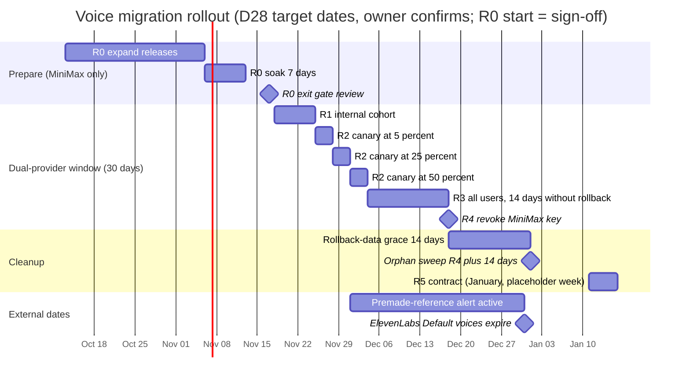
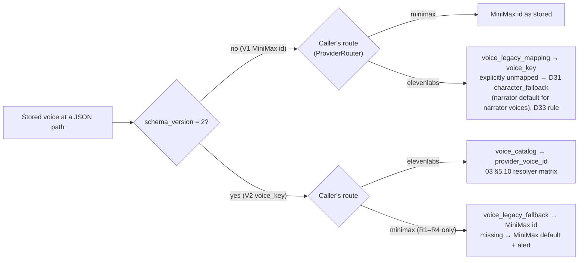
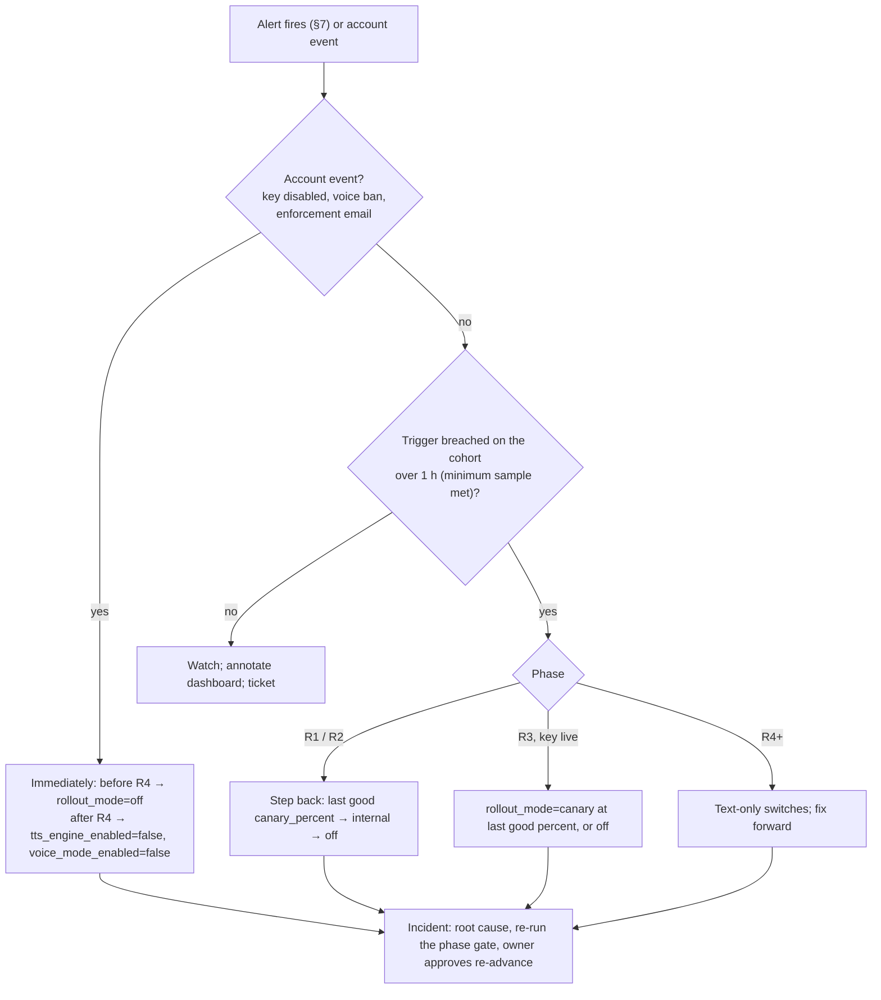

# 10 — Data migration and rollout

- **Date:** 2026-10-12
- **Status:** Proposed (see [03](03_target_architecture_and_decisions.md) for sign-off status)
- **Plan role:** the DATA and ROLL plans named in [03 "How to read"](03_target_architecture_and_decisions.md#how-to-read-this-document)

## Scope

This plan covers how voice data moves from MiniMax to ElevenLabs and how traffic follows it. For every place a voice is stored it says what happens in each phase. It also covers:
- the read-only production inventory taken before anything changes;
- how `voice_legacy_mapping` and its reverse `voice_legacy_fallback` are curated and gated;
- the dated R0 → R5 rollout behind the DB-backed cohort router, with its spike and legal gates;
- what can be rolled back at each phase;
- what is monitored, and which alerts mean "roll back";
- what users are told;
- what is deleted at the end;
- one runbook checklist per phase.

It implements D12, D15, D21, D22, D23, D28, D31, D32 and D36, and touches D05, D09, D19, D24–D26, D33–D35, D37 and D38. The decisions themselves are fixed in [03](03_target_architecture_and_decisions.md) and are not re-decided here. Canonical DDL, enums and tables are copied from 03 §5. Where 03 leaves a detail to DATA or ROLL, this plan fills it in and marks it **(plan)**. Those details can change without changing 03. All dates are the D28 targets, and the owner still has to confirm them. Prices and provider facts are as of 2026-10-12.

**Related:** [README](README.md) · [01 current state](01_current_state.md) · [03 decisions (source of truth)](03_target_architecture_and_decisions.md) · [04 catalog](04_voice_catalog_and_library.md) · [05 Studio and console](05_voice_studio_and_admin_console.md) · [06 narration](06_chat_narration_migration.md) · [07 calls](07_realtime_calls_migration.md) · [08 backend plan](08_backend_refactor_plan.md) · [09 frontend plan](09_frontend_refactor_plan.md) · [11 cost and operations](11_cost_plans_and_operations.md) · [13 policy and privacy](13_policy_privacy_and_compliance.md) · [14 spikes and contract tests](14_staging_spike_and_contract_tests.md) · [15 implementation plan](15_implementation_plan_and_acceptance.md) · [16 risks](16_risks_and_open_questions.md) · research [08](research/08_voice_data_model_migration_surface.md), [11](research/11_gap_catalog_api_semantics.md), [13](research/13_gap_codebase_checks.md)

---

## 1. Summary

| Principle | Rule | Decision |
|---|---|---|
| Expand before anything else | Readers for both voice shapes, widened validators (03 §5.14), new tables and the mapping all ship in R0, while every user is still on MiniMax. | D28, D11 |
| Every DDL step is lockstep with its build | The BFF refuses to start unless the live schema matches its contract exactly: no unexpected or missing table, the same columns in the same order, the expected seeds and the exact `CONTENT_SCHEMA_REVISION` ([bootstrap.py:1662](/home/andres/PycharmProjects/magic-worlds-api/src/database/mysql/bootstrap.py), `:1717`, `:1794`). "Additive" DDL is therefore **not** tolerated by an older build. Each expand or contract script runs immediately before the build that expects it, and each R0 step ships with a reverse script. | D28; [research 13 §4.4](research/13_gap_codebase_checks.md) |
| Snapshots are never rewritten by the system | Frozen `template_snapshot` voices are translated at read time. Only the user changes them, at the paths they touch. | D21, D36 |
| Live documents are rewritten once, at R5 | Cards, drafts, versions, template casts and presets are rewritten with 100% coverage: mapped, or language default + review flag. | D21, D12 |
| Routing is per user and DB-backed | `voice_runtime_setting.rollout_mode ∈ {off, internal, canary, all}` is read with a TTL ≤ 60 s. Narration picks the provider per job; calls pick it at `start_call`. | D28 |
| Rollback is route-only | No data is reverted. From R1 on, no build older than R0 is deployed. V2 voices written during the window are read by MiniMax through the reverse mapping. After R4, rollback means text-only. | D28, D21 |
| Coverage gates every step | Mapping coverage is re-run before R1, before each canary step, at R3 and before R5. Any gap blocks that step. | D21 |
| History stays truthful | `tts_job`, `tts_asset`, `voice_session`, transcripts and execution records are never rewritten. Their validators are widened instead. | D23 |



Calendar notes **(plan)**:
- 2026-11-28, the 25% step, is the Saturday of US Thanksgiving weekend. The step is a console change (no deploy), but on-call cover must be confirmed. Otherwise the owner shifts R2 by whole days.
- R3 (2026-12-04) and R4 (2026-12-18) fall on Fridays. Moving R4 later would push the dual window past 30 days (D28). So R4 runs on Friday morning, with on-call through the weekend.
- 2027-01-01 is the earliest allowed sweep date. Running it on the next working day (2027-01-04) is fine.

### 1.1 Phase-state matrix

| Item | R0 Prepare | R1 Internal | R2 Canary | R3 100% | R4 Revoke (+14 d sweep) | R5 Contract |
|---|---|---|---|---|---|---|
| Target date (D28) | 2026-11-06 | 2026-11-18 | 2026-11-25 → 2026-12-04 | 2026-12-04 | 2026-12-18 (sweep 2027-01-01) | January 2027 |
| `rollout_mode` / `canary_percent` | `off` / 0 | `internal` / 0 | `canary` / 5 → 25 → 50 | `all` | `all` (`off` no longer accepted) | `all` |
| Who hears ElevenLabs | nobody (staging only) | `user_type ∈ {root, admin}` + allow-list | internal + `bucket(user_hash) < canary_percent` | everyone | everyone | everyone |
| `MINIMAX_AUDIO_API_KEY` | live | live | live | live (rollback only) | **revoked** | — |
| `voice_legacy_mapping` | curated to 100% | read-time translation | same | same | same | drives the one-shot rewrite; kept permanently |
| `voice_legacy_fallback` | built, 100% of published voices | live | live | live (rollback only) | **dropped** | — |
| MiniMax picker | restricted to approved mapped ids | non-cohort users only | non-cohort users only | unused | removed | — |
| V1 writes (D32, 03 §5.10) | unchanged; mapped pick | unchanged; mapped pick by non-cohort | same | unchanged only | unchanged only | byte-identical only |
| Live documents (cards, drafts, versions, template casts, presets) | V1 | V1, plus V2 where cohort users change a voice | same | same | same | **rewritten to V2, 100%** |
| Session snapshots | V1 | read-time translation; V2 only at user-changed paths | same | same | same | same (never system-rewritten) |
| Effective-voice projection (D35) | off | on | on | on | on | on |
| Review flags (D15) | — | cohort owners | + owners newly included at each step | everyone | no new flags | + `needs_review` for defaulted voices |
| Consent at call start (D25) | `voice-v1` | per route: `voice-v1` (MiniMax), `voice-v2` (ElevenLabs) | same | `voice-v2` (`voice-v1` only after a rollback) | `voice-v2` only | `voice-v2` |
| Privacy page | MiniMax | both providers (global page) | both, published for all users (R2 entry gate) | both | ElevenLabs only | ElevenLabs only |
| MiniMax global presets (D22) | visible | visible | visible | hidden (reversible) | hidden | deleted |

---

## 2. Pre-migration production inventory

None of the research counts were run ([research 09 G6](research/09_research_critic_gaps.md); [research 08 §18](research/08_voice_data_model_migration_surface.md)). The numbers below set the curation effort, which custom voices need operator answers, how many users see a notice, and the R5 batch sizes. D21 makes 08 §18 queries #1, #7–#11, #13, #18 and #23 mandatory. This plan also requires the queries marked **gate** or **sizing** below.

### 2.1 How to run it

- Run on a **read replica** only, with a read-only DB user. Never run on the primary: several queries are full `JSON_TABLE` scans.
- Prefix each session with `SET SESSION MAX_EXECUTION_TIME = 600000;` (applies to `SELECT` only), and run off-peak.
- Store the outputs in the ROLL log with the run timestamp and the replica lag at that time. The outputs contain voice ids and counts only: no story text, no emails. The owner-count queries (Q-A5) return counts, never user lists.
- Run times: **T0** (as soon as R0 work starts, to size curation); **R0 exit**; **before R1**; **before each canary step**; **R3**; **before R5** (D21). From T0 on, Q-A1 and the coverage query C-1 (§3.4) are the ones that gate.
- MySQL 8.0 syntax, copied from research 08 §18. `->`/`->>` are `JSON_EXTRACT`/`JSON_UNQUOTE(JSON_EXTRACT())`. A wildcard path returns an array of every match. If a comparison between `->>` output and a `utf8mb4_bin` column raises a collation error, add `COLLATE utf8mb4_bin` (research 08 §18 note). None of these were run while writing this plan, so validate each on the replica first.
- After the R0 DDL, V2 objects exist, and they have **no** `voice_id` key. Every `$**.voice_id` query below therefore counts **V1 only**, which is exactly what the coverage gates need. For `voice_preset`, add `WHERE schema_version = 1` once the column exists.

### 2.2 Queries copied from research 08 §18 (row numbers kept)

```sql
-- #1 Character cards with a voice, by role (persona rows are excluded from gates, D38)
SELECT props->>'$.role' AS role, COUNT(*) AS cards, COUNT(DISTINCT props->>'$.voice.voice_id') AS ids FROM tb_card_body WHERE card_type='character' AND JSON_TYPE(props->'$.voice')='OBJECT' GROUP BY role;

-- #2 Adventure-template cast copies
SELECT COUNT(*) FROM tb_card_body b, JSON_TABLE(JSON_EXTRACT(b.props,'$**.voice_id'),'$[*]' COLUMNS(vid VARCHAR(256) PATH '$')) jt WHERE b.card_type='adventure_template';

-- #3 Drafts
SELECT COUNT(*) FROM tb_card_draft WHERE card_type='character' AND JSON_TYPE(props->'$.voice')='OBJECT';

-- #4 Version history
SELECT COUNT(*) FROM tb_card_version WHERE card_type='character' AND JSON_TYPE(props->'$.voice')='OBJECT';

-- #5 Public vs private voiced cards (propagation)
SELECT c.card_public, COUNT(*) FROM tb_card c JOIN tb_card_body b ON b.card_id=c.card_id WHERE b.card_type='character' AND JSON_TYPE(b.props->'$.voice')='OBJECT' GROUP BY c.card_public;

-- #6 Dangling preset links
SELECT COUNT(*) FROM tb_card_body b LEFT JOIN voice_preset p ON p.preset_id=(b.props->>'$.voice.preset_id') WHERE b.card_type='character' AND JSON_TYPE(b.props->'$.voice.preset_id')='STRING' AND p.preset_id IS NULL;

-- #7 Adventure snapshots
SELECT COUNT(*) AS sessions, SUM(JSON_LENGTH(JSON_EXTRACT(template_snapshot,'$**.voice_id'))) AS refs, SUM(JSON_TYPE(template_snapshot->'$.narrator_voice')='OBJECT') AS narrators, SUM(active_stream_id IS NOT NULL) AS active FROM adventure_session WHERE conversation_kind='adventure' AND JSON_EXTRACT(template_snapshot,'$**.voice_id') IS NOT NULL;

-- #8 1:1 character-chat snapshots (#7 with conversation_kind='character', narrators dropped)
SELECT COUNT(*) AS sessions, SUM(JSON_LENGTH(JSON_EXTRACT(template_snapshot,'$**.voice_id'))) AS refs, SUM(active_stream_id IS NOT NULL) AS active FROM adventure_session WHERE conversation_kind='character' AND JSON_EXTRACT(template_snapshot,'$**.voice_id') IS NOT NULL;

-- #9 Group-chat snapshots
SELECT COUNT(*) AS sessions, SUM(JSON_LENGTH(JSON_EXTRACT(template_snapshot,'$**.voice_id'))) AS refs, SUM(active_stream_id IS NOT NULL) AS active FROM adventure_session WHERE conversation_kind='character_group' AND JSON_EXTRACT(template_snapshot,'$**.voice_id') IS NOT NULL;

-- #10 Legacy voice-id inventory (input to curation; see Q-A1 for the per-location version)
SELECT vid, COUNT(*) n FROM (SELECT jt.vid FROM tb_card_body b, JSON_TABLE(JSON_EXTRACT(b.props,'$**.voice_id'),'$[*]' COLUMNS(vid VARCHAR(256) PATH '$')) jt UNION ALL SELECT jt.vid FROM adventure_session s, JSON_TABLE(JSON_EXTRACT(s.template_snapshot,'$**.voice_id'),'$[*]' COLUMNS(vid VARCHAR(256) PATH '$')) jt UNION ALL SELECT base_voice_id FROM voice_preset) x GROUP BY vid ORDER BY n DESC;

-- #11 Presets: recipe-field usage and global rows
SELECT is_global, COUNT(*) presets, COUNT(DISTINCT base_voice_id) voices, SUM(pitch<>0) pitch_used, SUM(ABS(volume-1)>0.001) vol_used, SUM(speed<0.7 OR speed>1.2) speed_clamped, SUM(emotion IS NOT NULL) emotion_used, SUM(COALESCE(language_boost,'auto')<>'auto') lang_used FROM voice_preset GROUP BY is_global;

-- #13 TTS jobs by provider/model/status, and in-flight jobs
SELECT source, provider, model_alias, status, COUNT(*) FROM tts_job GROUP BY source, provider, model_alias, status;
SELECT COUNT(*) FROM tts_job WHERE status IN ('pending','in_progress','synthesizing','mirroring');

-- #14 Stored audio and orphans (adventure deleted)
SELECT j.source, COUNT(*) assets, ROUND(SUM(a.file_size_bytes)/1048576) mib, MIN(a.created_at), MAX(a.created_at) FROM tts_asset a JOIN tts_job j ON j.job_id=a.job_id WHERE a.deleted_at IS NULL GROUP BY j.source;
SELECT COUNT(*) FROM tts_asset a JOIN tts_job j ON j.job_id=a.job_id LEFT JOIN adventure_session s ON s.adventure_id=j.adventure_id WHERE a.deleted_at IS NULL AND s.adventure_id IS NULL;

-- #15 Narrated assistant messages
SELECT COUNT(*) FROM adventure_message WHERE role='assistant' AND JSON_CONTAINS_PATH(metadata,'one','$.tts_segments');

-- #16 Call-turn messages pinned to the MiniMax streaming literal
SELECT COUNT(*) FROM adventure_message WHERE metadata->>'$.voice.tts_provider'='minimax_streaming';

-- #17 Stored spoken text with MiniMax pause markers
SELECT COUNT(*) FROM voice_transcript_segment WHERE role='assistant' AND transcript_text REGEXP '<#[0-9]+(\\.[0-9]+)?#>';
SELECT COUNT(*) FROM adventure_message WHERE metadata->>'$.conversation_mode'='voice_call' AND content REGEXP '<#[0-9]+(\\.[0-9]+)?#>';

-- #18 Voice sessions by provider and status
SELECT tts_provider, status, COUNT(*) FROM voice_session GROUP BY tts_provider, status;

-- #19 Call transcript TTS provenance
SELECT COUNT(*), COUNT(DISTINCT tts_summary->>'$.voice_id') FROM voice_transcript_segment WHERE role='assistant' AND tts_summary->>'$.asset_id' IS NOT NULL;

-- #20 Callbot execution records
SELECT COUNT(*) FROM tb_llm_execution_plan WHERE feature_key='callbot';

-- #21 Replay snapshots carrying voices (expected ~0)
SELECT 'gen', COUNT(*) FROM tb_llm_card_generation WHERE JSON_EXTRACT(output_snapshot,'$**.voice_id') IS NOT NULL UNION ALL SELECT 'assist', COUNT(*) FROM tb_llm_assistant_turn WHERE JSON_EXTRACT(output_snapshot,'$**.voice_id') IS NOT NULL;

-- #22 Negative checks (expected 0)
SELECT (SELECT COUNT(*) FROM story_card_ref WHERE JSON_EXTRACT(snapshot,'$**.voice_id') IS NOT NULL) AS stories, (SELECT COUNT(*) FROM lorebook_attachment WHERE snapshot IS NOT NULL AND JSON_EXTRACT(snapshot,'$**.voice_id') IS NOT NULL) AS lore;

-- #23 Active voice consents by version
SELECT consent_version, COUNT(*) FROM voice_consent WHERE revoked_at IS NULL GROUP BY consent_version;

-- #27 Drafts whose voice was erased by the card assistant (bug, D30)
SELECT COUNT(*) FROM tb_card_draft d JOIN tb_card_body b ON b.card_id=d.card_id WHERE d.card_type='character' AND JSON_TYPE(b.props->'$.voice')='OBJECT' AND JSON_TYPE(d.props->'$.voice')='NULL';

-- #28 Current narration/call limits
SELECT * FROM membership_plan_limit WHERE operation IN ('tts_generation','voice_call');

-- #30 Frozen session snapshots inside chat execution records
SELECT feature_key, status, COUNT(*) FROM tb_llm_execution_plan WHERE JSON_EXTRACT(frozen_payload,'$.agt.metadata.conversation_snapshot.template_snapshot**.voice_id') IS NOT NULL GROUP BY feature_key, status;

-- #32 Scope guard: fal-hosted theme songs stay (D01); a MiniMax cleanup must not touch them
SELECT provider, model_alias, COUNT(*) FROM theme_song_job GROUP BY provider, model_alias;
```

### 2.3 Queries added by this plan (plan)

```sql
-- Q-A1  Legacy ids per location: the curation worklist and the input to coverage gate C-1.
--       Defines the v1_refs set reused in §3.
SELECT loc, vid, COUNT(*) AS refs
FROM (
    SELECT CONCAT('card:', b.props->>'$.role') AS loc, b.props->>'$.voice.voice_id' AS vid
      FROM tb_card_body b
     WHERE b.card_type = 'character' AND JSON_TYPE(b.props->'$.voice.voice_id') = 'STRING'
    UNION ALL
    SELECT 'template_cast', jt.vid
      FROM tb_card_body b,
           JSON_TABLE(JSON_EXTRACT(b.props, '$**.voice_id'), '$[*]' COLUMNS (vid VARCHAR(256) PATH '$')) jt
     WHERE b.card_type = 'adventure_template'
    UNION ALL
    SELECT 'card_draft', d.props->>'$.voice.voice_id'
      FROM tb_card_draft d
     WHERE d.card_type = 'character' AND JSON_TYPE(d.props->'$.voice.voice_id') = 'STRING'
    UNION ALL
    SELECT 'card_version', v.props->>'$.voice.voice_id'
      FROM tb_card_version v
     WHERE v.card_type = 'character' AND JSON_TYPE(v.props->'$.voice.voice_id') = 'STRING'
    UNION ALL
    SELECT CONCAT('snapshot:', s.conversation_kind), jt.vid
      FROM adventure_session s,
           JSON_TABLE(JSON_EXTRACT(s.template_snapshot, '$**.voice_id'), '$[*]' COLUMNS (vid VARCHAR(256) PATH '$')) jt
    UNION ALL
    SELECT CONCAT('preset:', IF(p.is_global = 1, 'global', 'user')), p.base_voice_id
      FROM voice_preset p            -- after R0 DDL: WHERE p.schema_version = 1
) x
GROUP BY loc, vid
ORDER BY refs DESC;

-- Q-A2  D15 review-flag volume (thresholds |pitch| >= 3, vol outside [0.8, 1.25], speed outside 0.7–1.2).
--       Cards (JSON values; JSON null is excluded by the JSON_TYPE guards):
SELECT COUNT(*) AS voiced_cards,
       SUM(JSON_TYPE(props->'$.voice.pitch') = 'INTEGER'
           AND ABS(CAST(props->>'$.voice.pitch' AS SIGNED)) >= 3)                               AS pitch_flag,
       SUM(JSON_TYPE(props->'$.voice.vol') IN ('INTEGER','DOUBLE','DECIMAL')
           AND CAST(props->>'$.voice.vol' AS DECIMAL(6,3)) NOT BETWEEN 0.8 AND 1.25)             AS vol_flag,
       SUM(JSON_TYPE(props->'$.voice.speed') IN ('INTEGER','DOUBLE','DECIMAL')
           AND CAST(props->>'$.voice.speed' AS DECIMAL(6,3)) NOT BETWEEN 0.7 AND 1.2)            AS speed_flag
  FROM tb_card_body
 WHERE card_type = 'character' AND props->>'$.role' = 'character'
   AND JSON_TYPE(props->'$.voice.voice_id') = 'STRING';
--       Presets (FLOAT columns: round first, or 1.2 stored as 1.2000000477 is wrongly flagged):
SELECT is_global, COUNT(*) AS presets,
       SUM(ABS(pitch) >= 3)                                  AS pitch_flag,
       SUM(ROUND(volume, 3) NOT BETWEEN 0.8 AND 1.25)        AS vol_flag,
       SUM(ROUND(speed, 3)  NOT BETWEEN 0.7 AND 1.2)         AS speed_flag,
       SUM(ABS(pitch) >= 3 OR ROUND(volume, 3) NOT BETWEEN 0.8 AND 1.25
           OR ROUND(speed, 3) NOT BETWEEN 0.7 AND 1.2)        AS any_flag
  FROM voice_preset GROUP BY is_global;

-- Q-A3  language_boost distribution (D34 light languages, D17 step 2 seed)
SELECT lb, COUNT(*) AS refs FROM (
    SELECT jt.lb FROM tb_card_body b,
           JSON_TABLE(JSON_EXTRACT(b.props, '$**.language_boost'), '$[*]' COLUMNS (lb VARCHAR(64) PATH '$')) jt
    UNION ALL
    SELECT jt.lb FROM adventure_session s,
           JSON_TABLE(JSON_EXTRACT(s.template_snapshot, '$**.language_boost'), '$[*]' COLUMNS (lb VARCHAR(64) PATH '$')) jt
    UNION ALL
    SELECT language_boost FROM voice_preset
) x GROUP BY lb ORDER BY refs DESC;

-- Q-A4  Co-occurring legacy ids in one snapshot (D33 alternates). Counts persona and codex voices too;
--       treat it as a curation signal, not an exact speaker count.
SELECT a.vid AS vid_a, b.vid AS vid_b, COUNT(DISTINCT s.adventure_id) AS sessions
  FROM adventure_session s,
       JSON_TABLE(JSON_EXTRACT(s.template_snapshot, '$**.voice_id'), '$[*]' COLUMNS (vid VARCHAR(256) PATH '$')) a,
       JSON_TABLE(JSON_EXTRACT(s.template_snapshot, '$**.voice_id'), '$[*]' COLUMNS (vid VARCHAR(256) PATH '$')) b
 WHERE a.vid < b.vid
 GROUP BY a.vid, b.vid
 ORDER BY sessions DESC
 LIMIT 500;

-- Q-A5  Owners who will see a review flag or "voice changed" notice (communication sizing; counts only)
SELECT COUNT(DISTINCT c.user_id) AS card_owners
  FROM tb_card c JOIN tb_card_body b ON b.card_id = c.card_id
 WHERE b.card_type = 'character' AND b.props->>'$.role' = 'character'
   AND JSON_TYPE(b.props->'$.voice.voice_id') = 'STRING';
SELECT COUNT(DISTINCT user_id) AS preset_owners FROM voice_preset WHERE is_global = 0;

-- Q-A6  Plans that need the lockstep membership rows (voice_preview, daily_quantity_limit), custom plans included
SELECT p.plan_code, COUNT(l.operation) AS ops
  FROM membership_plan p LEFT JOIN membership_plan_limit l ON l.plan_code = p.plan_code
 GROUP BY p.plan_code;
```

Inventory that is **not SQL**:
- **MiniMax custom voices** (D22): `GET /admin/voices?voice_type=voice_cloning` and `?voice_type=voice_generation`, through the root inventory ([admin_voices.py:166-179](/home/andres/PycharmProjects/magic-worlds-api/src/routes/admin_voices.py)), exported before R1. Q-A1 ids that appear in these lists are custom voices.
- **MiniMax system catalog** (`?voice_type=system`): needed to check that every reverse-mapping id (§3.5) is a live MiniMax system voice.
- **Env defaults**: record the current `TTS_DEFAULT_VOICE_ID` and `VOICE_MINIMAX_TTS_VOICE_ID` values by name and id only. Today they are the fallbacks for voiceless MiniMax narration ([tts_generation/config.py:205-208](/home/andres/PycharmProjects/magic-worlds-api/src/services/tts_generation/config.py)) and calls ([voice_orchestration/engine.py:512-515](/home/andres/PycharmProjects/magic-worlds-api/src/services/voice_orchestration/engine.py)).
- **ElevenLabs production account facts** (S-1): read-only `GET /v1/user`, `/v1/user/subscription`, `/v2/voices?voice_type=default|personal`, `/v1/workspace/webhooks` ([research 11 §9](research/11_gap_catalog_api_semantics.md)).

### 2.4 What each answer changes

| Query | Answer drives | If the number is large or surprising |
|---|---|---|
| #1 | R5 rewrite size for live cards; persona count (excluded from gates, D38) | Large `persona` share: no work, hidden picker (D38). Many distinct ids: more curation time (§3) |
| #2, #3, #4 | R5 batch sizes and duration for template casts, drafts and versions | Versions dominate: run them in their own batch window, with audit only and no flags (§4.4) |
| #5 | Curation priority: ids on public cards spread into importers' libraries | Curate public-card ids first. They also drive the shared-card substitution metric (§7) |
| #6 | Optional hygiene (display-only `preset_id`) | No gate. Leave dangling ids alone |
| #7–#9 | Read-time translation load; how many sessions could show "Voice replaced" if an id stays unmapped; resolver cast-cache sizing (D33) | High `refs` per session: check Q-A4 collisions first |
| #10 / Q-A1 | **Curation worklist** (§3.2) and the R0-exit coverage gate | Long tail of ids with ≤ 2 refs: curate by MiniMax archetype family, but every id still needs an `approved` row |
| #11 / Q-A2 | D15 flag and notice volume; `is_global=1` count, which is the D22 global-preset re-seed scope | Zero global rows (likely, [research 13 §3](research/13_gap_codebase_checks.md)): nothing to hide or delete at R3/R5 |
| #13 | Provider/model baseline; in-flight jobs to terminalize before R4 | Non-zero in-flight jobs at R4: run the global stale sweep first (§10.6) |
| #14 | Disk use and orphan count, which size the D23 sweep | Large orphan share: schedule the sweep in batches |
| #15 | How many narrated messages keep MiniMax clips (kept playable) | — |
| #16, #17 | Legacy call markers to strip at display time (D23, D27) | — |
| #18 | Call-history rows that rely on the widened `tts_provider` validator ([models.py:5343-5353](/home/andres/PycharmProjects/magic-worlds-api/src/database/mysql/models.py)) | Must be readable after R0. At R4, the `active`/`starting`/`ending` MiniMax count must be 0 |
| #19, #20, #21, #22 | Read-only provenance and negative checks | #21 or #22 > 0: extend the V1 readers to those snapshots before R0 exit |
| #23 | Users who will be re-prompted for `voice-v2` consent (D25) | — |
| #27 | Urgency of the card-assistant voice-erasure fix (D30, before R5) | > 0: fix in R0, and restore voices from `tb_card_body` where the draft lost it (owner-visible change, reviewed) |
| #28, Q-A6 | Lockstep migration rows for `voice_preview` and `daily_quantity_limit` for **every** plan ([research 13 §4.4](research/13_gap_codebase_checks.md)) | A missing custom plan aborts startup of the new build |
| #30 | Pre-migration failed or cancelled turns: only matter if the D36 R0 test (voices excluded from retry byte-equality) cannot pass | Large number: prepare the 409 explanation copy (D36 fallback) |
| Q-A3 | Fallback source for `legacy_language` per mapping row (§3.2 step 1). The D34 light-language list is the union of fr/de/pt/it, every `legacy_language` of a referenced id (Q-A1) and every language with ≥ 1% of narrated segments in R0 telemetry | Languages outside en/es/fr/de/pt/it: add light acceptance for them before R0 exit |
| Q-A4 | `alternate_voice_keys` needs (D33) | Pairs that co-occur often and map to one target need alternates **before** R0 exit |
| Q-A5 | Communication volume (§8) and support staffing | — |
| #32 | Proves the cleanup scope excludes fal theme songs | Any grep or delete that matches `minimax_music_3` is a bug |

---

## 3. Legacy mapping and reverse mapping

### 3.1 Canonical tables (copied from 03 §5.2)

```sql
-- Legacy MiniMax id -> catalog voice (read-time translation; curated by audition).
create table voice_legacy_mapping (
    legacy_provider     varchar(32)  character set utf8mb4 collate utf8mb4_bin not null,  -- 'minimax'
    legacy_voice_id     varchar(256) character set utf8mb4 collate utf8mb4_bin not null,
    voice_key           varchar(64)  character set utf8mb4 collate utf8mb4_bin null,      -- null = explicitly unmapped
    alternate_voice_keys json null,                                                        -- ordered candidates for the D33 distinct-voice rule
    settings_override   json null,                                                         -- VoiceSettingsV2 shape
    legacy_language     varchar(8)   character set utf8mb4 collate utf8mb4_bin null,      -- language of the MiniMax voice (D34, R5 default choice)
    status              varchar(16)  character set utf8mb4 collate utf8mb4_bin not null,  -- proposed|approved|retired
    reviewed_by_user_id int null,
    reviewed_at         datetime null,
    notes               text null,
    primary key (legacy_provider, legacy_voice_id)
) engine = InnoDB default character set = utf8mb4 collate = utf8mb4_0900_ai_ci;

-- Reverse mapping for non-cohort playback and rollback (D21, D28). Dropped after R4.
create table voice_legacy_fallback (
    voice_key        varchar(64)  character set utf8mb4 collate utf8mb4_bin primary key,
    legacy_provider  varchar(32)  character set utf8mb4 collate utf8mb4_bin not null,  -- 'minimax'
    legacy_voice_id  varchar(256) character set utf8mb4 collate utf8mb4_bin not null,
    source           varchar(16)  character set utf8mb4 collate utf8mb4_bin not null,  -- derived|curated
    updated_at       datetime default CURRENT_TIMESTAMP not null on update CURRENT_TIMESTAMP
) engine = InnoDB default character set = utf8mb4 collate = utf8mb4_0900_ai_ci;
```

The mechanism during the dual-provider window:



### 3.2 Curation process (who, how)

| Role **(plan)** | Who | Does |
|---|---|---|
| DATA engineer | backend engineer with replica access | Runs §2 queries. Loads Q-A1 ids into `voice_legacy_mapping` as `proposed` rows with `legacy_language` pre-filled. Publishes the coverage report (§3.4) |
| Curator | root operator with listening judgement | Auditions in the console **Legacy mapping** module (D20) and proposes `voice_key`, `settings_override` and alternates |
| Approver | a second root user (four-eyes: approver ≠ proposer) | Sets `status = approved`, `reviewed_by_user_id`, `reviewed_at` |
| Product owner | owner | Signs off explicit-unmapped rows and every custom-voice outcome (D22) |
| LEGAL | counsel | Required only when a custom voice is re-created as IVC (D20 consent record) |

Steps:
1. **Seed.** One `proposed` row per distinct Q-A1 id, plus every MiniMax **system** voice the owner wants to keep in the restricted picker during R0–R2. `legacy_language` comes from the MiniMax id prefix (`English_…`, `Spanish_…`, `Chinese (Mandarin)_…`), else from the dominant `language_boost` of its references (Q-A3, using the research 08 §13 name → ISO 639-1 table), else `en`.
2. **Classify.** Mark each id as `system`, `custom` (it appears in the custom inventory, §2.3) or `non_en_es`. Record the class in `notes`.
3. **Candidates.** The console lists published or publishable catalog voices for that language, gender and age bucket, ranked by `sort_rank`. Language comes from `voice_catalog_language`; gender and age come from the MiniMax name. For non-en/es ids: multilingual targets that passed light acceptance in that language, else the closest en/es voice by gender and age (D34).
4. **Audition.** Play a MiniMax sample of the legacy id against the candidate's own sample. While the MiniMax key is live, the existing root test path renders MiniMax samples. Pick the target and the `settings_override` (VoiceSettingsV2 ranges, D13). For legacy voices used mainly by strongly pitched presets, set the override D15 allows (for example a deeper target).
5. **Alternates (D33).** For every target that receives two or more legacy ids which co-occur (Q-A4, then C-3 below), store ≥ 2 ordered `alternate_voice_keys` with the same language and, where possible, the same gender and age.
6. **Approve.** The second reviewer listens to at least the top 50 ids by reference count, plus every custom-voice row, and approves.
7. **Report.** The coverage report (§3.4) goes into the ROLL log. Any gap blocks the next phase step.

**Acceptance criteria for an `approved` row (plan):**
- `voice_key` points at a voice that is `status = active`, `call_eligible = 1`, has an own sample, and is never `premade_deprecated` (D09). Language fit: for an en/es `legacy_language`, accepted on `eleven_flash_v2_5` **and** `eleven_v4` in that language; for any other language, a multilingual voice that passed light acceptance in it, else the closest en/es voice by gender and age (D34).
- `settings_override` validates as VoiceSettingsV2 (speed 0.7–1.2).
- `legacy_language` is set, lower-case ISO 639-1.
- Alternates are present when C-3 shows a collision.
- An explicitly unmapped row (`voice_key IS NULL`) is allowed only for retired custom voices with no usable audition (D22). It needs a `notes` reason and owner sign-off. At R5 it becomes the D31 language default plus a `needs_review` flag (D21).
- The primary key `(legacy_provider, legacy_voice_id)` allows one row per legacy id. Re-pointing a referenced id therefore updates `voice_key`, `alternate_voice_keys` and `settings_override` **in place** and re-records `reviewed_by_user_id` and `reviewed_at` (four-eyes again); the row stays `approved`. `retired` is only for ids with zero references in the latest Q-A1 run. Coverage is measured on `approved` rows only.
- Ids referenced only from persona paths are excluded from the gates (D38), but C-1's snapshot branch uses `$**` and cannot tell persona paths apart. Close such ids with an ordinary `approved` mapping, chosen without the full audition (nobody hears them, D38). This is a stricter-than-required side effect, not a gate change.

### 3.3 Picker restriction and new references

From R0 the MiniMax picker offers **only** legacy ids with an `approved` row and a non-null `voice_key`. V1 writes by non-cohort users must carry such an id (D21, D32). Coverage of "ids the restricted picker offers" is therefore 100% by construction. Unmapped references can only be old ones. The restriction can switch on as soon as all T0-referenced ids and the kept system voices are approved. It must be on by **R0 exit** at the latest. Until then, the coverage re-runs catch any new id.

### 3.4 Coverage gates and metrics

| Gate / metric | Query | Target | Checked at |
|---|---|---|---|
| **C-1 Mapping coverage** (gate) | below | 0 rows: every referenced V1 id (persona cards excluded, D38) has an `approved` row | R0 exit, before R1, before each canary step, R3, before R5 (D21) |
| **C-2 Reverse coverage** (gate) | below | 0 published voices without a `voice_legacy_fallback` row | R0 exit (03 §6.3), R1 entry (D21), then before each canary step and whenever a voice is published during R1–R4 **(plan)** |
| **C-3 Cast collisions** (curation) | below | every target with co-occurring legacy ids has alternates | R0 exit (D33) |
| **C-4 Legacy ids per target** (metric, D09) | below | reported; no fixed threshold | every coverage run |
| **C-5 Defaults present** (gate) | below | `en`, `es`: narrator rank 1 + ≥ 4 `character_fallback`; each light language: narrator (03 §5.11) | R0 exit; before R5 |
| **Mapped share** (metric, plan) | C-1 variant: share of *references* whose approved row has a non-null `voice_key` | ≥ 99% recommended (explicit-unmapped is rare) | every run |

```sql
-- C-1  Referenced legacy ids with no approved mapping row (gate: 0 rows)
WITH v1_refs AS ( /* inner UNION of Q-A1, without the 'card:persona' branch */ )
SELECT r.vid, COUNT(*) AS refs
  FROM v1_refs r
  LEFT JOIN voice_legacy_mapping m
         ON m.legacy_provider = 'minimax'
        AND m.legacy_voice_id = r.vid COLLATE utf8mb4_bin
        AND m.status = 'approved'
 WHERE m.legacy_voice_id IS NULL
 GROUP BY r.vid ORDER BY refs DESC;

-- C-2  Published voices without a reverse entry (gate: 0 rows)
SELECT c.voice_key, c.display_name
  FROM voice_catalog c
  LEFT JOIN voice_legacy_fallback f ON f.voice_key = c.voice_key
 WHERE c.status = 'active' AND c.visibility IN ('public', 'plan_gated') AND f.voice_key IS NULL;
-- (plan) also report active voices referenced in voice_reference (root-assigned admin voices) without a reverse entry.

-- C-3  Distinct legacy ids that co-occur in one snapshot and map to the same target (D33)
WITH pairs AS (
    SELECT s.adventure_id, a.vid AS vid_a, b.vid AS vid_b
      FROM adventure_session s,
           JSON_TABLE(JSON_EXTRACT(s.template_snapshot, '$**.voice_id'), '$[*]' COLUMNS (vid VARCHAR(256) PATH '$')) a,
           JSON_TABLE(JSON_EXTRACT(s.template_snapshot, '$**.voice_id'), '$[*]' COLUMNS (vid VARCHAR(256) PATH '$')) b
     WHERE a.vid < b.vid
)
SELECT ma.voice_key,
       COUNT(DISTINCT p.adventure_id)                       AS sessions_with_collision,
       JSON_LENGTH(COALESCE(ma.alternate_voice_keys, '[]')) AS alternates
  FROM pairs p
  JOIN voice_legacy_mapping ma ON ma.legacy_provider = 'minimax' AND ma.status = 'approved'
                              AND ma.legacy_voice_id = p.vid_a COLLATE utf8mb4_bin
  JOIN voice_legacy_mapping mb ON mb.legacy_provider = 'minimax' AND mb.status = 'approved'
                              AND mb.legacy_voice_id = p.vid_b COLLATE utf8mb4_bin
 WHERE ma.voice_key = mb.voice_key
 GROUP BY ma.voice_key, ma.alternate_voice_keys
 ORDER BY sessions_with_collision DESC;

-- C-4  Legacy ids per target voice
SELECT voice_key, COUNT(*) AS legacy_ids
  FROM voice_legacy_mapping
 WHERE legacy_provider = 'minimax' AND status = 'approved' AND voice_key IS NOT NULL
 GROUP BY voice_key ORDER BY legacy_ids DESC;

-- C-5  Default rows per language (eligibility itself is enforced by the console and the readiness probe, D04)
SELECT l.language,
       SUM(d.role = 'narrator' AND d.`rank` = 1) AS narrator,
       SUM(d.role = 'character_fallback')         AS fallback_pool
  FROM (SELECT 'en' AS language UNION ALL SELECT 'es') l   -- add each D34 light language
  LEFT JOIN voice_default d ON d.language = l.language
 GROUP BY l.language;
```

### 3.5 Building `voice_legacy_fallback` (reverse mapping)

Rule (D21): for every published voice, use the **most-referenced approved legacy id mapped to it** (`source = derived`). If no legacy id maps to it, root picks a MiniMax system voice of the same language, gender and age (`source = curated`).

Additional constraints **(plan)**:
- The reverse id must be a **live MiniMax system voice** (in the `?voice_type=system` export). Never use a retired custom voice (D22): MiniMax may have deleted it, and its references are being retired anyway.
- `curated` rows are never overwritten by the derived refresh.
- During R1–R4, publishing a new voice requires a reverse row in the same console action. Otherwise C-2 fails and the shared-card substitution metric rises.

```sql
-- Derived candidates: most-referenced approved legacy id per target (review, then upsert where source <> 'curated')
WITH v1_refs AS ( /* inner UNION of Q-A1 */ ),
counted AS (
    SELECT m.voice_key, m.legacy_voice_id, COUNT(*) AS n
      FROM voice_legacy_mapping m
      JOIN v1_refs r ON r.vid COLLATE utf8mb4_bin = m.legacy_voice_id
     WHERE m.legacy_provider = 'minimax' AND m.status = 'approved' AND m.voice_key IS NOT NULL
     GROUP BY m.voice_key, m.legacy_voice_id
),
ranked AS (
    SELECT voice_key, legacy_voice_id, n,
           ROW_NUMBER() OVER (PARTITION BY voice_key ORDER BY n DESC, legacy_voice_id) AS rn
      FROM counted
)
SELECT voice_key, legacy_voice_id, n FROM ranked WHERE rn = 1;
```

Lifecycle: created in R0 and filled by R0 exit (03 §6.3), re-checked at R1 entry (gate C-2, D21). Read only by the MiniMax route. Dropped at R4 in lockstep with the R4 build (§9.1).

### 3.6 MiniMax custom voices and global presets (D22)

| Item | Action | When |
|---|---|---|
| Custom voice list | Export `voice_cloning` and `voice_generation` from the root inventory. Cross-reference with Q-A1 for reference counts | before R1 (D22) |
| Per voice: operator question | "Do you hold the original recordings off-platform, **and** can you obtain fresh consent naming ElevenLabs?" No source audio, prompt or consent was ever stored ([research 13 §2](research/13_gap_codebase_checks.md)) | before R0 exit |
| Yes to both | Root re-creates the voice as IVC through the D20 flow (consent record, `consent_record_id`), runs acceptance, publishes it, and maps the legacy id to it | R0–R2 |
| No | Audition-map to the closest catalog voice (default), or explicit-unmapped with owner sign-off (§3.2) | before R0 exit |
| Global presets count | Query #11 (`is_global = 1`) | T0 |
| Curated ElevenLabs global presets | Seed through `POST /admin/voice-presets/global`, for example one narrator and two archetypes per language (D22). Never auto-translate MiniMax global rows | before R3 |
| MiniMax global rows | **Hidden at R3** by a reversible flag. Shown again if the cohort is rolled back before R4. **Deleted at R5** (no user owns them) | R3 / R5 |

**(plan)** The hide flag needs no new column. The preset list can filter `is_global = 1 AND schema_version = 1` rows while `rollout_mode = all`, so routing back to `canary` or `off` shows them again automatically. BE confirms in [08](08_backend_refactor_plan.md). The list query today returns every global row to every user ([models.py:15096-15107](/home/andres/PycharmProjects/magic-worlds-api/src/database/mysql/models.py)).

---

## 4. Migration mechanics per storage location

### 4.1 Expand → migrate → switch → contract, mapped to phases

Here, live documents are migrated **after** the switch. Read-time translation and the effective-voice projection (D35) give users the new voice from R1 without rewriting data while rollback is still possible (until R4). This is why 03 rejected moving the rewrite to R3 (D35 review note).

| Stage | Phases | What changes in data |
|---|---|---|
| **Expand** | R0 | Additive DDL, each step run right before the build that expects it (§1: the startup schema check rejects unexpected tables and columns): new tables (03 §5.2), `voice_preset` v2 columns (03 §5.3), `tts_job` columns, `user_preferences.narration_tier`, `membership_plan_limit.daily_quantity_limit`, widened CHECKs and validators (03 §5.14), lockstep membership rows. Union readers in BE and FE. Mapping and reverse mapping curated. Defaults seeded |
| **Migrate (lazy)** | R1–R4 | No system rewrite of user data. Writes happen only where a user changes a voice (V2 at that path), plus `voice_review_flag` rows computed per cohort step |
| **Switch** | R1 → R3 route flips (DB setting, no deploy); R4 key revocation | Provider per job or call, persisted on `tts_job.provider` and `voice_session.tts_provider` |
| **Contract** | R4, R4 + 14 d, R5 | Drop `voice_legacy_fallback` (with the R4 build); remove MiniMax code; reviewed orphan sweep; **one-shot rewrite** of live documents; `voice_preset` contract DDL (with the R5 build) |

### 4.2 Script conventions (plan, following the repo's cutover precedents)

The repo already has reviewed, idempotent cutovers:
- [theme_song_cutover.py:1-25](/home/andres/PycharmProjects/magic-worlds-api/src/database/mysql/theme_song_cutover.py): review with exact counts and fingerprint; mark → remove file → delete row; timestamps kept, `REFERENCE_DOCUMENTS` at `:44-59`.
- [interrupted_turn_cutover.py](/home/andres/PycharmProjects/magic-worlds-api/src/database/mysql/interrupted_turn_cutover.py) with [20261010_interrupted_turns.py:46-51](/home/andres/PycharmProjects/magic-worlds-api/scripts/migrations/20261010_interrupted_turns.py): `--apply` requires `--review-file`.
- [20261012_image_profiles.py:1-5](/home/andres/PycharmProjects/magic-worlds-api/scripts/migrations/20261012_image_profiles.py): read-only check by default.

The voice scripts copy that pattern:

| Script (names indicative) | Phase | Does |
|---|---|---|
| `scripts/migrations/2026MMDD_voice_expand.py` + `voice_expand_cutover.py` | R0 | DDL expand (idempotent: checks `information_schema` before each `ALTER`). Advances `CONTENT_SCHEMA_REVISION` ([bootstrap.py:17](/home/andres/PycharmProjects/magic-worlds-api/src/database/mysql/bootstrap.py)) only after the DDL. New columns must land in the column order the new `db.sql` contract declares (the startup check compares order). Ships with a reverse script (drop the new tables and columns, restore the previous revision), valid only before any V2 value exists (R1) |
| `…_voice_membership_ops.py` | R0, **before** the new build boots | Inserts the `voice_preview` limit rows and `daily_quantity_limit` values for every plan, custom ones included. A one-way, lockstep change; the reverse migration exists only for a rollback before R1 ([research 13 §4.4](research/13_gap_codebase_checks.md)) |
| `…_voice_review_flags.py` | R1, each canary step, R3 | Computes D15 flags for the owners in scope. Upserts `voice_review_flag` without resurrecting dismissed flags |
| `…_voice_fallback_drop.py` | R4 | Drops `voice_legacy_fallback` and advances the revision, immediately before the R4 build boots (lockstep) |
| `…_voice_live_rewrite.py` + `voice_live_rewrite_cutover.py` | R5 | One-shot V1 → V2 rewrite of live documents (§4.4) |
| `…_voice_preset_contract.py` | R5, after the rewrite | Applies the 03 §5.3 R5 DDL only when `--check` reports 0 V1 presets, immediately before the R5 build boots (lockstep) |
| `…_tts_orphan_sweep.py` | R4 + 14 d | Reviewed orphan sweep (§9.2) |

Common rules:
- **Modes.** Default (or `--check`) is read-only: it prints exact counts per location and outcome, plus an identity fingerprint, as JSON. `--review-file <path>` preflights a reviewed copy of that output. `--apply` requires `--review-file` and refuses if the live counts or fingerprint changed.
- **Idempotent.** Already-V2 paths are skipped, so a rerun converges to "0 to change". An interrupted run is resumed by rerunning with the same review.
- **Batched** by primary key (≤ 500 rows per transaction), with `SELECT … FOR UPDATE` on the batch.
- **Timestamps kept.** `SET updated_at = updated_at` (or `adventure_last_update`). An explicit assignment suppresses `ON UPDATE CURRENT_TIMESTAMP`, so migration edits do not reorder lists or look like user edits (precedent comment at `theme_song_cutover.py:44-48`).
- **Audit.** One `voice_migration_audit` row per rewritten JSON path, with one `run_id` per run.
- **Safe errors.** Error output is the exception class only, as in the existing scripts.
- **Gates built in.** `--apply` refuses unless C-1 = 0, C-5 is green and every approved mapping target is resolvable (§4.5).

### 4.3 Per-location plan

| # | Location (paths) | Copy semantics | R0 (expand) | R1–R4 (window) | R5 (contract) | Audit / flags |
|---|---|---|---|---|---|---|
| L1 | `tb_card_body.props.$.voice`, `role = character` | live, editable | Union readers. FE whitelists keep both shapes ([cardTransforms.ts:57-72](/home/andres/WebstormProjects/magic-worlds/src/utils/cardTransforms.ts)). Unchanged voices pass on shape only (D32). MiniMax picker restricted | Read-time translation and `effective_voice`. Cohort user changes a voice → V2 at that path. Non-cohort user → V1 mapped id (until R3) | **Rewrite to V2, 100%** | audit per path; flag `ref_type = card` |
| L2 | same, `role = persona` | live | Picker hidden (D38) | kept and translated silently | rewritten by the same mapping | audit only; no flags or badges; excluded from gates (D38) |
| L3 | `tb_card_body` `adventure_template`: `$.persona.voice`, `$.characters[*].voice` | display copy; sessions re-resolve the live card | union readers | read-time translation | **rewrite** | audit; flag `ref_type = template_cast` |
| L4 | `tb_card_draft.props.$.voice` | live, owner-private | union readers; **card-assistant voice-erasure fix** (D30, needed before R5; recommended in R0) | as L1 | **rewrite** | audit; flag `ref_type = card_draft` |
| L5 | `tb_card_version.props.$.voice` | frozen history, restorable | union readers; a restore is a copy (shape-only, D32) | read-time translation on use | **rewrite** (D21) | audit only (no owner UI for versions) |
| L6 | `voice_preset` user rows | live (CRUD) | 03 §5.3 R0 DDL; `_from_row` parses v1 and v2 and skips (logs) one bad row instead of failing the list (D12) | A cohort user opening a V1 preset gets a **V2 draft** pre-filled from the mapping. Save converts in place (same `preset_id`); that is a voice change, so eligibility is checked (D12) | convert every remaining V1 row; then the contract DDL | `metadata.migration` + audit; flag `ref_type = preset` |
| L7 | `voice_preset` global rows | operator-owned, read-only | count (#11); seed curated ElevenLabs globals before R3 | visible until R3; hidden at R3 (reversible) | **deleted** | audit of deleted rows |
| L8 | `adventure_session.template_snapshot` (`adventure`): cast, persona, **`$.narrator_voice`** | frozen; user-editable via `PUT …/template-snapshot` ([route_adventure_session.py:1620-1672](/home/andres/PycharmProjects/magic-worlds-api/src/routes/user/route_adventure_session.py)) | union readers; retry byte-equality excludes voice paths (D36, 03 §5.14) | **Never rewritten by the system.** The narrator is changed through `PUT`, and cast entries through `POST /adventure-sessions/{id}/voices/refresh` (D36). Both write V2 at changed paths only; untouched entries keep V1 byte-for-byte | unchanged | — |
| L9 | `template_snapshot` (`character`): `$.character.voice`, `$.persona.voice`, codex paths | frozen; no edit route | same | **Never rewritten.** `POST /character-chats/{id}/voice/refresh` (D36). Calls read `snapshot.character.voice` ([route_voice_call.py:404-421](/home/andres/PycharmProjects/magic-worlds-api/src/routes/user/route_voice_call.py)) through the resolver | unchanged | — |
| L10 | `template_snapshot` (`character_group`): `$.characters[*].voice`, persona, codex | frozen | same | Never rewritten; resolver only. D36 names routes for character chats and adventures only. Group-chat refresh is an open item for [08](08_backend_refactor_plan.md) | unchanged | — |
| L11 | `tb_llm_execution_plan.frozen_payload` (`conversation_snapshot`, [conversation_execution.py:118-121](/home/andres/PycharmProjects/magic-worlds-api/src/services/conversation_execution.py)), callbot results | immutable, compared on retry and recovery ([conversation_turn_store.py:124-137](/home/andres/PycharmProjects/magic-worlds-api/src/database/mysql/conversation_turn_store.py), `:241-252`) | tolerant V1/V2 readers; voice paths excluded from the comparison | never rewritten | never rewritten | — |
| L12 | `tb_llm_card_generation`, `tb_llm_assistant_turn`, `tb_operation_receipt` snapshots | immutable replay | V1 stays readable (#21 expected ≈ 0) | — | — | — |
| L13 | `voice_session` (`tts_provider`, `consent_version`) | history | `tts_provider ∈ {minimax_streaming, elevenlabs_streaming}` on insert **and** read ([models.py:5343-5353](/home/andres/PycharmProjects/magic-worlds-api/src/database/mysql/models.py)); required consent depends on the provider (D25) | new rows: provider chosen at `start_call`, consent version persisted | unchanged (CHECK keeps the legacy value) | — |
| L14 | `voice_transcript_segment` (`tts_summary.voice_id`, `transcript_text` with `<#x#>`) | history | display strips markup v1 ([CallTranscriptView.tsx:63,87](/home/andres/WebstormProjects/magic-worlds/src/features/call/components/CallTranscriptView.tsx)) | never rewritten | never rewritten | — |
| L15 | `adventure_message.metadata.voice` | frozen execution record | union `tts_provider`; new keys `truncated`, `played_ms` (D06) | never rewritten | never rewritten | — |
| L16 | `adventure_message.metadata.tts_segments[i]` | derived clip map | new optional keys `tier`, `substitution_reason`, `gain_db`; display-only states `daily_limit_reached`, `not_narrated`. Missing keys on old clips mean "Standard, no substitution, 0 dB". The FE casts without validation ([chatSessionConfig.ts:81-84](/home/andres/WebstormProjects/magic-worlds/src/features/interaction/chatSessionConfig.ts)) | re-narrating a turn overwrites the entry; old clips stay playable | never rewritten | — |
| L17 | `tts_job` | history | CHECK widened to `('minimax','elevenlabs')` ([db.sql:670](/home/andres/PycharmProjects/magic-worlds-api/src/database/mysql/db.sql)); alias union incl. `speech_2_8_turbo` ([tts_generation/engine.py:980](/home/andres/PycharmProjects/magic-worlds-api/src/services/tts_generation/engine.py)); new columns `turn_charge_id`, `billed_chars`, `tier`, `substitution_reason` | provider persisted per job; reuse hash v2 includes the provider, so audio is never reused across providers | unchanged; `minimax` stays in the CHECK permanently (D23) | — |
| L18 | `tts_asset` + MP3 files under `TTS_STORAGE_ROOT` | history | read accepts 32 kHz; serving is provider-agnostic ([tts.py:103-141](/home/andres/PycharmProjects/magic-worlds-api/src/routes/tts.py)) | kept | referenced files kept; **orphan sweep at R4 + 14 d** (§9.2) | sweep review file |
| L19 | Env defaults `TTS_DEFAULT_VOICE_ID`, `VOICE_MINIMAX_TTS_VOICE_ID` | config | ElevenLabs route uses `voice_default` + `VOICE_LAST_RESORT_VOICE_KEY` (D31); MiniMax route keeps the env ids | MiniMax default only for V2 voices without a reverse row (alerted) | removed at R4 (D01, D31) | — |
| L20 | `voice_consent` | records | `voice-v2` rows start at R1 (cohort) | both versions coexist | after R4 only `voice-v2` is required | — |
| L21 | `membership_plan_limit`, `tts_turn_charge` | config + ledger | lockstep rows; per-turn reservation live **on MiniMax** (D24, D28) | provider-neutral | — | — |
| L22 | Migration-only tables | — | `voice_legacy_mapping`, `voice_legacy_fallback`, `voice_migration_audit`, `voice_review_flag` created | — | `voice_legacy_fallback` dropped at R4; audit kept one release cycle after R5; mapping kept permanently (D21) | — |

### 4.4 R5 rewrite: V1 → V2 translation rules

The rules come from 03 §5.1, D15 and D21, with the field details from [research 08 §13](research/08_voice_data_model_migration_surface.md).

| V1 field | V2 result | Rule |
|---|---|---|
| `voice_id` | `voice_key` | `approved` mapping → `voice_key`. If the target is `removed` or `blocked`, use its `replacement_voice_key`. Explicitly unmapped (or no usable replacement) → D31 default for `legacy_language` (narrator role for narrator paths, else `character_fallback` rank 1), outcome `defaulted_review` |
| — | `voice_name` | the catalog `display_name` (display cache only) |
| — | `schema_version`, `provider` | `2`, `"elevenlabs"` |
| `speed` | `settings.speed` | `clamp(speed, 0.7, 1.2)`; absent → the override's speed, else null |
| — | `settings.stability`, `similarity_boost`, `style`, `use_speaker_boost` | from `settings_override`, else null (catalog default applies) |
| `vol`, `pitch` | — | **dropped**; originals kept in `voice_migration_audit.old_voice` |
| `emotion` | `emotion` | carried unchanged (same 7 values) |
| `language_boost` | `language_code` | research 08 §13 name → ISO 639-1 table; `auto` and unknown values → null |
| `preset_id`, `preset_name` | same | kept (display-only) |

Flags (D15) are written when `|pitch| ≥ 3`, `vol ∉ [0.8, 1.25]` or the original speed was outside 0.7–1.2. Defaulted voices also get `needs_review`. Flag values written by the rewrite: `pitch_dropped`, `vol_dropped`, `speed_clamped`, `needs_review`. The canonical set in 03 §5.2 also has `voice_changed`, which the R5 rewrite does not write. Audit `outcome`: `mapped` (no flags), `flagged_review` (mapped with flags), `defaulted_review` (unmapped → default). `skipped_active_stream` stays in the enum, but R5 does not use it: snapshots are not rewritten.

Card props serialize all keys, with `null` for unused ones (03 §5.1.1). Example (`tb_card_body`, `$.voice`):

```jsonc
// before (V1)
{"voice_id": "English_Wise_Elder", "speed": 1.4, "vol": 0.6, "pitch": -4, "emotion": "calm",
 "language_boost": "English", "preset_id": "p_7c1e", "preset_name": "Old sage"}
// after (V2): mapping → vk_3f0c…, settings_override {"stability": 0.55}
{"schema_version": 2, "provider": "elevenlabs", "voice_key": "vk_3f0c2a9e5b7d4c1a8e6f0b2d4a6c8e1f",
 "voice_name": "Eldrin",
 "settings": {"stability": 0.55, "similarity_boost": null, "style": null, "use_speaker_boost": null, "speed": 1.2},
 "emotion": "calm", "language_code": "en", "preset_id": "p_7c1e", "preset_name": "Old sage"}
// voice_review_flag: ["pitch_dropped", "vol_dropped", "speed_clamped"]; audit outcome "flagged_review"
```

Rewrite loop (pseudo-code, one location):

```python
async def rewrite_location(loc: Location, run_id: str, review: Review | None, apply: bool) -> Counts:
    counts = Counts()
    async for batch in iter_pk_batches(loc.table, size=500):
        async with transaction() as cur:
            rows = await select_for_update(cur, loc.table, batch)
            for row in rows:
                doc = json.loads(row[loc.column]); changed = False
                for path in loc.voice_paths(doc):          # explicit paths, never "$**"
                    old = get_path(doc, path)
                    if old is None or old.get("schema_version") == 2:
                        continue                             # idempotent
                    new, outcome, flags = translate_v1(old, mapping, catalog, defaults)
                    counts.add(loc, outcome)
                    if apply:
                        set_path(doc, path, new); changed = True
                        await insert_audit(cur, run_id, loc.table, row.pk, path, old, new, outcome)
                        if loc.flag_ref_type and flags:
                            await upsert_flag(cur, owner_of(row), loc.flag_ref_type, row.pk, path, flags)
                if changed:
                    await cur.execute(
                        f"UPDATE {loc.table} SET {loc.column}=%s, {loc.ts}={loc.ts} WHERE {loc.pk}=%s",
                        (json.dumps(doc), row.pk))   # loc.ts omitted for tb_card_version (no auto timestamp)
    if review is not None:
        review.assert_matches(counts)                        # refuse if counts drifted since review
    return counts
```

`upsert_flag` **(plan)**: merge the new flags into an existing row. Keep `dismissed_at` when no flag type is new. Clear it when a new type (for example `needs_review`) is added.

### 4.5 Preconditions and verification for R5

Preconditions:
- C-1 = 0 and C-5 green.
- **Every approved mapping target is `active`**, or `removed`/`blocked` with a resolvable replacement. `--check` lists targets that are `hidden` or `deprecating`; the curator re-points them, so R5 does not write a leaving voice into live cards.
- The card-assistant fix is shipped (D30).
- No R5 write meets a V1 value that a user is changing: the V1 write rules (03 §5.10) already block V1 picks after R3.

```sql
-- V-1  V1 values left in live documents (all must be 0 after --apply)
SELECT 'card_body'   AS loc, COUNT(*) FROM tb_card_body    WHERE JSON_EXTRACT(props,'$**.voice_id') IS NOT NULL
UNION ALL SELECT 'card_draft',   COUNT(*) FROM tb_card_draft   WHERE JSON_EXTRACT(props,'$**.voice_id') IS NOT NULL
UNION ALL SELECT 'card_version', COUNT(*) FROM tb_card_version WHERE JSON_EXTRACT(props,'$**.voice_id') IS NOT NULL
UNION ALL SELECT 'voice_preset', COUNT(*) FROM voice_preset    WHERE schema_version = 1;
```

Only after V-1 reports 0 for `voice_preset` is the 03 §5.3 R5 DDL applied (§9.3).

### 4.6 Concurrency hazards

| Hazard | Mitigation |
|---|---|
| An old SPA build saves a card and strips V2 fields ([research 08 §14.4](research/08_voice_data_model_migration_surface.md)) | The FE union readers ship in R0, **before** any V2 value can exist (R1). A CI grep gate on `.voice_id` (D35) |
| A user edit races the R5 rewrite | `SELECT … FOR UPDATE` per batch, so the user's save serializes after the rewrite. That save may still carry the V1 value the editor loaded, while the row now holds V2. Under D32 this is a V1 value that differs from the stored one, and after R3 it would be refused. **(plan)** The write service treats an incoming V1 value equal to the `voice_migration_audit.old_voice` of the same path as unchanged and keeps the stored V2 value. Any other V1 value gets a "reload" conflict. BE confirms in [08](08_backend_refactor_plan.md) |
| A snapshot `PUT` races a voice refresh | Both are user actions on a non-system-rewritten row. The refresh returns 409 while a stream or call is active (D36) |
| Retry of a turn frozen before a user's voice refresh | Voice paths are excluded from retry byte-equality (D36). If the R0 test cannot prove that voices are not part of the graph input, accept and explain `CHAT_RETRY_CONFLICT` 409 (#30 sizes it) |
| `tts_job` in flight when the route flips | Each job keeps its persisted provider and completes there. At R4, terminalize every non-terminal MiniMax job with a **global** stale sweep. Today's sweep is per user ([tts_generation/engine.py:296-316](/home/andres/PycharmProjects/magic-worlds-api/src/services/tts_generation/engine.py); bug #8) |
| A live call when the route flips | The provider is fixed at `start_call`. A call lasts at most 600 s by default (`DEFAULT_VOICE_MAX_CALL_DURATION_SECONDS`, [voice_orchestration/config.py:28](/home/andres/PycharmProjects/magic-worlds-api/src/services/voice_orchestration/config.py); check the production env override). With the 60 s TTL, a flip fully applies within about 11 minutes |
| Process restarts drop live calls (single process, bug #19) | Route changes are DB settings and need no restart. R0, R4 and R5 deploys are scheduled in low-traffic windows |

---

## 5. Rollout phases R0–R5

### 5.1 Phase table

| Phase | Target | Content (D28) | Entry gate | Exit gate |
|---|---|---|---|---|
| **R0 Prepare** (MiniMax only) | 2026-11-06 deployed; soak to 2026-11-13; gate review by 2026-11-17 | Expand-only releases. V1/V2 union readers (BE and FE) and shared FE helpers (D35). 03 §5.14 widening list. Capability registry. `SpeechTextPipeline` with fail-closed moderation. `user_attestation` + 428 / WS error frame. `voice_preview` op (on MiniMax). Per-turn reservation, settlement and refunds, per-plan caps. Catalog tables + Jobs A/B/C, `voice_default`, Acceptance console module. MiniMax picker restricted to mapped ids. `ProviderRouter` with DB-backed settings. Budget guards (D37). Baseline latency and error metrics | owner sign-off of 03 | Deployed 7 days with no regressions, plus the **R0 exit gate** (§5.2) |
| **R1 Internal** | 2026-11-18 (7 days) | Cohort = `user_type ∈ {root, admin}` + allow-list. Provider-specific consent (`voice-v2`). Effective-voice projection and first-exposure notice for the cohort. Reverse mapping live | R0 exit gate; C-1, C-2 green | 7 days within thresholds, plus the **R1 exit gate** |
| **R2 Canary** | 2026-11-25 → 2026-12-04 | `hash(user_hash) % 100 < canary_percent` at 5 → 25 → 50%, each step ≥ 3 days. Coverage re-run before each step | **R2 entry gate** (legal and privacy) | within thresholds at each step |
| **R3 100%** | 2026-12-04 | All users on ElevenLabs. MiniMax global presets hidden (reversible). Review flags computed for everyone | **R3 entry gate** | 14 days with no rollback |
| **R4 Revoke** | 2026-12-18 | Revoke `MINIMAX_AUDIO_API_KEY`; delete MiniMax runtime code paths; drop `voice_legacy_fallback`; remove MiniMax from copy | R3 exit | — |
| **R4 + 14 d** | 2027-01-01 | Reviewed orphan sweep (D23) | — | — |
| **R5 Contract** | January 2027 | One-shot rewrite of live cards, drafts, versions and presets with 100% coverage (D21). V1 accepted on writes only when unchanged (D32). Legacy preset columns dropped after `--check` reports 0 V1 presets | §4.5 preconditions | audit table kept one release cycle |

### 5.2 Spike, legal and readiness gates (copied from 03 §6.3)

| Gate | Spikes (03 §6.1) | Written confirmations (03 §6.2) | Legal, privacy and product preconditions | Data and readiness |
|---|---|---|---|---|
| **R0 exit** (before any ElevenLabs request with real user text) | S-1, S-2, S-3, S-4, S-5, S-6, S-11, S-13, S-14, S-16, S-20, S-27, S-28, S-29 | L-1 **sent** (with L-9); L-3 answered or its safe default applied | Training opt-out verified with a dated screenshot (production and staging); dashboard seats limited and recorded | ≥ 40 published voices (call-eligible, accepted, own samples); `voice_default` rows per §5.11; `voice_legacy_mapping` 100% of referenced ids and of the ids the restricted picker offers, with alternates per D33; reverse mapping 100% of published voices; Acceptance console module live; readiness probes green |
| **R1 exit** (before R2; staff traffic only until here) | S-7, S-9, S-10, S-15, S-17, S-23, S-25 | — | — | 7 days within thresholds; coverage re-run green |
| **R2 entry** (before any non-staff user text reaches ElevenLabs) | S-8 measured in the production region; S-21 | **L-1, L-4 and L-8 answered** | External counsel sign-off (D25); ToS page, click-wrap, `user_attestation` and 428 / WS frame live (D26); privacy copy naming both providers published for **all** users; consent `voice-v2` copy live | Budget guards live (D37); history sweep running within its SLO |
| **R3 entry** | — | — | — | Every canary step within thresholds; coverage re-run green; PAYG cap re-sized from telemetry |
| **Public Library voices** (any time) | S-11, S-12 (for lifecycle) | **L-2** (and L-12 for perpetual voices; L-16 for remixes) | — | Library voices pass acceptance |
| **Optional features** | S-18 (v4 Turbo calls), S-19 (Scribe), S-26 (`<break>` on WS), S-12 (webhook), S-22 (IVC) | L-13 for third-party IVC | — | — |

Spike outcomes are pending: none of S-1…S-29 had run on 2026-10-12. Every spike-dependent parameter in this plan (the "Standard voice" fallback share, call latency, the per-key cap behaviour, history-sweep throughput) is an assumption until its spike reports. Procedures and pass/fail criteria are in [14](14_staging_spike_and_contract_tests.md).

### 5.3 Cohort routing through `voice_runtime_setting`

Canonical table (03 §5.2):

```sql
-- DB-backed rollout switches, read with TTL <= 60 s (D28).
create table voice_runtime_setting (
    setting_key    varchar(64) character set utf8mb4 collate utf8mb4_bin primary key,
        -- rollout_mode (off|internal|canary|all), canary_percent, tts_engine_enabled, voice_mode_enabled,
        -- daily_budget_chars, auto_narration_paused
    value_json     json not null,
    updated_by_user_id int not null,
    updated_at     datetime default CURRENT_TIMESTAMP not null on update CURRENT_TIMESTAMP
) engine = InnoDB default character set = utf8mb4 collate = utf8mb4_0900_ai_ci;
```

Routing function (semantics per D28; hash choice **(plan)**):

```python
def route_for(user: User, s: RuntimeSettings) -> Literal["minimax", "elevenlabs"]:
    """s is cached in-process with TTL <= 60 s; boot defaults come from env (D28)."""
    if s.rollout_mode == "off":                  # everyone, internal cohort included, to MiniMax (R0..R3 only)
        return "minimax"
    if s.rollout_mode == "all":
        return "elevenlabs"
    internal = user.user_type in {"root", "admin"} or user.user_hash in s.allow_list
    if s.rollout_mode == "internal":
        return "elevenlabs" if internal else "minimax"
    # canary
    return "elevenlabs" if internal or bucket(user.user_hash) < s.canary_percent else "minimax"

def bucket(user_hash: str) -> int:
    # Stable across processes and restarts. Never Python's hash(), which is salted per process.
    return int(hashlib.sha256(b"voice-rollout:" + user_hash.encode()).hexdigest()[:8], 16) % 100
```

Properties and rules:
- **Monotonic cohorts.** A user in the 5% bucket stays in at 25% and 50%. Raising the percent only adds users, so nobody flips back and forth between providers.
- **Where it applies.**
  - Narration: per job, persisted on `tts_job.provider`.
  - Calls: at `start_call`, persisted on `voice_session.tts_provider` together with `consent_version` (D25).
  - Previews and the Studio editor follow the same route.
  - The SPA learns the route per voice through `effective_voice.provider_route` (03 §5.12), never from build flags.
- **Allow-list storage (plan).** Keep it DB-backed, like the other switches, in a `voice_runtime_setting` row (`value_json` = array of `user_hash`). The env value is only a boot default. BE confirms the key name in [08](08_backend_refactor_plan.md).
- **Changes go through the root console**, which writes `updated_by_user_id`. Break-glass SQL, for when the console is down:

  ```sql
  UPDATE voice_runtime_setting SET value_json = JSON_QUOTE('off'), updated_by_user_id = :root_id
   WHERE setting_key = 'rollout_mode';
  ```
  Wait 60 s for the TTL, then verify (§10.8).
- **After R4,** `off` is rejected by the console and the setting validator **(plan)**. MiniMax no longer exists, and rollback means the text-only switches `tts_engine_enabled = false` / `voice_mode_enabled = false` (D28).
- **Tier on the MiniMax route.** Expressive is ElevenLabs-only (D05). A cohort user routed back to MiniMax gets Standard semantics for that turn, billed at Standard weight, the same as the D05 fallback when the tier is unavailable (03 §5.4.1).

### 5.4 Dual-provider window (≤ 30 days: 2026-11-18 → 2026-12-18)

| Concern | During the window |
|---|---|
| Keys | `MINIMAX_AUDIO_API_KEY` and the six ElevenLabs keys (03 §5.4.3) are all live. The MiniMax key is used only by non-cohort routes and by rollback |
| Shared content | A non-cohort user who meets a V2 voice (cohort user's pick on a shared card, preset or narrator) hears its reverse-mapped MiniMax voice. A cohort user who meets V1 hears the mapped ElevenLabs voice |
| Picker | Non-cohort: the MiniMax picker restricted to mapped ids. Cohort: the ElevenLabs catalog |
| Privacy | One global privacy page names both providers ("depending on your account, voice is generated by MiniMax or ElevenLabs", D25) |
| Consent | `minimax_streaming → voice-v1`, `elevenlabs_streaming → voice-v2`, checked by `require_current_voice_consent` with the provider ([admission.py:96-107](/home/andres/PycharmProjects/magic-worlds-api/src/services/voice_orchestration/admission.py)). Cohort users are re-prompted with copy naming ElevenLabs. Non-cohort users never see ElevenLabs copy. A user rolled back to MiniMax who never accepted `voice-v1` sees the v1 prompt |
| Cost | Both providers bill. Narration of the same turn after a route change is a reuse miss (reuse hash v2 includes the provider), so it is a new job and a new charge |
| Data | V2 writes accumulate only where users change voices (L1–L9). Nothing is rewritten by the system |

### 5.5 MiniMax key revocation (R4, 2026-12-18)

Preconditions: 14 days at `rollout_mode = all` with no rollback. #13 in-flight MiniMax jobs = 0 after a global stale sweep. #18 MiniMax sessions with `status ∈ {starting, active, ending}` = 0.

Order: run `…_voice_fallback_drop.py` and deploy the build without MiniMax paths (lockstep, §4.2), verify it, revoke the key in the MiniMax console the same day, then confirm zero MiniMax egress for 24 h (§10.6). "MiniMax removed" means this key is revoked (D01). The fal-hosted `minimax/music-3` theme songs are unaffected (D01, #32).

---

## 6. Rollback

### 6.1 What can be rolled back, phase by phase

| Phase | Rollback lever | Effect time | What is **not** rolled back |
|---|---|---|---|
| R0 | **Build** rollback to the previous release. The reverse scripts run first: membership ops ([research 13 §4.4](research/13_gap_codebase_checks.md)) and the expand DDL of every step being rolled back (the older build refuses to start on unexpected tables, columns or revision, [bootstrap.py:1662](/home/andres/PycharmProjects/magic-worlds-api/src/database/mysql/bootstrap.py)). Export `voice_legacy_mapping` and `voice_legacy_fallback` to the ROLL log before dropping them, and re-import them on re-advance | deploy time | mapping curation work (kept as an export) |
| R1 | `rollout_mode = off` (internal cohort included) | ≤ 60 s for new jobs; ≤ ~11 min for live calls | V2 voices written by staff stay; `voice-v2` consents stay; ElevenLabs clips stay playable |
| R2 | `canary_percent` back to the last good step, or `internal`, or `off` | same | same, for canary users |
| R3 | `rollout_mode = canary` (last good percent) or `off`. MiniMax global presets reappear automatically (§3.6) | same | review flags stay (the projection shows the route's voice) |
| R4 and later | **No provider rollback.** Text-only: `tts_engine_enabled = false`, `voice_mode_enabled = false`; then fix forward | ≤ 60 s | everything |
| R5 | Per-row **repair**: re-map a wrong target with a reviewed script driven by `voice_migration_audit` (old → new). No return to V1: MiniMax is gone and the preset contract DDL forbids V1 | script run | — |

From R1 on, the build is **never** rolled back below R0: pre-R0 builds cannot read V2 voices (strict `extra="forbid"`) (D28). Build rollbacks stay inside R0+ builds, and only between builds that expect the same schema contract and revision. A build fix after R1 is a fix-forward release, never a rollback across a DDL step.

### 6.2 Data policy on rollback (D28)

| Data written during the window | On route rollback |
|---|---|
| V2 voices in cards, presets, narrator or cast entries (user changes) | **Kept.** MiniMax reads them through `voice_legacy_fallback`. A missing reverse row uses the MiniMax default and alerts |
| ElevenLabs `tts_job` / `tts_asset` | Kept and playable (provider-agnostic serving) |
| `voice_session` rows with `elevenlabs_streaming`, `voice-v2` consents | Kept (history) |
| `voice_review_flag` rows | Kept. `effective_voice` for a MiniMax-routed caller shows the MiniMax voice; FE hides ElevenLabs-specific flag badges for that route **(plan)** |
| `tts_turn_charge`, `user_attestation`, abuse counters | Provider-neutral, kept |
| ElevenLabs history items | The deletion sweep keeps running (D25) |

### 6.3 Rollback triggers (copied from D28)

Route the cohort back to MiniMax while the key is live if, over 1 h:

| Metric | Threshold |
|---|---|
| narration `tts_failed` rate | > 2% (or > 2× baseline) |
| `voice_unavailable` | > 0.5% of segments |
| call first-audio p50 | > 400 ms |
| call TTS failure | > 3% |
| narration job p95 | > 2× baseline |
| moderation `moderation_unavailable` | > 1% of segments |
| shared-card voice substitution rate (non-cohort plays of V2 voices without a reverse entry, plus resolver substitutions on shared cards) | > 1% of segments |
| account events | any key disable, voice ban or enforcement email |

**(plan)** "> 2% (or > 2× baseline)" is read conservatively: either condition fires the trigger. The baseline is the R0 7-day MiniMax measurement (§7.2). The owner may relax the multiplier at R0 exit once the baseline is known.



---

## 7. Monitoring, SLOs and alerts

### 7.1 Sources

The BFF has no metrics stack: `requirements.txt` has no Prometheus, OpenTelemetry or StatsD dependency, and none is imported in `src/` (checked 2026-10-12). Rollout metrics therefore come from:
- **DB rows** that already carry the needed dimensions: `tts_job` (`provider`, `status`, `error_category`, `tier`, `substitution_reason`, `created_at`, `completed_at`), `voice_session`, `voice_spend_daily`, `voice_catalog_event`, `tts_turn_charge`;
- **structured log events** from the resolver and the call engine (substitutions, first-audio timing, 1008 closes).

A lifespan monitor job **(plan)** evaluates the triggers every 5 minutes over sliding 1 h windows, split by route, and alerts root (console banner + the monitored ops inbox). The paging integration and any metrics stack belong to [11](11_cost_plans_and_operations.md).

Example evaluation (narration, plan sketch):

```sql
SELECT provider,
       COUNT(*)                                                                       AS terminal,
       SUM(status IN ('failed','invalid','unavailable','rate_limited','timeout'))     AS failed,
       SUM(error_category = 'voice_unavailable')                                      AS voice_unavailable,
       SUM(error_category = 'moderation_unavailable')                                 AS moderation_unavailable,
       SUM(substitution_reason IS NOT NULL)                                           AS substituted
  FROM tts_job
 WHERE source = 'chat_tts_request'
   AND status NOT IN ('pending','in_progress','synthesizing','mirroring')
   AND completed_at >= NOW() - INTERVAL 1 HOUR
 GROUP BY provider;
```

`content_blocked` (a policy outcome), `quota_exceeded` (the user's membership quota; provider quota maps to `unavailable`, 03 §5.8) and cap states (`daily_limit_reached`, `not_narrated`, never job statuses, 03 §5.4.2) are excluded from the failure rate. They are tracked separately.

**Minimum sample (plan).** At 5% canary traffic, one hour can be thin. Percentage triggers fire only when the window has ≥ 200 terminal narration segments or ≥ 20 calls. Below that, the window extends to at most 6 h, and absolute alerts apply: ≥ 5 `voice_unavailable` or ≥ 3 call TTS failures in 1 h.

### 7.2 Baselines (R0)

D28 puts "baseline latency and error metrics" in R0, and D06 requires the end-to-end "user stops speaking → first audio" baseline on MiniMax. Capture 7 days, all users, MiniMax route:
- narration failure rate;
- narration job p50/p95 (`created_at → completed_at`);
- call first-audio p50/p95;
- call TTS failure rate;
- end-to-end call latency;
- requests per day per surface.

Freeze the numbers in the ROLL log at R0 exit. During R1–R3 also compare the cohort with the concurrent non-cohort control, which removes daily and weekly traffic effects.

### 7.3 SLOs and alert table

| Signal | Definition | Target / SLO | Alert | Rollback trigger (D28) | Source |
|---|---|---|---|---|---|
| Narration failure rate | failed / terminal narration segments, per route | ≤ baseline | > 1.5× baseline (ticket) | > 2% or > 2× baseline | `tts_job` |
| `voice_unavailable` | share of segments | ~0 (D31 last resort makes it exceptional) | any > 0.1% (ticket) | > 0.5% | `tts_job.error_category` |
| `moderation_unavailable` | share of segments | ≤ 0.2% **(plan)** | > 0.5% | > 1% | `tts_job.error_category` |
| Narration job latency | p95 `created_at → completed_at` | ≤ 1.5× baseline | > 1.5× | > 2× baseline | `tts_job` |
| Call first-audio | BFF time from first sanitized sentence ready (moderation included) to first audio frame | p50 ≤ 250 ms, p95 ≤ 600 ms (D06; pending S-8) | p50 > 300 ms or p95 > 600 ms | p50 > 400 ms | call engine log |
| Call TTS failure | calls with a TTS failure / calls | ≤ 1% | > 2% | > 3% | `voice_session` + log |
| 1008 closes | per 100 call turns | 0 in 200 scripted barge-ins (D06) | any repeated pattern | — (feeds call failure) | call engine log |
| Substitution rate | segments with a `substitution_reason`, **by reason** (`unmapped_legacy`, `voice_removed`, `voice_unavailable`, `voice_blocked`, `not_call_eligible`, `default_voice`, `distinct_voice`, `language_unsupported`, `tier_fallback`) | `unmapped_legacy` ≈ 0 (coverage); others reported | `tier_fallback` > 10% (Expressive health) | shared-card substitution > 1% | `tts_job`, `tts_segments`, resolver log (needs a `shared` field: card owner ≠ caller) |
| Reverse-mapping misses | non-cohort plays of a V2 voice with no `voice_legacy_fallback` row | 0 (C-2 gate) | **each occurrence** (ticket + fix the row) | part of the shared-card metric | resolver log |
| Mapping coverage | C-1 rows | 0 | > 0 (blocks the next step) | — | §3.4 |
| Spend | `voice_spend_daily` vs daily budget (03 §5.13) | under budget | 50% and 80% alert; 95% auto-narration paused; 100% new narration and calls refused (page) | — (budget circuit acts) | `voice_spend_daily` |
| Reconciliation drift | our counter vs `GET /v1/user/subscription` / usage analytics | ≤ 5% | > 5% (D37) | — | OPS job |
| History-sweep lag | age of the oldest undeleted ElevenLabs history item | < 48 h (D25) | 36 h alert; 72 h page | — | sweep job |
| Account events | key disabled, voice ban, enforcement email (monitored inbox) | none | page | **any** | inbox, provider errors (03 §5.8) |
| Breakers | config or billing breaker open (03 §5.8) | closed | page | — (surface already degraded) | breaker state |
| Catalog health | Job A aborted by the mass-miss guard; voices turning `suspect`/`removed`; any premade reference from 2026-12-01 (D09) | none | ticket; premade reference = page | — | `voice_catalog_event` |
| Default readiness | each `voice_default` row and `VOICE_LAST_RESORT_VOICE_KEY` probe (D04) | green | default failing → alert; last resort failing → page | — | readiness probe |
| Settlement lag | open `tts_turn_charge` rows older than the stuck-job timeout | 0 | > 0 after the stale sweep | — | `tts_turn_charge` |
| Abuse | `voice_abuse_counter` thresholds (D26 6a) | — | per D26 | — | counter |

### 7.4 Dashboards (plan)

| Dashboard | Panels |
|---|---|
| **Rollout overview** | current `rollout_mode` / `canary_percent` and their last change (actor, time); route share of narration jobs and calls; every D28 trigger with its value, threshold and sample size; gate checklist status per phase |
| **Narration** | per route: segments/min, failure rate by status, `error_category` mix, p50/p95 job latency vs baseline, tier mix and `tier_fallback`, reuse hit rate, refunds at settlement |
| **Calls** | per route: calls started, first-audio p50/p95, TTS failures, 1008 closes and reconnects, barge-ins and drained characters, consent re-prompt rate (`voice-v2`) |
| **Voices and mapping** | C-1…C-5 results with timestamps; substitutions by reason; shared-card substitution rate; reverse-mapping misses; legacy ids per target; review flags created and dismissed |
| **Spend and budget** | daily characters × list price per surface and model vs budget; PAYG cap headroom; per-key usage; reconciliation drift |
| **Privacy and moderation** | history-sweep lag and throughput; moderation blocks, `moderation_unavailable`; abuse thresholds hit |

---

## 8. User communication

All user copy ships in en and es in the same release (03 §5.12). Badge and notice keys are the canonical `voices.badge.*` / `voices.notice.*` keys from 03 §5.12. Release-note text below is a **draft** for product and LEGAL review. It never promises "24 h deletion" or "not stored by providers" (D25).

| When | Audience | Channel | Message (key or draft) | Trigger / source |
|---|---|---|---|---|
| R0 deploy | all users | release note + usage page + narration controls | Narration is now measured in characters per day (03 §5.9: Free 2,500, Plus 8,000, Pro 20,000; numbers subject to owner sign-off). Failed narration is refunded. Studio recipe previews are limited per day (3/10/20). Daily call minutes become per plan (Free 3, Plus 10, Pro 10; today every user has 10, `VOICE_DAILY_MINUTES_PER_USER`). Both Free changes (narration from 20 narrations a day, calls from 10 to 3 minutes) are regressions and must be stated plainly (D24) | per-plan caps live on MiniMax (D28 R0) |
| R0 deploy (must be live by R2 entry) | existing users, before any voice use | blocking prompt | 18+ and ToS attestation (D26). Free users also need a verified email and an account at least 24 h old (D37) | missing `user_attestation` → 428 / WS error frame |
| R1 | staff | internal note | what changed, how to report voice issues, test accounts per route | R1 start |
| first exposure (R1, each canary step, R3) | cohort users | one-time banner (Studio, chat) | `first_exposure`: "Voices have a new engine. We picked the closest match for your existing voices; you can change them anytime." | first request routed to ElevenLabs. **(plan)** Store the dismissal server-side so it does not reappear on other devices; FE decides ([09](09_frontend_refactor_plan.md)) |
| first call after inclusion | cohort users | consent dialog | `voice-v2` consent naming ElevenLabs (TTS), Groq (STT) and the moderation classifier's provider (D25 item 6) | `consent_stale` (older version held) or `consent_required` (none), 428 / frame ([13](13_policy_privacy_and_compliance.md)) |
| R1 on, per cohort | owners of affected cards and presets | badge in the editor and Studio | `review` ("Review this voice: some settings changed", dismissible) | `voice_review_flag` (D15) |
| R1 on | everyone hearing a substitute | clip menu, call header, chat header | `replaced`, `call_voice`, `standard_fallback`, plus the "Use the card's current voice" action (D36) | resolver `substitution_reason` |
| R2 entry | all users | privacy page | both providers named, plus Groq and the moderation provider; US storage; scheduled deletion (never "24 h"); possible safety review; training opt-out (D25) | R2 entry gate |
| R3 | all users | release note | Draft: "Magic Worlds has a new voice engine. Your characters keep the closest match, and you can change any voice in the character editor or Voice Studio. Plus and Pro can turn on Expressive narration." | R3 |
| any time | owners | badge | `leaving` (with one-click switch), `retired`, `not_tested_language`, `language_scope` | catalog lifecycle (D19, D34). No end-user email (D19) |
| R4 | all users | privacy page + release note | MiniMax removed from the processor list | R4 |
| R5 | owners of defaulted voices | badge | `needs_reselect` ("Voice needs re-selection") | `needs_review` flags from the R5 rewrite |

Support kit (FAQ / macros, plan):
- "Why does my character sound different?" (new engine, closest match, how to change it).
- "What does 'Voice replaced' mean, and how do I use the card's current voice?" (D36).
- "Why can't I pick this voice?" (plan-gated, D32).
- "Why did narration stop today?" (daily character cap).
- "Why was I asked to confirm I am 18+?" (D26).
- "Why can't I use voice on my new Free account?" (verified email, 24 h account age, D37).
- "Which provider generates voice?" (privacy page).

---

## 9. Cleanup

### 9.1 R4 (2026-12-18)

- [ ] Remove `MINIMAX_*`, `VOICE_MINIMAX_*`, `TTS_DEFAULT_VOICE_ID` and `VOICE_TTS_PROVIDER=minimax_streaming` from env, `.env.example` and `docker-compose.yml` (D01, D31). Keep `FAL_KEY` and the theme-song alias.
- [ ] `drop table voice_legacy_fallback;` through `…_voice_fallback_drop.py`, run immediately before the R4 build boots. That build's schema contract no longer lists the table; the R3 build would refuse to start without it, so this is the point of no return for provider rollback.
- [ ] Deploy the BE and FE builds without MiniMax runtime paths. The module lists are in [08](08_backend_refactor_plan.md) and [09](09_frontend_refactor_plan.md), from [research 06](research/06_backend_minimax_inventory.md) and [research 07](research/07_frontend_minimax_inventory.md).
- [ ] Same day, after the new build is verified: revoke `MINIMAX_AUDIO_API_KEY` in the MiniMax console and confirm zero MiniMax egress for 24 h (§5.5).
- [ ] The setting validator rejects `rollout_mode = off`. Only `voice-v2` consent is required.
- [ ] Copy: MiniMax removed from the privacy page and consent text (D25).
- [ ] Grep gate: `grep -rli minimax` over both repos returns only the allowed list: legacy readers and validators kept by D23 (`minimax` provider literal, `speech_2_8_turbo`, `minimax_streaming`), V1 parser and mapping code (D21), display-time markup stripping, historical docs, and fal theme songs (`minimax_music_3`, `theme_song_job.provider`, [research 08 #32](research/08_voice_data_model_migration_surface.md)).

### 9.2 Orphan sweep (R4 + 14 days, 2027-01-01; D23)

Schedule **(plan)**:

| Date | Step |
|---|---|
| 2026-12-28 | Read-only inspection run. Counts and an identity fingerprint per class |
| 2026-12-29 → 2026-12-31 | Review (owner + DATA). LEGAL re-confirms the MiniMax retention answer (CN-6, D23 open item), which was already answered before R4 |
| 2027-01-01 or the next working day | `--apply --review-file`. Mark `deleted_at` → remove files (root containment; a missing file counts as removed) → delete rows. This is the theme-song pattern ([theme_song_cutover.py:14-25](/home/andres/PycharmProjects/magic-worlds-api/src/database/mysql/theme_song_cutover.py)) |
| next day | Verification run: 0 remaining in each class; disk delta recorded |

Classes (D23):
1. assets whose adventure no longer exists (#14 orphan query);
2. files under `TTS_STORAGE_ROOT` without a `tts_asset` row (filesystem walk vs `storage_path`);
3. assets referenced by no `tts_segments` and no `tts_summary`. A sketch, in which only terminal jobs older than 7 days are considered:

```sql
SELECT COUNT(*)
  FROM tts_asset a
  JOIN tts_job j ON j.job_id = a.job_id
 WHERE a.deleted_at IS NULL
   AND j.status NOT IN ('pending','in_progress','synthesizing','mirroring')
   AND a.created_at < NOW() - INTERVAL 7 DAY
   AND NOT EXISTS (SELECT 1 FROM adventure_message m
                    WHERE m.adventure_id = j.adventure_id
                      AND JSON_SEARCH(m.metadata, 'one', a.asset_id, NULL, '$.tts_segments.*.assets[*].asset_id') IS NOT NULL)
   AND NOT EXISTS (SELECT 1 FROM voice_transcript_segment t
                    WHERE t.tts_summary->>'$.asset_id' = a.asset_id COLLATE utf8mb4_bin);
```

If LEGAL finds (CN-6, answered before R4) that MiniMax terms forbid keeping generated audio, a **separate** reviewed run purges referenced MiniMax audio (`tts_job.provider = 'minimax'`). Text is kept, and clips show "audio no longer available" (D23). This sweep is one-off. Recurring retention is bug #9, which is outside this program apart from this sweep (D30). The script stays re-runnable in inspect mode for monthly reporting.

### 9.3 R5 contract (January 2027)

1. Run §4.5 preconditions, then `…_voice_live_rewrite.py --check` → review → `--apply --review-file`, location by location: L1/L2 → L3 → L4 → L5 → L6. Delete the L7 MiniMax global rows.
2. Verify V-1 = 0 for every location.
3. Deploy the V1 write restriction: after R5, V1 is accepted only when byte-identical to the stored value at the same path (D32, 03 §5.10).
4. Apply the preset contract DDL, copied from 03 §5.3, immediately before the build whose schema contract expects it (lockstep, §1):

```sql
-- R5 (contract). Precondition: the R5 --check run reports 0 rows with schema_version = 1
-- (every V1 preset converted: mapped, or D31 default + needs_review; D12, D21).
alter table voice_preset
    drop check chk_voice_preset_shape,
    drop column base_voice_id, drop column speed, drop column volume,
    drop column pitch, drop column language_boost,
    alter column schema_version set default 2,
    alter column provider set default 'elevenlabs',
    add constraint chk_voice_preset_shape check (schema_version = 2 and voice_key is not null);
```

5. Kept **permanently**: the V1 parser, `voice_legacy_mapping` (frozen snapshots still hold V1, D21), and the `tts_job.provider` CHECK incl. `minimax` (D23).
6. `voice_migration_audit` is kept one release cycle after R5, then dropped by a reviewed DDL in lockstep with the build that stops expecting it **(plan: the first release after 2027-02-15, owner confirms)**. Export it to cold storage first: it holds the only copy of the pre-R5 `pitch`/`vol` values (D15).

---

## 10. Runbook checklists

### 10.1 T0: inventory (as soon as R0 starts)

- [ ] Replica, read-only user, `MAX_EXECUTION_TIME` set, off-peak.
- [ ] Run §2.2 (#1–#32 as listed) and §2.3 (Q-A1…Q-A6). Save the JSON/CSV output with timestamp and replica lag in the ROLL log.
- [ ] Export the MiniMax inventory (`system`, `voice_cloning`, `voice_generation`).
- [ ] Record the env default voice ids (names only, no secrets).
- [ ] Owner runs the S-1 read-only ElevenLabs account checks.
- [ ] File the curation worklist (Q-A1) and custom-voice questions (§3.6).

### 10.2 R0 build and deploy

- [ ] Apply the membership lockstep migration (Q-A6 plans) **before** the new build boots. Keep the reverse migration ready (valid only before R1).
- [ ] Run `…_voice_expand.py` (check → apply) immediately before the build that expects it. Advance `CONTENT_SCHEMA_REVISION` only after the DDL. Keep its reverse script ready (valid only before R1).
- [ ] Seed `voice_runtime_setting`: `rollout_mode=off`, `canary_percent=0`, `tts_engine_enabled=true`, `voice_mode_enabled=true`, `daily_budget_chars`, `auto_narration_paused=false`.
- [ ] Deploy the FE union readers and helpers with or before the BE. The CI grep gate on `.voice_id` is on (D35).
- [ ] Card-assistant voice-erasure fix (D30) shipped; #27 restore reviewed if > 0.
- [ ] Baseline collection running (§7.2). Monitor job and dashboards live (§7).
- [ ] Seed curated mapping and reverse rows; turn on the MiniMax picker restriction (§3.3).
- [ ] Release note for the per-plan character caps (§8).

### 10.3 R0 exit gate review (by 2026-11-17)

- [ ] 7 days deployed with no regressions vs baseline.
- [ ] Spikes S-1, S-2, S-3, S-4, S-5, S-6, S-11, S-13, S-14, S-16, S-20, S-27, S-28, S-29 reported pass, or their fallback applied ([14](14_staging_spike_and_contract_tests.md)).
- [ ] L-1 sent (with L-9). L-3 answered or its safe default applied.
- [ ] Training opt-out screenshots (production + staging). Dashboard seats recorded.
- [ ] ≥ 40 published voices (call-eligible, accepted, own samples). C-5 green.
- [ ] C-1 = 0; C-2 = 0; C-3 alternates done; custom-voice outcomes signed off (D22).
- [ ] Readiness probes green. Acceptance console module live.
- [ ] Owner decision recorded if the acceptance consistency scores (S-15 evidence) leave fewer eligible voices than the D09 target (D06 item 7 puts this decision at R0 exit; the formal S-15 gate is R1 exit, 03 §6.3).

### 10.4 R1 internal (2026-11-18)

- [ ] C-1 and C-2 re-run green.
- [ ] Privacy page names both providers. Cohort `voice-v2` consent copy live.
- [ ] Allow-list set. `rollout_mode=internal`. After 60 s: a staff test account routes to ElevenLabs and a consumer test account to MiniMax (narration, call, preview).
- [ ] Effective-voice projection on. Review flags computed for cohort owners. First-exposure notice live.
- [ ] Monitor 7 days. Run spikes S-7, S-9, S-10, S-15, S-17, S-23, S-25 (R1 exit gate).
- [ ] PAYG monthly cap set to 1.5× the R0 forecast (D02).

### 10.5 R2 canary steps (2026-11-25, 2026-11-28, 2026-12-01)

Entry (once, before 5%):
- [ ] L-1, L-4 and L-8 answered in writing. External counsel sign-off.
- [ ] ToS page, click-wrap, `user_attestation`, 428 / WS frame live. Privacy copy for **all** users. `voice-v2` copy live.
- [ ] Budget guards live. History sweep within SLO. S-8 measured in the production region; S-21 done.

Each step:
- [ ] C-1 and C-2 green (the result is attached to the step record).
- [ ] Review flags computed for owners newly in the bucket range.
- [ ] Set `canary_percent` (5 → 25 → 50). After 60 s, verify with a test account whose bucket is just inside the range.
- [ ] Checkpoints at +1 h, +24 h and +72 h: every D28 trigger green with the minimum sample met. Spend projection vs PAYG cap.
- [ ] Owner (or delegate) approves the next step in the ROLL log.

### 10.6 R3 (2026-12-04) and R4 (2026-12-18)

R3:
- [ ] Every canary step within thresholds; coverage green. PAYG cap re-sized from R1/R2 telemetry (D02).
- [ ] `rollout_mode=all`. MiniMax global presets now hidden (verify the list). Curated ElevenLabs global presets present.
- [ ] Review flags for everyone. Release note (§8).
- [ ] Enterprise/ZRM talks opened if not already (D02: about $3k/month or R3).
- [ ] 14-day watch. Any rollback resets the 14-day clock and moves R4 (owner decides the new date, still ≤ 30 days of dual window, or accepts a longer window explicitly).

R4:
- [ ] 14 days at `all` with no rollback.
- [ ] Global stale sweep; #13 in-flight MiniMax jobs = 0; #18 live MiniMax sessions = 0.
- [ ] CN-6 answered (D23). If MiniMax terms forbid keeping generated audio, the purge path is ready (keep the text, show "audio no longer available").
- [ ] Run `…_voice_fallback_drop.py`, then deploy the build without MiniMax (morning, low traffic; on-call through the weekend).
- [ ] Revoke the key the same day; confirm zero MiniMax egress for 24 h.
- [ ] Complete the §9.1 checklist. Privacy page and release note updated.

### 10.7 R4 + 14 d sweep and R5 contract

- [ ] §9.2 schedule executed; verification run = 0 in each class.
- [ ] R5 preconditions (§4.5) and C-1 = 0 before the run.
- [ ] Rewrite `--check` → review → `--apply` per location; V-1 = 0.
- [ ] V1 write restriction deployed. Preset contract DDL applied. MiniMax global rows deleted.
- [ ] `needs_reselect` badges visible for defaulted voices. Support kit updated.
- [ ] Audit-table drop scheduled (§9.3 item 6).

### 10.8 Rollback (any phase while the key is live)

- [ ] Confirm the trigger (§6.3): metric, window and sample size, or an account event (immediate).
- [ ] Console: set the lever for the phase (§6.1). Record the reason in the change.
- [ ] Wait 60 s. Verify with a cohort test account that narration jobs show `provider = minimax` and a new call `tts_provider = minimax_streaming`. Live ElevenLabs calls end within about 11 minutes.
- [ ] Watch the shared-card substitution and reverse-mapping miss panels. Fix missing reverse rows.
- [ ] Post an incident note (status, user impact). No data reverts (§6.2).
- [ ] Before re-advancing: root cause fixed, the phase gate re-run, owner approval.

After R4 the same runbook applies, but the lever is the text-only switch pair, and recovery is a fix-forward release ([11](11_cost_plans_and_operations.md) runbooks).

### 10.9 Account enforcement event (any phase)

- [ ] Treat it as a rollback trigger (§6.3): before R4 `off`, after R4 text-only.
- [ ] Identify the scope (key, voice or workspace) from the email or the error (03 §5.8). Rotate the affected key if it was disabled (create → deploy → delete, D04).
- [ ] Notify the owner and LEGAL. Answer through the monitored inbox (L-7).
- [ ] Re-enable only after ElevenLabs confirms and the cause is mitigated.

---

## 11. Open items

| Item | Owner | Needed by |
|---|---|---|
| Confirm the D28 dates (Thanksgiving-weekend step, Friday R3/R4, January R5 week) | owner | R0 start |
| Production counts (§2) and global-preset count (#11) | DATA | T0 |
| Operator answers on off-platform audio and consent for custom voices (D22) | operator | R0 exit |
| MiniMax retention terms for generated audio (CN-6, D23 open item; [13](13_policy_privacy_and_compliance.md)). R4 deletes the MiniMax paths and revokes the key, so the purge path must be ready by then | LEGAL + owner | Before R4, 2026-12-18. 2026-12-29 (sweep review) is only the latest point to re-confirm it before the R4 + 14 days sweep |
| Group-chat (`character_group`) voice refresh: D36 names only character chats and adventures | BE ([08](08_backend_refactor_plan.md)), may need a 03 update | R1 |
| Storage of the allow-list, the global-preset hide rule and the first-exposure dismissal (plan proposals in §5.3, §3.6, §8) | BE / FE | R0 |
| Split of the R0 expand DDL into deployable steps, each with its build's schema contract (`db.sql` column order) and a tested reverse script (§1, §4.2) | BE ([08](08_backend_refactor_plan.md)) | R0 start |
| Write-service rule for a stale V1 save after the R5 rewrite (§4.6) | BE ([08](08_backend_refactor_plan.md)) | R5 |
| Metrics sink and paging integration (§7.1) | ops ([11](11_cost_plans_and_operations.md)) | R0 |
| Spike results that set fallbacks (S-8, S-15, S-23, S-28, S-29 especially) | QA ([14](14_staging_spike_and_contract_tests.md)) | per §5.2 |
| L-1, L-4, L-8 written answers | LEGAL ([13](13_policy_privacy_and_compliance.md)) | R2 entry |
