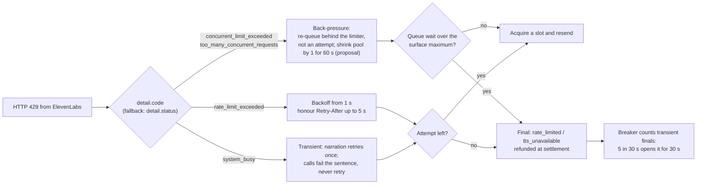
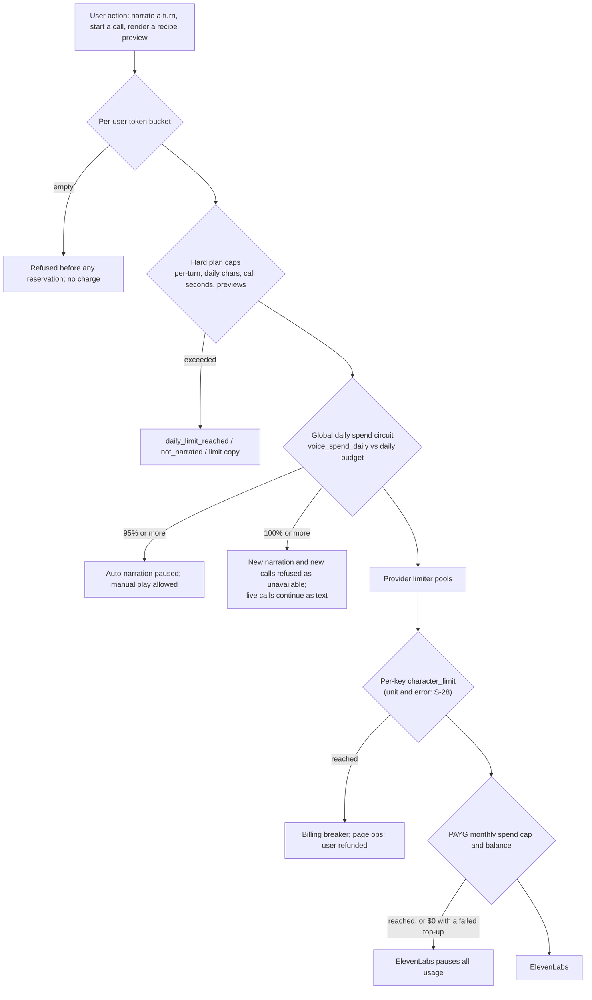
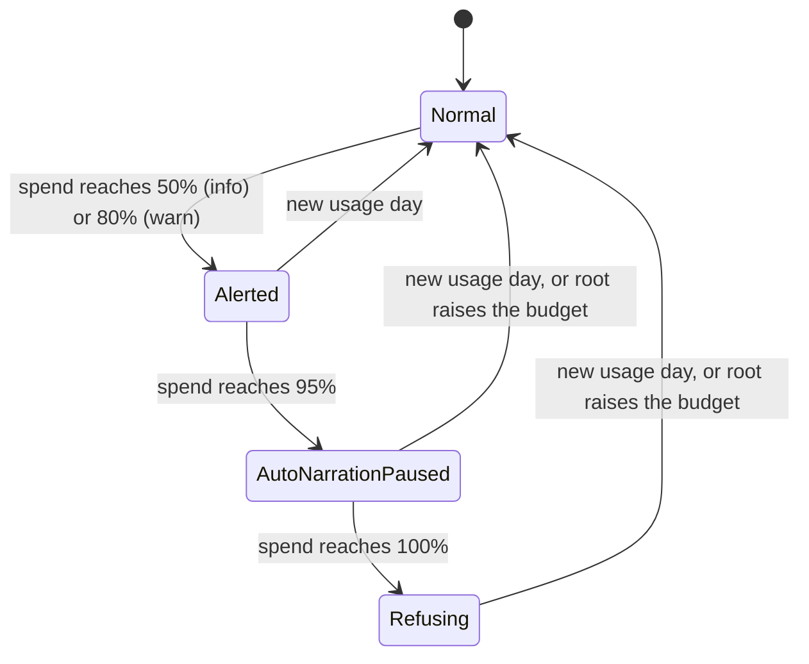

# Cost, plans and operations

> **Scope / status (reviewed 2026-10-14):** Voice design and dated evidence; product rollout is **WIP**. [00 — Current status and roadmap](00_current_status_and_roadmap.md) owns current implementation/flags/gaps. Later [03 §5.16](03_target_architecture_and_decisions.md#516-r0-implementation-decisions-2026-10-12) instructions and [15 §§11–13](15_implementation_plan_and_acceptance.md#11-minimax-voice-purge-2026-10-14) supersede MiniMax routing, cohorts, V1/maps and original rollout dates. Preserve earlier proposals and vendor facts as dated references; they are not proof of availability.

- **Date:** 2026-10-12
- **Original proposal status (2026-10-12):** Proposed (see [03](03_target_architecture_and_decisions.md) for sign-off status)

## Scope

This document says how magic-worlds buys, pays for and runs ElevenLabs speech after MiniMax is removed. It covers:
- the ElevenLabs plan and the production and staging accounts;
- the consolidated cost model and the app's membership re-pricing;
- the API key topology, secrets and readiness probes;
- concurrency settings against plan limits, and 429 handling;
- budget guards;
- runbooks, monitoring and dashboards;
- vendor management, including the legal confirmations still needed.

It implements decisions D02, D03, D04, D18, D24, D25 and D37, and the operational parts of D10, D19, D26 and D28. Where it needs a canonical table, it copies [03 §5](03_target_architecture_and_decisions.md) verbatim. Prices and model facts are **as of 2026-10-12**. Anything that still depends on a staging spike (S-n) or a written confirmation (L-n) is labelled as such. Code is not changed here. The backend and frontend work is in [08](08_backend_refactor_plan.md) and [09](09_frontend_refactor_plan.md).

**Section references.** "03 §n" points to the decision record; a bare "§n" points to this document. Tables marked "copied verbatim from 03" keep 03's own section numbers inside their cells (for example "§5.8" or "§5.4.3" there means 03 §5.8 or 03 §5.4.3).

**Related:** [README](README.md) · [01 current state](01_current_state.md) · [02 capabilities](02_elevenlabs_capabilities.md) · [03 decisions (source of truth)](03_target_architecture_and_decisions.md) · [04 catalog](04_voice_catalog_and_library.md) · [06 narration](06_chat_narration_migration.md) · [07 calls](07_realtime_calls_migration.md) · [08 backend](08_backend_refactor_plan.md) · [09 frontend](09_frontend_refactor_plan.md) · [10 rollout](10_data_migration_and_rollout.md) · [12 best practices](12_best_practices_and_improvements.md) · [13 policy](13_policy_privacy_and_compliance.md) · [14 spikes](14_staging_spike_and_contract_tests.md) · [15 implementation](15_implementation_plan_and_acceptance.md) · [16 risks](16_risks_and_open_questions.md) · research [05](research/05_elevenlabs_platform_pricing_limits_policy.md), [10](research/10_gap_policy_licensing.md), [14](research/14_cost_model.md)

---

## 0. At a glance

| Topic | Position | Source |
|---|---|---|
| Plan | **Scale ($299/month)**, held by a legal entity. A separate Creator or Pro staging workspace. Enterprise talks start at about $3k/month of spend or at R3, whichever comes first. | D02 |
| Launch precondition | D02 requires written confirmation of L-1…L-3. Per the gates in [03 §6.3](03_target_architecture_and_decisions.md): L-1 **sent** (with L-9) and L-3 answered or its safe default applied by R0 exit; L-1, L-4 and L-8 **answered** by R2 entry; L-2 gates public Library voices only. | D02, 03 §6.3 |
| Cost at 10k MAU, base usage | Recommended stack **$9,111/month** vs MiniMax today **$10,421**, which is **−13%** at list price. This excludes the moderation classifier, whose cost is [unverified]. At list price +25% the recommended stack costs **$11,384**, which is more than MiniMax. | [research 14 §5.5, §9](research/14_cost_model.md) |
| Biggest cost lever | The narration model. Narration is about 93% of ElevenLabs spend. The plan fee changes nothing at any modelled level. | [research 14 §0, §6.1](research/14_cost_model.md) |
| App credits | Standard narration costs 1 credit per 400 characters and Expressive 1 per 200, rounded once per turn. Hard daily caps are 2,500, 8,000 and 20,000 characters, and 3, 10 and 10 call minutes. Previews: 3 free, then 1 credit each, up to 3, 10 or 20 a day. | D24, D18, 03 §5.9 |
| Keys | One service account `mw-prod`. Six scoped, capped, IP-allowlisted keys, one per surface. Rotation is quarterly and after any incident. Probes degrade a surface; they never abort startup. | D04, 03 §5.4.3 |
| Concurrency | Provider limiter pools `flash` 24 of 30 and `non_flash` 12 of 15. In-process while the BFF is single-process (bug #19). Each call uses one multi-context socket with at most 4 live contexts. | D02, D06 |
| Budget guards | Global daily spend circuit: alerts at 50% and 80%, auto-narration pause at 95%, refusal at 100%. Per-user token buckets. Daily reconciliation, with an alert above 5% drift. Provider-side caps are the last line of defence. | D37, 03 §5.13 |
| Privacy operations | Training opt-out on day one. A history-deletion sweep with an SLO: the oldest item is under 48 h old, alert at 36 h, page at 72 h. No ZRM until Enterprise. | D25 |
| SLA | **None on self-serve.** Our own SLOs and runbooks replace it. | [research 05 §9.2](research/05_elevenlabs_platform_pricing_limits_policy.md) |

---

## 1. ElevenLabs plan and account (D02)

### 1.1 Recommendation and why

**Production runs on Scale, contracted by a legal entity.** Each factor that decides the tier:

| Factor | What it requires | Lowest tier that meets it | Evidence |
|---|---|---|---|
| Commercial licence | Any paid plan; Free is non-commercial | Starter | [research 10 §2.2, §2.7](research/10_gap_policy_licensing.md) |
| Licensing floor ("Making Available") | The OEM Terms expressly bar Free–Pro from Making Available. Scale is the cheapest tier that is not expressly barred if ElevenLabs takes a middle position. It is a hedge, not a fix: consumers can never be OEM End Users on any self-serve plan. | **Scale**, plus written confirmation L-1 | [research 10 §2.3, §7](research/10_gap_policy_licensing.md) |
| Contracting party | An OEM "Business Entity" excludes individuals acting personally | Scale, held by an entity (L-3 confirms whether a sole proprietor qualifies) | [research 10 §2.3](research/10_gap_policy_licensing.md) |
| Service accounts (D04 key topology) | A multi-seat workspace | **Scale** (3 seats) | [research 05 §4.2](research/05_elevenlabs_platform_pricing_limits_policy.md) |
| TTS concurrency | About 5 non-Flash and 4–6 Flash slots at peak for the recommended mix at 50k MAU (base load) | Pro (10/20) fits; Scale (15/30) leaves room for heavy use | [research 14 §6.2](research/14_cost_model.md) |
| Voice slots and operations | About 50 slots and 150 operations at launch, then 10–40 operations a month | Pro fits; Scale has 660 slots and 1,040 operations | [research 14 §6.3](research/14_cost_model.md) |
| ZRM, data residency, per-key concurrency, SLA | Enterprise only | Enterprise (deferred, §1.3) | [research 05 §5.1–5.2, §9.2](research/05_elevenlabs_platform_pricing_limits_policy.md) |
| Price | Below Enterprise the plan fee is a prepaid USD allowance spent at the same list rates. Usage exceeds the Scale fee at every modelled level. | Indifferent | [research 14 §1, §6.1](research/14_cost_model.md) |

Plan comparison, as of 2026-10-12 ([research 14 §2.2](research/14_cost_model.md); [research 05 §2.1, §3.1](research/05_elevenlabs_platform_pricing_limits_policy.md)):

| Plan | $/month (annual) | Seats | Custom slots | Voice ops/month | TTS concurrency non-Flash / Flash | TTD WS sessions | STT batch / realtime | PAYG purchase cap without 2FA | Fit |
|---|---|---|---|---|---|---|---|---|---|
| Pro | 99 ($990/yr) | 1 | 160 | 290 | 10 / 20 | 70 | 40 / 30 | $200 | **No.** Expressly barred from Making Available; no service accounts |
| **Scale** | **299 ($2,990/yr)** | **3** | 660 | 1,040 | **15 / 30** | 105 | 60 / 45 | $600 | **Yes** |
| Business | 990 ($9,900/yr) | 10 | 2,200 vs 660 (pages conflict) | 1,040 | 15 / 30 (pricing page says 25) | 105 | 60 / 45 | $2,000 | Only if we outgrow 660 slots or 3 seats |
| Enterprise | custom | custom | custom | unlimited | elevated; per-key limits | elevated | elevated | n/a | Later (§1.3) |

Limits are **read, not hard-coded**: slots, operations and characters come from `GET /v1/user/subscription` (Job C, hourly), and concurrency from the `maximum-concurrent-requests` response header (the adaptive clamp in §5.2).

Billing: monthly at first. Annual Scale ($2,990) saves $598 a year but locks in the tier. Review it 30 days after R3, unless Enterprise talks have started by then (proposal).

### 1.2 What Scale does not solve, and the Enterprise triggers

| Gap on Scale | Consequence | Trigger to escalate (D02) |
|---|---|---|
| "Reading B": ElevenLabs says a B2C app is Making Available | No self-serve plan works; custom OEM or Enterprise terms are needed | L-1 answered "yes, Making Available" |
| No ZRM | User text and audio stay in ElevenLabs history; the D25 sweep minimises it | ZRM becomes a requirement. L-9 (ZRM eligibility) is sent with L-1. |
| No EU residency | Storage in the US | EU residency becomes a requirement |
| No adult audio approval | Voice launches under the no-NSFW policy (D26) | L-5 approval plus a content rating, age assurance and updated ToS |
| No SLA, no per-key concurrency, no volume price | We carry outage risk and partition concurrency ourselves | **About $3k/month of spend, or R3, whichever comes first** |
| History deletion is one item per call | The sweep may not keep up (S-23) | The S-23 fallback brings Enterprise and ZRM talks forward (D25) |

The Enterprise negotiation checklist is in §9.5.

### 1.3 Production account setup checklist

Each item is recorded in the ROLL access and change log ([10](10_data_migration_and_rollout.md)), with a date and the operator's name.

- [ ] **Contract** Scale under the legal entity. LEGAL records which ElevenLabs ToS applies (EEA/UK/CH or non-EEA) from the entity's residence (L-15).
- [ ] **Admin email** is a non-personal address routed to a **monitored shared inbox**. Warnings and enforcement notices arrive by email (D26 item 8; [research 10 §8.6](research/10_gap_policy_licensing.md)).
- [ ] **2FA on.** It also lifts Scale's $600/month PAYG purchase cap. The small-level overage of about $613/month already exceeds that cap ([research 14 §6.1](research/14_cost_model.md)).
- [ ] **Training opt-out:** "Data use → Improve the models for everyone" is off **before any real user text**. Take a dated screenshot. This is an R0 exit gate (§6.3), and the opt-out only covers data sent after it is set ([research 10 §6](research/10_gap_policy_licensing.md)).
- [ ] **Auto top-up on**, sized per §6.5.
- [ ] **Monthly PAYG spend cap** set at R1 to **1.5× the R0 forecast**, then re-sized from R1/R2 telemetry before R3 (D02, 03 §6.3 R3 entry). Never size it from promo-era allowances: the v4 "72% off until Oct 12" promo ends today.
- [ ] **Seats:** only named operators, listed in the access register. Shared history contains users' story text and is readable by every dashboard seat (D25 item 8). Proposed allocation of the 3 Scale seats: owner/admin, on-call operator, spare. Whether the service account uses one of them is [unverified]; record it during S-1.
- [ ] **Service account `mw-prod`** created with `default_sharing_groups` set to the catalog group. Every catalog voice is shared with that group, and Job A asserts it (D04).
- [ ] **Six keys** created per §4.1, each IP-allowlisted to the BFF egress, with `third_party_disable_allowed=true` so that GitHub leak scanning can disable a leaked key.
- [ ] **Workspace webhook** (optional) left **disabled until S-12** passes and public HTTPS ingress exists (D10). The catalog subscribes to `voice_library_removal_notice` when it is enabled.
- [ ] **Startup Grant:** apply now, but **use it only after L-14** confirms in writing that grant-funded usage counts as a paid commercial, Business Entity subscription with no attribution duty. Paid Scale stays active alongside any grant, so production audio is never generated "outside a subscription" ([research 10 §2.6](research/10_gap_policy_licensing.md)). The grant's list value is roughly $1.3k (Flash) to $2.6k (v4), about 2 months of small-level narration. It does not change the plan ([research 14 §6.1](research/14_cost_model.md)).
- [ ] **S-1, read-only:** with the production keys, read `GET /v1/user`, `/v1/user/subscription`, `/v2/voices?voice_type=default|personal` and `/v1/workspace/webhooks`. Record the account creation date and any existing voices. Nothing may depend on Default voices, which expire on 2026-12-31.

### 1.4 Staging account setup

| Item | Setting |
|---|---|
| Workspace | Separate paid **Creator or Pro** workspace (D02). Pro adds 44.1 kHz PCM, which may help S-9 and S-8 ([research 05 §11.1](research/05_elevenlabs_platform_pricing_limits_policy.md)). |
| Owner | A **dedicated operator seat on a shared mailbox**, not a person's account |
| Keys | **User keys** (one seat means no service accounts) with **the same six scopes** as production, tiny `character_limit`s and an IP allow-list for the staging BFF and the spike runner. Rotated quarterly. Spike-only keys may use a 30-day expiry. |
| Data | **Synthetic, policy-safe text only.** Never real user content, and never prohibited content, because an attempted violation is itself a violation ([research 10 §3](research/10_gap_policy_licensing.md)). Moderation is tested with mocks only (D26). |
| Training opt-out | On, with a dated screenshot (R0 exit gate) |
| Spend | The spike estimate is under $10 ([03 §6.1](03_target_architecture_and_decisions.md)). Set the PAYG monthly cap at $50 (proposal). |
| Rejected options | A second Scale workspace (about $299/month more); a staging service account inside production, which would share concurrency, settings and history with production |

---

## 2. Cost model (as of 2026-10-12)

This summarises [research 14](research/14_cost_model.md). Every usage number is an [assumption]; no telemetry exists yet ([research 14 §3](research/14_cost_model.md)). Re-run the model after 30 days of telemetry.

### 2.1 Prices used (list, as of 2026-10-12)

| Item | Price | Notes |
|---|---|---|
| `eleven_flash_v2_5` | **$0.04 / 1K chars** | Standard narration, calls and Standard previews |
| `eleven_v4` | **$0.08 / 1K** | List price. The promo ($0.022, "72% off until Oct 12") ends today and is never used for planning (C15). |
| `eleven_v4_turbo` | $0.04 / 1K (promo $0.011) | Flagged call upgrade only (S-18) |
| `eleven_multilingual_v2`, `eleven_v3` | $0.08 / 1K | Lab only |
| Scribe v2 Realtime | $0.39 / h | Not adopted at launch (D07). Billing basis [unverified]. |
| Speech Engine | $0.08 / min, burst $0.16 | Rejected (D06) |
| Voice Design | Preview-text characters only | Per-character rate [unverified] |
| MiniMax `speech-2.8-turbo` (baseline) | $0.06 / 1K | List price. What MiniMax actually invoices is unknown ([research 14 §13 #2](research/14_cost_model.md)). |
| Groq `whisper-large-v3` (calls STT, unchanged) | $0.111 / h, 10 s minimum per request | |

Sources: [research 14 §2](research/14_cost_model.md); [research 05 §2.3](research/05_elevenlabs_platform_pricing_limits_policy.md).

**Billing mechanics** ([research 05 §2.2](research/05_elevenlabs_platform_pricing_limits_policy.md)):
- API usage is billed in USD. The plan fee is a prepaid allowance spent at list rates, so the monthly bill is `max(plan fee, usage)`.
- Overage is drawn from a prepaid PAYG balance:
  - minimum top-up $5; at most 250 top-ups a month; top-ups expire after 12 months and are non-refundable;
  - "usage pauses immediately" when Auto Top Up is off or an attempt fails.
- An optional monthly PAYG spend cap exists (off by default).
- Unused allowance rolls over for 2 months. That never matters for us, because usage exceeds the fee.

### 2.2 Usage assumptions (all [assumption])

| Parameter | Free | Plus | Pro | Blended per MAU |
|---|---|---|---|---|
| Tier mix | 90% | 7% | 3% | — |
| Narrated turns per month | 5 | 60 | 200 | 14.7 |
| Characters per narrated turn | 1,000 (range 600–1,500); about 2.5 segments per turn | | | |
| Expressive share of turns | 0% (Standard only) | 50% | 50% | 35% of characters |
| Call minutes per month (wall clock) | 1 | 15 | 50 | 3.45 |
| Assistant speech per call minute | 405 characters (+10% barge-in waste) | | | |
| Recipe previews per month | — | 1.5 | 3 | cache hit rate 30% |
| Waste and tag overhead | +5% retries; +3% tag characters on v4 (whether tags are billed is S-17) | | | |

Population levels: 1k, 10k and 50k MAU. About 1.5% of MAU are online at peak ([research 14 §3.1](research/14_cost_model.md)).

### 2.3 Unit costs

| Unit | MiniMax today | Recommended (ElevenLabs) | Δ |
|---|---|---|---|
| Narrated turn (1,000 chars) | $0.0630 | Standard $0.0420 · Expressive $0.0865 · blended mix E **$0.0574** | −9% blended |
| Call minute (TTS + STT) | $0.0277 | K1 Flash multi-context + Groq **$0.0188** | −32% |
| Recipe preview (150 chars) | $0.009 | $0.012 on v4 / about $0.006 on Flash | — |
| Catalog audition | synthesized, about $0.012 | **$0** (own pre-rendered sample, D10) | — |
| Designed voice | $3 fee + preview characters | about $0.02 per design call [unverified rate] + 1 slot | — |
| Worst-case turn | today's 96,000-character cap: $5.76 | new 2,500-character cap: $0.105 (Flash) / $0.216 (v4) | — |

Source: [research 14 §4, §10.2](research/14_cost_model.md).

### 2.4 Scenarios (USD per month, list prices, base usage)

| Stack | Narration + calls + previews | 1k MAU | 10k MAU | 50k MAU | vs S0 |
|---|---|---|---|---|---|
| **S0 MiniMax today** | M0 + K0 + P0 | **1,056** | **10,421** | **51,999** | baseline |
| **S1 recommended** (D05, D06, D18) | E + K1 + P1 | **912** | **9,111** | **45,545** | **−13%** |
| S2 all-Expressive | A + K3 + P1 | 1,361 | 13,596 | 67,968 | +30% |
| S3 cheapest (Flash only) | C + K1 + P1 | 685 | 6,840 | 34,192 | −34% |
| S4 Text to Dialogue narration | D + K3 + P1 | 1,397 | 13,959 | 69,785 | +34% |
| S6 recommended + Speech Engine calls | E + K4 + P1 | 1,124 | 11,224 | 56,111 | +8% |

S1 by surface:

| Surface | 1k | 10k | 50k | Share at 10k |
|---|---|---|---|---|
| Narration (option E) | 844 | 8,445 | 42,223 | 92.7% |
| Calls K1, of which ElevenLabs TTS / Groq STT | 65 (61 / 3) | 647 (615 / 32) | 3,234 (3,074 / 160) | 7.1% |
| Previews (P1) | 2 | 16 | 82 | 0.2% |
| Admin and catalog | 2 | 3 | 7 | <0.1% |
| **ElevenLabs-only spend** (input for §6 budgets) | **≈ 910** | **≈ 9,079** | **≈ 45,386** | — |

Per user per month (S1 vs S0): Free $0.23 vs $0.34; Plus $4.14 vs $4.19 (41% of $9.99); Pro $13.79 vs $13.98 (55% of $24.99). The plan prices are **proposed**; the api.auth Stripe catalog is the source of truth ([research 14 §2.6, §5.6](research/14_cost_model.md)).

### 2.5 Sensitivity and break-evens (10k MAU)

| Driver | Range | Effect on S1 | Action |
|---|---|---|---|
| Characters per turn | 600 / 1,500 | narration $5,067 / $12,668 | Measure first. It is the biggest unknown, together with turns per MAU. |
| Usage intensity | ×0.5 / ×2 | total $4,565 / $18,202 | Linear |
| Expressive share | 50% of paid turns → 100% | narration +27% ($8,445 → $10,713) | Keep the 2× credit weight (D24) |
| **List price +25%** (older price levels) | +25% | total ≈ **$11,384 > S0 $10,421** | Budget at list +25% ([research 05 §2.3](research/05_elevenlabs_platform_pricing_limits_policy.md)) |
| v4 promo re-run ($0.022) | — | v4 cheaper than Flash | Not plannable. Check prices monthly (§10.2). |
| `previous_text`/`next_text` billed | +30% characters on v4 | — | They stay off until S-17 (D05) |
| Library voices with a 2× multiplier | 20% of characters | narration +20% | The importer blocks `rate ≠ 1.0` (D09) |
| Calls ×3 | — | K1 $647 → $1,940 | Calls stay small |
| Enterprise discount | −20% to −30% [unverified] | 50k: $45.5k → $32–36k | Ask in Enterprise talks |

**Break-even:** S1 narration stays below MiniMax while the Expressive share of narration characters stays under about **47%** (base: 35%) ([research 14 §9](research/14_cost_model.md)).

### 2.6 What the model excludes

| Excluded | Why it matters | Owner |
|---|---|---|
| **Moderation classifier** (one batched call per narrated turn plus one per call sentence, D26) | Unit cost [unverified] until BE picks the `magic_llm` `moderation` profile. BILL must add it before the "−13%" claim is used (D26). | BILL, BE ([08](08_backend_refactor_plan.md)) |
| LLM, images, hosting, storage, egress | Outside speech | — |
| Theme songs (fal `minimax/music-3` at $0.002/s) | Out of scope (D01). Re-pricing is noted for BILL. | BILL |
| MiniMax's real invoice | S0 is list-based and may be lower | Owner checks the MiniMax console |
| Drained call audio on barge-in | Assumed billed (S-25). The flush-ahead window bounds it (D06). | [07](07_realtime_calls_migration.md) |

### 2.7 Where this document follows 03 over research 14

| Topic | Research 14/05 proposed | Canonical (03) |
|---|---|---|
| Narration reservation | Per segment | **Once per turn, after the reuse check** (D24) |
| Free daily narration cap | 1,000 characters | **2,500** (D24, 03 §5.9) |
| Daily call minutes | Free 5 · Plus 10 · Pro 20 | **Free 3 · Plus 10 · Pro 10** (D24 item 7) |
| Recipe preview daily limit | ≤ 30 | **3 / 10 / 20** (D18) |
| Catalog auditions | Free upstream `preview_url` | **Own samples only until L-3** (D10) |
| PAYG spend cap | 1.3× forecast | **1.5× R0 forecast at R1, re-sized from telemetry** (D02) |
| Enterprise talks | By 10k MAU (about $9k/month) | **About $3k/month or R3, whichever comes first** (D02) |
| Narration key cap | About 70% of budget ([research 05 §11.2](research/05_elevenlabs_platform_pricing_limits_policy.md)) | **About 65%** (03 §5.4.3; see the sizing check in §4.3) |
| `OPS` key cap | 0 | **Smallest non-zero value until S-28** (D04) |
| Exposure maths | Effective Flash rate $0.042/1K | List $0.04/1K (03 §5.9; about 5% lower) |

---

## 3. App credit pricing and membership re-pricing (D24, D18, D37)

### 3.1 Why re-price

- Today one narrated turn costs 1 credit, and only segment 0 reserves quota ([route_chat.py:1433](/home/andres/PycharmProjects/magic-worlds-api/src/routes/user/route_chat.py)).
- TTS never refunds ([research 13 §4.2](research/13_gap_codebase_checks.md)).
- A Pro user can narrate 500 turns a day ([db.sql:939](/home/andres/PycharmProjects/magic-worlds-api/src/database/mysql/db.sql)), which is $1,298/month on v4 against a $24.99 plan.
- The preview route is unmetered ([voice_presets.py:99-118](/home/andres/PycharmProjects/magic-worlds-api/src/routes/voice_presets.py)). Scripting it could cost about $2.8k a day on v4 ([research 14 §7](research/14_cost_model.md)).
- `daily_request_limit` is **soft** today: past it, `reserve_media_operation` spends PAYG credits instead of refusing ([models.py:3003](/home/andres/PycharmProjects/magic-worlds-api/src/database/mysql/models.py)). So the new caps must be a separate, hard check (D24 item 9).

### 3.2 Charge algorithm (summary of D24)

1. **Build** segments: per-turn cap 2,500 characters, ≤ 12 segments, ≤ 1,200 characters per segment. Characters are counted on the final sanitized text, without our prefix tags.
2. **Reuse first.** A completed hit is free. A pending or in-progress hit attaches to that job with no new charge.
3. **Reserve once per turn** for all missed segments: `credits = ceil(Σ standard_chars / 400 + Σ expressive_chars / 200)`, with a minimum of 1. This is one `reserve_media_operation` call with the `credit_cost` override ([models.py:2929](/home/andres/PycharmProjects/magic-worlds-api/src/database/mysql/models.py)) and one `tts_turn_charge` row.
4. **Daily cap** in the same transaction (Standard-equivalent characters; Expressive counts 2×). The Expressive turn falls back to Standard first if that fits; segments that do not fit become `daily_limit_reached`.
5. **In-flight** counts open turn charges, not jobs.
6. **Settlement** refunds failed segments and reduces the counted characters.
7. Calls keep 1 credit per 10 s of billed audio ([engine.py:58-59](/home/andres/PycharmProjects/magic-worlds-api/src/services/voice_orchestration/engine.py)). Daily minutes become per-plan data.
8. `voice_preview` is a new metered operation (D18).
9. **Caps are hard against PAYG.**
10. `character-cost` is logged for reconciliation only.

The narration-side detail (segments, tier fallback, delivery) is in [06](06_chat_narration_migration.md).

### 3.3 Membership numbers (copied verbatim from 03 §5.9)

| Operation | Unit | Free | Plus | Pro |
|---|---|---|---|---|
| `tts_generation` Standard | 1 credit / 400 chars, rounded **per turn** (min 1 per charged turn) | ✓ | ✓ | ✓ |
| `tts_generation` Expressive | 1 credit / 200 chars, same rounding (mixed turns: `ceil(Σstd/400 + Σexpr/200)`) | — | ✓ (opt-in) | ✓ (opt-in) |
| Daily narration cap, `daily_quantity_limit` (Standard-equivalent chars; Expressive counts 2×; hard, PAYG cannot exceed it) | chars/day | 2,500 | 8,000 | 20,000 |
| Per-turn cap | chars / segments / chars per segment | 2,500 / 12 / 1,200 (never more than the remaining daily cap) | same | same |
| `tts_generation` `daily_request_limit` (now counts **turns**) | turns/day | 20 | 100 | 500 (seed values unchanged; meaning changed) |
| `tts_generation` `max_in_flight` (now counts **open turn charges**) | turns | 1 | 2 | 4 |
| `voice_call` | 1 credit / 10 s billed audio (unchanged); `daily_quantity_limit` in seconds | 3 min/day | 10 min/day | 10 min/day |
| `voice_preview` (new; cache misses only) | 3 free renders/day, then 1 credit each | 3/day | 10/day | 20/day |
| Refunds | at turn settlement, for failed segments | ✓ | ✓ | ✓ |

What the units mean for typical turns:

| Turn | Standard credits | Expressive credits | Provider cost (list) |
|---|---|---|---|
| 1,000 characters | 3 | 5 | $0.040 / $0.080 |
| Mixed: 600 Standard + 400 Expressive | `ceil(1.5 + 2.0)` = 4 | — | $0.056 |
| Maximum turn, 2,500 characters | 7 | 13 | $0.100 / $0.200 |

Daily caps in typical 1,000-character turns: Free 2.5 Standard turns; Plus 8 Standard or 4 Expressive; Pro 20 Standard or 10 Expressive. The base-usage Pro user narrates about 6.7 turns a day, well inside the cap.

### 3.4 Credit economics

| Unit | Provider cost per credit (list) | Revenue per credit |
|---|---|---|
| Standard narration (400 chars) | ≈ $0.0168 | Plus included $0.0033 · Pro included $0.0017 · PAYG packs $0.033–0.05 |
| Expressive narration (200 chars) | ≈ $0.0173 | same |
| Call (10 s billed audio, K1; 4.8 credits per call minute) | ≈ $0.0039 | same |
| Recipe preview (1 credit after 3 free) | ≈ $0.012 (v4) / $0.006 (Flash) | same |

- The 2× Expressive weight gives Standard and Expressive the **same cost per credit**. The tier choice is therefore margin-neutral.
- PAYG margin on narration is 49–66%.
- Credits barely constrain typical users. At base usage a month costs about 15 credits for Free, 240 for Plus (8 a day, 8% of the pool) and 800 for Pro (27 a day, 5%). **The character caps bound the tail** ([research 14 §10](research/14_cost_model.md)).

### 3.5 All-surface tail exposure (copied verbatim from 03 §5.9)

One user maxing every capped surface every day for 30 days, at list prices (Flash $0.04/1K, v4 $0.08/1K [verified: https://elevenlabs.io/pricing/api]; call TTS ≈ $0.01875/min derived from research/14 §10.2 row 6; Groq STT and LLM excluded; research/14 uses an effective Flash rate of about $0.042/1K, so its figures are about 5% higher):

| Plan (price) | Narration | Calls | Previews (all misses) | Total / month | × plan price |
|---|---|---|---|---|---|
| Free ($0) | 2,500 × 30 × $0.04/1K = $3.00 | 3 × 30 × $0.01875 = $1.69 | 3 × 150 × 30 Flash = $0.54 | **$5.23** | — |
| Plus ($9.99) | 8,000 × 30 × $0.04/1K = $9.60 | 10 × 30 × $0.01875 = $5.63 | 10 × 150 × 30 v4 = $3.60 | **$18.83** | 1.9× |
| Pro ($24.99) | 20,000 × 30 × $0.04/1K = $24.00 | $5.63 | 20 × 150 × 30 v4 = $7.20 | **$36.83** | 1.5× |

- The absolute ceiling per user per day is the row ÷ 30 (Pro ≈ $1.23 a day).
- Free accounts cost real money ($5.23/month at the cap) and are free to create. That is why voice on Free requires attestation, a verified email, an account at least 24 h old and ≤ 3 new Free voice accounts per device or IP per day (D37, §6.6).

### 3.6 Expressive premium and fallback rules

- Expressive (`eleven_v4`) is **Plus and Pro only, opt-in**. It is set in `user_preferences.narration_tier` with a per-session override in `session_voice_setting` (D05). Free gets Standard only.
- Weight: 2× per character, both for credits and for the daily cap.
- **Fallback to Standard, billed at Standard weight**, when:
  - the plan no longer allows Expressive;
  - the Expressive cost would cross the daily cap but the Standard cost fits;
  - the Expressive model is unhealthy.

  Fallback clips show "Standard voice".
- **Owner levers if the paid-tier voice cost (41% of Plus, 55% of Pro at base) is too high** ([research 14 §10.3](research/14_cost_model.md)):
  1. accept it;
  2. tighten the paid caps to Plus 4,000 and Pro 10,000;
  3. raise prices, or sell Expressive as an add-on.

  The default is (1), then a re-tune after 30 days of telemetry (D24 consequences).

### 3.7 Preview metering (D18)

| Preview kind | Cost to the user | Metering |
|---|---|---|
| Catalog audition (own pre-rendered sample) | Free | Rate limit 60/min per user |
| "Default settings" audition (quantized settings equal the catalog defaults, no emotion) | Free | The own sample is served instead of a render |
| Recipe preview, **cache hit** (`voice_preview_render`) | Free | Does not count toward the daily limit |
| Recipe preview, **cache miss** | 3 free a day, then 1 credit each | Hard daily limit 3 / 10 / 20; `max_in_flight` 1; token bucket 6/min |

Implementation sketch for BE ([08](08_backend_refactor_plan.md)):
- **Count:** the preview service counts the user's cache-miss renders for the usage day (`voice_preview_render.requested_by_user_id`) **before** reserving.
- **Hard limit:** the plan's limit is enforced there, because `daily_request_limit` alone is soft.
- **Reserve:** the first 3 misses reserve with `credit_cost=0`, which only counts in-flight and writes no ledger row ([models.py:2983](/home/andres/PycharmProjects/magic-worlds-api/src/database/mysql/models.py)); later misses reserve with `credit_cost=1`.
- **Ledger link:** `voice_preview_render.ledger_entry_id` stays null for free renders.
- **Refund:** a failed render is refunded through `refund_credit_ledger` ([models.py:3159](/home/andres/PycharmProjects/magic-worlds-api/src/database/mysql/models.py)).

### 3.8 Seeds (R0 expand)

Adding an operation is a **lockstep startup contract**:
- every plan, custom plans included, must carry exactly the seeded operation set ([bootstrap.py:1108](/home/andres/PycharmProjects/magic-worlds-api/src/database/mysql/bootstrap.py));
- `count_in_flight` raises on unknown operations ([models.py:2061-2117](/home/andres/PycharmProjects/magic-worlds-api/src/database/mysql/models.py)).

So `voice_preview` and the cap columns ship in R0, before the provider switch, with a reverse migration for a rollback before R1 ([research 13 §4.4](research/13_gap_codebase_checks.md); D18, D28). SQL sketch:

```sql
-- R0 expand (column from 03 §5.2)
alter table membership_plan_limit add column daily_quantity_limit int null;
    -- tts_generation: Standard-equivalent chars/day; voice_call: seconds/day; null elsewhere

-- Built-in plans
update membership_plan_limit set daily_quantity_limit = 2500  where plan_code = 'free' and operation = 'tts_generation';
update membership_plan_limit set daily_quantity_limit = 8000  where plan_code = 'plus' and operation = 'tts_generation';
update membership_plan_limit set daily_quantity_limit = 20000 where plan_code = 'pro'  and operation = 'tts_generation';
update membership_plan_limit set daily_quantity_limit = 180   where plan_code = 'free' and operation = 'voice_call';
update membership_plan_limit set daily_quantity_limit = 600   where plan_code in ('plus', 'pro') and operation = 'voice_call';
-- tts_generation daily_request_limit (20/100/500) and max_in_flight (1/2/4) keep their seed values; their meaning changes (turns).

-- New operation: daily_request_limit carries the hard daily render limit enforced by the preview service (§3.7).
insert into membership_plan_limit (plan_code, operation, daily_request_limit, max_in_flight, credit_cost, daily_quantity_limit) values
  ('free', 'voice_preview',  3, 1, 1, null),
  ('plus', 'voice_preview', 10, 1, 1, null),
  ('pro',  'voice_preview', 20, 1, 1, null);

-- Custom root-made plans (data migration, run BEFORE the new build boots):
-- insert a voice_preview row for every plan that lacks one. Proposal: Free values (3, 1, 1),
-- because Free is the most restrictive; root adjusts them in the plan editor.
-- Same for daily_quantity_limit on tts_generation / voice_call of custom plans (proposal: Free values).
```

Mirror the rows in `MEMBERSHIP_PLAN_LIMIT_SEED_ROWS` ([bootstrap.py:24-49](/home/andres/PycharmProjects/magic-worlds-api/src/database/mysql/bootstrap.py)) and the `db.sql` seed block ([db.sql:916-942](/home/andres/PycharmProjects/magic-worlds-api/src/database/mysql/db.sql)). Add `voice_preview` to `MEMBERSHIP_OPERATIONS` and `MEMBERSHIP_MEDIA_OPERATIONS` ([models.py:57-67](/home/andres/PycharmProjects/magic-worlds-api/src/database/mysql/models.py)). The process-wide `VOICE_DAILY_MINUTES_PER_USER` ([config.py:27,96](/home/andres/PycharmProjects/magic-worlds-api/src/services/voice_orchestration/config.py)) stays only as a global upper bound (D24 item 7). The usage DTO gains `narration_chars_used`, `narration_chars_limit`, `call_seconds_used`, `call_seconds_limit` and `previews_left` (D24); the UI is in [09](09_frontend_refactor_plan.md).

---

## 4. API key topology and secrets (D04)

### 4.1 Keys (copied verbatim from 03 §5.4.3)

| Env var | Surface | Scopes | `character_limit` |
|---|---|---|---|
| `ELEVENLABS_KEY_NARRATION` | narration jobs | `text_to_speech` | ~65% of monthly budget |
| `ELEVENLABS_KEY_CALLS` | call TTS (+ STT if Scribe is adopted) | `text_to_speech` (+ `speech_to_text`) | ~30% |
| `ELEVENLABS_KEY_PREVIEW` | user recipe previews only; readiness probe | `text_to_speech` | hard cap ~2% |
| `ELEVENLABS_KEY_CATALOG` | Jobs A/B, models | `voices_read`, `models_read` | minimal |
| `ELEVENLABS_KEY_ADMIN_VOICES` | root console, acceptance renders, catalog sample renders | `voices_read`, `voices_write`, `voice_generation`, `create_instant_voice_clone`, `add_voice_from_voice_library`, `text_to_speech`, `pronunciation_dictionaries_read`, `pronunciation_dictionaries_write` | small cap (sized for one full catalog render) |
| `ELEVENLABS_KEY_OPS` | reconciliation, history sweep, webhooks, subscription probe | `user_read`, `workspace_analytics_full_read`, `speech_history_read`, `speech_history_write`, `webhooks_write` | smallest non-zero value until S-28 says what 0 means |
| `ELEVENLABS_BASE_URL` | all | — | default `https://api.elevenlabs.io`; ops switch `https://api.us.elevenlabs.io` |

A seventh `MEDIA` key exists only if D29 adopts SFX or Music.

Rules (D04; [research 05 §4.2, §11.2](research/05_elevenlabs_platform_pricing_limits_policy.md)):
- **Never** `permissions: "all"`. **Never grant** `publish_voice_to_voice_library`, `share_voice_externally`, `create_user_api_key`, `service_account_write` or `terms_of_service_accept`.
- Every key is **IP-allowlisted to the BFF egress** (1–100 public IPs or CIDRs; private ranges are rejected; other IPs get 403). The allow-list is updated **before** any egress change.
- Keep `third_party_disable_allowed=true`.
- Why one key per surface: ElevenLabs may disable a single credential for misuse without the usual notice (ElevenAPI §5.1), and all activity on any credential is attributed to our workspace (§2.2) ([research 10 §2.2](research/10_gap_policy_licensing.md)). A disabled `PREVIEW` key must never stop narration.
- Concurrency is **workspace-wide**, shared by all keys. Per-key concurrency limits are Enterprise-only, so partitioning is the limiter's job (§5).

### 4.2 Secrets handling

| Rule | Detail |
|---|---|
| Where keys live | BFF environment or secret store only. Never in the SPA, a repository, a build artifact or a client-reachable response. The SPA never names a provider. `.env` stays untracked. |
| Transport | REST: `xi-api-key` header. TTS WebSocket: `xi-api-key` **header**, never the `authorization` query parameter, because URLs end up in logs ([research 05 §4.1](research/05_elevenlabs_platform_pricing_limits_policy.md)). |
| Single-use tokens | Not used. Browser-direct calls would bypass metering, moderation and barge-in logic ([research 05 §4.4](research/05_elevenlabs_platform_pricing_limits_policy.md)). |
| Redaction | Extend both redactors with `xi-api-key:`, `sk_…`, `sutkn_…` and `ELEVENLABS_KEY_*=` ([image_generation/errors.py:24-32](/home/andres/PycharmProjects/magic-worlds-api/src/services/image_generation/errors.py); [voice_orchestration/errors.py:58-69](/home/andres/PycharmProjects/magic-worlds-api/src/services/voice_orchestration/errors.py)). Add `api.elevenlabs.io` and `api.us.elevenlabs.io` to the provider-URL pattern next to Groq and MiniMax. |
| Logging | Log `request-id`, `x-request-id`, `detail.request_id`, `x-trace-id`, `character-cost` (or `x-character-count`), `x-region` and the concurrency headers. **Never log text.** |
| MiniMax | `MINIMAX_AUDIO_API_KEY` (minimax_credentials.py:8 (retired historical source: `/home/andres/PycharmProjects/magic-worlds-api/src/services/minimax_credentials.py`)) stays only during the dual-provider window and is **revoked at R4** (2026-12-18, D28). Remove the `.env.example` MiniMax block ([.env.example:385-425](/home/andres/PycharmProjects/magic-worlds-api/.env.example)) at R4. |
| Other env names | `VOICE_LAST_RESORT_VOICE_KEY` (D31). `ELEVENLABS_ENABLE_LOGGING` stays **unset** until ZRM is granted (D25). A webhook secret is needed only if the webhook is enabled after S-12 ([research 13 §5.2](research/13_gap_codebase_checks.md)). The full config list is in [08](08_backend_refactor_plan.md). |

### 4.3 Per-key `character_limit` sizing

- **Unit, reset and error are unknown.** The live page calls the limit a "custom credit limit" and states no unit, no reset and no meaning for 0 (D04 review notes). S-28 measures all of these. Until then the per-key caps are a **last line of defence only**. The app-side guards in §6 are the enforced budget (D37).
- **Formula:** `cap(key) = share(key) × monthly budget`. Convert to the S-28 unit: characters at $0.04/1K (Flash) or $0.08/1K (v4), or credits.
- **Sizing check (open item O-1).** At base usage, narration is about 93% of ElevenLabs spend and call TTS about 7% (§2.4). Two ways to read "monthly budget" in 03 §5.4.3:

  | Reading of "monthly budget" | Narration cap (65%) vs narration forecast | Calls cap (30%) vs calls forecast | Outcome |
  |---|---|---|---|
  | The forecast (1.0×) | 0.65 vs 0.93 | 0.30 vs 0.07 | **The narration key hits its cap around day 21, causing a narration outage (billing breaker)** |
  | The PAYG envelope (1.5× forecast, D02) | 0.975 vs 0.93 (about 5% headroom) | 0.45 vs 0.07 (about 6.6×) | Works, but narration headroom is thin |

  **This document uses the second reading.** It proposes, as an amendment to 03 §5.4.3 after S-28 (a proposal, not a decision), a re-split of the 1.5× envelope to roughly narration 85%, calls 10%, preview 2%, admin ≈ $50/month [assumption: one catalog render ≈ $5 plus one acceptance pass], ops and catalog minimal. Until 03 changes, the 03 §5.4.3 shares stand and the narration-key usage alert (§8.4, 80% of cap) gives early warning.
- `ADMIN` key: catalog sample re-renders use `ADMIN`, never `PREVIEW`, so a re-render cannot starve user previews (D10).

### 4.4 Rotation

| When | Who | Procedure |
|---|---|---|
| Quarterly (production service-account keys never expire; staging user keys follow the same calendar) | On-call operator, with root approval | (1) Create the new key with the **same scopes, IP allow-list and cap**. (2) Store it in the secret store. (3) Drain calls: set `voice_mode_enabled=false` in `voice_runtime_setting` (no restart needed; TTL ≤ 60 s) and wait for live calls to end (max call 600 s). (4) Deploy and restart the BFF. **A restart drops every live call while the BFF is single-process (bug #19), so env-key rotation is a drained restart in the lowest-traffic hour.** (5) Check that the readiness probes are green and that the first real request per surface succeeds. (6) Re-enable `voice_mode_enabled`. (7) Delete the old key. (8) Record it in the access register. |
| On incident | On-call operator | Runbook RB-4 (§7.4) |
| When a seat holder leaves | Owner | Remove the seat, review the access register, and rotate the staging user keys if that person held the operator seat |

Old and new keys are valid at the same time until step 7, so narration has no gap. Reloading keys without a restart is an optional BE improvement ([08](08_backend_refactor_plan.md)).

### 4.5 Readiness probes (copied from D04)

| Probe | Key | Failure effect |
|---|---|---|
| `GET /v1/models` lists every configured model | `CATALOG` (`models_read`) | the affected surface/tier is unhealthy (Expressive → Standard fallback; Standard missing → narration unhealthy) |
| Every `voice_default` voice and `VOICE_LAST_RESORT_VOICE_KEY` exist (`GET /v1/voices/{id}`) | `CATALOG` (`voices_read`) | missing default → next default in the D31 chain + root alert; last resort missing → narration and calls unhealthy |
| Subscription active, character headroom | `OPS` (`user_read`) | alert; billing breaker if inactive |
| `text_to_speech` keys valid | `PREVIEW` only: a 1-character Flash synthesis on the last-resort voice, at most once per process start | preview unhealthy; `NARRATION` and `CALLS` are not probed with synthesis (their first real request is the check; the config breaker in §5.8 handles 401/403) |

- A failed probe marks a surface unhealthy (narration, call, preview, catalog, ops). It **never aborts process startup**, so a provider outage cannot block text chat.
- Proposal:
  - re-run the models and defaults probes hourly with Job C, so a model removal or lost default is caught between restarts;
  - read `maximum_text_length_per_request`, not the deprecated `max_characters_*` fields ([research 05 §9.4](research/05_elevenlabs_platform_pricing_limits_policy.md)).

---

## 5. Concurrency configuration vs plan limits

### 5.1 Scale limits and how they are counted (as of 2026-10-12)

| Pool | Scale limit | What counts | Over the limit |
|---|---|---|---|
| Non-Flash TTS (v4, multilingual v2, v3 over HTTP) | 15 | Each HTTP request while processed | Queued (about 50 ms), then `429 concurrent_limit_exceeded` / `too_many_concurrent_requests` |
| Flash TTS | 30 | HTTP requests; **WebSocket only while generating** | same |
| TTD WebSocket sessions (only if S-18 adopts v4 Turbo for calls) | 105 | **Each open connection, for its lifetime** | **Rejected, not queued** |
| STT batch / realtime | 60 / 45 | Not used at launch (Groq, D07) | — |
| Priority | 5 | Queue order | — |

- No page states a separate HTTP limit for v4. It is treated as non-Flash [unverified].
- Concurrency is per workspace, not per key.
- ElevenLabs' rule of thumb: a limit of 5 serves about 100 simultaneous broadcasts.

Sources: [research 05 §3.1–3.3](research/05_elevenlabs_platform_pricing_limits_policy.md).

### 5.2 Limiter pools

Today narration uses a per-process `asyncio.Semaphore(TTS_GLOBAL_CONCURRENCY)`, default 3, max 20 ([config.py:34-35](/home/andres/PycharmProjects/magic-worlds-api/src/services/tts_generation/config.py); [engine.py:94](/home/andres/PycharmProjects/magic-worlds-api/src/services/tts_generation/engine.py)). Previews and the admin lab are not gated at all. D02 replaces this with **one provider limiter with named pools**:

| Pool (D02) | Size | Sub-allocation | Notes |
|---|---|---|---|
| `flash` | **24 of 30** | Narration Standard ≤ 16 · Standard previews ≤ 2 · admin Flash renders ≤ 2 · call headroom 4 | **The sub-allocation is this document's proposal.** D02 fixes the totals; S-21 and the S-8 load test tune it. Calls do not acquire slots per sentence: they are bounded by `VOICE_GLOBAL_CONCURRENCY` and generate for about 1–2% of wall time. |
| `non_flash` | **12 of 15** | Narration Expressive 10 · preview 1 · admin 1 | D02 |
| Provider headroom | 6 Flash, 3 non-Flash | — | Absorbs bursts, admin batch jobs and doc drift |

Other limiter rules:

| Rule | Value |
|---|---|
| Scope | **In-process** while the BFF is single-process (bug #19). Moves to a MySQL lease table (or the optional Redis) when #19 is fixed; BE decides then (D37). Running two workers before that would double the effective limit ([research 05 §3.7](research/05_elevenlabs_platform_pricing_limits_policy.md)). |
| Adaptive clamp | Read `maximum-concurrent-requests` on every response. If the provider reports less than configured (a plan change or doc drift), clamp the pool to `header × 0.8` and alert (proposal). |
| Max wait in the limiter queue (proposal) | Narration 30 s, then `rate_limited` (refunded at settlement); recipe preview 5 s, then a "busy, try again" error with no charge; admin: unbounded (batch) |
| Priority | Calls > narration (manual play) > auto-narration > previews > admin batch (proposal) |

### 5.3 Demand vs limits (recommended mix E)

| Pool | 1k MAU | 10k MAU | 50k base | 50k heavy (2× narration, 3× calls) | Our pool |
|---|---|---|---|---|---|
| Non-Flash HTTP (Expressive narration, v4 previews, admin) | 3 | 3 | 4–5 | 8–10 | 12 (Expressive 10) |
| Flash (Standard narration + call generation time) | 3 | 3 | 4–6 | 8–12 | 24 |
| Concurrent calls at peak | 1–2 | 3–4 | 12–18 | 36–54 | `VOICE_GLOBAL_CONCURRENCY` (default 8) |
| TTD sessions (only with the v4 Turbo upgrade) | 1–4 | 3–8 | 12–36 | 36–108 | ≤ 0.7 × 105 = 72 |

Multi-voice turns fire up to 3 segment requests at once, so per-segment narration never uses fewer than 3 slots. Generation speeds (Flash about 1.5 s and v4 about 4 s per 1K characters) are [unverified] until S-21 ([research 14 §6.2](research/14_cost_model.md)).

**Reading.** ElevenLabs limits are not the constraint at any modelled level for mix E. **Our own limits bind first**: the call cap at 50k MAU, and the single BFF process.

### 5.4 Calls

| Setting | Value | Source |
|---|---|---|
| Sockets per call | 1 Flash multi-context socket, opened at call accept (prewarm) | D06 |
| Contexts per socket | ≤ 4 live (5 allowed); closed contexts count until their slot is observed free (about 5 s); a new turn waits rather than opening a 6th | D06; [research 12 §8.5](research/12_gap_model_protocol_facts.md) |
| Flush-ahead | ≤ 3 sentences or about 8 s beyond `played_ms`. This bounds the drained audio billed on barge-in. | D06 |
| `VOICE_GLOBAL_CONCURRENCY` (concurrent calls, enforced in MySQL) | Default 8, max 64 ([config.py:31,38](/home/andres/PycharmProjects/magic-worlds-api/src/services/voice_orchestration/config.py); [quota.py:241-248](/home/andres/PycharmProjects/magic-worlds-api/src/services/voice_orchestration/quota.py)) | — |
| Staged raise (proposal) | Keep 8 through R1/R2 (peak ≤ 4 at 10k MAU). Raise to 16, then 24, when the 7-day peak exceeds 6, and only after the S-8 load test passes in the production region at that level. Beyond 24, bug #19 must be fixed first. | [research 05 §11.4](research/05_elevenlabs_platform_pricing_limits_policy.md) |
| Groq STT limits | **Unknown.** They are not in the research. Check the Groq console before raising past 8 (open item O-4). | — |
| v4 Turbo upgrade (S-18) | One TTD session per call, held for the whole call. Over-limit opens are rejected, so a call start must check headroom and fall back to the Flash profile. | D06 item 8 |

### 5.5 Non-synthesis traffic

| Job | Concurrency | Rate rule |
|---|---|---|
| Catalog Jobs A, B and C | Serial, 1 request in flight, under the `GET_LOCK('voice_catalog_sync', 0)` lease on a dedicated connection | Honour `Retry-After` when present. Back off on 429 and 5xx (D10; [research 11 §7](research/11_gap_catalog_api_semantics.md)). |
| History sweep (`OPS`) | 4 in flight to start, under its own budget, separate from synthesis | Tuned from S-23 (D25) |
| Admin acceptance and sample batch renders | Through the `admin` sub-pools; run off-peak | Never auto-retry creates, because they consume slots ([research 05 §9.5](research/05_elevenlabs_platform_pricing_limits_policy.md)) |

### 5.6 429 handling

These rows are copied verbatim from the 03 §5.8 error table:

| Provider signal | Narration (`TtsErrorCategory`) | Calls (`VoiceErrorCategory`) | Retry class | Refund | Side effects |
|---|---|---|---|---|---|
| 429 `concurrent_limit_exceeded` / `too_many_concurrent_requests` | re-queue behind the limiter; after exhaustion `rate_limited` | `tts_unavailable` | back-pressure (not counted as an attempt) | yes if final | shrink pool |
| 429 `rate_limit_exceeded` | `rate_limited` | `tts_unavailable` | backoff from 1 s, honour `Retry-After` ≤ 5 s | yes if final | — |
| 429 `system_busy`; 500/502/503/504; connect errors before any byte | retry once (narration only), then `unavailable` | `tts_unavailable` (no retry; reconnect once) | transient | yes if final | breaker counts |



- Accept both 429 code names. Read `detail.code` first, then `detail.status`.
- Whether `Retry-After` and the concurrency headers are present is S-24. Without them, use exponential backoff with jitter.
- A user is **never charged twice**. Back-pressure is not an attempt, and a final 429 is refunded at settlement (D24).
- **Do not retry after the first audio byte.** A read timeout after the first byte is `timeout` with no retry, because a retry could double-charge (bug #12).
- Runbook: RB-2 (§7.2).

---

## 6. Budget guards (D37)

### 6.1 Layers



The layers are ordered so that each one trips before the next. The app circuit's worst case is 1.5× the monthly budget (100% of the daily budget every day for 30 days). That equals the D02 PAYG cap of 1.5× the forecast. So the provider-side pause, which stops everything, is reached only if the app circuit has been at 100% every single day.

### 6.2 Canonical guard rules (copied verbatim from 03 §5.13)

| Guard | Rule |
|---|---|
| Global daily spend circuit | Counter `voice_spend_daily` (our characters × list price, all surfaces). Daily budget = monthly budget ÷ 30 × 1.5 (`voice_runtime_setting.daily_budget_chars`). 50% and 80% → alert; 95% → auto-narration paused (manual play continues); 100% → new narration and new calls refused as `unavailable`, live calls continue as text; root can raise the budget in the console. |
| Per-user token buckets | narration enqueue: 6 turns/min, burst 10; call start: 3/10 min; recipe preview: 6/min (catalog auditions: 60/min, D18). In-process until bug #19 is fixed. |
| Reconciliation | Daily, `OPS` key: our counters vs `GET /v1/user/subscription` and usage analytics; drift > 5% alerts; the report feeds the PAYG cap re-sizing (D02). |
| Provider-side caps | Per-key `character_limit` (§5.4.3) and the PAYG spend cap: last line of defence only; unit and behaviour from S-28. |
| Abuse counter | `voice_abuse_counter`; thresholds in D26 item 6a. |
| Free accounts | voice requires attestation, a verified email and account age ≥ 24 h; ≤ 3 new Free voice accounts per device or IP per day. |

Tables (copied verbatim from 03 §5.2):

```sql
-- DB-backed rollout switches, read with TTL <= 60 s (D28).
create table voice_runtime_setting (
    setting_key    varchar(64) character set utf8mb4 collate utf8mb4_bin primary key,
        -- rollout_mode (off|internal|canary|all), canary_percent, tts_engine_enabled, voice_mode_enabled,
        -- daily_budget_chars, auto_narration_paused
    value_json     json not null,
    updated_by_user_id int not null,
    updated_at     datetime default CURRENT_TIMESTAMP not null on update CURRENT_TIMESTAMP
) engine = InnoDB default character set = utf8mb4 collate = utf8mb4_0900_ai_ci;

-- Global daily spend counter for the circuit (D37).
create table voice_spend_daily (
    usage_day      date not null,
    surface        varchar(16) not null,      -- narration|call|preview|admin
    model_id       varchar(64) not null,
    chars          bigint not null default 0,
    est_cost_usd_micros bigint not null default 0,   -- at list price
    primary key (usage_day, surface, model_id)
) engine = InnoDB default character set = utf8mb4 collate = utf8mb4_0900_ai_ci;
```

### 6.3 Spend circuit mechanics

| Item | Rule |
|---|---|
| What is counted | Every ElevenLabs synthesis we send, on every surface (`narration`, `call`, `preview`, `admin`), at **list price**. Characters are counted **when the request is sent**, not at settlement, so failures still count. Groq STT is a different vendor and is excluded; it shows on the cost dashboard (§8.3). |
| Budget unit (proposal; open item O-2) | `daily_budget_chars` holds **Flash-list-equivalent characters** (USD budget ÷ $0.04 per 1K). The circuit compares `Σ est_cost_usd_micros ÷ 40` (micro-USD per Flash character) with it. v4 characters therefore weigh 2×, matching the Standard-equivalent counting of the daily user cap (D24). |
| Day boundary | The membership usage day (`CURRENT_DATE()` on the DB server, as in the membership code [models.py:1560](/home/andres/PycharmProjects/magic-worlds-api/src/database/mysql/models.py)). BE confirms that the DB timezone is UTC. |
| Monthly budget per phase | R1: the staff-cohort forecast. R2: `canary_percent × full forecast`, reset at each canary step (the setting is in the DB, so no restart). R3+: the full forecast, re-sized monthly from reconciliation. |
| Override | Root raises the budget in the console. Every change is logged with the actor. Raising it above the PAYG envelope also requires raising the PAYG cap first (§6.5). |
| Reset | At the day boundary the counter starts a new row. `auto_narration_paused` clears **only if it was set by the circuit**, not if it was set by an operator (proposal). |



Example budgets (S1 base forecast, ElevenLabs-only spend from §2.4):

| Level | Forecast / month | Daily budget (÷ 30 × 1.5) | `daily_budget_chars` (Flash-equivalent) | 80% alert at | 95% pause at |
|---|---|---|---|---|---|
| 1k MAU | ≈ $910 | ≈ $45.5 | ≈ 1.14M | $36 | $43 |
| 10k MAU | ≈ $9,079 | ≈ $454 | ≈ 11.35M | $363 | $431 |
| 50k MAU | ≈ $45,386 | ≈ $2,269 | ≈ 56.7M | $1,815 | $2,156 |

### 6.4 Daily reconciliation

| Input | Source |
|---|---|
| Our counters | `voice_spend_daily`; `tts_job.billed_chars`; call billed characters; `voice_preview_render` |
| Provider subscription | `GET /v1/user/subscription`: `character_count`, `character_limit`, `next_character_count_reset_unix`, `current_overage`, `status`, `open_invoices` (`OPS` key) |
| Provider usage | `POST /v1/workspace/analytics/query/usage-by-product-over-time`, grouped by `hashed_xi_api_key`, `model` and `product_type` ([research 04 §13](research/04_elevenlabs_other_products.md)). The legacy `GET /v1/usage/character-stats` is deprecated; do not use it. |

| Check | Alert |
|---|---|
| Workspace drift: \|provider − ours\| ÷ provider | > 5%: warn (D37) |
| **Per-key drift**: provider usage on a key with no matching app traffic | Any unexplained usage: **page** and go to RB-4 (possible compromise) |
| `character-cost` vs our count per job (tags, context fields; S-17) | Systematic gap > 3%: warn and re-check S-17 |
| Subscription `status ≠ active`, or open invoices | Page; the billing breaker opens if inactive (D04) |
| Month-to-date spend vs the PAYG cap | > 70% before day 20: warn, then re-size (§6.5) |

Outputs:
- a daily report (BE chooses where to store it, [08](08_backend_refactor_plan.md));
- the root admin provider-cost view ([ProviderCostByPayer.tsx](/home/andres/WebstormProjects/magic-worlds/src/features/admin/membership/components/ProviderCostByPayer.tsx));
- the input to PAYG cap re-sizing before R3 (§6.3 R3 entry of 03).

### 6.5 Provider-side settings: PAYG cap, auto top-up, balance

| Setting | Rule |
|---|---|
| Monthly PAYG spend cap | R1: 1.5× the R0 forecast (D02). Re-size from R1/R2 telemetry before R3, then monthly. Always ≥ 1.5× the app monthly budget, so the app circuit trips first. |
| Auto top-up amount (proposal) | `max((1.5 × forecast monthly overage) ÷ 100, one day of daily budget)`. The first term keeps top-ups at or below 100 a month at the circuit maximum, well under the 250-a-month limit; the second keeps one top-up worth a full day. Examples (overage = S1 forecast − $299): 1k MAU max($9, $46) → **$50**; 10k MAU max($132, $454) → **$500**; 50k MAU max($676, $2,269) → **$2,300** (by then Enterprise invoicing is likely). |
| Top-up threshold (proposal) | ≥ 1 day of daily budget (1k $50, 10k $500, 50k $2,300). Whether usage pauses at a failed attempt or only at $0 is [unverified]. A healthy card and the threshold buffer cover both cases. |
| Balance visibility | Whether the API exposes the PAYG balance is [unverified]. Check it while S-1 reads `/v1/user/subscription`. If it does not, an operator checks the dashboard daily until Enterprise invoicing. |
| Burst cap | "Twice the usual monthly quota" may be used at once ([research 05 §2.2](research/05_elevenlabs_platform_pricing_limits_policy.md)). How it applies to USD API billing is [unverified]; ask support (open item O-5). |

### 6.6 Abuse controls (summary)

- **Free voice eligibility:** voice on Free requires all of:
  - attestation (D26);
  - a verified email (the BFF tracks verification itself if `api.auth` exposes none);
  - an account at least 24 h old;
  - at most 3 new Free voice accounts per device fingerprint or IP per day.
- **Abuse score:** `voice_abuse_counter` thresholds over 7 rolling days (D26 item 6a):
  - 3 moderation blocks → warning;
  - 10 blocks, or any minors or sexual-violence block → voice off for 24 h and root notified;
  - 25 blocks, or a second disable within 30 days → voice off until review.
  - Drained call characters over 20k, and preview-limit hits, also count.
- **Tuning:** after 30 days of R2/R3 telemetry.
- Policy detail: [13](13_policy_privacy_and_compliance.md).

---

## 7. Operations runbooks

Common tools for every runbook:

| Control | Where | Effect | Restart needed |
|---|---|---|---|
| `rollout_mode` = `off` / `internal` / `canary` / `all`, and `canary_percent` | `voice_runtime_setting` (TTL ≤ 60 s) | `off` routes **everyone** to MiniMax while its key is live (until R4) | No |
| `tts_engine_enabled` | same | Narration off (text only) | No |
| `voice_mode_enabled` | same | New calls refused; live calls end per the engine's rules | No |
| `auto_narration_paused` | same | Manual play only | No |
| `daily_budget_chars` | same | Spend circuit budget | No |
| Per-user voice kill switch | D26 item 8 | Voice off for one user; text unaffected | No |
| `ELEVENLABS_BASE_URL` → `https://api.us.elevenlabs.io` | env | Pins the US region. Effectiveness against regional degradation is [unverified]. | **Yes**: a drained restart, as in §4.4 |
| Circuit breakers (narration, call TTS, preview, admin) | in-process | Automatic: 5 transient failures in 30 s open the breaker for 30 s, then a half-open probe | — |

After R4 (2026-12-18), rolling back means **text-only**, not MiniMax (D28).

### 7.1 RB-1 ElevenLabs outage or degradation

| | |
|---|---|
| **Detect** | A breaker opens (narration or call TTS); 5xx, `system_busy` or timeouts above the alert thresholds (§8.4); status page incident at https://status.elevenlabs.io; `x-region` concentrated on one region. Expect a TTS/STT degradation roughly every 2–4 weeks, usually latency ([research 05 §9.1](research/05_elevenlabs_platform_pricing_limits_policy.md)). |
| **Impact** | Narration segments fail and are refunded at settlement. Auto-narration pauses while the breaker is open. New calls are refused; live calls continue as text. |
| **Severity** | Page if a D28 rollback threshold is crossed for 15 min; otherwise a ticket. |

- [ ] Confirm on the status page and in the per-surface error mix. Rule out our own causes first: a config breaker (401/403), a billing breaker (402) or the spend circuit.
- [ ] Let the breakers work. Do not raise retry counts: retries after the first byte double-charge.
- [ ] If it lasts more than 15 min, set `auto_narration_paused=true`, so queued auto-narrations do not pile up refunds and user-visible failures.
- [ ] **R1–R3, MiniMax key live:** if the D28 rollback triggers hold for 1 h, route the cohort back with `rollout_mode=off`. This needs no restart and no data revert (D28).
- [ ] **After R4:** `tts_engine_enabled=false` and `voice_mode_enabled=false` for a hard outage. The app runs text-only.
- [ ] If one region is degraded (by `x-region`) and the outage lasts more than 1 h, consider the US base-URL pin. It needs a drained restart.
- [ ] Recovery: re-enable the switches in reverse order; verify that the probes are green and the error rate is back to baseline.
- [ ] Post-incident: verify that every `tts_turn_charge` settled (the stale-charge sweep), that refunds were posted, and that no user was charged for failed segments. Record the incident for vendor review (§9.3).

### 7.2 RB-2 429 storm

| | |
|---|---|
| **Detect** | The 429 share of provider requests is > 5% over 5 min (warn) or > 20% (page) (proposal); `rate_limited` finals are rising; queue waits are near their maximum. |
| **Impact** | Narration latency, then `rate_limited` refunds; previews return "busy"; calls fail sentences (text continues). |

- [ ] Split by `detail.code`:
  - concurrency (`concurrent_limit_exceeded` / `too_many_concurrent_requests`);
  - rate (`rate_limit_exceeded`);
  - `system_busy`, which is really RB-1.
- [ ] **Concurrency 429s:**
  - compare `maximum-concurrent-requests` with the configured pools. A lower value means a plan change or downgrade: check Job C `tier` and `status`, then the account;
  - check for an internal burst: an admin batch render, a catalog re-render, an Expressive surge, or a loop (bug) issuing repeated requests;
  - pause admin batch jobs;
  - temporarily lower the narration pools by 25% (proposal) so that calls keep their headroom.
- [ ] **Rate 429s:** these have no published numbers. Back off, check for a retry loop (the same `job_id` repeated), and check the history sweep and catalog jobs (they share the workspace).
- [ ] If the cause is real growth: set `auto_narration_paused=true` at peak, then plan capacity:
  - raise pools only within the plan limits;
  - Business does **not** add concurrency (15/30 per the models page);
  - Enterprise per-key limits are the real fix.
- [ ] Confirm that no user was double-charged. Final 429s are refunded at settlement.

### 7.3 RB-3 Voice removed or deprecated

| | |
|---|---|
| **Detect** | Job B sets `disable_at`, giving `deprecating`; a `voice_library_removal_notice` webhook (if enabled); a runtime 404 (`voice_not_found`, `invalid_voice_id`, WS 1008 "voice … does not exist") marks the voice `suspect`; `safety_control` becomes BAN or CAPTCHA; from **2026-12-01**, an alert fires if any reference to a Default (premade) voice remains (D09). |
| **Impact** | During the notice period: no user impact beyond the "Voice leaving" badge. After removal: the resolver substitutes the `replacement_voice_key` per segment, and users see "Voice replaced". |

- [ ] **403 pattern check first:** if 3 or more distinct voices hit 403 `voice_access_denied` within 10 min, this is a key or group-sharing misconfiguration (config breaker, page ops), **not** a removal. Check that the catalog voices are still shared with the `mw-prod` group (D19 item 7).
- [ ] **Deprecating** (`disable_at` in the future):
  - confirm the replacement voice (same language, gender and age bucket; owned preferred);
  - review the impact view: references per `ref_type`, distinct owners;
  - owners see "Leaving on {date}", root gets a banner and an email, and end users get no email (D19 item 5).
- [ ] **Removed:**
  - Job B's per-voice confirmation (`GET /v1/voices/{id}` 404, or absence from a successful `voice_ids` batch) sets `removed`. Two Job A misses never do that alone (D10);
  - the resolver substitutes for every reference, frozen snapshots included;
  - DATA runs the reviewed rewrite batch for live cards and presets.
- [ ] **`safety_control` BAN or CAPTCHA:**
  - set the voice to `blocked`;
  - treat it as a possible enforcement signal and open RB-8;
  - check the abuse counters of users who used that voice.
- [ ] **Library copies are never provider-deleted** from the console. Owned voices are deleted only at reference count 0 (D19).
- [ ] **IVC consent revocation** uses D19 item 9, which overrides the lock:
  - within 1 business day: `removed` plus forced substitution;
  - within 7 days: provider delete and sample deletion;
  - within 30 days: rendered audio purged.

  Details: [04](04_voice_catalog_and_library.md), [13](13_policy_privacy_and_compliance.md).
- [ ] Verify that the substitution rate on shared cards stays ≤ 1% of segments (a D28 rollback metric).

### 7.4 RB-4 Key compromise or forced rotation

| | |
|---|---|
| **Detect** | Per-key drift or unexplained usage in the reconciliation (§6.4); a 401 `invalid_api_key` on one surface (for example after GitHub leak scanning auto-disables a key with `disable_reason=exposed_publicly`); a key found in a log, ticket or repo; a departing seat holder; an ElevenLabs email saying a key was disabled (ElevenAPI §5.1). |
| **Severity** | Page |

- [ ] **Contain:** disable the key now, through the dashboard, the self-disable endpoint (`api_key_name=self`) or the workspace revoke endpoint ([research 05 §4.2](research/05_elevenlabs_platform_pricing_limits_policy.md)). The other surfaces keep working; that is the point of per-surface keys.
- [ ] **Replace:** create a new key with the same scopes, IP allow-list and cap. Deploy it with the drained restart (§4.4). Verify the probes.
- [ ] **Scope the exposure:**
  - analytics by `hashed_xi_api_key` for the exposure window;
  - history items not attributable to app traffic (the `OPS` key can list history).

  All activity on the key is attributed to our workspace (ElevenAPI §2.2).
- [ ] **Policy risk:** if the misuse could have sent prohibited content, proactively inform ElevenLabs through the account inbox, copying legal@elevenlabs.io (L-7 asks how enforcement is targeted). Then delete the attacker's history items.
- [ ] **Wider exposure:** if the secret store or env file leaked, rotate **all six** keys, the Groq and fal keys, and `MINIMAX_AUDIO_API_KEY` if it is still live.
- [ ] **Hygiene:** check that the redaction patterns cover the leaked format (§4.2); add the leak path to the postmortem; update the access register.
- [ ] **Forced rotation by ElevenLabs** (a key disabled for misuse): treat it as RB-8 as well. Any key disable is a D28 rollback trigger during R1–R3.

### 7.5 RB-5 History-deletion sweep lag

| | |
|---|---|
| **SLO (D25)** | The oldest undeleted history item is younger than **48 h**. Alert at **36 h**; page at **72 h**. The sweep deletes items older than 24 h, continuously, in small batches, starting at 4 in flight, with the `OPS` key. |
| **Volume** | About 12k narration items a day at 10k MAU and about 60k at 50k MAU, before call sentences if WebSocket TTS creates history items (S-23). |
| **Detect** | The oldest-item age metric; sweep 429s or errors; deletions per hour below the arrival rate. |

- [ ] Check the `OPS` key: a 401 or 403 means a key problem (go to RB-4); a cap reached means S-28 semantics.
- [ ] Check the 429 mix on `DELETE /v1/history/{id}`. Rate limits are undocumented.
  - On a rate 429, lower the parallelism to 2.
  - If there is no 429 and the backlog is growing, raise it in steps of 2 up to 8 (proposal).
- [ ] Check the listing: `GET /v1/history` with `date_before_unix`, `page_size` ≤ 1,000 and `start_after_history_item_id` paging ([research 04 §12.2](research/04_elevenlabs_other_products.md)). A paging bug can re-list the same items.
- [ ] Never pause synthesis to save the sweep. The sweep has its own budget.
- [ ] **If the lag is structural** (S-23 throughput too low):
  - ask ElevenLabs for bulk deletion or auto-expiry;
  - bring the Enterprise/ZRM talks forward (D25, D02).
- [ ] The privacy copy **never promises 24 h**, so a lag is an SLO breach, not a copy breach. A lag above 72 h for more than 7 days is reported to the owner and counsel (proposal).

### 7.6 RB-6 Catalog sync failures

| Failure | Detect | Action |
|---|---|---|
| Job A **mass-miss abort**: the listing errors, returns empty, or more than `max(3, 5%)` of known active voices are missing | Abort event plus root alert (D10) | No status changes are made, by design. Check `CATALOG` key health and group sharing. Re-run manually ("Sync now"). Never "fix" it by marking voices removed. |
| Key-level 401/403 on catalog calls | Config breaker | RB-4 if the key is disabled; otherwise the scopes or IP allow-list drifted |
| Job B fails 2 days in a row | Last-success age > 48 h | With curated notice periods ≥ 365 days, weeks of sync outage are tolerable ([research 11 §5.4](research/11_gap_catalog_api_semantics.md)). Runtime 404 detection still protects narration. Fix within the week. |
| Job C stale (subscription not read for > 3 h) | Last-success age | The limits widget is stale. Library adds are refused when fewer than 5 operations remain (D19), so the pre-flight fails safe. |
| Lease stuck (`GET_LOCK('voice_catalog_sync', 0)` never acquired) | Job skipped repeatedly | The lease lives on a dedicated connection. Restart only the job loop if BE exposes that, otherwise a drained restart. |
| Sync 429 | Error mix | Already serial with 1 in flight. Honour `Retry-After`; back off. |
| Readiness: a default voice fails the probe | Root alert | The D31 chain skips it. Root fixes the `voice_default` row. If the last resort fails, narration and calls are unhealthy: page. |

### 7.7 RB-7 Cost spike

| | |
|---|---|
| **Detect** | The spend circuit reaches 50% or 80% before the expected time of day; per-key usage nears its cap; reconciliation drift; Expressive share or characters per turn jump above their 7-day baseline by more than 30% (proposal). |

- [ ] **Split** today's `voice_spend_daily` by surface and model, then by user (top 20 by charged characters from `tts_turn_charge`, previews, call seconds).
- [ ] **Match a cause:**

  | Signature | Likely cause | Action |
  |---|---|---|
  | One or a few users dominate | Abuse or scripting | Per-user kill switch; check `voice_abuse_counter`; tighten the token bucket for that user class |
  | Many new Free accounts | Multi-account abuse | Verify the Free eligibility rules (§6.6); block by IP or device |
  | The same `job_id` or segment repeated | Retry loop or reuse-hash bug | Disable the surface (`tts_engine_enabled=false`); hotfix |
  | Expressive share up sharply | Product change or promo | Expected cost; update the forecast. Check the 47% break-even (§2.5). |
  | `admin` surface high | Batch render | Pause it; schedule off-peak |
  | Spend per character up with no traffic change | Price change, or a Library voice with a credit multiplier | Monthly price check; the importer blocks `rate ≠ 1.0` (D09) |
  | Drained call characters up | Barge-in heavy users | Check the flush-ahead window (D06); abuse counter (> 20k) |

- [ ] **Contain without user harm first:** `auto_narration_paused=true`, then lower `canary_percent` (R2), then refuse at 100%. The circuit does this automatically.
- [ ] **Raise the budget** only with owner approval, and only below the PAYG cap.
- [ ] Afterwards, re-forecast and update the monthly budget and the per-key caps.

### 7.8 RB-8 Account enforcement or warning

| | |
|---|---|
| **Detect** | An email to the shared inbox (warning, voice ban, key disable, workspace restriction); a 4xx whose message mentions terms, verification, moderation or a ban; `safety_control` BAN or CAPTCHA (§5.8 of 03). |
| **Severity** | Page. Any key disable, voice ban or enforcement email is a D28 rollback trigger. |

- [ ] Preserve the evidence (email, request ids, timestamps).
- [ ] Identify the users through the audit trail (`user_id`, voice, text hash, `request_id`); never through stored text.
- [ ] Apply the per-user kill switch to the users involved, and review the abuse counters and moderation logs.
- [ ] **During R1–R3:** route the cohort back with `rollout_mode=off`. **After R4:** narrow the scope (surface off, or a voice `blocked`) rather than going fully text-only, unless the workspace itself is restricted.
- [ ] Reply through the account inbox and copy legal@elevenlabs.io. LEGAL leads ([13](13_policy_privacy_and_compliance.md)).
- [ ] Postmortem: was the moderation gate bypassed, or did it fail open? It must fail closed (D26).

### 7.9 RB-9 Billing pause (402, `quota_exceeded`, key cap, PAYG at $0)

- [ ] The billing breaker opens and users are refunded. It is **never shown as the user's quota** (03 §5.8).
- [ ] Check, in order:
  1. subscription `status`;
  2. PAYG balance and the last top-up;
  3. the payment method;
  4. the PAYG monthly cap;
  5. per-key `character_limit` (S-28).
- [ ] Fix the cause: top up manually, raise the cap with owner approval, or raise the key cap.
- [ ] Close the breaker by probe. Re-check §6.5 sizing.

---

## 8. Monitoring and dashboards

### 8.1 Current state and approach

- The BFF has **no metrics library** today (no `prometheus`, `opentelemetry` or `statsd` in `src/` or the requirements).
- It has no ops alert channel. Emails go through api.auth's user-mail flow only.

Approach:
1. Every provider call and guard decision emits one **structured log event** with fixed fields (§8.2). Text is never logged.
2. Dashboards are **root-console views over DB aggregates**: `voice_spend_daily`, `tts_job`, `tts_turn_charge`, `voice_session`, `voice_catalog*`, `voice_abuse_counter`, `voice_preview_render`, plus a small ops-metrics table if BE needs one. BE builds the endpoints ([08](08_backend_refactor_plan.md)) and FE the views ([09](09_frontend_refactor_plan.md)).
3. **An alert channel must exist before R2 entry**, because the budget guards and the sweep SLO are R2 gates (03 §6.3). The owner picks it (open item O-3): for example a chat webhook or a hosted monitor polling a BFF health endpoint. Until then, root-console banners plus `ERROR`-level log lines carry an `alert=` key.

### 8.2 Signals

| Signal (event / field set) | Fields | Source |
|---|---|---|
| `voice.provider.request` | surface, tier, model_id, key (logical name), transport, outcome category (§5.8 of 03), http_status, `detail.code`, ttfb_ms, total_ms, billed_chars (`character-cost` or `x-character-count`), own_chars, region (`x-region`), `current-concurrent-requests`, `maximum-concurrent-requests`, request_id | Adapters |
| `voice.limiter` | pool, acquired, wait_ms, queue_depth, timeout | Limiter |
| `voice.breaker` | path, state transition, reason (transient, config, billing) | Breakers |
| `voice.guard` | guard (token bucket, daily cap, circuit level, Free eligibility), decision, user_hash | Guards |
| `voice.narration.turn` | turn_charge_id, credits_reserved, credits_final, segments by state, reuse hits, tier_fallback, substitution reasons | `tts_turn_charge`, `tts_job` |
| `voice.call` | first_audio_ms (incl. moderation), tts failures, 1008 reconnects, barge-ins, drained_chars, billed_seconds, live_contexts | Call engine |
| `voice.moderation` | surface, outcome (pass, block by category, `moderation_unavailable`), latency_ms | `SpeechTextPipeline` |
| `voice.catalog.job` | job (A, B, C), outcome (ok, aborted mass-miss, error), counts, duration | Sync jobs |
| `voice.history.sweep` | deleted, errors, 429s, oldest_item_age_h | Sweep |
| `voice.reconciliation` | provider vs ours per day and per key, drift_pct | Reconciliation |

### 8.3 Dashboards (root console)

| Dashboard | Panels |
|---|---|
| **Spend and budget** | Today's spend vs the daily budget (with the 50/80/95/100% bands) by surface and model; month-to-date vs forecast and PAYG cap; per-key usage vs `character_limit`; Expressive share; characters per turn; top users by characters; reconciliation drift; Groq STT cost; plan headroom from Job C |
| **Provider health** | Requests and error categories per surface; TTFB and total p50/p95; breaker states; 429s by code; concurrency current vs max; `x-region` mix; probe status per surface |
| **Narration** | Turns charged; credits reserved vs final (refunds); segment states (`completed`, failed, `daily_limit_reached`, `not_narrated`, `content_blocked`, `moderation_unavailable`); reuse hit ratio; tier fallbacks; substitution reasons; job p95 vs the MiniMax baseline |
| **Calls** | Active calls vs `VOICE_GLOBAL_CONCURRENCY`; first-audio p50/p95 (target ≤ 250/600 ms, D06); TTS failure rate; 1008 reconnects; barge-ins and drained characters; billed seconds per plan; live contexts per call |
| **Catalog and voices** | Counts by status (active, deprecating, suspect, removed, blocked); upcoming `disable_at`; Jobs A/B/C last success; slots and operations headroom; default-voice probe status; Default (premade) references (alert from 2026-12-01); voices with `rate ≠ 1.0` (must be 0 among published voices) |
| **Privacy and compliance** | History sweep oldest-item age vs SLO; deletions per hour; sweep errors; training opt-out evidence date (staging and production); access-register review date; days since each key's last rotation |
| **Abuse and limits** | Moderation blocks by category; abuse thresholds hit; token-bucket rejections by guard; preview-limit hits; new Free voice accounts per IP or device; minor reports and holds |

### 8.4 Alert rules

The R1–R3 rollback thresholds are D28's, measured over 1 h. The other thresholds are this document's proposals.

| Alert | Threshold | Severity | Runbook |
|---|---|---|---|
| Narration `tts_failed` rate | > 2% (or > 2× baseline) over 1 h | Page (rollback trigger, D28) | RB-1 |
| `voice_unavailable` | > 0.5% of segments over 1 h | Page (D28) | RB-3 |
| Call first-audio p50 | > 400 ms over 1 h | Page (D28) | RB-1 |
| Call TTS failure | > 3% over 1 h | Page (D28) | RB-1 |
| Narration job p95 | > 2× baseline over 1 h | Page (D28) | RB-1 |
| `moderation_unavailable` | > 1% of segments over 1 h | Page (D28) | RB-1 (classifier side) |
| Shared-card voice substitution rate | > 1% of segments over 1 h | Page (rollback trigger during R1–R4, D28) | RB-3 |
| Account event (key disable, voice ban, enforcement email) | Any | Page (D28) | RB-8 |
| Spend circuit | 50% info · 80% warn · 95% page · 100% page | as listed | RB-7 |
| Reconciliation drift | > 5% | Ticket | RB-7 |
| Unexplained per-key usage | Any | Page | RB-4 |
| Per-key usage | > 80% of `character_limit` (after S-28) | Ticket | §4.3 |
| Billing breaker open; subscription not active | Any | Page | RB-9 |
| Config breaker open (401/403, `model_access_denied`, `unsupported_model`) | Any | Page | RB-4 or RB-1 |
| 429 share | > 5% over 5 min warn; > 20% page | as listed | RB-2 |
| History sweep oldest item | > 36 h ticket; > 72 h page | as listed | RB-5 |
| Job A mass-miss abort | Any | Ticket to root | RB-6 |
| Job B / Job C stale | > 48 h / > 3 h | Ticket | RB-6 |
| Default-voice probe fails / last resort fails | Any | Root alert / page | RB-6 |
| Voice enters `deprecating` | Any | Root email and banner (D19) | RB-3 |
| Default (premade) references remain | Any, from 2026-12-01 (Default voices expire 2026-12-31) | Page root (D09) | RB-3 |
| Abuse thresholds (D26 6a) | 10 blocks, or a severe category | Root notified | [13](13_policy_privacy_and_compliance.md) |
| Key age | > 100 days since rotation | Ticket | §4.4 |

### 8.5 Internal SLOs (we have no vendor SLA)

| SLO | Target | Source |
|---|---|---|
| Narration segment success (excluding moderation blocks and caps) | ≥ 98% daily | Mirrors the 2% D28 trigger |
| Call first audio | p50 ≤ 250 ms, p95 ≤ 600 ms, including moderation | D06 |
| History sweep lag | Oldest item < 48 h | D25 |
| Reconciliation | Drift ≤ 5% | D37 |
| Catalog health | Job B succeeds daily; Job A nightly | D10 |

---

## 9. Vendor management

### 9.1 Contacts and channels

| Party | Channel | Use |
|---|---|---|
| ElevenLabs sales | Enterprise contact at https://elevenlabs.io/enterprise | The L-* request (§9.2), Enterprise and ZRM talks (§9.5) |
| ElevenLabs legal | legal@elevenlabs.io (named on the Voice Library page, [research 10 §9](research/10_gap_policy_licensing.md)) | Copied on the L-* request; enforcement replies |
| ElevenLabs privacy | dpo@elevenlabs.io or the online form ([research 05 §5.5](research/05_elevenlabs_platform_pricing_limits_policy.md)) | Data-subject requests involving provider data |
| ElevenLabs status | https://status.elevenlabs.io (components: TTS, STT, Other; no uptime figures) | RB-1 |
| ElevenLabs changelog | https://elevenlabs.io/docs/changelog (weekly) | Weekly review (§9.4) |
| ElevenLabs trust center | https://compliance.elevenlabs.io (client-rendered; the SOC 2 Type II report is available on request under the DPA) | LEGAL due diligence |
| Our account inbox | The shared mailbox on the production and staging accounts | All provider notices (D26 item 8) |
| Our side | Owner (contract, budget sign-off); on-call operator (runbooks); root admin (catalog); LEGAL with external counsel (L-*, privacy, D25 sign-off) | Named in the ROLL access register ([10](10_data_migration_and_rollout.md)) |
| MiniMax | Existing console | Until R4: final invoice, retention terms (D23), key revocation |
| Groq | Existing console | STT, unchanged; rate limits (open item O-4) |
| fal.ai | Existing console | Theme songs, unchanged (D01) |

### 9.2 Legal confirmations to request (L-*)

**Send them as one written request to sales, copying legal@elevenlabs.io, and send L-9 together with L-1** (D02). Keep the replies with the plan in the ROLL log. LEGAL ([13](13_policy_privacy_and_compliance.md)) owns the wording. This table shows only timing and safe defaults (03 §6.2, §6.3).

| ID | Question (short) | Needed by | Safe default until answered |
|---|---|---|---|
| L-1 | Ordinary commercial use (Reading A), not "Making Available"? | **Sent** by R0 exit; **answered** by R2 entry | No non-staff user traffic |
| L-2 | May users pick Library voices we added; any attribution or owner approval? | Public Library voices (any time) | Library voices admin-only; owned designs only |
| L-3 | Minimum tier and contracting party; may we persist and serve preview audio? | Answered by R0 exit, **or** its safe default applied | Scale; own samples only; no upstream proxy |
| L-4 | Is click-wrap ToS with PUP flow-down and 18+ enough for PUP §12? | **Answered** by R2 entry | Ship the ToS and attestation as designed |
| L-5 | Is adult fiction narration permitted, and with which safeguards? | Not planned | No-NSFW voice |
| L-6 | Moderation and ban signal shapes; are refused requests billed? | — | Treat as `voice_unavailable` / `unavailable` |
| L-7 | Notice before a restriction; which inbox or webhook; can enforcement target one key? | — (informs RB-8) | Monitored inbox; per-surface keys; any enforcement email is a rollback trigger |
| L-8 | Is an 18+ roleplay companion app a "higher-risk use"? | **Answered** by R2 entry | Companion safeguards as designed |
| L-9 | ZRM eligibility on Enterprise | Sent with L-1 | History sweep (D25) |
| L-10 | After an ElevenLabs removal (VLA §8), does notice-period access survive? | — | Treat removal as instant (RB-3) |
| L-12 | Are the Default-replacement voices ElevenLabs-owned and permanent? | Before using them as perpetual | Ordinary Library rules |
| L-13 | IVC verification path for a third-party speaker | Third-party IVC | Dashboard-assisted IVC |
| L-14 | Does a Scale-level Startup Grant count as a paid commercial, Business Entity plan with no attribution duty? | Before using grant funds | Do not rely on the grant; keep paid Scale |
| L-15 | Which ToS applies to our entity; how to handle users in sanctioned regions? | At contracting | Non-EEA ToS only if the entity is non-EEA; geo-block voice in sanctioned regions |
| L-16 | Rights in a remix after the source Library voice is withdrawn | Library remixes | No Library-derived remixes |

### 9.3 SLAs, support and contractual facts (as of 2026-10-12)

| Topic | Fact | Consequence |
|---|---|---|
| SLA | **None on self-serve.** The service is "as is" and "as available". Enterprise offers custom SLAs. | Our SLOs (§8.5) and runbooks carry the risk |
| Incidents | Several TTS/STT latency or error incidents between Aug and Oct 2026 | Expect degradation every 2–4 weeks (RB-1) |
| Breaking changes | No notice period is defined. Unknown fields must be ignored. The changelog is weekly. | Strict validation only of fields we use (D03) |
| Model removals | About 1 month of notice was observed (v1 models: notice 2026-06-08, removal 2026-07-09) | Plan 4 weeks of lead time; the startup models probe |
| DPA | Breach notice "without undue delay"; 30 days' notice of new subprocessors with a right to object; SOC 2 Type II report on request | LEGAL tracks the subprocessor notices |
| Data | US storage by default; deleted history kept in backups for up to 30 days; may be deleted after 180 days of self-serve inactivity; the safety team may access content (DPA §13.1.3) | Privacy copy (D25) |
| Refunds | Plans: only within 14 days and only if unused. Top-ups: non-refundable. | Size top-ups per §6.5 |
| Lapse | Output generated outside an active subscription needs attribution | Never let the production subscription lapse; keep the card healthy |

Sources: [research 05 §2.2, §5, §9](research/05_elevenlabs_platform_pricing_limits_policy.md); [research 10 §2.6, §6](research/10_gap_policy_licensing.md).

### 9.4 Change and price management

| Cadence | Check | Owner |
|---|---|---|
| Weekly | Changelog review: model deprecations, field deprecations, pricing, webhook events | On-call operator |
| Each process start, then hourly (proposal) | `GET /v1/models` contains every configured model; read `maximum_text_length_per_request` | BFF probe |
| Monthly | Price check of the API pricing page (v4 list vs any promo; Flash). Update §2.1 and the budget forecast. | Owner |
| Monthly | PAYG cap and per-key cap re-size from reconciliation | Owner and operator |
| Quarterly | Key rotation; seat and access-register review; staging key rotation | Operator, owner |
| After 30 days of R2/R3 telemetry | Re-run the cost model ([research 14 §13](research/14_cost_model.md)); re-tune caps, token buckets and abuse thresholds (D24, D26) | BILL, owner |

### 9.5 Enterprise negotiation checklist (start at about $3k/month or R3, D02)

- [ ] Volume pricing for Flash and v4 (a discount is [unverified]; −20% to −30% is the sensitivity case).
- [ ] **ZRM** for TTS, TTD and STT (L-9). Explicitly discuss mature-fiction narration. ZRM may be refused for "high risk" uses. Note that request stitching is unavailable under ZRM; we do not use it (D05).
- [ ] **Bulk history deletion or auto-expiry** if ZRM is refused (the S-23 fallback).
- [ ] Per-key concurrency (`tts_concurrency_limit`) and custom rate limits.
- [ ] An SLA covering TTS HTTP, TTS WebSocket and API key management, with support response times.
- [ ] A custom OEM exhibit **if L-1 says Making Available** (Reading B).
- [ ] Data residency (EU) only if required. It is a separate workspace with separate keys and voices.
- [ ] Invoicing instead of PAYG top-ups. That removes the top-up failure mode in RB-9.
- [ ] Clarify the key `character_limit` unit and errors if S-28 left questions.

### 9.6 MiniMax wind-down

| Step | When | Note |
|---|---|---|
| Confirm what MiniMax actually invoices (plan vs PAYG) | Before R2 | Makes the S0 baseline exact ([research 14 §13 #2](research/14_cost_model.md)) |
| Confirm MiniMax retention terms for legacy assets and history | Before R4 | D23 needs them |
| Revoke `MINIMAX_AUDIO_API_KEY`; delete runtime paths; drop `voice_legacy_fallback`; remove MiniMax from the copy | R4, 2026-12-18 | D28. After R4, rollback means text-only. |
| Cancel any MiniMax subscription after the final usage month; archive invoices | After R4 | — |
| Theme songs via fal `minimax/music-3` | Unchanged | D01: out of scope, separate key (`FAL_KEY`) |

---

## 10. Ops readiness by phase and calendar

### 10.1 By phase (operational items only; the gates are in 03 §6.3, the plan in [15](15_implementation_plan_and_acceptance.md))

| Phase | Ops items that must be true |
|---|---|
| **R0 exit** (before any real user text reaches ElevenLabs) | Scale contracted (S-1); training opt-out screenshots for production and staging; seats limited and recorded; six keys created, scoped and IP-allowlisted; readiness probes green; S-28 run; L-1 sent with L-9; L-3 answered or its safe default applied; `voice_preview` op and cap columns seeded (§3.8); spend circuit, token buckets and limiter deployed (D28 lists the budget guards in R0) |
| **R1** (staff only) | Daily budget set from the cohort forecast; PAYG cap at 1.5× the R0 forecast; dashboards readable; S-17, S-23 and S-25 passed by R1 exit (03 §6.3); MiniMax baseline latency and error metrics recorded |
| **R2 entry** (before non-staff text) | **L-1, L-4 and L-8 answered**; counsel sign-off (D25); budget guards live; history sweep within its SLO; **alert channel live** (O-3); S-8 in the production region; S-21 |
| **R2 steps** | `daily_budget_chars` reset at each `canary_percent` step; rollback alerts armed |
| **R3 entry** | PAYG cap re-sized from telemetry; per-key caps re-sized; Enterprise talks open if not already (D02) |
| **R4** | MiniMax key revoked; rollback runbooks switch to text-only |
| **R3 + 30 days** | Cost model re-run; caps and buckets re-tuned; annual-vs-monthly decision |

### 10.2 Recurring calendar

| Frequency | Job or check |
|---|---|
| Continuous | History sweep; limiter; breakers; spend circuit |
| Hourly | Job C (subscription limits); models and defaults probe (proposal) |
| Daily | Job B (health); reconciliation; spend-circuit day roll-over; balance check if the API does not expose it |
| Nightly | Job A (inventory) |
| Weekly | Changelog review |
| Monthly | Price check; PAYG and per-key cap re-size; cost dashboard review with the owner |
| Quarterly | Key rotation (drained restart); access-register review |
| Dated | 2026-12-01: Default-voice reference alert on · 2026-12-18: R4 MiniMax key revocation · 2026-12-31: Default voices expire |

---

## 11. Open items

| ID | Item | Closes with | Owner |
|---|---|---|---|
| O-1 | The per-key cap split in 03 §5.4.3 does not match the spend mix (§4.3). Propose an amendment to 03 after S-28. | S-28 + 03 change | Architect, BE |
| O-2 | The unit of `daily_budget_chars` (proposal: Flash-list-equivalent characters, §6.3) | 03 or BE confirmation | BE |
| O-3 | No ops alert channel exists in the BFF; one is needed before R2 entry | Owner choice | Owner, BE |
| O-4 | Groq STT rate limits before raising `VOICE_GLOBAL_CONCURRENCY` past 8 | Groq console | BE |
| O-5 | PAYG mechanics: whether the balance is visible by API; pause at a failed attempt vs at $0; how the "2× monthly quota" burst cap applies to USD billing; the PAYG credit-to-dollar rate ([research 14 §13 #7](research/14_cost_model.md)) | S-1 reads, support ticket, first invoice | Operator |
| O-6 | Whether a service account uses one of Scale's 3 seats | S-1 | Operator |
| O-7 | Moderation classifier unit cost; BILL adds it before using the "−13%" figure (D26) | BE picks the profile | BILL, BE |
| O-8 | Real usage telemetry (turns per MAU, characters per turn, call minutes, previews) | 30 days of R2/R3 | BILL |
| O-9 | Config-only switches that still need a restart (`ELEVENLABS_BASE_URL`, keys). Optional: move them to `voice_runtime_setting` or a reloadable secret source. | [08](08_backend_refactor_plan.md) | BE |
| Spikes | S-1, S-8, S-17, S-21, S-23, S-24, S-25, S-28 (procedures in [14](14_staging_spike_and_contract_tests.md)) | Staging | QA |
| Legal | L-1…L-10, L-12…L-16 (§9.2) | ElevenLabs reply | LEGAL |
| Owner sign-off | D02 (plan), D24 (prices, caps, Free trade-off), D37 (exposure table, Free rules), D18 (preview limits) | Sign-off ([16](16_risks_and_open_questions.md)) | Owner |
