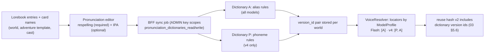
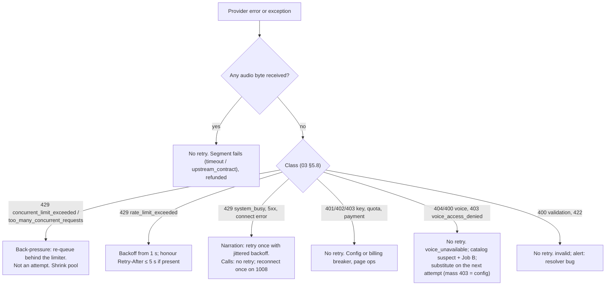
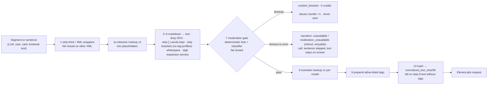
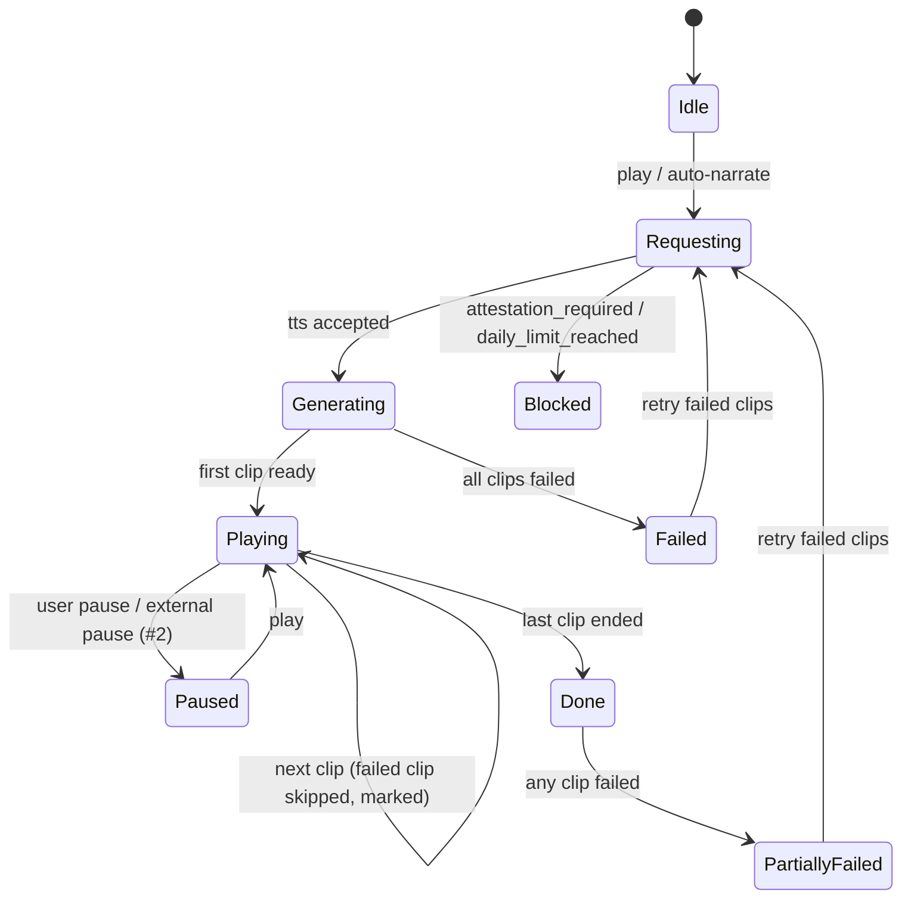

# 12. Best practices and improvements

- **Date:** 2026-10-12
- **Status:** Proposed (see [03](03_target_architecture_and_decisions.md) for sign-off status)

## Scope

This document turns ElevenLabs' published guidance and our own research into concrete rules for magic-worlds, and lists what we improve along the way. It covers six things:

1. ElevenLabs best practices, applied per surface (narration, calls, previews, catalog, admin).
2. Engineering practices for the BFF and SPA code that talks to the provider.
3. Every known bug from the MiniMax baseline review, with its fix approach and whether it lands in the migration or separately (D30).
4. The opportunity backlog of new ElevenLabs features (D29).
5. UX improvements for narration and calls.
6. Anti-patterns to avoid.

It adds no decision. Where a rule here touches a decision, the decision record [03](03_target_architecture_and_decisions.md) wins, and this document cites it by id (D05, S-6, L-2 …). Prices and model facts are **as of 2026-10-12** (list prices; the v4 launch promo ends on that date). Anything that still depends on a staging spike (S-n, [03 §6.1](03_target_architecture_and_decisions.md)) or a written confirmation (L-n, [03 §6.2](03_target_architecture_and_decisions.md)) is labelled as such.

**Related:** [03 decisions](03_target_architecture_and_decisions.md) · [01 current state](01_current_state.md) · [02 ElevenLabs capabilities](02_elevenlabs_capabilities.md) · [04 catalog and Library](04_voice_catalog_and_library.md) · [05 Voice Studio and admin console](05_voice_studio_and_admin_console.md) · [06 narration](06_chat_narration_migration.md) · [07 calls](07_realtime_calls_migration.md) · [08 backend plan](08_backend_refactor_plan.md) · [09 frontend plan](09_frontend_refactor_plan.md) · [10 data migration and rollout](10_data_migration_and_rollout.md) · [11 cost and operations](11_cost_plans_and_operations.md) · [13 policy and privacy](13_policy_privacy_and_compliance.md) · [14 spikes and contract tests](14_staging_spike_and_contract_tests.md) · [15 implementation plan](15_implementation_plan_and_acceptance.md) · [16 risks](16_risks_and_open_questions.md)

---

## 1. How to use this document

| Prefix | Meaning | Consumed by |
|---|---|---|
| **EL-nn** | ElevenLabs best practice applied to this app (§2) | [08](08_backend_refactor_plan.md), [09](09_frontend_refactor_plan.md), code review |
| **ENG-nn** | Engineering practice for this codebase (§3) | [08](08_backend_refactor_plan.md), [09](09_frontend_refactor_plan.md), [14](14_staging_spike_and_contract_tests.md) |
| **#n**, **M-n**, **LW-n**, **T-n** | Known bug from research 00 (#1–#19), migration-surfaced defect (M), lower-severity item (LW), test gap (T) (§4) | [15](15_implementation_plan_and_acceptance.md) task list |
| **OPP-nn** | Opportunity backlog item (§5) | owner prioritisation (D29) |
| **UX-nn** | UX improvement (§6) | [09](09_frontend_refactor_plan.md) |
| **AP-nn** | Anti-pattern (§7) | code review checklist |

Evidence tags follow 03: `[verified]` (official page, read 2026-10-12, through the named research note), `[secondary]`, `[unverified]` (maps to a spike or stays open).

---

## 2. ElevenLabs best practices applied to magic-worlds

### 2.1 Model selection per surface

The server picks the model; stored voices never carry a model id (D11). Model ids live only in the capability registry (§5.4.1, §5.6 of 03).

| Surface | Profile → model | Transport | Output | Why this model | Gate |
|---|---|---|---|---|---|
| Narration, **Standard** (everyone, default) | `narration/standard` → `eleven_flash_v2_5` | TTS HTTP `POST /v1/text-to-speech/{voice_id}` | `mp3_44100_128` | $0.04/1K; 40,000-char limit; honours stability, similarity and speed; no tags (D05) | S-3 |
| Narration, **Expressive** (Plus/Pro opt-in) | `narration/expressive` → `eleven_v4`; fallback `narration/standard` at Standard weight | TTS HTTP | `mp3_44100_128` | Audio tags, best quality; $0.08/1K; style and speed ignored (D05) | S-2, S-3, S-6 |
| Calls | `call` → `eleven_flash_v2_5` | TTS multi-context WebSocket, one socket per call | `mp3_44100_64` | ~75 ms inference, 100–150 ms WS TTFB in NA/EU [verified, [research 01 §13.1](research/01_elevenlabs_tts_models_and_api.md)] (D06, D08) | S-7, S-8, S-9 |
| Calls, flagged upgrade | `call` → `el_v4_turbo` (`eleven_v4_turbo`) via TTD WebSocket, 1 voice | TTD WS | `mp3_44100_64` (D08) | Tags and model-family consistency with Expressive narration; same $0.04/1K | S-18 (OPP-08) |
| Recipe preview | profile of the tier the user selects | TTS HTTP | `mp3_44100_64` | Users hear what they will get (D18) | — |
| Catalog acceptance and own samples | `eleven_flash_v2_5` **and** `eleven_v4`, per language | TTS HTTP, `ADMIN` key | Showcase samples: `mp3_44100_64`, the preview format ([04 §7.2](04_voice_catalog_and_library.md#72-own-samples-voice_sample_asset), 03 §5.4.1), so D18's free default-settings audition is the exact audio a recipe render would return. Acceptance renders: `mp3_44100_128`, the narration/stored format, because they are judged and loudness-measured as narration (proposal: [04 §10.3](04_voice_catalog_and_library.md#103-render-matrix-per-voice-language) does not fix a format) | One identity across both models (D06 item 7, D09) | S-14, S-15, S-16 |
| Root synth lab | any allow-listed model | TTS HTTP | any allowed `output_format` | Lab only (D20) | — |
| Call STT | Groq `whisper-large-v3` (unchanged) | HTTP batch per segment | — | Cheaper ($0.111/h) and no user audio at the new processor (D07) | S-19 for Scribe |

Rules (EL-01 … EL-04):

- **EL-01.** `eleven_multilingual_v2` and `eleven_v3` are **lab-only**. Multilingual v2 is never a production fallback: no tags, never takes `language_code`, same price as v4, not covered by acceptance (D05).
- **EL-02.** Normalise deprecated ids on ingest (`eleven_turbo_v2_5` → `eleven_flash_v2_5`, `eleven_turbo_v2` → `eleven_flash_v2`) and never offer them (03 §5.4.1). `eleven_monolingual_v1`, `eleven_multilingual_v1` and `scribe_v1` were scheduled for removal on 2026-07-09; the models overview no longer lists the v1 TTS models and still lists `scribe_v1` as deprecated, so treat all three as gone [verified, [research 05 §9.4](research/05_elevenlabs_platform_pricing_limits_policy.md)].
- **EL-03.** v4 and v4 Turbo are rejected at the TTS WebSocket handshake (HTTP 400 `unsupported_model`). That is a configuration error, never retried [secondary, [research 12 §2](research/12_gap_model_protocol_facts.md)].
- **EL-04.** ElevenLabs says v4 is "under active, continuous development" and its behaviour "may shift over time" [verified, [research 01 §0](research/01_elevenlabs_tts_models_and_api.md)]. Keep a small **golden listening set** (the acceptance scripts on 3–5 house voices) and re-render it when the changelog mentions v4 or Flash. A regression flips Expressive to Standard by config (D05), never to another model.

### 2.2 Audio tags on v4/v3: allow-list, placement and prompt rules

**Facts that drive the rules** (as of 2026-10-12):

- On v3/v4, audio tags are natural-language instructions, not an enum, so **any** `[…]` is a candidate instruction. No escape mechanism is documented [verified, [research 12 §7](research/12_gap_model_protocol_facts.md)].
- v4 "can occasionally" read a tag as a sound effect; tags "land more readily when the delivery is already in the voice's training data"; tags combine and apply until the delivery shifts [verified, [research 01 §5.2](research/01_elevenlabs_tts_models_and_api.md)].
- Tag characters stay in the alignment data with non-zero duration [secondary, [research 12 §7](research/12_gap_model_protocol_facts.md)].
- Flash and Multilingual v2 have no tags; `[ ] { } < >` "will usually result in low quality speech" [verified, research 12 §7].
- Today narration sends brackets and markdown to the provider unchanged, and user text, card fields and lorebook entries can carry brackets ([research 13 §9](research/13_gap_codebase_checks.md)). On v4 that is both an artefact risk and a tag-injection path.

**EL-05. Only the server emits tags, and only these** (verbatim from 03 §5.5.2):

> Only the server emits tags, only these, and only on profiles with `supports_audio_tags=true`:
> - emotion: `[happily]`, `[sad]`, `[angry]`, `[surprised]`, `[calm]`, `[nervously]`, `[disgusted]`;
> - thought: `[whispers]`;
> - pauses (from markup v1): `[short pause]`, `[long pause]`;
> - interjections (from markup v1): `[laughs]`, `[sighs]`, `[gasps]`, `[inhales deeply]`, `[exhales]`, `[hums]`.
>
> Composition order for a segment: `[thought tag] [emotion tag] text`, for example `[whispers] [sad] …`. At most two prefix tags.

**EL-06. Emotion mapping** (verbatim from 03 §5.5.1, `emotion_map_version = 1`):

| `emotion` | Expressive (v4/v3/v4_turbo): prefix tag | Standard (Flash/multilingual_v2): stability offset | Tag source |
|---|---|---|---|
| null | none | 0 | — |
| `happy` | `[happily]` | −0.15 | documented [verified: https://elevenlabs.io/docs/overview/capabilities/text-to-speech/best-practices, via research/01 §5.2] |
| `sad` | `[sad]` | −0.10 | documented (same source) |
| `angry` | `[angry]` | −0.20 | documented (same source) |
| `surprised` | `[surprised]` | −0.10 | documented (same source) |
| `calm` | `[calm]` | +0.15 | docs and blog examples [research/01 §5.3] |
| `fearful` | `[nervously]` | −0.20 | free-form [unverified] |
| `disgusted` | `[disgusted]` | −0.10 | free-form [unverified] |

The Standard offset is applied as `effective_stability = clamp(base + offset, 0, 1)` and is never stored (03 §5.5.1). The offsets and the two free-form tags are unverified until **S-6** (listening test on 3–5 catalog voices, en and es). A tag that fails becomes "no tag" for its row; `[whispers]` failing leaves thoughts on gain only (D16).

**EL-07. Placement.**

- ElevenLabs' own "Enhance" prompt places tags "immediately before the dialogue segment they modify or immediately after" [verified, research 01 §5.2]. Our segments are already one speaker and one delivery, so emotion and thought tags go **as a prefix of the segment** (step 9 of the sanitizer, 03 §5.5.3).
- Pauses and interjections exist only as markup v1 in stored text (D27) and are translated **in place**, at the position where the LLM wrote the neutral marker (sanitizer step 8, table verbatim from D27):

  | Markup v1 | Flash / multilingual_v2 | v4 / v4_turbo / v3 |
  |---|---|---|
  | `<#x#>` pause | `<break time="xs"/>` (x ≤ 3 s, clamped) if **S-26** passes, else `…` | x < 0.5 → `…`; 0.5–1.5 → `[short pause]`; ≥ 1.5 → `[long pause]` |
  | `(laughs)` … interjections | stripped | `[laughs]`, `[sighs]`, `[gasps]`, `[inhales deeply]`, `[exhales]`, `[hums]` |

- At launch the call profile is Flash (`supports_audio_tags=false`), so `CALLBOT_INTERJECTIONS_ENABLED` is forced off (D27). The callbot prompt gates **both** the pause and the interjection instructions behind that one flag ([callbot_chat.v2.json:32](/home/andres/PycharmProjects/magic-worlds-api/src/agent_graphs/runtime/callbot_chat.v2.json)), so at launch the callbot emits no markup v1 at all; the translation table matters for stored history and for the flagged v4 Turbo upgrade (OPP-08).
- Match tags to voices: a tag a voice cannot perform is a catalog problem, caught at acceptance ("emotion-tag response" is a rubric column, D09).

**EL-08. What the LLM prompts should and should not emit.** Stored text stays provider-neutral (D27); the prompts never ask for ElevenLabs syntax. (Research 02 §11.4 suggested a model-aware prompt that asks for `[laughs]` on v4; that is **not adopted**, because it would tie stored history to one model and re-open injection.)

| Graph | Should emit | Must not emit | Enforced by |
|---|---|---|---|
| Callbot ([callbot_chat.v2.json:32](/home/andres/PycharmProjects/magic-worlds-api/src/agent_graphs/runtime/callbot_chat.v2.json)) | Short spoken sentences in the story language. Numbers, money, dates, times and ordinals spelled out (already in the prompt). Delivery through punctuation (`…`, `—`, `?`, `!`). Markup v1 (`<#x#>` pauses and `(laughs)`-style interjections) **only** while `CALLBOT_INTERJECTIONS_ENABLED` is on; it gates both and is forced off while the call profile has no tag support (Flash at launch, D27) | Square brackets of any kind; ElevenLabs audio tags; SSML (`<break>`, `<phoneme>`); IPA; markdown, asterisk stage directions, emoji; URLs, code, raw digits and symbols; instructions to the voice ("whispering:") | Sanitizer: fail-closed on XML (step 1), bracket strip (steps 4–5), digit expansion (step 6), 03 §5.5.3 |
| Chat graphs that feed narration ([adventure_chat.v2.json](/home/andres/PycharmProjects/magic-worlds-api/src/agent_graphs/runtime/adventure_chat.v2.json), [character_chat.v2.json](/home/andres/PycharmProjects/magic-worlds-api/src/agent_graphs/runtime/character_chat.v2.json), [character_group_chat.v2.json](/home/andres/PycharmProjects/magic-worlds-api/src/agent_graphs/runtime/character_group_chat.v2.json)) | Prose inside the existing `<narrator>`, `<say>`, `<think>` segments; numbers spelled out in the story language (D27); the new turn `language` field in the turn-metadata output (D17) | The new rule "do not use square brackets" (D14), which also covers `[OOC …]` asides; audio tags; markup v1; SSML; IPA; speaker labels inside speech text ("Eldrin: …"), because attribution is structural | Same pipeline |

**EL-09. Not adopted: LLM-inserted tags.** ElevenLabs publishes an "Enhance" prompt that inserts tags with an LLM. We do not use it: tags would no longer come from our allow-list (any `[…]` is a candidate instruction, so an LLM-chosen tag re-opens the injection path), and the stock prompt also carries its own content rule (it forbids NSFW content), which is not our moderation gate (D26) [verified, research 01 §5.2]. A future per-segment emotion hint must use the neutral 7-value enum, never free text (OPP-13).

### 2.3 Text normalization and numbers

Official sources contradict each other on whether Flash v2.5 normalizes numbers (C17): the models page says it is off by default and "on" is Enterprise-only; best practices and a 2025-09 changelog say it is on [verified, [research 12 §6](research/12_gap_model_protocol_facts.md)]. The docs' own example: Flash reads "$1,000,000" as "one thousand thousand dollars" [verified, research 01 §10.1]. So we normalize upstream and treat the provider as a backstop (D27).

| Layer | What it does | Languages |
|---|---|---|
| Prompts (callbot today; chat graphs gain it, D27) | Spell out numbers, money, dates, times, ordinals; expand abbreviations and units; no raw symbols or URLs | all |
| Sanitizer step 6 (`sanitizer_version = 1`) | Expand residual digits in non-placeholder text | en, es |
| `language_code` (D17) | Tells the provider's normalizer which language rules apply | per allow-list |
| `apply_text_normalization: "auto"` | Sent explicitly; the provider decides. Never relied on for Flash | all |

- **EL-10.** Never send `apply_text_normalization: "on"` (Enterprise gating unclear; CT-08 records the answer) and never send `apply_language_text_normalization` (Japanese only, "can heavily increase the latency") [verified, research 12 §5.1].
- **EL-11.** The digit expander is **language-aware**: `1.250` is one thousand two hundred fifty in Spanish and one point two five in English; `12/03/2026` is day-first in Spanish. Use the D17 effective language, and leave the digits alone when the language is unknown.
- **EL-12.** Roleplay-specific fixtures for [14](14_staging_spike_and_contract_tests.md) and the sanitizer tests: dice notation (`d20`, `2d6+3`), regnal numerals (`Henry IV`, must not be expanded), currency (`$1,250.50`, `1.250 €`), times (`3:45 pm`, `15:30`), ordinals (`1st`, `1.º`), percentages, ranges (`3-5`), and a pause marker next to digits (`He waited <#0.4#> 3 seconds`, already a 03 §5.5.3 fixture).
- **S-5** measures Flash under `auto` cheaply through `normalized_alignment` (CT-08). If Flash turns out to normalize well, only the expansion tables shrink; the design does not change.

### 2.4 Pronunciation of world and character names

Invented names are the biggest narration quality lever (D29 rationale). Dictionaries are a **P1** feature (OPP-01); until then, names are read as written.

**Facts** [verified, [research 01 §7](research/01_elevenlabs_tts_models_and_api.md)]:

| Rule type | `eleven_v4` | `eleven_flash_v2_5` | Notes |
|---|---|---|---|
| **Alias** (`string_to_replace` → respelling) | yes | yes | Works on every model we use |
| **Phoneme** (IPA or CMU) | yes | **skipped** | Non-English IPA needs v4 |
| Inline IPA `"/…/"` in text | yes | no | We do not let the LLM write IPA (EL-08) |

- Up to **3 locators per request**, applied in order; the dictionary is searched "start to end and only the very first replacement is used".
- `add-rules`, `remove-rules` and `set-rules` each return a **new `version_id`**; `case_sensitive` and `word_boundaries` exist since 2026-03.
- On TTS WebSockets, locators go only in the first message, matches are "only respected within a provided chunk", and phoneme dictionaries need `enable_ssml_parsing=true`.

**EL-13. Design sketch for P1** (BE/FE detail goes to [08](08_backend_refactor_plan.md) and [09](09_frontend_refactor_plan.md) when P1 is scheduled):

- **Two dictionaries per world**, not one: Flash skips phoneme rules, and whether a skipped phoneme rule still counts as the "first match" (hiding a later alias for the same word) is **[unverified]**. Splitting them avoids the question. v4 receives `[P, A]`; Flash receives `[A]`. That uses at most 2 of the 3 locators and leaves one for an app-wide house dictionary.
- **Every entry needs a respelling**; IPA is optional. Calls (Flash) and Standard narration then always benefit.
- The dictionary **version ids enter the reuse hash** (03 §5.6). A lorebook edit therefore changes the hash for new turns only; existing clips stay as they are.
- **Open before P1** (add to [14](14_staging_spike_and_contract_tests.md) when P1 is scheduled): whether a key with only `text_to_speech` may reference a locator, or whether `NARRATION`/`CALLS` need `pronunciation_dictionaries_read` (a D04 amendment); limits on rule count per dictionary; whether alias substitution changes `character-cost`; dictionary behaviour on the multi-context socket with and without `enable_ssml_parsing` (overlaps S-26).
- **Fallback option** if provider dictionaries disappoint: a server-side alias substitution step in `SpeechTextPipeline` (works on every model, no provider state). Its cost: the billed text and alignment then differ from the displayed text, which matters for word highlight (OPP-05).

### 2.5 Chunking, segment limits and request stitching

| Item | Rule | Source |
|---|---|---|
| Per turn | ≤ 2,500 characters, ≤ 12 segments, ≤ 1,200 characters per segment, never more than the remaining daily cap | D24, 03 §5.9 |
| Model limits | v4 10,000; Flash 40,000; read `maximum_text_length_per_request` from `GET /v1/models` at startup | 03 §5.6 |
| One request per segment | Keeps per-character recipes and per-segment retry | D05 |
| Text to Dialogue for narration | **Not used** (one global settings object, ≤ 2,000 characters recommended, retries per turn) | D05, [research 12 §3](research/12_gap_model_protocol_facts.md) |
| `previous_request_ids` | **Never.** ZRM-incompatible; using it would block a later switch to ZRM | D05, D25 |
| `previous_text` / `next_text` | Off until S-17 shows they are accepted and not billed (v3 reportedly rejects `previous_text`, CT-19) | D05 |
| `seed` | Stable 32-bit hash of `job_id`; deliberately **not** part of the reuse hash (03 §5.6) | D05 |

- **EL-14 (recommended; the segment builder is owned by [06](06_chat_narration_migration.md)).** Today one over-limit clip rejects the whole turn ([research 00 §2](research/00_current_tts_review.md)). Instead of refusing a segment above the 1,200-character clip cap, split an over-long segment at sentence boundaries into consecutive clips of the same speaker. The pieces count toward the 12-segment cap.
- **EL-15. Calls keep sentence units.** `SentenceBuffer` stays, because moderation must pass **before** text is flushed (D06, D26). Each moderated sentence is sent with `flush: true`, with a flush-ahead window of at most 3 sentences or about 8 s beyond `played_ms`, and never split inside a markup v1 marker (D27). Research 02 §6.3 proposed word-level streaming; it is not adopted, because unmoderated text would reach the provider.
- **EL-16.** Tuning `chunk_length_schedule` and `auto_mode` is an S-8 fallback lever, not a default. With per-sentence `flush` the schedule matters mostly for long sentences.

### 2.6 `language_code`

The full chain is 03 §5.7; the practical rules are:

- **EL-17.** Turn language → voice language → user preferred language → omit (D17). The **story** decides, not the UI locale.
- **EL-18.** Lower-case ISO 639-1, no region (`es`, never `es-ES` or `spa`); `yue` and `zh` only for v4 Turbo. Filter by the per-model allow-list from `GET /v1/models`, because Flash answers an unsupported code with **HTTP 400**, not a no-op [secondary, research 12 §5.1]. Never send it to Multilingual v2.
- **EL-19.** v4 speaks a target language with a **native** accent when it differs from the voice's language, instead of carrying the voice's accent over [verified, research 01 §9]. A Spanish voice narrating English on v4 can therefore sound like a different person. This is why acceptance is per `(voice, model, language)` and the picker shows "Not tested in {language}" (D34).
- **EL-20.** The effective code enters the reuse hash, and the same chain feeds the Groq STT hint (03 §5.7).

### 2.7 Voice settings tuning

| Setting | Default (03 §5.1.1) | User-editable | Sent on Flash | Sent on v4 | Practice |
|---|---|---|---|---|---|
| `stability` | 0.5 | yes | yes (+ Standard emotion offset) | yes | Lower is more expressive and less consistent. Starting guidance: 0.3–0.5 for expressive characters, 0.6–0.8 for steady narrators [unverified; tuned at acceptance] |
| `similarity_boost` | 0.75 | yes | yes | yes | Too high reproduces artefacts of poor source audio [verified, research 01 §3.1] |
| `style` | 0 | no (lab only) | stripped | stripped | ElevenLabs recommends 0: non-zero adds latency and is "slightly less stable" |
| `use_speaker_boost` | true | no (lab only) | stripped | stripped | "Rather subtle"; adds latency |
| `speed` | 1.0 | yes (Standard only) | yes, 0.7–1.2 | stripped (ignored by v4) | Out-of-range values are rejected with 400 on Multilingual v2, not clamped [secondary, research 12 §4.2] |

- **EL-21.** Send `voice_settings` on **every** request from the resolved recipe. Never write recipes into the account's stored voice settings (`POST /v1/voices/{id}/settings/edit`): those are shared by every user of the voice [verified, research 01 §3.4].
- **EL-22.** Validate at write time (422 out of range, D13); strip at request time per 03 §5.6, logging stripped keys as a debug metric. The exact Flash allow-list is final only after **S-3**.
- **EL-23.** On a TTS WebSocket, settings go in the first message of a context and **never change** mid-socket (CT-18: a change closes with 1008). On the TTD WebSocket only `stability` exists, first message only.
- **EL-24.** Recipe previews quantize settings to 0.05 steps before the cache key and the request, so slider nudges hit the cache (D18).

### 2.8 Latency

Targets (D06), measured at the BFF in the production region: call **p50 first audio ≤ 250 ms** after the first sanitized sentence is ready, **p95 ≤ 600 ms**, both including the synchronous moderation check; no 1008 across 200 scripted barge-ins; end-to-end "user stops speaking → first audio" must not regress vs the MiniMax baseline measured in R0.

| Lever | Rule | Ref |
|---|---|---|
| Model | Flash for calls; v4 TTFB is not published | D06 |
| Warm socket | Open the call's multi-context socket at call accept (after consent and attestation have passed), in parallel with the first STT; `inactivity_timeout=180`; keepalive every ≤ 15 s, per context only after its initialising message | D06 rules 1, 4 |
| Region | ElevenLabs serves from the US, the Netherlands and Singapore; the BFF's own host location matters more than the user's. Log `x-region` on every response. `ELEVENLABS_BASE_URL` can be switched to `https://api.us.elevenlabs.io` by ops. Residency hosts are Enterprise-only separate workspaces: never mix them with our keys | [research 01 §13.2](research/01_elevenlabs_tts_models_and_api.md), 03 §5.4.3 |
| Format | `mp3_44100_64` for calls; higher bitrates add latency for little gain | D08 |
| Voice type | PVC voices are slower than designed and IVC voices; prefer designed voices for call-eligible defaults (`use_pvc_as_ivc` exists as an escape hatch and is no longer deprecated since 2026-09-28) [verified] | [research 02 §11](research/02_elevenlabs_streaming_dialogue_realtime_agents.md), [research 05 §9.3–§9.4](research/05_elevenlabs_platform_pricing_limits_policy.md) |
| Settings | `style = 0`; speaker boost not sent on Flash | §2.7 |
| Moderation | Classify sentence N while N−1 plays; only the first sentence of a turn pays classifier latency (300 ms budget); S-29 measures | D26 |
| HTTP | One shared `httpx.AsyncClient` per key with keep-alive, so narration does not pay a TLS handshake per segment [unverified: general practice] | D03 |
| Queueing | Over the concurrency limit, ElevenLabs queues; this "typically only adds ~50ms". Watch `current-concurrent-requests` | [research 05 §3.3](research/05_elevenlabs_platform_pricing_limits_policy.md) |

If S-8 misses the target, the ordered fallbacks are: tune `chunk_length_schedule`/`auto_mode`, then PCM + AudioWorklet (D08), then v4 Turbo (S-18). Narration latency depends on generation speed (S-21 expects about 1.5 s per 1K characters on Flash and about 4 s on v4 [unverified]).

### 2.9 Caching and reuse

ElevenLabs offers no free regenerations over the API: "Free regenerations … are not available via the API" [verified, research 01 §12.2]. Every miss is paid, so reuse is a money feature.

- **EL-25. Narration reuse runs before any reservation** (D24): a completed hit attaches the asset free; a pending or in-progress hit attaches to the existing job; only misses are charged. Reuse hash v2 is computed over (verbatim from 03 §5.6):
  - `provider`, `provider_model_id`, resolved `provider_voice_id`;
  - effective (post-strip) settings;
  - effective `language_code`;
  - the composed tag prefix;
  - `emotion_map_version`, `sanitizer_version`;
  - `output_format`;
  - pronunciation dictionary version ids (P1).
- **EL-26. Previews:** a shared `voice_preview_render` cache keyed by `sha256(provider_voice_id, model_id, quantized effective settings, tag_prefix, language_code, text_id, output_format)`; hits are free and not counted (D18). Default-settings auditions serve the own catalog sample instead of rendering.
- **EL-27. Catalog samples** are our own pre-rendered audio (`voice_sample_asset`), served by `GET /voices/catalog/{voice_key}/preview.mp3` with `Cache-Control: private, max-age=86400` and a content hash in the URL; upstream `preview_url` is never served to users until L-3, and never hotlinked (D10).
- **EL-28.** Narration audio is **not** shared across users or sessions: the text is private story content. Cross-user caching exists only for previews (fixed texts) and catalog samples.

### 2.10 Retries, backoff and `Retry-After`

03 §5.8 is the authoritative mapping of every provider signal to a category, retry class, refund and side effect. The rules of thumb that follow from it:

- **EL-29.** Match `detail.code` first, then the legacy `detail.status`; accept both `concurrent_limit_exceeded` and `too_many_concurrent_requests` [verified, [research 05 §3.4](research/05_elevenlabs_platform_pricing_limits_policy.md)].
- **EL-30.** `Retry-After` is **undocumented**; honour it (and `retry-after-ms`) when present, capped at 5 s for narration, otherwise exponential backoff with full jitter. S-24 records what the server actually sends.
- **EL-31.** Never use the SDK's built-in retries (2 blind retries on 408/409/429/5xx and a 240 s timeout, D03). Never auto-retry admin creates (design, IVC, Library add): each consumes slots or voice ops.
- **EL-32.** Circuit breakers per path (narration, call TTS, preview, admin): open after 5 transient failures in 30 s, 30 s cool-down, half-open probe. While open: narration fails fast and is refunded, auto-narrate pauses, new calls are refused, live calls continue as text (03 §5.8).
- Starting timeouts (from [research 05 §9.5](research/05_elevenlabs_platform_pricing_limits_policy.md); BE owns the final values in [08](08_backend_refactor_plan.md)):

  | Path | Connect | First byte / audio | Total or idle | Attempts |
  |---|---|---|---|---|
  | Narration HTTP | 5 s | 15 s | 45 s (Flash) / 60 s (v4) | 2, only if no byte received |
  | Recipe preview | 3 s | 8 s | 15 s | 1 |
  | Call TTS WS | 3 s | 3 s per sentence | 5 s between chunks | reconnect once (D06 rule 5) |
  | Admin creates | 5 s | — | 120 s | 1 |
  | Catalog reads | 5 s | — | 20 s | 3 |

### 2.11 Concurrency control

- **EL-33.** Concurrency is a property of the workspace, **shared by all keys**; per-key limits are Enterprise-only [verified, research 05 §3.2]. Partitioning is our job: one provider limiter with pools `flash` (24 of 30) and `non_flash` (12 of 15: narration Expressive 10, preview 1, admin 1) (D02). Calls count against `flash` only while generating (03 §5.6).
- **EL-34.** The limiter is in-process while the BFF is single-process (bug #19) and moves to a MySQL lease table (or Redis) when #19 is fixed (D37). Never run a second worker before that: it would double the effective limit.
- **EL-35.** Adapt from headers: read `maximum-concurrent-requests` and shrink the local pool when the provider reports less than configured. Numbers are read, never hard-coded (D02).
- **EL-36.** Each call holds at most 4 live contexts on its socket (5 allowed); closed contexts count until their slot is observed free, about 5 s (D06). TTD sessions (OPP-08) are a separate pool of 105 on Scale, held for the socket's whole life.
- **EL-37.** Before R2, load-test with the ElevenLabs Locust recipe: simulated users, slow ramp, randomised 50–300-character sentences (S-21; [research 05 §11.4](research/05_elevenlabs_platform_pricing_limits_policy.md)).

### 2.12 Key security

The six production keys (verbatim from 03 §5.4.3):

| Env var | Surface | Scopes | `character_limit` |
|---|---|---|---|
| `ELEVENLABS_KEY_NARRATION` | narration jobs | `text_to_speech` | ~65% of monthly budget |
| `ELEVENLABS_KEY_CALLS` | call TTS (+ STT if Scribe is adopted) | `text_to_speech` (+ `speech_to_text`) | ~30% |
| `ELEVENLABS_KEY_PREVIEW` | user recipe previews only; readiness probe | `text_to_speech` | hard cap ~2% |
| `ELEVENLABS_KEY_CATALOG` | Jobs A/B, models | `voices_read`, `models_read` | minimal |
| `ELEVENLABS_KEY_ADMIN_VOICES` | root console, acceptance renders, catalog sample renders | `voices_read`, `voices_write`, `voice_generation`, `create_instant_voice_clone`, `add_voice_from_voice_library`, `text_to_speech`, `pronunciation_dictionaries_read`, `pronunciation_dictionaries_write` | small cap (sized for one full catalog render) |
| `ELEVENLABS_KEY_OPS` | reconciliation, history sweep, webhooks, subscription probe | `user_read`, `workspace_analytics_full_read`, `speech_history_read`, `speech_history_write`, `webhooks_write` | smallest non-zero value until S-28 says what 0 means |
| `ELEVENLABS_BASE_URL` | all | — | default `https://api.elevenlabs.io`; ops switch `https://api.us.elevenlabs.io` |

Checklist (EL-38):

- [ ] Never `permissions: "all"`; never grant `publish_voice_to_voice_library`, `share_voice_externally`, `create_user_api_key`, `service_account_write` or `terms_of_service_accept` (D04).
- [ ] IP-allowlist the BFF egress on every key; keep `third_party_disable_allowed` on so GitHub leak scanning can auto-disable a leaked key [verified, research 05 §4.2].
- [ ] Rotate quarterly and on any incident: create → deploy → delete. Service-account keys never expire, so rotation is manual.
- [ ] The SPA never holds a key or a single-use token: a browser token would bypass metering, moderation and transcript storage [research 05 §4.4]. (Hygiene note: the SPA's `.env` is untracked but not git-ignored as of 2026-10-12; it only carries `VITE_*` values and must stay that way.)
- [ ] Readiness probes use the key that holds the scope (D04 table); a failed probe degrades one surface, never process start.
- [ ] Every catalog voice is shared with the service account's group; voices created by the admin key are visible only to admins by default [verified, research 05 §4.3].
- [ ] Extend the redactors with `xi-api-key:`, `sk_…`, `sutkn_…` and `ELEVENLABS_KEY_*=` ([image_generation/errors.py:24-32](/home/andres/PycharmProjects/magic-worlds-api/src/services/image_generation/errors.py), [voice_orchestration/errors.py:58-69](/home/andres/PycharmProjects/magic-worlds-api/src/services/voice_orchestration/errors.py)). Note that these redactors also scrub `request-id`/`x-request-id` and anything containing `trace` from message strings ([voice_orchestration/errors.py:68](/home/andres/PycharmProjects/magic-worlds-api/src/services/voice_orchestration/errors.py), [image_generation/errors.py:31](/home/andres/PycharmProjects/magic-worlds-api/src/services/image_generation/errors.py)); the new adapters must carry provider ids in **structured fields**, not inside exception messages, or §3.5 loses its correlation ids.
- [ ] Per-key `character_limit` is a last line of defence only; its unit, reset and error are unknown until **S-28**. App-side guards (D37) are the enforced budget.
- [ ] Staging is a separate Creator/Pro workspace with user keys of the same scopes, tiny quotas, synthetic text only (D02).

### 2.13 Privacy: `enable_logging`, history and retention

| Fact (as of 2026-10-12) | Consequence | Ref |
|---|---|---|
| Without ZRM, TTS text and audio stay in workspace history; deleted items persist up to 30 days in backups; "debugging and moderation logs may still retain data" | Scheduled deletion sweep; copy never says "not stored" | D25, [research 04 §12](research/04_elevenlabs_other_products.md) |
| ZRM (`enable_logging=false`) is Enterprise-only and may be refused for high-risk use | `ELEVENLABS_ENABLE_LOGGING` stays unset until ZRM is granted (L-9) | D25 item 3 |
| ZRM disables request stitching | We never use `previous_request_ids`, so ZRM can be switched on later with no code change | D05, D25 |
| History items include the **text** and are readable by every dashboard seat | Named operator seats only; staff browse history only for a logged incident | D25 item 8 |
| Storage is in the US | Named in the privacy copy | D25 item 6 |
| Training opt-out is an account toggle ("Improve the models"), not a request flag | Toggle switched off (opted out) on day one in production and staging, with a dated screenshot; an R0-exit gate (03 §6.3) | D02, D25 |
| SFX and Music generations are not in the History API | Store our own copy (OPP-04, OPP-07) | research 04 §4.2 |

Checklist (EL-39):

- [ ] OPS sweep deletes history items older than 24 h, one `DELETE /v1/history/{id}` each, continuously, 4 in flight under its own budget. **SLO:** oldest undeleted item < 48 h; alert at 36 h; page at 72 h. Throughput, rate limits and whether multi-context WebSocket TTS creates history items are **S-23** (D25).
- [ ] Privacy copy says "deleted from the provider's history on a regular schedule" and **never promises 24 h**.
- [ ] No user identifiers (ids, emails) in TTS text; store `request_id`, billed characters, region, model and voice per job, never the text (D25 items 4, 5).
- [ ] If Scribe is ever adopted (OPP-02, OPP-09), delete transcripts after use (`DELETE /v1/speech-to-text/transcripts/{id}`) in the same sweep.

### 2.14 Voice consent and voice sourcing

Three different consents meet in this program; keep them separate in code and copy.

| Consent | Who gives it | Rule | Ref |
|---|---|---|---|
| **Voice subject** (IVC) | The person whose voice is cloned | Root-only IVC with a consent record: identity and identity-check method, 18+, consent text version naming ElevenLabs and the app's use, biometric-consent version and jurisdiction, no Library sharing, revocation terms, sample provenance and SHA-256. Samples encrypted; records kept the longer of the legal period or 5 years after deletion. Revocation runs D19 item 9 (removed within 1 business day, provider voice deleted within 7 days, stored audio purged within 30 days) | D20, D19 |
| **End user, voice processing** | The caller | Consent version per provider: `voice-v1` for MiniMax, `voice-v2` for ElevenLabs, persisted on `voice_session.consent_version`; copy names ElevenLabs (TTS) and Groq (STT) and the moderation classifier's provider | D25 item 7 |
| **Library voice owner** | The voice's owner, through the Voice Library terms | Always add; record `terms_at_add`; only curated voices with notice ≥ 365 days, no custom rate, no live moderation, not famous, not child-like; public only after **L-2** | D09, D19 |

- **EL-40.** Users never create provider voices in this program; personalisation goes through presets (D20).
- **EL-41.** No sound-alike or public-figure prompts in Voice Design; no child-like voices in the public catalog; ElevenLabs blocks "no-go" celebrity clones and may ban the account [verified, [research 03 §10](research/03_elevenlabs_voices_catalog_cloning_design.md)].
- **EL-42.** Keep a per-user generation audit (`user_id`, `voice_key`, text hash, `request_id`, time): ElevenLabs traces every generation to **our** account [verified, research 03 §10].

### 2.15 Moderation

ElevenLabs documents **no synchronous moderation error** for plain TTS; enforcement is asynchronous and account-level, and "attempting to violate this Policy is itself a violation" [verified, research 05 §6.2, §6.6]. So the gate is ours and runs before any request (D26).

- **EL-43.** Moderation is **synchronous and fail-closed** on every narration segment (one batched classifier call per turn, 2 s budget), every call sentence (300 ms budget), every recipe preview text and every root free-text test (D26). S-29 measures the classifier; a miss moves the call layer to a self-hosted small classifier, never to fail-open.
- **EL-44.** The classifier is a published `moderation` profile in `api.magic_llm` on a provider already disclosed for story generation, and it is still named in the privacy copy for this purpose (D25, D26).
- **EL-45.** Moderation runs on the text **with placeholders removed** (step 7). Bracket stripping happens before it, so `[whispers]`-style injection can neither steer delivery nor hide words from the classifier.
- **EL-46.** Never red-team ElevenLabs with prohibited content, not even in staging. The moderation path is tested only with mocks (D26).
- **EL-47.** Live-moderated Library voices are banned from the catalog (D09): their refusals are undocumented and add latency.
- **EL-48.** A provider 4xx that mentions terms, verification, moderation or a ban is non-retryable, refunded, marks the voice `blocked` and triggers the incident runbook (03 §5.8). Any enforcement email is a rollback trigger (D28).

### 2.16 Provider change management

- **EL-49.** Clients must "ignore fields they don't recognize and avoid strict typing checks on responses" (ElevenLabs breaking-change policy); no notice period is defined and the changelog is weekly [verified, research 05 §9.4]. Validate only the fields we rely on (D03).
- **EL-50.** Startup readiness: `GET /v1/models` must list every configured model with its `maximum_text_length_per_request` and `languages[]`; a missing model degrades its surface (D04).
- **EL-51.** A weekly ops review of the changelog; plan about 4 weeks of lead time for model removals.
- **EL-52.** Before shipping any ElevenLabs feature, check that its docs carry no alpha, beta or preview label (Beta Services Addendum, D29).
- **EL-53.** Do not build on deprecated surfaces: `GET /v1/voices` v1 listing (use `/v2/voices` with cursor and `voice_ids` batches ≤ 100), `GET /v1/usage/character-stats` (use `usage-by-product-over-time`), `optimize_streaming_latency`, `POST /v1/text-to-voice/create-previews` (use "Design a voice"), `api-global-preview.elevenlabs.io`, `max_characters_request_*` model fields [verified, [research 03 §13](research/03_elevenlabs_voices_catalog_cloning_design.md), research 05 §9.4].

---

## 3. Engineering best practices for this codebase

### 3.1 Provider-neutral seams

| Practice | Rule | Ref |
|---|---|---|
| **ENG-01** One adapter package | Only `providers/elevenlabs/*` imports provider URLs, header names or `detail.code` strings. Everything else sees `SpeechSynthesisProvider`, `StreamingSpeechProvider`, `SpeechToTextProvider`, `VoiceCatalogProvider`, `ProviderErrorClassifier`, `VoiceCapabilityRegistry`, `VoiceResolver`, `SpeechTextPipeline`, `ProviderRouter` | 03 §2.1 |
| **ENG-02** Neutral app state | `app.state.speech_synthesis_provider`, `speech_streaming_provider`, `voice_catalog_provider` replace `minimax_tts_provider` and `minimax_voice_admin_*` | 03 §2.1 |
| **ENG-03** SPA never names a provider | Capabilities come from `GET /voices/capabilities`; tiers and badges, never model ids (`accepted_models` uses tier names) | D13, D35 |
| **ENG-04** Grep gates in CI | FE: no `.voice_id` reads outside the V1 parser and `hasAssignedVoice`/`voiceIdentity`/`isSameVoice` (D35). BE (recommended): no `api.elevenlabs.io`, `xi-api-key` or `eleven_` model literals outside the adapter package and the capability table | D35 |
| **ENG-05** One text pipeline | `SpeechTextPipeline` replaces `normalize_tts_text` ([registry.py:248-253](/home/andres/PycharmProjects/magic-worlds-api/src/services/tts_generation/registry.py)) and `normalize_text_for_tts` ([transcript_sanitizer.py:170-180](/home/andres/PycharmProjects/magic-worlds-api/src/services/voice_orchestration/transcript_sanitizer.py)) for narration, calls and previews | D14, D27 |

### 3.2 Strict contracts, tolerant readers

- **ENG-06. Strict for our data.** `CharacterVoiceV2` and `VoiceSettingsV2` are `strict=True, extra="forbid"` (03 §5.1.3); the same model validates shape on write, read and resolve (fixes #10). Catalog eligibility is a separate write-service function, `validate_voice_change(old, new, actor)`, run only when a voice is set or changed (D32).
- **ENG-07. Tolerant for provider data.** Parse responses into models that ignore unknown fields (EL-49); accept snake_case and camelCase on sockets (`context_id`/`contextId`, `is_final`/`isFinal`); accept `detail.code` and legacy `detail.status`; parse both the structured error body and FastAPI-style `detail[]` [verified, research 01 §12.1].
- **ENG-08. Union readers during the window.** V1/V2 readers on both sides from R0; FE parsers preserve the whole object for both shapes (03 §5.1.2).
- **ENG-09. Closed public enums stay closed.** New internal categories (`voice_unavailable`, `attestation_required`, `moderation_unavailable`) map to existing public statuses with an `error.code`, so older SPA builds keep working during the canary (03 §5.8).
- **ENG-10. Data-driven audio frames.** `sample_rate`, `codec` and `channels` travel on every `voice_audio_chunk` and `tts_asset`; validators accept {22050, 24000, 44100} plus legacy 32000 on read (D08, 03 §5.14).

### 3.3 Async I/O

- **ENG-11.** No blocking work on the event loop: provider bytes are written via `asyncio.to_thread`, **outside** the `tts_job` row-lock transaction (fixes #11; today `_atomic_write` fsyncs inline, [storage.py:224-239](/home/andres/PycharmProjects/magic-worlds-api/src/services/tts_generation/storage.py)). Hex decoding disappears with MiniMax.
- **ENG-12.** One `httpx.AsyncClient` per key, created in the lifespan and closed on shutdown; `websockets` for sockets; explicit connect, first-byte and idle timeouts (§2.10).
- **ENG-13.** Cancellation-safe jobs: on shutdown, terminalize in-flight jobs instead of only cancelling tasks; a global stale sweep replaces per-user cleanup (fixes #8, [tts_generation/engine.py:296-310](/home/andres/PycharmProjects/magic-worlds-api/src/services/tts_generation/engine.py)).
- **ENG-14.** Named DB locks belong to their connection: catalog sync jobs hold `GET_LOCK('voice_catalog_sync', 0)` on a **dedicated** connection taken out of the aiomysql pool for the whole job (D10).
- **ENG-15.** Backpressure, not unbounded queues: the provider limiter (EL-33) and the call flush-ahead window (EL-15) bound in-flight work; token buckets bound users (D37).

### 3.4 Idempotency and money safety

| Practice | Rule | Ref |
|---|---|---|
| **ENG-16** Reuse before charge | Reuse lookup, then one reservation per turn for all misses | D24 |
| **ENG-17** Settlement | `final = ceil(Σ completed std/400 + Σ completed expr/200)`; refund `reserved − final` at turn settlement; stale-charge sweep settles orphaned charges | D24 item 6 |
| **ENG-18** Retry only before the first byte | A body that started streaming is never re-requested; it would bill twice | 03 §5.8, #12 |
| **ENG-19** Our count bills users | Users are charged by our own character count on the step-8 text; `character-cost` is logged for reconciliation only | D24 item 10 |
| **ENG-20** Deterministic ids | `seed` from `job_id`; context id `t_<turn_id>`, never reused; reuse hash v2 | D05, D06 |
| **ENG-21** Idempotent side effects | Webhooks deduplicated by `voice_catalog_event.dedupe_key`; history deletion treats 404 as done; catalog removal only after Job B's per-voice confirmation | D10, D25 |
| **ENG-22** Billing parser | Whole-frame MP3 parser that returns `(duration_ms, consumed_bytes)` and carries the tail to the next slice | D08, [research 12 §12.1](research/12_gap_model_protocol_facts.md) |

### 3.5 Observability

| Signal | What to record | Used by |
|---|---|---|
| Provider correlation | `request-id`, then `x-request-id`, then `detail.request_id`; `x-trace-id`; `x-region`; `character-cost`; concurrency headers; model; `voice_key` and `provider_voice_id`. **Never the text** (03 §5.8) | support tickets, reconciliation |
| Narration | jobs by surface, tier, model, key and outcome category; job p50/p95; `tts_failed` rate; `voice_unavailable` and `moderation_unavailable` rates; `substitution_reason` counts; stripped-settings debug metric (D13); tier fallbacks | D28 rollback triggers |
| Calls | first-audio p50/p95 (incl. moderation); 1008 closes and reconnects; drained characters per barge-in; live contexts; `tts_stream_interrupted` | D06 targets |
| Moderation | latency p50/p95 per surface; block rate by category; classifier errors | S-29, D26 thresholds |
| Money | our character counter vs `character-cost` (S-17); `voice_spend_daily` vs budget; daily reconciliation drift > 5% alert | D37 |
| Privacy | history sweep lag (oldest undeleted item), deletions/min, 429s | D25 SLO |
| Catalog | Job A aborts (mass-miss guard), `suspect` voices, readiness probe status per surface | D10, D04 |

- **ENG-23.** Correlate `job_id` ↔ `request-id` ↔ history item id, so a support case or a user deletion can be traced to the provider item without storing text.
- **ENG-24.** Dashboards carry the D28 rollback thresholds as alert lines, so a rollback decision reads straight off one screen.

### 3.6 Contract tests and test doubles

| Layer | What | When | Cost |
|---|---|---|---|
| Unit | Sanitizer fixtures (03 §5.5.3 list + EL-12), resolver matrix (03 §5.10), D33 cast fixture, settlement math, MP3 tail-carry | every CI run | none |
| Adapter | Recorded provider responses (200, 400 `unsupported_model`, 404 `voice_not_found`, 429 variants, 1008 closes, camel/snake frames) replayed against the adapters; request shapes compared with the pinned SDK source as oracle (D03) | every CI run | none |
| Staging contract | CT-01…CT-20 ([research 12 §13](research/12_gap_model_protocol_facts.md)) and T1…T13 (research 11 §9), synthetic policy-safe text only | before each phase gate (03 §6.3) | < $10 total |
| Staging drift smoke (recommended) | A weekly cheap subset: CT-01 (models, free), CT-02, CT-03, CT-10, CT-16 | weekly | cents |
| Load | Locust recipe, call barge-in script | before R2 (S-8, S-21) | small |
| Listening | Acceptance scripts per `(voice, model, language)`; golden set (EL-04) | R0 exit, on model changes | ~$5 per full re-render of the own catalog samples (D10); acceptance renders (4 scripts × 2 models × languages per voice) come on top; [11](11_cost_plans_and_operations.md) budgets the `ADMIN` key for both [assumption] |

- **ENG-25.** Moderation is tested only with mocks (EL-46). The skipped MiniMax live contract placeholder is replaced by the staging suite, not by a live test in CI.
- **ENG-26.** Every "Migration" row in §4.1 gets a regression test (D30), including the missing `TurnNarration` and multi-segment runner tests.

### 3.7 Configuration and runtime switches

- **ENG-27.** Model ids, ranges and limits live in the capability registry, built from the static table plus `GET /v1/models`; no env variable selects a TTS model (the same rule the stack already applies to LLM profiles).
- **ENG-28.** Rollout and kill switches are DB-backed (`voice_runtime_setting`, TTL ≤ 60 s): `rollout_mode`, `canary_percent`, `tts_engine_enabled`, `voice_mode_enabled`, `daily_budget_chars`. Env values are boot defaults only, because a restart drops every live call (D28).
- **ENG-29.** Defaults are catalog rows (`voice_default`); the only env voice value is `VOICE_LAST_RESORT_VOICE_KEY`, validated at startup (D31).

---

## 4. Known bugs: fixes and where they land (D30)

Bug numbers are from [research 00 §3](research/00_current_tts_review.md). Line numbers were re-checked against the working trees on 2026-10-12. "Lands" uses the phase where 03 places the work; where 03 names only the module, the row says so.

### 4.1 Fixed in the migration

| # | Bug | Evidence | Fix approach | Lands | Test |
|---|---|---|---|---|---|
| #1 | Unmetered paid preview: any user, any `voice_id`, free text | [voice_presets.py:99-118](/home/andres/PycharmProjects/magic-worlds-api/src/routes/voice_presets.py) | Catalog auditions from own samples; recipe preview = fixed per-language texts, quantized settings, shared cache, new `voice_preview` op (3 free/day then 1 credit, hard 3/10/20), `PREVIEW` key with a small cap, 6/min token bucket; free text only in the root lab (D18, D37) | Op added in R0 (on MiniMax); provider switch R1 | limit, cache-hit-free and token-bucket tests |
| #3 | One failed segment halts a multi-voice turn; shows Play instead of Retry | [TurnNarration.tsx:225-230](/home/andres/WebstormProjects/magic-worlds/src/features/interaction/components/TurnNarration.tsx), `:268-273` | Per-clip terminal states from the 03 §5.8 categories; the player skips a failed clip and continues; per-clip retry re-requests only failed segments; distinct visuals (UX-01, UX-02) | FE release with the new failure categories | First `TurnNarration` tests |
| #5 | Free re-synthesis: only segment 0 reserves quota | [route_chat.py:1433](/home/andres/PycharmProjects/magic-worlds-api/src/routes/user/route_chat.py), [engine.py:226-258](/home/andres/PycharmProjects/magic-worlds-api/src/services/tts_generation/engine.py) | Reuse first, then one reservation per turn for all misses; in-flight counted per turn (D24) | R0 | Multi-segment runner test with segment 0 reused |
| #6 | Speaker names containing `secret`, `bearer `, `minimax` … fail the turn after the provider was paid ("Tracey" is caught by a `trace` pattern) | [chat_tts_delivery.py:28-49](/home/andres/PycharmProjects/magic-worlds-api/src/services/chat_tts_delivery.py); the `trace` pattern reaches it through [tts_generation/errors.py:66-72](/home/andres/PycharmProjects/magic-worlds-api/src/services/tts_generation/errors.py) → [image_generation/errors.py:31](/home/andres/PycharmProjects/magic-worlds-api/src/services/image_generation/errors.py) | Rewrite the marker list without plain words; match structured secrets only (key prefixes, signed URLs, `data:` URIs); a redaction hit never drops a paid completion silently | With `SpeechTextPipeline` (R0) | Names "Tracey", "Secret Keeper", "Minimax the Bard", "Bearer of Bad News" |
| #7 | No refund on failure | research 00 §2 Path A | Settlement refunds failed segments at turn settlement (D24 item 6) | R0 | Settlement tests |
| #8 | Stuck jobs: shutdown cancels without terminalizing; stale cleanup only on that user's next enqueue; cutoff shorter than worst-case run | [tts_generation/engine.py:296-310](/home/andres/PycharmProjects/magic-worlds-api/src/services/tts_generation/engine.py) | Terminalize on shutdown; global stale sweep at the switch; cutoff above the worst-case timeout budget (§2.10); stale-charge sweep (D24) | R0–R1 | Shutdown and sweep tests |
| #10 | Write validator accepts what the resolver rejects; one bad cast voice breaks all TTS | research 00 §3 | One pydantic model for write, read and resolve; resolver never raises per voice (03 §5.1.3, §5.10) | R0 | Resolver matrix fixtures |
| #11 | Event-loop blocking: hex validation and fsync on the loop | [storage.py:224-239](/home/andres/PycharmProjects/magic-worlds-api/src/services/tts_generation/storage.py) | Bytes (no hex), written in `to_thread`, outside the row lock (ENG-11) | With the ElevenLabs adapter | Loop-lag test under load |
| #12 | Duplicate charges on retry; usage-limit code 2056 retried after 10–50 ms | [minimax_adapter.py:17-25](/home/andres/PycharmProjects/magic-worlds-api/src/services/tts_generation/minimax_adapter.py) | 03 §5.8 retry classes; no retry after first byte; quota and payment never retried (§2.10) | With the adapter | Adapter fixture tests |
| #16 | Sanitizer false positives are fatal ("bearer of bad news"; any 160+ letter run counted as base64) | [transcript_sanitizer.py:18](/home/andres/PycharmProjects/magic-worlds-api/src/services/voice_orchestration/transcript_sanitizer.py), `:284-292` | Shared pipeline; secret detection requires token shape (no spaces, mixed character classes, minimum length) and known prefixes; base64 detection on the raw text, not on whitespace-compacted prose | R0 | 03 §5.5.3 fixtures incl. "bearer of bad news" |
| #17 | Barge-in after the LLM finished persists the full text with truncated audio | [voice_orchestration/engine.py:1785-1821](/home/andres/PycharmProjects/magic-worlds-api/src/services/voice_orchestration/engine.py) | Persist `completed` with sentence-level truncation at `played_ms`; `metadata.voice.truncated`, `played_ms` (D06 item 3); validators widened in R0 | R1 (calls on ElevenLabs) | 200 scripted barge-ins (S-8) |
| M-1 | Card assistant erases `voice` | [research 08 §17](research/08_voice_data_model_migration_surface.md); [assistants/card.py](/home/andres/PycharmProjects/magic-worlds-api/src/services/assistants/card.py) | Preserve `voice` on patch and replace paths; regression test | Before R5 | Assistant round-trip test |
| M-2 | Frontend whitelists strip voice fields | [cardTransforms.ts:57-72](/home/andres/WebstormProjects/magic-worlds/src/utils/cardTransforms.ts), [adventureSnapshot.ts:81-96](/home/andres/WebstormProjects/magic-worlds/src/features/interaction/utils/adventureSnapshot.ts) | V1/V2 pass-through parsers (ENG-08) | R0 | Parser round-trip tests |
| M-3 | V1-keyed FE checks hide V2 voices | [CallsPage.tsx:25-27](/home/andres/WebstormProjects/magic-worlds/src/features/call/components/CallsPage.tsx), [VoicePickerDialog.tsx:35](/home/andres/WebstormProjects/magic-worlds/src/features/voices/components/VoicePickerDialog.tsx) | Shared helpers + CI grep gate (D35, ENG-04) | R0 | Helper tests; gate |
| M-4 | Per-sentence MP3 billing loses partial frames | [voice_orchestration/engine.py:1579-1599](/home/andres/PycharmProjects/magic-worlds-api/src/services/voice_orchestration/engine.py), `:2286-2306` | Whole-frame parser with tail carry (ENG-22), regardless of S-9 | With the call adapter | Split-frame fixtures |
| M-5 | 32 kHz literals | [delivery.py](/home/andres/PycharmProjects/magic-worlds-api/src/services/voice_orchestration/delivery.py) `:159, 342-353`; [registry.py](/home/andres/PycharmProjects/magic-worlds-api/src/services/tts_generation/registry.py) `:29`; [voice.types.ts:165-170](/home/andres/WebstormProjects/magic-worlds/src/shared/types/voice.types.ts) | Widen in R0; sample rate becomes data (ENG-10) | R0 (widen), R1 (44.1 kHz) | Frame contract tests |
| M-6 | Preview race: overlapping previews overwrite each other | [usePreviewVoice.ts:22](/home/andres/WebstormProjects/magic-worlds/src/features/voices/usePreviewVoice.ts) | Split into a catalog-sample hook and a metered recipe hook (D18); a request sequence id or `AbortController` drops stale responses | With the Studio rewrite | Hook race test |
| M-7 | Admin console: inventory refresh races, clone demo from provider CDN, design form skips validation, hard-coded English | research 00 §3 Lower; [VoiceCloneForm.tsx:43-150](/home/andres/WebstormProjects/magic-worlds/src/features/admin/voices/components/VoiceCloneForm.tsx) | Rewritten provider-neutral console modules (D20), en/es i18n, own-sample playback | With the console rewrite (Acceptance module is R0) | Console tests |

### 4.2 Fixed separately

| # | Bug | Evidence | Fix approach | Timing |
|---|---|---|---|---|
| #2 | Multi-voice player stuck on Pause when another source takes focus | [TurnNarration.tsx:216-218](/home/andres/WebstormProjects/magic-worlds/src/features/interaction/components/TurnNarration.tsx), `:293-300` | Derive `isPlaying` from element events, not from intent; on toggle, if `audio.paused` then play, else pause; treat an external `pause` as a real pause | Separate, **same FE release as #3** (D30) |
| #4 | Hydration erases narration in progress; a late poll can attach audio to the newest reply | [InteractionCenterPanel.tsx:333-337](/home/andres/WebstormProjects/magic-worlds/src/features/interaction/components/InteractionCenterPanel.tsx), [chatTurnMerge.ts](/home/andres/WebstormProjects/magic-worlds/src/features/interaction/utils/chatTurnMerge.ts) `:81-92`, [chatTtsTurnState.ts:283-290](/home/andres/WebstormProjects/magic-worlds/src/features/interaction/utils/chatTtsTurnState.ts) | Merge live TTS state over hydrated state when it is newer; match job results only by `job_id` or `assistant_message_id`, never by the last-AI-turn fallback | Separate |
| #9 | No retention or deletion of MP3s on chat, message or user deletion | [models.py:5091-5137](/home/andres/PycharmProjects/magic-worlds-api/src/database/mysql/models.py) | Delete assets with their owners; the reviewed orphan sweep (mark → remove file → delete row) covers the backlog | Separate, except the orphan sweep at R4 + 14 days (D23) |
| #13 | A transient auth-service outage ends the call as "session expired" | [useVoiceCallController.ts:124-131](/home/andres/WebstormProjects/magic-worlds/src/features/interaction/hooks/useVoiceCallController.ts) vs [voiceSocket.ts:473-478](/home/andres/WebstormProjects/magic-worlds/src/infrastructure/api/voiceSocket.ts) | Honour the error's `retryable` flag: `auth` is terminal only on `auth:expired` | Separate |
| #14 | Reconnect queue guard never holds; segments upload during reconnect and reply frames are lost | [useVoiceCallController.ts:455](/home/andres/WebstormProjects/magic-worlds/src/features/interaction/hooks/useVoiceCallController.ts) | Queue whenever the socket is reconnecting **or** the lifecycle is not `live` (fix the operator grouping) | Separate |
| #15 | A seq gap after resume stalls playback | [voicePlaybackBuffer.ts:273-281](/home/andres/WebstormProjects/magic-worlds/src/features/interaction/audio/voicePlaybackBuffer.ts) | Skip a gap after a short timeout or when `voice_audio_final.last_seq` proves it permanent | Separate |
| #18 | STT failure loses the utterance (segment stays `accepted`; retry returns `duplicate`) | [voice_orchestration/engine.py:1468-1483](/home/andres/PycharmProjects/magic-worlds-api/src/services/voice_orchestration/engine.py) | Mark the segment failed and retryable on STT errors; idempotent by segment id | Separate (Groq kept, D07) |
| #19 | Single process only | research 00 §3 | Move call state and the provider limiter to shared storage (MySQL lease or Redis) before adding workers | Separate; limiter in-process until then (D37) |

### 4.3 Lower-severity items, dead code and test gaps

| Id | Item | Disposition |
|---|---|---|
| LW-1 | MiniMax WS payload: no `bitrate`, undocumented `text_normalization_mode` | Removed with MiniMax at R4; no fix |
| LW-2 | Silent narration failures; stuck jobs polled forever with no backoff ([InteractionCenterPanel.tsx:692-700](/home/andres/WebstormProjects/magic-worlds/src/features/interaction/components/InteractionCenterPanel.tsx), 3 s interval) | Fold into the #3 FE work: visible failure states (UX-01) and poll backoff to 30 s, stopping at a terminal status or the job's stale cutoff (UX-16) |
| LW-3 | `sendTts` is a new function every render, re-rendering every `ChatTurn` per streamed chunk | Separate performance fix (stable callback) |
| LW-4 | Accessibility: failed narration looks idle; call captions are not live regions; start errors hidden behind the consent modal | §6 (UX-01, UX-08, UX-09); narration part ships with #3 |
| LW-5 | Dead code: `waitForTts`, `getCharacterChatCalls`, `_FORBIDDEN_TTS_V1_CLIENT_FIELDS`, unused `TtsAssetModel.mark_deleted` | Delete with MiniMax removal, except `mark_deleted`, which the D23 orphan sweep can use for its mark step |
| T-1 | Test gaps: `TurnNarration`, multi-segment runner, hydration tests fed unrealistic data, barge-in after LLM finish, STT exceptions, real controller + real socket, skipped live MiniMax contract test | ENG-25, ENG-26; [15](15_implementation_plan_and_acceptance.md) carries one task per gap |

---

## 5. Opportunity backlog (D29)

Phases are D29's: **P0** ships with the migration (ops only), **P1** first quarter after R5, **P2** later, **P3** backlog. Every item passes the beta-label check (EL-52), runs through the moderation gate (D26) and, if it adds usage, gets a membership op with the lockstep startup pattern (D29 consequences). Costs are list prices as of 2026-10-12.

### 5.1 Overview

| Id | Feature | Phase | User value | Effort | Provider cost (as of 2026-10-12) | Gates |
|---|---|---|---|---|---|---|
| P0 ops | History sweep; `request-id`/`character-cost` capture; per-surface keys; usage analytics; subscription readiness in the console | P0 | Indirect (privacy, cost control) | S–M | none | S-23, S-28 |
| OPP-01 | Pronunciation dictionaries per world/adventure | P1 | High (names said right everywhere) | M | No per-use fee documented [unverified] | P1 checks in §2.4 |
| OPP-02 | Push-to-talk dictation in the chat composer | P1 | High (mobile, accessibility) | S–M | Groq $0.111/h with a 10 s minimum; Scribe v2 batch $0.22/h (keyterms +20%, and a 20 s billable minimum above 100 terms), ≈ $0.0006 per 10 s clip | S-19 (provider choice); new op `stt_dictation` (D07) |
| OPP-03 | Adventure "export as audio" | P1 | Medium–High | M | Reused clips free; missing segments at TTS rates ($0.04/1K Flash, $0.08/1K v4) | New op (BILL); moderation on missing segments |
| OPP-04 | SFX ambience loops per world or location | P2 | High (immersion) | M | $0.12/min API, so ≈ $0.04–0.06 per 20–30 s loop, once per card; official figures conflict (per second vs per generation; included-generation math gives ≈ $0.033–0.036), confirm with analytics | `MEDIA` key (D04); new op; loop-seam test |
| OPP-05 | Word highlight from `/with-timestamps` alignment | P2 | Medium (read-along, accessibility) | M | No surcharge documented [unverified]; JSON base64 response (+~33% transfer) | Offset map in the pipeline |
| OPP-06 | Story Studio audiobook (self-assembled) | P2 | Medium–High (novelists) | L | TTS rates: ≈ $4 (Flash) or $8 (v4) per 100,000 characters, plus the attribution LLM pass | Attribution graph; new op with caps |
| OPP-07 | Eleven Music theme songs | P2, **legal-gated** | High (quality, multilingual vocals) | M | $0.15/min vs fal `minimax/music-3` $0.002/s and ACE-Step $0.0002/s; Scale cap 1,100 generation min/month, concurrency 5 | Counsel clears Model Resale, Studio Games, Music Library; Scale/Business eligibility (D29, D01) |
| OPP-08 | v4 Turbo for calls (TTD WebSocket) | Flagged upgrade (D06), outside D29 phases | Medium (expressive calls; voice consistency with Expressive narration) | M | $0.04/1K, same as Flash; one TTD session per call (105 on Scale) | S-18; `VOICE_CALL_MODEL_PROFILE=expressive_turbo` |
| OPP-09 | Scribe v2 Realtime for call STT | Stage 2 (D07) | Medium (accuracy on names, partials for barge-in) | M | $0.39/h vs Groq $0.111/h (≈ +$0.0056 per call-minute, +30% on calls) | S-19; privacy copy (user audio at ElevenLabs without ZRM) |
| OPP-10 | Text to Dialogue | Not planned for narration (D05) | — | — | Same per-character price as v4; ≈ +3% vs per-segment because retries are per turn | A D05 change |
| OPP-11 | Agents / Speech Engine | Rejected (D06) | — | L | $0.08/min (burst $0.16) plus our LLM; 3.2–4.3× DIY | A D06 change; CT-20 |
| OPP-12 | Studio API; instrumental beds; per-turn SFX | P3 | Medium | M–L | Studio: TTS rates, sales access; per-turn SFX needs a cross-user cache | Sales access; legal for beds (Music) |
| OPP-13 | Per-segment emotion hint (enum) from the turn graph | Not scheduled | Medium (livelier Expressive narration) | S–M | None beyond reuse misses | Owner decision; D14 enum only |
| Skip | Dubbing, Audio Native, user Voice Changer, Avatars | Skip (D29) | Low | — | — | — |

### 5.2 Notes per item

**OPP-01 Pronunciation dictionaries.** Design in §2.4 (EL-13). Extra product notes:
- The editor lives with lorebook entries and card names; the LLM may *suggest* respellings, but a person confirms them (a wrong alias is worse than none).
- Version changes only affect new turns (reuse hash). A "re-narrate with new pronunciations" action is a normal paid re-request.
- Acceptance: a name list per world renders correctly on Flash (alias) and v4 (phoneme where given) in a listening check; dictionary version ids appear in `tts_job` metadata.

**OPP-02 Dictation.** Often described as "dictation via Scribe", but D07 decides the provider from the S-19 WER comparison with keyterms, and **the default is Groq**.
- Flow: push-to-talk in [ChatComposer.tsx:52](/home/andres/WebstormProjects/magic-worlds/src/features/interaction/components/ChatComposer.tsx) → `MediaRecorder` → BFF → `SpeechToTextProvider` → transcript inserted into the composer for editing. Never auto-send.
- Keyterms (Scribe) from character names, persona name and lorebook keys (≤ 1,000 terms, < 50 characters and ≤ 5 words each; +20% cost) [verified, research 04 §6.2].
- Proxy through the BFF so the `stt_dictation` op meters it; never a browser single-use token (§2.12).
- If Scribe is chosen, user voice audio goes to ElevenLabs without ZRM: privacy copy and the transcript deletion sweep (EL-39) come first.

**OPP-03 Export as audio.**
- Stitch existing `tts_segments` clips in turn order; synthesize only missing segments (charged like narration, moderated like narration).
- MP3 concatenation needs one codec, sample rate and bitrate. Legacy MiniMax clips are 32 kHz and call assets are `mp3_44100_64`, so mixed exports need a decode → gain → encode pass. The same pass bakes in `gain_db` and the −3 dB thought factor, which the player applies client-side today (D16). Use the existing `lameenc` path in `to_thread` [research 13 §6](research/13_gap_codebase_checks.md).
- Do not strip provenance on purpose; label the file as AI voice in its metadata (PUP disclosure, [research 04 §15](research/04_elevenlabs_other_products.md)).
- Runs as a background task (e.g. a `BackgroundTaskOperation` value such as `audio_export`, next to the existing ones in [task.types.ts:11](/home/andres/WebstormProjects/magic-worlds/src/shared/types/task.types.ts)); the op name is set by BILL.

**OPP-04 SFX ambience.**
- `POST /v1/sound-generation`, `eleven_text_to_sound_v2`, `loop=true`, 20–30 s, generated once per world or location card by an LLM writer (≤ 450-character prompt), stored as an owned asset like theme songs and cloned with shared cards [verified, research 04 §4].
- Looping MP3s can click or gap at the seam because of encoder padding; play through Web Audio with trimmed loop points and test the seam through our storage and playback path (looping effects are MP3-only).
- Duck under narration with a `GainNode`. A seventh `MEDIA` key exists only once SFX is adopted (D04).

**OPP-05 Word highlight.**
- Narration requests move to `/with-timestamps` (JSON with `audio_base64`, `alignment`, `normalized_alignment`); calls already request `sync_alignment=true` (D06).
- The hard part is offsets: the spoken text differs from the displayed text (markdown stripped, digits expanded, tags prepended, aliases applied). `SpeechTextPipeline` must emit a character-offset map from display text to spoken text; the same map also serves barge-in truncation (D06 item 3). Highlight from `alignment` (original characters), not `normalized_alignment`.
- Legacy MiniMax clips have no alignment; show no highlight rather than backfilling with forced alignment.
- Respect reduced motion (UX-14).

**OPP-06 Story Studio audiobook.**
- Chapter `body` is unattributed prose ([stories.py:144](/home/andres/PycharmProjects/magic-worlds-api/src/routes/stories.py)), so an attribution LLM pass must emit the chat segment format (`narrator`, `speech`, `thought`, [chat_segments.py:13](/home/andres/PycharmProjects/magic-worlds-api/src/services/chat_segments.py)); voices come from cards, the POV card ([stories.py:148](/home/andres/PycharmProjects/magic-worlds-api/src/routes/stories.py)) can be the book voice.
- Self-assembled first (P2). The Studio API (P3) is sales-gated, not ZRM-eligible, and applies settings per `voice_id` per project, which collapses two characters that share a base voice with different recipes [verified, research 04 §3.4].
- Caps per chapter and per day; every segment goes through moderation.

**OPP-07 Eleven Music.** Out of the removal scope (D01). Only after counsel clears Model Resale ("offering any Music Model alongside third-party models"), Studio Games and Music Library, and Scale or Business eligibility is confirmed [verified, research 04 §5.4]. One engine behind our alias, **never next to ACE-Step in a picker** ([MediaStudioSection.tsx:449-450](/home/andres/WebstormProjects/magic-worlds/src/features/creation/common/components/MediaStudioSection.tsx) offers a choice today); a global monthly minutes budget; `sign_with_c2pa`; persist the `song_id` response header; retry `bad_prompt` once with the suggestion, never loop.

**OPP-08 v4 Turbo calls.** Constraints [verified/secondary, research 12 §8.3–§8.5]: TTD socket, exactly one voice, only `stability`, first message only; fixed 20 s inactivity (keepalive needed); one session held per open socket; `close_context` **generates** buffered text; protocol errors close the whole connection. Billing of drained audio is unknown (CT-11). Benefit: tags in calls, so interjections could be re-enabled (D27), and Expressive users would hear the same model family in narration and calls.

**OPP-09 Scribe Realtime.** Adopt only if S-19 shows commit-to-final p50 < 300 ms, Spanish WER no worse than Groq, and working session rollover (`session_time_limit_exceeded` is real; the cap is undocumented) (D07).

**OPP-10 Text to Dialogue.** Rejected for narration: one global settings object loses per-character recipes, the reliable limit is about 2,000 characters per request, retries are all-or-nothing (D05). It stays relevant only as the transport for OPP-08.

**OPP-11 Agents / Speech Engine.** Rejected: 3.2–4.3× the DIY cost, needs a public inverted WebSocket, and per-character voices are unproven (CT-20) (D06). Revisit only if CT-20 passes and the price changes.

**OPP-13 Per-segment emotion hint.** The turn graph could tag each segment with one value of the neutral 7-value enum; the server maps it with the 03 §5.5.1 table. This keeps D14's injection guarantee (enum in, allow-listed tag out) and makes Expressive narration react to the scene instead of a static per-voice emotion. Needs an owner decision and a small graph change; the composed tag prefix is already part of the reuse hash.

---

## 6. UX improvements for narration and calls

### 6.1 Narration player states

Today `TurnNarration` shows Play, Pause, a generating state and a retry only when **every** clip failed ([TurnNarration.tsx:291](/home/andres/WebstormProjects/magic-worlds/src/features/interaction/components/TurnNarration.tsx), `:318-322`); partial failures stall (#3) and some failures look idle (LW-4). Target state model:

| Id | Improvement | Detail | Ref |
|---|---|---|---|
| **UX-01** | Every state is visibly distinct, never by colour alone | Icon + text + tooltip per state: generating, playing, paused, partially failed ("2 of 5 clips failed"), failed, content blocked, voice unavailable, moderation unavailable, daily limit, attestation needed | LW-4, WCAG 1.4.1 |
| **UX-02** | Partial failure keeps playing | Skip the failed clip with a marker; retry re-requests only failed segments | #3 |
| **UX-03** | Actionable blocked states | `attestation_required` opens the blocking 18+/ToS prompt (D26); `daily_limit` shows the 03 §5.12 copy; `content_blocked` explains the clip was not voiced and the text stays | D26, 03 §5.12 |
| **UX-04** | Fallbacks are honest | "Standard voice" on Expressive fallback clips; "Voice replaced" with the clip-menu action "Use the card's current voice" | D05, D36, 03 §5.12 |
| **UX-05** | Remaining budget is visible where it is spent | Narration characters left, call minutes left, "{n} previews left today" | D24, D18 |
| **UX-06** | Auto-narrate pause is explained | When the spend circuit (95%) or a breaker pauses auto-narration, show a quiet note; manual play still works | D37, 03 §5.8 |
| **UX-07** | Screen-reader announcements | Announce state **transitions** only (ready, failed, blocked) through the existing polite `sr-only` region ([InteractionCenterPanel.tsx:1249](/home/andres/WebstormProjects/magic-worlds/src/features/interaction/components/InteractionCenterPanel.tsx)); never per poll or chunk | LW-4 |
| **UX-12** | Thought clips read as interior | −3 dB thought factor and per-voice `gain_db` (attenuation only); optional visual "thought" cue on the clip | D16 |
| **UX-15** | Autoplay rejections are visible | When `play()` rejects (browser autoplay rules, already described in the onboarding copy, [en.ts:1374-1377](/home/andres/WebstormProjects/magic-worlds/src/app/i18n/locales/en.ts)), show "Tap to play" instead of failing silently | LW-2 |
| **UX-16** | Polling backs off | Exponential backoff to 30 s; stop at terminal status or the stale cutoff; resume on focus | LW-2 |
| **UX-17** | Word highlight (P2) | Follow-along highlight from alignment; off under reduced motion | OPP-05 |

### 6.2 Calls

| Id | Improvement | Detail | Ref |
|---|---|---|---|
| **UX-08** | Live captions are a live region | The caption block ([CallScreen.tsx:247-258](/home/andres/WebstormProjects/magic-worlds/src/features/call/components/CallScreen.tsx)) becomes `aria-live="polite"`, updated per sentence, not per token; the transcript view uses `role="log"` | LW-4 |
| **UX-09** | Start errors are visible | Show call-start errors inline on the call screen; the consent modal opens only for `consent_required`/`consent_stale` | LW-4 |
| **UX-10** | Degraded mode is explicit | When the TTS leg ends (`tts_stream_interrupted`, breaker open, spend circuit at 100%), show "Voice unavailable, continuing in text"; captions continue | D06 rule 5, D37 |
| **UX-11** | Honest header | "AI voice" label; "Call voice: {name}" when the call substitutes; "Voice replaced: {name}" with the refresh action | D26 item 7, D06 item 7, D36 |
| **UX-13** | Keyboard and focus | Mute, end, play, pause and retry are reachable and keep focus across state changes (stable button identity) | WCAG 2.1.1, 2.4.3 |
| **UX-14** | Reduced motion | Waveform animation and pulsing indicators respect `prefers-reduced-motion` | WCAG 2.3.3 |
| **UX-18** | Captions match what was heard | After barge-in, the stored and displayed assistant text is truncated at `played_ms` (sentence level) | D06 item 3, #17 |

### 6.3 Copy proposals (for [09](09_frontend_refactor_plan.md) and LEGAL review)

The badge and notice inventory in 03 §5.12 is canonical. The existing narration namespace is `interaction.narration.*` ([en.ts:4783-4800](/home/andres/WebstormProjects/magic-worlds/src/app/i18n/locales/en.ts)). Proposed additions, en shown, es required in the same release. Placeholders use the app's i18n syntax (`{{name}}`, as in `call.screen.calling`):

| Proposed key | en | Where |
|---|---|---|
| `interaction.narration.partialFailed` | "{{failed}} of {{total}} clips couldn't be voiced. Retry" | narrated turn |
| `interaction.narration.contentBlocked` | "This part can't be voiced. The text is unchanged." | clip menu |
| `interaction.narration.moderationUnavailable` | "Voice check is unavailable right now. Try again." | clip menu |
| `interaction.narration.voiceUnavailable` | "This voice isn't available right now." | clip menu |
| `interaction.narration.tapToPlay` | "Tap to play" | autoplay rejection |
| `interaction.narration.autoPaused` | "Auto-narration is paused for now. Tap play to hear this reply." | narration controls |
| `call.screen.voiceDegraded` | "Voice unavailable, continuing in text." | call screen |

---

## 7. Anti-patterns to avoid

| Id | Don't | Why | Instead |
|---|---|---|---|
| AP-01 | Pass LLM, user, card or lorebook `[…]` text to v4 | Any bracket is a tag candidate; injection path; no escape exists | Strip brackets, prepend only allow-listed tags (D14) |
| AP-02 | Let prompts emit ElevenLabs syntax (`[laughs]`, `<break>`, IPA) | Ties stored history to one model | Markup v1 in stored text, translated at the edge (D27) |
| AP-03 | Send `<break>` to v4 or tags to Flash | Unsupported; read aloud or degrade audio | Per-profile translation (D27) |
| AP-04 | Send settings a model ignores or rejects (speed on v4; speed outside 0.7–1.2) | Ignored values waste debug time; out-of-range values return 400 | Strip per 03 §5.6, validate at write (D13) |
| AP-05 | Change `voice_settings` on an open TTS socket | Closes with 1008 | Settings in each context's first message (D06) |
| AP-06 | Treat `close_context` as a cancel | Flushed text keeps generating | Drop frames by `context_id`; `close_context` only frees the slot (C8) |
| AP-07 | Reuse context ids, keep more than 4 live contexts, or send a keepalive before a context's first message | Protocol errors and 1008 closes | `t_<turn_id>`, ≤ 4 live, init first (D06) |
| AP-08 | Use `is_final_audio_for_turn` as end of context, or assume MP3 chunks are frame-aligned | Arrives per batch; alignment undocumented | `is_final` + 5 s idle; tail-carry parser (D06, D08) |
| AP-09 | Retry after the first byte, use SDK blind retries, or retry concurrency 429s as attempts | Double charges; wasted budget | 03 §5.8 classes (EL-29 … EL-31) |
| AP-10 | Use `previous_request_ids` | Breaks a future ZRM switch | Off; `previous_text` only after S-17 (D05) |
| AP-11 | Rely on Flash provider normalization, or send `apply_text_normalization: "on"` | Contradictory docs; possibly Enterprise-gated | Upstream normalization + `auto` (D27) |
| AP-12 | Use Multilingual v2 as the Expressive fallback | No tags, no `language_code`, same price, not accepted | Fallback to Standard (D05) |
| AP-13 | Hard-code model ids, sample rates, concurrency, slots or limits | Docs drift; plans change | Registry + `GET /v1/models` + subscription and headers (D02, D13) |
| AP-14 | Store per-character recipes as account voice settings | Shared by every user of the voice | Per-request `voice_settings` (EL-21) |
| AP-15 | Use Default/premade voices or an env default voice id | Expire 2026-12-31; a bad default is a global outage | `voice_default` rows, last-resort key (D09, D31) |
| AP-16 | Hotlink `preview_url`, or serve upstream previews before L-3 | Leaks user IPs; not our Output | Own samples (D10) |
| AP-17 | Offer users free-text previews | Most proxy-like feature; abuse cost | Fixed texts, metered (D18) |
| AP-18 | Provider-delete Library copies or referenced voices | Irreversible if the source left the Library | Retire (`status=hidden`) (D19) |
| AP-19 | Treat a burst of 403s as voice removals | Usually a key or group-sharing misconfiguration | ≥ 3 voices in 10 min = config breaker (D19 item 7) |
| AP-20 | Validate catalog eligibility on every write, or rewrite frozen snapshots | Retiring a voice would block unrelated saves; retries return 409 | Change-only checks (D32), read-time translation (D21) |
| AP-21 | Put a key or single-use token in the SPA; use `permissions: "all"`; one key for everything | Bypasses metering and moderation; blast radius | Six scoped BFF keys (D04) |
| AP-22 | Log TTS text, or put provider ids only inside redacted message strings | Privacy; correlation lost to redactors | Structured ids, never text (§2.12, §3.5) |
| AP-23 | Promise "not stored by providers" or "deleted within 24 h" | False without ZRM; sweep has an SLO, not a guarantee | D25 copy |
| AP-24 | Test moderation with prohibited content against ElevenLabs | An attempt is itself a violation; workspace-wide risk | Mocks only (D26) |
| AP-25 | Flush call text before moderation passes | Unchecked text reaches the provider | Moderate per sentence first (D26) |
| AP-26 | Shard traffic across several ElevenLabs accounts to dodge limits | PUP platform-integrity violation | Plan upgrade or Enterprise (D02) |
| AP-27 | Offer Eleven Music next to ACE-Step in a picker | Matches the Model Resale wording | One engine behind our alias, after legal (D29) |
| AP-28 | Re-encode provider audio without need, or strip provenance | PUP provenance clause; quality loss | Store bytes as-is; re-encode only for exports (OPP-03) |
| AP-29 | Share narration audio caches across users or sessions | Private story text | Per-message reuse; cross-user only for fixed-text previews (EL-28) |
| AP-30 | Use the MiniMax patterns: private socket per sentence, 10–50 ms retries, in-flight counted per job | Session and money waste; #5, #12 | One socket per call; 03 §5.8 retry classes; per-turn charges (D06, D24) |
| AP-31 | Use preview reachability as a voice health signal | Upstream previews are not a liveness contract | Job B per-voice checks (D10) |
| AP-32 | Build on deprecated endpoints or ids (EL-53) | Removal with ~4 weeks' notice | Current endpoints only |

---

## 8. Open items that affect this guidance

| Item | Guidance that depends on it | Where it is tested or answered |
|---|---|---|
| S-2, CT-02 | v4 on TTS HTTP on our account, `request-id`/`character-cost` headers (§2.1, §3.5) | [14](14_staging_spike_and_contract_tests.md) |
| S-3 | Flash/v4 settings allow-lists (EL-22) | [14](14_staging_spike_and_contract_tests.md) |
| S-4, CT-07 | Per-model `language_code` allow-list and code format (EL-18) | 14 |
| S-5, CT-08 | How much digit expansion Flash needs (§2.3) | 14 |
| S-6, CT-09 | Tag wording, Standard offsets, `[whispers]`, stripped-bracket reading (EL-06) | 14 |
| S-7, S-25, CT-11, CT-12, CT-18 | Multi-context protocol rules: `is_final`, casing, keepalive order, settings changes, `close_context` billing (EL-23, AP-05 … AP-08) | 14 |
| S-8, S-21, S-29 | Latency levers and classifier budget (§2.8, EL-43) | 14 |
| S-9, CT-15 | Frame alignment (the tail-carry fix ships regardless) | 14 |
| S-14, S-15 | Enough accepted voices; one identity on Flash and v4 (§2.1 acceptance row, EL-19) | 14 |
| S-16 | Whether attenuation-only gain is enough (UX-12) | 14 |
| S-17, CT-16, CT-19 | `character-cost` semantics; `previous_text`; billing of tags | 14, [11](11_cost_plans_and_operations.md) |
| S-18, S-19 | OPP-08, OPP-09 | 14 |
| S-23 | History sweep throughput (EL-39) | 14, [13](13_policy_privacy_and_compliance.md) |
| S-24 | `Retry-After` and 429 headers (EL-30) | 14 |
| S-26 | `<break>` on the multi-context socket; dictionary parsing (OPP-01) | 14 |
| S-28 | Per-key cap semantics (§2.12) | 14, [11](11_cost_plans_and_operations.md) |
| L-2, L-3 | Public Library voices; upstream preview serving (EL-27) | [13](13_policy_privacy_and_compliance.md) |
| L-5, L-6, L-8 | Adult audio stays off; moderation signal shapes; companion safeguards (§2.15) | 13 |
| P1 checks for dictionaries | Key scope, rule limits, cost (§2.4) | Added to 14 when P1 is scheduled |
| Music Terms review | OPP-07 | 13 |

## Sources

Research notes used (all in [research/](research/)): [00](research/00_current_tts_review.md) (baseline and bugs), [01](research/01_elevenlabs_tts_models_and_api.md) (models, tags, pauses, pronunciation, normalization, errors), [02](research/02_elevenlabs_streaming_dialogue_realtime_agents.md) (streaming, alignment, latency), [03](research/03_elevenlabs_voices_catalog_cloning_design.md) (catalog checklist, consent, moderation), [04](research/04_elevenlabs_other_products.md) (SFX, Music, Studio, Scribe, history, backlog), [05](research/05_elevenlabs_platform_pricing_limits_policy.md) (concurrency, keys, privacy, policy, retries), [08](research/08_voice_data_model_migration_surface.md) (card assistant defect), [10](research/10_gap_policy_licensing.md) (guardrails), [12](research/12_gap_model_protocol_facts.md) (protocol facts, contract tests), [13](research/13_gap_codebase_checks.md) (brackets, loudness path), [14](research/14_cost_model.md) (costs). Decisions: [03](03_target_architecture_and_decisions.md) D02–D10, D13, D14, D16–D20, D23–D37, §5.1 and §5.4–§5.14, §6. Code facts were re-read in both working trees on 2026-10-12.
