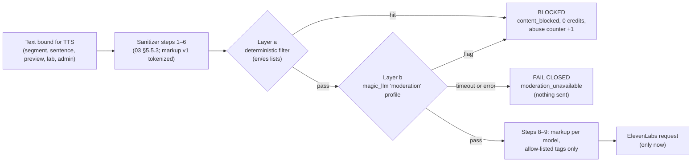
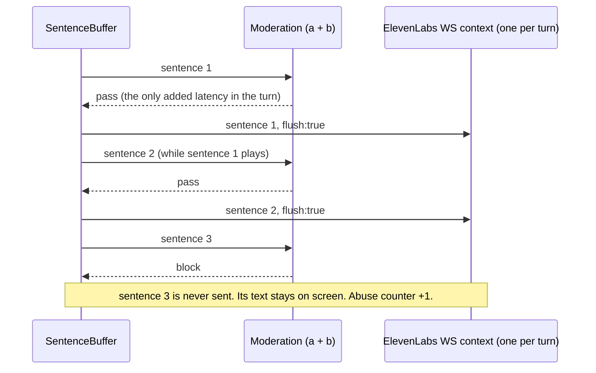
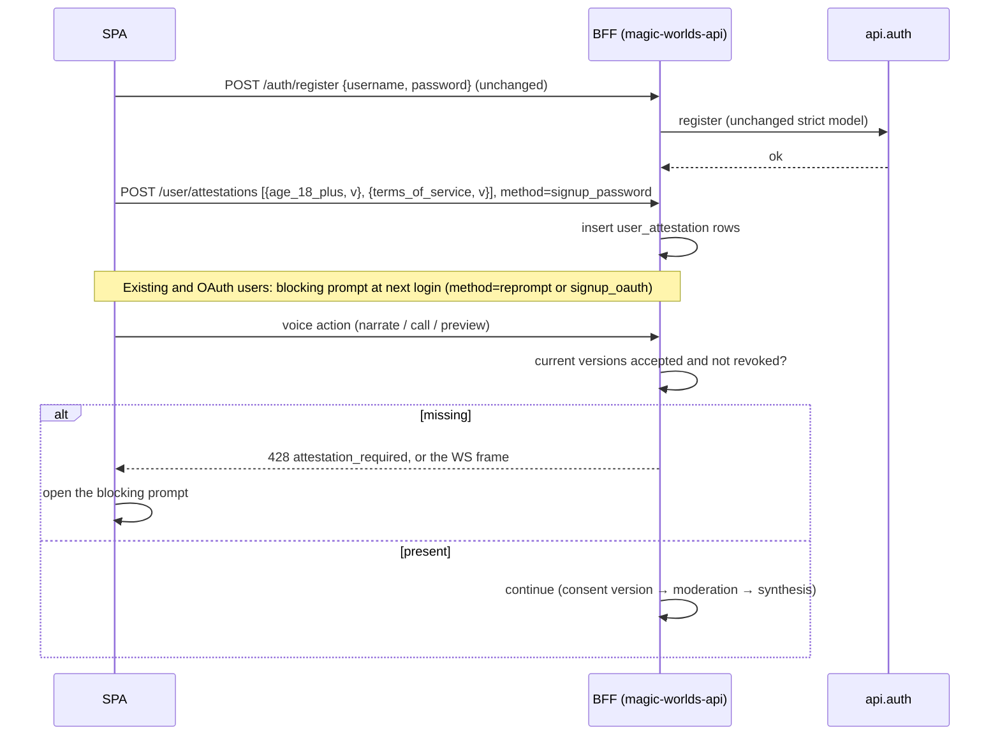
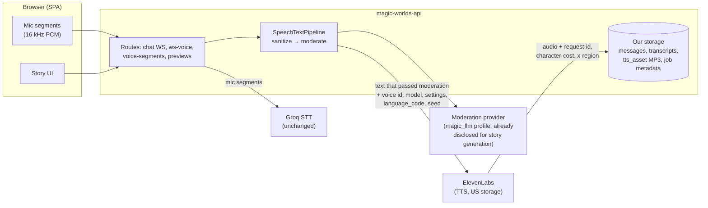
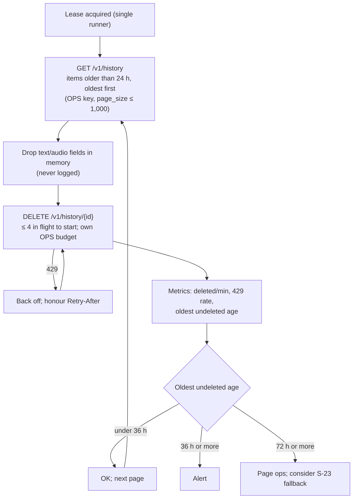
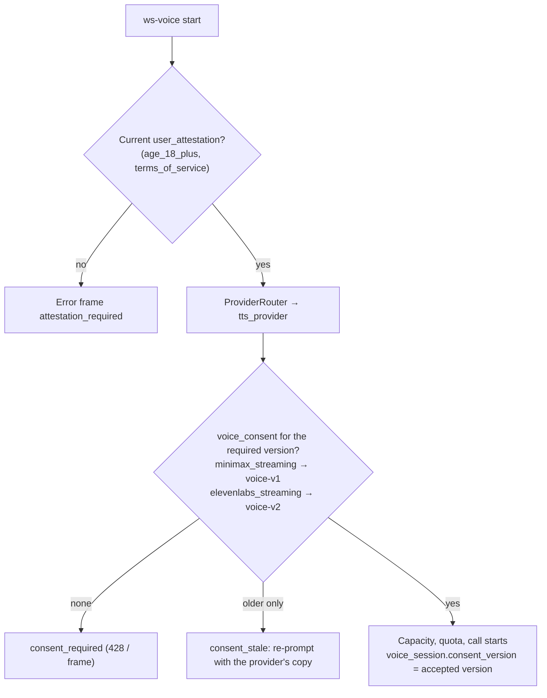

# Policy, privacy and compliance

- **Date:** 2026-10-12
- **Status:** Proposed (see [03](03_target_architecture_and_decisions.md) for sign-off status)
- **Plan short name in 03:** **LEGAL** (policy, consent, ToS and copy plan)

## Scope

This is the LEGAL plan for moving every speech surface of magic-worlds from MiniMax to ElevenLabs: chat narration, realtime calls, recipe previews, the voice catalog and the root admin voice console. It turns the licensing, content-policy, age-gate, cloning-consent, privacy and security parts of the decision record into concrete rules, schemas, copy changes, owners, deadlines and per-gate checklists.

It does not repeat cost and key budgets ([11](11_cost_plans_and_operations.md)), rollout mechanics ([10](10_data_migration_and_rollout.md)) or spike procedures ([14](14_staging_spike_and_contract_tests.md)).

Ground rules for reading it:
- [03](03_target_architecture_and_decisions.md) is the source of truth. Decisions are cited as (D25), spikes as (S-23), written confirmations from ElevenLabs as (L-1).
- Every legal reading here is an engineering interpretation, not legal advice. External counsel signs off before any non-staff user text reaches ElevenLabs (D25, 03 §6.3 "R2 entry").
- ElevenLabs terms, prices, model facts and endpoint behaviour are **as of 2026-10-12**. Anything that still depends on a staging spike or a written confirmation is labelled that way.
- **"Workspace"** in §5.6, §5.10 and §6.5 is the **ElevenLabs** account workspace. The app's own personal workspaces (Workspace R1) are written "app workspace".

**Workspace R1 alignment (2026-10-12).** Re-read against backend `f37eefd`. Every legal record in this plan stays **account-level**, never per app workspace: `user_attestation`, `voice_consent` and `voice_consent_record`, abuse counters, holds, Free-tier prerequisites and the D37 device and IP signals. One attestation or consent covers every app workspace, and archiving an app workspace never revokes, hides or duplicates one. Content-bound records (`tts_job`, `tts_turn_charge`, call transcripts) inherit the session's app workspace. The account wipe order is 03 §5.15 (D39).

**Related:** [03 decision record](03_target_architecture_and_decisions.md) · [01 current state](01_current_state.md) · [02 ElevenLabs capabilities](02_elevenlabs_capabilities.md) · [04 catalog](04_voice_catalog_and_library.md) · [05 Studio and admin console](05_voice_studio_and_admin_console.md) · [06 narration](06_chat_narration_migration.md) · [07 calls](07_realtime_calls_migration.md) · [08 backend plan](08_backend_refactor_plan.md) · [09 frontend plan](09_frontend_refactor_plan.md) · [10 rollout](10_data_migration_and_rollout.md) · [11 cost and operations](11_cost_plans_and_operations.md) · [12 best practices](12_best_practices_and_improvements.md) · [14 spikes and contract tests](14_staging_spike_and_contract_tests.md) · [15 implementation plan](15_implementation_plan_and_acceptance.md) · [16 risks](16_risks_and_open_questions.md) · research: [05](research/05_elevenlabs_platform_pricing_limits_policy.md), [10](research/10_gap_policy_licensing.md), [11](research/11_gap_catalog_api_semantics.md), [13](research/13_gap_codebase_checks.md), [15](research/15_workspace_r1_impact.md)

---

## 0. At a glance

| Area | Launch position | Decisions | Blocking gate |
|---|---|---|---|
| Plan and licence | ElevenLabs **Scale**, held by a legal entity. We read the app as ordinary paid commercial use ("Reading A"), not "Making Available"; this needs written confirmation. | D02, D04 | L-1 answered before R2 entry |
| Voice sources | Owned designed voices (plus remixes of owned voices) only, until L-2. No Default, live-moderated, famous, child-like or sound-alike voices. Users never create provider voices. | D09, D20 | L-2 for public Library voices |
| Content | **No-NSFW voice.** A synchronous, **fail-closed** moderation gate runs before every ElevenLabs request. | D26 | S-29 at R0 exit |
| Age | Server-recorded 18+ and ToS attestation (`user_attestation`), enforced with HTTP 428 or the matching WebSocket error frame. Click-wrap ToS with PUP flow-down. | D26, D37 | Live at R2 entry; L-4, L-8 answered |
| Cloning | Root-only IVC with a consent record, kept 5 years after deletion. Revocation SLAs. MiniMax custom voices are retired; re-creating one needs fresh consent. | D19, D20, D22 | First IVC (optional feature) |
| Privacy | Training opt-out on day one. History-deletion sweep with SLO "oldest undeleted item < 48 h". No ZRM at launch. Both providers named in the copy during R1–R4. Consent version per provider (`voice-v2` for ElevenLabs calls). | D25 | Counsel sign-off and copy live at R2 entry |
| Security | Six scoped, capped, IP-allowlisted keys on one service account. HMAC webhook disabled until S-12 passes. ElevenLabs patterns added to redaction; text is never logged. | D03, D04, D10 | R0 exit |

---

## 1. Licensing

### 1.1 Documents that bind us (as of 2026-10-12)

Paraphrased from [research 10 §2.1–§2.2](research/10_gap_policy_licensing.md) and [research 05 §6.1, §6.8](research/05_elevenlabs_platform_pricing_limits_policy.md).

| Document | Updated | Binds us when | What matters for magic-worlds |
|---|---|---|---|
| Terms of Service, non-EEA | 2026-10-09 | Always, unless a signed agreement replaces it. Applies when the contracting entity resides outside the EEA, UK and CH. | §1(a): the account holder must be 18+. §1(c): paid plans allow commercial use. §4: Output we generate is ours. §4(d)/§4(i): the training licence is perpetual, and the opt-out covers only new data. §5(b): access to the Services cannot be sublicensed. §5(c): ElevenLabs branding needs written permission. |
| Terms of Service, EEA/UK/CH | 2026-10-09 | The contracting entity resides in the EEA, UK or CH | Same substance on the points checked. L-15 records which version applies. |
| Prohibited Use Policy (PUP) | 2026-10-09 | Everyone, including use **through our app**, so it reaches our users | No fiction carve-out. An attempted violation is a violation. §12: no proxy or wrapper, end-user terms must not be "more permissive", no training any AI model on Output, no scraping. |
| ElevenAPI Terms (new) | 2026-10-09 | All API use | §2.1: secure, rotate and revoke credentials, and never expose them in clients. §2.2: all activity on a key is attributed to us. §2.3: we authenticate and authorise our app's users. §4.1: our systems are ours to secure. §5.1: a single key can be disabled without notice. |
| OEM Terms | 2025-02-28 | Only if we "Make Available" the Services | §1.D: a Business Entity is on Scale or above and is not an individual. §1.I: an End User uses the product for internal business operations only, so **consumers can never be End Users**. §2.B: Free–Pro are barred from Making Available. |
| Voice Library Addendum (VLA) | 2026-03-06 | We use Library voices | No attribution duty. Owner notice periods apply. §8: ElevenLabs may remove any shared voice at any time. |
| Beta Services Addendum | 2024-11-13 | Any alpha, beta or preview feature | No production use and no personal data. As of 2026-10-12, none of v4, v4 Turbo, v3, Flash, Text to Dialogue or Scribe carries a beta label. |
| DPA | 2026-04-08 | Personal data in content; it reaches self-serve accounts through the ToS | §2.2: we owe data subjects notice and consent. §13.1.3: the ElevenLabs safety team may read content. SCCs are deemed executed. |
| Privacy Policy | 2026-10-09 | ElevenLabs as processor | Storage in the US. Voice data is kept at most 3 years after the last interaction. |
| ElevenAgents Terms | 2026-10-09 | Agents or Speech Engine only; Speech Engine is rejected (D06) | §1.4 ("agent users are not Making Available") does **not** cover plain TTS. |
| Music Terms | — | Only if Eleven Music is adopted (D29 P2, legal-gated) | Model Resale, Studio Games and eligibility risks [research 04 §5.4](research/04_elevenlabs_other_products.md) |

### 1.2 How the app is classified: Reading A vs Reading B

| | **Reading A: ordinary paid use (our position)** | Reading B: we "Make Available" the Services |
|---|---|---|
| Basis | PUP scope and §12 (Output to our own end users on equal terms); ElevenAPI §2.3 (Customer Applications with users); ToS §4 (we own Output) | ToS §5(b) (no sublicensing); the ToS list routes "building into your own solution" to the OEM Terms |
| Plan needed | Any paid plan for the licence; **Scale** as the hedge (D02) | No self-serve plan works; Enterprise or a custom OEM exhibit |
| Conditions | Users are bound by terms no looser than ours (PUP flow-down, 18+). No proxy-like features. Users never touch the API. | Everything in OEM §3.A, plus whatever ElevenLabs negotiates |
| Status | **[unverified: legal interpretation]**, built on verified clauses. Pending L-1. | Nothing found supports it for server-side rendering [research 10 §2.3](research/10_gap_policy_licensing.md) |

**Decision (D02).**
- Production runs on Scale ($299/month as of 2026-10-12), contracted by a legal entity with a non-personal admin email.
- Staging is a separate Creator or Pro workspace that only ever receives synthetic, policy-safe text.
- No production traffic ever runs on Starter–Pro.
- Escalate to Enterprise if ElevenLabs answers L-1 with "Making Available", or if adult audio, ZRM or EU residency become requirements.

**Design rules that keep us inside Reading A** [research 10 §8.1](research/10_gap_policy_licensing.md):

| Rule | Where it is enforced |
|---|---|
| Users never call ElevenLabs. Keys stay in the BFF, and no single-use tokens are minted for browsers. | D04; [voiceSocket.ts:64-79](/home/andres/WebstormProjects/magic-worlds/src/infrastructure/api/voiceSocket.ts) already keeps calls BFF-only |
| No free-text "speak anything" for users. Recipe previews use fixed per-language texts; free text exists only in the root synth lab. | D18 (replaces the free-text route [voice_presets.py:99-118](/home/andres/PycharmProjects/magic-worlds-api/src/routes/voice_presets.py), bug #1) |
| Users never create provider voices (no design, clone or remix) | D20 |
| Users browse our DB catalog, never the live Voice Library | D10, §2.4 of 03 |
| Narration text is always our product's own story output, after moderation | D26 |

### 1.3 Feature-by-feature licensing position

| Feature | Position (as of 2026-10-12) | Basis | Decision / gate |
|---|---|---|---|
| Narration and call audio rendered server-side and played to our users | Allowed under Reading A | ToS §4; PUP §12; ElevenAPI §2.3 | D02; **R2 entry needs L-1** |
| Users pick owned designed or remixed voices from our catalog | Allowed | Our Output, no third-party voice rights | D09 |
| Users pick curated Library voices we added to our account | No clause forbids it and no attribution is owed, but written confirmation is pending | VLA; [research 10 §2.4](research/10_gap_policy_licensing.md) | **L-2.** Until then Library voices stay `visibility=admin` (D09) |
| Library-derived remixes | Not allowed yet | Rights in a derivative after the owner withdraws are unknown | L-2, L-12 and L-16, plus `voice_mixing_allowed=true` at add time (D09) |
| Default / premade voices | Licence-clean but **banned**: they expire 2026-12-31 | Lifecycle | D09 |
| Live-moderated, custom-rate, `famous`, child-like or sound-alike voices | Banned | VLA; PUP §1, §3; no-go voices | D09 |
| Serving upstream `preview_url` audio to users | Not until L-3; we serve our own pre-rendered samples only | ToS §5(a)–(b); PUP §12 bars framing and mirroring; an owner's preview is not our Output under ToS §4 [research 11 §4.4](research/11_gap_catalog_api_semantics.md) | D10 |
| Free-text previews for users | Not offered | PUP §12 proxy ban | D18 |
| End-user voice cloning, design or remix | Not offered | Proxy ban; consent | D20 |
| Root IVC of a consenting speaker | Allowed with a consent record | PUP §3; ToS §4(b) | D20, §4 below |
| A PVC commissioned from a voice actor and shared to us | Allowed with a written licence from the actor | A PVC can only be made of one's own voice | D09, D20 |
| Attribution | Not required on any paid plan. Output generated **outside an active subscription** carries attribution duties, so the subscription must never lapse. | Help center | D02 |
| "Powered by ElevenLabs" badge or logo | Needs prior written permission; not planned | ToS §5(c) | — |
| Naming ElevenLabs as a processor in privacy copy | Allowed; it is descriptive, not branding | DPA §2.2 | D25 |
| Using ElevenLabs Output to train or fine-tune **any** AI model, including our own | Banned. Flowed down to users in our ToS. Internal rule: no narration or call audio in any training or evaluation dataset. | PUP §12 | D26 item 4 |
| Beta or alpha features | No production use and no personal data. Each feature gets a beta-label check before shipping. | BSA | D29 |
| Startup Grant | Apply, but use grant credit only after L-14 confirms it in writing. Until then a paid Scale subscription stays active alongside the grant, so no production output is generated "outside a subscription". | OEM §1.D, §2.B; attribution | D02 |
| Adult (erotic) narration | Not enabled | The PUP neither allows nor bans it | D26 item 1, L-5 |
| Eleven Music theme songs | Legal-gated; fal `minimax/music-3` is out of scope | Music Terms | D01, D29 |

### 1.4 Written confirmations from ElevenLabs (L-items)

**How to ask.**
- Send **one** written request covering every item to ElevenLabs sales, with legal@elevenlabs.io in copy (the address the Voice Library page names) [research 10 §9](research/10_gap_policy_licensing.md).
- **Proposed send date: 2026-10-19.** The hard limit for *sending* L-1 and L-9 is R0 exit (review by 2026-11-17; last R0 deploy 2026-11-06 + 7-day soak; D28, 03 §6.3); the L-1 *answer* is due at R2 entry.
- Log every reply in the LEGAL log kept with this plan: date, sender, verbatim reply and our reading.
- An answer that changes a safe default updates [03](03_target_architecture_and_decisions.md) first, then this plan.

**Roles.** **Owner**: the product owner, who holds the ElevenLabs contract, sends the request and signs off. **Counsel**: external counsel, who reviews each reply. **LEGAL**: the maintainer of this plan, who tracks answers and applies them.

The question and safe-default columns are copied from 03 §6.2. The owner and date columns are this plan's.

| ID | Question | Decisions | Safe default until answered | Owner | Answer needed by |
|---|---|---|---|---|---|
| L-1 | Is the app ordinary commercial use (Reading A), not "Making Available"? | D02 | No non-staff user traffic (R2 entry blocked, §6.3) | Owner sends; Counsel reviews | **R2 entry, 2026-11-25** (hard gate) |
| L-2 | May users select Library voices we have added; is attribution or owner approval needed? | D09 | Library voices `visibility=admin`; owned designed voices only; no Library remixes. Gates public Library voices only, not any phase | Owner; Counsel | Before any Library voice goes public. No launch date depends on it. |
| L-3 | Minimum tier (Scale?) and contracting party (entity vs sole proprietor); may we persist and serve preview audio? | D02, D10 | Scale; own samples only; **no upstream proxy** | Owner; Counsel | R0 exit (review by 2026-11-17; last R0 deploy 2026-11-06 + 7-day soak), **or** apply the safe default |
| L-4 | Is click-wrap ToS with PUP flow-down + 18+ sufficient for PUP §12? | D26 | Ship the ToS and attestation as designed | Owner; Counsel | **R2 entry, 2026-11-25** (hard gate) |
| L-5 | Adult fiction narration permitted, and under which safeguards? | D26 | No-NSFW voice | Owner | No deadline. Required before adult audio is ever enabled. |
| L-6 | Moderation and ban signal shapes; billing of refused requests | §5.8 | Treat as `voice_unavailable` / `unavailable` | LEGAL (forward the answer to BE) | Wanted before R2 entry; the safe default otherwise |
| L-7 | Is there notice before a key, voice or workspace is restricted; which email or webhook gets warnings; can enforcement target a single service account or key? | D04, D28 | Monitored shared inbox; per-surface keys; any enforcement email is a rollback trigger | Owner; ops | Wanted before R2 entry; the safe default otherwise |
| L-8 | Is an 18+ roleplay companion app a "higher-risk use"? | D26 | Companion safeguards as designed | Owner; Counsel | **R2 entry, 2026-11-25** (hard gate) |
| L-9 | ZRM eligibility on Enterprise (sent together with L-1) | D25 | History sweep | Owner | **Sent** with L-1 by R0 exit. Answer before Enterprise talks open (about $3k/month of spend or R3, 2026-12-04, whichever comes first). |
| L-10 | If ElevenLabs removes a shared voice (VLA §8), do accounts that added it keep notice-period access; how are they notified? | D19 | Treat removal as instant: replacement voices and runtime detection (D19) | LEGAL | No gate (safe default) |
| L-12 | Ownership and permanence of the Default-replacement voices | D09 | Ordinary Library rules | Owner | Before any perpetual Library voice is public, used as a D31 default, or remixed |
| L-13 | IVC verification path for a third-party speaker | D20 | Dashboard-assisted IVC | LEGAL | Before the first third-party IVC (optional feature) |
| L-14 | Does a Scale-level Startup Grant count as a paid commercial subscription and a Business Entity plan (OEM §1.D, §2.B), with no attribution duty? | D02 | Do not rely on the grant; keep paid Scale active | Owner | Before any grant-funded usage |
| L-15 | Which ElevenLabs ToS applies (EEA/UK/CH vs non-EEA) for our contracting entity, and how must we handle users in regions ElevenLabs blocks (sanctions)? | D02, D26 | Contract under the non-EEA ToS only if the entity is non-EEA; geo-block voice for sanctioned regions | Owner; Counsel | ToS variant: before the production contract is signed (S-1, R0 exit). Sanctions: R2 entry. |
| L-16 | Rights in a remix derived from a Library voice after the owner withdraws the source voice | D09, D19 | No Library-derived remixes | Owner; Counsel | Before any Library-derived remix |

There is no **L-11**. Item 11 of [research 10 §9](research/10_gap_policy_licensing.md) (preview caching) was folded into L-3.

### 1.5 Counsel tasks (not questions for ElevenLabs)

These tasks come from open items in 03 and from this plan. The CN numbers are local to this document.

| ID | Task | Source | Owner | Needed by |
|---|---|---|---|---|
| CN-1 | Is self-attestation (18+, ToS) enough in every jurisdiction where we have users, and does any market require age assurance even under no-NSFW? | D26 open item | Counsel | R2 entry |
| CN-2 | Draft and approve the Terms of Service: click-wrap, 18+, PUP flow-down, no impersonation, no training on outputs, our enforcement rights (§3.3) | D26 item 4, L-4 | Counsel + LEGAL | R2 entry |
| CN-3 | Approve the privacy-policy voice section, the `voice-v2` call consent, the first-run voice bullet and the dual-provider wording for the window (§5.8) | D25 items 6, 9 | Counsel | R2 entry |
| CN-4 | IVC consent text and biometric-consent wording per jurisdiction (Illinois BIPA, Texas, Washington as candidates) | D20 open item | Counsel | Before the first IVC |
| CN-5 | Confirm the IVC revocation SLAs and the 30-day purge of stored audio (§4.7) | D19 item 9 | Counsel | Before the first IVC |
| CN-6 | Do MiniMax terms allow keeping MiniMax-generated audio after the contract ends? If not: purge it, keep the text, show "audio no longer available". | D23 open item | Counsel + Owner | Before R4, 2026-12-18 |
| CN-7 | Companion-chatbot law (for example California SB 243 [secondary]): AI disclosure, published self-harm protocol, break nudges | D26 item 5 | Counsel | R2 entry |
| CN-8 | Sanctions: which regions to geo-block for voice, and from which signal (with L-15) | L-15 | Counsel | R2 entry |
| CN-9 | Retention periods for `user_attestation`, `voice_abuse_counter`, D37 device/IP abuse signals and call transcripts (§5.7) | This plan | Counsel | R2 entry |
| CN-10 | Should we pin ElevenLabs processing to the US (`ELEVENLABS_BASE_URL=https://api.us.elevenlabs.io`) instead of using global routing (§5.5)? | This plan | Counsel | R2 entry |
| CN-11 | Eleven Music terms (Model Resale, Studio Games, Music Library) | D29 | Counsel | Before D29 P2 item 7 |

---

## 2. Content policy

### 2.1 Launch position

- **Voice launches under the app's existing no-NSFW policy** ([en.ts:884](/home/andres/WebstormProjects/magic-worlds/src/app/i18n/locales/en.ts); About and Disclaimer repeat it at en.ts:1962, 2102) (D26 item 1).
- **Adult audio stays off until all four exist** (D26 item 1):
  - ElevenLabs written approval (L-5);
  - a content rating on cards and adventures (neither repository has one today [research 10 §4.2](research/10_gap_policy_licensing.md));
  - age assurance;
  - an updated ToS.
- **The PUP has no fiction carve-out, and an attempted violation is itself a violation.** Enforcement can hit the whole workspace, not only the offending request [research 10 §3.1](research/10_gap_policy_licensing.md).
- **ElevenLabs has no synchronous moderation contract for plain TTS.** The error catalog has no moderation code (as of 2026-10-12). Enforcement arrives later and lands on the account: an email, a banned voice, a disabled key or a suspended workspace [research 10 §3.3](research/10_gap_policy_licensing.md). App-side moderation before every request is therefore the only control we own.

### 2.2 Moderation categories

Categories follow [research 10 §8.5](research/10_gap_policy_licensing.md), as D26 requires. "Severe" marks the categories that feed `moderation_block_severe` and the immediate 24 h disable in D26 item 6a ("minors or sexual-violence categories").

| Category | PUP basis | Rule at launch | Severe | Allowed (for calibration) |
|---|---|---|---|---|
| Sexual content of any kind | §6; app no-NSFW policy | Block | No; **yes** when non-consensual | Romance without sexual content |
| Minors: any sexualisation of a minor or a child-like character; grooming | §1 | Block | **Yes** | Child characters in clearly non-sexual contexts, voiced with an adult or neutral voice |
| Incest, bestiality, necrophilia, non-consent | §6 | Block | **Yes** (sexual violence) | — |
| Encouraging, instructing or facilitating self-harm, suicide or eating disorders | §2 | Block, and trigger the companion safeguard (§2.7) | No | A character in distress, without encouragement |
| Gratuitous gore that dwells on serious injury, death or abuse; glorifying mass-casualty attacks | §2, §6 | Block | No | Ordinary fantasy combat (presumed fine [unverified]) |
| Hate, slurs, targeted harassment, threats | §5 | Block | No | A villain's menace without slurs |
| Real people: sexual or defamatory content; impersonating real politicians or officials | §3, §4 | Block | No | Fictional politicians |
| Private data: PII, payment numbers, ID numbers | §7 | Block | No | Invented names and places |

The category lists and thresholds are tuned after 30 days of R2/R3 telemetry (D26 item 6a).

### 2.3 Synchronous moderation gate (D26)

**Rule.** Every unit of text bound for ElevenLabs passes a deterministic filter and a classifier, **synchronously and before any ElevenLabs request**. A failure of the check is treated as a block (fail closed). The gate is step 7 of the sanitizer in 03 §5.5.3. It runs on the sanitized text with markup placeholders removed, so it sees what will actually be spoken after bracket injection has been neutralised.

**Layers.**
- **(a) Deterministic filter:** keyword and pattern lists per category, English and Spanish first.
- **(b) Classifier:** a published `moderation` profile in `api.magic_llm`, resolved like every other profile (no env model id). Its provider must be one already named in the privacy copy for story generation, so no new processor receives story text. It is still named for this purpose (D25 item 6).
- The classifier's unit cost is [unverified] until BE picks the profile. BILL adds it to the cost comparison ([11](11_cost_plans_and_operations.md)).

**Coverage per surface.**

| Surface | Unit checked | When | Timeout | Notes |
|---|---|---|---|---|
| Chat narration (chat WebSocket `tts` frame) | Every segment of the turn | After the segment builder, before the resolver, the reuse check and the reservation (03 §2.2) | 2 s per narration batch | All segments of a turn are classified in **one batched call** |
| Realtime calls (`ws-voice`) | Every sentence from `SentenceBuffer` | Before the sentence is sent with `flush:true`. Sentence N is classified while sentence N−1 is generating or playing. | 300 ms per call sentence | Only the first sentence of a turn adds latency, and that is inside the D06 budget (S-29 measures it). A second, asynchronous per-turn classifier ends voice for the call if it flags. |
| Recipe preview ("hear my recipe") | The fixed per-language text (`text_id`) | On a cache miss, before the provider request (cache hits never reach ElevenLabs) | BE sets it; narration batch budget as reference | Fixed texts are also screened when root curates them (D18) |
| Root synth lab | The free text | Before the request | BE sets it | Refused on block or classifier failure |
| Root console: acceptance scripts, showcase texts, Voice Design and Remix prompts and texts | The text and the prompt | When root saves or runs them | BE sets it | Recommendation of this plan. D26 covers "every root free-text test", and design prompts are root free text sent to ElevenLabs. |



**Pipelining on calls** (D06, D26):



If S-29 misses the call budget (300 ms p95 per sentence), BE switches layer (b) for calls to a self-hosted small classifier. The fail-closed rule does not change (D26 item 2).

### 2.4 Failure modes

Public shapes follow 03 §5.8 exactly. No new public `tts_job` status is introduced.

| Condition | Narration segment | Call sentence | Recipe preview | Root lab / console |
|---|---|---|---|---|
| Blocked (layer a or b) | `content_blocked` (existing status); 0 credits; never sent; abuse counter +1 (`moderation_block`, or `moderation_block_severe` for severe categories) | Skipped for TTS while the text continues on screen; the turn reports `tts_unavailable` if every sentence is blocked; abuse counter +1 | Refused with no charge. A block on a fixed text is a curation bug, so root is alerted. | Refused and logged with the actor |
| Classifier timeout or error | Public status `unavailable` with `error.code = moderation_unavailable`; refunded at turn settlement; the user can retry. WS frame: `tts_failed{…, status:"unavailable", error:{code:"moderation_unavailable", retryable:true}}` | Skipped for TTS; the text continues | HTTP 503 `moderation_unavailable` | Refused |
| Async second layer flags a call turn | — | Voice ends for this call; the call continues as text | — | — |
| `moderation_unavailable` above 1% of segments over 1 h | **Rollback trigger** while the MiniMax key is live (D28) | same | — | — |
| Provider-side enforcement (§2.5) | 03 §5.8 rows; config breaker; incident runbook | same | same | same |

### 2.5 Provider-side enforcement: what reaches us

| Signal (as of 2026-10-12) | How it reaches us | Our reaction |
|---|---|---|
| Email warning to the workspace admin, before a voice ban (one public 2025 case [secondary]) | The admin inbox | The inbox is a monitored shared mailbox (D02, D26 item 8). Any enforcement email is a **rollback trigger** (D28) and opens the incident runbook ([11](11_cost_plans_and_operations.md)). |
| One key disabled for misuse (ElevenAPI §5.1) | 401 or 403 on that key; exact code [unverified] | Config breaker for that surface; page ops; other surfaces keep working (D04). Rollback trigger. |
| Voice `safety_control` `BAN` or `CAPTCHA`; any 4xx whose message mentions terms, verification, moderation or ban | 03 §5.8 row | `voice_unavailable` (voice-scoped) or `unavailable`; catalog voice `blocked`; replacement voice; no retry; refund |
| Live Moderation refusal | Undocumented | Avoided: live-moderated voices are banned from the catalog (D09) |
| Account flagged for extra moderation | Admin notification; ZRM may be withheld | Incident review; feeds L-9 |
| Safety-team review of content (DPA §13.1.3) | None | Disclosed in the privacy copy (D25 item 6) |

L-6 (signal shapes, billing of refused requests) and L-7 (notice before restriction; key-level vs workspace-level enforcement) refine this table once answered.

### 2.6 Abuse scoring and enforcement on our side

Counters live in `voice_abuse_counter` (03 §5.2), as rolling windows computed over day rows. The kinds are `moderation_block`, `moderation_block_severe`, `drained_call_chars`, `preview_limit_hit` and `minor_report`.

Thresholds, copied from D26 item 6a. The window is a rolling 7 days, counting blocked segments or sentences, drained call characters over 20k and preview-limit hits:
- 3 moderation blocks → in-app warning;
- 10 blocks, or any block in the minors or sexual-violence categories → voice disabled for 24 h and root notified;
- 25 blocks, or a second disable within 30 days → voice disabled until account review;
- thresholds are tuned after 30 days of R2/R3 telemetry.

Supporting controls:
- a **per-user voice kill switch**, with text unaffected (D26 item 8);
- the global kill switches `tts_engine_enabled`, `voice_mode_enabled` and `rollout_mode=off` (D28);
- the "second disable within 30 days" rule needs counter rows kept for **at least 30 days**. The retention proposal is in §5.7 (CN-9).

### 2.7 Companion safeguards, AI disclosure and other content rules

| Rule | Source | Implementation owner |
|---|---|---|
| No retention prompts or guilt-tripping in character voice | D26 item 5; PUP §3 ("harmful emotional dependency") | BE (prompts), FE |
| Break nudges | D26 item 5; SB 243 [secondary] | FE |
| Self-harm detection pauses voice and shows crisis resources. Draft copy: "If you are thinking about harming yourself, voice is paused. Please contact {local crisis line}." | D26 item 5; [research 10 §8.3](research/10_gap_policy_licensing.md) | BE (detection), FE (copy) |
| A published self-harm protocol (Contact or legal page) | D26 item 5; CN-7 | LEGAL |
| **"AI voice" labels** on every narrated turn and on the call header. A character voice is never presented as a human. | D26 item 7; PUP §10 | FE |
| Real-person character cards (name or description matching a public-figure list) get a generic voice, and their text is screened by the real-people category | [research 10 §8.5](research/10_gap_policy_licensing.md); PUP §3, §4 | BE (recommendation of this plan) |
| Child characters may be narrated only in non-sexual contexts, with an adult or neutral voice. There are no child-like voices in the catalog. | D09; PUP §1 | Catalog curation (D20) |
| **Bracket injection:** every `[…]` in LLM, card or user text is stripped before synthesis. Tags come only from the server allow-list. This closes both the tag-injection and the moderation-bypass vector. | D14; 03 §5.5.3 | BE |
| No user-supplied PII in narration. The first-run modal already tells users not to share it ([en.ts:886](/home/andres/WebstormProjects/magic-worlds/src/app/i18n/locales/en.ts)); the private-data category blocks obvious cases. | PUP §7 | BE |

### 2.8 Testing rules

- **Never send prohibited text to ElevenLabs, in any environment, including staging.** The attempt clause makes even a test a violation.
- The moderation path is tested **only with mocks** (D26 item 2).
- S-29 runs 500 synthetic policy-safe sentences in en and es, plus a public moderation evaluation set, **against the classifier only**. Nothing from it is sent to ElevenLabs ([14](14_staging_spike_and_contract_tests.md)).
- Staging is policy-safe synthetic text only (03 §6.1). Edgy but compliant samples, such as dark-fantasy combat or mild profanity, are the most a spike may send.
- QA fixtures for bracket neutralisation (03 §5.5.3) include `[whispers]` injected through card or user text.

---

## 3. Age gate and Terms of Service

### 3.1 Current state (2026-10-12)

| Element | Evidence | Problem |
|---|---|---|
| A first-run modal stores acceptance in `localStorage` key `magic_worlds:app-warning-accepted:v1` | [AppWarningModal.tsx:7-8](/home/andres/WebstormProjects/magic-worlds/src/ui/components/AppWarningModal.tsx) | Scoped to the device, not the account. Accounts that share a browser inherit it. |
| "Accept" only writes `localStorage`; there is no API call | [AppWarningModal.tsx:35-42](/home/andres/WebstormProjects/magic-worlds/src/ui/components/AppWarningModal.tsx) | **The server cannot prove that any user attested** |
| 18+ is the first of nine or ten bundled bullets (the voice bullet shows only when voice mode is on) | [AppWarningModal.tsx:68](/home/andres/WebstormProjects/magic-worlds/src/ui/components/AppWarningModal.tsx); [en.ts:879](/home/andres/WebstormProjects/magic-worlds/src/app/i18n/locales/en.ts) | Bundled with other notices; no separate control |
| Legal pages bypass the modal, and `isOpen` is computed once at mount | [AppWarningModal.tsx:12, 32](/home/andres/WebstormProjects/magic-worlds/src/ui/components/AppWarningModal.tsx) | Landing on `#/privacy` and then navigating never shows it (found by inspection; untested) |
| The modal is mounted globally, before login | [AppRouter.tsx:214](/home/andres/WebstormProjects/magic-worlds/src/app/router/AppRouter.tsx) | Never tied to an authenticated identity |
| Registration DTOs are strict and have no age or terms field | BFF [route_auth.py:52-58](/home/andres/PycharmProjects/magic-worlds-api/src/routes/user/route_auth.py); api.auth [Models.py:2149-2154](/home/andres/PycharmProjects/api.auth/src/Util/Models.py) | A new field would be a breaking contract change |
| There is no Terms of Service page. Legal pages are `about`, `contact`, `privacy` and `disclaimer` only. | [legalContent.ts:21](/home/andres/WebstormProjects/magic-worlds/src/features/legal/components/legalContent.ts) | No end-user agreement to flow the PUP down |
| Narration and preview have no age, consent or moderation check | [route_chat.py:1224](/home/andres/PycharmProjects/magic-worlds-api/src/routes/user/route_chat.py); [voice_presets.py:99-118](/home/andres/PycharmProjects/magic-worlds-api/src/routes/voice_presets.py) | — |
| The only per-user consent the server stores is call consent | `voice_consent` [db.sql:195-206](/home/andres/PycharmProjects/magic-worlds-api/src/database/mysql/db.sql); enforced at [admission.py:96-107](/home/andres/PycharmProjects/magic-worlds-api/src/services/voice_orchestration/admission.py) | Good pattern to reuse; it contains no age statement |

**Verdict** [research 10 §4.3](research/10_gap_policy_licensing.md), [research 13 §1.4](research/13_gap_codebase_checks.md): the current gate works neither as a technical gate nor as a contractual record. ElevenLabs does not require us to *verify* end-user age. However, PUP §12 ("not more permissive") requires our users to be bound by an 18+ term, and we must be able to show that they agreed.

### 3.2 Target: server-side attestation (D26 item 3)

**Table.** The column list comes from D26 and is canonical. Types, keys and the `method` values are a sketch modelled on `voice_consent`.

```sql
create table user_attestation (
    user_id          int not null,
    project_hash     varchar(64) character set utf8mb4 collate utf8mb4_bin not null,
    user_group_hash  varchar(64) character set utf8mb4 collate utf8mb4_bin not null,
    kind             varchar(32) character set utf8mb4 collate utf8mb4_bin not null,  -- age_18_plus | terms_of_service
    version          varchar(64) character set utf8mb4 collate utf8mb4_bin not null,  -- env-driven, like VOICE_CONSENT_VERSION
    accepted_at      datetime default CURRENT_TIMESTAMP not null,
    revoked_at       datetime null,
    method           varchar(32) character set utf8mb4 collate utf8mb4_bin not null,  -- proposal: signup_password | signup_oauth | reprompt
    primary key (user_id, project_hash, user_group_hash, kind, version),
    constraint fk_user_attestation_user foreign key (user_id) references tb_user (user_id),
    constraint chk_user_attestation_kind check (kind in ('age_18_plus', 'terms_of_service'))
) engine = InnoDB default character set = utf8mb4 collate = utf8mb4_0900_ai_ci;
```

If counsel wants stronger evidence (IP address, user agent, a hash of the copy shown), D26 must be amended first (CN-1).

**Capture** (D26 item 3). The capture is done **by the BFF**; `api.auth` is not changed.
1. The sign-up form shows two separate, unticked checkboxes: "I am 18 or older" and "I accept the Terms of Service".
2. Right after a successful registration, the SPA posts both to the new BFF endpoint `POST /user/attestations` (`kind`, `version`, `method`).
3. Existing users and OAuth users get a **blocking prompt** at their next login, and whenever a voice surface answers `attestation_required`.
4. If the post-registration call fails, nothing is lost: the first voice action returns `attestation_required` and the same prompt opens.
5. Proposal (FE and BE confirm it): `GET /user/attestations` returns the current-version status, so the SPA can prompt at login without first hitting a 428.

**Enforcement points.**

| Surface | Hook today | Response when a current attestation is missing |
|---|---|---|
| Chat narration (chat WS `tts` frame) | `_handle_chat_tts_request` [route_chat.py:1224](/home/andres/PycharmProjects/magic-worlds-api/src/routes/user/route_chat.py) (frame dispatch at :2268) | No job is created. Frame (03 §5.8): `tts_failed{assistant_message_id, turn_id, status:"unavailable", error:{code:"attestation_required", retryable:false, action:"attest"}}`. The SPA opens the blocking prompt. |
| Call start (`/character-chats/{id}/ws-voice`) | `_create_admitted_voice_session`, before `require_current_voice_consent` [route_voice_call.py:484](/home/andres/PycharmProjects/magic-worlds-api/src/routes/user/route_voice_call.py) | A fatal call error frame (`voice_error`) carrying `code: attestation_required`, raised where `consent_required` is raised today. Call start is the `ws-voice` handshake after `websocket.accept` ([route_voice_call.py:889-924](/home/andres/PycharmProjects/magic-worlds-api/src/routes/user/route_voice_call.py)), so an HTTP 428 is not possible there even though D26 item 3 lists call start among the 428 surfaces. Per 03 §5.8, `attestation_required` is a new **internal** `VoiceErrorCategory` (the consent categories are listed at [errors.py:10-11](/home/andres/PycharmProjects/magic-worlds-api/src/services/voice_orchestration/errors.py)); on the wire the frame uses the existing category `tts_unavailable` plus the new `code`, so older SPA builds still treat it as terminal. |
| Voice consent | `POST /character-chats/{id}/voice-consent` [route_voice_call.py:574-589](/home/andres/PycharmProjects/magic-worlds-api/src/routes/user/route_voice_call.py) | HTTP **428** `attestation_required` |
| Recipe preview | Today `POST /voice-presets/preview` [voice_presets.py:99-118](/home/andres/PycharmProjects/magic-worlds-api/src/routes/voice_presets.py), rewritten for D18 | HTTP **428** `attestation_required` |
| Free-tier voice | All of the above | Also requires a verified email and an account at least 24 h old (D37, §3.5) |

**Versioning.** Each `kind` has its own current version, read from env like `VOICE_CONSENT_VERSION` ([config.py:26](/home/andres/PycharmProjects/magic-worlds-api/src/services/voice_orchestration/config.py)). Bumping a version re-prompts everyone on their next voice action. A revoked 18+ attestation (`revoked_at` set) disables voice for that user.

**The `localStorage` modal stays, as UX only.**
- Split the 18+ bullet into its own control that links to the ToS.
- Re-evaluate the legal-page bypass on navigation, not only at mount.
- The server gate is authoritative ([research 10 §8.4](research/10_gap_policy_licensing.md)).



### 3.3 Terms of Service and PUP flow-down (D26 item 4)

A new legal page, `terms`, alongside the four that exist, accepted by click-wrap at sign-up (password and OAuth) and again on every version change. CN-2 drafts it.

Content checklist:
- [ ] Users must be 18 or older, or the local age of majority if higher (ToS §1(a) mirror).
- [ ] PUP flow-down: the prohibited-content list; no impersonation of real people; no extraction or scraping; **no training AI models on outputs**; no automated abuse or multi-account evasion.
- [ ] Third-party AI providers process content: ElevenLabs (voice), Groq (speech-to-text), the story-generation providers, and the moderation provider.
- [ ] Our enforcement rights: block, remove, suspend voice or account; the per-user kill switch; abuse thresholds.
- [ ] AI disclosure: voices are AI-generated and may be retired and replaced.
- [ ] Naming ElevenLabs as a third-party beneficiary, a no-agency clause and a data-processing grant: **only if** L-4 says so, or if the OEM framework ever applies.
- [ ] No under-18 positioning anywhere, including marketing (PUP §1).

Draft lead clause for counsel, from [research 10 §8.3](research/10_gap_policy_licensing.md): "You must be 18 or older. You may not use Magic Worlds to create content that sexualises minors, encourages self-harm, harasses or impersonates real people, or breaks the policies of our AI providers, including the ElevenLabs Prohibited Use Policy, which applies to all voice features."

### 3.4 "Report a minor" (D26 item 6)

- Lives on the Contact page (`legal.pages.contact`, [en.ts:1966](/home/andres/WebstormProjects/magic-worlds/src/app/i18n/locales/en.ts)).
- A report places a **temporary voice hold** on the reported account: voice off, text unaffected, for at most 48 h pending human review. The hold applies only when the reporter is a verified, attested account older than 7 days.
- Reporters are limited to 3 reports a day. Repeated unfounded reports disable reporting for that account.
- Review either lifts the hold or escalates to account review. Each report increments `voice_abuse_counter` kind `minor_report`.

### 3.5 Free-tier voice prerequisites (D37, 03 §5.13)

- Voice on Free requires: an attested account (§3.2), a verified email, and an account at least 24 h old.
- At most 3 new Free voice accounts per device fingerprint or IP per day. This is enforced BFF-side.
- If `api.auth` exposes no verified-email flag, the BFF tracks verification itself (BE).
- **Privacy consequence:** this processes IP addresses and a device fingerprint for abuse prevention. The privacy copy must say so, and retention follows CN-9 (proposal in §5.7).

---

## 4. Voice cloning and voice-creation consent

### 4.1 Who may create provider voices

| Actor | May create | Decision |
|---|---|---|
| End users | **Nothing.** No design, clone or remix in this program; personalisation goes through presets. Revisit only with written ElevenLabs approval, a consent and verification flow, per-user slot metering and abuse handling. | D20 |
| Root (console, `ADMIN` key) | Voice Design, Remix of owned voices (Library voices only under the D09 remix rule), and IVC **with a consent record** | D20 |
| Anyone | **No PVC creation.** A commissioned PVC arrives by sharing plus Library add. | D20 |

The console's IVC module, consent form and revocation action are specified in [05](05_voice_studio_and_admin_console.md). This section sets the legal content.

### 4.2 IVC and PVC requirements (as of 2026-10-12)

| | IVC (root console) | Commissioned PVC (shared to us) |
|---|---|---|
| Who creates it | Root, through `POST /v1/voices/add` with the `ADMIN` key (`create_instant_voice_clone`) | The speaker, in **their own** account. "Even with consent" we cannot clone someone else's voice as a PVC. |
| Consent basis | The speaker's explicit, informed, written consent naming ElevenLabs and our use (PUP §3; ToS §4(b), §4(g)), plus our consent record (§4.3) | A written licence from the actor covering the app's use and content scope, plus a notice period or contractual term |
| Consent in the API | **None.** Calling the API implicitly makes the representation the UI asks for [unverified: inference]. | n/a |
| Verification | A voice CAPTCHA by the speaker may be required. `requires_verification=true` → catalog status `blocked` (D20). The completion path is unknown (S-22, L-13). | CAPTCHA or manual verification by the speaker |
| Speakers under 18 | Refuse (PUP §1) | Refuse |
| Audio guidance | 1–2 min of clean, single-speaker audio, MP3 ≥ 128 kbps (192 recommended), −23 to −18 dB RMS [research 03 §5](research/03_elevenlabs_voices_catalog_cloning_design.md) | ≥ 30 min |
| Library sharing | **Never.** IVCs cannot be shared to the Library, and no key holds `publish_voice_to_voice_library` (D04). | n/a |
| ZRM | Never covers clone samples | same |
| Catalog row | `source_kind = ivc`. The CHECK `chk_voice_catalog_ivc_consent` requires `consent_record_id` (03 §5.2). | `source_kind = pvc_shared` |

### 4.3 Consent record (copied verbatim from 03 §5.2)

```sql
create table voice_consent_record (
    consent_record_id   varchar(64) character set utf8mb4 collate utf8mb4_bin primary key,
    subject_name        varchar(255) not null,
    subject_contact     varchar(255) null,
    subject_is_adult    tinyint(1) not null,
    identity_check_method varchar(64) not null,   -- e.g. id_document_in_person|video_call|notarised
    jurisdiction        varchar(16) not null,       -- ISO 3166-1/-2 of the subject (BIPA, TX, WA rules)
    biometric_consent_version varchar(32) not null,
    consent_version     varchar(32) not null,
    scope               text not null,
    document_ref        varchar(512) null,      -- encrypted storage key of signed release
    sample_sha256       json not null,          -- array of sha256 of uploaded samples
    samples_ref         varchar(512) null,      -- encrypted root-only storage
    signed_at           datetime not null,
    revoked_at          datetime null,
    retain_until        datetime null,          -- max(legal period, voice deletion + 5 years)
    recorded_by_user_id int not null,
    created_at          datetime default CURRENT_TIMESTAMP not null
) engine = InnoDB default character set = utf8mb4 collate = utf8mb4_0900_ai_ci;
```

What each field proves ([research 10 §5.3](research/10_gap_policy_licensing.md); D20):

| Requirement | Field(s) |
|---|---|
| Identity, and how it was checked | `subject_name`, `subject_contact`, `identity_check_method` |
| The speaker is 18+ | `subject_is_adult` (must be 1; the console refuses otherwise) |
| An explicit, informed consent text that names ElevenLabs (US storage), the use (AI character voices in a consumer roleplay app speaking AI- and user-written lines within our content policy), commercial use, compensation and term, **no Library sharing**, and how to revoke and what happens then | `consent_version`, `scope`, `document_ref` (signed release, encrypted) |
| Biometric notice and consent where local law requires it | `biometric_consent_version`, `jurisdiction` (CN-4) |
| Sample provenance and integrity | `sample_sha256`, `samples_ref` (encrypted, root-only) |
| Accountability | `recorded_by_user_id`, `signed_at`, `created_at`; the catalog event `cloned` with actor and voice id |
| Retention and revocation | `retain_until`, `revoked_at` |

### 4.4 Console IVC flow (checklist)

1. [ ] Root verifies the speaker's identity using the recorded method, confirms 18+ and records the jurisdiction.
2. [ ] The speaker signs the consent text (`consent_version`) and the biometric consent (`biometric_consent_version`). The signed release is stored encrypted (`document_ref`).
3. [ ] Samples: root records provenance (who recorded them, when and where; only the consenting speaker is audible). SHA-256 values are computed, and the samples are stored encrypted and root-only (`samples_ref`).
4. [ ] A mandatory checkbox: "The speaker gave explicit, informed, written consent covering ElevenLabs processing and this app's use."
5. [ ] The IVC is created with the `ADMIN` key. If `requires_verification=true`, the row becomes `blocked` and the speaker is booked for the CAPTCHA (S-22). Otherwise the row is `draft`.
6. [ ] Acceptance (D09), own samples, then Publish.
7. [ ] The root action is logged with actor and voice id (D20).

### 4.5 Retention

| Item | Kept for | Basis |
|---|---|---|
| Consent record | `retain_until = max(legal period, voice deletion + 5 years)`; kept after revocation with `revoked_at` set | The 5-year benchmark in ElevenLabs' own Creative Terms §2 and Agents Terms §3.5 (they do not name TTS or IVC, but show what ElevenLabs expects) [research 10 §5.1](research/10_gap_policy_licensing.md); D20 |
| Signed release (`document_ref`) | With the record | same |
| Original samples (`samples_ref`) | While the voice exists, because clones cannot be exported; **deleted on revocation** | D19 item 9; [research 03 §5](research/03_elevenlabs_voices_catalog_cloning_design.md) |
| ElevenLabs' copy of the voice data | Until we delete the voice; their privacy policy keeps voice data at most 3 years after the last interaction | ElevenLabs Privacy Policy |

### 4.6 What the consent copy must say about revocation

The speaker can revoke at any time through the contact named in the release. The consent text states the D19 item 9 SLAs below. It also states that the voice is deleted, that stored audio rendered with it is purged unless counsel advises otherwise, and that the consent record itself is kept for its retention period.

### 4.7 Revocation procedure (D19 item 9; CN-5 confirms the SLAs)

Revocation overrides the "never delete referenced voices" lock (D19 items 3 and 6) and D21's "frozen snapshots are never rewritten".

| Deadline | Action |
|---|---|
| **Within 1 business day** | `status=removed`. The resolver substitutes the replacement voice for **every** reference, frozen snapshots included (forced substitution, `substitution_reason=voice_removed`). |
| **Within 7 days** | Live cards and presets are rewritten to the replacement. The provider voice is deleted (`DELETE /v1/voices/{id}`, `ADMIN` key) regardless of reference count. The encrypted samples are deleted. |
| **Within 30 days** | Stored audio rendered with that voice is purged from `tts_asset` storage. The clip shows "audio no longer available" and the text is kept. Counsel may advise otherwise. |
| Retained | Only the consent record, with `revoked_at`, until `retain_until` |

### 4.8 No-go voices

None of these is ever created, added or published:
- clones or designs that approximate **prominent public figures** (ElevenLabs no-go voice detection blocks them; `sharing.category = famous`; the Iconic Marketplace licenses per use with script approval, which is incompatible with roleplay);
- real politicians, candidates or officials (PUP §4);
- **minors and child-like voices** (PUP §1; the Library bars them);
- any voice without the speaker's consent, including deceased persons where harm is likely or post-mortem rights apply (PUP §3);
- **sound-alike prompts** in Voice Design (D20);
- live-moderated, custom-rate and Default/premade voices, for policy and lifecycle reasons (D09).

### 4.9 MiniMax custom voices (D22)

- No clone source audio, design prompt, consent record or `file_id`-to-voice mapping was ever stored. Samples went from memory straight to MiniMax, and nothing was logged [research 13 §2](research/13_gap_codebase_checks.md) (upload route [admin_voices.py:107-147](/home/andres/PycharmProjects/magic-worlds-api/src/routes/admin_voices.py); form [VoiceCloneForm.tsx](/home/andres/WebstormProjects/magic-worlds/src/features/admin/voices/components/VoiceCloneForm.tsx), 294 lines, with no consent or rights field).
- **All MiniMax custom voices are retired.** Their references go to `voice_legacy_mapping` targets chosen by audition, or to the unmapped policy (D21).
- **Exception:** if the operator holds off-platform source audio **and** obtains **fresh consent naming ElevenLabs**, root re-creates the voice as an IVC through §4.4. A MiniMax-era consent, if one ever existed, does not cover a new processor.
- **Before R1:** ROLL lists the custom voices from the existing root inventory ([admin_voices.py:166-179](/home/andres/PycharmProjects/magic-worlds-api/src/routes/admin_voices.py)), and the operator answers voice by voice whether source audio and consent exist.

### 4.10 Voice Design and Remix rules

- Design prompts (`voice_description`) and preview texts are screened by the real-people category and the moderation gate (§2.3). Sound-alike prompts are refused (D20).
- **Proposed addition to D20** (needs a 03 update before it binds): `eleven_ttv_v3` accepts `reference_audio_base64`, which designs a voice from a reference clip [research 03 §7.1](research/03_elevenlabs_voices_catalog_cloning_design.md). That is cloning from audio. The console should either disable it or require a `voice_consent_record`, exactly as for an IVC.
- Remix: owned voices only. Library voices may be remixed only under the D09 rule (L-2, L-12, L-16 and `voice_mixing_allowed=true` recorded in `terms_at_add`).

---

## 5. Privacy

### 5.1 Data flows per processor



| Data | Sent to | Purpose | Kept by the recipient (as of 2026-10-12) | Kept by us |
|---|---|---|---|---|
| Narration segment text (sanitized, moderated story text) | ElevenLabs TTS (HTTP) | Synthesis | In history until our sweep deletes it (SLO < 48 h, §5.3); "debugging and moderation logs may still retain data"; backups up to 30 days | Chat messages as today. `tts_job` stores a hash, not the text ([db.sql:642](/home/andres/PycharmProjects/magic-worlds-api/src/database/mysql/db.sql)). |
| Call reply sentences | ElevenLabs TTS multi-context WebSocket | Synthesis | Same, **if** WebSocket TTS creates history items (S-23) | Transcript text ([db.sql:313](/home/andres/PycharmProjects/magic-worlds-api/src/database/mysql/db.sql)); assistant audio assets |
| User microphone segments | Groq STT (unchanged, D07) | Transcription | Groq's policy | Raw microphone audio is not stored |
| Fixed preview texts, acceptance scripts, design prompts, lab text | ElevenLabs | Previews, catalog | History (swept), voices | `voice_preview_render`, `voice_sample_asset` |
| Text to be moderated (all of the above) | The moderation provider | Moderation | That provider's policy, already disclosed for story generation | Verdict counters only (`voice_abuse_counter`) |
| IVC samples (biometric) | ElevenLabs | Clone | While the voice exists; voice data at most 3 years after the last interaction | Encrypted, root-only, while the voice exists (§4.5) |
| Request metadata: `provider_voice_id`, `model_id`, settings, `language_code`, `seed` | ElevenLabs | Synthesis | With the history item | On the job |
| **Never sent** | — | — | — | User ids, emails, usernames, real names (D25 item 4); keys never reach browsers (D04) |

If Scribe replaces Groq (D07 stage 2), user voice audio goes to ElevenLabs. That needs a new consent version, privacy-copy changes, a biometric review by counsel and the STT transcript deletion path (`DELETE /v1/speech-to-text/transcripts/{id}`) before it is enabled.

### 5.2 Training opt-out (D02, D25 item 1)

- In both the production and the staging workspace, switch off **Terms and privacy → Data use → "Improve the models for everyone"**, **before the first request that carries any real user text.** The opt-out only applies going forward (ToS §4(i)).
- There is no per-request API flag; it is an account setting (as of 2026-10-12).
- Evidence: a dated screenshot per workspace in the ROLL log. This is an R0 exit gate item (03 §6.3).
- Recommendation of this plan: re-check the setting quarterly, with the key rotation, and after any workspace or plan change.

### 5.3 Provider history retention and the deletion sweep (D25 item 2)

Without ZRM, ElevenLabs keeps the TTS text and audio of every request in history. History preservation is on by default. Deleted items persist in backups for up to 30 days, and "debugging and moderation logs may still retain data" [research 05 §5.3](research/05_elevenlabs_platform_pricing_limits_policy.md), [research 04 §12](research/04_elevenlabs_other_products.md).

**Mechanism.**
- A scheduled `OPS`-key job lists history (`GET /v1/history`, `speech_history_read`, `page_size` ≤ 1,000, `date_before_unix` = now − 24 h, paged with `start_after_history_item_id`) and deletes items older than **24 h** with `DELETE /v1/history/{id}` (`speech_history_write`), one request per item [research 04 §12.2](research/04_elevenlabs_other_products.md).
- No bulk delete and no auto-expiry was found (as of 2026-10-12), and rate limits are undocumented.
- Recommendation: one runner at a time, under a DB lease, like the catalog jobs (D10).

**Sizing.** About 12k narration items a day at 10k MAU and about 60k at 50k MAU, **before** call sentences, if WebSocket TTS creates items (D25; open until S-23).

| Property | Value |
|---|---|
| Target item age at deletion | 24 h (an internal target, **never promised in copy**) |
| **SLO** | The oldest undeleted item is **younger than 48 h** |
| Alert / page | Alert at 36 h; page at 72 h |
| Throughput | Runs continuously in small batches with bounded parallelism (start at 4 in flight), under its own `OPS` concurrency budget, separate from synthesis |
| Hygiene | List responses contain the story `text`. The job drops text and audio fields as soon as it has parsed them and **never logs response bodies**. |
| Fallback if S-23 shows insufficient throughput | Ask ElevenLabs for bulk deletion or auto-expiry, and bring the Enterprise/ZRM talks forward (D02) |
| When it must run | From **R1** (staff text reaches ElevenLabs from then; recommendation of this plan). It must be within its SLO at **R2 entry** (03 §6.3). |



**What remains after the sweep:** debugging and moderation logs, backups for up to 30 days, the account, voices and their samples. The privacy copy says text is "deleted from the provider's history on a regular schedule" and **never promises 24 h** (D25 item 2).

### 5.4 Zero Retention Mode (ZRM) decision (D25)

| | Fact (as of 2026-10-12) |
|---|---|
| Availability | **Enterprise only.** It may be refused or revoked for "high-risk" use cases or accounts flagged for moderation, and a mature-fiction roleplay app may be refused. |
| Mechanism | `enable_logging=false` per request. It covers TTS HTTP and WebSocket, Text to Dialogue, Speech to Speech and STT. It does **not** cover IVC/PVC samples. |
| Side effects | History features, including request stitching, are unavailable. ElevenLabs cannot diagnose generations. |

**Decision: no ZRM at launch; retention plus the sweep instead.**
- Request stitching (`previous_request_ids`) is never used, so ZRM can be switched on later with no code change (D05, D25 item 3).
- The adapter flag `ELEVENLABS_ENABLE_LOGGING` stays unset until ZRM is granted. When it is granted, every TTS request sends `enable_logging=false`, and the sweep remains only as a backstop.
- **Triggers to ask:** Enterprise and ZRM talks open at about **$3k/month of spend or at R3 (2026-12-04), whichever comes first** (D02). L-9 goes out together with L-1, so a refusal leaves time for a fallback.

### 5.5 Residency, transfers and sanctions

- **Routing:** `api.elevenlabs.io` uses global routing (the default since 2026-02) and processes each request in the nearest region: USA, Netherlands or Singapore. The `x-region` response header names the region. **Storage is in the US.** `ELEVENLABS_BASE_URL` defaults to the global host and can be switched by ops to `https://api.us.elevenlabs.io` to pin the US [research 05 §5.1](research/05_elevenlabs_platform_pricing_limits_policy.md). CN-10 asks counsel whether to pin.
- **Store the region per job** (D25 item 5), so a transfer question can be answered after the fact.
- **EU residency** is Enterprise-only: a separate, blank workspace with its own keys. Moderation may still run outside the region, and EU-only processing requires ZRM. Not at launch (D02 escalation trigger).
- **Contracting ToS variant:** L-15 records which variant applies, based on where the contracting entity resides.
- **Sanctions:** ElevenLabs blocks access from Belarus, Cuba, Iran, North Korea, Russia, Syria and occupied Ukrainian regions (as of 2026-10-12). Our BFF egress is unaffected. Whether users in those regions may receive Output is a legal question (L-15, CN-8). **Safe default: geo-block voice for sanctioned regions.** The BFF has no country signal today; BE picks one.

### 5.6 DPA obligations (DPA updated 2026-04-08)

| Clause | Obligation or right | Our action |
|---|---|---|
| §2.2 | **We** give data subjects notice of ElevenLabs' processing and obtain consent where the law requires it. This applies to every self-serve customer, not only under OEM. | Privacy-copy rewrite and consent versions (§5.8, §5.9) |
| §13.1.3 | The ElevenLabs safety team may access customer content to check PUP compliance | Disclose "may be reviewed by its safety team" in the privacy copy |
| EU SCCs (2021/914), UK Addendum, Brazil SCCs, Swiss FADP terms | Deemed executed through the ToS | Counsel records the transfer basis (CN-3) |
| Subprocessors | Listed at compliance.elevenlabs.io with 30 days' notice and a right to object | Ops subscribes to notices; LEGAL reviews each one |
| Breach notice | "Without undue delay" (no fixed hours) | Our incident runbook ([11](11_cost_plans_and_operations.md)) |
| Self-serve content | ElevenLabs *may* delete it after 180 days of inactivity ("may", not "must") | Never rely on ElevenLabs history as storage; the sweep stays |
| Data subject requests | dpo@elevenlabs.io or the online form | Used only when a request needs action at the processor (§5.11) |
| Audits | A SOC 2 Type II report on request (the trust centre was not readable on 2026-10-12) | Request it at contracting |

ElevenAPI §4.1 adds that ElevenLabs' security commitments do not cover systems we control. Our BFF, stored MP3s and logs are ours to secure (§6).

### 5.7 Our own retention

| Data | Where | Today | Target |
|---|---|---|---|
| Narration and call MP3s | `tts_asset` (local filesystem) | No retention policy (bug #9, handled separately by D30) | Unchanged by this program, except the post-R4 + 14 days orphan sweep (D23) and the IVC-revocation purge (§4.7) |
| MiniMax-era MP3s and job rows | `tts_asset`, `tts_job` | Kept | Kept and readable (D23). Purged, keeping the text, if CN-6 says the MiniMax terms do not allow keeping them. |
| Text hash, provider request id, billed characters, region, model, voice | `tts_job` and call turns | MiniMax trace id stored as a hash ([db.sql:649](/home/andres/PycharmProjects/magic-worlds-api/src/database/mysql/db.sql)) | Stored per D25 item 5; **never the text**. Request ids are never exposed in user DTOs or public error frames (§6.4). |
| Call transcripts | `voice_transcript_segment.transcript_text` (`db.sql`, after `voice_session` at `:408`; lines at `f37eefd`) | Kept with the chat, in its app workspace | Unchanged; CN-9 reviews |
| Call consent | `voice_consent` ([db.sql:353](/home/andres/PycharmProjects/magic-worlds-api/src/database/mysql/db.sql)) | Kept; account-level | Unchanged; one row per accepted version (§5.9); never per app workspace (D39) |
| Attestations | `user_attestation` (new) | — | Proposal: account lifetime plus the period counsel sets (CN-9) |
| Abuse counters | `voice_abuse_counter` (new) | — | Proposal: 90 days of day rows (≥ 30 days is required by D26 item 6a), CN-9 |
| D37 device/IP abuse signals | New, BFF-side | — | Proposal: hashed with a rotating salt, kept no longer than the counting window, CN-9 |
| IVC consent records, releases, samples | `voice_consent_record`, encrypted storage | — | §4.5 |

### 5.8 Privacy-policy and in-app copy changes (D25 item 6)

English and Spanish ship in the same release. Lines are from the working tree on 2026-10-12. "Phase" is when the change must be live.

| Key | en / es line | Today | Change | Phase |
|---|---|---|---|---|
| `legal.pages.privacy.sections.voice.body1` | [en.ts:2047](/home/andres/WebstormProjects/magic-worlds/src/app/i18n/locales/en.ts) / es.ts:2057 | Names Groq STT and **MiniMax** TTS, and describes **calls only**: chat narration, which also sends story text to the TTS provider, is not mentioned | **R1–R4:** name both TTS providers ("depending on your account, voice is generated by MiniMax or ElevenLabs"), Groq (STT) and the moderation provider; US storage; provider retention and scheduled deletion; possible safety review; training opt-out. **After R4:** ElevenLabs only. | Published **for all users** before R2 entry |
| `legal.pages.privacy.sections.voice.body2` | en.ts:2048 / es.ts:2058 | "Raw microphone audio, full call recordings … not stored by default" | Scope the statement to *our* storage. Say that the AI's spoken replies are saved with the chat, and that providers keep request data under their own retention. | R2 entry |
| `interaction.voiceConsent.disclosures.processing` | [en.ts:4823](/home/andres/WebstormProjects/magic-worlds/src/app/i18n/locales/en.ts) / es.ts:4833 | "… replies are spoken with MiniMax text-to-speech" | One copy variant per consent version: `voice-v1` keeps the MiniMax wording for non-cohort users; `voice-v2` names ElevenLabs. Key naming is decided in [09](09_frontend_refactor_plan.md). | `voice-v2` copy live at R1 (cohort) |
| `interaction.voiceConsent.disclosures.noRecordings` | en.ts:4825 / es.ts:4835 | "Raw microphone audio and full call recordings are not stored." | Scope to our storage; mention provider retention | With `voice-v2` |
| `warning.voice` (first-run voice bullet) | [en.ts:888](/home/andres/WebstormProjects/magic-worlds/src/app/i18n/locales/en.ts) / es.ts:898 | "… store transcript text/metadata only by default". Shown only when voice mode is enabled ([AppWarningModal.tsx:77-79](/home/andres/WebstormProjects/magic-worlds/src/ui/components/AppWarningModal.tsx)) | Rewrite: provider processing for narration and calls, AI voices, assistant audio saved. Show it whenever any voice surface (narration included) is enabled. | R2 entry |
| `warning.ageRequirement` | en.ts:879 / es.ts:889 | Bundled 18+ bullet | Its own control, linking to the ToS (§3.2) | R2 entry |
| `warning.authRequired` | en.ts:882 / es.ts:892 | "… registration is open, and no email is required." | Add that voice on the Free plan needs a verified email and an account at least 24 h old (D37, §3.5) | R2 entry |
| `call.screen.privacyNote` | en.ts:5755 / es.ts:5765 | "Only transcript text and metadata are saved." | Inaccurate: assistant call audio is also saved [research 07 §7.4](research/07_frontend_minimax_inventory.md). Correct it. | R2 entry |
| `docs.guides.voice.*` (`record.body`) | en.ts:1441 / es.ts:1451 | "… full call recordings are not stored by default" | Align with the corrected privacy copy | R2 entry |
| New: `legal.pages.terms.*` and the sign-up checkboxes | — | — | The ToS page (§3.3) | R2 entry |
| New: "AI voice" labels, companion safety copy, "Report a minor" | — | — | §2.7, §3.4 | R2 entry |
| New: catalog notices ("Voices are AI-generated. A voice may occasionally be retired; we will switch you to a similar voice and let you know.") | — | — | Next to the badges inventory in 03 §5.12 | R1 |
| All copy | — | — | Never claim "not stored by providers" (D25 consequence); never promise 24 h deletion | Always |

**Draft wording for counsel** (adapted from [research 10 §8.3](research/10_gap_policy_licensing.md); these are our own drafts):
- *Privacy, R1–R4:* "Voice narration and call replies are spoken by AI voices generated by a text-to-speech provider: depending on your account, MiniMax or ElevenLabs. In calls, your speech is transcribed by Groq. The text to be spoken is sent to that provider. ElevenLabs processes it, may store it in the United States, and may have its safety team review it to enforce its usage policy. We delete it from ElevenLabs' history on a regular schedule, and we have opted out of ElevenLabs using it to train its models. Before any text is spoken, an automated safety check run by {moderation provider} reviews it."
- *Call consent, `voice-v2`:* "Replies are spoken by an AI voice generated by ElevenLabs. Your speech is transcribed by Groq. Magic Worlds does not store raw microphone audio; the AI's spoken replies and the transcript are saved with the chat. Our providers may keep request data under their own retention policies."

### 5.9 Consent version per provider for calls (D25 item 7)

Today `VOICE_CONSENT_VERSION` is one process-wide value, `voice-v1` ([config.py:26, 308-312](/home/andres/PycharmProjects/magic-worlds-api/src/services/voice_orchestration/config.py)). It cannot serve two cohorts.

| TTS provider chosen at `start_call` (`ProviderRouter`, D28) | Required consent version | Copy shown |
|---|---|---|
| `minimax_streaming` | `voice-v1` | Today's copy (names MiniMax). Non-cohort users never see ElevenLabs copy. |
| `elevenlabs_streaming` | `voice-v2` | Names ElevenLabs (TTS) and Groq (STT) |

Rules:
1. `require_current_voice_consent` takes the provider ([admission.py:96-107](/home/andres/PycharmProjects/magic-worlds-api/src/services/voice_orchestration/admission.py)) and checks the version that provider requires.
2. Recommendation of this plan: answer `consent_stale` (not `consent_required`) when the user holds only an older version. The SPA already shows the "review" title for `consent_stale` ([VoiceConsentModal.tsx:28](/home/andres/WebstormProjects/magic-worlds/src/features/interaction/components/VoiceConsentModal.tsx)). Both map to 428 ([admission.py:75-76](/home/andres/PycharmProjects/magic-worlds-api/src/services/voice_orchestration/admission.py)).
3. `POST /character-chats/{id}/voice-consent` records the version for the caller's **current route**. Today it records `config.consent_version` ([route_voice_call.py:574-589](/home/andres/PycharmProjects/magic-worlds-api/src/routes/user/route_voice_call.py)).
4. The accepted version is persisted on `voice_session.consent_version`, a column that already exists ([db.sql:260](/home/andres/PycharmProjects/magic-worlds-api/src/database/mysql/db.sql)).
5. **Rollback:** a cohort user routed back to MiniMax needs `voice-v1`. If they never accepted it, they are prompted with the MiniMax copy.
6. **After R4** only `voice-v2` is required. `voice-v1` rows remain as history.
7. Recommendation (backlog, [12](12_best_practices_and_improvements.md)): give users a "withdraw voice consent" control. `VoiceConsentModel.revoke` exists but has no caller ([models.py:5718](/home/andres/PycharmProjects/magic-worlds-api/src/database/mysql/models.py)).



### 5.10 Staff and dashboard access (D02, D25 item 8)

- ElevenLabs dashboard seats go only to **named operators** listed in the ROLL access register. Shared workspace history contains users' story text and is readable by every seat.
- Staff never browse history except during an incident, and each such access is logged.
- Staging belongs to a dedicated operator seat on a shared mailbox, never to a person's account (D02).
- Root console actions are logged with actor and voice id (D20).
- The `OPS` and `ADMIN` keys are the most sensitive. `OPS` can read history text, and `ADMIN` can clone and delete voices. Access to the env that holds them is limited to the operators in the register.

### 5.11 Data-subject requests and account deletion

- **Our data:** handled as today, plus the new tables (§5.7). `delete_all_user_data` ([models.py:5237-5311](/home/andres/PycharmProjects/magic-worlds-api/src/database/mysql/models.py)) already removes every app workspace and its content. The new voice tables join it in the 03 §5.15 order: `tts_turn_charge` after `tts_job`, then `voice_review_flag`, then the user's `voice_preview_render` rows and files (Q-35). Membership ledger rows are kept as billing records, as today. `user_attestation` and `voice_consent_record` follow the retention counsel sets (CN-9, Q-29), not the wipe.
- **App workspaces:** archiving an app workspace is not deletion. Its narration audio, transcripts and call history stay readable and exportable, and are deleted only with the account (Workspace R1 rules).
- **ElevenLabs history:** every item is deleted within the sweep SLO anyway. An account deletion therefore needs no extra provider call; residual backups age out within 30 days. Recommendation: a user-initiated deletion may trigger an immediate sweep pass.
- **IVC speakers:** a request from a speaker is handled as a revocation (§4.7).
- **Requests that need processor action:** sent to dpo@elevenlabs.io. We are the controller; ElevenLabs is the processor.

---

## 6. Security

### 6.1 Key handling (D04)

Key table, copied verbatim from 03 §5.4.3 (production service account; staging uses user keys with the same scopes):

| Env var | Surface | Scopes | `character_limit` |
|---|---|---|---|
| `ELEVENLABS_KEY_NARRATION` | narration jobs | `text_to_speech` | ~65% of monthly budget |
| `ELEVENLABS_KEY_CALLS` | call TTS (+ STT if Scribe is adopted) | `text_to_speech` (+ `speech_to_text`) | ~30% |
| `ELEVENLABS_KEY_PREVIEW` | user recipe previews only; readiness probe | `text_to_speech` | hard cap ~2% |
| `ELEVENLABS_KEY_CATALOG` | Jobs A/B, models | `voices_read`, `models_read` | minimal |
| `ELEVENLABS_KEY_ADMIN_VOICES` | root console, acceptance renders, catalog sample renders | `voices_read`, `voices_write`, `voice_generation`, `create_instant_voice_clone`, `add_voice_from_voice_library`, `text_to_speech`, `pronunciation_dictionaries_read`, `pronunciation_dictionaries_write` | small cap (sized for one full catalog render) |
| `ELEVENLABS_KEY_OPS` | reconciliation, history sweep, webhooks, subscription probe | `user_read`, `workspace_analytics_full_read`, `speech_history_read`, `speech_history_write`, `webhooks_write` | smallest non-zero value until S-28 says what 0 means |
| `ELEVENLABS_BASE_URL` | all | — | default `https://api.elevenlabs.io`; ops switch `https://api.us.elevenlabs.io` |

Rules:
- [ ] Never `permissions: "all"`. Never grant `publish_voice_to_voice_library`, `share_voice_externally`, `create_user_api_key`, `service_account_write` or `terms_of_service_accept` (D04).
- [ ] Every key is IP-allowlisted to the BFF egress. Other IPs get 403.
- [ ] Rotate **quarterly and on any incident**: create, then deploy, then delete. Service-account keys never expire, so rotation is manual.
- [ ] Keys live only in the BFF environment. The BFF `.env` is git-ignored ([.gitignore:13](/home/andres/PycharmProjects/magic-worlds-api/.gitignore)).
- [ ] **Keys never reach the SPA.** `VITE_*` values are public by construction. The SPA `.env` holds only the API URL and feature flags, and it is untracked but **not** git-ignored (git status on 2026-10-12). Recommendation: a CI check fails the SPA build if the bundle contains `xi-api-key`, `sk_` or `ELEVENLABS`.
- [ ] No single-use tokens (`sutkn_…`) are ever minted for browsers. They would bypass moderation, metering and barge-in logic [research 05 §4.4](research/05_elevenlabs_platform_pricing_limits_policy.md).
- [ ] Keep `third_party_disable_allowed=true` (the default), so leak scanning can disable an exposed key.
- [ ] Per-key `character_limit` values are a last line of defence only. Their unit, reset and error are unknown until S-28, and the app-side guards in D37 come first.
- [ ] `MINIMAX_AUDIO_API_KEY` ([minimax_credentials.py:8](/home/andres/PycharmProjects/magic-worlds-api/src/services/minimax_credentials.py)) stays only during the dual-provider window and is **revoked at R4** (D28).
- [ ] Leak response: disable the key with the self-disable endpoint or the workspace revoke endpoint, rotate it, and review usage (ElevenAPI §2.2 attributes all activity on the key to us).

### 6.2 Why per-surface scopes

- ElevenAPI §5.1 lets ElevenLabs disable a single credential without notice. Separate keys mean a disabled preview key cannot stop narration (D04).
- Readiness probes run with the key that holds each scope, and a failure degrades only that surface; it never aborts startup (D04 table).
- Every catalog voice is shared with the service account's group. A key-level 401 or 403 is a **configuration breaker**, never a voice event (D04, D10, D19 item 7).

### 6.3 Webhook signature verification (D10)

`POST /webhooks/elevenlabs` is **optional**, and it stays **disabled until S-12 passes and public HTTPS ingress exists**. The repository has none confirmed; polling is the primary path [research 13 §5](research/13_gap_codebase_checks.md).

Requirements:
- [ ] Verify the HMAC on the **raw body bytes**, before any JSON parsing, with `hmac.compare_digest`. The SDKs compare with `!=`, which is not constant-time (D03).
- [ ] Header format and tolerance window are **[unverified]**: the SDK source shows `ElevenLabs-Signature: t=…,v0=…` with 30 min, while a community source says `v1` and 5 min. Both are fixed from a delivery captured in S-12. The window must cover the documented retry schedule (immediate, 30 s, 2 min, 8 min, 30 min, plus jitter) unless retries are re-signed.
- [ ] Secret in `ELEVENLABS_WEBHOOK_SECRET`. It is shown only once, at webhook creation, and is handled like a key.
- [ ] Dedupe on `voice_catalog_event.dedupe_key`. The **only action is to enqueue Job B**, so a forged or replayed event can at most trigger a re-check.
- [ ] Cap the body size, rate-limit signature failures, and log failures redacted. Model it on api.auth's Stripe verifier ([security.py:92-116](/home/andres/PycharmProjects/api.auth/src/Util/stripe/security.py)) and the BFF's fal route ([fal.py:17-30](/home/andres/PycharmProjects/magic-worlds-api/src/routes/webhooks/fal.py)).
- [ ] Treat delivery as best effort: retries are off by default (`retry_enabled`), and the docs state retry support only for ElevenAgents post-call events, so a `voice_removal_*` event may never be redelivered. Polling (Jobs A/B) stays the source of truth (D10) [research 05 §8](research/05_elevenlabs_platform_pricing_limits_policy.md).
- [ ] Optional: a static secret request header, and an allow-list of ElevenLabs' egress IPs (US `34.67.146.145`, `34.59.11.47` as of 2026-10-12).
- [ ] Monitor `is_auto_disabled` and `most_recent_failure_*` with the `OPS` key (`webhooks_write`).

```python
# Sketch only: header format and tolerance are fixed by S-12 (D10).
def verify_elevenlabs_webhook(raw_body: bytes, header: str, secret: bytes, now: int) -> bool:
    parts = dict(p.split("=", 1) for p in header.split(",") if "=" in p)
    try:
        ts = int(parts.get("t", ""))
    except ValueError:
        return False
    candidate = parts.get(SIGNATURE_KEY)            # "v0" or "v1" per S-12
    expected = hmac.new(secret, f"{ts}.".encode() + raw_body, hashlib.sha256).hexdigest()
    in_window = abs(now - ts) <= TOLERANCE_SECONDS  # 5 vs 30 min per S-12; must cover retries
    ok = candidate is not None and hmac.compare_digest(expected, candidate)
    return in_window and ok                          # compare_digest runs even when the window check fails
```

### 6.4 Logging and redaction

**Rules** (03 §5.8, D04, D25):
- **Never log text**: not narration, call sentences, preview text or history-list bodies.
- Log `request-id`, `x-request-id`, `detail.request_id` and `x-trace-id` as **structured fields** in server logs and job metadata. They never appear in user-facing frames or DTOs.
- Match provider errors on `detail.code` first, then `detail.status`. Log the code, not the message body.

**Patterns to add** (D04 consequences; [research 06 §6.6](research/06_backend_minimax_inventory.md)):

| Pattern | Catches |
|---|---|
| `xi-api-key\s*[:=]\s*\S+` | The auth header |
| `\bsk_[A-Za-z0-9]{20,}\b` | ElevenLabs key shape (from third-party scanners [secondary]). The existing `\bsk-…` pattern uses a hyphen and does not match it. |
| `\bsutkn_[A-Za-z0-9_-]+` | Single-use tokens |
| `ELEVENLABS_(KEY_[A-Z_]+\|WEBHOOK_SECRET)\s*=\s*[^\s,;]+` | Env leaks |
| `(?:https\|wss)://api(?:\.[a-z]+)*\.elevenlabs\.io[^\s"')]*` | Provider URLs (today only groq and minimax are matched) |
| `"audio_base_64"\s*:\s*"[^"]+"` and base64 MP3 prefixes (`SUQz`, `//uQ`, `//NE`) | Audio payloads from Design and Remix |
| `ElevenLabs-Signature:\s*\S+` | Webhook signatures |

**Where these patterns go:**

| Location | Today | Change |
|---|---|---|
| [image_generation/errors.py:24-32](/home/andres/PycharmProjects/magic-worlds-api/src/services/image_generation/errors.py) | MiniMax and fal patterns | Move to a shared redaction helper with the ElevenLabs patterns |
| [voice_orchestration/errors.py:58-69](/home/andres/PycharmProjects/magic-worlds-api/src/services/voice_orchestration/errors.py) | `GROQ\|MINIMAX…_KEY`, groq and minimax URLs, `sk-` keys, `UklG`/`SUQz` audio base64, request-id redaction | Add the ElevenLabs patterns (`SUQz` is already covered here; `//uQ`, `//NE` and `audio_base_64` are not). Keep request-id redaction for public frames. |
| [transcript_sanitizer.py:17-19](/home/andres/PycharmProjects/magic-worlds-api/src/services/voice_orchestration/transcript_sanitizer.py) | groq and minimax URL and key patterns | Add ElevenLabs |
| [observability.py:39-55](/home/andres/PycharmProjects/magic-worlds-api/src/services/voice_orchestration/observability.py) | Forbidden field markers (`transcript`, `content`, `voice_id`, …) | Keep them; they keep text out of metrics |
| [chat_tts_delivery.py:28-49](/home/andres/PycharmProjects/magic-worlds-api/src/services/chat_tts_delivery.py) | `_PRIVATE_TEXT_MARKERS` includes the plain word `"minimax"` | Remove it (bug #6, D30). **Do not** add `"elevenlabs"` as a substring marker: a speaker or a story could legitimately contain the word. |
| [tts_generation/engine.py:52-69](/home/andres/PycharmProjects/magic-worlds-api/src/services/tts_generation/engine.py) and [tts_generation/errors.py:210-234](/home/andres/PycharmProjects/magic-worlds-api/src/services/tts_generation/errors.py) | Public error codes are dropped when they contain any private marker, **including the substring `"voice"`** (engine.py:65, errors.py:227) | **Finding:** the new public code `voice_unavailable` (03 §5.8) would be suppressed in `/tasks` and job DTOs. Replace the substring check with an allow-list of the 03 §5.8 public codes. This is for BE ([08](08_backend_refactor_plan.md)). |

### 6.5 Account and workspace hygiene (D02)

- [ ] 2FA on every seat.
- [ ] The workspace admin email is non-personal and routed to a **monitored shared inbox**, because warnings arrive by email before bans.
- [ ] Named seats only (§5.10).
- [ ] Staging is a separate workspace with user keys, synthetic text and the training opt-out on. It never shares concurrency, settings or history with production.
- [ ] The production subscription never lapses, because output generated outside a subscription carries attribution duties.
- [ ] A monthly PAYG spend cap and auto top-up, sized per [11](11_cost_plans_and_operations.md).

### 6.6 Provenance and output integrity

- PUP §10 forbids removing ElevenLabs watermarks, metadata or provenance signals.
- **Provider bytes are stored unmodified.** Loudness gain is applied by the player, not by re-encoding (D16), and narration MP3s are stored as returned.
- Whether ElevenLabs embeds C2PA metadata in API output is [unverified]. If a later phase re-encodes audio (for example the PCM path deferred in D08 or a server gain step), check what metadata survives before shipping it.

---

## 7. Compliance checklist per rollout gate

Gates and dates come from D28 and 03 §6.3. Items marked **(03 §6.3)** are hard gates from the decision record. Unmarked items are this plan's checks that implement D20, D22, D25 and D26. They are expected at that gate; if any of them should become a hard gate, it is added to 03 §6.3 first. Only compliance-relevant items are listed: the full spike, data and readiness gates are in 03 §6.3 and [10](10_data_migration_and_rollout.md).

### R0 exit (review by 2026-11-17; last R0 deploy 2026-11-06 + 7-day soak): before any ElevenLabs request with real user text

- [ ] **L-1 sent, together with L-9 (03 §6.3)**, in one written request that also carries L-2…L-16 (§1.4).
- [ ] **L-3 answered, or its safe default applied (03 §6.3):** Scale; own samples only (every published voice has its own pre-rendered sample per accepted language, D10); no upstream preview proxy.
- [ ] **Training opt-out verified with a dated screenshot, production and staging (03 §6.3).**
- [ ] **Dashboard seats limited and recorded in the access register (03 §6.3).**
- [ ] Spikes S-1, S-28 and S-29 passed (03 §6.3): the production account is Scale held by a legal entity with no Default-voice dependency (S-1); per-key cap semantics known (S-28); classifier latency within budget, tested against the classifier only (S-29).
- [ ] L-15 ToS variant recorded before the production contract is signed (D02).
- [ ] 2FA on; admin email is a monitored shared inbox; staging owned by an operator seat (D02).
- [ ] Six scoped, capped, IP-allowlisted keys; never-grant list checked; ElevenLabs redaction patterns live; SPA bundle check (§6.1, §6.4).
- [ ] `SpeechTextPipeline` with fail-closed moderation deployed and tested with mocks (R0 content, D28).
- [ ] `user_attestation`, 428 and the WS frame deployed (R0 content, D28). They are not yet required of users before R2.
- [ ] Catalog policy enforced: no premade, live-moderated, `famous`, child-like or custom-rate voices. Library voices `visibility=admin` until L-2. Every published voice is an owned design or a remix of one (D09).
- [ ] If any IVC is planned: `voice_consent_record`, the console consent form and the `chk_voice_catalog_ivc_consent` constraint are live, and CN-4 and CN-5 are done (§4).
- [ ] Staging has received synthetic, policy-safe text only.

### R1: internal cohort, target 2026-11-18 (staff traffic only)

- [ ] Provider-specific consent live: `voice-v2` copy for ElevenLabs calls; non-cohort users see only `voice-v1` copy (D25 item 7, D28).
- [ ] History sweep running, because staff text now reaches ElevenLabs (§5.3).
- [ ] "AI voice" labels on narrated turns and the call header (D26 item 7).
- [ ] MiniMax custom voices listed from the root inventory; operator answers recorded per voice (D22).
- [ ] The incident runbook covers key disable, voice ban and workspace suspension, with a text-only fallback (D26 item 8; [11](11_cost_plans_and_operations.md)).

### R1 exit (before R2)

- [ ] **S-23 passed (03 §6.3):** the `OPS` key lists and deletes history; throughput supports ≥ 60k deletions a day; whether WebSocket TTS creates history items is known.
- [ ] Sweep metrics show the oldest undeleted item under 48 h.

### R2 entry: target 2026-11-25 (before any non-staff user text reaches ElevenLabs)

- [ ] **L-1, L-4 and L-8 answered in writing (03 §6.3).**
- [ ] **External counsel sign-off (03 §6.3, D25 item 9)**, covering CN-1, CN-2, CN-3, CN-7, CN-8, CN-9 and CN-10.
- [ ] **ToS page, click-wrap, `user_attestation` and 428 / WS frame live (03 §6.3, D26).**
- [ ] **Privacy copy naming both providers published for all users (03 §6.3).**
- [ ] **Consent `voice-v2` copy live (03 §6.3).**
- [ ] **Budget guards live (D37), and the history sweep running within its SLO (03 §6.3).**
- [ ] **S-8 measured in the production region, and S-21 passed (03 §6.3).**
- [ ] D26 deliverables live: "Report a minor" with the reviewed hold; abuse-score thresholds; per-user kill switch; companion safeguards (self-harm pause with crisis resources, break nudges, published self-harm protocol).
- [ ] Free-tier voice prerequisites enforced: attestation, verified email, account age ≥ 24 h, ≤ 3 new Free voice accounts per device or IP per day (D37).
- [ ] Sanctions safe default applied: voice geo-blocked for sanctioned regions (L-15, CN-8).
- [ ] Corrected "not stored" statements live (§5.8).

### Each canary step: 5%, 25%, 50% (2026-11-25 → 2026-12-04)

- [ ] No account events: any key disable, voice ban or enforcement email triggers a **rollback** (D28).
- [ ] `moderation_unavailable` ≤ 1% of segments over 1 h (a D28 rollback trigger).
- [ ] Sweep SLO met; no 72 h page.
- [ ] Abuse counters and moderation block rates reviewed for false positives.

### R3 entry: target 2026-12-04

- [ ] Every canary step was within thresholds (03 §6.3).
- [ ] Enterprise and ZRM talks opened, if the about $3k/month trigger has not already fired (D02).
- [ ] MiniMax global presets hidden through the reversible flag (D22).

### R4: target 2026-12-18

- [ ] `MINIMAX_AUDIO_API_KEY` revoked (D28).
- [ ] MiniMax removed from every piece of copy: privacy, consent, first-run bullet, docs (D25 item 6).
- [ ] Only `voice-v2` is required for new calls.
- [ ] CN-6 answered. If MiniMax terms do not allow keeping generated audio, a purge plan is ready (keep the text; "audio no longer available").

### R4 + 14 days: target 2027-01-01

- [ ] The reviewed orphan sweep of MiniMax-era assets has run (D23), honouring CN-6.

### R5 contract: January 2027

- [ ] MiniMax global preset rows deleted (D22).
- [ ] `voice_migration_audit` kept for one release cycle (D28). Its privacy footprint is reviewed under CN-9.

### Feature gates (any time)

| Feature | Preconditions |
|---|---|
| Public Library voices | L-2 (+ L-12 for perpetual voices, L-16 for remixes); D09 filters checked and `terms_at_add` recorded at add; S-11, S-12 for lifecycle |
| First IVC | §4 checklist; CN-4, CN-5; S-22; L-13 for a third-party speaker |
| Scribe STT (D07 stage 2) | S-19; a new consent version and privacy copy naming ElevenLabs for STT; a biometric review by counsel; transcript deletion path |
| Webhook | S-12 passed; public HTTPS ingress; §6.3 checklist |
| Eleven Music (D29 P2) | CN-11; Scale or Business eligibility confirmed |
| Adult audio | L-5 yes; content rating; age assurance; updated ToS (D26 item 1) |
| Any new ElevenLabs feature | Beta-label check under the Beta Services Addendum (D29) |

---

## 8. Open items

Everything here is tracked in [16](16_risks_and_open_questions.md).

- **ElevenLabs answers:** L-1…L-16 (§1.4). L-1, L-4 and L-8 block R2.
- **Counsel tasks:** CN-1…CN-11 (§1.5).
- **Spikes that affect this plan:** S-12 (webhook signature), S-22 (IVC verification), S-23 (sweep throughput, WebSocket history items), S-28 (per-key cap semantics), S-29 (classifier latency). Procedures are in [14](14_staging_spike_and_contract_tests.md).
- **Proposed additions to 03:**
  - treat Voice Design `reference_audio_base64` as cloning (§4.10);
  - `consent_stale` for users who hold only an older consent version (§5.9);
  - a public-code allow-list instead of substring redaction (§6.4);
  - attestation evidence columns, if counsel asks for them (§3.2);
  - D26 item 3 wording: call start is a WebSocket surface (error frame), not an HTTP 428 surface (§3.2).
- **BE choices this plan depends on:** the `moderation` profile and its cost; the sanctions country signal; the envelope encryption for consent documents and samples (keys kept separate from DB credentials).

---

## Evidence and sources

**Decision record:** [03_target_architecture_and_decisions.md](03_target_architecture_and_decisions.md): D02, D03, D04, D05, D07, D09, D10, D16, D18, D19, D20, D21, D22, D23, D25, D26, D28, D29, D30, D37; §5.2, §5.4.3, §5.5.3, §5.8, §5.13; §6.1–§6.3.

**Research notes:**
- [research 10](research/10_gap_policy_licensing.md): §1 key findings, §2 licensing and OEM, §3 content rules and enforcement, §4 age, §5 cloning consent, §6 data obligations, §8 implications, §9 confirmation list.
- [research 05](research/05_elevenlabs_platform_pricing_limits_policy.md): §4 keys, §5 data handling and ZRM, §6 policy, §8 webhooks, §11.2–§11.6 recommendations, §12 open questions.
- [research 11](research/11_gap_catalog_api_semantics.md): §3 remix, §4 previews and re-hosting, §5 removal lifecycle and webhooks.
- [research 13](research/13_gap_codebase_checks.md): §1 age gate, §2 clone source audio, §5 webhook ingress.
- [research 04](research/04_elevenlabs_other_products.md) §12 (history API); [research 03](research/03_elevenlabs_voices_catalog_cloning_design.md) §5–§7 (IVC, PVC, Design); [research 06](research/06_backend_minimax_inventory.md) §6.6 (redaction inventory); [research 07](research/07_frontend_minimax_inventory.md) §7.4, §11.5 (copy inventory).

**Official ElevenLabs pages** (read by the research notes on 2026-10-12): Terms of Service (non-EEA and EEA/UK/CH), Prohibited Use Policy, ElevenAPI Terms, ElevenAgents Terms, ElevenCreative Terms, OEM Terms, Voice Library Addendum, Beta Services Addendum, DPA, Privacy Policy, Zero Retention Mode, API keys and service accounts, history API, webhooks, IP allow-listing, no-go voices, country restrictions, IVC and voice-cloning concepts. URLs are listed in [research 10, Sources](research/10_gap_policy_licensing.md) and [research 05 §13](research/05_elevenlabs_platform_pricing_limits_policy.md).

**Secondary sources** (through research 10): the MIT Technology Review 2025 voice-ban case; California SB 243 summaries.

**Codebase** (read-only, working trees on 2026-10-12): every path is linked inline above.
