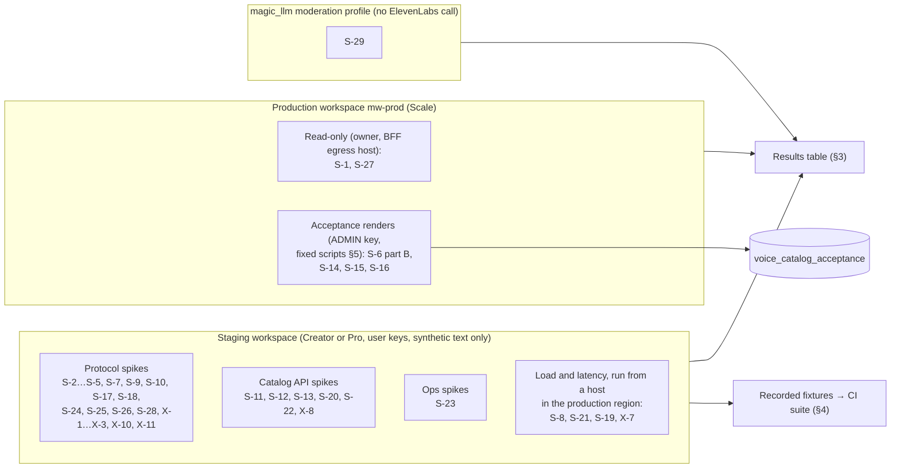
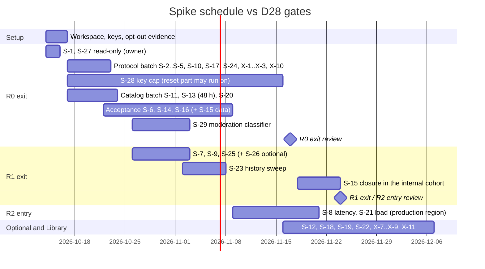

# 14. Staging spike and contract tests

- **Date:** 2026-10-12
- **Status:** Proposed (see [03](03_target_architecture_and_decisions.md) for sign-off status)

## Scope

This document turns every open ElevenLabs assumption in the decision record into a test you can run. It covers:

- the staging setup: workspace, keys, budget and safety rules;
- one test plan per spike S-1 to S-29 ([03 §6.1](03_target_architecture_and_decisions.md)), plus eleven extra unverified items (X-1 to X-11) taken from [research 01 §16](research/01_elevenlabs_tts_models_and_api.md), [research 02 §14](research/02_elevenlabs_streaming_dialogue_realtime_agents.md) and [research 12 §14](research/12_gap_model_protocol_facts.md);
- the results template;
- the permanent contract-test suite that replaces the spike once it is done;
- the listening-test protocol used by S-6, S-14, S-15 and S-16.

It does not repeat the decisions. Every pass/fail threshold below either copies a number from [03](03_target_architecture_and_decisions.md) or is marked **[proposal]** (QA's suggestion, for the owner or root to confirm).

The behaviour each spike expects is research evidence, mostly third-party live observations, and has **not** been confirmed on our account. It is written as "Expected (unconfirmed)". Prices are ElevenLabs list prices **as of 2026-10-12**: Flash and v4 Turbo $0.04 per 1K characters; v4, v3 and Multilingual v2 $0.08 per 1K; Scribe v2 Realtime $0.39 per hour; Groq `whisper-large-v3` $0.111 per hour with a 10 s minimum per request ([research 14 §2](research/14_cost_model.md)).

**Related:** [03 decision record](03_target_architecture_and_decisions.md) (D02, D04–D10, D13, D14, D16, D17, D19, D20, D24–D27, D37; §5.4–§5.8, §6) · [02 capabilities](02_elevenlabs_capabilities.md) · [04 catalog](04_voice_catalog_and_library.md) · [05 Studio and console](05_voice_studio_and_admin_console.md) · [06 narration](06_chat_narration_migration.md) · [07 calls](07_realtime_calls_migration.md) · [08 backend](08_backend_refactor_plan.md) · [09 frontend](09_frontend_refactor_plan.md) · [10 rollout](10_data_migration_and_rollout.md) · [11 cost and ops](11_cost_plans_and_operations.md) · [12 best practices](12_best_practices_and_improvements.md) · [13 policy](13_policy_privacy_and_compliance.md) · [15 implementation](15_implementation_plan_and_acceptance.md) · [16 risks](16_risks_and_open_questions.md) · test sources: [research 12 §13 (CT-01…CT-20)](research/12_gap_model_protocol_facts.md), [research 11 §9 (T1…T13)](research/11_gap_catalog_api_semantics.md)

---

## 1. Staging setup

### 1.1 Environments

The spikes run in five environments (table below). Most use the staging workspace. Two touch production **read-only** (S-1, S-27: `GET` only, no synthesis). Four render on production with the `ADMIN` key (S-6 part B, S-14, S-15, S-16), for two reasons:

- the catalog voices exist only there;
- a Library add may return a voice id that is specific to the workspace ([research 11 §2.2](research/11_gap_catalog_api_semantics.md)).

S-29 never calls ElevenLabs at all.



| Environment | What runs there | Key holder | Text allowed |
|---|---|---|---|
| **Staging workspace** (D02: Creator or Pro, separate from production) | Protocol, catalog-API and ops spikes; nightly and weekly contract tests (§4) | Operator seat on a shared mailbox | Synthetic, policy-safe text only (§1.5) |
| **Spike host in the production region** | S-8, S-19, S-21, X-7 latency and load runs, using **staging keys** | Operator | Same |
| **Production workspace, read-only** | S-1, S-27 (`GET` only) | Owner, from a BFF egress host, because production keys are IP-allow-listed (D04) | None (no synthesis) |
| **Production workspace, acceptance renders** | S-6 part B, S-14, S-15, S-16, through the console Acceptance module (D20) or, until that module ships, the spike harness with the `ADMIN` key | Root | The fixed acceptance scripts in §5.3 only |
| **Moderation classifier** | S-29 | BE | Synthetic set plus a public evaluation set. It **never** goes to ElevenLabs. |

**Staging plan.** Use **Pro** for the spike month and Creator after it. Reasons:

- Pro's concurrency (10 non-Flash / 20 Flash) is two thirds of Scale's (15 / 30), so the S-21 and S-24 extrapolations are shorter.
- It has 290 voice operations and 160 slots, which cover T2–T8 with room to spare.

Creator ($22) is enough for the nightly contract suite after the spike. Both plans are within D02 ("Creator or Pro").

### 1.2 Account settings checklist (before the first request)

| # | Setting | Evidence for the ROLL log |
|---|---|---|
| 1 | Staging workspace owned by a dedicated operator seat on a shared mailbox, not a person's account (D02) | Seat email, date |
| 2 | 2FA on | Screenshot |
| 3 | **Training opt-out ("Improve the models" off) on staging and on production**, before any request (D02, D25) | Dated screenshots |
| 4 | **Auto top-up OFF on staging during the spike, and no PAYG top-up purchased.** PAYG is drawn only *after* the plan's included usage, and with auto top-up off usage "pauses immediately" at a zero PAYG balance ([research 05 §2.2](research/05_elevenlabs_platform_pricing_limits_policy.md)). The provider-enforced stop is therefore the plan's included usage (Pro: $99 of list-price usage), not $25; the $25 spike stop is enforced by the harness ledger (§1.4). (Production keeps auto top-up on, D02.) | Screenshot |
| 5 | Optional PAYG monthly spend cap (Top Up settings) set to $25, as a backstop if anyone buys a top-up | Screenshot |
| 6 | Dashboard seats limited to the operator plus one QA engineer (D25) | Access register |
| 7 | No live-moderated, custom-rate, famous or child-like voices added, ever (D09) | Voice list export |
| 8 | Spike host egress IPs added to every staging key's IP allow-list (D04) | Key list export |

### 1.3 Staging keys

These are user keys, not service accounts, because Creator and Pro have no service accounts (D02, D04). The six keys carry the same per-key scopes as production ([03 §5.4.3](03_target_architecture_and_decisions.md)), small quotas and an IP allow-list. Env var names are the production names with staging values, so the BFF in staging needs no special code. The spike harness refuses to run against production (§1.6, workspace guard).

| Env var (staging value) | Scopes (same as §5.4.3) | Spike quota [proposal] | Used by |
|---|---|---|---|
| `ELEVENLABS_KEY_NARRATION` | `text_to_speech` | ~$6 equivalent | S-2…S-5, S-17, S-21, X-2, X-3, X-10 |
| `ELEVENLABS_KEY_CALLS` | `text_to_speech` | ~$4 | S-7, S-8, S-9, S-18, S-25, S-26 |
| `ELEVENLABS_KEY_PREVIEW` | `text_to_speech` | ~$0.50 | readiness-probe rehearsal, S-24 |
| `ELEVENLABS_KEY_CATALOG` | `voices_read`, `models_read` | smallest non-zero value | S-4 (CT-01), X-8, Job A/B dry runs |
| `ELEVENLABS_KEY_ADMIN_VOICES` | the eight scopes in §5.4.3 | ~$2 | S-10, S-11, S-13, S-20, S-22 |
| `ELEVENLABS_KEY_OPS` | `user_read`, `workspace_analytics_full_read`, `speech_history_read`, `speech_history_write`, `webhooks_write` | smallest non-zero value | S-12, S-23, X-10, the workspace guard |
| `SPIKE_CAP_A`, `SPIKE_CAP_B` (temporary) | `text_to_speech` | tiny (S-28) | S-28 only; **deleted** after it |
| `SPIKE_STT` (temporary, optional) | `speech_to_text` | ~$1.50 | S-19 only; deleted after it |

Rules:

- Quota units are unknown until S-28 ([research 05 §12 Q7](research/05_elevenlabs_platform_pricing_limits_policy.md)). Until then, the values above are what the dashboard displays, sized loosely.
- Never use `permissions: "all"`, and never grant the forbidden scopes listed in D04.
- The operator creates keys in the dashboard. No app key holds `create_user_api_key`.
- Keys live in the operator's secret store and in the spike host's environment only. They are never committed.
- Rotate all keys when the spike ends.

### 1.4 Budget

| Bucket | Where | Expected (as of 2026-10-12) | Hard stop |
|---|---|---|---|
| Gating spikes (R0, R1, R2; staging part) | Staging | ≈ $6.9 (≈ 140k characters, mostly Flash; S-8 and S-21 are ≈ 75% of it) | Harness ledger stop at $25 cumulative (list price, from the `character_count` deltas); provider stop = plan-included usage (§1.2 item 4) |
| Optional spikes (S-12, S-18, S-19, S-22, S-26) | Staging | ≈ $1.8 (S-19 Scribe minutes are most of it) | same |
| Extra items X-1…X-11 | Staging | ≈ $0.3 | same |
| **Staging total** | | **≈ $9.0, inside the "< $10" of 03 §6.1** | $25 (harness) |
| Acceptance and catalog build (S-6 part B, S-14, S-15, S-16, own samples, Voice Design) | Production, `ADMIN` key | ≈ $12–18, plus ~40–60 custom slots of 660 | `ADMIN` key cap "sized for one full catalog render" (§5.4.3); set to about 2× this estimate [proposal] |
| S-29 classifier | `magic_llm` | Unit cost [unverified] until BE picks the profile (D26) | BE's LLM budget |
| Plan fee | Staging | Pro $99 for the spike month, then Creator $22 | — |

Notes:

- Self-serve plans include usage worth their fee at list rate. Pro includes $99 of usage, about 1.24M characters at $0.08/1K ([research 05 §2.2](research/05_elevenlabs_platform_pricing_limits_policy.md)). The spike therefore costs almost nothing beyond the plan fee.
- Per-spike estimates are in each section and are summed in the results table (§3.2).
- Before and after each spike, the harness records `GET /v1/user/subscription` (`character_count`, `voice_slots_used`, `voice_add_edit_counter`). That gives the ledger. The harness refuses to start a spike whose estimate would take the cumulative list-price spend past $25; until X-10 calibrates the counter units, it converts with the conservative v4 rate ($0.08/1K) for every model.

### 1.5 Safety rules (binding for every spike and contract test)

1. **Policy-safe synthetic text only.**
   - Invented names, places and sums.
   - No real people, public figures or brands.
   - No PII: phone numbers only from the fictional 555-01xx range.
   - No sexual content, minors in any risky context, self-harm, slurs, harassment or graphic violence. Mild dark-fantasy action ("the door gave way") is the ceiling.

   All texts are fixed in §5.3 and in the procedures below. Ad-hoc text is not allowed.
2. **No mature text to any voice. Live-moderated voices are never used.** They are excluded from the catalog (D09). The research-11 test voice "M" (live-moderated) is **dropped**: sending prohibited or borderline text would itself breach the PUP, whose intro says an attempted violation is a violation ([research 10 §3.4](research/10_gap_policy_licensing.md)).
3. **Moderation is never tested against ElevenLabs.** The moderation path is tested with mocks (D26). S-29 tests the classifier alone, and its evaluation set never reaches an ElevenLabs endpoint.
4. **No unauthenticated scraping or enumeration.**
   - All Library and voice discovery goes through the authenticated API under our account.
   - Research 11's one-off unauthenticated probes must not be repeated or automated ([research 11 §11](research/11_gap_catalog_api_semantics.md)).
   - Preview audio is fetched only from URLs returned to our authenticated account, at most 10 voices every 6 h (S-13).
   - We never construct preview URLs.
   - The spec oracle in §4 is the pinned SDK repository, not a crawl of `api.elevenlabs.io`.
5. **No real user content in staging** (D02). Recorded fixtures contain only the texts in this document.
6. **IVC only with a full D20 consent record** (S-22). Samples are stored encrypted. The voice and the samples are deleted at the end of the spike.
7. **No ids copied from vendor samples.** Official samples still use expiring Default ids ([research 11 §1.3](research/11_gap_catalog_api_semantics.md)). Test voices are chosen in S-27 and S-11 and recorded by their returned copy ids.
8. **Pace.**
   - One request in flight, except in the load spikes (S-8, S-21, S-23, S-24), which ramp slowly.
   - Honour `Retry-After` if it is present.
   - Stop a spike on any 401 or 403 that is not expected by its procedure.
9. **Clean up.** At the end of each spike, delete:
   - test owned voices (staging);
   - history items;
   - webhooks;
   - temporary keys.

   Library copies are deleted only in staging, and only by the T4 steps.
10. **Stop rule.** Any ElevenLabs email about policy, verification or enforcement stops all spikes and goes to the incident runbook ([11](11_cost_plans_and_operations.md)). In production the same event is a D28 rollback trigger.

### 1.6 Harness and recording conventions

The harness is a small Python 3.12 package using `httpx` and `websockets`, the same stack as the adapters (D03). It is proposed at `scripts/elevenlabs_spike/` in magic-worlds-api; it does not exist yet.

Conventions follow [research 12 §13](research/12_gap_model_protocol_facts.md):

- `seed: 4242`;
- every baseline is run twice, so seed noise is known before any comparison;
- `output_format=mp3_44100_128` unless stated otherwise;
- for every call, record the status, all response headers (with `xi-api-key` redacted), the error body, and the audio SHA-256, bytes and duration.

```python
# scripts/elevenlabs_spike/harness.py (proposed sketch)
import hashlib, json, os, time, httpx

BASE = os.environ.get("ELEVENLABS_BASE_URL", "https://api.elevenlabs.io")
def key(alias: str) -> str: return os.environ[f"ELEVENLABS_KEY_{alias}"]

async def workspace_guard(c: httpx.AsyncClient) -> None:
    """Refuse to spend on anything but the staging workspace (defence in depth:
    production keys are also IP-allow-listed to the BFF egress, D04)."""
    h = {"xi-api-key": key("OPS")}
    user = (await c.get(f"{BASE}/v1/user", headers=h)).json()
    sub = (await c.get(f"{BASE}/v1/user/subscription", headers=h)).json()
    if (user.get("user_id") != os.environ["SPIKE_EXPECTED_USER_ID"]       # operator seat id, recorded in setup
            or sub.get("tier") != os.environ["SPIKE_EXPECTED_TIER"]):     # staging tier string, recorded in setup
        raise SystemExit(f"refusing to run: user/tier mismatch (tier={sub.get('tier')!r})")

async def tts(c, *, spike, alias, voice, body, path="", fmt="mp3_44100_128"):
    t0 = time.perf_counter()
    r = await c.post(f"{BASE}/v1/text-to-speech/{voice}{path}", params={"output_format": fmt},
                     headers={"xi-api-key": key(alias)}, json=body, timeout=httpx.Timeout(30, connect=5))
    record(spike=spike, endpoint=f"POST /v1/text-to-speech/{{voice}}{path}", alias=alias,
           request={**{k: v for k, v in body.items() if k != "text"}, "text_len": len(body["text"]),
                    "text_sha256": hashlib.sha256(body["text"].encode()).hexdigest()},
           status=r.status_code, headers={k: v for k, v in r.headers.items() if k.lower() != "xi-api-key"},
           error=r.json() if r.status_code >= 400 else None,
           audio=mp3_info(r.content) if r.headers.get("content-type", "").startswith("audio/") else None,
           timing={"total_ms": round((time.perf_counter() - t0) * 1000)})
    return r
```

Each call writes one JSONL record (schema in §3.1). Audio files are kept outside git, in the operator's encrypted spike bucket, for 90 days. Only fixtures promoted to §4 enter the repository.

**Shared test voices** (staging copies, chosen and added in S-27 and S-11):

| Alias | What | Source |
|---|---|---|
| `VP` | A perpetual Library voice (`notice_period` 4015), one of the Default replacements | S-27 |
| `VN` | A community Library voice with notice 365–730, `rate` 1.0, `fiat_rate` null, no live moderation, not famous | S-11 |
| `VD` | An owned voice designed in staging (`eleven_ttv_v3`) | S-20 |
| `VX` | `AAAAAAAAAAAAAAAAAAAA` (an unknown id) | S-10 |

### 1.7 Mapping from the research test scripts

| Research test | Spike here | Research test | Spike here |
|---|---|---|---|
| CT-01 | S-4, X-2 | CT-11 | S-18 (TTD), S-25 (Flash variant) |
| CT-02 | S-2 | CT-12 | S-7, S-25 |
| CT-03 | S-10 | CT-13 | S-18; S-7 (TTS variant) |
| CT-04 | **not run** (§2.31) | CT-14 | S-7 (a), S-18 (b) |
| CT-05, CT-06 | S-3 | CT-15 | S-9 |
| CT-07 | S-4 | CT-16 | S-17 (200), S-24 (429), X-1 |
| CT-08 | S-5 | CT-17 | S-19 |
| CT-09 | S-6 | CT-18 | S-7 |
| CT-10 | S-10 | CT-19 | S-17 |
| T1 | S-1, S-27 | CT-20 | **not run** (§2.31) |
| T2, T3, T4 | S-11 (T4 step 2 → S-10) | T9 | S-13 |
| T5, T6 | S-12 | T10 | written questions L-2 and L-3, not a spike |
| T7, T8 | S-20 | T11 | S-14 |
| T12 | X-8 | T13 | X-9 |

### 1.8 Schedule against the rollout gates

Gates are as in [03 §6.3](03_target_architecture_and_decisions.md). Dates follow D28:

- R1 starts 2026-11-18, so the R0 exit review is due by 2026-11-17.
- R2 starts 2026-11-25.



S-24 gates R1 exit in 03 §6.3 (§6, note 1). It is run early, in the R0 protocol batch, because it shares the CT-16 run with S-17.

---

## 2. Spike test plans

Each spike lists the same fields:

- question;
- the decisions that depend on it;
- environment and key;
- gate (from 03 §6.3);
- research basis;
- estimated cost;
- exact procedure;
- what to record;
- pass/fail;
- fallback (copied from 03 §6.1).

"Expected (unconfirmed)" lines are what the research predicts. They are **not** assumptions the design relies on.

### 2.1 S-1. Production account facts

| Field | Value |
|---|---|
| Question | Is the production account Scale (or can it become Scale), held by an entity? What are its creation date, existing voices and webhooks? Does anything depend on Default voices? |
| Decisions | D02, D09 (and the D04 readiness assumptions) |
| Environment | Production workspace, **read-only**, run by the owner from a BFF egress host |
| Gate | R0 exit |
| Research | [research 11 §9](research/11_gap_catalog_api_semantics.md) (T1, production half); [research 05 §4](research/05_elevenlabs_platform_pricing_limits_policy.md) |
| Cost | $0 |

**Procedure**

```bash
H_OPS=(-H "xi-api-key: $PROD_OPS"); H_CAT=(-H "xi-api-key: $PROD_CATALOG")
curl -s https://api.elevenlabs.io/v1/user "${H_OPS[@]}" | jq '{created_at, subscription: .subscription.tier}'
curl -s https://api.elevenlabs.io/v1/user/subscription "${H_OPS[@]}" \
  | jq '{tier,status,character_count,character_limit,next_character_count_reset_unix,voice_slots_used,voice_limit,voice_add_edit_counter,max_voice_add_edits}'
for T in default personal community non-default; do
  curl -s "https://api.elevenlabs.io/v2/voices?voice_type=$T&page_size=100&include_total_count=true" "${H_CAT[@]}" \
    | jq --arg t "$T" '{type:$t,total:.total_count,ids:[.voices[]|{voice_id,category,name}]}'
done
curl -s "https://api.elevenlabs.io/v1/workspace/webhooks?include_usages=true" "${H_OPS[@]}"
# Repo guard: no configured or seeded id from the old-Default list (research 11 §1.2)
rg -n -F -f old_default_voice_ids.txt /home/andres/PycharmProjects/magic-worlds-api /home/andres/WebstormProjects/magic-worlds -g '!node_modules' -g '!docs'
```

Manual evidence (screenshots for the ROLL log):

- billing page with the contracting entity;
- seats;
- training opt-out;
- 2FA;
- PAYG cap.

**Record**

- tier and status;
- `created_at`, which settles Default-voice eligibility (accounts created on or after 2026-03-01 have none);
- voice counts by type and any `premade` ids (Job A will tag them `premade_deprecated`);
- slot and operations headroom;
- existing webhooks;
- a 403 on the webhook list with the `OPS` key, if it happens: that is a D04 scope finding.

**Pass:** all of these hold.

- The tier is `scale`, or an upgrade path is confirmed in writing.
- The contracting party is a legal entity.
- `created_at` is known.
- The repo guard finds **0** old-Default ids.
- The existing voices and webhooks are inventoried.

**Fallback:** create a new Scale workspace for production (03 §6.1).

### 2.2 S-2. `eleven_v4` on TTS HTTP, with headers

| Field | Value |
|---|---|
| Question | Do `eleven_v4` (and `eleven_v4_turbo`) work on `POST /v1/text-to-speech` on our account, with `request-id` and `character-cost` headers? |
| Decisions | D05, D06 |
| Environment | Staging, `NARRATION` key |
| Gate | R0 exit |
| Research | CT-02; [research 12 §1–§2](research/12_gap_model_protocol_facts.md) |
| Cost | ≈ 450 characters ≈ $0.03 |

**Procedure**

```bash
for M in eleven_v4 eleven_v4_turbo; do for P in "" /stream /with-timestamps /stream/with-timestamps; do
  for T in "La puerta se abrió despacio." "The door opened slowly."; do
    curl -sS -D "hdr_${M}${P//\//_}_${#T}.txt" -o "out_${M}${P//\//_}_${#T}.bin" \
      -X POST "https://api.elevenlabs.io/v1/text-to-speech/$VP$P?output_format=mp3_44100_128" \
      -H "xi-api-key: $ELEVENLABS_KEY_NARRATION" -H 'content-type: application/json' \
      -d "$(jq -nc --arg t "$T" --arg m "$M" '{text:$t, model_id:$m, seed:4242}')"
done; done; done
```

**Record:** for every call:

- status and `content-type`;
- `request-id`, `x-request-id`, `x-trace-id`, `character-cost`, `x-character-count`, `x-region`, `current-concurrent-requests`, `maximum-concurrent-requests`;
- the MP3 frame header (sample rate, bitrate);
- the duration;
- on the timestamp variants, the JSON keys (`audio_base64`, `alignment`, `normalized_alignment`) and the time unit.

Expected (unconfirmed): 200 on every v4 endpoint, with both headers on convert ([research 12 §1](research/12_gap_model_protocol_facts.md)).

**Pass:** `eleven_v4` returns 200 on all four endpoints, with `audio/mpeg` (or the timestamp JSON), and convert carries `request-id` and `character-cost`. The `eleven_v4_turbo` results are informational: HTTP use of v4 Turbo is undocumented and the design does not rely on it.

**Fallback (03 §6.1):** Expressive goes through TTD HTTP with one input per segment, at the same price. If that also fails, D05 applies: Expressive is unhealthy and turns fall back to Standard (see §6, note 2 on `eleven_multilingual_v2`). Missing headers hand over to the S-17 fallback (meter by our own count).

### 2.3 S-3. Per-model settings behaviour

| Field | Value |
|---|---|
| Question | Does per-model settings behaviour match 03 §5.6? That is: v4 ignores `style` and `speed`; Flash rejects or ignores speed outside 0.7–1.2; Flash's handling of `style` and `use_speaker_boost`; v3 stability discreteness; the error code for `stability: 1.01` |
| Decisions | D13 (allow-lists in §5.6) |
| Environment | Staging, `NARRATION` key |
| Gate | R0 exit |
| Research | CT-05, CT-06; [research 12 §4](research/12_gap_model_protocol_facts.md) |
| Cost | ≈ 2,800 characters ≈ $0.20 |

**Procedure** (CT-05 × CT-06, which also gives X-3 seed determinism for free)

```python
TEXT = "Uno, dos, tres. La lluvia caía sin prisa."            # 40 characters
MODELS = ["eleven_v4", "eleven_v4_turbo", "eleven_v3", "eleven_multilingual_v2", "eleven_flash_v2_5"]
VARIANTS = [{}, {}, {"speed": 0.69}, {"speed": 0.7}, {"speed": 1.2}, {"speed": 1.21}, {"speed": 0.25},
            {"speed": 4.0}, {"style": 0.8}, {"style": 1.5}, {"use_speaker_boost": False},
            {"similarity_boost": 0.1}, {"stability": 1.01}]                       # {} twice = seed noise
for m in MODELS:
    for vs in VARIANTS:
        await tts(c, spike="S-3", alias="NARRATION", voice=VP, path="/with-timestamps",
                  body={"text": TEXT, "model_id": m, "seed": 4242, "voice_settings": vs})
for s in [0.0, 0.3, 0.5, 0.7, 1.0]:                                             # CT-06, v3, each twice
    for _ in range(2):
        await tts(c, spike="S-3", alias="NARRATION", voice=VP, path="/with-timestamps",
                  body={"text": TEXT, "model_id": "eleven_v3", "seed": 4242, "voice_settings": {"stability": s}})
```

**Record:** for every cell:

- status, `detail.code` and `param`;
- duration and SHA-256 compared with the two baselines;
- the alignment end time.

A setting counts as **ignored** when the SHA matches the baseline (if the two baselines are identical) or the duration is within ±2% of it (if they are not). It counts as **honoured** when the effect is consistent with the setting; for speed, the duration ratio is within ±10% of 1/speed.

Expected (unconfirmed):

- Multilingual v2 rejects speed outside 0.7–1.2 with 400 `invalid_voice_settings`;
- v4 returns 200 with duration equal to the baseline for `speed` and `style`;
- `stability: 1.01` returns 400 or 422;
- the Flash and v3 cells are unknowns ([research 12 §4.2](research/12_gap_model_protocol_facts.md)).

**Pass:** all of these hold.

1. No field in §5.6's "sent" column is rejected for its model within D13's write-time ranges (stability and similarity 0–1, speed 0.7–1.2).
2. v4 ignores `style` and `speed`, which confirms "strip".
3. Flash honours speed at 0.7 and 1.2. Its behaviour at 0.69 and 1.21 is recorded; the resolver never sends those values.
4. The error code for `stability: 1.01` is recorded and maps to `invalid` (§5.8).
5. The Flash `style` and `use_speaker_boost` effects and v3 discreteness are recorded. If v3 snaps to stops, the lab shows three stops.

**Fallback:** tighten the allow-lists (for example Flash: stability and similarity only); v3 gets a three-stop control in the lab.

### 2.4 S-4. `language_code` acceptance per model

| Field | Value |
|---|---|
| Question | Does `language_code` acceptance per model match the allow-list? Does Flash return 400 on unsupported codes? Does `es` normalize numbers on v4? |
| Decisions | D17, D34 (light languages); §5.7 |
| Environment | Staging, `CATALOG` key (models) and `NARRATION` key |
| Gate | R0 exit |
| Research | CT-01, CT-07; [research 12 §5](research/12_gap_model_protocol_facts.md) |
| Cost | ≈ 1,300 characters ≈ $0.08 (`GET /v1/models` is free) |

**Procedure**

```bash
curl -s https://api.elevenlabs.io/v1/models -H "xi-api-key: $ELEVENLABS_KEY_CATALOG" \
 | jq '[.[]|select(.model_id|IN("eleven_v4","eleven_v4_turbo","eleven_v3","eleven_flash_v2_5","eleven_multilingual_v2"))
        |{model_id,maximum_text_length_per_request,can_use_style,can_use_speaker_boost,concurrency_group,
          requires_alpha_access,languages:[.languages[].language_id]}]'
```

```python
ES = "El 12 de marzo de 2026 pagué 1.250 € a las 15:30."
EN = "On 12 March 2026 I paid €1,250 at 15:30."
for m in ["eleven_v4", "eleven_v4_turbo", "eleven_flash_v2_5", "eleven_multilingual_v2"]:
    for code in [None, "es", "spa", "es-ES"]:
        await tts(..., body={"text": ES, "model_id": m, "seed": 4242, **({"language_code": code} if code else {})},
                  path="/with-timestamps")
for m in ["eleven_v4", "eleven_flash_v2_5"]:
    for code in [None, "en"]: await tts(..., body={"text": EN, "model_id": m, **({"language_code": code} if code else {})})
    for code, line in LIGHT_LINES.items():     # fr, de, pt, it (D34 defaults): "The lantern is still lit." translated
        await tts(..., body={"text": line, "model_id": m, "language_code": code})
await tts(..., body={"text": "Hola.", "model_id": "eleven_flash_v2_5", "language_code": "fa"})   # negative control
for code, line in {"yue": "燈仲著緊。", "zh": "灯还亮着。"}.items():
    await tts(..., body={"text": line, "model_id": "eleven_v4_turbo", "language_code": code})
```

**Record:**

- status and `detail.message` for each cell;
- `normalized_alignment.characters`, which shows how the numbers were expanded and in which language;
- the per-model `languages[]` list, which becomes the allow-list source.

**Pass:** all of these hold.

1. `GET /v1/models` lists every configured model, with `en` and `es` for Flash and v4.
2. Flash returns 400 for `fa`, which confirms the guard is needed, and 200 for every code in its `languages[]` (en, es and each D34 light language listed).
3. v4 with `es` expands the numbers into Spanish.
4. The `spa` and `es-ES` outcomes are recorded. These codes are never sent (§5.7 format rule).
5. The Multilingual v2 outcome with a code is recorded. A code is never sent there.

**Fallback:** if Flash rejects codes that appear in its own `languages[]`, omit `language_code` on Flash and rely on upstream normalization (03 §6.1).

### 2.5 S-5. Flash text normalization under `auto`

| Field | Value |
|---|---|
| Question | How does Flash handle digits in Spanish and English under `apply_text_normalization: "auto"` (and `on` / `off`)? |
| Decisions | D27 (and C17) |
| Environment | Staging, `NARRATION` key |
| Gate | R0 exit |
| Research | CT-08; [research 12 §6](research/12_gap_model_protocol_facts.md) |
| Cost | ≈ 900 characters ≈ $0.04 |

**Procedure**

```python
LINES = {"es": "Llama al 555-0134 a las 3:45 pm; total: $1,250.50 (12/03/2026).",
         "en": "Call 555-0134 at 3:45 pm; total: $1,250.50 (03/12/2026)."}
for lang, text in LINES.items():
    for mode in [None, "auto", "on", "off"]:
        await tts(..., path="/with-timestamps", body={"text": text, "model_id": "eleven_flash_v2_5", "language_code": lang,
                  "seed": 4242, **({"apply_text_normalization": mode} if mode else {})})
    # our pipeline output: the D27 upstream expansion of the same line (sanitizer step 6)
    await tts(..., path="/with-timestamps", body={"text": expand_digits(text, lang), "model_id": "eleven_flash_v2_5",
              "language_code": lang, "apply_text_normalization": "auto"})
```

**Record:**

- for each mode, whether `normalized_alignment.characters` spells out the numbers;
- whether `on` returns 200 or a plan error (record its `code`);
- the listening score (naturalness, §5.4) of the pipeline-expanded render.

**Pass:** informational for the provider part. The mitigation (upstream expansion) ships regardless (03 §6.1). The pipeline-expanded render must score naturalness ≥ 4 in both languages.

**Fallback:** already mitigated. Upstream expansion is the default, and only the expansion tables grow.

### 2.6 S-6. Emotion tags, `[whispers]` and stripped brackets

| Field | Value |
|---|---|
| Question | Are the 03 §5.5 emotion tags and `[whispers]` audible on v4, without being read aloud or rendered as sound effects? Do stripped brackets read naturally? Is the Standard stability offset audible? |
| Decisions | D14 (§5.5.1 rows), D16 (thought tag), D13 (emotion control on Standard) |
| Environment | Part A (raw brackets): staging. Part B (tags on catalog voices): production, `ADMIN` key |
| Gate | R0 exit |
| Research | CT-09; [research 12 §7](research/12_gap_model_protocol_facts.md); [research 01 §5](research/01_elevenlabs_tts_models_and_api.md) |
| Cost | Part A ≈ 1,500 characters ≈ $0.10 (staging). Part B ≈ 23k characters ≈ $1.2 (production acceptance budget) |

**Procedure**

*Part A, CT-09 on staging* (v4, v3 for the lab only, and Flash; `/with-timestamps`):

- en: `[Chapter 2] The door opened. [OOC: roll a d20] (She whispers) Run.`
- es: `[Capítulo 2] La puerta se abrió. [OOC: tira un d20] (Ella susurra) Corre.`

Then render the **sanitizer output** (03 §5.5.3 steps 1–8) of the 11 fixture cases listed in 03 §5.5.3 on v4 and Flash, in both languages.

*Part B, listening test* (protocol in §5.6). Use 4 catalog candidates: 2 en and 2 es, mixed gender, at least one owned designed voice. Render on `eleven_v4` with 2 seeds (4242 and 7):

- carrier lines **C1** and **C1-es** (§5.3) prefixed with each of `[happily]`, `[sad]`, `[angry]`, `[surprised]`, `[calm]`, `[nervously]`, `[disgusted]` and `[whispers]`;
- the composition `[whispers] [sad]`;
- the untagged carrier, as the reference.

*Standard offset (Flash):* for each emotion, render pairs of base and base + offset (03 §5.5.1). The two renders of a pair share one seed; seeds differ between pairs (otherwise the 10 pairs are byte-identical copies). Then run the forced-choice test in §5.6.

*Informational:* pause and interjection tags (`[short pause]`, `[long pause]`, `[laughs]`, …) on v4, for 2 voices. They matter only if the S-18 upgrade path is adopted, because Flash strips them.

**Record:**

- per render, the outcome code P / N / R / S / X (§5.6);
- the alignment span of tag characters (X-5);
- rater ids;
- the forced-choice score per emotion.

**Pass:**

1. A §5.5.1 row keeps its tag only if P ≥ 75% of its renders and R = S = 0 **[proposal]**.
2. `[whispers]` passes, for the D16 thought delivery.
3. The sanitizer outputs score naturalness median ≥ 4.
4. For the Standard offset: the §5.6 audibility rule (≥ 70% over ≥ 30 judgements) holds on at least 4 of the 7 emotions **[proposal]**.

**Fallback (03 §6.1, D13):**

- A failing tag row maps to no tag (bump `emotion_map_version`).
- If `[whispers]` fails, the thought falls back to gain only.
- If the offsets are inaudible, the emotion control is shown on Expressive only (D13).

### 2.7 S-7. Flash multi-context WebSocket protocol

| Field | Value |
|---|---|
| Question | On the Flash multi-context socket: does `is_final` arrive after `flush`? Which casing is used? Does a keepalive before the initialising message cause 1008? Does a settings change cause 1008? |
| Decisions | D06 (protocol rules 1–5) |
| Environment | Staging, `CALLS` key |
| Gate | R1 exit |
| Research | CT-12, CT-14 (a), CT-18; [research 12 §8.1–§8.7](research/12_gap_model_protocol_facts.md); [research 02 §5](research/02_elevenlabs_streaming_dialogue_realtime_agents.md) |
| Cost | ≈ 7,000 characters ≈ $0.28 |

**Procedure.** URL, as in D06 rule 1:

`wss://api.elevenlabs.io/v1/text-to-speech/$VP/multi-stream-input?model_id=eleven_flash_v2_5&output_format=mp3_44100_64&inactivity_timeout=180&sync_alignment=true&apply_text_normalization=auto`

with the header `xi-api-key: $ELEVENLABS_KEY_CALLS`. `→` is a client message; `←` is a server message.

```jsonc
// (a) is_final after flush, without close
→ {"context_id":"t_1","text":" ","voice_settings":{"stability":0.5,"similarity_boost":0.75,"speed":1.0}}
→ {"context_id":"t_1","text":"The lantern flickered once and went still. ","flush":true}
← {audio, alignment, contextId|context_id}…          // log the raw keys of every frame
   wait 10 s: record whether isFinal|is_final arrives for t_1
→ {"context_id":"t_1","close_context":true}
← record the time to isFinal|is_final (slot hold time)

// (b) keepalive before init (expect a later 1008, research 12 §8.2)
→ {"context_id":"t_k","text":""}                     // no init message for t_k yet
   wait 30 s with ordinary keepalives on t_1: record any close code and reason

// (c) settings change on an open context (CT-18), on a fresh socket; repeat on /stream-input
→ {"context_id":"t_2","text":" ","voice_settings":{"stability":0.5,"similarity_boost":0.75}}
→ {"context_id":"t_2","text":"Hello there. ","voice_settings":{"stability":0.9,"similarity_boost":0.75},"flush":true}
← expect close 1008 "voice_settings field must be provided in the first message…"

// (d) context limit on the TTS socket: init t_a…t_f (6 contexts) with 10 characters each, no close
← record the error or close when the 6th context opens

// (e) inactivity (CT-14 a): fresh socket, one init, then idle 185 s
← record the close code and reason (expect 1008 input_timeout_exceeded at about 180 s)

// (f) the D06 protocol, 50 scripted turns: per turn, init t_n, 3 sentences each with flush,
//     close_context after the last one; keepalive {"context_id":X,"text":""} every 15 s, only after init;
//     at most 4 live contexts (closed contexts counted until is_final or 5 s)
```

**Record:**

- the server key casing per frame type;
- whether `is_final_audio_for_turn` appears on the TTS socket;
- the time from `flush` and from `close_context` to final;
- the close codes and reasons for (b) to (e);
- in (f), the number of unexpected closes and the number of live contexts over time.

**Pass:** (f) completes 50 turns with **zero** unexpected closes. (a) to (e) are recorded and captured as fixtures (§4). The parser accepts both casings.

**Fallback:** a single-context `stream-input` socket per turn, prewarmed (03 §6.1).

### 2.8 S-8. Call latency target in the production region

| Field | Value |
|---|---|
| Question | Is the call latency target met? p50 first audio ≤ 250 ms after the first sanitized sentence is ready, **including synchronous moderation**; p95 ≤ 600 ms; no 1008 in 200 barge-ins; no end-to-end regression against the MiniMax baseline |
| Decisions | D06 (rule 6), D08 |
| Environment | Staging BFF build (R1 code with the ElevenLabs adapter), deployed on a host **in the production region** with staging keys, the real `moderation` profile (S-29) and Groq STT |
| Gate | R2 entry |
| Research | [research 02 §13.2, §13.4](research/02_elevenlabs_streaming_dialogue_realtime_agents.md); [research 05 §3.7](research/05_elevenlabs_platform_pricing_limits_policy.md) |
| Cost | ≈ 60k Flash characters ≈ $2.4, plus Groq ≈ $0.10 and callbot LLM tokens ([unverified] unit cost) |

**Procedure** (the load script; 03 §6.1 names [research 02 §13.4](research/02_elevenlabs_streaming_dialogue_realtime_agents.md), which gives only the acceptance criteria, see §6 note 3)

1. A synthetic caller signs in as a staff test account on the staging app and opens `/character-chats/{session_id}/ws-voice` (subprotocol `mw.bearer.v1`; [route_voice_call.py:889](/home/andres/PycharmProjects/magic-worlds-api/src/routes/user/route_voice_call.py), [auth_adapter.py:65](/home/andres/PycharmProjects/magic-worlds-api/src/services/auth_adapter.py)).
2. It sends pre-rendered policy-safe utterances (16 kHz PCM16 WAV) through `POST /character-chats/{session_id}/voice-segments` ([route_voice_call.py:592](/home/andres/PycharmProjects/magic-worlds-api/src/routes/user/route_voice_call.py)). The utterances come from the §5.3 dialogue lines, rendered once with Flash in staging and stored as fixtures.
3. **Latency run:** 300 turns at 1, 5 and 10 concurrent callers, spread over 24 h.
4. **Barge-in run:** 200 turns, each sending `voice_barge_in {reason:"barge_in", turn_id, played_ms}` at a random 300–2,500 ms after the first `voice_audio_chunk`. Today's frame carries only `reason` ([route_voice_call.py:143-147](/home/andres/PycharmProjects/magic-worlds-api/src/routes/user/route_voice_call.py)); the `turn_id` and `played_ms` fields are the R1 extension proposed in [07](07_realtime_calls_migration.md).
5. **Baseline:** the same driver against the MiniMax route (cohort off), so the end-to-end comparison uses identical inputs. This is D06's R0 baseline.
6. **X-7:** repeat 50 latency turns with `ELEVENLABS_BASE_URL=https://api.us.elevenlabs.io`.

**Record** (server timestamps from the BFF turn timings; see the existing timing test [test_voice_turn_latency.py:94](/home/andres/PycharmProjects/magic-worlds-api/tests/voice/test_voice_turn_latency.py)):

- `t_sentence_ready`, `t_moderation_done`, `t_ws_first_audio` and `t_first_chunk_to_client`;
- STT end → first audio;
- close codes;
- late frames dropped for dead contexts;
- live contexts per call;
- persisted `metadata.voice.truncated` / `played_ms` (D06 rule 3).

**Pass:** all of these hold.

- p50(`t_ws_first_audio − t_sentence_ready`) ≤ 250 ms and p95 ≤ 600 ms, with moderation inside the window.
- Zero 1008 closes across the 200 barge-ins.
- Every barge-in turn is persisted as `completed` with truncated content.
- p50 end-to-end (user stops speaking → first audio) is no worse than the MiniMax baseline.

**Fallback:** tune `chunk_length_schedule` and `auto_mode`; then consider PCM + AudioWorklet (D08); then v4 Turbo (S-18) (03 §6.1). If moderation dominates, the S-29 fallback applies (a self-hosted classifier for calls).

### 2.9 S-9. MP3 chunk frame alignment

| Field | Value |
|---|---|
| Question | Are MP3 chunks frame-aligned on the WebSocket and on `/stream`? |
| Decisions | D08, D24 (call billing parser) |
| Environment | Staging, `CALLS` and `NARRATION` keys |
| Gate | R1 exit |
| Research | CT-15; [research 12 §8.9, §12.1](research/12_gap_model_protocol_facts.md) |
| Cost | ≈ 1,500 characters ≈ $0.07 |

**Procedure.** Use a three-sentence text from §5.3 (N1), with `flush` after each sentence. Run it in `mp3_44100_128` and `mp3_44100_64` on:

- HTTP `/stream` (Flash and v4);
- the TTS multi-context socket (Flash);
- optionally, the TTD socket (`eleven_v4_turbo`).

Save every chunk separately. Then analyze offline:

```python
def scan(chunk: bytes) -> dict:
    """Does the chunk start on a sync word, and does it hold only whole MPEG-1 Layer III frames?"""
    starts_sync = len(chunk) > 1 and chunk[0] == 0xFF and (chunk[1] & 0xE0) == 0xE0
    off, frames = 0, 0
    while (n := frame_len(chunk, off)) > 0 and off + n <= len(chunk):
        off, frames = off + n, frames + 1
    return {"starts_sync": starts_sync, "whole_frames_only": off == len(chunk), "tail_bytes": len(chunk) - off}
```

Also run the proposed tail-carry parser over the chunk sequence. Its summed billed duration must equal the whole-file duration within one frame. Today's parser fails this: [engine.py:1579-1599](/home/andres/PycharmProjects/magic-worlds-api/src/services/voice_orchestration/engine.py) marks all pending bytes billed before parsing, and [engine.py:2286-2306](/home/andres/PycharmProjects/magic-worlds-api/src/services/voice_orchestration/engine.py) drops a partial trailing frame.

**Record:**

- the share of chunks that start on a sync word;
- the share that hold only whole frames;
- whether every flush boundary is frame-aligned;
- tail-byte statistics.

**Pass:** informational. The tail-carry fix ships regardless (D08). The recorded chunk sets become fixtures PCT-F04 and PCT-F05 (§4).

**Fallback:** none needed (03 §6.1).

### 2.10 S-10. Error shapes for unknown voices and unsupported models

| Field | Value |
|---|---|
| Question | What are the error shapes for an unknown or removed voice on HTTP, the TTS socket and the TTD socket? What does the handshake rejection for an unsupported model look like? |
| Decisions | 03 §5.8 (error classifier) |
| Environment | Staging, `NARRATION`, `CALLS` and `ADMIN_VOICES` keys |
| Gate | R1 exit |
| Research | CT-10, CT-03, T4 step 2; [research 12 §8.6, §8.8](research/12_gap_model_protocol_facts.md) |
| Cost | ≈ $0.01 |

**Procedure**

| # | Request | Expected (unconfirmed) |
|---|---|---|
| 1 | `POST /v1/text-to-speech/$VX` (Flash, "Hola.") | 404 `voice_not_found`, type `not_found` |
| 2 | `POST /v1/text-to-speech/not-a-voice!!` | 400 `invalid_voice_id` |
| 3 | TTS socket `stream-input` on `$VX`: `{"text":" "}`, then `{"text":"Hola. ","flush":true}` | Opens, then closes 1008 with "A voice with voice_id … does not exist." |
| 4 | TTS socket `multi-stream-input` on `$VX`: init a context, then text with flush | Record the close code and reason |
| 5 | TTD socket (`eleven_v4_turbo`): `{"voices":["$VX"]}`, then `{"inputs":[{"text":"Hola.","voice_id":"$VX"}],"flush":true}` | `{message, error, code, param}`, then a close with `code` |
| 6 | CT-03: `multi-stream-input?model_id=eleven_v4_turbo` and `stream-input?model_id=eleven_v4`; control: `eleven_flash_v2_5` | HTTP 400 at the upgrade, `detail.code: unsupported_model`; control 101 |
| 7 | TTD socket with `model_id=eleven_flash_v2_5` | 403 |
| 8 | Synthesis on the copy deleted in S-11 (T4 step 2) | 404 or 403; record which |

**Record:** status or close code, reason, body, headers. Each becomes a fixture.

**Pass:** every shape is captured and can be classified by `detail.code` or close reason into a §5.8 row:

- rows 1–5 and 8 → `voice_unavailable`;
- rows 6–7 → `unavailable` with the config breaker.

**Fallback:** treat any 4xx or 1008 that mentions the voice as `voice_unavailable` (03 §6.1).

### 2.11 S-11. Voice Library add semantics

| Field | Value |
|---|---|
| Question | Does a Library add return an id (the same one or a different one)? Does it consume at most 1 operation? Does a re-add work while the voice is still listed? |
| Decisions | D10, D19 |
| Environment | Staging, `ADMIN_VOICES` key |
| Gate | R0 exit; also the "Public Library voices" gate |
| Research | T2, T3, T4; [research 11 §2](research/11_gap_catalog_api_semantics.md) |
| Cost | ≈ 250 characters ≈ $0.01, plus about 3–4 voice operations |

**Procedure.** Read the subscription counters before and after every step.

```text
T2  GET /v2/voices?voice_ids=VP_lib,VN_lib                 → expect no rows (not yet added)
    POST /v1/text-to-speech/VN_lib {"text":"Prueba uno.","model_id":"eleven_flash_v2_5"}  → record 200/404/403
    GET /v2/voices?voice_ids=VN_lib                         → did using the voice add it?
T3  POST /v1/voices/add/{public_owner_id}/VN_lib {"new_name":"mw-stg-VN","bookmarked":true} → R
    GET /v1/voices/R → sharing.status, original_voice_id, public_owner_id, notice_period, disable_at_unix,
                       live_moderation_enabled, voice_mixing_allowed, rate, fiat_rate
    synthesize on R and on VN_lib; repeat the add → expect 400 voice_already_cloned
T4  DELETE /v1/voices/R; synthesize on R (→ S-10 row 8); re-add VN_lib → R2; synthesize on R2
```

`VP` is added in the same way, but never deleted.

**Record:**

- R vs `VN_lib`, and R2 vs R;
- the `voice_add_edit_counter` and `voice_slots_used` deltas per add;
- the terms at add time;
- the error codes.

**Pass:** the add returns an id (same or different, recorded), costs at most 1 operation, and a re-add works while the voice is listed. Synthesis on the returned id succeeds.

**Fallback:** the design already stores both ids; budget the operations; never delete Library copies in production (03 §6.1, D19).

### 2.12 S-12. Webhook payload, signature and retries

| Field | Value |
|---|---|
| Question | Does the voice-removal webhook payload contain a voice id we can parse? What is the signature format? Do retries behave as documented when enabled? |
| Decisions | D10 (the webhook stays disabled until this passes), D19 |
| Environment | Staging, `OPS` key (webhooks). Needs a **public HTTPS staging receiver**; no ingress is confirmed today ([research 13 §5](research/13_gap_codebase_checks.md)) |
| Gate | Public Library voices (lifecycle); optional (webhook) |
| Research | T5, T6; [research 11 §5.3](research/11_gap_catalog_api_semantics.md) |
| Cost | $0 (T6 needs a cooperating PVC owner, or sample payloads from support) |

**Procedure**

1. **T5.** `POST /v1/workspace/webhooks` with `{"settings":{"auth_type":"hmac","name":"mw-stg","webhook_url":"https://<staging-host>/webhooks/elevenlabs"}}`. Store `webhook_secret` in the secret store; it is shown once.
2. `PATCH /v1/workspace/webhooks/{id}` with `{"name":"mw-stg","is_disabled":false,"retry_enabled":true,"events":["voice_library_removal_notice"]}`.
3. `GET /v1/workspace/webhooks?include_usages=true` to confirm the events.
4. The receiver stores the raw body and all headers (encrypted), and answers **500 to the first delivery** of each event so the retries are observed.
5. **T6, preferred path:** ask ElevenLabs support for sample signed payloads of `voice_removal_notice`, `voice_removal_notice_withdrawn` and `voice_removed`.
6. **T6, alternative path:** a team member shares their own PVC with a 30-day notice period; staging adds it; the owner stops sharing; the receiver captures the notice. Then re-share (captures `…_withdrawn`), stop sharing again, and capture `voice_removed` after 30 days.

**Record:**

- the raw `ElevenLabs-Signature` header (expected `t=…,v0=…`, [unverified]);
- the verification result of `HMAC-SHA256(secret, "<t>.<raw body>")` with `compare_digest`;
- the JSON path of the voice id in `data`;
- retry times on 500;
- `is_auto_disabled` after the test.

**Pass:** the voice id can be parsed. The signature verifies on raw bytes. Retry behaviour for voice events is recorded. The D10 tolerance window is set so that it covers the observed retry schedule.

**Fallback:** polling only, which is already the primary path (03 §6.1).

### 2.13 S-13. Upstream preview URL stability

| Field | Value |
|---|---|
| Question | Are upstream preview URLs stable enough to proxy with a 1 h cache? |
| Decisions | D10, D18. This matters only once L-3 allows the proxy; until then we serve our own samples only. |
| Environment | Staging, `CATALOG` key. Fetches only URLs returned to our account. |
| Gate | R0 exit |
| Research | T9; [research 11 §4](research/11_gap_catalog_api_semantics.md) |
| Cost | $0 |

**Procedure.** Every 6 h for 48 h, for 10 added voices:

1. Call `GET /v2/voices?voice_ids=…`.
2. Store each `preview_url` and each `verified_languages[].preview_url`.
3. Download the bytes. Record status, `content-type`, `Cache-Control` and SHA-256.
4. Derive the canonical source key: the URL without the hourly `timestamp`.

The audio stays in root-only storage and is deleted after the spike.

**Pass:** for at least 9 of the 10 voices, the same canonical key gives the same SHA-256 across 48 h, and `Cache-Control` allows ≥ 3600 s.

**Fallback:** our own pre-rendered samples only, which is already the primary path.

### 2.14 S-14. English and Spanish catalog coverage

| Field | Value |
|---|---|
| Question | Do enough Spanish and English voices pass acceptance on Flash and v4 to reach ≥ 16 per language (≥ 40 public, call-eligible)? |
| Decisions | D09, D31 (default rows), D34 |
| Environment | Part A: staging or production, authenticated Library listing. Part B: production workspace, `ADMIN` key, Acceptance module. |
| Gate | R0 exit |
| Research | T11; [research 11 §4.5](research/11_gap_catalog_api_semantics.md); [research 14 §3.4–§3.5](research/14_cost_model.md) |
| Cost | Part A $0. Part B ≈ $10–15 in renders, plus Voice Design ≈ $2–3 ([unverified] per-character design rate), plus about 40–60 slots |

**Procedure**

1. **Part A (T11, authenticated).** Page through `GET /v1/shared-voices?language=es&min_notice_period_days=365&include_custom_rates=false&include_live_moderated=false&category=high_quality&page_size=100&page=N` until `has_more=false`. Then repeat for `language=en`. Count voices whose `verified_languages` lists the language on `eleven_v4` and on `eleven_flash_v2_5`. This is informational until L-2.
2. **Part B, design.** Design owned voices with `eleven_ttv_v3`, using archetype briefs that span narrator, hero, villain, mentor, companion, creature and noble, across gender and age bucket, in en and es. Save the chosen designs in the same session (S-20), as `draft`.
3. **Part B, acceptance.** Run the §5 protocol per (voice, model, language) on `eleven_flash_v2_5` and `eleven_v4`, and write the results to `voice_catalog_acceptance`.
4. Add perpetual Library candidates as `visibility=admin` only (the L-2 safe default).

**Pass:** all of these hold.

- At least 16 en and 16 es voices pass on both models.
- With S-15, at least 40 public call-eligible voices.
- The D31 rows are covered (03 §5.11): one narrator and at least 4 `character_fallback` voices per en and es, all owned, accepted on both models, call-eligible, with own samples; and at least one owned narrator per language per gender (D09).
- Each D34 light language has a narrator default that passed light acceptance (§5.5).

Until L-2 has a written answer, only owned designs count towards the public totals (D09).

**Fallback:** design more owned Spanish voices (`eleven_ttv_v3`), or lower the launch target to ≥ 10 per language. The owner decides at R0 exit (03 §6.1).

### 2.15 S-15. Same character on Flash and v4

| Field | Value |
|---|---|
| Question | Do accepted voices sound like the same character on Flash and v4 (rubric consistency ≥ 4)? |
| Decisions | D06 (rule 7, `call_eligible`), D09 |
| Environment | Production, `ADMIN` key (acceptance renders), then the R1 internal cohort |
| Gate | **R1 exit** (03 §6.3). The acceptance data is produced during R0, because R0 exit needs ≥ 40 call-eligible voices and D06 rule 7 puts the fallback choice at R0 exit (§6, note 4). |
| Research | [research 02 §14 Q16](research/02_elevenlabs_streaming_dialogue_realtime_agents.md) |
| Cost | Included in the S-14 renders |

**Procedure**

1. Run the §5.7 A/B consistency test on every S-14 candidate. Score `consistency_vs_v4`.
2. `call_eligible = 1` requires a Flash pass and consistency ≥ 4 (D06, D09).
3. During R1, internal-cohort testers use a structured feedback form (voice, chat, "sounded like a different person in the call: yes/no"), as an **[proposal]**.

**Pass:**

- At R0 exit, the eligible count meets the D09 launch target.
- At R1 exit, there are zero confirmed "different person" reports on published voices **[proposal]**.

**Fallback (03 §6.1, D06 rule 7):** narrow `call_eligible`; use call-specific replacements; or adopt v4 Turbo for calls (S-18). The owner may instead publish non-eligible voices with the "Not available in calls" badge and the "Works in calls" filter.

### 2.16 S-16. Loudness spread

| Field | Value |
|---|---|
| Question | Is the LUFS spread among accepted voices ≤ 6 LU, and does attenuation-only gain suffice? |
| Decisions | D16 (per-voice `gain_db`) |
| Environment | Offline meter on the acceptance renders (production `ADMIN` key renders; no new synthesis) |
| Gate | R0 exit |
| Research | [research 13 §6](research/13_gap_codebase_checks.md) |
| Cost | $0 extra |

**Procedure.** Follow §5.8. Measure about 20 voices per model, or every accepted voice if there are more.

**Pass:** all of these hold.

- The spread of integrated loudness among accepted voices is ≤ 6 LU per model.
- No accepted voice needs more than −6 dB of attenuation (D16 rejects such voices).
- The quietest accepted voice is at or above −24 LUFS, so no boost is needed **[proposal]**.

**Fallback:** phase 2 server gain through PCM + `lameenc` (D16, 03 §6.1).

### 2.17 S-17. `character-cost` semantics and context fields

| Field | Value |
|---|---|
| Question | Is `character-cost` present on HTTP TTS, and does it equal the input length including tags? Are `previous_text` and `next_text` billed? Does v3 or v4 reject `previous_text`? |
| Decisions | D05 (context fields off), D24 (reconciliation), D37 |
| Environment | Staging, `NARRATION` key, run in an isolated window (no other staging traffic) |
| Gate | R1 exit |
| Research | CT-16 (200 headers), CT-19; [research 12 §11](research/12_gap_model_protocol_facts.md); [research 14 §13 item 3](research/14_cost_model.md) |
| Cost | ≈ 3,500 characters ≈ $0.22 |

**Procedure.** Run X-10 first; it calibrates the subscription counter units per model. Then:

| # | Model | Body | Billed length if "text only" |
|---|---|---|---|
| 1 | Flash | 100-character plain line (from N1) | 100 |
| 2 | v4 | the same line | 100 |
| 3 | v4 | `"[whispers] [sad] "` + the same line | 117 |
| 4 | Flash | line + `previous_text` (40 characters) + `next_text` (40 characters) | 100 |
| 5 | v4, v4 Turbo, v3 | line + `previous_text: "Él dijo:"` (CT-19) | 100, or a 4xx |
| 6 | Flash | a 100-code-point line with `ñ`, `á` and `¿` (non-ASCII) | 100 (code points), or the byte count? |
| 7 | Flash | line with `<break time="0.5s"/>` inline | record |
| 8 | Flash | the long line N1 + D1 + T1 + U1 (en, §5.3), 642 characters | 642 |

For each: read `character-cost` and `x-character-count`, wait 60 s, then read the `character_count` delta.

**Pass:** `character-cost` is present on HTTP TTS and equals `len(text)` in code points, including tags, or follows a rule we can predict. `previous_text` and `next_text` are not billed, or are billed predictably. The CT-19 results are recorded.

**Fallback:** meter by our own count (already the case, D24 item 10); keep the context fields off (03 §6.1).

### 2.18 S-18. `eleven_v4_turbo` on the TTD multi-context socket (optional)

| Field | Value |
|---|---|
| Question | On the TTD multi-context socket with `eleven_v4_turbo`: is the billing of audio drained at barge-in acceptable? Are the context limit and slot hold manageable? |
| Decisions | D06 rule 8 (`VOICE_CALL_MODEL_PROFILE=expressive_turbo`) |
| Environment | Staging, `CALLS` key. If TTD needs a different scope, record it as a D04 finding and use a temporary key. |
| Gate | Optional features |
| Research | CT-11, CT-13, CT-14 (b); [research 12 §8.3–§8.5](research/12_gap_model_protocol_facts.md); [research 05 §11.4](research/05_elevenlabs_platform_pricing_limits_policy.md) |
| Cost | ≈ 15k characters ≈ $0.60 |

**Procedure** (`wss://api.elevenlabs.io/v1/text-to-dialogue/multi-stream-input?model_id=eleven_v4_turbo&output_format=mp3_44100_64&sync_alignment=true`)

```jsonc
// CT-11, repeated 10 times in an isolated window; read character_count before and +60 s after each
→ {"context_id":"a","voices":["$VP"],"voice_settings":{"stability":0.5}}
→ {"context_id":"a","inputs":[{"text":"<N1 sentence 1, 61 characters> ","voice_id":"$VP"}],"flush":true}
→ {"context_id":"a","inputs":[{"text":"<N1 sentences 2–3, 172 characters> ","voice_id":"$VP"}]}   // not flushed
← on the first audio: → {"context_id":"a","close_context":true}
← count the bytes and ms of audio until is_final for "a" (drained audio; slot hold time)
→ {"context_id":"a","inputs":[{"text":"x","voice_id":"$VP"}]}     // after close: expect an error payload + connection close
// CT-13: open contexts c1…c6, each with voices:[$VP] and a 10-character input → 6th: error + close; record code and error
// CT-14 b: a fresh socket idle 21 s → close at about 20 s; another socket with {"keep_alive":true} every 15 s for 60 s stays open
// Latency: 20 turns, first audio after the first input
```

**Record:**

- the character delta per run (≈ 234 means the unflushed text was also generated and billed, as the TTD docs imply; ≈ 61 means only the flushed sentence was billed);
- drained audio in seconds;
- slot hold time;
- the context-limit error;
- keepalive behaviour;
- TTD session headroom from the analytics series;
- p50 first audio.

**Pass:** all of these hold.

- Drained characters stay within the D06 flush-ahead bound (≤ 3 sentences or ≈ 8 s), and the projected call TTS cost rises by ≤ 10% against the [research 14 §3.3](research/14_cost_model.md) assumption **[proposal]**.
- Slot hold time is ≤ 5 s, which fits 4 live contexts.
- The projected concurrent calls at target are ≤ 0.7 × 105 TTD sessions ([research 05 §11.4](research/05_elevenlabs_platform_pricing_limits_policy.md)).
- p50 latency meets D06.

**Fallback:** stay on Flash (03 §6.1).

### 2.19 S-19. Scribe v2 Realtime against Groq (optional)

| Field | Value |
|---|---|
| Question | Scribe v2 Realtime: is the session cap handled? Is commit-to-final p50 < 300 ms? Is Spanish WER ≤ Groq's? |
| Decisions | D07 |
| Environment | Staging, temporary `SPIKE_STT` key, spike host in the production region |
| Gate | Optional features |
| Research | CT-17; [research 02 §9](research/02_elevenlabs_streaming_dialogue_realtime_agents.md); [research 12 §10](research/12_gap_model_protocol_facts.md) |
| Cost | Scribe ≤ 160 streamed min (WER set ≈ 80 min with silence frames, CT-17 ≈ 78 min) ≈ $1.05, plus keyterms (+$0.08/h) on half the WER set ≈ $0.05; this is an upper bound, since whether Scribe bills streamed or speech minutes is [unverified]. Groq ≈ 67 billed min (400 requests × 10 s minimum) ≈ $0.12. List prices as of 2026-10-12. |

**Procedure**

1. **WER set:** 200 en and 200 es utterances of 3–8 s, policy-safe, including invented story names. Source: a CC0 or otherwise licensed speech corpus, or staff recordings with written consent. Recordings are deleted after the spike.
2. Send the same audio to Groq `whisper-large-v3` (production STT path) and to `wss://api.elevenlabs.io/v1/speech-to-text/realtime?model_id=scribe_v2_realtime&audio_format=pcm_16000&commit_strategy=manual&include_timestamps=true&language_code=<en|es>`.
   - Use 100 ms chunks (the documented range is 0.1–1 s, mono) and send `commit: true` at the end of each utterance, followed by silence frames (the server closes about 15 s after audio stops).
   - Run once with `keyterms` (the invented names; at most 50 terms of ≤ 20 characters each) and once without.
3. **CT-17:** one session of up to 75 min (silence plus a 5 s phrase every 2 min, `keepalive_interval_ms=5000`, `commit_strategy=vad`). Also three short sessions with `language_code` set to `es`, `spa` and `es-ES` (expected, unconfirmed: 639-1 and 639-3 accepted, region suffix closed with 1008).
4. **Rollover:** on `session_time_limit_exceeded`, open a new session with `previous_text` (the tail of the last committed text, under 50 characters) on its **first** chunk only (a later chunk is an error), and check that no utterance is lost.
5. Delete any stored transcripts.

**Record:**

- WER (normalized) per language, provider and keyterms setting;
- commit → `committed_transcript` latency;
- first-partial latency;
- the session-cap time and payload;
- the language-code outcomes;
- whether silence is billed (Scribe usage delta vs streamed minutes);
- whether an idle open session counts against the realtime STT concurrency pool (open sessions up to the plan limit + 1 and record the refusal, [research 02 §14 Q10](research/02_elevenlabs_streaming_dialogue_realtime_agents.md)).

**Pass:** commit-to-final p50 < 300 ms; Spanish WER ≤ Groq's; rollover works with zero lost utterances (D07).

**Fallback:** keep Groq, which is already the launch default.

### 2.20 S-20. Voice Design id lifetime and remix eligibility

| Field | Value |
|---|---|
| Question | Does a `generated_voice_id` survive at least 60 min? Is remixing allowed on perpetual Library copies? |
| Decisions | D19 (item 8 hedge), D20 (Design and Remix modules) |
| Environment | Staging, `ADMIN_VOICES` key |
| Gate | R0 exit |
| Research | T7, T8; [research 11 §3, §6.1](research/11_gap_catalog_api_semantics.md) |
| Cost | ≈ 600 characters ([unverified] design rate) ≈ $0.05, plus 3–4 slots for a short time (deleted) |

**Procedure**

1. **T8:** three `POST /v1/text-to-voice/design` calls (`eleven_ttv_v3`, a 100-character preview text from N1, a neutral archetype brief with no sound-alike prompts). Record the `character_count` delta per call.
2. Save the first call's preview at +1 min, the second at +60 min and the third at +24 h, each with `POST /v1/text-to-voice`. Record the failure code when an id has expired, and the slot and operation deltas. The first saved design becomes `VD`.
3. **T7:** `POST /v1/text-to-voice/{id}/remix` (100-character text, `stream_previews:false`) on (a) `VP`'s copy, (b) `VN`'s copy and (c) `VD`. Record the status and code, the `character_count` delta and `sharing.voice_mixing_allowed`.
4. Save one preview from (a), record the deltas, then delete it.
5. Delete all saved test voices except `VD`, which is kept for the contract suite.

**Pass:** a save at +60 min succeeds, and the technical eligibility of the remix on (a) is recorded. This is technical only: using Library remixes still needs the D09 remix rule (L-2, L-12, L-16 and `voice_mixing_allowed=true`).

**Fallback:** save within the same session; remix owned voices only (03 §6.1).

### 2.21 S-21. Generation speed and concurrency headroom

| Field | Value |
|---|---|
| Question | Does generation speed per 1K characters (Flash ~1.5 s, v4 ~4 s) keep p99 concurrency inside Scale at the target load? |
| Decisions | D02 (limiter pools), D05 |
| Environment | Staging (Pro: 10 non-Flash / 20 Flash), spike host in the production region. Scale headroom is **extrapolated**: staging has no Scale concurrency (§6, note 5). |
| Gate | R2 entry |
| Research | [research 05 §3.7, §11.4](research/05_elevenlabs_platform_pricing_limits_policy.md) (Locust recipe); [research 14 §3.2, §6.2](research/14_cost_model.md) |
| Cost | ≈ 50k characters ≈ $2.80 |

**Procedure.** Locust-style simulation: simulated users, a slow ramp (+1 user every 30 s), randomised narration turns averaging 2.5 segments and about 1,000 characters (segments of 150–600 characters), 65% Flash and 35% v4 (option E), up to the staging plan limit, then 20% beyond it.

**Record per request:**

- model, characters, `total_ms`;
- `current-concurrent-requests` and `maximum-concurrent-requests`;
- 429 count and code;
- queueing delay, measured as the difference from single-request latency.

**Compute:**

- service time S(model) per 1K characters, p50 and p95;
- the target arrival rate λ at R3 (100% of current users, from R0 telemetry) and at the 50k MAU planning level ([research 14 §6.2](research/14_cost_model.md));
- the required concurrency N = Poisson p99 of (λ × S_p95) per pool.

**Pass:**

- N fits the D02 pools: N(Expressive narration) ≤ 10 of the `non_flash` 12 (preview 1, admin 1), and N(Standard narration + Flash preview + call generation time) ≤ the `flash` 24.
- S(Flash) and S(v4) are within ±50% of the assumption **[proposal]**.

The budget buys about 125 requests (≈ 80 Flash, ≈ 45 v4), so the p95 service times are low-confidence. The verdict is re-checked against R1 telemetry (`current-concurrent-requests` and service times from real traffic) before the R2 canary steps.

**Fallback:** lower the Expressive share or the caps; queue; upgrade the plan or move to Enterprise (03 §6.1).

### 2.22 S-22. IVC verification (optional)

| Field | Value |
|---|---|
| Question | Can IVC `requires_verification` be completed for a consenting speaker without the dashboard, or is it rarely triggered? |
| Decisions | D20 (IVC module) |
| Environment | Staging, `ADMIN_VOICES` key. One adult staff volunteer with a complete D20 consent record (identity-check method, 18+, consent version naming ElevenLabs, biometric-consent version and jurisdiction, revocation terms, sample SHA-256). |
| Gate | Optional features (L-13 covers third-party speakers) |
| Research | [research 03 §5](research/03_elevenlabs_voices_catalog_cloning_design.md); [research 10 §5](research/10_gap_policy_licensing.md) |
| Cost | ≈ $0.01; 1 slot and 1 operation |

**Procedure**

1. `POST /v1/voices/add` (multipart: `files` with 60–180 s of policy-safe read speech, `name`, `labels`, `remove_background_noise`).
2. Record `{voice_id, requires_verification}`, then `GET /v1/voices/{id}` for `voice_verification` and `safety_control`.
3. If verification is required, look for an API path to complete it. None is documented for IVC [unverified]; record what the dashboard asks for.
4. Run one 150-character synthesis.
5. Delete the voice and the encrypted samples within 7 days. Keep only the consent record.

**Pass:** `requires_verification=false`, or it can be completed without the dashboard.

**Fallback:** root creates the IVC in the dashboard and syncs it as `ivc` with a consent record (03 §6.1).

### 2.23 S-23. History sweep with the OPS key

| Field | Value |
|---|---|
| Question | Can the `OPS` key list and delete history items, and is deletion effective? Does delete throughput support ≥ 60k deletions a day with bounded parallelism? Does the multi-context socket create history items? |
| Decisions | D25 (sweep, SLO, fallback), D04 |
| Environment | Staging, `OPS` and `CALLS` keys |
| Gate | R1 exit. The sweep must be running within its SLO at R2 entry. |
| Research | [research 04 §12](research/04_elevenlabs_other_products.md); [research 05 §12 Q12](research/05_elevenlabs_platform_pricing_limits_policy.md) |
| Cost | ≈ 8.5k Flash characters ≈ $0.35 |

**Procedure**

1. Create 5 items (Flash, "Uno.").
2. `GET /v1/history?page_size=100&source=TTS&date_after_unix=…`. Record the fields: `history_item_id`, `request_id`, `text`, `voice_id`, `model_id`, `date_unix`, `source`.
3. Delete each item with `DELETE /v1/history/{id}`, then `GET /v1/history/{id}` (expect 404 `history_item_not_found`) and list again.
4. **Backlog:** create 2,000 items (Flash, 4 characters each, ≤ 4 in flight). Then delete them at 4 in flight for at least 15 min, then at 8 in flight for 5 min. Record items/min, 429s and their codes, and latency.
5. **Socket:** one 10-turn Flash multi-context call (S-7 (f) script). Then list history for that time window. Record whether items appear, and whether there is one per context, per flush or per sentence.
6. **X-1:** check whether the history `request_id` equals the HTTP `request-id` header, and whether a `history-item-id` header exists.

**Pass:** all of these hold.

- Listing and deletion work with the `OPS` key, and a deleted item is gone.
- Sustained deletion at 4 in flight reaches at least 84 items/min with < 1% 429s **[proposal]**. That is 2× the 41.7/min needed for 60k a day.
- Socket history behaviour is recorded, so sweep volume can be sized.

**Fallback:** ask ElevenLabs for bulk deletion or auto-expiry; bring Enterprise ZRM forward. The privacy copy already avoids a 24 h promise (03 §6.1, D25).

### 2.24 S-24. 429 shapes and headers

| Field | Value |
|---|---|
| Question | Do 429 shapes and headers (`Retry-After`, concurrency headers) match 03 §5.8? |
| Decisions | §5.8 retry classes |
| Environment | Staging, `PREVIEW` key |
| Gate | **Not assigned in 03 §6.3** (§6, note 1). Scheduled with the R0 protocol batch. |
| Research | CT-16; [research 05 §3.4](research/05_elevenlabs_platform_pricing_limits_policy.md) |
| Cost | ≈ $0.02 |

**Procedure.** Fire `maximum-concurrent-requests + 3` parallel Flash requests of 5 characters each (the limit is read from a prior 200's headers). Repeat 5 times. Also run the same pattern on v4 against the non-Flash limit (feeds X-2).

**Record:**

- for 200s: the two concurrency headers;
- for 429s: `detail.code` vs `detail.status`, `type`, and headers (`Retry-After`, `retry-after-ms`, `x-ratelimit-reset`);
- whether requests over the limit are queued (slower 200s) or rejected.

The docs say requests over the limit are queued first ("typically only adds ~50ms", [research 05 §3.3](research/05_elevenlabs_platform_pricing_limits_policy.md)), so `+3` may produce no 429 at all. If none appears, repeat with `2 × maximum-concurrent-requests` once; if still none, record "queued, no 429 observed" and keep the documented 429 envelope as a synthetic fixture.

**Pass:** every observed 429 body matches a §5.8 row (`concurrent_limit_exceeded` / `too_many_concurrent_requests`, `rate_limit_exceeded`, `system_busy`), the presence of each header is recorded, and the queue-vs-reject behaviour is recorded.

**Fallback:** exponential backoff with jitter, ignoring headers (03 §6.1).

### 2.25 S-25. Flash `close_context` and drained-audio billing

| Field | Value |
|---|---|
| Question | Does Flash multi-context `close_context` drop unflushed text? Is audio generated after the close billed? |
| Decisions | D06 (barge-in, flush-ahead window), D24 |
| Environment | Staging, `CALLS` key, isolated window |
| Gate | R1 exit |
| Research | CT-11 and CT-12 on Flash; [research 12 §8.5](research/12_gap_model_protocol_facts.md) |
| Cost | ≈ 2.7k characters (5 runs × U and D) ≈ $0.11 |

**Procedure** (each variant 5 times; read `character_count` before and +60 s after)

```jsonc
// generation_config.chunk_length_schedule [120,160,250,290], auto_mode off,
// so a tail shorter than 120 characters stays buffered until a flush
// Variant U (unflushed tail)
→ {"context_id":"u","text":" ","voice_settings":{…},"generation_config":{"chunk_length_schedule":[120,160,250,290]}}
→ {"context_id":"u","text":"<A = N1, 234 characters> ","flush":true}
→ {"context_id":"u","text":"<B = T1, 75 characters> "}                   // below the first threshold, no flush
← on the first audio of A: → {"context_id":"u","close_context":true}
← record the audio after the close; does B's text appear in the alignment chars?
// Variant D (drained, flushed): the three N1 sentences, each flushed; close on the first audio
```

**Record:**

- the character delta (U: ≈ 234 means B was dropped, ≈ 309 means B was generated);
- the audio seconds received after the close;
- the alignment text after the close.

**Pass:** either B is dropped on close, or the audio after the close is not billed.

**Fallback:** send text only as flushed sentences (already the design) and accept the drained cost. Drained characters go into `voice_abuse_counter` (D06, D37).

### 2.26 S-26. `<break>` on the Flash multi-context socket

| Field | Value |
|---|---|
| Question | Is `<break time="xs"/>` honoured on the Flash multi-context socket, with and without `enable_ssml_parsing`? |
| Decisions | D27 (pause translation for Flash) |
| Environment | Staging, `CALLS` key |
| Gate | Optional features |
| Research | [research 01 §6](research/01_elevenlabs_tts_models_and_api.md); [research 12 §7](research/12_gap_model_protocol_facts.md) |
| Cost | ≈ $0.01 |

**Procedure.** Send `The door creaked open. <break time="1.0s"/> Nobody was there.` and the Spanish line `La puerta crujió. <break time="1.0s"/> No había nadie.`, with `enable_ssml_parsing` set to `false` and to `true`. Also send the `…` variant as control.

**Record:** the alignment gap between "open." and "Nobody", whether the tag text is spoken, and a listening check.

**Pass:** a gap of at least 0.8 s, and the tag is not spoken, in at least one parameter setting. Record which setting.

**Fallback:** translate pauses to `…` (D27).

### 2.27 S-27. Default-replacement voices are ElevenLabs-owned and perpetual

| Field | Value |
|---|---|
| Question | Are the Default-replacement voices owned by ElevenLabs and perpetual (`notice_period` 4015)? |
| Decisions | D09 (source policy), D31 (Library defaults only after L-2 and L-12) |
| Environment | Staging (authenticated listing and add), plus production read-only (`CATALOG`) |
| Gate | R0 exit |
| Research | T1; [research 11 §1.2](research/11_gap_catalog_api_semantics.md); L-12 |
| Cost | $0 (the adds use operations: ≤ 3 in staging) |

**Procedure**

1. For each of the 19 replacement ids in [research 11 §1.2](research/11_gap_catalog_api_semantics.md), read their public metadata through the **authenticated** `GET /v1/shared-voices` (filters `min_notice_period_days=4015`, `owner_id` = the recorded owner) and record:
   - `notice_period`, `public_owner_id`, `category`;
   - `free_users_allowed`, `live_moderation_enabled`, `rate`;
   - `verified_languages` (models and languages).
2. Add 2–3 of them to staging and read `GET /v1/voices/{copy}` for `sharing.*`.
3. Send L-12 (ownership and permanence) in writing, together with L-1.
4. Choose `VP` from these voices.

**Pass:** every candidate shows 4015 and the same public owner, **and** L-12 confirms in writing that ElevenLabs owns them.

**Fallback:** treat them as ordinary `library_noticed` voices (admin-only until L-2), with no remix unless the D09 remix rule holds (03 §6.1).

### 2.28 S-28. Per-key `character_limit` semantics

| Field | Value |
|---|---|
| Question | For the per-key `character_limit`: what is the unit (characters or credits)? When does it reset? What error is returned when it is reached? What do 0 and empty mean? |
| Decisions | D04 (per-key caps), D37 (provider caps are the last line only), §5.4.3 (the `OPS` cap) |
| Environment | Staging, temporary keys `SPIKE_CAP_A` and `SPIKE_CAP_B` (created by the operator in the dashboard) |
| Gate | R0 exit (if reset timing cannot be observed before then, that part follows the fallback) |
| Research | [research 05 §12 Q7](research/05_elevenlabs_platform_pricing_limits_policy.md); 03 D04 review notes |
| Cost | ≈ 800 characters ≈ $0.05 |

**Procedure**

1. Run X-10 first; it gives the per-model counter units.
2. Set both keys to a limit of 100, as displayed.
3. Exhaust `SPIKE_CAP_A` with 20-character Flash requests and `SPIKE_CAP_B` with 20-character v4 requests. For each key, record the cumulative characters accepted before the first refusal, and the refusal's status, body and headers.
   - Equal totals mean the unit is characters.
   - B accepting about half of A means the unit is weighted credits or USD.
4. Raise A's limit by 50 and send one request: does the key resume at once?
5. Set A to `0` and send one 10-character request. Clear A's limit (empty) and send one request.
6. Record `next_character_count_reset_unix` and the keys' displayed usage. Re-check after the reset date.
7. Delete both keys.

**Pass:** the unit, the refusal error (mapped to the §5.8 row "key `character_limit` reached" and the billing breaker) and the meaning of 0 and empty are all known.

**Fallback:** treat the per-key cap as unknown. Keep the app-side guards (D37) as the only enforced budget, and set `OPS` to the smallest non-zero value (03 §6.1).

### 2.29 S-29. Moderation classifier latency

| Field | Value |
|---|---|
| Question | Does the `magic_llm` `moderation` profile return within 300 ms p95 for one call sentence and 2 s p95 for a narration batch, in the production region? |
| Decisions | D26 (fail-closed gate, timeouts), D06 (latency budget includes moderation) |
| Environment | Classifier only, from a host in the production region. **Never sent to ElevenLabs.** |
| Gate | R0 exit |
| Research | [research 10 §8.5](research/10_gap_policy_licensing.md) (categories) |
| Cost | ElevenLabs $0. Classifier [unverified] until BE picks the profile. |

**Procedure**

1. **Synthetic safe set:** 500 policy-safe sentences, 250 en and 250 es, in the style of real narration (including dark-fantasy action, which must not be blocked).
2. **Public moderation evaluation set**, covering the [research 10 §8.5](research/10_gap_policy_licensing.md) categories:
   - licence checked first;
   - stored encrypted;
   - never logged in shared logs;
   - its use allowed by the classifier provider's terms.
3. **Single-sentence mode:** 2,000 calls with the D26 timeout (300 ms), at 1, 5 and 20 concurrent.
4. **Batch mode:** 300 batches of 12 segments (≤ 2,500 characters) with a 2 s timeout.
5. Layer (a) (deterministic filter) runs before every call; measure it separately.

**Record:**

- p50, p95 and p99 latency per mode and concurrency;
- the timeout rate;
- the false-positive rate on the safe set;
- recall per category on the evaluation set.

**Pass:** all of these hold.

- p95 ≤ 300 ms for a single sentence and ≤ 2 s for a batch.
- The timeout rate is < 0.5%, half the D28 rollback threshold of 1% `moderation_unavailable` **[proposal]**.
- The false-positive rate on the safe set is ≤ 2% **[proposal; the owner tunes it]**.

**Fallback:** a self-hosted small classifier for calls. The fail-closed rule does not change (03 §6.1).

### 2.30 Extra unverified items (X-1 to X-11)

These come from [research 01 §16](research/01_elevenlabs_tts_models_and_api.md), [research 02 §14](research/02_elevenlabs_streaming_dialogue_realtime_agents.md) and [research 12 §14](research/12_gap_model_protocol_facts.md), and are not covered by S-1 to S-29. None of them gates a phase. Each one refines a parameter or an operations practice.

| ID | Question | Feeds | Procedure | Pass / use | Cost |
|---|---|---|---|---|---|
| **X-1** | Header inventory: `x-region`, `history-item-id`, `x-character-count`, `x-trace-id` on 200s; history `request_id` = `request-id`? | D25 logging, D37 reconciliation | Read from the S-2, S-17 and S-23 records | Logging spec updated. The adapter's `billed_characters` comes from `character-cost` only (03 §2.1); `x-character-count` has no official source ([research 12 §11](research/12_gap_model_protocol_facts.md)) and is only logged if observed | $0 |
| **X-2** | Which pool v4 and v4 Turbo HTTP count against (`concurrency_group`) | D02 pools | CT-01 field (S-4), plus the S-24 v4 burst against the non-Flash limit | v4 confirmed in `non_flash`; otherwise the pools are re-split | ≈ $0.03 |
| **X-3** | Seed determinism per model (same seed, text and settings → same bytes?) | Reuse and regeneration expectations; S-3 interpretation | S-3 duplicate baselines | Recorded per model | in S-3 |
| **X-4** | v4 drift: no pinned model snapshot is documented ("will keep evolving") | D14 tags, D16 gain | The weekly golden-render drift check (PCT-L10, §4.4) | A drift alert triggers a §5 re-listen of tags and loudness | in §4 |
| **X-5** | Do audio-tag characters appear in `alignment` with a non-zero duration? | D06 truncation (only on the v4 Turbo path), P2 word highlight | S-6 alignment spans | If they do, truncation and highlighting skip tag spans | in S-6 |
| **X-6** | Is `opus_48000_*` containerized (Ogg or WebM) and usable with MSE? | D08 phase 2 (deferred) | One Flash HTTP request in `opus_48000_64`; inspect the magic bytes | Informational; run only if D08 phase 2 is reopened | ≈ $0.01 |
| **X-7** | `api.us.elevenlabs.io` vs global routing: latency and `x-region` | `ELEVENLABS_BASE_URL` ops switch (§5.4.3) | 50 S-8 turns on each host | Choose the default host for the production region | in S-8 |
| **X-8** | Catalog sync under load (T12): do 10 back-to-back Job A/B/C runs trigger 429s? Header behaviour? | D10 jobs (serial, one in flight) | Loop the Job A/B/C requests 10× with the `CATALOG` and `OPS` keys | No 429; otherwise backoff settings recorded | $0 |
| **X-9** | Post-expiry Default behaviour (T13), calendar-gated: 2027-01-01 | Incident playbook only (D09 bans Defaults) | Only on a **non-production** account created before March 2026, if one exists (production is read-only, §1.1; a new staging workspace has no Defaults): 10 characters to a Default id; record status, or a silently different voice. Otherwise skip. | Informational | ≈ $0 |
| **X-10** | Subscription `character_count` units per model: is Flash weighted 0.5×? Is the counter prompt? Does v4 bill at the $0.08/1K list rate now that the promo ("72% off until Oct 12") has ended ([research 01 §16 Q14](research/01_elevenlabs_tts_models_and_api.md))? | D37 reconciliation (drift > 5%), S-17, S-25, S-28 | 1,000-character Flash and 1,000-character v4 renders in an isolated window; read the counter at +10 s, +60 s and +5 min; compare with the dashboard USD usage | Per-model weights, the post-promo v4 rate and the counter lag recorded for the reconciliation job | ≈ $0.12 |
| **X-11** | What does `auto_mode=true` change on the Flash multi-context socket when we already send whole, flushed sentences ([research 02 §14 Q4](research/02_elevenlabs_streaming_dialogue_realtime_agents.md))? | S-8 fallback ("tune `chunk_length_schedule` and `auto_mode`") | 20 turns of the S-7 (f) script with `auto_mode` omitted vs `auto_mode=true`, same seed | First-audio latency and audio continuity recorded; the S-8 tuning starts from the better setting | ≈ $0.10 |

### 2.31 Tests deliberately not run

| Test | Why not |
|---|---|
| CT-04 (TTD HTTP per turn, over 2,000 characters) | D05 chose per-segment TTS HTTP; no decision depends on it |
| CT-20 (Speech Engine per-character voices) | Speech Engine is rejected (D06 rule 9) |
| Research 09 G1 "mature text to a live-moderated voice" | Forbidden by §1.5 rules 2–3: live-moderated voices are excluded (D09), and moderation is tested with mocks (D26) |
| Any test of the moderation signal from ElevenLabs | No synchronous signal exists ([research 10 §3.3](research/10_gap_policy_licensing.md)). The shape is a written question (L-6). |
| Account-level `quota_exceeded` (401) or `insufficient_credits` (402) | Would need the staging balance driven to zero. The classifier matches both codes (§5.8); observe them opportunistically if the spike cap trips. |

---

## 3. Results template

### 3.1 Per-call record (JSONL, one line per provider call)

```jsonc
{
  "spike": "S-3", "run_id": "2026-10-20T09:14Z-a1", "ts": "2026-10-20T09:14:07.412Z",
  "env": "staging",                       // staging | prod_readonly | prod_acceptance | classifier
  "operator": "qa-1", "harness_commit": "…",
  "key_alias": "NARRATION",               // never the key itself
  "endpoint": "POST /v1/text-to-speech/{voice}/with-timestamps",
  "model_id": "eleven_v4", "voice_alias": "VP", "voice_id": "…",
  "request": { "text_id": "S3-T1", "text_len": 40, "text_sha256": "…", "voice_settings": {"speed": 1.21},
               "language_code": null, "seed": 4242, "output_format": "mp3_44100_128" },
  "status": 200, "ws_close": null,         // {code, reason} for sockets
  "headers": { "request-id": "…", "character-cost": "40", "x-region": "…", "current-concurrent-requests": "1" },
  "error": null,                           // the raw detail object or WS error payload
  "audio": { "sha256": "…", "bytes": 38912, "duration_ms": 2412, "sample_rate": 44100, "bitrate_kbps": 128,
             "starts_sync": true, "whole_frames_only": true },
  "timing": { "ttfb_ms": 412, "total_ms": 1630 },
  "subscription_delta": null,              // filled by isolated-window spikes
  "fixture": "fixtures/elevenlabs/s3/v4_speed_1_21.json",   // when promoted to §4
  "notes": ""
}
```

### 3.2 Results table (fill one row per spike; link the evidence)

| ID | Run date(s) | Env | Operator | Key observations (numbers) | Verdict (pass / partial / fail) | Decision impact (parameter changed in 03) | Fallback activated? | Fixtures promoted | Cost (characters / USD) | Evidence |
|---|---|---|---|---|---|---|---|---|---|---|
| S-1 | | prod_readonly | owner | | | | | — | 0 / $0 | |
| S-2 | | staging | | | | | | | / $0.03 | |
| S-3 | | staging | | | | | | | / $0.20 | |
| S-4 | | staging | | | | | | | / $0.08 | |
| S-5 | | staging | | | | | | | / $0.04 | |
| S-6 | | staging + prod_acceptance | | | | | | | / $1.30 | |
| S-7 | | staging | | | | | | | / $0.28 | |
| S-8 | | staging (production region) | | | | | | | / $2.50 | |
| S-9 | | staging | | | | | | | / $0.07 | |
| S-10 | | staging | | | | | | | / $0.01 | |
| S-11 | | staging | | | | | | | / $0.01 | |
| S-12 | | staging | | | | | | | 0 / $0 | |
| S-13 | | staging | | | | | | | 0 / $0 | |
| S-14 | | prod_acceptance | root | | | | | — | / $12–18 | |
| S-15 | | prod_acceptance + R1 | root | | | | | — | in S-14 | |
| S-16 | | offline | root | | | | | — | $0 | |
| S-17 | | staging | | | | | | | / $0.22 | |
| S-18 | | staging | | | | | | | / $0.60 | |
| S-19 | | staging (production region) | | | | | | | / $1.20 | |
| S-20 | | staging | | | | | | | / $0.05 | |
| S-21 | | staging (production region) | | | | | | | / $2.80 | |
| S-22 | | staging | | | | | | | / $0.01 | |
| S-23 | | staging | | | | | | | / $0.35 | |
| S-24 | | staging | | | | | | | / $0.02 | |
| S-25 | | staging | | | | | | | / $0.11 | |
| S-26 | | staging | | | | | | | / $0.01 | |
| S-27 | | staging + prod_readonly | | | | | | | 0 / $0 | |
| S-28 | | staging | | | | | | | / $0.05 | |
| S-29 | | classifier | BE | | | | | — | classifier cost | |
| X-1…X-11 | | | | | | | | | / ≈ $0.3 | |

### 3.3 Gate sign-off

| Gate (03 §6.3) | Spikes | All passed, or fallback accepted by the owner? | Open items carried | Signed by (owner, QA lead) | Date |
|---|---|---|---|---|---|
| R0 exit | S-1, S-2, S-3, S-4, S-5, S-6, S-11, S-13, S-14, S-16, S-20, S-27, S-28, S-29 (+ S-15 data, S-24) | | | | |
| R1 exit | S-7, S-9, S-10, S-15, S-17, S-23, S-25 | | | | |
| R2 entry | S-8 (production region), S-21 | | | | |
| Public Library voices | S-11, S-12 (lifecycle) + L-2, L-12, L-16 | | | | |
| Optional features | S-18, S-19, S-26, S-12 (webhook), S-22 | | | | |

---

## 4. Permanent contract-test suite

The spike runs once. The contract suite runs for as long as ElevenLabs is the provider, because:

- ElevenLabs ships weekly;
- several reference pages are stale ([research 12 §2 note 1](research/12_gap_model_protocol_facts.md));
- v4 has no pinned snapshot.

The suite follows the repository's existing opt-in pattern for live provider tests:

- a marker excluded by default in [pytest.ini:5](/home/andres/PycharmProjects/magic-worlds-api/pytest.ini);
- an explicit env flag, as in [test_live_minimax_tts_contract.py:19-29](/home/andres/PycharmProjects/magic-worlds-api/tests/voice/test_live_minimax_tts_contract.py) and [test_fal_provider_contract_live.py:8-16](/home/andres/PycharmProjects/magic-worlds-api/tests/test_fal_provider_contract_live.py).

### 4.1 Layers

| Layer | Runs | Network | Spends | Purpose |
|---|---|---|---|---|
| **Fixture (replay)** | Every `pytest` / `pnpm test` run | None | $0 | Our adapters, classifier, parsers and players handle the **recorded** provider behaviour |
| **Live contract** | Scheduled (§4.4), against **staging** only | Staging keys | ≈ $1.50/month | The provider still behaves as recorded. A failure means drift, an outage or a config problem. |
| **Readiness probes** (D04) | At BFF process start, in production | Production keys | ~1 character | Not part of this suite; listed so the boundaries are clear. Production voice availability is covered by the D04 probes and Job B (D10), not by this suite, because production keys are IP-allow-listed to the BFF. |

### 4.2 Layout and flags (proposed)

- **Backend fixtures:**
  - stored at `tests/providers/elevenlabs/fixtures/<spike>/<case>.json` (request, status, headers with ids redacted, body or WS frame list with relative timings), with small MP3s (≤ 50 KB) where audio is needed;
  - every fixture carries `captured_at`, `source_spike`, `model_id` and `endpoint`;
  - HTTP replay uses `pytest-httpx`, already a dev dependency ([requirements-dev.txt:39](/home/andres/PycharmProjects/magic-worlds-api/requirements-dev.txt));
  - WebSocket replay uses a local `websockets.serve` fake that plays the recorded frame lists, with timing compressed.
- **Live tests:**
  - in `tests/providers/elevenlabs/test_live_*.py`, marked `live_elevenlabs_provider`;
  - the marker is added to the `markers` list and to the default `-m "not …"` exclusion in `pytest.ini`;
  - they run only with `RUN_ELEVENLABS_CONTRACT_TESTS=1` and `ELEVENLABS_CONTRACT_TIER ∈ {nightly, weekly, monthly}`;
  - they use the staging `ELEVENLABS_KEY_*` values;
  - every live module first runs the **workspace guard** (§1.6). It aborts unless `GET /v1/user/subscription` reports the expected staging tier, which makes running against production impossible by mistake.
- **Privacy:** the live and fixture tests extend the existing sentinel pattern ([tests/fakes/voice.py:194](/home/andres/PycharmProjects/magic-worlds-api/tests/fakes/voice.py)) with `xi-api-key:`, `sk_…`, `sutkn_…` and `ELEVENLABS_KEY_*=` (D04 redaction list). No sentinel may appear in logs, frames or DTOs.
- **Frontend:**
  - the SPA never calls ElevenLabs, so it has fixture tests only;
  - `voicePlaybackBuffer.test.ts` gains the recorded 44.1 kHz / 64 kbps unaligned chunk sets from S-9;
  - the `voice_audio_chunk` type stops pinning `sample_rate: 32000` ([voice.types.ts:165-170](/home/andres/WebstormProjects/magic-worlds/src/shared/types/voice.types.ts)).
- **Scheduler:** neither repository has CI workflow files today (no `.github/workflows`). ROLL picks the runner (a CI scheduled job, or cron on the staging spike host) and the alert channel ([10](10_data_migration_and_rollout.md), [11](11_cost_plans_and_operations.md)).

### 4.3 Fixture tests (every run, offline)

| ID | Source fixtures | Asserts |
|---|---|---|
| PCT-F01 | S-2, S-17 | HTTP TTS success parsing for Flash and v4: raw MP3 bytes, `content_type`, `sample_rate` and `bitrate` from the frame header, `request_id` (`request-id` → `x-request-id` → `detail.request_id`), and `billed_characters` from `character-cost` when present → `SynthesisResult` |
| PCT-F02 | S-10, S-24, S-28, S-3, S-4, S-7, S-18 | **Error classifier, table-driven:** every recorded error maps to the exact §5.8 row (internal category, public status and `error.code`, retry class, refund, side effect: suspect plus Job B, config breaker, billing breaker). `detail.code` is matched first, then `detail.status`. Text is never logged. |
| PCT-F03 | S-7, S-25 | Multi-context client: both key casings; frames for a dead context are dropped; `close_context` at turn end; turn completion on `is_final` or 5 s idle; ≤ 4 live contexts, with queueing; keepalive only after init; settings never resent; one reconnect on 1008 with replay of the unacknowledged sentence (D06 rules 2–5) |
| PCT-F04 | S-9 | Tail-carry MP3 parser: the summed billed duration over the recorded unaligned chunks equals the whole-stream duration within one frame; the parser never resynchronises on a false sync |
| PCT-F05 | S-9 | FE `voicePlaybackBuffer`: the recorded 44.1 kHz chunks play only whole frames ([voicePlaybackBuffer.ts:694-709](/home/andres/WebstormProjects/magic-worlds/src/features/interaction/audio/voicePlaybackBuffer.ts)); the frame shape has data-driven `sample_rate`, `gain_db` and `substitution_reason` |
| PCT-F06 | S-4 (`GET /v1/models`) | The capability registry builds the §5.6 profiles; a configured model missing from the response fails readiness for that surface; the language allow-list is derived from `languages[]` |
| PCT-F07 | S-11, S-13, S-27, S-12, X-8 | Catalog jobs: Job A page parsing (cursor), the mass-miss guard, and the separate premade query; Job B (`disable_at` → `deprecating`; `safety_control` BAN → `blocked`; 404 → `removed` only through per-voice confirmation); the webhook verifier on the captured signed payload, plus dedupe |
| PCT-F08 | S-1, S-28, X-10 | Job C subscription parsing; the key-limit refusal maps to the billing breaker; the reconciliation arithmetic uses the recorded per-model counter weights |
| PCT-F09 | S-4 | The resolver never sends `language_code` to Multilingual v2, never sends an unsupported code to Flash, and never sends 639-3 or region forms |
| PCT-F10 | S-3 | Request-time strip: v4 requests never carry `speed`, `style` or `use_speaker_boost`; Flash requests carry only `stability`, `similarity_boost` and `speed` (per the final S-3 allow-list) |
| PCT-F11 | all | Redaction sentinels (above) never appear in logs, WS frames, job DTOs or `/tasks` |

### 4.4 Live contract tests (staging; scheduled)

| ID | Schedule | Request (all on staging) | Asserts | Approx. cost |
|---|---|---|---|---|
| PCT-L01 Models | Nightly | `GET /v1/models` (`CATALOG`) | Every configured model is present with `can_do_text_to_speech`; `maximum_text_length_per_request` ≥ our caps (1,200 per segment); en and es in `languages[]` for Flash and v4; `concurrency_group` and `requires_alpha_access` unchanged from the fixture (a diff alerts) | $0 |
| PCT-L02 Staging voices | Nightly | `GET /v2/voices?voice_ids=VP,VN,VD` (`CATALOG`) | The canary voices exist; `safety_control` is NONE or null; `sharing.disable_at_unix` is null; the fields that D09/D10 parse still exist (`notice_period`, `rate`, `fiat_rate`, `live_moderation_enabled`, `voice_mixing_allowed`, `verified_languages`) | $0 |
| PCT-L03 HTTP synthesis | Nightly | One fixed 60-character line per model (Flash, v4) on `VP`, `seed: 4242` | 200; `audio/mpeg`; frame header 44.1 kHz at the requested bitrate; duration within ±25% of the fixture; `request-id` present; `character-cost` present and following the S-17 rule | ≈ 120 characters |
| PCT-L04 Socket turn | Nightly | Flash multi-context: init, 2 flushed sentences, `close_context` | 101; frames received; final received; casing as recorded (a change alerts); no 1008; first-audio latency sample | ≈ 150 characters |
| PCT-L05 Error shapes | Nightly | 404 unknown voice (HTTP); handshake 400 `unsupported_model` (v4 on the TTS socket); Flash with `language_code: "fa"` | Each body or close matches its fixture's `code` and status; the classifier gives the same category | ≈ $0 |
| PCT-L06 Subscription | Nightly | `GET /v1/user/subscription` (`OPS`) | `status` active; tier unchanged; the counter moved by the suite's own usage within the X-10 tolerance | $0 |
| PCT-L07 Settings | Weekly | The S-3 cells that set the allow-lists (v4 `speed` and `style`; Flash `speed` 0.7 and 1.2; `stability: 1.01`) | The same honoured/ignored/rejected outcome as the fixture | ≈ 500 characters |
| PCT-L08 Language | Weekly | S-4 subset: es and en on Flash and v4; `fa` on Flash | The same acceptance per cell; Spanish number expansion on v4 is still present in `normalized_alignment` | ≈ 300 characters |
| PCT-L09 Frame alignment | Weekly | S-9 three-sentence script on `/stream` and the socket | The parser invariants (PCT-F04) hold on fresh audio | ≈ 400 characters |
| PCT-L10 Model drift (golden renders) | Weekly | C1 / C1-es (§5.3) on 3 canary voices × {Flash, v4}, `seed: 4242`, plus `[whispers]` and `[sad]` on v4 | Duration within ±10% and integrated loudness within ±1.5 LU of the stored golden render; **heuristic tag check:** Groq STT of the tagged render must not contain the tag word ("whispers", "sad"), and its WER against the carrier must be ≤ 15%. Any breach opens a §5 re-listen (S-6, S-16 subset). | ≈ 1,200 characters (+ Groq ≈ $0.01) |
| PCT-L11 History path | Weekly | List the suite's own items; delete them; GET a deleted item | List shape unchanged; deletion effective (404) | $0 |
| PCT-L12 Library and catalog shapes | Weekly | `/v2/voices` one page with `voice_type=non-default`; one authenticated `/v1/shared-voices` page with the D09 curated filters | Cursor and paging fields; the curated filter parameters are still accepted (no 400) | $0 |
| PCT-L13 Webhook health | Weekly (only if enabled) | `GET /v1/workspace/webhooks?include_usages=true` | Not `is_auto_disabled`; no recent failure codes | $0 |
| PCT-L14 SDK oracle diff | Weekly | `git diff` of the pinned elevenlabs-python / elevenlabs-js commits (D03) against HEAD, limited to the types we rely on (voice settings, subscription, voice, model, WS message models, error envelope) | Changes are listed for BE review; no network call to `api.elevenlabs.io` | $0 |
| PCT-L15 Latency sample | Monthly, and before each D28 step | 20 turns of the S-8 script from the production region | p50 and p95 within the D06 targets, with headroom of at least 20% | ≈ 6k characters |
| PCT-L16 Key-cap and 429 behaviour | Monthly | S-28 subset on a temporary capped key; the S-24 burst | Refusal and 429 shapes unchanged | ≈ 200 characters |
| PCT-L17 Full re-spike | On demand | Any spike whose decision parameter is challenged, or an ElevenLabs changelog entry touching TTS, voices or WebSockets (weekly changelog review, [research 05 §11.7](research/05_elevenlabs_platform_pricing_limits_policy.md)) | Per §2 | per §2 |

The total live cost is about 300 characters a night, about 2.5k a week and about 6k a month (PCT-L15), roughly 25k characters or $1.50 a month at list price (as of 2026-10-12), well inside Creator's included usage.

### 4.5 Failure handling

| Failure class | Detected by | Action |
|---|---|---|
| **Drift**: shape, casing, header, accepted values or model fields changed | PCT-L01–L12, L14 | Alert BE and QA. Re-record the fixture through the matching spike procedure. Update the adapter or classifier. **[proposal]** A red drift result blocks the next D28 rollout step until it is triaged (ROLL decides). |
| **Model behaviour drift** (golden renders, tag heuristic) | PCT-L10 | §5 re-listen of the affected tags and loudness. Update `emotion_map_version` or `gain_db` as needed. |
| **Outage** (5xx, timeouts) | Any live test | Retry once next hour. Record against the provider status page. No fixture change. |
| **Configuration** (401, 403, IP denied, tier changed) | Workspace guard, PCT-L06 | Page the operator. Check key rotation and allow-lists. |
| **Fixture staleness** | Weekly job | Fixtures older than 90 days are listed for refresh **[proposal]** |

### 4.6 Retirement of the MiniMax live tests

The existing MiniMax contract tests are deleted together with the MiniMax runtime code at R4 (D01, D28):

- `tests/voice/test_live_minimax_tts_contract.py`;
- `tests/services/test_tts_live_minimax_contract.py`;
- the `live_minimax_provider` and MiniMax-specific `live_tts_provider` usages, including their `pytest.ini` marker and exclusion entries;
- the hygiene assertion that still requires `RUN_MINIMAX_PROVIDER_CONTRACT_TESTS` and `live_minimax_provider` in `.env.example`, `docker-compose.yml`, `pytest.ini` and `docs/` ([test_config_hygiene.py:225-252](/home/andres/PycharmProjects/magic-worlds-api/tests/test_config_hygiene.py)), which is replaced by the ElevenLabs equivalents (`RUN_ELEVENLABS_CONTRACT_TESTS`, `live_elevenlabs_provider`).

The Groq STT live test ([test_live_groq_stt_contract.py](/home/andres/PycharmProjects/magic-worlds-api/tests/voice/test_live_groq_stt_contract.py), marker `live_stt_provider`) stays, because Groq stays (D07).

---

## 5. Listening-test protocol (S-6, S-14, S-15, S-16)

### 5.1 When it is used

| Spike | Part of the protocol |
|---|---|
| S-6 | §5.6 tag outcome coding; forced choice for the Flash stability offset; naturalness of stripped-bracket text |
| S-14 | §5.3 scripts × §5.4 rubric × §5.5 verdict, per (voice, model, language) |
| S-15 | §5.7 A/B consistency |
| S-16 | §5.8 loudness measurement (instrumental, no raters) |
| D34 light languages | N1 and D1 only, translated by a native speaker, versioned `acc-v1-<lang>` |

### 5.2 Panel and setup

- **Raters:** at least 2 per language, with at least one native or near-native speaker of that language. A third rater settles any dimension where two scores differ by 2 or more. Raters must not be the person who designed the voice under test.
- **Playback:**
  - closed-back headphones in a quiet room, on the same device for the whole session;
  - level-matched: renders are normalised to −18 LUFS for rating (the S-16 measurement uses the raw files);
  - order randomised;
  - the model is hidden, except where a test needs to show it;
  - at most 45 minutes per session.
- **Tooling:** the console Acceptance module (D20), with a side-by-side player and the rubric form writing to `voice_catalog_acceptance`. Until it ships, use the spike harness plus a spreadsheet that is imported into the table.
- **Recording:** each rating stores rater id, scores, comments, `script_version` and render SHA-256. The aggregated row stores `scores`, `verdict`, `integrated_lufs`, `gain_db`, `script_version`, `reviewed_by_user_id` and `reviewed_at` (the 03 §5.2 columns).

### 5.3 Scripts (`script_version = acc-v1`)

All scripts are original, policy-safe and use invented names. The "numbers" script is rendered in its **pipeline-expanded** form, because that is what production sends (D27). The raw-digit form is used only in S-5.

| ID | Use | English | Spanish |
|---|---|---|---|
| **N1** | Narration | The rain had stopped by the time Mara reached the old bridge. Lanterns swayed above the market stalls, and somewhere below, the river carried the last of the autumn leaves toward the sea. She pulled her cloak tighter and kept walking. | La lluvia ya había cesado cuando Mara llegó al viejo puente. Los faroles se mecían sobre los puestos del mercado y, más abajo, el río arrastraba las últimas hojas del otoño hacia el mar. Se ajustó la capa y siguió caminando. |
| **D1** | In-character dialogue | "You came back," said the innkeeper, setting down two cups. "I wasn't sure you would. The road north is closed until spring, so tell me: what are you really looking for?" | —Has vuelto —dijo el posadero, dejando dos tazas sobre la mesa—. No estaba seguro de que lo hicieras. El camino del norte está cerrado hasta la primavera, así que dime: ¿qué buscas de verdad? |
| **T1** | Thought (rendered with the thought treatment: `[whispers]` on v4, none on Flash, −3 dB at playback) | Don't look back. If he sees the map, everything we planned tonight is lost. | No mires atrás. Si ve el mapa, todo lo que planeamos esta noche estará perdido. |
| **U1** | Numbers (expanded) | The caravan left at six forty-five with three hundred and twelve crates, and the toll was one thousand two hundred and fifty silver coins on the third of March. | La caravana salió a las seis y cuarenta y cinco con trescientas doce cajas, y el peaje fue de mil doscientas cincuenta monedas de plata el tres de marzo. |
| **U1-raw** | S-5 only | The caravan left at 6:45 with 312 crates, and the toll was 1,250 silver coins on 3 March. | La caravana salió a las 6:45 con 312 cajas, y el peaje fue de 1.250 monedas de plata el 3 de marzo. |
| **C1** | Tag carrier (S-6, PCT-L10) | I didn't expect to see the lighthouse lit again tonight. | No esperaba ver el faro encendido otra vez esta noche. |
| **P1** | Pause probe (S-26, informational S-6) | The door creaked open. ‹pause› Nobody was there. | La puerta crujió. ‹pause› No había nadie. |

`‹pause›` stands for the model-specific form of markup v1 `<#1.0#>` (D27): `<break time="1.0s"/>`, `…` or `[short pause]`.

The own-sample showcase text served to users is defined in [04](04_voice_catalog_and_library.md). It is not one of these acceptance scripts.

### 5.4 Rubric (1–5 per dimension; the 03 §5.2 `scores` keys)

| Key | 5 | 4 | 3 | 2 | 1 |
|---|---|---|---|---|---|
| `timbre` (matches the brief or archetype; stable across N1/D1/T1/U1) | Exactly the brief, stable | Matches, slight drift | Acceptable, noticeable drift | Off-brief | Wrong gender, age or character |
| `naturalness` | Indistinguishable from a professional reading | Natural, rare synthetic prosody | Clearly synthetic but fine for fiction | Distracting prosody | Robotic or unintelligible |
| `emotion_tags` (v4 only; "n/a" on Flash) | Every tag performed as intended | Most performed, none read aloud | Subtle or inconsistent | One tag read aloud or rendered as a sound effect | Several read aloud, or broken audio |
| `accent` (in the rated language) | Native, as intended | Native with a slight foreign colour | Noticeable foreign accent | Strong accent | Wrong language or unintelligible |
| `artefacts` | None | One minor click or breath | Minor glitches | Repeated words, cut-offs | Noise, hallucinated audio, truncation |
| `consistency_vs_v4` (Flash render vs v4 render of the same voice) | Same person, same delivery | Same person, different delivery | Could be a sibling | Different person, similar type | Different person |

### 5.5 Verdict rules

Scores are the median across raters, after any third-rater tiebreak.

| Verdict | Rule | Source |
|---|---|---|
| `pass` for (voice, model, language) | `naturalness` ≥ 4, `accent` ≥ 4, `artefacts` ≥ 4, `timbre` ≥ 3, and on v4 `emotion_tags` ≥ 3 | **[proposal]**; root may tune it before R0 exit |
| `call_eligible = 1` | Flash `pass` **and** `consistency_vs_v4` ≥ 4 | D06 rule 7, D09 |
| Default voice (D31) | `pass` on `eleven_flash_v2_5` **and** `eleven_v4` in that language, plus `call_eligible`, an owned voice and an own sample | D31, §5.11 |
| Rejected for loudness | Needs more than −6 dB of attenuation | D16 |
| Light-language pass (D34) | N1 and D1 only; the same thresholds without `emotion_tags` | D34, **[proposal]** for thresholds |

### 5.6 S-6 tag and offset protocol

**Tag outcome coding.** Every tagged render (§2.6 part B) is coded by each rater:

| Code | Meaning |
|---|---|
| **P** | Performed as intended |
| **N** | No audible effect compared with the untagged carrier |
| **R** | Tag word read aloud |
| **S** | Rendered as a sound effect or a non-speech event |
| **X** | Other artefact |

- A tag row passes when P ≥ 75% of its renders and no rater codes R or S **[proposal]**.
- The `[whispers] [sad]` composition must be coded P for the whisper, because thought delivery depends on it (D16).
- Alignment spans for the tag characters are logged for X-5.

**Stripped-bracket naturalness.** The sanitizer outputs of the 03 §5.5.3 fixture list, rendered on v4 and Flash, are rated on `naturalness` only. The median must be ≥ 4.

**Flash stability-offset forced choice.**

1. For each emotion with a non-zero offset (03 §5.5.1), create 10 pairs per language, split across the S-6 voices of that language: the base render and the base + offset render of C1 (C1-es). Both renders of a pair use the same seed; each pair uses a different seed (4242, 7, 11, …).
2. Present each pair in a random order and ask: "Which sounds more {emotion}?".
3. An emotion's offset is **audible** when the pooled correct-choice rate across raters is ≥ 70% over at least 30 judgements per language (3 raters × 10 pairs) **[proposal]**. 21 of 30 correct is above chance at p ≈ 0.02 (one-sided binomial); with only 2 raters (20 judgements) 70% gives p ≈ 0.06, so 2-rater panels need ≥ 15 of 20 (75%).
4. If fewer than 4 of the 7 emotions are audible, D13's fallback applies: the emotion control is shown on Expressive only.
5. Offsets may be re-tuned in steps of ±0.05 and re-tested once.

### 5.7 S-15 A/B consistency protocol

For each candidate voice and language:

1. Present N1 and D1 rendered on Flash and on v4 as an A/B pair. Do not label which is which.
2. Raters score `consistency_vs_v4`.
3. Add a control pair (two different voices of the same gender and age) every 10 pairs. A rater who scores a control ≥ 4 is re-briefed and their session is discarded.

### 5.8 S-16 loudness measurement

1. **Inputs:** the raw (not level-matched) acceptance renders N1 + D1 + T1 + U1, concatenated per (voice, model, language).
2. **Meter:** integrated loudness and true peak per ITU-R BS.1770 / EBU R128, measured offline (for example the ffmpeg `ebur128` filter or `pyloudnorm` on the operator machine), or server-side in the Acceptance module once BE picks a library (D20). Nothing is added to the BFF image for the spike.
3. **Per model:**
   - `target = min(L_i)` over the accepted voices (nominally about −18 LUFS);
   - `gain_db_i = target − L_i`, which is ≤ 0 (attenuation only);
   - a voice with `gain_db < −6` is rejected (D16).
4. **Report:**
   - the spread `max(L_i) − min(L_i)` per model;
   - the Flash-vs-v4 difference per voice (each pair gets its own `gain_db`, because the key is `(voice_key, model_id)`);
   - true-peak outliers above −1 dBTP.
5. **S-16 pass criteria:** §2.16.

---

## 6. Notes for the decision-record owner

These are gaps or inconsistencies in [03](03_target_architecture_and_decisions.md) found while writing this plan. This document does not resolve them; it works around them as described.

1. **S-24 gate (resolved 2026-10-12).** 03 §6.3 now lists S-24 in the R1 exit row. It is still run with the R0 protocol batch because it shares the CT-16 run.
2. **S-2 fallback (resolved 2026-10-12).** The 03 §6.1 S-2 row now matches D05: if TTD HTTP also fails, Expressive is marked unhealthy and turns fall back to Standard; `eleven_multilingual_v2` stays lab-only.
3. **The S-8 test cell points to "the load script per research/02 §13.4"**, which gives acceptance criteria only. The load script is §2.8 of this document. Suggest updating the reference.
4. **S-15 timing.** §6.3 gates S-15 at R1 exit, but R0 exit needs ≥ 40 call-eligible voices, and D06 rule 7 puts the fallback decision at R0 exit. This plan produces the S-15 acceptance data in R0 and closes the gate at R1 exit with internal-cohort confirmation. Suggest stating both points in §6.3.
5. **S-21 cannot reach Scale concurrency in a Creator or Pro staging workspace.** This plan measures service times in staging and extrapolates. Suggest saying so in §6.1, or allowing a capped confirmation run on the production workspace during R1 with synthetic text, subject to ROLL approval.
6. **Budget scope.** The "< $10" estimate in 03 §6.1 holds for the staging spike (≈ $9.0 here). The acceptance and catalog-build renders (≈ $12–18) are production `ADMIN` key spend and should be budgeted under D20 / [11](11_cost_plans_and_operations.md).

---

## Sources

**Decision record:** [03 §3, §4 (D02, D04–D10, D13, D14, D16, D17, D19, D20, D24–D28, D31, D34, D37), §5.2, §5.4–§5.8, §5.11, §6](03_target_architecture_and_decisions.md).

**Research notes:**

- [research 01 §2, §6, §16](research/01_elevenlabs_tts_models_and_api.md)
- [research 02 §4, §5, §9, §11, §13, §14](research/02_elevenlabs_streaming_dialogue_realtime_agents.md)
- [research 03 §5, §7](research/03_elevenlabs_voices_catalog_cloning_design.md)
- [research 04 §12](research/04_elevenlabs_other_products.md)
- [research 05 §2–§4, §11, §12](research/05_elevenlabs_platform_pricing_limits_policy.md)
- [research 10 §3, §5, §8.5](research/10_gap_policy_licensing.md)
- [research 11 §1–§7, §9, §11](research/11_gap_catalog_api_semantics.md)
- [research 12 §1–§14](research/12_gap_model_protocol_facts.md)
- [research 13 §5, §6](research/13_gap_codebase_checks.md)
- [research 14 §2, §3, §6, §13](research/14_cost_model.md)

**Codebase (read-only, 2026-10-12):**

- Backend:
  - [pytest.ini:5](/home/andres/PycharmProjects/magic-worlds-api/pytest.ini)
  - [requirements-dev.txt:39](/home/andres/PycharmProjects/magic-worlds-api/requirements-dev.txt)
  - [tests/voice/test_live_minimax_tts_contract.py:19-29](/home/andres/PycharmProjects/magic-worlds-api/tests/voice/test_live_minimax_tts_contract.py)
  - [tests/test_fal_provider_contract_live.py:8-16](/home/andres/PycharmProjects/magic-worlds-api/tests/test_fal_provider_contract_live.py)
  - [tests/services/test_tts_live_minimax_contract.py](/home/andres/PycharmProjects/magic-worlds-api/tests/services/test_tts_live_minimax_contract.py)
  - [tests/fakes/voice.py:194](/home/andres/PycharmProjects/magic-worlds-api/tests/fakes/voice.py)
  - [tests/voice/test_voice_turn_latency.py:94](/home/andres/PycharmProjects/magic-worlds-api/tests/voice/test_voice_turn_latency.py)
  - [src/services/voice_orchestration/engine.py:1579-1599, 2286-2306](/home/andres/PycharmProjects/magic-worlds-api/src/services/voice_orchestration/engine.py)
  - [src/routes/user/route_voice_call.py:143-147, 592, 889](/home/andres/PycharmProjects/magic-worlds-api/src/routes/user/route_voice_call.py)
  - [src/services/auth_adapter.py:65](/home/andres/PycharmProjects/magic-worlds-api/src/services/auth_adapter.py)
  - [tests/voice/test_live_groq_stt_contract.py](/home/andres/PycharmProjects/magic-worlds-api/tests/voice/test_live_groq_stt_contract.py)
  - [tests/test_config_hygiene.py:225-252](/home/andres/PycharmProjects/magic-worlds-api/tests/test_config_hygiene.py)
- Frontend:
  - [src/features/interaction/audio/voicePlaybackBuffer.ts:694-709](/home/andres/WebstormProjects/magic-worlds/src/features/interaction/audio/voicePlaybackBuffer.ts)
  - [src/shared/types/voice.types.ts:165-170](/home/andres/WebstormProjects/magic-worlds/src/shared/types/voice.types.ts)
