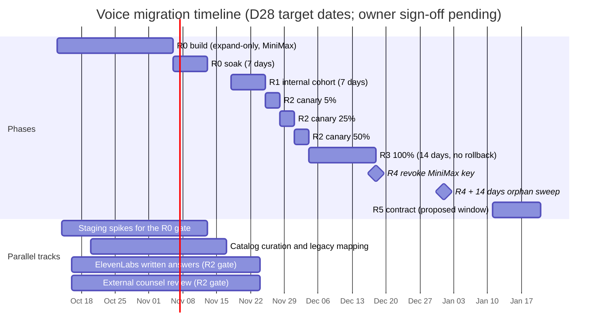
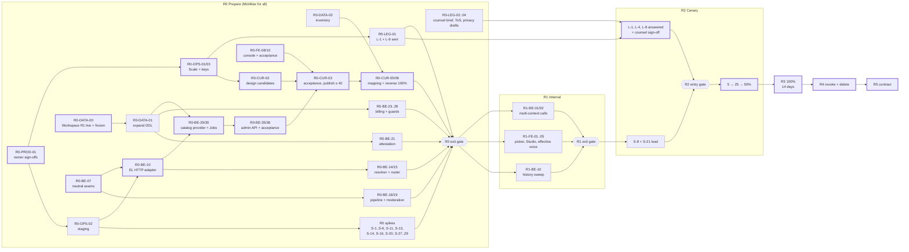

# Implementation plan and acceptance criteria (MiniMax → ElevenLabs)

> **Scope / status (reviewed 2026-10-14):** Voice design and dated evidence; product rollout is **WIP**. [00 — Current status and roadmap](00_current_status_and_roadmap.md) owns current implementation/flags/gaps. Later [03 §5.16](03_target_architecture_and_decisions.md#516-r0-implementation-decisions-2026-10-12) instructions and [15 §§11–13](15_implementation_plan_and_acceptance.md#11-minimax-voice-purge-2026-10-14) supersede MiniMax routing, cohorts, V1/maps and original rollout dates. Preserve earlier proposals and vendor facts as dated references; they are not proof of availability.

- **Date:** 2026-10-12
- **Status:** WIP release acceptance. §§0–10 retain historical planning; §§11–13 record the later purge/native cutover and local smoke. Current remaining gates are in [00](00_current_status_and_roadmap.md).

## Scope

This document turns the decision record into work that engineering can run. It covers:
- the phased work breakdown R0…R5: epics, then tasks for backend, frontend, data, ops and legal/product, each with an id, repo, dependencies, size and doc reference;
- the critical path and the dependency graph;
- acceptance criteria per phase and per surface (narration, calls, catalog, Studio, admin console, billing, privacy), with measurable SLOs;
- the test plan: unit, integration, contract, end-to-end, listening and load tests against the concurrency limits;
- the definition of done for the whole migration, including the MiniMax grep gate;
- the owner sign-off checklist, and the first 10 PRs.

Architecture, schemas and policies are **not** redefined here. They come from [03](03_target_architecture_and_decisions.md), and every task points to the decision (D-n), spike (S-n) or legal item (L-n) it implements. Module-level design lives in the backend plan [08](08_backend_refactor_plan.md) and the frontend plan [09](09_frontend_refactor_plan.md). Spike procedures live in [14](14_staging_spike_and_contract_tests.md). This plan only orders, sizes and gates that work. Nothing here was run against a provider or a database.

**Workspace R1 alignment (2026-10-12).** Workspace R1 (personal app workspaces, content schema `2026_10_workspace_r1`) is committed in both repositories (backend `f37eefd`, frontend `c7307c6`) but not deployed to production. This plan adds:
- a prerequisite, R0-DATA-00: Workspace R1 live in production and its schema frozen;
- workspace rules in R0-DATA-01, R0-BE-01 and R0-BE-23;
- new tasks R0-BE-38 (workspace scope and wipe) and R0-FE-15 (workspace gaps on voice surfaces);
- the capability pin test, rehearsals and acceptance rows.

The rules are 03 D39 and §5.15; the evidence is [research 15](research/15_workspace_r1_impact.md).

## Related

- [README](README.md): index and reading guide
- [03](03_target_architecture_and_decisions.md): **source of truth**. Decisions D01–D39, canonical definitions §5, spikes §6.1, legal items §6.2, gates §6.3
- [04](04_voice_catalog_and_library.md) catalog · [05](05_voice_studio_and_admin_console.md) Studio and console · [06](06_chat_narration_migration.md) narration · [07](07_realtime_calls_migration.md) calls
- [08](08_backend_refactor_plan.md) backend plan · [09](09_frontend_refactor_plan.md) frontend plan · [10](10_data_migration_and_rollout.md) data migration and rollout · [11](11_cost_plans_and_operations.md) cost and operations
- [12](12_best_practices_and_improvements.md) best practices and bug backlog · [13](13_policy_privacy_and_compliance.md) policy and privacy · [14](14_staging_spike_and_contract_tests.md) spikes and contract tests · [16](16_risks_and_open_questions.md) risks and open questions
- Research inventories used for the task lists: [research 06 §11](research/06_backend_minimax_inventory.md) (backend removal checklist), [research 07 §12](research/07_frontend_minimax_inventory.md) (frontend change checklist), [research 08 §18](research/08_voice_data_model_migration_surface.md) (migration surface), [research 13 §4, §7](research/13_gap_codebase_checks.md) (membership ops, canary routing), [research 15](research/15_workspace_r1_impact.md) (Workspace R1 impact)

## Contents

0. [Conventions](#0-conventions)
1. [Phase overview R0…R5](#1-phase-overview-r0r5)
2. [Work breakdown](#2-work-breakdown)
3. [Critical path and dependency graph](#3-critical-path-and-dependency-graph)
4. [Acceptance criteria and SLOs](#4-acceptance-criteria-and-slos)
5. [Test plan](#5-test-plan)
6. [Definition of done for the whole migration](#6-definition-of-done-for-the-whole-migration)
7. [Owner sign-off checklist](#7-owner-sign-off-checklist)
8. [Suggested first 10 PRs](#8-suggested-first-10-prs)
9. [R0 execution status (2026-10-12)](#9-r0-execution-status-2026-10-12)
10. [R1–R5 dark build status (2026-10-13)](#10-r1r5-dark-build-status-2026-10-13)
11. [MiniMax voice purge (2026-10-14)](#11-minimax-voice-purge-2026-10-14)
12. [Final cutover on the test database (2026-10-14)](#12-final-cutover-on-the-test-database-2026-10-14)
13. [Native catalog and legacy removal (2026-10-14)](#13-native-catalog-and-legacy-removal-2026-10-14)

---

## 0. Conventions

| Item | Convention |
|---|---|
| Task id | `<phase>-<track>-<nn>`, for example `R0-BE-14`. Ids are stable; new tasks get new numbers. |
| Tracks | **BE** magic-worlds-api · **FE** this SPA · **DATA** migrations, read-replica queries and data scripts (lives in the BE repo) · **OPS** ElevenLabs workspace, keys, env, monitoring, runbooks · **QA** spikes, test harnesses, load and listening tests · **CUR** catalog curation, done by root with product (content work, mostly no code) · **LEG** legal and counsel · **PROD** owner and product decisions |
| Size | **S** ≤ 2 engineer-days · **M** 3–5 · **L** 6–10. Anything larger is split. Effort sums use the midpoints S = 1.5, M = 4, L = 8. Sizes are this plan's estimates, not commitments. |
| Doc ref | The decision, spike or legal item first, then the plan doc that holds the design, e.g. `D24 · [06]`. |
| Labels | **(proposed)** marks something this plan adds that 03 does not fix. Facts that still depend on a spike or legal answer are labelled with S-n or L-n and are never treated as certain. Prices are list prices as of 2026-10-12. |

**Rules carried over from 03** (every task obeys them):
1. R0 is **expand-only** and still on MiniMax for every user (D28).
2. From R1 on, a build is never rolled back below R0. Rollback is route-only, through the DB-backed `voice_runtime_setting` (D28).
3. No non-staff user text reaches ElevenLabs before the R2 entry gate (§6.3). Staging carries synthetic, policy-safe text only (D02).
4. Nothing is sent to ElevenLabs before it passes the fail-closed moderation gate (D26).
5. Model ids, defaults and limits are data (capability registry, `voice_default`, `GET /v1/user/subscription`), never literals in code (D02, D05, D31).
6. Canonical schemas, enums and tables are copied from 03 §5. If a task needs to deviate, 03 is changed first.

---

## 1. Phase overview R0…R5

### 1.1 Phases, dates and exit criteria (copied from D28)

| Phase | Proposed target | Content | Exit criteria |
|---|---|---|---|
| **R0 Prepare** (still MiniMax) | 2026-11-06 | Expand-only releases:<br/>- V1/V2 union readers on BE and FE, shared FE voice helpers (D35);<br/>- the strict-validator widening list (§5.14);<br/>- capability registry;<br/>- `SpeechTextPipeline` with fail-closed moderation;<br/>- `user_attestation` + 428 / WS error frame;<br/>- `voice_preview` op (on MiniMax);<br/>- per-turn reservation, settlement and refunds (`tts_turn_charge`), per-plan caps;<br/>- catalog tables + Jobs A/B/C, `voice_default`, Acceptance console module;<br/>- MiniMax picker restricted to mapped ids;<br/>- `ProviderRouter` with DB-backed rollout settings;<br/>- budget guards (D37);<br/>- baseline latency and error metrics. | Deployed 7 days with no regressions. The R0 gates in §6.3. |
| **R1 Internal** | 2026-11-18 | Cohort = `user_type ∈ {root, admin}` + allow-list. Provider-specific consent (`voice-v2` for ElevenLabs calls). Effective-voice projection and first-exposure notice for the cohort (D35). Reverse mapping live. | 7 days within thresholds; the R1 gates in §6.3 |
| **R2 Canary** | 2026-11-25 → 2026-12-04 | `hash(user_hash) % 100 < canary_percent` at 5 → 25 → 50%, each step ≥ 3 days; mapping coverage re-run before each step | Within thresholds at each step; R2 entry requires the legal and privacy gate in §6.3 |
| **R3 100%** | 2026-12-04 | All users on ElevenLabs. MiniMax global presets hidden (reversible). Review flags computed for everyone. | 14 days with no rollback |
| **R4 Revoke** | 2026-12-18 | Revoke `MINIMAX_AUDIO_API_KEY`; delete MiniMax runtime code paths; drop `voice_legacy_fallback`; MiniMax removed from copy | — |
| **R4 + 14 days** | 2027-01-01 | Reviewed orphan sweep (D23) | — |
| **R5 Contract** | January 2027 | One-shot rewrite of live cards, drafts, versions and presets with 100% coverage (D21); V1 accepted on writes only when unchanged (D32); drop legacy preset columns after `--check` reports 0 V1 presets | Audit table kept one release cycle |

The dates need owner sign-off (D28). §1.5 shows why they are at risk and how to re-date them without changing the structure.

### 1.2 Per-phase gates (copied from 03 §6.3)

| Gate | Spikes (§6.1) | Written confirmations (§6.2) | Legal, privacy and product preconditions | Data and readiness |
|---|---|---|---|---|
| **R0 exit** (before any ElevenLabs request with real user text) | S-1, S-2, S-3, S-4, S-5, S-6, S-11, S-13, S-14, S-16, S-20, S-27, S-28, S-29 | L-1 **sent** (with L-9); L-3 answered or its safe default applied | Training opt-out verified with a dated screenshot (production and staging); dashboard seats limited and recorded | ≥ 40 published voices (call-eligible, accepted, own samples); `voice_default` rows per §5.11; `voice_legacy_mapping` 100% of referenced ids and of the ids the restricted picker offers, with alternates per D33; reverse mapping 100% of published voices; Acceptance console module live; readiness probes green |
| **R1 exit** (before R2; staff traffic only until here) | S-7, S-9, S-10, S-15, S-17, S-23, S-25 | — | — | 7 days within thresholds; coverage re-run green |
| **R2 entry** (before any non-staff user text reaches ElevenLabs) | S-8 measured in the production region; S-21 | **L-1, L-4 and L-8 answered** | External counsel sign-off (D25); ToS page, click-wrap, `user_attestation` and 428 / WS frame live (D26); privacy copy naming both providers published for **all** users; consent `voice-v2` copy live | Budget guards live (D37); history sweep running within its SLO |
| **R3 entry** | — | — | — | Every canary step within thresholds; coverage re-run green; PAYG cap re-sized from telemetry |
| **Public Library voices** (any time) | S-11, S-12 (for lifecycle) | **L-2** (and L-12 for perpetual voices; L-16 for remixes) | — | Library voices pass acceptance |
| **Optional features** | S-18 (v4 Turbo calls), S-19 (Scribe), S-26 (`<break>` on WS), S-12 (webhook), S-22 (IVC) | L-13 for third-party IVC | — | — |

### 1.3 Timeline



The R5 window inside "January 2027" is **(proposed)**: it starts after the orphan sweep, the 2026 holidays and one release cycle of R4 stability.

### 1.4 R0 sub-releases (proposed)

D28 calls R0 "expand-only releases" (plural). This plan cuts R0 into four deployable releases. Each is expand-only, keeps every user on MiniMax and can be rolled back to the previous R0 build. That rollback is allowed because R1 has not started [03 D28, rollback data policy].

| Release | Target (proposed) | Contents (task ids in §2.1) | Why this order |
|---|---|---|---|
| **R0.1 Expand** | 2026-10-23, and not before Workspace R1 is live in production (R0-DATA-00) | Schema expand (R0-DATA-01), §5.14 widening (R0-BE-01), V1/V2 union readers and FE helpers (R0-BE-02, R0-FE-01…03), neutral seams (R0-BE-07, -08), card-assistant fix (R0-BE-05), baseline metrics (R0-BE-37), turn `language` field (R0-BE-16) | Everything later writes into these tables and types. Baselines need ≥ 7 days of MiniMax data before R1. The D34 light-language list is computed from R0 telemetry of the turn `language` field, so that field must ship first. |
| **R0.2 Billing and policy** | 2026-10-30 | Per-turn charge and caps (R0-BE-23, -24, -27), `voice_preview` lockstep (R0-DATA-07, R0-BE-25, -26), attestation (R0-BE-21, R0-FE-05), consent per provider (R0-BE-22), `SpeechTextPipeline` + moderation (R0-BE-18…20), MP3 parser (R0-BE-17) | These change behaviour for all MiniMax users, so they need the longest soak before R1. Moderation is the exception: in R0 it runs only on ElevenLabs-bound and root synth-lab text ([03 §5.16](03_target_architecture_and_decisions.md) I-6). |
| **R0.3 Catalog (dark)** | 2026-10-30 | ElevenLabs adapters and registry (R0-BE-09…13), catalog provider, Jobs A/B/C, admin API, acceptance renders (R0-BE-29…31, -35, -36), console modules (R0-FE-08…12) | Unblocks curation, the longest pole (§3.2). |
| **R0.4 Routing (dark)** | 2026-11-06 | Resolver, router, runtime settings (R0-BE-14, -15, R0-DATA-06), catalog user API and effective voice (R0-BE-32…34), budget guards (R0-BE-28), restricted MiniMax picker (R0-BE-06), TurnNarration fixes (R0-FE-13, -14) | Ships with `rollout_mode=off`. The 7-day soak runs on this build. |

### 1.5 Capacity check and re-dating rule (proposed)

At the midpoint sizes in §2, the phases cost roughly:

| Phase | BE | FE | DATA | QA | Engineering total | CUR (root/product) | OPS + LEG |
|---|---|---|---|---|---|---|---|
| R0 | ≈ 176 | ≈ 54 | ≈ 18 | ≈ 17 | **≈ 265 engineer-days** | ≈ 37 days | ≈ 30 days |
| R1 | ≈ 46 | ≈ 36 | ≈ 2 | ≈ 4 | ≈ 88 | — | ≈ 3 |
| R2 | ≈ 8 | ≈ 10 | ≈ 5 | ≈ 4 | ≈ 27 | — | ≈ 8 |
| R3–R5 | ≈ 17 | ≈ 6 | ≈ 18 | ≈ 2 | ≈ 43 | ≈ 1 | ≈ 5 |

Tasks shared by two tracks are split evenly between them. The optional R1 tracks (IVC, webhook, ≈ 16 days) are not included.

**Reading.**
- The D28 target puts R0 code-complete 19 working days from today (2026-10-13 → 2026-11-06). At ≈ 265 engineer-days that needs about **14 engineers in parallel**.
- Even with unlimited staff, the serial chain in §3.2 (seams → adapter → catalog sync → console → acceptance runs → mapping → coverage → 7-day soak) has **zero slack** against D28: the R1 date holds only if every step finishes on its earliest date.
- The §3.2 "earliest finish" dates assume each L task on that chain is split across two engineers. With one engineer per task at the *minimum* sizes (M = 3 d, L = 6 d), the chain R0-BE-07 → -10 → -29 → -35 → -36 → R0-CUR-03 → -05 is about 36 working days, so mapping coverage lands around 2026-12-01, roughly two weeks after the D28 R1 date. Treat the §3.2 dates as a best case.
- So the D28 dates hold only with heavy staffing and the critical-path shortcuts in §3.3. Otherwise the owner should re-date when signing D28.

**Re-dating rule.** Keep every *relative* duration in D28 and §6.3, and move only the anchor date `T0` = the day the last R0 release is deployed:

| Milestone | Offset from `T0` | D28 value (`T0` = 2026-11-06) |
|---|---|---|
| R0 exit (7-day soak + §6.3 R0 gate) | ≥ `T0` + 7 d | 2026-11-13 |
| R1 start | `T0` + 12 d | 2026-11-18 |
| R2 start (after 7 days of R1, R1 gate, R2 entry gate) | R1 + 7 d | 2026-11-25 |
| R3 start (three canary steps of ≥ 3 days) | R2 + 9 d | 2026-12-04 |
| R4 (14 days at 100% with no rollback) | R3 + 14 d | 2026-12-18 |
| Orphan sweep | R4 + 14 d | 2027-01-01 |
| R5 | ≥ R4 + 3 weeks | January 2027 |

The dual-provider window R1 → R4 stays 30 days. **(proposed)** No canary step or 100% switch starts between 2026-12-22 and 2027-01-04, when staffing is thin. If re-dating pushes R2 or R3 into that window, wait until 2027-01-05. Nothing in 03 has a hard external deadline here: Default voices expire on 2026-12-31, but D09 already bans them.

---

## 2. Work breakdown

Each table is one epic. "Depends on" lists only blocking dependencies. Tasks with no dependency can start now.

### 2.1 R0 Prepare (still MiniMax; expand-only)

#### Epic R0-A: accounts, keys and legal kickoff

| ID | Task | Repo | Depends on | Size | Ref |
|---|---|---|---|---|---|
| R0-PROD-01 | Owner signs the "before R0" decisions in §7.1 (scope, plan, billing numbers, preview limits, caps, catalog policy, console scope, defaults, languages, custom voices, dates). | PROD | — | S | §7 · 03 §3 |
| R0-OPS-01 | Contract **Scale** under the legal entity. Non-personal admin email routed to a monitored shared inbox. 2FA on. Record which ElevenLabs ToS applies (L-15). | OPS | R0-PROD-01 | S | D02 · [11] |
| R0-OPS-02 | Staging workspace (Creator or Pro) on a dedicated operator seat with a shared mailbox. Six **user** keys with the §5.4.3 scopes, tiny quotas and an IP allow-list. Training opt-out on. Synthetic text only. | OPS | R0-PROD-01 (D02 covers the staging spend) | S | D02, D04 · [11] |
| R0-OPS-03 | Production service account `mw-prod` with the six keys of §5.4.3 (scopes, `character_limit`, BFF egress IP allow-list). Never `permissions: "all"` or the five forbidden scopes. Keys live in the deployment secret store only. `OPS` cap = smallest non-zero value until S-28. | OPS | R0-OPS-01 | S | D04 · §5.4.3 |
| R0-OPS-04 | Day-one settings: training opt-out with a **dated screenshot** (production and staging) in the ROLL log; auto top-up; dashboard seats limited to named operators in the access register. | OPS | R0-OPS-01, -02 | S | D02, D25 |
| R0-OPS-05 | List-price forecast for R1 (the PAYG cap is set to 1.5× this at R1). Never size from promo-era allowances. | OPS | R0-OPS-01 | S | D02 · [11] |
| R0-OPS-06 | Apply for the Startup Grant. Do not use it until L-14 is answered in writing, and keep paid Scale active. *(optional)* | OPS | R0-OPS-01 | S | D02, L-14 |
| R0-LEG-01 | Send one written request to ElevenLabs with **L-1 + L-9** (the R0 gate needs "sent") plus L-2, L-3, L-4, L-6, L-7, L-8, L-10, L-12, L-13, L-14, L-15, L-16. Log the date sent and a follow-up cadence in [16](16_risks_and_open_questions.md). | LEG | R0-OPS-01 | S | §6.2 · [13] |
| R0-LEG-02 | Engage external counsel. Brief: privacy copy, consent copy, ToS and attestation sufficiency per jurisdiction, IVC biometric wording, MiniMax audio retention after the contract ends (D23). | LEG | — | S | D23, D25, D26 · [13] |
| R0-LEG-03 | Draft the ToS page (click-wrap: 18+, PUP flow-down, no impersonation, no training on outputs, our enforcement rights). | LEG | R0-LEG-02 | M | D26 · [13] |
| R0-LEG-04 | Draft the privacy section, call consent `voice-v2` and first-run voice bullet. They name ElevenLabs (TTS), Groq (STT) and the moderation classifier's provider, US storage, scheduled deletion (**no "24 h" promise**), possible safety review and training opt-out. Include the dual-provider wording for R1–R4. | LEG | R0-LEG-02 | M | D25 · [research 10 §8.3](research/10_gap_policy_licensing.md) |

#### Epic R0-B: staging spikes (procedures in [14](14_staging_spike_and_contract_tests.md))

| ID | Task | Repo | Depends on | Size | Ref |
|---|---|---|---|---|---|
| R0-QA-01 | Spike runner. Scripted CT-01…CT-20 and T1…T13 on staging keys. Records status, all headers, error body, audio SHA-256 and duration. Synthetic texts only. Results committed as redacted JSON fixtures, which later feed the offline contract tests (§5.4). | QA | R0-OPS-02 | M | [research 12 §13](research/12_gap_model_protocol_facts.md) · [14] |
| R0-QA-02 | S-1 account facts: read-only calls with the production key (`/v1/user`, `/v1/user/subscription`, `/v2/voices?voice_type=default\|personal`, `/v1/workspace/webhooks`). | QA | R0-OPS-03 | S | S-1 |
| R0-QA-03 | S-2, S-3, S-4, S-5, S-28 (v4 on TTS HTTP, settings matrix, `language_code`, Flash normalization, per-key cap semantics). | QA | R0-QA-01 | M | §6.1 |
| R0-QA-04 | S-11, S-13, S-20, S-27 (Library add id and ops, preview URL stability, generated-voice lifetime, Default-replacement ownership). | QA | R0-QA-01 | S | §6.1 |
| R0-QA-05 | S-6 tags and `[whispers]`: CT-09 plus a listening test on 3–5 accepted voices, en and es (protocol in §5.6). | QA | R0-CUR-03 | S | S-6, D14 |
| R0-QA-06 | S-29 classifier latency: 500 synthetic sentences en/es plus a public evaluation set, sent to the classifier only. | QA | R0-BE-19 | S | S-29, D26 |
| R0-QA-07 | S-14 counts and S-16 LUFS spread, read from the acceptance results. | QA | R0-CUR-03 | S | S-14, S-16 |
| R0-QA-08 | Freeze the per-model settings and language allow-lists from S-3/S-4 into the registry static table. Re-check against `GET /v1/models`. | BE | R0-QA-03, R0-BE-09 | S | D13, D17 · §5.6 |

#### Epic R0-C: schema expand and data inventory

| ID | Task | Repo | Depends on | Size | Ref |
|---|---|---|---|---|---|
| R0-DATA-00 | **Workspace R1 prerequisite (D39).** Workspace R1 deployed to production (its own Phase 6 cutover and soak, scheduled by the owner, Q-33). Freeze `db.sql` at `2026_10_workspace_r1` as `src/database/mysql/migrations/2026_10_workspace_r1.sql` with a historical loader. Add a test that pins the workspace capability `schema_revision = "2026_10_workspace_r1"` ([services/workspaces.py:27](/home/andres/PycharmProjects/magic-worlds-api/src/services/workspaces.py), [models/workspaces.py:78](/home/andres/PycharmProjects/magic-worlds-api/src/models/workspaces.py)), independent of `CONTENT_SCHEMA_REVISION`. | DATA + OPS | Workspace R1 deploy | S | D39 · [08 §4.1](08_backend_refactor_plan.md) |
| R0-DATA-01 | **One expand migration** (`scripts/migrations/<date>_voice_expand.py` + `db.sql` parity). Its predecessor is `2026_10_workspace_r1`, and it follows the `workspace_cutover.py` pattern: advisory lock, exact revision gate, check against the frozen predecessor, data fingerprint before and after, marker compare-and-set. `tts_turn_charge` and `voice_review_flag` carry the app-workspace columns and FKs of 03 §5.2; `session_voice_setting.session_id` is an `int` FK to `adventure_session`. Adds every §5.2 table, the §5.3 R0 block, `user_attestation` (D26 column list), `user_preferences.narration_tier`, `membership_plan_limit.daily_quantity_limit`, the `tts_job` columns `turn_charge_id`, `billed_chars`, `tier`, `substitution_reason`, and widens the `tts_job` CHECK to `provider IN ('minimax','elevenlabs')`. Bumps `CONTENT_SCHEMA_REVISION` ([bootstrap.py:17](/home/andres/PycharmProjects/magic-worlds-api/src/database/mysql/bootstrap.py)) and adds the upgrade-chain entry ([bootstrap.py:1699-1716](/home/andres/PycharmProjects/magic-worlds-api/src/database/mysql/bootstrap.py)), never the workspace capability value (D39). | DATA | R0-DATA-00 | M | §5.2, §5.3, §5.14, §5.15 · [10] |
| R0-DATA-02 | Read-replica `--check` inventory: research 08 §18 counts #1, #7–#11, #13, #18, #23, #30; G6 `is_global` count; distinct legacy ids × reference count × recipe usage; legacy ids that co-occur in one cast; the language of each MiniMax id; persona voices counted separately. Export as CSV for curation. | DATA | — | M | D21, D33, D34, D38 · [research 08 §18](research/08_voice_data_model_migration_surface.md) |
| R0-DATA-03 | List MiniMax custom (cloned or designed) voices from the root inventory ([admin_voices.py:166-179](/home/andres/PycharmProjects/magic-worlds-api/src/routes/admin_voices.py)). Record the operator's answer on off-platform source audio. | DATA | — | S | D22 |
| R0-DATA-04 | Coverage script. Compares approved `voice_legacy_mapping` rows with referenced ids and picker-offered ids (persona excluded), and `voice_legacy_fallback` with published voices. Non-zero exit on any gap. Re-run at R0 exit, before R1, before each canary step, at R3 and before R5. | DATA | R0-DATA-01 | S | D21, D28 |
| R0-DATA-05 | `voice_reference` writes on card, preset and narrator save, plus a nightly scan that includes frozen snapshots. | DATA | R0-DATA-01, R0-BE-02 | M | D19 |
| R0-DATA-06 | Seed `voice_runtime_setting`: `rollout_mode=off`, `canary_percent=0`, `tts_engine_enabled`, `voice_mode_enabled`, `daily_budget_chars`, `auto_narration_paused`. | DATA | R0-DATA-01 | S | D28 · §5.2 |
| R0-DATA-07 | `voice_preview` **lockstep** migration. Inserts plan-limit rows for **every** plan, custom plans included, before the new code boots. Includes a reverse migration, used only for a rollback before R1. | DATA | R0-DATA-01 | S | D18 · [research 13 §4.4](research/13_gap_codebase_checks.md) |

#### Epic R0-D: voice object v2 and validator widening

| ID | Task | Repo | Depends on | Size | Ref |
|---|---|---|---|---|---|
| R0-BE-01 | §5.14 Python widening. Covers: registry `Literal` ([registry.py:24](/home/andres/PycharmProjects/magic-worlds-api/src/services/tts_generation/registry.py)); the `model_alias` union in `TtsJobPublic`, `/tasks` and notifications; the `tts_provider` unions (config guard, `voice_session`, message metadata); the turn-store callbot validators with `truncated` and `played_ms` ([conversation_turn_store.py:580-605](/home/andres/PycharmProjects/magic-worlds-api/src/database/mysql/conversation_turn_store.py)); the sample-rate set {22050, 24000, 44100} plus 32000 on read. Also the MiniMax checks added by Workspace R1: `create_pending_job` `allowed={"minimax"}` (`models.py:8935`), the asset-parent `provider="minimax"` check (`:766`, `:9465`), the `voice_session` insert guard (`:6027-6033`), and the call-audio literals in `_persist_call_audio_asset` (`voice_orchestration/engine.py:2419-2444`). | BE | R0-DATA-01 | M | §5.14, D23, D39 |
| R0-BE-02 | `CharacterVoiceV2`, `VoiceSettingsV2` and the `StoredCharacterVoice` discriminated union (§5.1.3), I/O-free. Every reader of cards, presets, snapshots and chats accepts both shapes. A bad preset row is skipped and logged, never fatal to the list. | BE | — | M | D11, D12 · §5.1 |
| R0-BE-03 | `validate_voice_change(old, new, actor)` in the write-service layer per §5.10. Used by card, draft, preset and snapshot `PUT` and by every copy flow, with a per-path "voice changed?" comparison. Copies are shape-only. One model for write, read and resolve fixes bug #10. | BE | R0-BE-02, R0-DATA-01 | L | D32, D11, D30 #10 · §5.10 |
| R0-BE-04 | Retry and restore byte-equality exclude voice paths. Adds a test asserting that the graph payload is identical with and without voices. If that test cannot pass, the fallback is to accept 409 with a message. | BE | R0-BE-02 | M | D36 |
| R0-BE-05 | The card assistant preserves `voice` (it is missing from `_ALLOWED_ROOT_FIELDS`, [card.py:41-55](/home/andres/PycharmProjects/magic-worlds-api/src/services/assistants/card.py)). Must land before R5, so do it now. | BE | — | S | D30 |
| R0-BE-06 | Restrict the MiniMax picker and V1 writes to approved mapped ids. Serve the non-cohort system-voice list from `voice_legacy_mapping` (`status=approved`) instead of the MiniMax admin API, and reject other V1 picks. The offered list grows as curation approves rows. **(proposed)** Enable it once the mapped ids cover at least the most-referenced MiniMax voices (R0-DATA-02), so the picker is never empty. | BE | R0-DATA-01, R0-BE-03, R0-CUR-05 (partial) | M | D21, D32 |
| R0-FE-01 | FE types per §5.1.2. `readCharacterVoice` ([cardTransforms.ts:57-72](/home/andres/WebstormProjects/magic-worlds/src/utils/cardTransforms.ts)), `snapshotVoice` ([adventureSnapshot.ts:81-96](/home/andres/WebstormProjects/magic-worlds/src/features/interaction/utils/adventureSnapshot.ts)) and `voiceFromPreset` keep the whole object for both shapes. Round-trip tests. | FE | — | M | D11 · [research 07 §9.3](research/07_frontend_minimax_inventory.md) |
| R0-FE-02 | Shared helpers `hasAssignedVoice`, `voiceIdentity`, `isSameVoice` in `src/shared`. Replace `CallsPage.hasVoice` ([CallsPage.tsx:25-27](/home/andres/WebstormProjects/magic-worlds/src/features/call/components/CallsPage.tsx)), `presetMatchesVoice` and every `.voice_id` read. Add a vitest grep gate that forbids `.voice_id` outside the V1 parser and the helpers. | FE | R0-FE-01 | M | D35, D30 |
| R0-FE-03 | Widen the `voice_audio_chunk` sample-rate type ([voice.types.ts:165-170](/home/andres/WebstormProjects/magic-worlds/src/shared/types/voice.types.ts)). Add the segment states `daily_limit_reached` and `not_narrated`. Handle the `error.code` values `voice_unavailable`, `attestation_required` and `moderation_unavailable`. `TERMINAL_STATUSES` stays unchanged ([chatTtsTurnState.ts:21-32](/home/andres/WebstormProjects/magic-worlds/src/features/interaction/utils/chatTtsTurnState.ts)). | FE | — | S | §5.8, §5.14 |
| R0-FE-04 | Hide the voice section for persona cards. | FE | — | S | D38 |

#### Epic R0-E: provider-neutral seams, adapters and routing (dark)

| ID | Task | Repo | Depends on | Size | Ref |
|---|---|---|---|---|---|
| R0-BE-07 | Neutral seams: `SpeechSynthesisProvider`, `StreamingSpeechProvider`, `SpeechToTextProvider`, `VoiceCatalogProvider`, `ProviderErrorClassifier`. Neutral `app.state` names ([main.py:916-949](/home/andres/PycharmProjects/magic-worlds-api/src/main.py)). The MiniMax adapters implement them with no behaviour change. | BE | — | M | §2.1 · [08] |
| R0-BE-08 | Storage takes bytes and writes **outside** the `tts_job` row lock and off the event loop (fixes #11). MiniMax hex is decoded inside its adapter. | BE | R0-BE-07 | M | D30 #11 |
| R0-BE-09 | `VoiceCapabilityRegistry`: §5.6 static table plus `GET /v1/models` at startup (a configured model missing from the response fails readiness). Exposed as `GET /voices/capabilities`. | BE | R0-BE-07 | M | D13 · §5.6 |
| R0-BE-10 | ElevenLabs HTTP TTS adapter, raw `httpx` (D03). Sends `xi-api-key`, `output_format`, `seed`, `apply_text_normalization: "auto"` and `language_code` only per the allow-list; no `previous_request_ids`; `previous_text`/`next_text` off until S-17. Captures `request-id` and `character-cost`. Validates MP3. Retry classes per §5.8, with no retry after the first byte (fixes #12). | BE | R0-BE-07, R0-OPS-02 | L | D03, D05 · §5.6, §5.8 |
| R0-BE-11 | ElevenLabs `ProviderErrorClassifier` (full §5.8 table), per-path circuit breakers (5 failures in 30 s, 30 s cool-down, half-open probe), and the public mapping to existing statuses plus `error.code`. | BE | R0-BE-10 | M | §5.8 |
| R0-BE-12 | Six-key config (`ELEVENLABS_KEY_*`, `ELEVENLABS_BASE_URL`). Readiness probes per the D04 table: a failure degrades one surface and never aborts startup. Redaction patterns `xi-api-key:`, `sk_…`, `sutkn_…`, `ELEVENLABS_KEY_*=` in [image_generation/errors.py:24-32](/home/andres/PycharmProjects/magic-worlds-api/src/services/image_generation/errors.py) and [voice_orchestration/errors.py:58-69](/home/andres/PycharmProjects/magic-worlds-api/src/services/voice_orchestration/errors.py). | BE | R0-BE-10 | M | D04 |
| R0-BE-13 | Provider limiter, in-process until bug #19 is fixed (then a MySQL lease table, D37). Pools `flash` 24 of 30 and `non_flash` 12 of 15 (Expressive 10, preview 1, admin 1); the limits are read from `GET /v1/user/subscription`, the pool sizes are config. It supersedes the per-process `TTS_GLOBAL_CONCURRENCY` (default 3, max 20) as the narration bound. A 429 concurrency response is back-pressure and does not count as an attempt. | BE | R0-BE-10 | M | D02, D37 · [research 05 §11.4](research/05_elevenlabs_platform_pricing_limits_policy.md) |
| R0-BE-14 | `VoiceResolver` per the §5.10 matrix. V1 → mapping → V2; catalog lookup and `replacement_voice_key`; D31 default chain; D33 cast map, cached per (session, snapshot hash, catalog version); D34 language acceptance; tier → profile; settings stripped per §5.6; emotion tag or offset (§5.5.1); `gain_db`. Never raises. | BE | R0-BE-02, R0-BE-09, R0-BE-31 | L | D21, D31–D34 |
| R0-BE-15 | `ProviderRouter` with a `voice_runtime_setting` reader (TTL ≤ 60 s). Cohort = internal + allow-list, then `hash(user_hash) % 100 < canary_percent`. `rollout_mode=off` routes **everyone**, the internal cohort included, to MiniMax. The chosen provider is persisted on `tts_job.provider` and `voice_session.tts_provider`. Reverse mapping for non-cohort users who meet a V2 voice. | BE | R0-BE-14, R0-DATA-06 | M | D28, D21 |
| R0-BE-16 | Turn `language` field in the three turn-metadata graph outputs, stored on the assistant message. "No square brackets" rule in the chat graphs. Callbot and chat prompts spell out numbers. Graph hashes updated. | BE | — | M | D14, D17, D27, D34 |
| R0-BE-17 | Whole-frame MP3 parser with tail carry for call billing (on MiniMax now; ships regardless of S-9). Replaces [engine.py:1579-1599](/home/andres/PycharmProjects/magic-worlds-api/src/services/voice_orchestration/engine.py). | BE | — | S | D08 · [research 12 §12.1](research/12_gap_model_protocol_facts.md) |

#### Epic R0-F: speech text pipeline and moderation

| ID | Task | Repo | Depends on | Size | Ref |
|---|---|---|---|---|---|
| R0-BE-18 | `SpeechTextPipeline` sanitizer v1, steps 1–10 of §5.5.3 with placeholder tokenization. One module for narration, calls and previews; replaces `normalize_tts_text` and `normalize_text_for_tts`. Fixes #16, and #6: the redaction marker list is rewritten without plain words, "minimax" included. `sanitizer_version` and `emotion_map_version` enter the reuse hash v2. | BE | R0-BE-07 | L | D14, D27, D30 · §5.5.3 |
| R0-BE-19 | Moderation gate: (a) deterministic en/es lists; (b) classifier through a published `moderation` profile in `api.magic_llm`. Runs on every narration segment (batched per turn, 2 s timeout), every call sentence (300 ms), every recipe-preview text and every root synth-lab text. **Fail closed.** Emits `content_blocked` and `moderation_unavailable`; increments the abuse counter. Tested with mocks only. | BE (+ api.magic_llm profile) | R0-BE-18 | L | D26 |
| R0-BE-20 | Markup v1 translation per `ModelProfile` (the D27 table). Interjections forced off while `supports_audio_tags=false`. | BE | R0-BE-18, R0-BE-09 | S | D27 |

#### Epic R0-G: attestation and consent plumbing

| ID | Task | Repo | Depends on | Size | Ref |
|---|---|---|---|---|---|
| R0-BE-21 | `POST /user/attestations` and status read. HTTP 428 `attestation_required` on call start, voice consent and recipe preview. The chat WS answers with `tts_failed{…, status:"unavailable", error:{code:"attestation_required", action:"attest"}}`. `api.auth` is not changed. | BE | R0-DATA-01 | M | D26 · §5.8 |
| R0-BE-22 | Consent version per provider: `require_current_voice_consent(provider)` ([admission.py:96-107](/home/andres/PycharmProjects/magic-worlds-api/src/services/voice_orchestration/admission.py)) with `minimax_streaming → voice-v1` and `elevenlabs_streaming → voice-v2`, persisted on `voice_session.consent_version`. | BE | R0-BE-01 | S | D25 |
| R0-FE-05 | 18+ and ToS checkboxes on sign-up, posted to the BFF right after registration. A blocking prompt for existing and OAuth users. Handles the 428 and the WS frame. | FE | R0-BE-21 | M | D26 |

#### Epic R0-H: billing and budget guards

| ID | Task | Repo | Depends on | Size | Ref |
|---|---|---|---|---|---|
| R0-BE-23 | Per-turn charge (the D24 algorithm, steps 1–6). Reuse check first. One `reserve_media_operation` call per turn, recorded in `tts_turn_charge` with `turn_charge_id` on each job. Daily cap checked in the same transaction, with the cap-crossing rule. In-flight counts open turn charges. Settlement refunds failed segments. Adds a stale-charge sweep, plus a global stale-job sweep and terminalization on shutdown. Fixes #5, #7 and #8; replaces the segment-0-only quota at [route_chat.py:1433](/home/andres/PycharmProjects/magic-worlds-api/src/routes/user/route_chat.py). **Workspace (D39):** reserve only after the active-workspace lock (`_admit_media_job_origin`); reuse hits stay free in an archived workspace; misses there get `workspace_archived` and reserve nothing; the charge copies the session's `workspace_id`; caps, in-flight and credits stay per account; settlement and sweeps are continuations. | BE | R0-DATA-01 | L | D24, D39 · §5.9, §5.15 |
| R0-BE-24 | Per-plan seeds and `daily_quantity_limit`: Standard-equivalent characters for `tts_generation`; seconds for `voice_call` (3/10/10 min). `VOICE_DAILY_MINUTES_PER_USER` stays only as a global upper bound. Caps are hard against PAYG. | BE + DATA | R0-DATA-01 | M | D24 · §5.9 |
| R0-BE-25 | `voice_preview` operation: added to `MEMBERSHIP_MEDIA_OPERATIONS`, with a `count_in_flight` branch over `voice_preview_render` rows in `rendering` ([models.py:2061-2117](/home/andres/PycharmProjects/magic-worlds-api/src/database/mysql/models.py)). Deployed in lockstep with R0-DATA-07. | BE | R0-DATA-07 | M | D18 |
| R0-BE-26 | MiniMax preview limited to fixed per-language texts (`text_id`). Settings quantized to 0.05, metered on cache misses, token bucket 6/min. Closes #1 on MiniMax already ([voice_presets.py:99-118](/home/andres/PycharmProjects/magic-worlds-api/src/routes/voice_presets.py)). | BE | R0-BE-25, R0-CUR-01 | M | D18, D30 |
| R0-BE-27 | Usage DTO fields `narration_chars_used`, `narration_chars_limit`, `call_seconds_used`, `call_seconds_limit`, `previews_left`. | BE | R0-BE-23, R0-BE-25 | S | D24 |
| R0-BE-28 | Budget guards per §5.13: `voice_spend_daily` counter and global circuit (50/80/95/100%); token buckets (narration 6/min burst 10, call start 3/10 min, preview 6/min, catalog 60/min); `voice_abuse_counter` with the D26 6a thresholds; Free rules (attested, verified email, account age ≥ 24 h, ≤ 3 voice accounts per device or IP per day). | BE | R0-DATA-01, R0-BE-21 | L | D37, D26 |
| R0-FE-06 | Remaining characters, minutes and previews on the usage page and in the narration controls. `daily_limit` copy. Fixed-text preview selector with "{n} previews left today" in the existing Studio. | FE | R0-BE-26, R0-BE-27 | M | D18, D24 · §5.12 |
| R0-FE-07 | Root plan editor: `daily_quantity_limit` field, custom plans included. | FE | R0-BE-24 | S | D24 |

#### Epic R0-I: catalog, defaults and sync (dark to users)

| ID | Task | Repo | Depends on | Size | Ref |
|---|---|---|---|---|---|
| R0-BE-29 | ElevenLabs `VoiceCatalogProvider`: `list_account_voices`, `get_voices`, `search_library`, `add_library_voice`, `design_previews`, `save_generated_voice`, `remix`, `create_ivc`, `delete_owned_voice`, `subscription_limits`, `list_models`. | BE | R0-BE-10 | L | D10, D19, D20 · [04] |
| R0-BE-30 | Jobs A/B/C in a lifespan loop. `GET_LOCK('voice_catalog_sync', 0)` held on a **dedicated** connection; serial; `Retry-After` honoured. Mass-miss guard. Separate premade query → `premade_deprecated`. Only Job B's per-voice confirmation sets `removed`. Runtime 404/403 hooks (`suspect`; mass 403 = config breaker). | BE | R0-BE-29, R0-DATA-01 | L | D10, D19 |
| R0-BE-31 | `voice_default` reads, default readiness probes, `VOICE_LAST_RESORT_VOICE_KEY` validated at startup. Premade and old-Default guard (startup and test). Alert from 2026-12-01 if any reference to a premade voice remains. | BE | R0-DATA-01, R0-BE-12 | M | D31, D09 · §5.11 |
| R0-BE-32 | User catalog API: `GET /voices/catalog` (filters, cursor, `recommended_for`, `include_locked`), `?keys=` batch (≤ 100), `GET /voices/catalog/{key}/preview.mp3?lang=&tier=` from `voice_sample_asset` with `Cache-Control: private, max-age=86400`. No provider call per user request. | BE | R0-BE-30 | M | D35, D10 · §5.12 |
| R0-BE-33 | Effective-voice projection in card, preset, snapshot and character-chat read DTOs, plus `GET /voices/effective`. Computed for the caller's route; returns the stored MiniMax voice while `rollout_mode=off`. | BE | R0-BE-14, R0-BE-15 | M | D35 · §5.12 |
| R0-BE-34 | Review flags: computed from the mapping (`pitch_dropped`, `vol_dropped`, `speed_clamped`), `GET /voices/review-flags`, `POST /voices/review-flags/{id}/dismiss`. Not yet visible to users. | BE | R0-DATA-01, R0-CUR-05 | M | D15 |
| R0-BE-35 | Admin catalog API `/admin/voices/*` (root only, `ADMIN` key): list and filter; publish (requires `call_eligible`, acceptance and an own sample per accepted language); hide/retire; set replacement; impact view; sync now; design and save; remix of owned voices; Library search and add (refused when fewer than 5 ops remain); defaults with §5.11 checks; legacy-mapping CRUD and coverage report; limits widget. Every action is logged in `voice_catalog_event` with actor and voice. | BE | R0-BE-29 | L | D19, D20 · [05] |
| R0-BE-36 | Acceptance renders: fixed scripts per (voice, model, language) on the `ADMIN` key; rubric write to `voice_catalog_acceptance`; integrated LUFS → `gain_db ≤ 0` (flag voices needing more than −6 dB); own samples to `voice_sample_asset`. | BE | R0-BE-35, R0-CUR-01 | M | D09, D16, D20 |
| R0-BE-38 | **Workspace scope and wipe (D39).** New voice routes use `resolve_workspace_context` with the 03 §5.15 selectors and intents (`recommended_for`, effective voice, voice settings, refresh with source resolution in the session's workspace and 409 `voice_source_unavailable`, review flags with `organization`). `delete_all_user_data` gains `tts_turn_charge`, `voice_review_flag` and the user's `voice_preview_render` rows in the 03 §5.15 order (Q-35). Tests: `test_voice_routes_workspace`, `test_turn_charge_workspace`, `test_voice_schema_chain`, the wipe test (08 §9.4). | BE | R0-DATA-01, R0-BE-23 | M | D39 · §5.15 |
| R0-BE-37 | MiniMax baseline metrics, collected ≥ 7 days before R1: narration `tts_failed` rate, job p50/p95, call first-audio p50/p95, "user stops speaking → first audio", call TTS failure rate, per provider and cohort label. | BE | — | M | D28, D06 |

#### Epic R0-J: root console, R0 modules ([05](05_voice_studio_and_admin_console.md))

| ID | Task | Repo | Depends on | Size | Ref |
|---|---|---|---|---|---|
| R0-FE-08 | Console v2 shell, provider-neutral admin types, i18n en/es (no hard-coded English). Built against the admin API contract with mocks, so it does not wait for R0-BE-35. | FE | — | M | D20 |
| R0-FE-09 | Catalog manager: list, filter, publish, hide, retire, replacement, **impact view** (references per `ref_type`, distinct owners, 20 examples, D33 collision count). | FE | R0-FE-08 | L | D19, D20 |
| R0-FE-10 | **Acceptance module**: batch renders, side-by-side player (Flash vs v4, candidate vs reference), rubric form, LUFS and `gain_db` display, sample generation. | FE | R0-FE-08 | L | D20, D16 |
| R0-FE-11 | Voice Design (3 previews, saved in the same session) and Remix of owned voices. | FE | R0-FE-08 | M | D20 |
| R0-FE-12 | Defaults module (§5.11 checks), legacy mapping (target, ordered alternates, coverage report, legacy-ids-per-target metric), limits widget. | FE | R0-FE-08 | M | D20, D21, D31, D33 |

#### Epic R0-K: catalog curation (content work; root with product)

| ID | Task | Repo | Depends on | Size | Ref |
|---|---|---|---|---|---|
| R0-CUR-01 | Fixed en/es acceptance scripts (narration, dialogue, thought, numbers; `script_version`). Recipe-preview texts: 3 per language, ≤ 150 characters, plus optional archetype lines. | CUR | — | S | D09, D18 |
| R0-CUR-02 | Design ≥ 50 owned candidate voices (to land ≥ 40 after acceptance), including ≥ 1 narrator per language per gender. **(proposed shortcut)** Start in the ElevenLabs dashboard of the production workspace as soon as R0-OPS-03 is done; Job A later syncs the voices as `draft`. Perpetual Library voices may be added, admin-only until L-2. | CUR | R0-OPS-03 | L | D09 · [04] |
| R0-CUR-03 | Acceptance runs on `eleven_flash_v2_5` and `eleven_v4` for en and es: rubric, consistency (S-15), LUFS, own samples. Publish **≥ 40** (≥ 16 en, ≥ 16 es), all `call_eligible=1`. | CUR | R0-BE-36, R0-FE-10, R0-CUR-02 | L | D09, D06, D16 |
| R0-CUR-04 | `voice_default` rows for en and es (narrator + ≥ 4 `character_fallback`). Light languages (fr, de, pt, it, plus any language ≥ 1% or referenced by a MiniMax voice): light acceptance and a narrator row. The ≥ 1% list comes from R0 telemetry of the turn `language` field. | CUR | R0-CUR-03, R0-DATA-02, R0-BE-16 (deployed with telemetry) | M | D31, D34 |
| R0-CUR-05 | `voice_legacy_mapping`: 100% of referenced and picker-offered ids, settings overrides, ordered alternates where mapped ids co-occur in casts, non-en/es ids mapped to multilingual targets. | CUR + DATA | R0-DATA-02, R0-CUR-03, R0-FE-12 | L | D21, D33, D34 |
| R0-CUR-06 | `voice_legacy_fallback`: the most-referenced approved legacy id per published voice, else a curator choice; 100% of published voices. | DATA | R0-CUR-05 | S | D21 |
| R0-CUR-07 | `replacement_voice_key` for every published voice (same language, gender and age; owned preferred), seeded through similar-voices. | CUR | R0-CUR-03 | M | D19 |
| R0-CUR-08 | Owner decisions at R0 exit: (a) if S-15 leaves fewer eligible voices than the D09 target, the D06 fallback (badge plus "Works in calls" filter); (b) if S-14 shows fewer than 16 voices per language pass acceptance, the S-14 fallback (more owned Spanish designs on `eleven_ttv_v3`, or a launch target of ≥ 10 per language). | PROD | R0-CUR-03 | S | D06, D09 · S-14, S-15 |

#### Epic R0-L: frontend in-migration fixes

| ID | Task | Repo | Depends on | Size | Ref |
|---|---|---|---|---|---|
| R0-FE-13 | `TurnNarration`: new failure categories and a retry state, so one failed segment never halts the turn (#3). Stuck pause (#2) in the same release. First `TurnNarration` tests. | FE | R0-FE-03 | M | D30 |
| R0-FE-14 | Player gain: `volume = user × 10^(gain_db/20) × (kind=='thought' ? 0.708 : 1)`. With no `gain_db` on MiniMax clips it changes nothing, so it ships early. | FE | — | S | D16 |
| R0-FE-15 | **Workspace gaps on voice surfaces** ([09 §4.11](09_frontend_refactor_plan.md)). `voiceSocket` treats close 4404 and 4422 as terminal and dispatches `workspace:required`; narration, the narrator picker and the Call button are read-only gated; the narrator save uses the session's client; labels for `WORKSPACE_ACTIVE_CALL` and `CHAT_SESSION_NOT_FOUND`; `workspace_archived` narration copy. Can ship before R0 as independent workspace fixes (Q-34). | FE | — | S | D39 |

#### Epic R0-M: observability and runbooks

| ID | Task | Repo | Depends on | Size | Ref |
|---|---|---|---|---|---|
| R0-OPS-07 | Dashboards and alerts for every D28 rollback metric, split by provider and cohort. Account-event inbox → page. Moderation and classifier latency panels. | OPS | R0-BE-37, R0-BE-15 | M | D28 · [11] |
| R0-OPS-08 | Runbooks: kill switches, route-only rollback, key rotation (create → deploy → delete), enforcement email → rollback, text-only incident mode, per-user voice kill switch. | OPS | — | M | D28, D26 · [11] |

**R0 exit checklist.** It is the §6.3 R0 gate plus: all R0 test suites green (§5); `pnpm build` and the BE test suite green; 7 days deployed with no regression against the baselines; the coverage script exits 0; owner decision R0-CUR-08 recorded.

### 2.2 R1 Internal cohort (target 2026-11-18)

| ID | Task | Repo | Depends on | Size | Ref |
|---|---|---|---|---|---|
| R1-BE-01 | ElevenLabs `StreamingSpeechProvider`. One multi-context socket per call, opened at accept (prewarm), with the D06 URL parameters. Context `t_<turn_id>`; `voice_settings` in the first message; `flush` per moderated sentence; flush-ahead ≤ 3 sentences or ≈ 8 s; `close_context` at turn end; ≤ 4 live contexts, then queue; keepalive ≤ 15 s; reconnect once on 1008; accepts snake_case and camelCase. | BE | R0 done | L | D06 · [07] |
| R1-BE-02 | Barge-in: mark the context dead, drop its frames, send one `close_context`. Persist `completed` with sentence-truncated text using stored-text spans plus alignment or MP3 durations; `truncated` and `played_ms` set. Drained characters go to `voice_abuse_counter`. Fixes #17. | BE | R1-BE-01 | L | D06, D30 |
| R1-BE-03 | Call delivery: `voice_audio_chunk{content_type, sample_rate, codec, channels, gain_db, substitution_reason}`; `voice_ready` advertises the format; stored call assets in `mp3_44100_64`; 32 kHz literals removed from write paths ([delivery.py:159,342-353](/home/andres/PycharmProjects/magic-worlds-api/src/services/voice_orchestration/delivery.py)). | BE | R1-BE-01 | M | D08 |
| R1-BE-04 | Call voice: `not_call_eligible` substitution, call-header data, Groq `language` hint from the D17 chain (replaces `VOICE_STT_LANGUAGE`). | BE | R0-BE-14 | S | D06, D07, D17 |
| R1-BE-05 | Narration for the cohort: router per job; effective tier = session override, else user setting, then plan clamp, with the D05 fallbacks; `tts_segments[].tier`, `gain_db`, `kind`, `substitution_reason`. | BE | R0 done | M | D05 · [06] |
| R1-BE-06 | `user_preferences.narration_tier` on the preferences DTO; `session_voice_setting` endpoints (never in `template_snapshot`). | BE | R0-DATA-01 | S | D05 |
| R1-BE-07 | ElevenLabs recipe preview: fixed texts, tier toggle, 0.05 quantization, `voice_preview_render` cache, free default-settings auditions (own sample), `PREVIEW` key. | BE | R0-BE-25 | M | D18 |
| R1-BE-08 | Presets v2 API (§5.3 DTO): a V1 preset opens as a V2 draft and a save converts it in place; `POST /admin/voice-presets/global`. | BE | R0-BE-03 | M | D12, D22 |
| R1-BE-09 | D36 refresh: `POST /character-chats/{id}/voice/refresh` and `POST /adventure-sessions/{id}/voices/refresh`. Write voice paths only, as V2; 409 while a stream or call is active. | BE | R0-BE-03, R0-BE-04 | M | D36 |
| R1-BE-10 | History sweep on the `OPS` key: continuous small batches, 4 in flight, own budget, metric "age of oldest undeleted item". | BE | R0-OPS-03 | M | D25 · S-23 |
| R1-BE-11 | Daily reconciliation (`OPS` key): our counters vs subscription and usage analytics; drift > 5% alerts. | BE | R0-BE-28 | S | D37 |
| R1-BE-12 | Per-user voice kill switch; "AI voice" label data on turns and call headers. | BE | — | S | D26 |
| R1-FE-01 | Voice picker v2: catalog API, filters, cursor paging, `recommended_for`, lock badge, free catalog auditions hook, `language_scope` note, "Works in calls" filter if R0-CUR-08 chose it. | FE | R0-BE-32 | L | D35, D18 · [05] |
| R1-FE-02 | Studio v2: presets v2 editor, controls per tier (the D13 table), emotion hint, read-only voice language, metered recipe-preview hook with `text_id` and tier toggle, previews left. Fixes the preview race. | FE | R1-BE-07, R1-BE-08 | L | D13, D18, D12 |
| R1-FE-03 | Effective voice everywhere a voice is shown; first-exposure notice; review-flag notice and dismiss; badge inventory §5.12 with en and es keys. | FE | R0-BE-33, R0-BE-34 | M | D35, D15 |
| R1-FE-04 | Narration tier setting and per-session toggle; "Standard voice" indicator; "Voice replaced" indicator with the refresh action; "AI voice" label. | FE | R1-BE-05, R1-BE-06, R1-BE-09 | M | D05, D36, D26 |
| R1-FE-05 | Call UI: data-driven sample rate and `gain_db`; "Call voice" and "Voice replaced" headers; consent modal per provider (`voice-v2` copy for ElevenLabs); transcript strips markup v1 ([CallTranscriptView.tsx:63,87](/home/andres/WebstormProjects/magic-worlds/src/features/call/components/CallTranscriptView.tsx)). | FE | R1-BE-03, R0-BE-22 | M | D08, D25, D23 |
| R1-FE-06 | Console R1 modules: Library browser (curated filters enforced), synth lab (any allow-listed model, free text, markup toolbar), global presets. Delete the MiniMax console modules (`voiceIdRules.ts`, `voiceLanguage.ts`, `MiniMaxReferenceDrawer.tsx`, `hexAudio.ts`), after moving `readAudioDuration` to a shared module. | FE | R0-FE-08 | L | D20 |
| R1-DATA-01 | Coverage re-run before R1; review flags computed for cohort users' documents. | DATA | R0-DATA-04 | S | D15, D21 |
| R1-QA-01 | R1-exit spikes: S-7, S-9, S-10, S-15 (if not closed), S-17, S-23 (incl. the 2,000-item backlog test), S-25. | QA | R1-BE-01, R1-BE-10 | M | §6.3 · [14] |
| R1-OPS-01 | Go-live: `rollout_mode=internal` plus allow-list; PAYG cap = 1.5× the R0 forecast; daily budget set; 7-day watch against the thresholds. | OPS | R0 exit | S | D28, D02 |
| R1-LEG-01 | Final cohort `voice-v2` consent copy; dual-provider privacy copy ready for R2. | LEG | R0-LEG-04 | S | D25 |
| R1-OPT-01 | *(optional track)* IVC with consent record and **Revoke consent** (D19 item 9 SLAs), encrypted samples; console form. Requires S-22 (and L-13 for a third-party speaker). | BE + FE | R0-BE-35 | L | D20, D19 |
| R1-OPT-02 | *(optional track)* `POST /webhooks/elevenlabs`. Only where public HTTPS ingress exists; disabled until S-12 fixes the signature format. | BE | S-12 | M | D10 |

### 2.3 R2 Canary 5 → 25 → 50% (target 2026-11-25 → 2026-12-04)

| ID | Task | Repo | Depends on | Size | Ref |
|---|---|---|---|---|---|
| R2-QA-01 | S-8 in the production region (call latency, 200 scripted barge-ins) and S-21 load test (§5.7). | QA | R1 exit | M | §6.3 |
| R2-LEG-01 | **Blocker:** L-1, L-4 and L-8 answered in writing. | LEG | R0-LEG-01 | — | §6.3 |
| R2-LEG-02 | **Blocker:** external counsel signs off on D25 (and on D26 attestation sufficiency). | LEG | R0-LEG-02…04 | — | D25, D26 |
| R2-FE-01 | ToS page with click-wrap live; privacy copy naming **both** providers published for **all** users; `voice-v2` consent copy live; attestation enforced for every voice surface. | FE + LEG | R2-LEG-02 | M | D25, D26 |
| R2-BE-01 | **(proposed gating)** Companion safeguards before non-staff voice: no retention prompts in character voice, break nudges, self-harm detection that pauses voice and shows crisis resources (published protocol). | BE + FE | — | L | D26 item 5 |
| R2-BE-02 | **(proposed gating)** "Report a minor" on the Contact page: temporary voice hold ≤ 48 h, reporter verified, attested and older than 7 days, 3 reports/day, abuse handling. | BE + FE | R0-BE-21 | M | D26 item 6 |
| R2-BE-03 | Geo-block voice for sanctioned regions (the L-15 safe default). | BE | — | S | L-15 |
| R2-OPS-01 | Verify the R2 entry gate: budget guards live; history sweep running within its SLO (held for 7 days **(proposed)**); dashboards green. | OPS | R1-BE-10, R0-BE-28 | S | §6.3 |
| R2-OPS-02 | Canary steps: 5% → 25% → 50%, each ≥ 3 days. `canary_percent` changed in `voice_runtime_setting` (no restart). | OPS | R2 entry | S ×3 | D28 |
| R2-DATA-01 | Coverage re-run before each canary step; any gap blocks the step. | DATA | R0-DATA-04 | S ×3 | D21 |
| R2-OPS-03 | Open Enterprise/ZRM talks if spend reaches about $3k/month (otherwise at R3). | OPS | — | S | D02 |

### 2.4 R3 100% (target 2026-12-04)

| ID | Task | Repo | Depends on | Size | Ref |
|---|---|---|---|---|---|
| R3-OPS-01 | R3 entry: every canary step within thresholds, coverage green, PAYG cap re-sized from R1/R2 telemetry. Then `rollout_mode=all`. | OPS | R2 done | S | §6.3, D02 |
| R3-BE-01 | Hide MiniMax global presets with a reversible flag; seed the curated ElevenLabs global presets (one narrator and two archetypes per language). | BE + CUR | R1-BE-08 | S | D22 |
| R3-DATA-01 | Review flags computed for every user; coverage re-run. | DATA | R1-DATA-01 | S | D15, D21 |
| R3-OPS-02 | Open Enterprise/ZRM talks now if not opened (L-9 sent with L-1). 14-day watch: no rollback. | OPS | — | S | D02, D28 |

### 2.5 R4 Revoke (target 2026-12-18) and R4 + 14 days (2027-01-01)

| ID | Task | Repo | Depends on | Size | Ref |
|---|---|---|---|---|---|
| R4-LEG-01 | Legal confirms that the MiniMax terms allow keeping generated audio after the contract ends. If not: purge referenced MiniMax audio, keep the text, show "audio no longer available". | LEG | R0-LEG-02 | — | D23 |
| R4-OPS-01 | Revoke `MINIMAX_AUDIO_API_KEY`; remove `MINIMAX_*`, `VOICE_MINIMAX_*`, `TTS_DEFAULT_VOICE_ID` from every env and the compose file. From now on, rollback = text-only. | OPS | R3 + 14 days | S | D28, D01 |
| R4-BE-01 | Delete the MiniMax runtime: `minimax_adapter.py`, `streaming_tts_minimax.py`, `minimax_voice_admin.py`, `minimax_credentials.py`, the router's MiniMax branch, the reverse-mapping use, the `voice-v1` consent branch; replace the MiniMax tests and fakes; remove the `live_minimax_provider` marker from [pytest.ini](/home/andres/PycharmProjects/magic-worlds-api/pytest.ini); rewrite `.env.example` (incl. the stale theme-song comment at `:474-475`). Checklist: [research 06 §11](research/06_backend_minimax_inventory.md). | BE | R4-OPS-01 | L | D01 · [08] |
| R4-BE-02 | New-row validators accept only `elevenlabs` / `elevenlabs_streaming`; readers keep the legacy literals (D23). | BE | R4-BE-01 | S | D23 |
| R4-BE-03 | Backend docs rewritten (every one names MiniMax today): `docs/api_usage/tts.md`, `docs/api_usage/voice.md`, `docs/configuration.md`, `docs/database.md`, `docs/architecture.md`, `docs/operations.md`, `docs/development.md`, `docs/README.md`, and the theme-song-free parts of `src/agent_graphs/README.md`. `docs/api_usage/theme_songs.md` stays. | BE | R4-BE-01 | M | D01 |
| R4-DATA-01 | Drop `voice_legacy_fallback`. | DATA | R4-OPS-01 | S | D21 |
| R4-FE-01 | Remove MiniMax from copy (privacy, consent, the `docs.guides.voicePresets.tune.body` guide, admin), the non-cohort V1 Studio editor and the MiniMax picker; update stories, tests, `CLAUDE.md`/`AGENTS.md` and the LLM-profile docs. Checklist: [research 07 §12](research/07_frontend_minimax_inventory.md). | FE | R4-OPS-01 | M | D25, D01 · [09] |
| R4-QA-01 | Switch the MiniMax grep gate (§6.2) to strict mode in both repos. | BE + FE | R4-BE-01, R4-FE-01 | S | §6 |
| R4-DATA-02 | **R4 + 14 days:** reviewed orphan sweep (mark → remove file → delete row) of assets whose adventure is gone, files without rows, and assets referenced by no `tts_segments` or `tts_summary`. Follows the [theme_song_cutover.py](/home/andres/PycharmProjects/magic-worlds-api/src/database/mysql/theme_song_cutover.py) precedent. | DATA | R4 + 14 d | M | D23 |

### 2.6 R5 Contract (January 2027)

| ID | Task | Repo | Depends on | Size | Ref |
|---|---|---|---|---|---|
| R5-DATA-01 | `--check` run of the one-shot rewrite (cards, drafts, versions, template casts, presets). Report mapped / `defaulted_review` counts; 0 errors. | DATA | R4 done | M | D21 · [10] |
| R5-DATA-02 | `--apply`: batched, timestamps preserved, one `voice_migration_audit` row per JSON path, `needs_review` flags. Persona voices are migrated silently (D38). | DATA | R5-DATA-01 | M | D21, D38 |
| R5-DATA-05 | Delete the MiniMax global preset rows (hidden since R3; no user owns them). | DATA | R3-BE-01 | S | D22 |
| R5-DATA-03 | Presets: `--check` reports **0** V1 rows (user presets converted, MiniMax globals deleted), then apply the §5.3 R5 DDL. | DATA | R5-DATA-02, R5-DATA-05 | S | D12 · §5.3 |
| R5-BE-01 | After R5, a V1 write is accepted only when byte-identical to the stored value at the same path. | BE | R5-DATA-02 | S | D32 |
| R5-FE-01 | Remove the V1 editing paths; keep the V1 reader for frozen snapshots. | FE | R5-BE-01 | S | D11 |
| R5-DATA-04 | Keep the audit table for one release cycle, then drop it. | DATA | R5-DATA-02 | S | D28 |
| R5-QA-01 | Final definition-of-done verification (§6). | all | everything | S | §6 |

### 2.7 After R5 (outside this program)

P1 features from D29 (pronunciation dictionaries, push-to-talk dictation with a new `stt_dictation` op, adventure audio export) start in the quarter after R5. Each new membership op follows the lockstep pattern. Optional tracks (v4 Turbo calls after S-18, Scribe after S-19, public Library voices after L-2) can start whenever their §6.3 gate is met.

---

## 3. Critical path and dependency graph

### 3.1 Dependency graph



### 3.2 Critical path

| # | Step | Earliest finish (proposed, fully staffed) | Why it is critical |
|---|---|---|---|
| 0 | Workspace R1 deployed to production and its schema frozen (R0-DATA-00, Q-33) | before R0.1 | R0's schema chain starts at `2026_10_workspace_r1`. It runs in parallel with step 1, but if it slips, every R0 schema step waits (16 ROL-08). |
| 1 | Owner signs D02, then Scale is contracted and `mw-prod` keys are issued (R0-PROD-01, R0-OPS-01, -03) | 2026-10-16 | Nothing on ElevenLabs (acceptance, curation, S-1) can start without it. |
| 2 | Neutral seams → ElevenLabs HTTP adapter (R0-BE-07, -10) | 2026-10-23 | Every render and every sync depends on the adapter. |
| 3 | Catalog provider, Jobs A/B/C, admin API, acceptance renders (R0-BE-29, -30, -35, -36) | 2026-10-30 | Curation writes into `voice_catalog_acceptance` only through these. |
| 4 | Acceptance module in the console (R0-FE-10), built in parallel against mocks | 2026-10-30 | Root scores voices here. |
| 5 | Acceptance runs and publishing ≥ 40 voices (R0-CUR-03) | 2026-11-10 | Defaults, mapping and replacements need published voices. |
| 6 | Mapping 100% + alternates + reverse mapping (R0-CUR-05, -06), coverage green | 2026-11-17 | Hard R0 exit condition, re-checked before every later step. |
| 7 | R0 exit → R1 (2026-11-18) → R1 exit after 7 days | 2026-11-25 | Soak periods are fixed by D28. |
| 8 | **L-1, L-4, L-8 answers and counsel sign-off** | 2026-11-24 | External dependency with no SLA. It is the most likely single cause of slip. |
| 9 | Canary (9 days) → R3 (14 days) → R4 → R5 | fixed by D28 | Fixed soak periods. |

### 3.3 Long poles and how to shorten them (proposed)

| Long pole | Shortener (stays within 03) |
|---|---|
| Catalog curation (≈ 37 curator-days) | Start designing owned voices in the ElevenLabs dashboard right after step 1 (R0-CUR-02). Build the console against the mocked admin contract (R0-FE-08). Run R0-CUR-04/05 per language as soon as that language has published voices. |
| ElevenLabs written answers (L-1, L-4, L-8) | Send the letter in week 1 (R0-LEG-01) with L-9. Track a weekly follow-up in [16](16_risks_and_open_questions.md). If no answer arrives by R1 exit, R2 does not start (the safe default in §6.2). Staff traffic continues. |
| Counsel sign-off | Brief counsel in week 1 with the research 10 §8.3 drafts. |
| R0 engineering volume (≈ 265 engineer-days) | Staff for it, or re-date (§1.5). Do not move items between phases without changing D28 first. |
| Lockstep membership op (`voice_preview`) | Ship it in R0.2, so any rollback stays inside R0. Rehearse the forward and reverse migrations on a copy (§5.8). |

---

## 4. Acceptance criteria and SLOs

Every SLO is measured at the BFF in the production region, over a 1-hour rolling window unless stated. "Source" says whether the number comes from 03 or is proposed here. Rows marked (proposed) need owner agreement and are tracked in [16](16_risks_and_open_questions.md).

### 4.1 Per phase

| Phase | Accept when | Verified by |
|---|---|---|
| **R0.1–R0.4 (each release)** | Deployed with no regression vs the previous R0 build. MiniMax narration and calls unchanged for users, except intended fixes (#1, #2, #3, #5, #6, #7, #8, #10, #11, #12, #16, the card-assistant erasure, the FE whitelists, V1-keyed FE checks and per-turn billing). BE suite and `pnpm build` green. `.voice_id` gate green; §6.2 MiniMax gate run in report mode and its count recorded. The workspace capability still reports `2026_10_workspace_r1`, and the SPA opens private content after each deploy (D39). | Local suites, dashboards |
| **R0 exit** | The §6.3 R0 gate (§1.2), plus: 7 days with no regression vs the baselines; coverage exit 0; every R0 test in §5 green; owner decision R0-CUR-08 recorded; restricted MiniMax picker live; `rollout_mode=off` confirmed. | Gate review with the owner |
| **R1 exit** | The §6.3 R1 gate. 7 days within every D28 rollback threshold for the cohort (§4.3). Contract and spike results S-7, S-9, S-10, S-15, S-17, S-23, S-25 recorded in [14](14_staging_spike_and_contract_tests.md). History sweep running. | Gate review |
| **R2 entry** | The §6.3 R2 entry gate. S-8 targets met (C-01, C-02). S-21 load test passed (§5.7). Companion safeguards and minor report live **(proposed gating)**. | Gate review + LEGAL |
| **R2 each step** | Within every threshold for ≥ 3 days; coverage green before the step. | Dashboards |
| **R3 entry** | The §6.3 R3 gate. | Gate review |
| **R3 exit** | 14 days at 100% with no rollback; review flags computed for everyone; ElevenLabs global presets seeded. | Dashboards |
| **R4** | Key revoked; MiniMax runtime deleted; grep gate strict and green; copy names ElevenLabs only; `voice_legacy_fallback` dropped; D23 legal answer on file. | Grep gate, review |
| **R4 + 14 d** | Orphan sweep reviewed with exact counts and applied. | DATA report |
| **R5** | `--check` reports 0 V1 presets and 0 rewrite errors; R5 DDL applied; V1 writes only byte-identical; §6 definition of done met. | DATA report, §6 |

### 4.2 Per surface

#### Narration

| ID | Criterion | Target | Source | Phase |
|---|---|---|---|---|
| N-01 | `tts_failed` rate | ≤ 2% of segments and ≤ 2× baseline | D28 | R1+ |
| N-02 | `voice_unavailable` | ≤ 0.5% of segments | D28 | R1+ |
| N-03 | Narration job p95 latency | ≤ 2× the MiniMax baseline | D28 | R1+ |
| N-04 | `moderation_unavailable` | ≤ 1% of segments | D28 | R0+ |
| N-05 | Provider 400s that mean a resolver bug (`invalid_voice_settings`, `validation_error`, unsupported `language_code`, `text_too_long`) | 0 per day; each one opens a bug | §5.8 **(target proposed)** | R1+ |
| N-06 | Shared-card voice substitution rate | ≤ 1% of segments | D28 | R1–R4 |
| N-07 | One failed segment never halts a multi-voice turn; the failed clip shows Retry | 100% in tests | D30 #3 | R0 |
| N-08 | No `[`, `]`, `{`, `}`, `<`, `>` from user or LLM text reaches a Flash request; only allow-listed tags reach v4 | 100% of §5.5.3 fixtures; plus a pre-request assertion that counts outgoing texts with bracket characters outside allow-listed tags and step-8 markup translations such as `<break time="xs"/>` (text never logged); the counter stays 0 **(assertion proposed)** | D14 | R0+ |
| N-09 | Expressive falls back to Standard (never multilingual_v2) with `tier_fallback` and a "Standard voice" indicator | 100% in tests | D05 | R1 |
| N-10 | Every new clip carries `tier`, `kind`, `gain_db`, `substitution_reason` | 100% | D16, D36 | R1 |
| N-11 | The reuse hash v2 includes every §5.6 field; a completed hit costs 0; a pending hit attaches without a charge | 100% in tests | D24, §5.6 | R0 |
| N-12 | Thought clips play at −3 dB relative to the same voice's normal clips | ±0.5 dB in a player test | D16 | R0 |

#### Calls

| ID | Criterion | Target | Source | Phase |
|---|---|---|---|---|
| C-01 | First audio after the first sanitized sentence is ready, **including** moderation | p50 ≤ 250 ms, p95 ≤ 600 ms; rollback if p50 > 400 ms | D06, D28 | R2 entry (S-8) |
| C-02 | 1008 closes across 200 scripted barge-ins | 0 | D06 | R2 entry (S-8) |
| C-03 | "User stops speaking → first audio" | No regression vs the R0 baseline; **(proposed)** tolerance p50 ≤ baseline + 5% | D06 | R1+ |
| C-04 | Call TTS failure | ≤ 3% | D28 | R1+ |
| C-05 | Classifier latency in the production region (S-29) | p95 ≤ 300 ms per call sentence and ≤ 2 s per narration batch; if missed, the call layer switches to a self-hosted classifier (fail-closed unchanged) | D26, S-29 | R0 exit |
| C-06 | Live contexts per socket | ≤ 4; a 6th is never opened; queued turns start once a slot frees | D06 | R1 |
| C-07 | Flush-ahead window | ≤ 3 sentences or ≈ 8 s beyond `played_ms` | D06 | R1 |
| C-08 | Barge-in persistence: status `completed`, text = sentences whose audio started before `played_ms`, `truncated`, `played_ms` set | 100% in tests | D06, D30 #17 | R1 |
| C-09 | Billing = delivered audio only, whole MP3 frames | Billed duration within one MP3 frame (≈ 26 ms at 44.1 kHz) of decoded delivered audio **(tolerance proposed)** | D08, D24 | R0 (parser), R1 |
| C-10 | `sample_rate` is data on every chunk; 44.1 kHz plays in the MSE player | 100% | D08 | R1 |
| C-11 | ElevenLabs calls require `voice-v2` consent and attestation | 100% (428 / error frame otherwise) | D25, D26 | R1 |
| C-12 | Interjections off while `supports_audio_tags=false` | 100% | D27 | R1 |

#### Catalog

| ID | Criterion | Target | Source | Phase |
|---|---|---|---|---|
| K-01 | Published voices | ≥ 40 (≥ 16 en, ≥ 16 es), all `call_eligible=1`, accepted on Flash and v4, own sample per accepted language; owned designs only while L-2 is open. Lowered to ≥ 10 per language only by the owner's S-14 fallback decision (R0-CUR-08) | D09, §6.3 | R0 exit |
| K-02 | Defaults | narrator + ≥ 4 `character_fallback` for en and es; narrator for every light language; default readiness probes green | D31, D34 | R0 exit |
| K-03 | Legacy mapping coverage | 100% of referenced and picker-offered ids (persona excluded), alternates per D33; reverse mapping 100% of published voices | D21, D33 | R0 exit, before every later step |
| K-04 | Premade or old-Default references | 0; alert from 2026-12-01 | D09 | R0+ |
| K-05 | Provider calls per user catalog request | 0 | D10 | R0+ |
| K-06 | Sync jobs | Job A nightly, Job B daily, Job C hourly; 0 voices set `removed` without Job B per-voice confirmation; mass-miss guard aborts in tests | D10 | R0+ |
| K-07 | Loudness | `gain_db ≤ 0` for every accepted (voice, model); no voice needs more than −6 dB; spread ≤ 6 LU, else phase-2 server gain (S-16) | D16 | R0 exit |
| K-08 | Previews | Served only by the BFF with `Cache-Control: private, max-age=86400`; never hotlinked; upstream previews not served to users until L-3 | D10 | R0+ |
| K-09 | `GET /voices/catalog` latency | p95 ≤ 300 ms **(proposed)** | — | R1 |

#### Voice Studio, picker and user surfaces

| ID | Criterion | Target | Source | Phase |
|---|---|---|---|---|
| U-01 | Controls per tier match the D13 table; `style` and `use_speaker_boost` not shown to users | 100% | D13 | R1 |
| U-02 | Out-of-range writes are rejected with 422 (speed 0.7–1.2; others 0–1) | 100% | D13 | R0 |
| U-03 | Recipe preview: fixed texts only, quantized to 0.05, cache hits free, limits 3/10/20 per day, remaining count shown | 100% | D18 | R0 (MiniMax), R1 |
| U-04 | Users see the voice they hear (effective voice) from R1; first-exposure notice shown once | 100% of voice displays | D35 | R1 |
| U-05 | Badge and copy inventory §5.12 present in en **and** es | i18n parity test green | D35 | R1 |
| U-06 | Review flags shown once and dismissible | 100% | D15 | R1 (cohort), R3 (all) |
| U-07 | A V1 preset opens as a V2 draft; saving converts it in place with the same `preset_id` | 100% | D12 | R1 |
| U-08 | Retiring, gating or removing a voice never blocks an unrelated save, clone, restore or session start | 0 × 422 in the D32 fixtures | D32 | R0 |
| U-09 | `plan_gated` voices: lock badge on pick; playback never gated | 100% | D32 | R1 |
| U-10 | Refresh action returns 409 while a stream or call is active | 100% | D36 | R1 |
| U-11 | Persona cards show no voice picker | 100% | D38 | R0 |

#### Root admin console

| ID | Criterion | Target | Source | Phase |
|---|---|---|---|---|
| A-01 | Every `/admin/voices/*` route is root-only | Non-root → 403 in tests | D20 | R0 |
| A-02 | Impact view shown before Retire, Set replacement or Publish-removal | 100% | D19, D20 | R0 |
| A-03 | Library copies never provider-deleted; owned voices only at reference count 0 with double confirmation | 100% | D19 | R0 |
| A-04 | Library add refused when fewer than 5 ops remain | 100% | D19 | R0 |
| A-05 | IVC impossible without a consent record (`chk_voice_catalog_ivc_consent`); revocation SLAs met (1 business day / 7 days / 30 days) | 100% | D20, D19 | optional track |
| A-06 | Every root action is logged with actor and voice | 100% in `voice_catalog_event` | D20 | R0 |
| A-07 | No hard-coded English; en and es complete | i18n parity test | D30 | R0 |
| A-08 | Defaults module enforces §5.11 eligibility | 100% | D31 | R0 |

#### Billing and budget

| ID | Criterion | Target | Source | Phase |
|---|---|---|---|---|
| B-01 | One reservation per turn; `credits = ceil(Σ std/400 + Σ expr/200)`, minimum 1 | 100% in tests | D24 | R0 |
| B-02 | `daily_request_limit` counts turns; `max_in_flight` counts open turn charges; segment 2 is never refused while segment 1 is pending | 100% | D24 | R0 |
| B-03 | Settlement refunds failed segments; no charge stays `open` longer than 15 min after all its jobs are terminal **(threshold proposed)** | 0 stale open charges | D24 | R0 |
| B-04 | Caps hard against PAYG; cap-crossing rule produces `daily_limit_reached` (never a partial segment) | 100% | D24 | R0 |
| B-05 | Per-plan call minutes 3/10/10 per day | 100% | D24 | R0 |
| B-06 | `voice_preview` metered on cache misses only | 100% | D18 | R0 |
| B-07 | Daily reconciliation drift (our counter vs provider) | ≤ 5%; alert above | D37 | R1+ |
| B-08 | Spend circuit: alerts at 50% and 80%; auto-narration paused at 95%; new narration and calls refused at 100% | Verified in a test with a lowered budget | D37 | R0 |
| B-09 | Ledger integrity: Σ reserved − Σ refunded = Σ final per day | Exact | D24 **(check proposed)** | R0+ |

#### Privacy and policy

| ID | Criterion | Target | Source | Phase |
|---|---|---|---|---|
| P-01 | Training opt-out evidence (dated screenshot) for production and staging | On file | D02, D25 | R0 exit |
| P-02 | History sweep lag: age of the oldest undeleted item | < 48 h; alert at 36 h; page at 72 h | D25 | R2 entry (7 days within SLO **proposed**) |
| P-03 | Text never logged; `request_id`, billed characters, region, model and voice stored per job | 0 text in logs (log-scan test with sentinels) | D25 | R0 |
| P-04 | Redaction covers `xi-api-key:`, `sk_…`, `sutkn_…`, `ELEVENLABS_KEY_*=` | Sentinel tests green | D04 | R0 |
| P-05 | Provider requests without a passing moderation verdict | 0 (each provider request carries a verdict id in internal metrics) **(mechanism proposed)** | D26 | R0+ |
| P-06 | Voice requests from users without attestation | 0 (428 / error frame) | D26 | R0+ |
| P-07 | Consent version per provider; privacy copy names both providers in R1–R4 and only ElevenLabs after R4; no "24 h" promise | Copy review | D25 | R2 entry, R4 |
| P-08 | Dashboard seats = named operators in the access register | Quarterly review | D02, D25 | R0+ |
| P-09 | Abuse thresholds (3 / 10 / 25 blocks) enforced | Tests | D26 | R0 |
| P-10 | "AI voice" label on narrated turns and the call header | 100% | D26 | R1 |

### 4.3 Rollback triggers and kill switches (copied from D28)

Route the cohort back to MiniMax while the key is live if, over 1 h:

| Metric | Threshold |
|---|---|
| narration `tts_failed` rate | > 2% (or > 2× baseline) |
| `voice_unavailable` | > 0.5% of segments |
| call first-audio p50 | > 400 ms |
| call TTS failure | > 3% |
| narration job p95 | > 2× baseline |
| moderation `moderation_unavailable` | > 1% of segments |
| shared-card voice substitution rate (non-cohort plays of V2 voices without a reverse entry, plus resolver substitutions on shared cards) | > 1% of segments |
| account events | any key disable, voice ban or enforcement email |

Kill switches: `tts_engine_enabled`, `voice_mode_enabled` and `rollout_mode=off` in `voice_runtime_setting`, effective within 60 s with no restart. After R4, rollback means text-only. The procedure is in [10](10_data_migration_and_rollout.md) and [11](11_cost_plans_and_operations.md).

---

## 5. Test plan

### 5.1 Levels

| Level | Where | Runs | Gate |
|---|---|---|---|
| Unit | BE `pytest`; FE `pnpm test` (vitest + testing-library) | Every PR | Merge |
| Integration | BE `pytest` against a MySQL schema built from `db.sql` and the expand migration; FE component tests with mocked sockets | Every PR | Merge |
| Contract, offline | Recorded staging responses (from R0-QA-01) replayed against the adapters and classifiers | Every PR | Merge |
| Contract, live | CT-01…CT-20, T1…T13 against staging, opt-in marker | Weekly, before each phase gate, after any ElevenLabs changelog entry that touches TTS, voices or WS | Phase gate |
| End-to-end | API-level scripts against a staging BFF + a manual UI checklist | Before each phase gate | Phase gate |
| Listening | Rubric sessions (acceptance, S-6, S-15, owner A/B) | R0, and whenever a voice or model changes | R0 exit, catalog publish |
| Load | Synthetic-provider load + budgeted real-provider calibration | R1 (synthetic), before R2 entry (calibration) | R2 entry |
| Migration rehearsal | Copies of production data | Before R0.2, R5 | Phase gate |

### 5.2 Unit tests (must exist before the related phase)

| Area | Tests | Phase |
|---|---|---|
| Voice model | V1/V2 discriminator; strict ranges; integers accepted as floats; `null` = absent in `settings`; FE round-trip keeps every field of both shapes | R0 |
| Write validation | §5.10 matrix: new pick, unchanged save, settings-only edit, copies, root writes; QA fixtures with a retired, a gated and a removed voice for every copy flow (D32) | R0 |
| Resolver | Every §5.10 resolver row; D31 chain; D33 fixture (three MiniMax ids mapped to one voice, plus a narrator mapped to the same voice); D34 accepted / untested / failed language; never raises | R0 |
| Sanitizer | Every §5.5.3 fixture case; markup v1 survives steps 5–6 on Flash and v4; `bearer of bad news` passes; a character named "Tracey" passes (#6) | R0 |
| Moderation | Deterministic lists; classifier timeout → `moderation_unavailable`; block → `content_blocked`, 0 credits, abuse +1; **mocks only** (D26) | R0 |
| Billing | D24 steps 1–6: reuse first, one reservation per turn, rounding per turn, cap-crossing, in-flight per turn, settlement refunds, stale-charge sweep, PAYG cannot pass caps | R0 |
| Membership op | `voice_preview` registered, `count_in_flight` branch, startup contract with and without seed rows | R0 |
| Error mapping | Every §5.8 row → internal category, public status, `error.code`, retry class, refund, side effect; breaker open/half-open | R0 |
| Registry | Settings strip per model; language allow-list incl. the `yue`/`zh` override; multilingual_v2 never gets `language_code` | R0 |
| Router | Cohort function determinism; `rollout_mode=off` sends the internal cohort to MiniMax; TTL ≤ 60 s; reverse mapping | R0 |
| Retry equality | Graph payload identical with and without voices (D36) | R0 |
| Streaming | Context lifecycle, 4-context cap and queue, flush-ahead, keepalive, 1008 reconnect, snake/camel parsing, barge-in truncation by `played_ms`, whole-frame parser with tail carry | R0 (parser), R1 |
| FE player | `TurnNarration` retry state (#3), pause (#2), gain and thought factor, segment states; `VoicePlaybackBuffer` with 44.1 kHz and 24 kHz chunks | R0, R1 |
| FE Studio and picker | Controls per tier; preview limits; badges; effective voice; persona hidden; i18n parity en/es | R1 |
| Static guards | `.voice_id` gate (FE); MiniMax grep gate (§6.2); "BE never imports provider URLs outside `providers/elevenlabs/*`" (pattern of [test_no_magic_agents_production_dependency.py](/home/andres/PycharmProjects/magic-worlds-api/tests/agent_graphs/test_no_magic_agents_production_dependency.py)) | R0, strict at R4 |

### 5.3 Integration tests

- **Narration path:** WS `tts` frame → attestation → segment builder → pipeline → resolver → reuse → per-turn reservation → job → fake provider → storage outside the row lock → `tts_segments` metadata → settlement. Variants: mixed tiers, a failing segment, the cap crossed mid-turn, the breaker open, a classifier timeout.
- **Call path:** start (consent `voice-v2`, attestation, provider persisted) → fake multi-context server → sentences → barge-in → persisted `completed` + truncated → billing parser.
- **Catalog:** Jobs A/B/C against a fake provider: mass-miss abort, two-miss → Job B confirmation, premade query, mass 403 = config breaker, lease on a dedicated connection.
- **Copy flows:** clone, version restore, session creation and snapshot `PUT` with retired, gated, removed and V1 voices (D32).
- **Legacy reads:** `/tasks`, notifications, call history and replay with MiniMax-era rows (`speech_2_8_turbo`, `minimax_streaming`, 32 kHz) after each widening and after R4 (D23).
- **FE:** existing `VoiceCall.integration.test.tsx` updated for 44.1 kHz and ElevenLabs sentinels; new picker and Studio flows with mocked APIs.
- **Workspaces (D39):** narration and calls in an active, an archived and a foreign workspace (hits free, misses refused, nothing reserved, 404 for foreign roots); a call in workspace B supersedes one in workspace A; caps across two workspaces; archive with a live call → `WORKSPACE_ACTIVE_CALL`; account wipe with every new voice table populated.

### 5.4 Contract tests

| Suite | Content | Pass rule |
|---|---|---|
| Offline (always on) | Replays recorded CT/T responses through the HTTP adapter, WS client, catalog provider and error classifier. Fixtures are refreshed when a live run differs. | Parser and mapping produce the expected category for every recorded shape |
| Live (opt-in) | CT-01…CT-20 ([research 12 §13](research/12_gap_model_protocol_facts.md)) and T1…T13 ([research 11 §9](research/11_gap_catalog_api_semantics.md)) on staging keys, synthetic text. Marker: the existing provider-neutral `live_tts_provider` / `live_stt_provider` markers, already excluded by default in [pytest.ini](/home/andres/PycharmProjects/magic-worlds-api/pytest.ini) (a dedicated `live_elevenlabs_provider` marker is an option); `live_minimax_provider` is removed at R4 (R4-BE-01). | Every assertion that feeds a decision still holds; a changed result opens a ticket against the decision that depends on it |
| Drift watch | `GET /v1/models` diff (models, `languages[]`, `maximum_text_length_per_request`) on each run and at startup | No silent change: the diff is reviewed |

Estimated spend per full CT run: under 25,000 characters (about $2) plus about 75 Scribe minutes (about $0.50), list prices as of 2026-10-12 [research 12 §13](research/12_gap_model_protocol_facts.md). The whole §6.1 spike, T1…T13 included, stays under $10 (03 §6.1). The Scribe minutes are needed only while S-19 is open.

### 5.5 End-to-end

No browser e2e framework exists in the SPA today. **(proposed)** Use API-level scripts (pytest + `httpx` + `websockets`) against a staging BFF, plus a manual UI checklist per phase. Adding Playwright is a decision for [09](09_frontend_refactor_plan.md).

| Scenario | Phase |
|---|---|
| New user: sign-up with attestation → create a character with a catalog voice → adventure → auto-narrate a 3-speaker turn → replay (reuse, 0 credits) | R1 |
| Cohort user opens a MiniMax-era card: effective voice shown, first-exposure notice, review flag, "use the card's current voice" in an old chat | R1 |
| Non-cohort user plays a card a cohort user re-voiced (reverse mapping) | R1, R2 |
| Expressive user hits the daily cap mid-turn → Standard fallback, then `daily_limit_reached` | R1 |
| Call: consent `voice-v2` → 3 turns → barge-in mid-sentence → history shows truncated text and playable audio | R1 |
| Root: design → acceptance → publish → set replacement → retire with impact view → removal path (fake 404) | R0 |
| Kill switch drill: `rollout_mode=off` mid-session; narration continues on MiniMax within 60 s; live calls end cleanly | R1 |
| Spend-circuit drill with a lowered budget | R1 |

### 5.6 Listening tests

| Test | Protocol | Pass rule |
|---|---|---|
| Acceptance (G7) | Fixed scripts on Flash and v4 per language; rubric 1–5 for timbre, naturalness, emotion tags, accent, artefacts, consistency vs v4; two raters for publish candidates **(two raters proposed)** | D09: Flash pass, consistency ≥ 4 for `call_eligible` |
| S-6 tags | Each §5.5.1 tag and `[whispers]` on 3–5 voices, en and es; bracket-stripped text read naturally | A tag that is read aloud or rendered as SFX → its row becomes "no tag" |
| S-15 consistency | The same voice on Flash and v4, blind pairs | Same character judged in ≥ 4/5 **(threshold proposed)** |
| Light languages (D34) | One narration and one dialogue script per light language on the defaults | Accepted, or the language uses its replacement |
| Owner A/B **(proposed)** | Blind MiniMax vs Flash Standard vs v4 Expressive on 10 typical turns | Records the owner's acceptance of the D05 "flatter Standard" trade-off |

### 5.7 Load tests against the concurrency limits

Scale limits (15 non-Flash, 30 Flash TTS) are read from `GET /v1/user/subscription`, never hard-coded (D02). The app pools are `flash` 24 and `non_flash` 12 (D02). Generation speed (Flash ~1.5 s, v4 ~4 s per 1K characters) is **[unverified] until S-21**.

**Tier 1: synthetic provider (free).** A local fake ElevenLabs server (HTTP + multi-context WS) with configurable latency per 1K characters, a concurrency ceiling that returns 429 `concurrent_limit_exceeded`, and fault injection. It exercises our limiter, buckets, MySQL counters and the single-process BFF (bug #19).

| ID | Scenario | Load | Pass |
|---|---|---|---|
| LT-1 | Narration Standard | Ramp to 2× the 50k-MAU heavy peak (Flash pool demand 8–12, [research 14 §6.2](research/14_cost_model.md)) | `flash` in-flight never > 24; queueing without 5xx; p95 enqueue → first job start ≤ 2 s **(proposed)** |
| LT-2 | Expressive share | 35% Expressive + previews + admin renders | `non_flash` never > 12 (Expressive ≤ 10, preview ≤ 1, admin ≤ 1) |
| LT-3 | Back-pressure | Fake returns 429 at 20 Flash | Re-queue, not counted as an attempt; no double charge; refund only if final |
| LT-4 | Calls | Concurrent calls at today's `VOICE_GLOBAL_CONCURRENCY` (default 8), then at the Scale starting point of 24, then stepping toward the config maximum of 64 ([research 05 §11.4](research/05_elevenlabs_platform_pricing_limits_policy.md)); 3 turns/min, 30% barge-ins | ≤ 4 contexts per socket; 0 frames from dead contexts delivered; C-06…C-09 hold |
| LT-5 | Burst abuse | One user scripting narration and previews | Token buckets and daily caps hold; abuse counter increments |
| LT-6 | History sweep backlog | 60k items/day equivalent against the fake | SLO P-02 held at 4 in flight |
| LT-7 | Soak | 4 h mixed load | No memory growth or leaked sockets; breakers recover |

**Tier 2: real-provider calibration (budgeted, owner OK required).** Runs on the production workspace with **synthetic, policy-safe text**, before R2 entry while only staff traffic exists, with the `NARRATION`/`CALLS` keys and the ElevenLabs Locust recipe (simulated users, slow ramp, randomised 50–300-character sentences).

| ID | Scenario | Pass |
|---|---|---|
| LC-1 (S-21) | Measure generation speed per 1K characters on Flash and v4; 3-minute plateau at 24 Flash and 12 non-Flash in flight | Measured speeds keep p99 concurrency inside Scale at the target load; `current-concurrent-requests` headers match our limiter |
| LC-2 (S-8) | Calls in the production region: first-audio and 200 scripted barge-ins | C-01, C-02 |
| LC-3 | Push to 30 Flash for 30 s | 429 shape and headers match §5.8 / S-24 |

Budget **(estimate)**: full Flash saturation is ~24 slots × ~670 characters/s ≈ 16K characters/s ≈ $0.64/s at $0.04/1K, so a 3-minute plateau ≈ $115. Non-Flash ≈ 12 × 250 characters/s × $0.08/1K ≈ $14/min. Cap the whole calibration at **≈ $250** with the key caps set for the run. These speeds are the S-21 assumptions, not facts.

### 5.8 Migration and rollback rehearsals

| Rehearsal | When | Pass |
|---|---|---|
| Upgrade chain from a production copy at `2026_10_workspace_r1` (after the Workspace R1 cutover) to the voice revision; data fingerprint unchanged; workspace capability unchanged | Before R0.1 | Marker advanced once; fingerprint equal; the SPA opens private content (D39) |
| Expand migration on a production copy; old (pre-R0) build still boots against the expanded schema until the lockstep op lands | Before R0.1 | Boots; reads unchanged |
| `voice_preview` lockstep forward and reverse migration (custom plans included) | Before R0.2 | New build boots after forward; previous build boots after reverse |
| Route-only rollback: `rollout_mode` internal → off → internal with live narration and a live call | R1 week 1 | Narration on MiniMax within 60 s; V2 voices play through the reverse mapping; no data reverted |
| R5 `--check` on a production copy, then `--apply` on the copy; audit-based reversal | Before R5 | 0 errors; 0 V1 presets, also in archived app workspaces; reversal restores the copy byte-for-byte |
| Orphan sweep dry run with exact counts | R4 + 7 d | Counts reviewed and signed |

### 5.9 Test data rules

- Synthetic, policy-safe text only for anything sent to ElevenLabs. Never prohibited content, not even to test moderation (moderation is tested with mocks).
- Fixtures cover en, es and one light language. Names include words that tripped the old redaction ("Tracey", "Bearer").
- Production copies used for rehearsals stay in the restricted environment and are deleted after the run.

---

## 6. Definition of done for the whole migration

### 6.1 Checklist

**Product and runtime**
- [ ] Every speech surface (narration, calls, previews, catalog, Studio, root console) runs on ElevenLabs through the neutral seams; `rollout_mode=all` since R3 with no rollback.
- [ ] All §4.2 criteria met for 14 consecutive days at 100%.
- [ ] D30 "Migration" bugs fixed with tests: #1, #3, #5, #6, #7, #8, #10, #11, #12, #16, #17, card-assistant erasure, FE whitelists that strip voice fields, V1-keyed FE checks, MP3 billing parser, 32 kHz literals, preview race, admin console races and hard-coded English. #2 shipped in the same FE release as #3.

**Code**
- [ ] No MiniMax adapter, client, credential loader, admin service, fake or test remains ([research 06 §11](research/06_backend_minimax_inventory.md), [research 07 §12](research/07_frontend_minimax_inventory.md) checklists closed).
- [ ] The only V1 code is the permanent read path: V1 parser, `voice_legacy_mapping` translation and FE `voiceIdentity` (D11, D21).
- [ ] Only `providers/elevenlabs/*` imports provider URLs, header names or `detail.code` strings (static guard).
- [ ] The §6.2 grep gate is strict and green in both repos.

**Config and env**
- [ ] `MINIMAX_AUDIO_API_KEY` revoked at the provider; `MINIMAX_*`, `VOICE_MINIMAX_*`, `TTS_DEFAULT_VOICE_ID` absent from code, `.env.example`, `docker-compose.yml` and every deployment secret store.
- [ ] Six `ELEVENLABS_KEY_*` keys in place, scoped, capped and IP-allowlisted; `VOICE_LAST_RESORT_VOICE_KEY` set; rotation scheduled quarterly.

**Database**
- [ ] R5 rewrite applied with 100% coverage; 0 V1 presets; R5 preset CHECK in place; legacy preset columns dropped; audit table dropped after one release cycle.
- [ ] `voice_legacy_fallback` dropped.
- [ ] Legacy enum values stay **readable only** (D23): `tts_job.provider` CHECK keeps `minimax`; `voice_session.tts_provider` keeps `minimax_streaming`; the alias union keeps `speech_2_8_turbo`. New-row validators reject them (R4-BE-02). They are removed only if the owner orders a purge.
- [ ] Orphan sweep done (R4 + 14 days).

**Copy and docs**
- [ ] No MiniMax mention in user-facing copy (en and es), including privacy, consent, the in-app docs guide and admin strings.
- [ ] Backend operator and API docs, `CLAUDE.md`/`AGENTS.md` and the LLM-profile docs describe ElevenLabs; dated reviews and this plan stay as history.
- [ ] Runbooks ([11](11_cost_plans_and_operations.md)) describe ElevenLabs only; the access register and seat list are current.

**Out of scope, explicitly kept**
- [ ] fal `minimax/music-3` theme songs and the `minimax_music_3` alias, tests and i18n (D01). The fallback is `THEME_SONG_DEFAULT_MODEL_ALIAS=ace_step` if the owner wants no MiniMax-branded model.

### 6.2 MiniMax grep gate

Implemented as a test in each repo, so it runs wherever the suites run: neither repo has a CI pipeline checked in. It follows the static-guard pattern of [test_no_magic_agents_production_dependency.py](/home/andres/PycharmProjects/magic-worlds-api/tests/agent_graphs/test_no_magic_agents_production_dependency.py). Mode: **report** from R0.1 (prints hits, never fails), **strict** from R4 (fails on any hit outside the allow-list).

**Forbidden patterns** (case-insensitive, tracked files only, so git-ignored `dist/`, `storybook-static/` and `ds-bundle/` are skipped):

```text
minimax | speech[-_]2[._]8 | t2a(_v2)? | MINIMAX_ | VOICE_MINIMAX | TTS_DEFAULT_VOICE_ID
| language_boost | audio_hex | hex_payload | base_resp | \b32_?000\b
```

**Allow-list** (a hit is allowed only if the path matches **and** the line matches the allowed regex):

| Repo | Path glob | Allowed line regex | Reason |
|---|---|---|---|
| BE + FE | any tracked file | `minimax_music_3\|minimax/music-3\|MiniMax Music` | Theme songs (D01): aliases also appear in tests, READMEs, `CLAUDE.md`/`AGENTS.md` and gallery fixtures |
| BE | `src/database/mysql/llm_profile_migration.py`, `tests/integration/test_llm_profile_database.py` | retired direct-MiniMax music lines (`music_3_0`, `'minimax', 'music-3.0'`) | Theme-song job history (D01, D23) |
| BE | secret-redaction modules (`*/errors.py`, the sanitizer's key-pattern list) | key-redaction regexes only | Old `MINIMAX_*_KEY=` values may still appear in pasted logs **(proposed)**; the narration redaction-marker list loses "minimax" (#6, D30) |
| FE | `CLAUDE.md`, `AGENTS.md` | `magic-llm` provider list (`OpenAI/Anthropic/Google/MiniMax`) | MiniMax as an LLM provider inside magic-llm is not speech and is outside D01 **(proposed)** |
| BE | `src/services/theme_song_generation/**`, `src/models/theme_song.py`, `src/agent_graphs/runtime/theme_song_prompt_minimax_music_3*.json` | `.*` | Theme songs out of scope (D01) |
| BE | `src/agent_graphs/builtin_agents.v1.json`, `src/services/builtin_agent_graphs.py` | `minimax_music_3` | Theme-song writer graph |
| BE | `src/database/mysql/db.sql` | `theme_song_job`, `'minimax','fal'`, `'minimax','elevenlabs'`, `minimax_streaming`, `legacy_provider` | Legacy history (D23) and theme songs |
| BE | `src/database/mysql/models.py`, `src/database/mysql/conversation_turn_store.py`, `src/models/tts.py`, `src/models/task.py`, `src/services/notifications.py` | `minimax_streaming`, `speech_2_8_turbo`, `"minimax"` inside a read-only allow-set | Legacy reads (D23) |
| BE | the V1 module (proposed `src/services/voice/legacy_v1.py`: `MiniMaxVoiceV1`, read-time translation) | `.*` | Permanent V1 read path (D11, D21) |
| BE | sample-rate read validators (`delivery.py`, `registry.py` successors) | `32_?000` | Legacy 32 kHz on read (D08, D23) |
| BE | `scripts/migrations/**`, `scripts/voice_migration/**` | `.*` | Migration history |
| BE | `tests/**/*legacy*`, `tests/fixtures/legacy_minimax/**`, `tests/**/*theme_song*` | `.*` | Legacy readability and theme-song tests |
| BE | `docs/api_usage/theme_songs.md`; `.env.example` | `.*`; `minimax_music_3` | Theme songs |
| FE | `src/app/i18n/locales/en.ts`, `es.ts` | theme-song model keys only | Theme songs; **never** privacy or consent after R4 (D25) |
| FE | the shared voice helpers and V1 parser (`src/shared/**/voice*`) | `minimax:`, `language_boost`, `voice_id` | `voiceIdentity` returns `minimax:{voice_id}` for V1 (D35) |
| FE | sample-rate read type | `32000` | Legacy call history |
| FE | `docs/voice_refactor/**`, `docs/voice-calls-review-2026-10-11.md`, `docs/voice-calls-latency-review-2026-10-11.md`, `docs/ui-audit-2026-09-19-play-admin.md` | `.*` | Dated history and this plan |
| FE | `docs/llm_profiles/**` | theme-song writer lines only | The rest is rewritten (research 07 #203) |

Pseudo-code (same logic in both repos):

```python
FORBIDDEN = re.compile(r"minimax|speech[-_]2[._]8|t2a(_v2)?|MINIMAX_|VOICE_MINIMAX|TTS_DEFAULT_VOICE_ID|"
                       r"language_boost|audio_hex|hex_payload|base_resp|\b32_?000\b", re.I)

def test_no_minimax_speech(mode=os.environ.get("MINIMAX_GATE_MODE", "report")):
    hits = []
    for path in git_ls_files():                      # tracked files only
        for n, line in enumerate(read_text(path).splitlines(), 1):
            if FORBIDDEN.search(line) and not allowed(path, line, ALLOWLIST):
                hits.append(f"{path}:{n}: {line.strip()[:120]}")
    if mode == "strict":
        assert not hits, "\n".join(hits)
    else:
        print(f"{len(hits)} MiniMax references outside the allow-list")  # trend tracked per phase
```

Baseline on 2026-10-12 (`grep -li minimax` over `git ls-files`): **123 tracked BE files**, 101 of them outside paths containing `theme_song`; **31 tracked FE files** (theme-song types and tests, the MiniMax console, picker, i18n, `CLAUDE.md`/`AGENTS.md`). The FE `docs/` folder, this plan included, is not tracked yet, so its allow-list rows matter only once it is committed. The report-mode count should fall at each phase and reach 0 outside the allow-list at R4.

---

## 7. Owner sign-off checklist

### 7.1 Decisions

Status per 03 §3: the bold rows are "Needs owner sign-off". If the owner does not choose otherwise, the option recommended in 03 stands. "Recommended" decisions need only "no objection" by the same deadline; "Blocked on staging spike" decisions close on spike results, not on a signature.

| ✓ | Decision | What the owner signs | Sign before | Why then |
|---|---|---|---|---|
| ☐ | **D01** Scope | Speech only; theme songs stay on fal | R0 start | Sets the grep-gate allow-list and the R4 deletion scope |
| ☐ | **D02** Plan and account | Scale under a legal entity; staging workspace; Enterprise trigger | R0 start | Keys, S-1 and curation need the account |
| ☐ | **D28** Rollout | Phase dates (or the §1.5 re-dating rule) and the rollback triggers | R0 start | Staffing and sub-release plan |
| ☐ | **D05** Narration tiers | Standard Flash for all, Expressive v4 for Plus/Pro at 2×; Free = Standard only | R0 start | Registry, billing weights and seeds are built in R0 |
| ☐ | **D24** Billing | Credit weights, caps (Free 2,500 / Plus 8,000 / Pro 20,000 chars), call minutes 3/10/10, Free narration regression | R0 start (R0.2 seeds) | Seeds ship in R0.2 |
| ☐ | **D18** Preview limits | 3 free/day, then 1 credit, hard 3/10/20 | R0 start (R0.2) | `voice_preview` lockstep seeds |
| ☐ | **D37** Budget guards | Monthly budget, exposure table, Free abuse rules | R0 start (R0.4) | Guards ship in R0 |
| ☐ | **D26** Content policy | No-NSFW voice; fail-closed moderation; attestation; companion safeguards; minor-report hold | R0 start | Pipeline and attestation ship in R0 |
| ☐ | **D09** Catalog sourcing | Owned designs first; Default ban; ≥ 40 launch voices | R0 start | Curation starts in week 1 |
| ☐ | **D20** Console scope | Modules; no user-created voices | R0 start | R0 console modules |
| ☐ | **D31** Defaults | Voiceless characters share the narrator default | R0 start | Defaults curated in R0 |
| ☐ | **D34** Languages | Light-language rule and the 1% threshold | R0 start | R0 exit needs light-language defaults |
| ☐ | **D22** Custom voices and global presets | Retire custom voices; re-seed curated global presets | R0 start | Mapping curation |
| ☐ | **D29** New features | P0 = ops only during the migration | R0 start | Keeps scope fixed |
| ☐ | **D06** Call consistency | Expressive users hear a flatter Flash in calls; S-15 fallback choice | R0 exit | Needs S-15 results (R0-CUR-08) |
| ☐ | **D15** Pitch and volume | Flag + one-time notice (vs silent drop) | R1 start | Flags shown to the cohort at R1 |
| ☐ | **D25** Privacy posture | No ZRM at launch; history sweep with SLO; dual-provider copy | Owner: R1 start **(proposed)**; owner + counsel: R2 entry (03 D25 item 9) | Staff text reaches ElevenLabs at R1; non-staff text at R2 |
| ☐ | **D23** Legacy MiniMax assets | Keep referenced audio; orphan sweep at R4 + 14 d; purge only on legal advice | R4 | Key revocation ends the MiniMax relationship |
| ☐ | D13 Capability handling, D14 tag mapping and sanitizer | Not owner items: status is "Blocked on staging spike" (S-3 for D13's allow-lists, S-6 for D14's tag wording). The code ships in R0; the frozen allow-lists and tag rows are confirmed from the spike results (R0-QA-03, -05, -08) | R0 exit | R0 gate spikes |
| ☐ | Recommended decisions (D03, D04, D07, D08, D10, D11, D12, D16, D17, D19, D21, D27, D30, D32, D33, D35, D36, D38, D39) | No objection | R0 start | Built in R0 |

### 7.2 Written confirmations and counsel

| ✓ | Item | Needed by | Safe default meanwhile |
|---|---|---|---|
| ☐ | L-1 **sent** with L-9 | R0 exit | — |
| ☐ | L-3 answered, or its safe default applied (Scale; own samples only; no upstream proxy) | R0 exit | Safe default |
| ☐ | L-15 recorded (contracting entity, ToS variant) | R0 start (purchase) | Non-EEA ToS only if the entity is non-EEA; geo-block sanctioned regions |
| ☐ | **L-1, L-4, L-8 answered** | R2 entry | No non-staff traffic |
| ☐ | External counsel sign-off (D25, D26) | R2 entry | No non-staff traffic |
| ☐ | L-14 answered | Before using any Startup Grant | Paid Scale stays active |
| ☐ | L-2 (+ L-12, L-16) | Public Library voices / Library remixes | Library voices admin-only; no Library remixes |
| ☐ | L-13 | Third-party IVC | Dashboard-assisted IVC only |
| ☐ | L-6, L-7, L-10 | No phase gate (asked in R0-LEG-01) | L-6: treat moderation and ban signals as `voice_unavailable` / `unavailable`; L-7: monitored shared inbox, per-surface keys, any enforcement email is a rollback trigger; L-10: treat Library removal as instant (replacement voices, runtime detection) |
| ☐ | MiniMax retention terms (D23) | R4 | Keep the text, purge the audio if the answer is no |
| ☐ | L-5 | Never in this program (adult audio stays off) | No-NSFW voice |

---

## 8. Suggested first 10 PRs

All ten are part of R0. They are expand-only and leave every user on MiniMax. They are ordered so that the critical path (§3.2) starts on day one.

| # | PR | Repo | Tasks | Contents | Tests | Depends on | Size |
|---|---|---|---|---|---|---|---|
| 1 | **Voice schema expand** | BE | R0-DATA-00, R0-DATA-01, R0-DATA-06 | Frozen `2026_10_workspace_r1.sql` predecessor and the capability pin test first. One migration (cutover pattern of `workspace_cutover.py`) with every §5.2 table, the §5.3 R0 block, `user_attestation`, the column additions, the `tts_job` CHECK widening and the `voice_runtime_setting` seeds; `db.sql` parity; revision bump; upgrade chain | Schema bootstrap and parity tests; upgrade-chain test from `2026_10_workspace_r1`; capability pin; data-wipe coverage for the new tables in the 03 §5.15 order | Workspace R1 in production | M |
| 2 | **Read-only inventory and coverage scripts** | BE (DATA) | R0-DATA-02, R0-DATA-04 | `scripts/voice_migration/inventory.py --check` (research 08 §18 counts, legacy ids × refs, co-occurrence, languages, persona split) and `coverage.py` (non-zero exit on gap). Read replica only. | Unit tests on SQL builders with a seeded test DB | 1 | M |
| 3 | **Validator widening** | BE | R0-BE-01 | §5.14 Python unions: provider, alias, `tts_provider`, sample rates, callbot `truncated`/`played_ms`; `/tasks` and notifications keep MiniMax rows valid | Legacy-read tests for `/tasks`, call history and replay | 1 | M |
| 4 | **CharacterVoice v2 union + retry equality + card-assistant fix** | BE | R0-BE-02, R0-BE-04, R0-BE-05 | Pydantic models per §5.1.3; readers accept both shapes; retry and restore ignore voice paths; card assistant keeps `voice` | V1/V2 fixtures; graph-payload identity test; assistant round-trip | 3 | M |
| 5 | **FE voice union, shared helpers and `.voice_id` gate** | FE | R0-FE-01, R0-FE-02, R0-FE-03, R0-FE-04 | Types per §5.1.2; parsers keep whole objects; `hasAssignedVoice`/`voiceIdentity`/`isSameVoice`; `CallsPage.hasVoice` and `presetMatchesVoice` replaced; sample-rate and segment-state widening; persona picker hidden | Round-trip tests; vitest grep gate; `pnpm build` | — (pairs with 4) | M |
| 6 | **Provider-neutral seams + bytes storage** | BE | R0-BE-07, R0-BE-08 | Interfaces, neutral `app.state` names; MiniMax adapters behind them; storage outside the row lock and off the loop (#11). No behaviour change. | Existing TTS and voice suites green; new storage test for the lock boundary | — | M |
| 7 | **Capability registry, error classifier, key config and probes (dark)** | BE | R0-BE-09, R0-BE-11, R0-BE-12 | §5.6 table + `GET /v1/models` read; `GET /voices/capabilities`; §5.8 classifier and breakers; six keys; per-scope readiness probes that degrade surfaces; redaction patterns | Table-driven §5.8 tests; probe failure leaves startup up; redaction sentinels | 6 | M |
| 8 | **ElevenLabs HTTP adapter + spike runner (dark)** | BE | R0-BE-10, R0-QA-01 | Raw `httpx` adapter (request rules of D05); `request-id`/`character-cost` capture; retry classes; spike runner that writes redacted fixtures | Offline contract tests from fixtures; no live call in default runs | 6, 7 | L |
| 9 | **Catalog provider, Jobs A/B/C and admin catalog API v1** | BE | R0-BE-29, R0-BE-30, R0-BE-35 (list, sync, design/save, publish, acceptance render/verdict, samples, defaults, mapping) | `VoiceCatalogProvider`; sync loop with lease, mass-miss guard and premade query; root-only admin routes logging to `voice_catalog_event` | Fake-provider integration tests (§5.3 catalog list); root-only 403 tests | 1, 8 | L |
| 10 | **Root console v2: shell, Acceptance, Catalog manager, Design** | FE | R0-FE-08…R0-FE-11 | Provider-neutral admin types; i18n en/es; acceptance player and rubric; publish and impact view; design previews and save. Built against the PR 9 contract (mocks until PR 9 merges). | Component tests per module; i18n parity; `pnpm typecheck:stories` for new stories | contract of 9 | L |

**Next in line (PR 11 onward):** workspace gaps on voice surfaces (R0-FE-15; may ship earlier, Q-34); workspace scope and wipe (R0-BE-38, with PR 1 and the per-turn charge); `SpeechTextPipeline` + moderation (R0-BE-18…20); per-turn charge and caps (R0-BE-23, -24, -27); `voice_preview` lockstep (R0-DATA-07, R0-BE-25, -26); attestation (R0-BE-21, R0-FE-05); MP3 parser (R0-BE-17); baseline metrics (R0-BE-37) and the turn `language` field (R0-BE-16), both in R0.1 because their telemetry must accumulate before R1; resolver and router (R0-BE-14, -15); catalog user API and effective voice (R0-BE-32, -33); budget guards (R0-BE-28); `TurnNarration` fixes (R0-FE-13).

**Non-PR actions for week 1:** owner sign-offs (R0-PROD-01), Scale contract and keys (R0-OPS-01, -03), staging (R0-OPS-02), L-1 + L-9 letter (R0-LEG-01), counsel brief (R0-LEG-02), start voice design in the dashboard (R0-CUR-02), training opt-out screenshots (R0-OPS-04).

---

## 9. R0 execution status (2026-10-12)

This section records what the R0 build delivered against the §2.1 rows. Where it disagrees with an earlier section of this document, the decisions in [03 §5.16](03_target_architecture_and_decisions.md) (I-1…I-40) win.

**Where the code is.** The R0 code is built in the working trees of the SPA (this repo) and the BFF (`magic-worlds-api`). It also includes a one-feature change in `api.magic_llm`. Nothing is committed, deployed or applied to any database, and no live or paid provider call was made: every test uses fakes. The schema revision `2026_10_voice_r0` has run nowhere, so it can still be edited until its first rehearsal (§5.8).

**Verification on 2026-10-12:**

| Check | Result |
|---|---|
| BFF full suite (`pytest`, minus the 6 `TestAuthProxyChain` failures already present at HEAD) | 12,854 passed, 0 failed, 758 skipped (real-MySQL tests that need a socket), 42 deselected |
| SPA `pnpm test` | 3,189 passed, 1 failed: `DocsPage.test.tsx`, which already failed after commit f0f5769 (PDF copy) and is unrelated to voice |
| SPA `pnpm build` and `pnpm typecheck:stories` | Both exit 0 |
| SPA ↔ BFF voice contract | Every voice call the SPA makes has a matching BFF route and compatible request and response models. The check compared the SPA types against a freshly generated OpenAPI and ran the SPA's capabilities adapter on real registry output. |
| `api.magic_llm` | The `moderation` feature is registered in `src/models/llm_execution.py`, `src/services/llm_features.py` and `src/services/llm_execution.py`, and its own 16 tests pass. The gateway's other unit-test failures predate this work: the tests and the code had already drifted apart. |

**Status legend:**
- **Done:** every locally doable clause is built and tested.
- **Done, pending external:** the code is done, but the row also needs an act outside the code, such as applying a migration, a staging run, curation or a sign-off.
- **External:** the row is owner, ops, legal, curation or live-QA work.

**Totals:** 46 done, 24 done pending external, 20 external.

**Done (46):**
- R0-BE-01…05, -07…18 and -20…22.
- R0-BE-26, -27 and -29…35.
- R0-DATA-05 and R0-CUR-01.
- R0-FE-01…15.

**Done, pending external (24):**

| Row | External step still needed |
|---|---|
| R0-BE-06 | Turn on `VOICE_LEGACY_PICKER_RESTRICTED` once curation (R0-CUR-05) has approved the top-referenced ids. I-10 requires it to be on by R0 exit. |
| R0-BE-19 | Policy and LEG sign-off on the deterministic term lists. Q-06 decides the moderation provider and admission path, and the `moderation` system profile must be published (I-21, I-31). Until then `VOICE_MODERATION_CLASSIFIER_ENABLED` stays false. The S-29 spike is also needed. |
| R0-BE-23, R0-BE-38 | Run the real-MySQL integration tests (`test_turn_charge_workspace_database.py`, `test_voice_wipe_database.py`) against an isolated MySQL 8 after the migration. |
| R0-BE-24, R0-BE-25, R0-DATA-06, R0-DATA-07 | Rehearse forward and reverse on a production copy that includes a custom plan (§5.8), then apply in lockstep with the build. The owner confirms the D24 Free cap and the D37 `daily_budget_chars`. |
| R0-BE-28 | Set the production `VOICE_IP_HASH_KEY` secret. The verified-email rule waits for Q-17. |
| R0-BE-36 | The light-language scripts (R0-CUR-04); real renders on the ADMIN key. |
| R0-BE-37 | After deploy, capture at least 7 days of MiniMax baseline and freeze the `voice_baseline_report` output in the ROLL log. The exporter is Q-07. |
| R0-DATA-00 | Workspace R1 production deploy, cutover and soak (Q-33). Migration 1 builds on `2026_10_workspace_r1`. |
| R0-DATA-01 | Rehearsal on a production copy (§5.8), then check → apply after R0-DATA-00. |
| R0-DATA-02, R0-DATA-04 | Run on the read replica with the root MiniMax export, and file the CSVs. Coverage exits 0 only after curation. |
| R0-OPS-07 | Alert channel and paging (Q-07), routing the enforcement inbox to the pager, a metrics exporter, and setting `VOICE_METRICS_MONITOR_ENABLED` and `VOICE_METRICS_BASELINE_PATH` in production. Scope limits are recorded in I-38 and I-39. |
| R0-OPS-08 | Owner sign-off on the R0 RB-1 step; route-only rollback rehearsal in R1 week 1. |
| R0-QA-01…06 | The spike cases are scripted and tested against fakes; staging and production runs need R0-OPS-02 and -03. Results must be promoted into `tests/providers/elevenlabs/fixtures` as PCT-F tests. S-27 also needs L-12 in writing, S-6 a listening panel, and S-29 the Q-06 decision. |
| R0-CUR-06 | `derive_reverse_mapping.py --check`, then `--apply`, after R0-CUR-05 curation. |

**External (20):**

| Rows | Owner and blocker |
|---|---|
| R0-PROD-01 | The owner signs the §7.1 "before R0" decisions. |
| R0-OPS-01…06 | Scale contract, staging workspace, the six scoped keys per environment, opt-out screenshots, forecast and grant. |
| R0-LEG-01…04 | The L-1 + L-9 letter (its "sent" date is an R0-exit gate), counsel, ToS, and the privacy and consent copy. |
| R0-DATA-03 | Per-voice answers on custom voices (Q-02) from live MiniMax. |
| R0-CUR-02, -03, -05, -07, -08 | Voice design on production keys, the rater panel and acceptance (≥ 40 published voices), legacy-mapping curation, replacements, and the S-14/S-15 fallbacks. |
| R0-CUR-04 | Native review of the drafted fr/de/pt/it texts (I-40), then defaults curation from production language telemetry. |
| R0-QA-07, R0-QA-08 | They need the R0-CUR-03 and R0-QA-03 results. |

**Open follow-ups (no R0 row is blocked by them):**
- **R1-entry gate:** the shared-card flag that 10 §7 requires (I-38).
- **Root route for enforcement emails:** a route to record account events from them (I-39).
- **Owner choices:** whether staff need a paid plan for Expressive (I-33), and P-13 (I-28).
- **`api.magic_llm` envelope path:** blocked by symbols missing from that repository before this work (`get_async_llm_pool`). The inline path the BFF uses today needs only a published profile.

---

## 10. R1–R5 dark build status (2026-10-13)

> **Superseded on 2026-10-14 by [03 §5.16](03_target_architecture_and_decisions.md) I-68 and I-69.** The owner ordered the MiniMax voice integration purged and ElevenLabs served to everyone, so the dark model below (`rollout_mode = off` routes to MiniMax) no longer exists. This section stays as the record of the dark build. §11 records the purge.

This section records what the R1 dark build delivered against the §2.2–§2.6 rows. Where it disagrees with an earlier section of this document, the decisions in [03 §5.16](03_target_architecture_and_decisions.md) (I-1…I-73) win.

**What "dark" means.** The R1 code, plus every row of R2, R3 and R5 that can be built ahead of time, sits in the same uncommitted working trees as R0. All of it is behind the R0 switches. With `rollout_mode = off` in both the env and the database (I-12), `ProviderRouter.decide` answers MiniMax with reason `rollout_off` for every caller and surface. Features for the cohort only are gated by exposure (I-16, I-53) and by the capabilities `provider_route`. Nothing is committed, deployed or applied to a database, and no live or paid provider call was made.

**Dark gate (checked on 2026-10-13):**
- `decide()` answers MiniMax/`rollout_off` on every surface for every kind of caller (30 probes), and the exposure checks fail closed (5 probes).
- No new background task starts with default settings.
- The MiniMax call frames are byte-identical to HEAD.
- The capabilities golden for non-cohort callers is unchanged (I-47).
- The SQL text of the rollout-off path is unchanged except for the hidden-V2-globals clause (I-49), which gives identical results until V2 globals are seeded at R3.

**Verification:**

| Check | Result |
|---|---|
| BFF full suite (minus the 6 `TestAuthProxyChain` failures already present at HEAD) | 14,247 passed, 0 failed |
| SPA `pnpm test` | 3,994 passed, 0 failed |
| SPA `pnpm build` and `pnpm typecheck:stories` | Both exit 0 |
| Real-MySQL integration tests | Not run: they need an isolated MySQL 8, and the owner must allow it (§9) |

**Status legend:**
- **Built dark:** every locally doable clause is built and tested; the row goes live with the rollout flip.
- **Built dark, pending external:** as above, but the row also needs a spike fact, a key, curation, legal copy, or an ops act such as a flag flip or a run on the replica.
- **External:** owner, ops, legal or live-QA work.
- **Time-gated:** the row may start only after an earlier phase has run in production, for example the R4 deletions after the key is revoked.
- **Optional:** not started by design.

**Totals (56 rows):** 9 built dark, 19 built dark pending external, 13 external, 13 time-gated, 2 optional.

**Built dark (9):** R1-BE-03…09, R1-BE-12, R1-FE-04.

**Built dark, pending external (19):**

| Row | External step still needed |
|---|---|
| R1-BE-01 | Live S-7, S-10 and S-25 (R1-QA-01). If S-7 fails, the adapter falls back to one single-context socket per turn. `ELEVENLABS_KEY_CALLS`, published `call_eligible` voices, rollout `internal` (R1-OPS-01). |
| R1-BE-02 | Live S-25 (drained billing) and S-9 (MP3 alignment). Q-19 is settled as I-51 and the drained-character score as I-52. |
| R1-BE-10 | S-23 facts on the OPS key (history scope, filters, delete throughput, whether multi-context TTS creates history items). Then `VOICE_HISTORY_SWEEP_ENABLED=true` and 7 days within the SLO before R2. The harness is built (I-54). |
| R1-BE-11 | The analytics response schema, the X-10 model weights, the S-1 key-hash mapping, the PAYG cap value, the OPS key, then `VOICE_RECONCILIATION_ENABLED=true`. |
| R1-FE-01 | The "Works in calls" filter waits for R0-CUR-08 and S-15. The accent filter and the curated taxonomy labels wait for the 04 curation. Spanish localization review. |
| R1-FE-02 | Per-model control behaviour (S-3), emotion on Standard (S-6) and v4/Expressive availability (S-2) arrive as capabilities data. |
| R1-FE-03 | A server-side first-exposure dismissal has no endpoint (localStorage only, a proposal). The review flag's `ref_name` is not in the DTO. `VOICE_REVIEW_FLAGS_JOB_ENABLED`. |
| R1-FE-05 | Counsel signs the `voice-v2` consent text (R1-LEG-01). It ships as `draft`. |
| R1-FE-06 | Lab models need keys and the registry. `v4_turbo` stays hidden until S-2, and Library publishing waits for L-2. |
| R1-DATA-01 | Coverage on the read replica after R0-CUR-05, then the review-flags job (drained restart), then the first run after rollout `internal`. |
| R2-FE-01 | Final ToS (CN-2), dual-provider privacy copy, consent copy and Spanish legal review. Then the release act: flip `PRIVACY_VOICE_VARIANT`, mark the drafts final and bump the ToS version. |
| R2-BE-01 | CN-7 phrase lists, a classifier graph with a published profile, crisis copy and per-country numbers, and the break-nudge interval. Then `VOICE_SELF_HARM_DETECTION_ENABLED`. The retention guard is deferred (I-48). |
| R2-BE-02 | Q-17 (a verified-email fact), which is out of scope for this execution (owner, 2026-10-14). Also the contact-page copy, the review SLA and retention (CN-9), then `VOICE_MINOR_REPORTS_ENABLED`. |
| R2-BE-03 | Q-13 (a country signal), which is out of scope for this execution (owner, 2026-10-14). Also the L-15/CN-8 list and mode, then `VOICE_GEO_BLOCK_MODE` (I-45). |
| R3-BE-01 | The curated preset JSON, kept outside the repo, then `--apply` together with `rollout_mode=all`. |
| R3-DATA-01 | The review-flags job and coverage after `rollout_mode=all`. |
| R5-DATA-01, R5-DATA-02 | Production runs after R4 is done, in order: `--check` with 0 errors, then `--apply`. |
| R5-BE-01 | Ops sets `VOICE_CONTRACT_PHASE=r5` after R5-DATA-02, with rollout `all`. Frozen snapshot PUTs follow the same-path rule at R5 (I-55). |

**External (13):**

| Rows | Owner and blocker |
|---|---|
| R1-QA-01 | Staging and production spike runs with the OPS, CALLS and ADMIN keys, plus a listening panel for S-15. Every scripted case, S-23 included, is ready. |
| R1-OPS-01 | R0 exit first, then rollout `internal` with the allow-list, the PAYG cap at 1.5× the forecast, the daily budget and a 7-day watch. |
| R1-LEG-01 | Counsel signs the 13 §5.8 consent text in en and es, and the dual-provider privacy text. The moderation provider name waits for Q-06. |
| R2-QA-01, R2-LEG-01, R2-LEG-02, R2-OPS-01 | The R2 entry gate (§6.3): production-region QA, L-1/L-4/L-8 in writing, counsel sign-off, and the ops gate review. |
| R2-OPS-02 | The canary steps 5 → 25 → 50 %, each step at least 3 days. Its code prerequisite, the R-23 exposure widening, is built (I-53). |
| R2-DATA-01 | Coverage on the replica before each canary step. |
| R2-OPS-03 | Owner and ops open the pricing talks from spend telemetry. |
| R3-OPS-01, R3-OPS-02 | `rollout_mode=all` after a clean R2, then the 14-day watch at 100 %. |
| R4-LEG-01 | A written legal answer before R4. |

**Time-gated (13):** R4-OPS-01, R4-BE-01…03, R4-DATA-01, R4-DATA-02, R4-FE-01, R4-QA-01, R5-DATA-03…05, R5-FE-01 and R5-QA-01. The R4 deletions remove the MiniMax code that is still the rollback path, so they may start only after the key is revoked (R3 + 14 days). The R5 rows follow R5-DATA-02.

**Optional, not started (2):** R1-OPT-01 (IVC: needs S-22, L-13 and the consent and biometric texts) and R1-OPT-02 (webhooks: needs public HTTPS ingress and S-12).

**Open follow-ups (no row is blocked by them):**
- **I-48:** the retention guard needs a design that leaves `graph_hash` unchanged, plus approved copy.
- **I-51:** a stored mid-stream turn carries `usage: null` rather than the usage so far.
- **Barge-in during persistence:** a barge-in that lands while the call audio asset is being persisted leaves that asset's transcript un-truncated.
- **Group chats:** they get no "voice replaced" indicator, which is consistent with the 404 the refresh route answers (Q-18).

---

## 11. MiniMax voice purge (2026-10-14)

The owner ordered the MiniMax voice integration purged now, with ElevenLabs serving everyone ([03 §5.16](03_target_architecture_and_decisions.md) I-68). What was built is recorded in I-69. Theme songs (`minimax_music_3` through fal.ai) and MiniMax as an LLM provider are out of scope. The database schema and data were out of scope for the purge; the owner then asked for them too (I-70, §12). Nothing is committed or deployed.

**Verification on 2026-10-14** (offline: no network, `.env` never loaded):

| Check | Result |
|---|---|
| BFF full suite, with `TestAuthProxyChain` (38 tests) left out because 6 of them failed before this work | 13,950 passed, 0 failed, 759 skipped: 756 need a MySQL socket, 2 are live auth tests, 1 is the frozen-schema test |
| BFF `import src.main` (dotenv loader stubbed) | OK; OpenAPI regenerated (312 paths) |
| SPA `pnpm test` | 393 files, 4,129 tests passed, 0 failed |
| SPA `pnpm build` and `pnpm typecheck:stories` | Both exit 0 |
| MiniMax grep gate (15 §6.2), strict, tracked and untracked files | Green in both repos; every remaining hit is on the allow-list in the gate test |
| Unchanged files | `db.sql`, the 7 migrations, every theme-song file, `CLAUDE.md` and `AGENTS.md` are byte-identical to a snapshot taken before the purge |
| BFF ↔ SPA contract | The SPA voice types match the regenerated OpenAPI. The capabilities body equals the SPA fixture. |

**Rows after the purge:**

| Rows | Status |
|---|---|
| R4-BE-01…03, R5-BE-01, R5-FE-01 | Done now in code (I-69), with no time gate |
| R4-FE-01 | Done. With the owner's OK, `AGENTS.md` (`CLAUDE.md`) now names ElevenLabs for TTS and the grep-gate allow row Q7 is gone (§13) |
| R4-QA-01 | The strict grep gate is done. The smoke passed locally and on the deployed test build (§13) |
| R1-OPS-01, R2-OPS-02, R2-DATA-01, R3-OPS-01, R3-OPS-02 | Waived: there is no cohort rollout |
| R5-DATA-01, R5-DATA-02 | Done on the test database (§12) |
| R4-OPS-01 | The retired names were removed from the operator's BFF `.env` (03 I-71). Revoking the MiniMax key in MiniMax's console is account hygiene for the owner |
| R4-DATA-01, R5-DATA-03…05 | Built as revision `2026_10_voice_contract` (03 I-70) and done on the test database (§12) |
| R4-DATA-02 | Done on the test database on the native revision, with no grace period (03 I-72, §13) |
| R5-QA-01 | Done on 2026-10-14: the owner deployed the BFF and the SPA on `.90`, and the staging smoke passed on that deployment (§13). Two §6 items are still the owner's: revoking the MiniMax key, and the dedicated moderation model before real users (03 I-73) |
| R1-QA-01, R2-QA-01 | Still external: the staging spikes now come before the deploy, not before a rollout step |
| R1-LEG-01, R2-LEG-01, R2-LEG-02, R4-LEG-01 | Closed by the owner without counsel (03 I-71). The Privacy page wires the ElevenLabs variant and the `voice-v2` consent copy is final |

**Release blockers (before the deploy):** items 1 and 2 were closed by the owner on 2026-10-14 (03 I-71); they are kept below as history.
1. **Legal (R1-LEG-01).** The `voice-v2` consent copy and the `elevenlabsOnly` privacy variant are still drafts. The published privacy page still names MiniMax (`minimaxOnly`). Counsel signs, then the privacy variant is flipped. The legal gate test was not weakened.
2. **Legal (R4-LEG-01).** Confirm that MiniMax-generated audio may be kept and played after the contract ends.
3. **Production configuration.** Without the following, every surface is text-only, because there is no fallback:
   - the ElevenLabs keys;
   - `VOICE_LAST_RESORT_VOICE_KEY`;
   - a published call profile;
   - a synced catalog with published voices;
   - moderation: for testing, `VOICE_MODERATION_REQUIRED=false` lets unclassified text speak (03 I-73). Before real users, a dedicated moderation model (TBD) and `VOICE_MODERATION_REQUIRED=true`; required moderation without a classifier fails closed.
4. **Deploy order.** BFF, then SPA, in the same window.

**After the deploy (ops):** R4-OPS-01: once production is verified, revoke the MiniMax key. The retired env names are already removed, and `rewrite_voices` no longer exists (03 I-72). Run the staging smoke: BFF `scripts/voice_smoke/voice_smoke.py` (runbook `docs/voice_native_cutover.md` N4). This smoke passed on the deployed test build on 2026-10-14 (§13).

**Open owner choices:**
- **Q2.** A call start refused with `surface_not_configured`, `surface_unverified` or `lane_unavailable` answers `provider_unavailable` (retryable), while narration answers `voice_unavailable`. Decide whether calls should match.
- **Preview with moderation off.** With `VOICE_MODERATION_REQUIRED=true` and no classifier it answers 503 `moderation_unavailable`, retryable; in the optional mode (03 I-73) it renders.
- **D04.** The wording of the preview-probe step.
- **Outside voice.** An assistant replace drops the cast `source_card_id`. This bug existed before this work.

---

## 12. Final cutover on the test database (2026-10-14)

The owner asked for the final post-R5 state on the test host `192.168.1.90`, database `magic_worlds` (MySQL 8.1.0). It holds test data only, with no users, and the owner waived the backup. The owner also asked for a process that can be replicated. The process is the BFF runbook `docs/voice_final_cutover.md` (steps T0 to T8). The code it runs is described in [03 §5.16](03_target_architecture_and_decisions.md) I-70.

**What ran** (2026-10-14 15:46–15:50 UTC, by Claude with the owner's permission):

| Step | Result |
|---|---|
| T0 | The revision was `2026_10_workspace_r1`, with 78 tables. No backup (owner waiver). An API instance on `.90` held 8 idle pool connections; it was not stopped. |
| T1 voice expand | Check, then preflight (`review_matches`), then apply: exit 0, revision `2026_10_voice_r0`, 29 steps. The seeds are 6 runtime settings, 3 preview limits and 6 daily quantities. |
| T2 | V-1: 1 card body and 1 card version, both `English_radiant_girl`. 6 V1 global presets. 7 V1 snapshot references. |
| T3 | Test fixtures in one transaction: 5 test catalog voices (placeholder provider ids), 14 defaults (C-5) and 4 approved mappings with 2 alternates each. |
| T4 orphan sweep (R4-DATA-02) | Inspect and preflight: 1 `adventure_gone` asset, 3 `files_without_row` (3.7 MB). The apply was **refused** (exit 2, `legacy_speech_recent`: 2 jobs and 5 calls from MiniMax in the last 14 days, the last call on 2026-10-11 15:26). It passes from 2026-10-25 15:27 on the database clock. Nothing was deleted. |
| T5 rewrite (R5-DATA-01/02) | The check passed (`c1_unmapped` 0, C-5 ok, no leaving targets or missing defaults). The preflight matched. The apply exited 0, run `3415a4df-2dc3-460e-9cae-068da9079411`, and rewrote L1 (1 row) and L5 (1 row). |
| T6 contract | The check exited 0 with no stop reasons. The preflight matched. The apply exited 0 and took the revision to `2026_10_voice_contract`. It exported 3 audit rows, 0 fallback rows and 6 V1 global presets (sha256 manifest verified), deleted the 6 V1 globals (0 `voice_reference` rows) and ran the 7 DDL statements. |
| T7 post-checks | 99 tables. `voice_legacy_fallback` and `voice_migration_audit` are gone. The `voice_preset` columns are as listed in the runbook. The defaults are `elevenlabs`, `elevenlabs_streaming`, 2 and `elevenlabs`. The check clause pins version 2, ElevenLabs and `voice_key`. No presets are left. V1 in card bodies, drafts and versions is 0, 0 and 0. A second contract check reports `phase: target`. |
| T8 | The API's own startup check (`init_db_pool`, then `verify_mysql_schema`) passed on `2026_10_voice_contract`. The API was not started or deployed. |

**Where the evidence is:** `~/.cache/magic-worlds/voice-final-20261014T154850Z/` on the operator machine, private. It holds the check, review and apply reports, the rewrite reports and the contract exports with their manifest.

**Follow-ups for the owner** (§13 supersedes the sweep, catalog and global-preset items):
- **Deploy this build to `.90`.** The instance running there is the old build. It does not start on the new revision, and its V1 preset reads fail against the dropped columns.
- **Run the T4 sweep apply** after 2026-10-25 15:27. Use the same commands; inspect again, because the review is tied to the counts.
- **Catalog.** The test catalog voices have placeholder provider ids. After the deploy, sync the real ElevenLabs catalog from the root console. Then set each test voice to `removed`, with a `replacement_voice_key` pointing at a real voice, and update the defaults.
- **Global presets.** The deleted V1 globals leave a soft `preset_id` (for example `global-child-girl`) in the rewritten card. Seed V2 globals with `seed_global_presets.py` after the real sync: seeding needs `call_eligible` voices with Flash acceptance, and the test voices have neither.
- **R5-QA-01 (§6)** closes once the deployed build passes the staging smoke.

---

## 13. Native catalog and legacy removal (2026-10-14)

The owner ordered everything left of the MiniMax voices removed, including the root console's Legacy mapping tab, and a native ElevenLabs voice set built in its place ([03 §5.16](03_target_architecture_and_decisions.md) I-72). The test database `192.168.1.90` / `magic_worlds` is the only database. The runbook is BFF `docs/voice_native_cutover.md`, with `docs/voice_native_purge.md` and `docs/voice_native_catalog.md`.

**What ran on the test database** (2026-10-14, by Claude with the owner's permission):

| Step | Result |
|---|---|
| Native set (`native_set.py --apply`, run `70ac8a40f921`) | The API was up, on the contract build. Six designed voices, each saved, labelled, accepted 4 of 4 automatically, sampled, activated, ringed and published. 24 of 24 acceptance rows pass. The `en`/`es` defaults were set (narrator F1; `character_fallback` M1, F2, M2, F3). Exit 0. |
| Fixtures (D1) | By SQL: the 5 test voices set to `removed`/`admin`, and their 4 light-language narrator defaults deleted. `VOICE_LAST_RESORT_VOICE_KEY` set to F1 in the operator `.env`. |
| N1 purge (run `9596bd70-7a64-49c0-b546-52e5cc797549`) | Inspect, then review, then apply: exit 0, 13 of 13 steps. Deleted: 12 MiniMax narration jobs and their 10 assets, 2 notifications, 12 operation contexts and 10 workspace media rows; 38 MiniMax calls (55 transcript segments) with 25 call turns (50 messages); 1 `voice-v1` consent; 5 stripped segment entries in 4 messages. The 7 V1 snapshot voices (`English_radiant_girl`) and the card body and version that named fixture `vk_…02` now hold F2 (Joven brillante). The 5 fixture voices were deleted. `voice_reference` was rebuilt (9 rows). Every cutover precondition read 0. |
| N2 native cutover | Check exit 0 (phase `predecessor`, no stop reasons), then preflight (`review_matches`), then apply: exit 0, phase `target`. Exported 4 `voice_legacy_mapping` rows, 1 `voice_review_flag` row and the 2 retired runtime settings (sha256 manifest). Ran the 7 DDL steps and moved the marker. |
| Post-checks | Revision `2026_10_voice_native`, 97 tables, and the API's own `init_db_pool` exact verification passes. The `tts_job`, `voice_session` and runtime-setting checks match `db.sql`. 4 runtime settings are left. No `tts_job`, `voice_session` or `voice_consent` rows remain. The catalog holds exactly the 6 native voices, all active and public. 0 V1 voices remain. The defaults probe (offline, provider confirmation skipped) reports no missing or failing default. |
| N5 orphan sweep | Inspect, then preflight, then apply: exit 0, 10 row-less MP3s (8.3 MB) deleted from the local `TTS_STORAGE_ROOT`. A re-inspect reads 0. The 2 MiniMax files newer than the 7-day cutoff (2026-10-11) were deleted by hand, after a check that their asset rows were gone. One captured MiniMax asset was not under the local root: it lives on the storage of whichever API generated it. |

**Caveat.** The purge review attests `api_stopped`. The local dev API could not start, because the code expects the native revision. The API instance on `.90` (old build) held 8 idle pool connections and was not stopped, as in §12. The database has no users.

**Code verification** (offline):
- **BFF.** Full pytest: 13,716 passed and 6 failed. The 6 were the stale `TestAuthProxyChain` tests, fixed afterwards (see below). `compileall` is clean, and the MiniMax grep gate is green.
- **SPA.** `pnpm build`, `pnpm vitest run` (386 files, 4,018 tests) and `pnpm typecheck:stories` all pass. `pnpm lint` has no new errors in touched files.
- **Review.** 21 findings from the adversarial review; 17 survived verification, and all were fixed. The last one, the stale `AGENTS.md` TTS lines, was fixed later with the owner's OK.

**Evidence:** on the operator machine, private (mode 700):
- `~/.cache/magic-worlds/voice-native-20261014/` holds the purge, cutover and sweep reports and the exports.
- `~/.local/state/magic-worlds/voice_native_set/` holds the native set state, the report, the clips and the designs.

**After the run** (2026-10-14, by Claude):
- **Local API on the new build.** The local BFF on `:8010` was reloaded onto this build and started on `2026_10_voice_native`. `/ready` answers 200. On `/health/dependencies`, every component is `ok`: MySQL, api.auth, the LLM proxy, the TTS engine, voice calls, and the speech providers narration, call, preview, catalog and ops. So the provider confirmed the defaults and the last resort.
- **Catalog sync Job A** ran with the API's own `CatalogSyncRunner`: `ok`, 30 voices listed, 0 missing. It added the account's 21 premade voices and 3 Library voices as `draft` / `admin`; one Library voice is `blocked` by the provider. None of them can be published or used as a default. The 6 native voices are unchanged.
- **Moderation (03 I-73).** The owner had published the `moderation` system profile. Narration then failed in the UI with `moderation_unavailable`. A reproduction with a local test session measured about 2.3 s per classifier batch against the 2 s budget. One batch in about six also failed in transport. Moderation is now optional for testing: `VOICE_MODERATION_REQUIRED=false`, the LLM classifier is off, and a dedicated moderation model is TBD. After a reload, the health node shows `moderation` `ok` (`voice_moderation_optional`), and a narration check passes in under 1 ms.
- **Local smoke.** This ran on a diagnostic instance of this build (`127.0.0.1:8011`, same `.env`, test database, moderation optional), with a local test account that has its age and ToS attestations recorded.
  - **Catalog.** `/voices/capabilities`, `/voices/catalog` (the 6 native voices) and `/voices/preview-texts` answer 200, and a sample preview serves.
  - **Eligibility.** A rendered preview first answered 403 `voice_not_eligible` (`account_too_new`: Free accounts wait 24 h); see the test-data edits below.
  - **Rendered preview.** F1, `dialogue`, `es`, with settings that differ from the default: 200, `source=render`, a 58 KB MP3. Moderation `allow`.
  - **Narration, end to end.** This is the I-73 check; the UI had failed it before. A new character with M1, a persona and a chat. A chat turn over the WebSocket, then a manual `tts` frame. That made 3 jobs: the narrator line on F1 (the default) and 2 lines on M1 (the card's voice). All 3 are `completed` on `el_flash_v2_5` with distinct MP3 assets (6.1 s, 6.8 s, 6.8 s). Moderation `allow` for all 3 units.
  - **Call.** Consent `voice-v2`, then `voice_ready` with M1, then one 7.7 s WAV segment (16 kHz PCM). Groq Whisper transcribed it word for word. The in-character reply streamed as 4 MP3 chunks from ElevenLabs: TTFB 149 ms, first audio 4.9 s after the upload. The turn ended `completed`, the transcript was saved, and the call billed 19 s (2 credits). Moderation `allow` for each unit.
  - **Defaults probe with provider confirmation.** The API's own `probe_voice_defaults`, run with the real catalog provider, reports no issue. The last resort F1 is `ok`, its provider voice id is confirmed, and 0 defaults fail. The 10 `en`/`es` rows are as designed.
  - **Repeatable smoke script.** BFF `scripts/voice_smoke/voice_smoke.py` runs the same steps. An adversarial review found 9 issues; all were fixed. Two examples: a WAV header the server refused, and a refused upload the script did not notice. A test now runs the script's WAV through the server's own segment validation. Its last two local runs (2026-10-14 14:37 and 14:50) passed every step, exit 0. At 14:37:
    - login and catalog (6 voices);
    - a rendered preview (`source=render`);
    - a narrated chat turn: 3 segments on 2 voices, 235 KB of audio;
    - a call turn: 3 MP3 chunks, first audio 2.7 s after the upload, turn `completed`.
  - **Chat bug found and fixed (not voice).** From about 14:15, new character-chat turns failed with `LLM_EXECUTION_STREAM_INVALID`. The chat graphs' read-card planner (`mw_read_card_llm`) sometimes calls its `mw_read_card` tool. The graph consumes that call itself, but api.magic_llm still previews every schema-tool call to the caller, and the BFF accepted only `mw_emit_turn_metadata`. The 14:04 turn above passed because the planner did not call the tool that time.
    - **Fix:** BFF `src/services/llm_execution_tools.py` drops the planner's call previews, in both the streamed and the complete form, for chat turns (the `narrative` contract) only. The rules:
      - the name must be exactly `mw_read_card`;
      - several calls may share one delta;
      - each call keeps its first fragment's identity;
      - at most 12 calls are dropped, and they must come before the action;
      - the action's index must follow them.
      Any other tool, index or extra call is still refused.
    - **Review and tests:** an adversarial review found no way to pass a second action, a disallowed tool or a secret through this path. Its 5 hardening findings were applied, including several card reads in one delta. `tests/services/test_chat_narrative_transport.py` has 30 regression tests for this. The full BFF suite passes: 13,817 tests.
    - **Live check:** stream traces of the 14:37 and 14:50 runs show `mw_read_card` and then `mw_emit_turn_metadata`, and both turns passed.
    - **Upstream:** api.magic_llm has an uncommitted change (`src/util/agt_flow.py`) that stops sending preflight tool calls. Once it is deployed, this BFF rule is only a compatibility guard.
  - **Test-data edits for the smoke.** Both were made on the test database only, to the test account only. Its creation date was moved back 2 days (the Free 24 h rule). Its 3 preview renders of the day were moved to the day before (the Free 3-a-day limit).
  - **Test data left on the test database:** the test account, its cards, chats 47–59 with their narration jobs, and the call sessions. The account's credentials are not in this repository.
- **Moderation observability.** In optional mode, each `speech_moderation event=moderation_verdict` line now counts in `unmoderated=` the units that passed with no verdict; they are counted in `allow=` too (BFF `docs/operations.md`). With the classifier off, every unit the deterministic list does not block is unmoderated.
- **Agent instructions.** With the owner's OK, `AGENTS.md` (`CLAUDE.md`) names ElevenLabs for TTS. The grep-gate row Q7 that allowed the stale lines is removed.
- **Auth tests.** The 6 `TestAuthProxyChain` failures were stale tests: signup no longer takes an email (it is added later through `POST /user/me/emails`), and the auth client drops a `session_token` alias. The tests now match the contract.
- **Deploy and staging smoke (R5-QA-01).** On 2026-10-14 the owner deployed the BFF at `https://api-magic-worlds.arz.ai`, then the SPA at `https://magic-worlds.novus.chat`. Both run on the test database `.90`. The deployed commit was not checked from here; the latest BFF commit was `2c2973d`.
  - **Startup and wiring.** The API started, so the startup check accepted `2026_10_voice_native`. `/health` answers 200. The SPA bundle carries this API base URL. A CORS preflight from the SPA origin is allowed with credentials and the `x-workspace-id` header.
  - **Smoke.** `voice_smoke.py --base-url https://api-magic-worlds.arz.ai`, with the same test account, ran at about 20:58 UTC and exited 0 with every step passing:
    - login, and the catalog with 6 voices;
    - a rendered preview (`source=render`, 88 KB);
    - a narrated chat turn: 4 segments on 2 voices, 308 KB of audio;
    - a call turn: 3 MP3 chunks, first audio 5.7 s after the upload, turn 5.9 s.
  - **Database side** (read-only checks on `.90`). The run wrote chat 59, so the deployment uses this database. The 4 narration jobs are `completed`, with 4 turn-charge ledger rows. The call session `ended` (`user`) with 20 s consumed, and no quota reservation is left open.
  - **Not run on the deployment:** narration replay (re-requesting a narrated turn should reuse its jobs at 0 credits). Auto mode refused that extra write against the deployed API, so it was left out.
- **Database close-out** (2026-10-14 ~21:15 UTC, by Claude at the owner's request: "anything left to migrate, clean or close"). Three read-only auditors checked `.90`, each with a different focus: migration completeness, open state, and residue. An adversarial verifier then checked each finding.
  - **Already in its final state:** 60 checks. Examples: the exact revision and its 97 tables; no MiniMax provider values; no V1 voice JSON in card bodies, drafts or versions; 10 defaults; 6 accepted native voices (24 `pass` verdicts); every TTS job `completed`; every call session `ended`; no open quota reservation; every operation reservation `released`.
  - **Migrated: V2 global presets.** The contract deleted the 6 V1 globals (§12 T6), and `voice_preset` was empty. `seed_global_presets.py` (dry run, then `--apply`) created 12 globals. Each language (`es`, `en`) has F1 as the narrator and M1, F2, M2, F3 and M3 as archetypes 1–5. The names and descriptions come from the native set spec, translated for `en`. Settings are null. All 12 are on active, public, call-eligible voices, and a rerun reports `unchanged`. The verifiers called this curator content: root can edit or delete each preset in the console. The step is now in BFF `docs/voice_native_catalog.md` (operator follow-up).
  - **Closed: 2 smoke scene-image jobs.** They were left `in_progress` (fal, adventures 57 and 58). Platform fal jobs close when they are read, and there is no sweep for them. Reading each one through `GET /images/jobs/{id}` on the deployment completed both.
  - **Kept on purpose:**
    - 9 callbot execution plans from 2026-10-11 that still say `minimax_streaming`, and 23 `voice_call` credit-ledger rows. They are billing provenance, and the purge keeps the ledgers (BFF `docs/voice_native_purge.md`).
    - One test card body and one card version with the soft `preset_id` `global-child-girl`. The id is display-only, the voice is F2, and re-picking the voice clears it.
    - `voice_consent_record`: empty and kept for legal retention.
    - Today's smoke data.
  - **Not touched (outside `magic_worlds`):** the same MySQL host also has the schema `magic_worlds_old_20260803`, a July snapshot of the whole application. It still holds MiniMax-era voice rows: 8 `tts_job`, 33 `voice_session` and 6 V1 presets. No code or runbook uses it. Dropping it is the owner's decision.

**Follow-ups for the owner:**
- **Deploy.** Done on 2026-10-14: BFF, then SPA, on `.90` (above).
- **Moderation model (TBD, I-73).** Choose a dedicated moderation model, then set `VOICE_MODERATION_REQUIRED=true` again before real users.
- **Global presets.** Done: 12 V2 globals were seeded (above). Review the names and descriptions in the root console.
- **Old snapshot schema.** Decide whether to drop `magic_worlds_old_20260803` on the same host (above).
- **R5-QA-01.** Done: the staging smoke passed on the deployed build (above). BFF `scripts/voice_smoke/voice_smoke.py` runs it against any URL with a test account; its use is in BFF `docs/voice_native_cutover.md` N4.
- **MiniMax key.** Revoke the MiniMax key in MiniMax's console; only the owner can do that.

<!-- Short reference links used in the tables -->
[README]: README.md
[01]: 01_current_state.md
[02]: 02_elevenlabs_capabilities.md
[03]: 03_target_architecture_and_decisions.md
[04]: 04_voice_catalog_and_library.md
[05]: 05_voice_studio_and_admin_console.md
[06]: 06_chat_narration_migration.md
[07]: 07_realtime_calls_migration.md
[08]: 08_backend_refactor_plan.md
[09]: 09_frontend_refactor_plan.md
[10]: 10_data_migration_and_rollout.md
[11]: 11_cost_plans_and_operations.md
[12]: 12_best_practices_and_improvements.md
[13]: 13_policy_privacy_and_compliance.md
[14]: 14_staging_spike_and_contract_tests.md
[16]: 16_risks_and_open_questions.md
