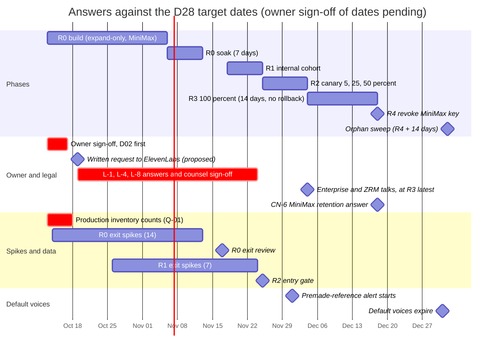

# Risks and open questions

- **Date:** 2026-10-12
- **Status:** Proposed (see [03](03_target_architecture_and_decisions.md) for sign-off status)

## Scope

This is the one register of what can go wrong in the MiniMax → ElevenLabs speech migration, and of every question that is still open. It covers all speech surfaces: chat narration, realtime calls, the voice catalog, the user Voice Studio and the root admin voice console. It contains:
- a **risk register** (vendor, technical, product, cost, legal and privacy, rollout) with likelihood, impact, mitigation, owner, early warning and the related decisions and spikes;
- every **open question**, consolidated: owner decisions still waiting for sign-off in [03 §3](03_target_architecture_and_decisions.md#3-decision-index), written confirmations from ElevenLabs (L-n), counsel tasks (CN-n, defined in [13 §1.5](13_policy_privacy_and_compliance.md)), staging spikes (S-n), and the engineering, data and operations questions raised by the plan documents. Each has an owner, a needed-by phase and a default if it stays unanswered;
- the **assumptions** the plan rests on;
- the **sign-off checklist**.

It decides nothing new. [03](03_target_architecture_and_decisions.md) is the source of truth, and decisions are cited as (D11), spikes as (S-3), written confirmations as (L-2). Changes that plan documents propose to 03 are collected in §3.8; they take effect only once 03 is edited. Facts that still depend on a spike or a written confirmation are labelled so. Prices and model facts are **as of 2026-10-12**. Dates are the D28 targets, which still need owner sign-off.

**Related:** [README](README.md) · [01 current state](01_current_state.md) · [02 capabilities](02_elevenlabs_capabilities.md) · [03 decisions (source of truth)](03_target_architecture_and_decisions.md) · [04 catalog](04_voice_catalog_and_library.md) · [05 Studio and console](05_voice_studio_and_admin_console.md) · [06 narration](06_chat_narration_migration.md) · [07 calls](07_realtime_calls_migration.md) · [08 backend](08_backend_refactor_plan.md) · [09 frontend](09_frontend_refactor_plan.md) · [10 data and rollout](10_data_migration_and_rollout.md) · [11 cost and operations](11_cost_plans_and_operations.md) · [12 best practices](12_best_practices_and_improvements.md) · [13 policy and privacy](13_policy_privacy_and_compliance.md) · [14 spikes and contract tests](14_staging_spike_and_contract_tests.md) · [15 implementation plan](15_implementation_plan_and_acceptance.md) · research [09](research/09_research_critic_gaps.md), [10](research/10_gap_policy_licensing.md), [11](research/11_gap_catalog_api_semantics.md), [12](research/12_gap_model_protocol_facts.md), [13](research/13_gap_codebase_checks.md), [14](research/14_cost_model.md)

---

## 0. At a glance

**51 risks:** 3 Critical, 17 High, 23 Medium, 8 Low impact (heat map in §2.1).

| Rank | Risk | Why it ranks here | Bites at |
|---|---|---|---|
| 1 | **VEN-06** ElevenLabs enforcement against mature roleplay text lands on the whole workspace | Asynchronous, account-level, no error code; the PUP has no fiction carve-out | Every phase from R1 |
| 2 | **PRD-01** Every existing user hears a different voice | Certain for cohort users; companions are the product | R1 → R5 |
| 3 | **ROL-05** R0 scope does not fit the dates | About 265 engineer-days and zero slack on the critical path ([15 §1.5](15_implementation_plan_and_acceptance.md)) | R0 exit |
| 4 | **LGL-01** ElevenLabs reads the app as "Making Available" (L-1) | Would need custom terms; R2 is blocked until L-1 is answered | R2 entry |
| 5 | **VEN-07** A key is disabled or the workspace suspended | After R4 the only fallback is text-only | R1 onwards |
| 6 | **PRD-02** Too few owned en/es voices pass acceptance on Flash and v4 | ≥ 40 call-eligible voices is an R0 exit condition; Spanish v4 coverage is thin | R0 exit |
| 7 | **TEC-09** The fail-closed moderation gate becomes a voice outage | Every segment and call sentence waits for the classifier | R1 onwards |
| 8 | **TEC-01** Call first-audio target missed once moderation is in the path | p50 ≤ 250 ms includes the classifier | R2 entry (S-8) |
| 9 | **CST-01** Spend above forecast | Usage drivers are unmeasured and scale linearly | R2 → R3 |
| 10 | **ROL-02** No rollback path once the MiniMax key is revoked | After 2026-12-18 rollback means text-only | R4 |

**On the critical path today:**
1. Owner sign-off on the 18 decisions still marked "Needs owner sign-off" (§3.2); D02 first, by about 2026-10-16, because nothing on ElevenLabs can start without the account ([15 §3.2](15_implementation_plan_and_acceptance.md)).
2. The written request to ElevenLabs (all L-items, L-1 together with L-9), proposed for 2026-10-19 ([13 §1.4](13_policy_privacy_and_compliance.md)). L-1, L-4 and L-8 must be **answered** before R2 entry (2026-11-25), and ElevenLabs gives no response-time commitment.
3. The 14 spikes in the R0 exit gate, and the production inventory counts (Q-01), which the mapping coverage gate needs.
4. Catalog curation: ≥ 40 published voices, owned designs only until L-2.

---

## 1. Conventions

### 1.1 Identifiers

| Prefix | Meaning | Defined in |
|---|---|---|
| `VEN-`, `TEC-`, `PRD-`, `CST-`, `LGL-`, `ROL-` | Risk, by category: vendor, technical, product, cost, legal and privacy, rollout | This document |
| `D01`…`D38` | Decisions | [03 §4](03_target_architecture_and_decisions.md#4-decision-records) |
| `S-1`…`S-29` | Staging spikes | [03 §6.1](03_target_architecture_and_decisions.md#61-staging-spike-paid-staging-workspace-synthetic-policy-safe-text-only); procedures in [14 §2](14_staging_spike_and_contract_tests.md) |
| `L-1`…`L-16` | Written confirmations from ElevenLabs. **There is no L-11:** research 10 §9 item 11 (preview caching) was folded into L-3 | [03 §6.2](03_target_architecture_and_decisions.md#62-pending-written-confirmations-elevenlabs-sales-or-legal-items-from-research10-9) |
| `CN-1`…`CN-11` | Tasks for external counsel | [13 §1.5](13_policy_privacy_and_compliance.md) |
| `Q-` | Engineering, data and operations questions | This document, §3.7 |
| `PA-` | Proposed amendments to 03, raised by plan documents | This document, §3.8 |
| `AS-` | Assumptions | This document, §4 |
| `RB-1`…`RB-9` | Operations runbooks | [11 §7](11_cost_plans_and_operations.md) |
| `R0`…`R5` | Rollout phases | D28 |

### 1.2 Scales

| Likelihood | Meaning (within 12 months of today) |
|---|---|
| **Low** | Under 10%, or prevented by a design rule that has to be broken first |
| **Medium** | 10–50% |
| **High** | Over 50%, or certain |

| Impact | Meaning |
|---|---|
| **Low** | Contained or cosmetic; a workaround exists; no user-visible outage |
| **Medium** | Degraded quality, or a cost overrun under 25% of forecast; affects a subset of users; recoverable within a day |
| **High** | Voice outage for many users, a cost overrun of 25% or more, a gate slip, or a privacy or policy breach that needs disclosure or a provider conversation |
| **Critical** | The ElevenLabs workspace or contract is lost or restricted, voice is unavailable to everyone with no provider fallback, or there is regulatory exposure |

### 1.3 Roles

Roles, not people. Each row of the register gets a named person at sign-off (§5.2).

| Role | Who | Plan short name in 03 |
|---|---|---|
| **Owner** | Product owner. Holds the ElevenLabs contract, signs decisions and accepts trade-offs | — |
| **Architect** | Lead architect; owns 03 and this register | — |
| **BE** | Backend lead, magic-worlds-api | BE ([08](08_backend_refactor_plan.md)) |
| **FE** | Frontend lead, this SPA | FE ([09](09_frontend_refactor_plan.md)) |
| **DATA** | Data model and migration owner | DATA ([10](10_data_migration_and_rollout.md)) |
| **BILL** | Membership and billing owner | BILL ([11](11_cost_plans_and_operations.md)) |
| **LEGAL** | Maintainer of the policy plan | LEGAL ([13](13_policy_privacy_and_compliance.md)) |
| **Counsel** | External counsel | — |
| **Operator** | On-call operations and rollout | ROLL ([10](10_data_migration_and_rollout.md), [11](11_cost_plans_and_operations.md)) |
| **QA** | Staging spike and test owner | QA ([14](14_staging_spike_and_contract_tests.md)) |
| **Curator** | Root voice curator: designs voices, runs acceptance, curates mappings | — ([04](04_voice_catalog_and_library.md), [05](05_voice_studio_and_admin_console.md)) |

---

## 2. Risk register

### 2.1 Heat map

| Impact ↓ / Likelihood → | Low | Medium | High |
|---|---|---|---|
| **Critical** | VEN-07, LGL-01 | VEN-06 | — |
| **High** | VEN-03, TEC-10, LGL-06, LGL-07, ROL-06 | VEN-01, VEN-08, TEC-01, TEC-09, PRD-02, CST-01, LGL-03, LGL-04, ROL-01, ROL-02, ROL-03 | PRD-01 |
| **Medium** | VEN-10, TEC-04, TEC-12, LGL-08, LGL-09, LGL-10, LGL-11, ROL-04, ROL-07 | VEN-02, VEN-04, VEN-05, VEN-09, TEC-02, TEC-05, TEC-07, TEC-08, PRD-05, CST-02, CST-04, LGL-05 | PRD-04, ROL-05 |
| **Low** | — | TEC-06, TEC-11, PRD-06, CST-03, LGL-02 | TEC-03, PRD-03, PRD-07 |

### 2.2 Vendor

| ID | Risk | L | I | Mitigation | Owner | Trigger / early warning | Related |
|---|---|---|---|---|---|---|---|
| **VEN-01** | **Model churn.** A configured model (`eleven_flash_v2_5`, `eleven_v4`) is renamed, deprecated or removed, or a request field we send is deprecated. ElevenLabs defines no notice period for breaking changes; the v1 TTS models were scheduled for removal on 2026-07-09, about one month after the 2026-06-08 notice (as of 2026-10-12) [research 05 §9.4](research/05_elevenlabs_platform_pricing_limits_policy.md). | M | H | Model ids live only in the capability registry, never in code (D05, D13). `GET /v1/models` readiness probe marks a surface or tier unhealthy instead of failing startup (D04). Expressive falls back to Standard by config. Read `maximum_text_length_per_request`, not the deprecated fields. Weekly changelog review and live contract tests ([11 §9.4](11_cost_plans_and_operations.md), [14 §4](14_staging_spike_and_contract_tests.md)). | BE; Operator (changelog) | Changelog deprecation entry; probe failure; 400 `unsupported_model` opens the config breaker (03 §5.8) | D03, D04, D05, D13; S-2, S-3 |
| **VEN-02** | **v4 immaturity.** `eleven_v4` and `eleven_v4_turbo` launched 2026-09-28. Tags, settings handling and quality may still shift; no pinned model snapshot is documented. `eleven_v4_turbo` on TTS HTTP works but is undocumented and could be withdrawn [research 12 §14](research/12_gap_model_protocol_facts.md). | M | M | v4 is only the opt-in Expressive tier; Standard is Flash (D05). The fallback is Standard, never `eleven_multilingual_v2`. Acceptance renders on both models per voice (D09). v4 Turbo for calls stays behind a flag until S-18. Weekly golden-render drift check ([14 §2.30](14_staging_spike_and_contract_tests.md), X-4). | BE; QA | S-2 or S-6 failure; Expressive `tts_failed` above Standard; tags read aloud | D05, D06, D14; S-2, S-3, S-6, S-18 |
| **VEN-03** | **Default-voice expiry.** Default (premade) voices expire 2026-12-31 (exact instant not stated; plan for 2026-12-30 00:00 UTC), and post-expiry behaviour is undocumented: an error or a silent voice swap [research 11 §1.4](research/11_gap_catalog_api_semantics.md). The risk is an accidental dependency: an env id, a mapping target, a default, or an id copied from official samples (the quickstarts still use George). | L | H | Banned outright (D09). Job A tags any premade `premade_deprecated`, admin-only, through a separate `voice_type=default` query. A startup or CI guard rejects the old-Default id list and `category=premade`. Defaults are DB rows checked by readiness probes (D31, D04). Alert from 2026-12-01 if any reference remains. | BE; Curator | CI guard hit; Job A tags any premade; reference alert from 2026-12-01 | D09, D31, D04; S-1, S-27; L-12 |
| **VEN-04** | **Library voice removal or change.** Owners withdraw voices with 0–730 days' notice; ElevenLabs may remove or rename any shared voice at any time, even 4015-day ones; a re-add picks up the owner's current terms; a deleted copy may not be re-addable [research 11 §5](research/11_gap_catalog_api_semantics.md). Applies to admin-only Library voices now and to public ones after L-2. | M | M | Public catalog = owned designs until L-2 (D09). Curation filter `notice_period ≥ 365`. Always add, store both ids, never provider-delete a copy. Every published voice has a `replacement_voice_key`. Job B daily, the webhook after S-12, and runtime 404/403 detection; "Voice leaving" UX and the demotion path (D19). RB-3. | Curator; BE | `disable_at` set; `voice_removal_notice`; runtime 404 on a catalog voice; `voice_unavailable` > 0.5% (a D28 rollback trigger) | D09, D10, D19, D33; S-11, S-12; L-2, L-10, L-12, L-16 |
| **VEN-05** | **Provider price change.** At list prices plus 25%, the recommended stack costs more than MiniMax today: about $11.4k against $10.4k a month at 10k MAU (as of 2026-10-12) [research 14 §9](research/14_cost_model.md). The v4 promo ("72% off until Oct 12") ends today; whether v4 now bills at the $0.08/1K list rate is checked by X-10 ([14 §2.30](14_staging_spike_and_contract_tests.md)). | M | M | Plan on list price + 25% (research 14 §11). Credit weights and caps are DB data, so re-tuning needs no deploy (D24). Keep the Expressive share under the ~47% break-even. Monthly price check ([11 §9.4](11_cost_plans_and_operations.md)). Enterprise talks at about $3k/month or R3 (D02). | Owner; BILL | Pricing page change at the monthly check; cost per character up in reconciliation; Expressive share > 40% | D02, D05, D24, D37 |
| **VEN-06** | **Policy enforcement on mature roleplay.** The PUP (updated 2026-10-09) has no fiction carve-out. Enforcement is asynchronous and account-level (email warning, voice ban, key disable, workspace suspension), with no moderation error code. An attempted violation is itself a violation. Classifiers have flagged profanity before [secondary] [research 10 §3](research/10_gap_policy_licensing.md). | M | C | Voice launches under the existing no-NSFW policy (D26). Fail-closed synchronous moderation before **every** ElevenLabs request. Abuse-score thresholds and a per-user kill switch. Never send prohibited text, not even in tests ([14 §1.5](14_staging_spike_and_contract_tests.md)). Monitored shared inbox for the account email. RB-8. L-5, L-6 and L-8 asked in writing. | Owner (policy); BE (gate); LEGAL | Any enforcement email; `safety_control` BAN or CAPTCHA on a voice; a 4xx mentioning terms or moderation; rising block rate. Any account event is a D28 rollback trigger | D25, D26, D28; S-29; L-5, L-6, L-7, L-8 |
| **VEN-07** | **Key disable or workspace suspension.** ElevenAPI §5.1 lets ElevenLabs disable one credential without notice or cure; leaked keys are auto-disabled; a workspace suspension takes every surface down [research 10 §2.2, §8.6](research/10_gap_policy_licensing.md). | L | C | Six per-surface keys, so a disabled preview key does not stop narration (D04). The config breaker pages ops. Kill switches give text-only within 60 s (D28). Before R4, route back to MiniMax; after R4, text-only. L-7 asks about notice and per-key targeting. RB-4, RB-8. | Operator; BE | 401/403 across one key; enforcement email; config breaker open | D02, D04, D28; S-28; L-7 |
| **VEN-08** | **Outage or regional degradation.** Scale has no SLA, and there is no customer-controlled failover: residency environments are separate workspaces with separate voices. | M | H | Per-path breakers fail fast with refunds; auto-narration pauses; live calls continue as text (03 §5.8). `ELEVENLABS_BASE_URL` ops switch to the US host (effectiveness [unverified], X-7). RB-1. An SLA is on the Enterprise checklist ([11 §9.5](11_cost_plans_and_operations.md)). | Operator | 5xx or `system_busy` rate; breaker opens; call first-audio p50 > 400 ms | D04, D28; 03 §5.8 |
| **VEN-09** | **Undocumented behaviour changes silently:** TTS WebSocket error frames and close codes, `character-cost`, 429 headers, the webhook payload, `generated_voice_id` lifetime [research 12 §14](research/12_gap_model_protocol_facts.md). | M | M | Tolerant readers (snake_case and camelCase; ignore unknown fields). The SDK source as the contract oracle (D03). A permanent live contract-test suite in staging ([14 §4](14_staging_spike_and_contract_tests.md)). Bill by our own count (S-17 fallback). Polling is the primary catalog path. | QA; BE | Contract-test diff; `upstream_contract` errors; "unclassified 4xx" alert | D03, D08, D10; S-7, S-9, S-10, S-12, S-17, S-24 |
| **VEN-10** | **Groq STT dependency** (kept for calls, D07): unknown rate limits once `VOICE_GLOBAL_CONCURRENCY` rises past 8 ([config.py:31](/home/andres/PycharmProjects/magic-worlds-api/src/services/voice_orchestration/config.py)); price or availability change. | L | M | STT sits behind the `SpeechToTextProvider` interface. Check Groq limits before raising concurrency (Q-08). Scribe v2 Realtime is the stage-2 option (S-19). | BE | Groq 429s; STT error rate | D07; S-19 |

### 2.3 Technical

| ID | Risk | L | I | Mitigation | Owner | Trigger / early warning | Related |
|---|---|---|---|---|---|---|---|
| **TEC-01** | **Call latency target missed.** The target is p50 ≤ 250 ms and p95 ≤ 600 ms to first audio after the first sanitized sentence, **including** the synchronous moderation check, and no regression against the MiniMax baseline (D06). The classifier budget is 300 ms per sentence; MSE priming and region add more. | M | H | Socket prewarmed at call accept. Sentence N is classified while N−1 plays, so only the first sentence pays. Ladder if S-8 misses: tune `chunk_length_schedule`/`auto_mode`, then PCM + AudioWorklet (D08), then v4 Turbo (S-18). Self-hosted classifier for calls if S-29 misses. R0 measures the baseline. | BE; QA | S-8 and S-29 results; R1 p50 > 250 ms; p50 > 400 ms over 1 h is a rollback trigger | D06, D08, D26; S-8, S-21, S-29 |
| **TEC-02** | **Timbre differs between Flash and v4.** The same voice id can sound like another person on Flash (calls, Standard) and v4 (Expressive) [research 09 G7](research/09_research_critic_gaps.md). | M | M | `call_eligible` requires a Flash pass and Flash↔v4 consistency ≥ 4. Publishing requires `call_eligible=1`. Free users hear Flash everywhere. If S-15 leaves too few eligible voices: the badge plus "Works in calls" filter, an owner decision at R0 exit (D06 item 7). | Curator; Owner | S-15 pass rate; acceptance consistency scores; reports that the call voice differs | D06, D09, D16; S-15, S-18 |
| **TEC-03** | **MP3 framing.** ElevenLabs makes no statement that WebSocket or `/stream` chunks are frame-aligned. The per-sentence billing parser marks a partial tail frame as billed without counting it, then resyncs by byte scan ([engine.py:1579-1599](/home/andres/PycharmProjects/magic-worlds-api/src/services/voice_orchestration/engine.py)). 32 kHz literals would reject 44.1 kHz audio. | H | L | The tail-carry parser ships regardless of S-9 (D08, D30). The FE MSE player already plays whole frames only. Sample rate and codec become data; validators are widened in R0 (03 §5.14). | BE; FE | Drift between billed and delivered duration; MSE decode errors; `upstream_contract` "invalid MP3" | D08, D24, D30; S-9 |
| **TEC-04** | **Concurrency and 429.** Concurrency is shared by every key in the workspace. Multi-voice turns fire up to 3 requests at once. The recommended mix needs about 4–5 non-Flash slots at 50k MAU base and 8–10 under heavy use, inside Scale's 15, but only at the assumed v4 speed of about 4 s per 1K characters [unverified until S-21]; at 10 s per 1K, all-v4 p99 goes from 9 to 22, and a slow v4 or a higher Expressive share can push mix E past 15 under heavy use ([research 14 §6.2, §9](research/14_cost_model.md); [11 §5.3](11_cost_plans_and_operations.md)). Our own limiters bind first (`TTS_GLOBAL_CONCURRENCY` default 3, [config.py:34-35](/home/andres/PycharmProjects/magic-worlds-api/src/services/tts_generation/config.py)). | L | M | One provider limiter with pools `flash` (24 of 30) and `non_flash` (12 of 15) (D02). Concurrency 429s are back-pressure, not attempts (03 §5.8). Expressive falls back to Standard. RB-2. Plan upgrade or Enterprise if S-21 says so. | BE; Operator | 429 share > 5% (warn) or > 20% (page); limiter queue wait; `current-concurrent-requests` near the maximum | D02, D05, D37; S-21, S-24 |
| **TEC-05** | **Single-process state (bug #19).** Limiter, breakers and token buckets are in-process; a restart drops every live call; a second process or replica would double the effective provider concurrency and the per-user buckets. TTS is built once per process today ([main.py:916-942](/home/andres/PycharmProjects/magic-worlds-api/src/main.py)). | M | M | Rollout switches are DB-backed with TTL ≤ 60 s, so rollback needs no restart (D28). Daily, abuse and spend counters are in MySQL (D37). Drained restarts only. **No scale-out until the limiter moves to a MySQL lease table (or Redis)** (D37; Q-20). | BE; Operator | A deploy change that adds workers or replicas; restarts during call hours; limiter counts above the pool | D02, D28, D30, D37 |
| **TEC-06** | **Barge-in and contexts.** `close_context` does not cancel flushed text; the slot is held about 5 s; a connection allows 5 contexts; protocol errors close with 1008; drained audio is probably billed [research 12 §8.5](research/12_gap_model_protocol_facts.md). | M | L | Drop frames by `context_id`; flush-ahead ≤ 3 sentences or ≈ 8 s; ≤ 4 live contexts with queueing; one reconnect on 1008; drained characters counted in `voice_abuse_counter` (D06). Fallback: a single-context socket per turn (S-7). | BE | 1008 closes; queued-turn waits; drained characters per call | D06; S-7, S-25, S-18 |
| **TEC-07** | **Text pipeline defects.** v3/v4 read any `[…]` as an instruction, with no escape; user, card and lorebook text can inject tags; Flash number normalization is not dependable (C17); tags may be read aloud or rendered as sound effects. | M | M | One `SpeechTextPipeline` (D14, D27): markup v1 tokenized into placeholders, every other bracket stripped, server-only allow-listed tags, prompts that forbid brackets, upstream number expansion for en and es. `emotion_map_version` and `sanitizer_version` are in the reuse hash. | BE; QA | CT-09 results; stripped-bracket metric; reports of spoken brackets or odd numbers | D14, D27; S-5, S-6, S-26 |
| **TEC-08** | **Language handling.** Flash returns 400 for an unsupported `language_code`; a wrong code gives the wrong accent and number reading; mixed-language turns. The turn `language` field is new in three graph outputs. | M | M | The D17 chain plus a per-model allow-list from `/v1/models`; never a code on multilingual_v2; a 400 maps to `invalid` with a "resolver bug" alert (03 §5.8). Light acceptance for other languages (D34). | BE | `invalid` errors naming `language_code`; S-4 | D17, D34; S-4 |
| **TEC-09** | **Moderation gate availability.** The gate is fail-closed, so a classifier outage or slowdown is a voice outage; false positives block ordinary dark-fantasy narration. | M | H | 300 ms (call sentence) and 2 s (narration batch) timeouts; `moderation_unavailable` is retryable and refunded; > 1% over 1 h is a rollback trigger (D28). Deterministic first layer. Self-hosted classifier for calls if S-29 misses. Thresholds re-tuned after 30 days. Tests use mocks only. | BE | `moderation_unavailable` rate; block rate per 1k segments; S-29 | D06, D26, D28; S-29 |
| **TEC-10** | **Catalog sync misclassifies a configuration fault as mass voice removal** (listing error, key fault, lost group sharing), and the resolver substitutes voices across the board. | L | H | Mass-miss guard: the run aborts if more than max(3, 5%) of active voices are missing. Only Job B's per-voice confirmation sets `removed`. 403 on ≥ 3 voices in 10 minutes = config breaker, never removal. Every change logged in `voice_catalog_event` (D10, D19). | BE; Curator | Job A abort; spike of `suspect` voices; config breaker open | D04, D10, D19 |
| **TEC-11** | **Loudness spread.** Voices differ by more than 6 LU, and attenuation-only gain cannot lift quiet voices; multi-voice turns jump in volume. | M | L | Acceptance measures loudness and rejects voices needing more than −6 dB; the player applies `gain_db` (D16). Phase 2: PCM + `lameenc` server gain. | Curator; BE | S-16 spread; complaints about volume jumps | D16; S-16 |
| **TEC-12** | **Retry comparison change (D36).** Excluding voice paths from the retry byte-equality ([conversation_turn_store.py:124-137](/home/andres/PycharmProjects/magic-worlds-api/src/database/mysql/conversation_turn_store.py)) assumes voices never enter the LLM graph input. | L | M | An R0 test asserts the graph payload is identical with and without voices. If it cannot pass: accept 409 `CHAT_RETRY_CONFLICT` on retries of pre-refresh failed turns, with a message (D36). | BE | The R0 test fails | D21, D36; Q-16 |

### 2.4 Product

| ID | Risk | L | I | Mitigation | Owner | Trigger / early warning | Related |
|---|---|---|---|---|---|---|---|
| **PRD-01** | **Existing users' voices change.** Every MiniMax voice becomes a mapped catalog voice. The mapping is many-to-one (about 40 launch voices against the full MiniMax system catalog), companions sound different, and frozen snapshots keep a substitute until the user acts. | H | H | Mapping curated by audition, with ordered alternates (D21) and the cast distinct-voice rule (D33). From R1: the effective voice is shown and a one-time notice explains the change (D35). "Use the card's current voice" per chat and cast (D36). Review flags (D15). The reverse mapping keeps non-cohort playback coherent during the window. | Owner; Curator; FE | Voice-related support tickets; narration and call usage in the canary vs control; refresh-action usage; substitution rate | D15, D21, D33, D35, D36 |
| **PRD-02** | **Catalog quality and coverage, en and es.** R0 exit needs ≥ 40 public voices (≥ 16 per language), all accepted on Flash and v4 and call-eligible, from owned designs only until L-2. None of the 16 confirmed Default replacements lists `eleven_v4` in `verified_languages`, and six list Spanish only on v2-family models [research 11 §1.2](research/11_gap_catalog_api_semantics.md). Designed voices may be less performative on v4. | M | H | Start Voice Design right after the account exists ([15 §3.3](15_implementation_plan_and_acceptance.md)). The Acceptance console is an R0 deliverable (D20). S-14 fallback: design more owned Spanish voices and lower the target to ≥ 10 per language (owner choice, §3.3). Weekly acceptance burndown. | Curator; Owner | Burndown behind plan two weeks before the R0 exit review; S-14 counts | D09, D20, D31, D34; S-14, S-15, S-27; L-2 |
| **PRD-03** | **Controls lost.** Pitch and volume go away; speed narrows from MiniMax's 0.5–2.0 to 0.7–1.2; Expressive ignores speed; on Standard, emotion is only a stability offset. How many recipes are affected is unknown (G6). | H | L | Flag plus a one-time, dismissible notice (D15); curators can map "pitched" legacy voices to deeper or brighter targets; speed clamped; Studio hints per tier (D13). DATA reports counts before apply. | Owner; FE; DATA | G6 counts of flagged rows; notice dismiss vs change rates | D13, D15; S-3, S-6 |
| **PRD-04** | **Standard narration and Free limits read as a downgrade.** Flash has no audio tags and flatter delivery. Free narration goes from 20 narrations a day ([db.sql:923](/home/andres/PycharmProjects/magic-worlds-api/src/database/mysql/db.sql)) to 2,500 characters a day, about 2–3 typical turns. Expressive is for Plus and Pro only. | H | M | The owner accepts the trade-off explicitly (D05, D24). Remaining budget shown in the usage page, narration controls and Studio. Re-tune after 30 days of telemetry. Escape hatch in D05: Standard on v4 for everyone (+30% cost). | Owner; BILL | Free `daily_limit_reached` rate; narration usage per Free user; feedback | D05, D24 |
| **PRD-05** | **Other languages degrade.** The curated catalog is en and es; other languages use multilingual voices with light acceptance, and untested languages are allowed with a badge (D34). | M | M | Light languages (D34): fr, de, pt, it, plus any language with ≥ 1% of narrated segments in R0 telemetry or referenced by a MiniMax voice in live data; light acceptance on the narrator default and the 4 `character_fallback` voices per light language. "Not tested in {language}" badge and the language-scope note; the Flash language allow-list. | Curator; Owner | R0 turn-language shares; `language_unsupported` substitutions | D17, D34; S-4 |
| **PRD-06** | **Previews feel stingy.** Recipe previews use fixed texts only, with 3 free renders a day (D18). | M | L | Catalog auditions are free; settings are quantized to 0.05 so nudges hit the cache; default-settings auditions are free; the remaining count is shown. | Owner; FE | Preview-limit hits per day | D18 |
| **PRD-07** | **Creation features shrink.** Users never create provider voices; MiniMax custom voices are retired (no source audio was ever stored); root cloning needs a consent record. | H | L | Presets carry personalization (D20). Re-creating a custom voice is possible only with off-platform audio and fresh consent (D22, Q-02). | Owner | Requests for custom voices | D20, D22 |

### 2.5 Cost

| ID | Risk | L | I | Mitigation | Owner | Trigger / early warning | Related |
|---|---|---|---|---|---|---|---|
| **CST-01** | **Overspend against forecast.** Characters per turn and turns per MAU are unmeasured and scale linearly; an Expressive share above about 47% erases the saving; a user who maxes every capped surface costs 1.5–1.9× the plan price (03 §5.9); Free accounts are free to create. | M | H | Hard caps that PAYG cannot buy past (D24). Global daily spend circuit at 50/80/95/100%, per-user token buckets, daily reconciliation, Free-tier prerequisites (D37, 03 §5.13). PAYG cap at 1.5× the R0 forecast at R1, re-sized from telemetry before R3 (D02). Usage queries before R1 (Q-03). RB-7. | BILL; Operator | Spend-circuit alerts; reconciliation drift > 5%; cost per MAU against forecast; Expressive share | D02, D24, D37; S-17, S-28 |
| **CST-02** | **Our own re-pricing is miscalibrated.** Character weights, caps or per-turn rounding are wrong for real usage, so revenue drops or users churn; seeds are wrong for custom plans; the usage UI confuses. | M | M | Numbers live in `membership_plan_limit` and are editable without a deploy. Charge-algorithm tests. Owner sign-off (D24). Live Stripe prices checked (Q-05). Re-tune after 30 days (research 14 §10.3 levers). | BILL; Owner | Credits used per user against the model; refund rate; plan conversion | D18, D24; S-17 |
| **CST-03** | **Hidden provider costs.** The moderation classifier's unit cost is [unverified]; tags, `previous_text` and audio drained after `close_context` may be billed; the "−13%" comparison excludes the classifier. | M | L | Users are billed on our own count. Context fields stay off until S-17. BILL adds the classifier cost before the "−13%" figure is used (D26). The flush-ahead window bounds drained audio. Reconciliation catches drift. | BILL; BE | Reconciliation drift; S-17 and S-25 results | D05, D24, D26; S-17, S-25 |
| **CST-04** | **Per-key `character_limit` semantics are unknown** (unit, reset, error, meaning of 0). A cap may trip unexpectedly and take a surface down, or never trip at all. | M | M | App-side guards are the enforced budget (D37). The `OPS` key gets the smallest non-zero value until S-28. Cap errors map to the billing breaker and `unavailable`, never to the user's quota (03 §5.8). RB-9. | Operator; BE | Per-key usage > 80% of the cap; billing breaker opens | D04, D37; S-28 |

### 2.6 Legal and privacy

| ID | Risk | L | I | Mitigation | Owner | Trigger / early warning | Related |
|---|---|---|---|---|---|---|---|
| **LGL-01** | **Licensing classification.** If ElevenLabs reads the app as "Making Available" (L-1), no self-serve plan covers consumers and custom (Enterprise) terms are needed [research 10 §2.3](research/10_gap_policy_licensing.md). R2 cannot start until L-1 is answered. | L | C | Scale held by a legal entity (D02). L-1 sent with L-9 in week 1 (proposed 2026-10-19). Staff-only traffic until answered (03 §6.2 safe default). Enterprise talks start early enough to absorb a "yes". | Owner; Counsel | No reply two weeks after sending; a reply asking for OEM terms | D02; L-1, L-3, L-9, L-15 |
| **LGL-02** | **Library voice and preview rights.** L-2, L-3 or L-16 come back late or negative. | M | L | Safe defaults are already the plan: owned designs only, own samples only, no Library-derived remixes, and a demotion path if permission is withdrawn later (D09, D10, D19). | Owner; Curator | No answer; a negative answer after Library voices went public | D09, D10, D19; L-2, L-3, L-12, L-16 |
| **LGL-03** | **Consent and privacy notice.** DPA §2.2 makes us responsible for notice and consent. Today's copy names MiniMax ([en.ts:2047](/home/andres/WebstormProjects/magic-worlds/src/app/i18n/locales/en.ts)). During R1–R4 the copy must name both providers, the call consent version must follow the provider, and the classifier's provider must be named. Risk: users reach ElevenLabs before the copy and consent are live and approved. | M | H | `voice-v2` consent per provider, persisted on `voice_session` (D25 item 7). Dual-provider privacy copy for all users and counsel sign-off are R2 entry conditions (03 §6.3; CN-3). The copy never promises 24-hour deletion. | LEGAL; Counsel; FE | R2 entry checklist incomplete; consent errors in the cohort | D25; CN-3 |
| **LGL-04** | **Age gate and companion safeguards.** The 18+ gate is a dismissible modal stored in `localStorage` with no server record ([AppWarningModal.tsx:7-42](/home/andres/WebstormProjects/magic-worlds/src/ui/components/AppWarningModal.tsx)); registration and OAuth sign-up carry no age or terms field; self-attestation may not suffice in some jurisdictions; companion-chatbot laws such as California SB 243 [secondary] [research 10 §4](research/10_gap_policy_licensing.md). | M | H | Server-side `user_attestation` (18+, ToS) enforced with HTTP 428 or the WebSocket error frame; a blocking prompt for existing and OAuth users; click-wrap ToS with PUP flow-down; "Report a minor" hold; companion safeguards (D26). CN-1, CN-2, CN-7; L-4 and L-8 answered before R2 entry. | LEGAL; BE; FE; Counsel | Minor reports; a counsel finding; an attestation bypass found in QA | D26, D37; L-4, L-8; CN-1, CN-2, CN-7 |
| **LGL-05** | **Provider retention.** Without ZRM, ElevenLabs keeps TTS text and audio in history (deleted items persist up to 30 days in backups), and its safety team may read content. The sweep needs one DELETE per item: about 12k a day at 10k MAU and 60k at 50k MAU, before call sentences if WebSocket TTS creates history items (open). ZRM is Enterprise-only and may be refused for this use case. | M | M | Training opt-out from day one. Continuous sweep under its own `OPS` budget with an SLO: oldest item < 48 h, alert at 36 h, page at 72 h. The copy says "on a regular schedule". L-9 and Enterprise talks; ask for bulk deletion if S-23 fails. No user identifiers in TTS text. Named dashboard seats. RB-5. | Operator; BE; LEGAL | Sweep lag; 429s on deletes; S-23 throughput | D02, D25; S-23; L-9 |
| **LGL-06** | **Training opt-out missed** before the first real user text. The licence is perpetual, and the opt-out does not reach uses made before it is processed [research 10 §6](research/10_gap_policy_licensing.md). Irreversible. | L | H | R0 exit requires a dated screenshot for production and staging (03 §6.3). Staging carries synthetic text only. | Operator | The R0 exit checklist | D02, D25 |
| **LGL-07** | **Cloning consent and revocation.** The IVC API has no consent field; biometric laws (BIPA, Texas, Washington) may apply; revocation must remove the voice and its stored audio; MiniMax custom voices carry no consent record. | L | H | Root-only IVC with a consent record kept 5 years after deletion; revocation SLAs of 1 business day, 7 days and 30 days (D19 item 9); MiniMax custom voices retired (D22). CN-4, CN-5 and S-22 before the first IVC; L-13 for third-party speakers. | LEGAL; Counsel; Curator | The first IVC request; a revocation request | D19, D20, D22; S-22; L-13; CN-4, CN-5 |
| **LGL-08** | **MiniMax retention terms** for generated audio after the contract ends are unknown (D23). | L | M | CN-6 answered before R4. A purge path is ready: keep the text, show "audio no longer available". The orphan sweep waits until R4 + 14 days. | Counsel; Owner | No CN-6 answer by R4 | D23; CN-6 |
| **LGL-09** | **Jurisdiction and sanctions.** The ElevenLabs ToS variant depends on where the contracting entity resides; ElevenLabs blocks some regions; whether our users there may receive output is open. | L | M | L-15; geo-block voice in sanctioned regions as the safe default; CN-8. The BFF has no country signal yet (Q-13). | Owner; Counsel; BE | Contract signature; R2 entry checklist | D02, D26; L-15; CN-8 |
| **LGL-10** | **Startup Grant.** Output generated outside an active subscription carries attribution duties [research 10 §2.6](research/10_gap_policy_licensing.md). | L | M | Grant funds unused until L-14 confirms; paid Scale stays active (D02). | Owner | Any plan to draw on the grant | D02; L-14 |
| **LGL-11** | **Staff access to story text.** Shared workspace history holds users' story text and is readable by every dashboard seat. | L | M | Named seats in the access register; no browsing except logged incidents; quarterly review (D25 item 8). | Owner; Operator | Seat changes; any history access outside an incident | D02, D25 |

### 2.7 Rollout

| ID | Risk | L | I | Mitigation | Owner | Trigger / early warning | Related |
|---|---|---|---|---|---|---|---|
| **ROL-01** | **Canary routing bugs.** Wrong provider per user or job; `rollout_mode=off` misses the internal cohort; TTL lag; non-cohort playback of a V2 voice falls back to the MiniMax default; consent version mismatch; stale SPA builds. | M | H | `ProviderRouter` per job, persisted on `tts_job.provider` and `voice_session.tts_provider`. DB-backed settings with TTL ≤ 60 s. Reverse mapping 100% of published voices at R1 entry. Shared-card substitution > 1% is a rollback trigger. Consent version per provider. The SPA learns capability from the BFF, never from build flags (D28). | BE; QA | Provider-mismatch audit (cohort users with MiniMax jobs or the reverse); substitution rate; consent errors | D21, D25, D28, D35 |
| **ROL-02** | **Rollback limits.** From R1 no build may go below R0 (pre-R0 builds cannot read V2 voices); rollback is route-only; after R4 (2026-12-18) it means text-only. The dual window is ≤ 30 days, so a problem that surfaces later has no MiniMax path. | M | H | R3 runs 14 days with no rollback before R4. Kill switches are tested. MiniMax data stays intact until R4 + 14 days (D23). Every R0 release is expand-only. A text-only drill and an explicit R4 go/no-go are proposed (PA-15). | Owner; Operator | Any rollback during R3; open severe incidents at the R4 go/no-go | D23, D28 |
| **ROL-03** | **The expand step misses a strict reader.** `extra="forbid"` models, FE whitelists, `.voice_id` checks ([CallsPage.tsx:25-27](/home/andres/WebstormProjects/magic-worlds/src/features/call/components/CallsPage.tsx)) or closed status sets in older SPA builds break lists, turns or calls when a V2 value first appears. | M | H | The 03 §5.14 widening list in R0; V1/V2 union readers; a CI grep gate on `.voice_id` (D35); fixtures for each copy flow (D32); 7 days on R0 before R1; no new public statuses (03 §5.8). | BE; FE; QA | Validation errors after the first cohort write; FE parser warnings | D11, D30, D32, D35 |
| **ROL-04** | **Mapping coverage and the R5 rewrite.** Gaps in `voice_legacy_mapping` (counts unknown, G6), cast collisions, R5 rewrite errors, or V1 presets left before the R5 DDL. | L | M | MiniMax picker restricted to mapped ids from R0; the coverage query before R1, each canary step, R3 and R5; unmapped → language default plus review flag; reviewed `--check`/`--apply` with an audit row per path; R5 DDL only at 0 V1 presets (D12, D21). | DATA | Coverage below 100%; a non-zero `--check` | D12, D21, D33, D38 |
| **ROL-05** | **Schedule compression.** R0 is about 265 engineer-days with zero slack on the critical path against D28 ([15 §1.5](15_implementation_plan_and_acceptance.md)); the ElevenLabs answers have no SLA; a slip pushes R2–R4 into the December holidays. | H | M | Gates decide, not dates (03 §6.3). Re-date with the relative-offset rule ([15 §1.5](15_implementation_plan_and_acceptance.md)); keep the 30-day window by moving every phase together, never by shortening R3. Holiday freeze for canary and 100% steps (PA-14). Weekly L-item follow-up (§3.4). | Owner; Architect | R0 burndown; spikes not started by 2026-10-26; no ElevenLabs reply by R1 | D28 |
| **ROL-06** | **Membership-op lockstep.** Adding `voice_preview` and changing `count_in_flight` is a startup contract: an unknown operation raises ([models.py:2061-2117](/home/andres/PycharmProjects/magic-worlds-api/src/database/mysql/models.py)). A seed or deploy ordering mistake can stop the BFF starting or break narration quota. | L | H | Shipped in R0.2 so any rollback stays inside R0; forward and reverse migrations rehearsed on a copy ([15 §3.3](15_implementation_plan_and_acceptance.md)); reverse migrations exist only before R1 (D28). | BE; BILL | Staging startup failure | D18, D24, D28 |
| **ROL-07** | **MiniMax fails during the window.** Non-cohort users need MiniMax until R3, and rollback needs it until R4. | L | M | Confirm the MiniMax contract and billing before R2 ([11 §9.6](11_cost_plans_and_operations.md)). If MiniMax degrades, advance the cohort only as far as the gates allow, otherwise text-only. | Operator | MiniMax error rate; an invoice or contract notice | D28 |

### 2.8 Register upkeep

- **Cadence.** Reviewed weekly from R0 to R4 in the ops review, and at every gate review (§5.3). After R5, monthly until the risks below retire.
- **Status values:** `open`, `mitigating` (mitigation in progress), `watching` (mitigation live, trigger monitored), `closed`.
- **Change rule.** A new risk, or a changed rating, is added here. A mitigation that changes a decision is proposed to 03 first (§3.8).
- **Expected retirement:**

| Risk | Retires when |
|---|---|
| ROL-01, ROL-07 | R4: one provider, no cohort routing |
| ROL-02 | R4 + 14 days: the rollback window is gone and the post-R4 posture (text-only) is the steady state |
| ROL-03, ROL-04, ROL-06 | R5 contract complete; `--check` reports 0 V1 rows |
| VEN-03 | 2027-01-01 with zero premade references, and X-9 recorded ([14 §2.30](14_staging_spike_and_contract_tests.md)) |
| TEC-03, TEC-06 | S-9 and S-25 recorded, and the tail-carry parser in production |
| TEC-12 | The R0 graph-payload test passes |
| PRD-02 | R0 exit with ≥ 40 published voices |
| LGL-01, LGL-10 | L-1 or L-14 answered positively |
| LGL-06 | Opt-out screenshots filed for production and staging |

---

## 3. Open questions

**Default rule.** Per [03](03_target_architecture_and_decisions.md#how-to-read-this-document), an owner decision that is not answered by its needed-by phase defaults to the 03 recommendation, and the gap is logged at the next gate review. An L-item defaults to its 03 §6.2 safe default. A spike in a gate either passes or has its 03 §6.1 fallback adopted and recorded ([10 §10.3](10_data_migration_and_rollout.md)); a spike that has **not run** keeps its gate closed.

### 3.1 When answers are needed

The R0 exit review date (2026-11-17) follows [10 §10.3](10_data_migration_and_rollout.md), [14 §1.8](14_staging_spike_and_contract_tests.md) and [15 §1.5](15_implementation_plan_and_acceptance.md): the last R0 release lands on 2026-11-06 and soaks for 7 days. [13 §7](13_policy_privacy_and_compliance.md) labels 2026-11-06 itself as "R0 exit"; PA-16 asks 03 to settle this.

### 3.2 Owner decisions pending sign-off

Every decision whose 03 status is "Needs owner sign-off". The default if unanswered is the 03 recommendation.

| Decision | What the owner confirms | Owner | Needed by | Default if unanswered | Risks |
|---|---|---|---|---|---|
| **D01** | "Remove MiniMax" means speech only; fal `minimax/music-3` theme songs stay | Owner | Before R0 build (grep gates and inventories depend on it) | Speech only; optional one-line switch to `ace_step` | — |
| **D02** | Scale held by a legal entity; Creator or Pro staging with user keys; Startup Grant only after L-14; Enterprise talks at about $3k/month or R3 | Owner | **About 2026-10-16** (critical-path step 1, [15 §3.2](15_implementation_plan_and_acceptance.md)) | As recommended | LGL-01, VEN-07, LGL-10 |
| **D05** | Standard (Flash) / Expressive (v4) tiers, 2× credit weight for Expressive, Free = Standard only | Owner | R0 exit (capability registry and seeds) | Option E | PRD-04, VEN-05 |
| **D06** | The consistency trade-off: Expressive narration users hear a flatter Flash rendering in calls | Owner | R0 exit | A1, with publishing gated on `call_eligible` | TEC-02 |
| **D09** | Catalog sourcing: Default ban, owned designs only until L-2, ≥ 40 public voices with en/es coverage | Owner | R0 exit | As recommended | PRD-02, VEN-03, VEN-04 |
| **D15** | "Flag + notice" rather than a silent drop of pitch and volume | Owner | R1 (flags are computed for the cohort) | Flag + notice | PRD-03 |
| **D18** | Preview limits (3/10/20 per day; 3 free, then 1 credit) | Owner | R0.2 (the `voice_preview` op ships in R0) | 03 §5.9 numbers | PRD-06, CST-01 |
| **D20** | Root console scope; users never create provider voices | Owner | R0 (the Acceptance module is an R0 deliverable) | As recommended | PRD-07, LGL-07 |
| **D22** | Retire MiniMax custom voices; re-seed curated global presets | Owner (+ Operator, Q-02) | R0 exit ([10 §10.3](10_data_migration_and_rollout.md)) | Retire; re-seed | PRD-01, LGL-07 |
| **D23** | Keep legacy MiniMax assets and rows readable; orphan sweep at R4 + 14 days | Owner (+ CN-6) | Before R4 | Keep and widen; purge path if CN-6 says no | LGL-08 |
| **D24** | Prices, caps and the Free trade-off (2,500 characters a day) | Owner; BILL | R0.2 (seeds and per-turn reservation ship in R0) | 03 §5.9 numbers | PRD-04, CST-01, CST-02 |
| **D25** | Privacy posture: no ZRM at launch, history sweep, copy rewrite | Owner; Counsel | R2 entry (counsel sign-off); copy drafts by R1 | Retention + sweep | LGL-03, LGL-05 |
| **D26** | No-NSFW voice, fail-closed moderation, attestation, minor-report hold, abuse thresholds | Owner; Counsel | Built in R0; live by R2 entry | As designed | VEN-06, LGL-04, TEC-09 |
| **D28** | Dates, including the Thanksgiving-weekend canary step and Friday R3/R4 ([10 §11](10_data_migration_and_rollout.md)) | Owner | Before R0 build | D28 dates; re-date with the [15 §1.5](15_implementation_plan_and_acceptance.md) rule | ROL-02, ROL-05 |
| **D29** | Feature timing P0–P3 | Owner | P1 scheduling, after R5 | P0 (ops only) during the migration | — |
| **D31** | Voiceless characters share the narrator default (no auto-casting) | Owner | R0 exit (`voice_default` rows) | Share the narrator default | PRD-01 |
| **D34** | Light-language rule and the 1% threshold | Owner | R0 exit (light acceptance; narrator rows per light language) | Option (a), 1%, plus fr, de, pt, it | PRD-05 |
| **D37** | Caps, the all-surface exposure table, Free-tier rules | Owner | Built in R0; live by R2 entry | 03 §5.13 | CST-01 |

### 3.3 Conditional owner choices

These choices only arise if a spike or an answer goes the wrong way. Each has a default already written into 03.

| If… | Choice | Owner | When | Default |
|---|---|---|---|---|
| S-14 leaves fewer than 16 accepted voices in a language | Hold R0 exit until more owned voices pass, or accept the lower target | Owner; Curator | R0 exit | The 03 §6.1 fallback: design more owned Spanish voices (`eleven_ttv_v3`) and lower the target to ≥ 10 per language |
| S-15 leaves fewer call-eligible voices than the D09 target | Publish non-eligible voices with the "Not available in calls" badge and a "Works in calls" filter | Owner | R0 exit (D06 item 7) | Badge + filter |
| S-8 misses the latency target | Tune, then PCM + AudioWorklet, then v4 Turbo (S-18) | BE; Owner (for v4 Turbo) | R2 entry | The ladder in D06 / 03 §6.1 |
| S-23 shows insufficient deletion throughput | Ask ElevenLabs for bulk deletion or auto-expiry; bring Enterprise/ZRM talks forward | Owner | R1 exit | Both (D25) |
| S-21 shows non-Flash headroom is short | Lower the Expressive share or caps, queue, or upgrade the plan | Owner; BILL | R2 entry | Lower the share or caps first |
| L-1 says "Making Available" | Custom (Enterprise) terms, or hold at staff-only | Owner; Counsel | On receipt | No non-staff traffic |
| L-2 turns negative after Library voices went public | Demotion path and removal date | Owner; LEGAL | On receipt | D09 demotion path |
| Flash quality judged unacceptable as the default | Standard on `eleven_v4` for everyone at 2× weight (+30% cost) | Owner | After R1 listening | Keep Flash (D05) |
| v4 list price drops to promo level | Make Expressive the default | Owner; BILL | Monthly price check | Keep Standard default (D05) |
| CN-6 says MiniMax audio may not be kept | Purge referenced MiniMax audio, keep text | Owner | Before the R4 + 14 days sweep | Keep (D23) until answered |
| 30 days of R2/R3 telemetry | Accept, tighten paid caps, or raise voice-heavy prices ([research 14 §10.3](research/14_cost_model.md)) | Owner; BILL | After R3 | Accept with the balanced caps |

### 3.4 Written confirmations from ElevenLabs (L-*)

Question and safe-default columns are copied from [03 §6.2](03_target_architecture_and_decisions.md#62-pending-written-confirmations-elevenlabs-sales-or-legal-items-from-research10-9); owners and dates follow [13 §1.4](13_policy_privacy_and_compliance.md). All items go in one written request (proposed 2026-10-19), L-9 with L-1. **Follow-up:** this register tracks the request weekly ([15 §3.3](15_implementation_plan_and_acceptance.md)). With no reply after 14 days, the owner escalates to ElevenLabs sales (proposal). If L-1, L-4 or L-8 is still open at R1 exit, R2 does not start and staff traffic continues.

| ID | Question | Decisions | Safe default until answered | Owner | Needed by | Risks |
|---|---|---|---|---|---|---|
| L-1 | Is the app ordinary commercial use (Reading A), not "Making Available"? | D02 | No non-staff user traffic (R2 entry blocked, §6.3) | Owner sends; Counsel reviews | Sent by R0 exit; **answered by R2 entry** | LGL-01 |
| L-2 | May users select Library voices we have added; is attribution or owner approval needed? | D09 | Library voices `visibility=admin`; owned designed voices only; no Library remixes. Gates public Library voices only, not any phase | Owner; Counsel | Before any Library voice goes public | LGL-02, PRD-02 |
| L-3 | Minimum tier (Scale?) and contracting party (entity vs sole proprietor); may we persist and serve preview audio? | D02, D10 | Scale; own samples only; **no upstream proxy** | Owner; Counsel | R0 exit, or apply the safe default | LGL-02 |
| L-4 | Is click-wrap ToS with PUP flow-down + 18+ sufficient for PUP §12? | D26 | Ship the ToS and attestation as designed | Owner; Counsel | **R2 entry** | LGL-04 |
| L-5 | Adult fiction narration permitted, and under which safeguards? | D26 | No-NSFW voice | Owner | Only before adult audio is ever enabled | VEN-06 |
| L-6 | Moderation and ban signal shapes; billing of refused requests | §5.8 | Treat as `voice_unavailable` / `unavailable` | LEGAL (to BE) | Wanted before R2 entry | VEN-06, VEN-09 |
| L-7 | Is there notice before a key, voice or workspace is restricted; which email or webhook gets warnings; can enforcement target a single service account or key? | D04, D28 | Monitored shared inbox; per-surface keys; any enforcement email is a rollback trigger | Owner; Operator | Wanted before R2 entry | VEN-07 |
| L-8 | Is an 18+ roleplay companion app a "higher-risk use"? | D26 | Companion safeguards as designed | Owner; Counsel | **R2 entry** | VEN-06, LGL-04 |
| L-9 | ZRM eligibility on Enterprise (sent together with L-1) | D25 | History sweep | Owner | Sent with L-1; answered before Enterprise talks (about $3k/month or R3) | LGL-05 |
| L-10 | If ElevenLabs removes a shared voice (VLA §8), do accounts that added it keep notice-period access; how are they notified? | D19 | Treat removal as instant: replacement voices and runtime detection (D19) | LEGAL | No gate | VEN-04 |
| L-12 | Ownership and permanence of the Default-replacement voices | D09 | Ordinary Library rules | Owner | Before a perpetual Library voice is public, a D31 default, or remixed | VEN-03 |
| L-13 | IVC verification path for a third-party speaker | D20 | Dashboard-assisted IVC | LEGAL | Before the first third-party IVC | LGL-07 |
| L-14 | Does a Scale-level Startup Grant count as a paid commercial subscription and a Business Entity plan (OEM §1.D, §2.B), with no attribution duty? | D02 | Do not rely on the grant; keep paid Scale active | Owner | Before any grant-funded usage | LGL-10 |
| L-15 | Which ElevenLabs ToS applies (EEA/UK/CH vs non-EEA) for our contracting entity, and how must we handle users in regions ElevenLabs blocks (sanctions)? | D02, D26 | Contract under the non-EEA ToS only if the entity is non-EEA; geo-block voice for sanctioned regions | Owner; Counsel | ToS variant at contracting; sanctions by R2 entry | LGL-09 |
| L-16 | Rights in a remix derived from a Library voice after the owner withdraws the source voice | D09, D19 | No Library-derived remixes | Owner; Counsel | Before any Library-derived remix | LGL-02 |

### 3.5 Counsel tasks (CN-*)

Defined in [13 §1.5](13_policy_privacy_and_compliance.md); the last column is this register's. CN-1, -2, -3, -7, -8, -9 and -10 are part of the R2 entry counsel sign-off ([13 §7](13_policy_privacy_and_compliance.md)), so leaving them open keeps R2 closed. The defaults below are what engineering builds meanwhile.

| ID | Task (short) | Owner | Needed by | Default engineering builds while open |
|---|---|---|---|---|
| CN-1 | Is self-attestation (18+, ToS) enough in every market we serve? | Counsel | R2 entry | `user_attestation` as designed (D26) |
| CN-2 | Draft and approve the ToS (click-wrap, 18+, PUP flow-down) | Counsel + LEGAL | R2 entry | ToS page skeleton and click-wrap plumbing |
| CN-3 | Approve the privacy section, `voice-v2` consent, first-run bullet and dual-provider wording | Counsel | R2 entry | Drafts from [research 10 §8.3](research/10_gap_policy_licensing.md) |
| CN-4 | IVC consent text and biometric wording per jurisdiction | Counsel | Before the first IVC | No IVC |
| CN-5 | Confirm the IVC revocation SLAs and the 30-day purge | Counsel | Before the first IVC | No IVC |
| CN-6 | May MiniMax-generated audio be kept after the contract ends? | Counsel + Owner | Before R4 | Keep (D23); purge path ready |
| CN-7 | Companion-chatbot law (AI disclosure, self-harm protocol, break nudges) | Counsel | R2 entry | D26 item 5 safeguards |
| CN-8 | Which regions to geo-block for voice, and from which signal | Counsel | R2 entry | Geo-block per L-15 safe default (needs Q-13) |
| CN-9 | Retention periods for attestations, abuse counters, device/IP signals, transcripts | Counsel | R2 entry | Proposals in [13 §5.7](13_policy_privacy_and_compliance.md) |
| CN-10 | Pin processing to the US host instead of global routing? | Counsel | R2 entry | Global routing (default `ELEVENLABS_BASE_URL`) |
| CN-11 | Eleven Music terms | Counsel | Before D29 P2 item 7 | Eleven Music not adopted |

### 3.6 Staging spikes (S-*)

Assumptions are abbreviated; the full text, tests and fallbacks are in [03 §6.1](03_target_architecture_and_decisions.md#61-staging-spike-paid-staging-workspace-synthetic-policy-safe-text-only) and the procedures in [14 §2](14_staging_spike_and_contract_tests.md). QA runs every spike; "Decides" names who acts on the result. Gates are copied from 03 §6.3.

| ID | Assumption under test | Decisions | Decides | Needed by | If false: fallback (03 §6.1) | Risks |
|---|---|---|---|---|---|---|
| S-1 | Production account facts: Scale, entity, creation date, existing voices; no Default dependency | D02, D09 | Owner; Operator | R0 exit | New Scale workspace for production | VEN-03, LGL-01 |
| S-2 | `eleven_v4` (and v4 Turbo) on TTS HTTP on our account, with `request-id` and `character-cost` | D05, D06 | BE | R0 exit | Expressive via TTD HTTP, one input per segment (see PA-2 on the second fallback) | VEN-02 |
| S-3 | Per-model settings behaviour matches 03 §5.6 | D13 | BE | R0 exit | Tighter allow-lists | VEN-02, PRD-03 |
| S-4 | `language_code` acceptance per model; Flash 400 on unsupported codes | D17 | BE | R0 exit | Omit `language_code` on Flash; upstream normalization | TEC-08 |
| S-5 | Flash `apply_text_normalization: "auto"` on digits, en and es | D27 | BE | R0 exit | Already mitigated by upstream expansion | TEC-07 |
| S-6 | Emotion tags and `[whispers]` audible and not read aloud on v4; stripped brackets read naturally | D14, D16 | Curator; BE | R0 exit | Failing tag → no tag; thought → gain only | TEC-07, VEN-02 |
| S-7 | Flash multi-context protocol: `is_final`, casing, keepalive and settings 1008s | D06 | BE | R1 exit | Single-context `stream-input` socket per turn, prewarmed | TEC-06 |
| S-8 | Call latency target in the production region | D06, D08 | BE | R2 entry | Tune, then PCM + AudioWorklet, then v4 Turbo | TEC-01 |
| S-9 | MP3 frame alignment on WS and `/stream` | D08, D24 | BE | R1 exit | None needed: tail-carry fix ships regardless | TEC-03 |
| S-10 | Unknown or removed voice error shapes on HTTP, TTS WS, TTD WS | 03 §5.8 | BE | R1 exit | Any 4xx or 1008 mentioning the voice = `voice_unavailable` | VEN-09 |
| S-11 | Library add returns an id, costs ≤ 1 op; re-add works while listed | D10, D19 | Curator; BE | R0 exit; public Library voices | Both ids stored; ops budgeted; never delete copies | VEN-04 |
| S-12 | Webhook payload has a parseable voice id; retries as documented | D10, D19 | BE | Optional (webhook); public Library voices | Polling only | VEN-04, VEN-09 |
| S-13 | Upstream preview URLs stable enough to proxy for 1 h | D10, D18 | BE | R0 exit | Own samples only (already primary) | LGL-02 |
| S-14 | ≥ 16 en and ≥ 16 es voices pass acceptance on Flash and v4 | D09 | Curator; Owner | R0 exit | More owned Spanish designs; target ≥ 10 per language | PRD-02 |
| S-15 | Accepted voices keep their timbre across Flash and v4 (consistency ≥ 4) | D06, D09 | Curator; Owner | R1 exit (data needed at R0 exit, PA-4) | Narrow `call_eligible`; call replacements; v4 Turbo for calls | TEC-02 |
| S-16 | Loudness spread ≤ 6 LU; attenuation suffices | D16 | Curator; BE | R0 exit | Phase 2 server gain | TEC-11 |
| S-17 | `character-cost` present and equal to input incl. tags; context fields unbilled or predictable | D05, D24 | BILL; BE | R1 exit | Meter by our own count; context fields off | CST-03 |
| S-18 | v4 Turbo on TTD multi-context: drained-audio billing and slots acceptable | D06 (upgrade) | BE; Owner | Optional | Stay on Flash | TEC-01, TEC-02 |
| S-19 | Scribe v2 Realtime: session cap handled, commit-to-final p50 < 300 ms, Spanish WER ≤ Groq | D07 | BE | Optional | Keep Groq | VEN-10 |
| S-20 | `generated_voice_id` survives ≥ 60 min; remix allowed on perpetual Library copies | D19, D20 | Curator | R0 exit | Save in the same session; remix owned voices only | PRD-02 |
| S-21 | Generation speed keeps p99 concurrency inside Scale at target load | D02, D05 | BE; Owner | R2 entry | Lower Expressive share or caps; queue; upgrade (see PA-5) | TEC-04 |
| S-22 | IVC verification without the dashboard, or rarely triggered | D20 | Curator; LEGAL | Optional (IVC) | Dashboard IVC, then sync with a consent record | LGL-07 |
| S-23 | `OPS` key lists and deletes history; ≥ 60k deletions a day; whether WS TTS creates history items | D25 | Operator; LEGAL | R1 exit | Bulk deletion or auto-expiry request; Enterprise ZRM earlier | LGL-05 |
| S-24 | 429 shapes and headers as assumed in 03 §5.8 | 03 §5.8 | BE | **R1 exit** (03 §6.3, added via PA-1; run early in the R0 batch per [14 §1.8](14_staging_spike_and_contract_tests.md)) | Exponential backoff with jitter, ignoring headers | TEC-04, VEN-09 |
| S-25 | Flash `close_context` drops unflushed text, or post-close audio is unbilled | D06, D24 | BE; BILL | R1 exit | Flushed sentences only; accept the drained cost | TEC-06, CST-03 |
| S-26 | `<break time>` honoured on the Flash multi-context socket | D27 | BE | Optional | Pauses become `…` | TEC-07 |
| S-27 | Default-replacement voices are ElevenLabs-owned and perpetual | D09 | Curator; Owner | R0 exit | Treat as `library_noticed`, admin-only until L-2 | VEN-03 |
| S-28 | Per-key `character_limit`: unit, reset, error, meaning of 0 | D04, D37 | Operator; BE | R0 exit | App-side guards are the only enforced budget; `OPS` at smallest non-zero | CST-04 |
| S-29 | Moderation classifier ≤ 300 ms p95 per call sentence, ≤ 2 s per narration batch, production region | D26, D06 | BE | R0 exit | Self-hosted classifier for calls; fail-closed unchanged | TEC-09, TEC-01 |

Not gating, but tracked in [14 §2.30](14_staging_spike_and_contract_tests.md): X-1…X-11 (header inventory, pool membership of v4, seed determinism, v4 drift, tag alignment, Opus containers, US host latency, sync under load, post-expiry Default behaviour on 2027-01-01, per-model counter weights and the post-promo v4 rate, `auto_mode` on the Flash multi-context socket).

### 3.7 Engineering, data and operations questions (Q-*)

Collected from the plan documents' open-item sections ([04 §15](04_voice_catalog_and_library.md), [05 §12](05_voice_studio_and_admin_console.md), [06 §12](06_chat_narration_migration.md), [07 §12](07_realtime_calls_migration.md), [08 §11](08_backend_refactor_plan.md), [09 §11](09_frontend_refactor_plan.md), [10 §11](10_data_migration_and_rollout.md), [11 §11](11_cost_plans_and_operations.md), [13 §8](13_policy_privacy_and_compliance.md)) and the research notes. Items that need a 03 change are in §3.8 instead.

| ID | Question | Source | Owner | Needed by | Default if unanswered |
|---|---|---|---|---|---|
| Q-01 | Production inventory: distinct MiniMax voice ids, custom vs system, `is_global` presets, out-of-range recipes, persona voices (research 08 §18 #1, #7–#11, #13, #18, #23) | G6; D12, D21 | DATA | R0 start (T0) | None: the mapping coverage gate cannot be computed, so R0 exit stays closed |
| Q-02 | Does the operator hold off-platform source audio and consent for any MiniMax custom voice? | D22 | Operator | R0 exit | Retire every custom voice |
| Q-03 | Real usage: turns per MAU, characters per turn, segments per turn, call minutes, previews per tier | [research 14 §13 #1](research/14_cost_model.md); 11 O-8 | BILL; DATA | R0 forecast before R1 (PAYG cap); re-tune after 30 days of R2/R3 | research 14 base assumptions + 25% buffer |
| Q-04 | What MiniMax actually invoices (PAYG or subscription points) | research 14 §13 #2 | Owner | Before R2 | List-based MiniMax baseline; the "−13%" stays labelled "list to list" |
| Q-05 | Live Stripe prices for Plus and Pro | research 14 §13 #9 | BILL | R0.2 (seeds) | $9.99 / $24.99, as used in 03 §5.9 |
| Q-06 | Which `magic_llm` `moderation` profile, and its unit cost | D26; 11 O-7 | BE; BILL | R0 exit (S-29) | No profile means the moderation gate cannot pass, so no voice launch; no "−13%" claim |
| Q-07 | Metrics sink and exporter (no metrics library today), alert channel and paging for the D28 one-hour triggers | 10 §11; 11 O-3; 08 §11 #11 | Owner; BE; Operator | R0 (baselines need it, 10 §11); paging live before R1 (this register; 11 O-3 says R2 entry) | Root console banner + shared inbox: too slow for D28 triggers, so treat as an R1 blocker (proposal) |
| Q-08 | Groq STT rate limits | 11 O-4 | BE | Before raising `VOICE_GLOBAL_CONCURRENCY` past 8 | Keep 8 |
| Q-09 | PAYG mechanics: balance by API, pause behaviour, burst cap, credit-to-dollar rate | 11 O-5 | Operator | R1 (PAYG cap set) | App-side guards are the enforced budget |
| Q-10 | Does a service account use one of Scale's 3 seats? | 11 O-6 | Operator | S-1 | Assume yes |
| Q-11 | Unit of `daily_budget_chars` | 11 O-2 | BE | R0 | Flash-list-equivalent characters ([11 §6.3](11_cost_plans_and_operations.md)) |
| Q-12 | Does production have public HTTPS ingress? | [research 13 §5](research/13_gap_codebase_checks.md) | Operator | Only for the optional webhook | Polling only |
| Q-13 | Country signal for the sanctions geo-block | 13 §5.5 | BE | R2 entry | None: without a signal the L-15 safe default cannot be enforced, so the R2 checklist item stays open |
| Q-14 | Envelope encryption for consent documents and IVC samples (keys separate from DB credentials) | 13 §8 | BE | Before the first IVC | No IVC |
| Q-15 | MiniMax baselines (first audio, `tts_failed`, job p95) measured in R0 | D06, D28 | BE; QA | ≥ 7 days before R1 | The "2× baseline" triggers cannot be used; only absolute thresholds apply |
| Q-16 | Does the D36 graph-payload test pass (voices never in the LLM input)? | D36 | BE | R0 | Accept 409 on pre-refresh retries, with a message |
| Q-17 | Does `api.auth` expose a verified-email flag? | D37 | BE | R2 entry | The BFF tracks verification itself |
| Q-18 | Group chats (`character_group`) have no voice-refresh action in D36 | 10 §11 | BE; Architect | R1 | No refresh for group chats; substitution stays visible (PA-13) |
| Q-19 | Mid-stream barge-in persistence path; truncation of display text and segments; FE `voice_playback_progress` frame | 07 §12 | BE; FE | R0 | The options recommended in [07](07_realtime_calls_migration.md) |
| Q-20 | Will production stay single-process until #19 is fixed? | D30, D37 | Operator; BE | R0 | Yes; any scale-out waits for the MySQL lease (TEC-05) |
| Q-21 | How often brackets appear in stored segments | research 13 §9 | DATA | R0 | Strip regardless (D14) |
| Q-22 | Restart-only config (`ELEVENLABS_BASE_URL`, keys): move to a reloadable source? | 11 O-9 | BE | Optional | Drained restart |
| Q-23 | Proposed names and storage choices still open in [04 §15.3](04_voice_catalog_and_library.md) (P-1…P-16), [05 §12](05_voice_studio_and_admin_console.md), [08 §11](08_backend_refactor_plan.md) #1 (routes, frames, `VOICE_CALL_MODEL_PROFILE` default), [09 §11](09_frontend_refactor_plan.md) (capabilities envelope, preview shapes, console routes) and [10 §11](10_data_migration_and_rollout.md) | Plans | BE; FE; DATA | R0 API freeze ([08 §11](08_backend_refactor_plan.md)) | The names in the owning plan |
| Q-24 | Partial refunds: no partial-refund primitive exists (`refund_credit_ledger` refunds whole rows), and the reservation can return up to three ledger ids | [06 §12](06_chat_narration_migration.md) #2; 08 §11 #3 | BILL; BE | R0 (per-turn settlement ships in R0.2) | `refund_credit_ledger_partial` as proposed in 06; the 03 §5.2 column change is PA-17 |
| Q-25 | Late TTS patches can resurrect `tts_segments` on an edited message | 06 §12 #9 | BE | R0 | Cancel jobs on edit; guard patches by a message version recorded at planning |
| Q-26 | Which `gain_db` row applies (`gain_db` is per voice, model and language) | 06 §12 #11; 04 P-14 | BE; Curator | R0 exit (acceptance writes the values) | Effective language, then `primary_language`, then 0 dB |
| Q-27 | Split of the R0 expand DDL into deployable steps, each with its build's schema contract and a tested reverse script; type refinements (`turn_id`, ledger ids, collations) and custom-plan backfill of `daily_quantity_limit` / `voice_preview` | 10 §11; 08 §11 #4, #5, #7 | BE; DATA; BILL | R0 start (migration 1) | None: R0.2 cannot ship without a rehearsed forward and reverse migration (ROL-06) |
| Q-28 | Write-service rule for a stale V1 save that arrives after the R5 rewrite | [10 §4.6, §11](10_data_migration_and_rollout.md) | BE | R5 | The 10 §4.6 proposal: a V1 value equal to `voice_migration_audit.old_voice` for that path counts as unchanged and keeps the stored V2; any other V1 value gets a "reload" conflict |
| Q-29 | `user_attestation` and `voice_consent_record` column types, `method` values and behaviour on user-data wipe | 08 §11 #6 | LEGAL; BE | R0 | D26 column list; retention per CN-9 |
| Q-30 | Which graphs carry the turn `language` field (adventure, character and group chat assumed) | 08 §11 #12 | BE | R0 (D34 telemetry needs it) | All three |
| Q-31 | Loudness measurement for acceptance: server-side library or offline meter import | 08 §11 #13 | BE; Curator | R0 exit (S-16) | Offline meter import |
| Q-32 | Delivery channel for D26 6a abuse warnings (03 does not fix one) | [09 §4.7, §11](09_frontend_refactor_plan.md) | FE; LEGAL | R1 | The 09 §4.7 proposal: the existing notifications feed; voice-disabled states reuse the `voice_error` / `tts_failed` copy |

### 3.8 Proposed amendments to 03

Raised by plan documents. None is in force until the Architect edits 03. Until then, the plans behave as in the last column.

| ID | Proposed change to 03 | Raised in | Needs | Interim behaviour |
|---|---|---|---|---|
| PA-1 | Add S-24 to the R1 exit gate (it is in §6.1 but in no §6.3 row) | [14 §6](14_staging_spike_and_contract_tests.md) note 1; this register | Architect | **Applied in 03 §6.3 on 2026-10-12** |
| PA-2 | Remove "else `eleven_multilingual_v2`" from the S-2 fallback: D05 says Multilingual v2 is never a production fallback | 14 §6 note 2 | Architect | **Applied in 03 §6.1 on 2026-10-12** |
| PA-3 | Point the S-8 test at [14 §2.8](14_staging_spike_and_contract_tests.md) (research 02 §13.4 has criteria, not a script) | 14 §6 note 3 | Architect | 14 §2.8 |
| PA-4 | State that S-15 data is needed at R0 exit (≥ 40 call-eligible voices; the D06 owner choice) and is closed at R1 exit with cohort confirmation | 14 §6 note 4; [07 §12](07_realtime_calls_migration.md) | Architect | As stated |
| PA-5 | S-21 cannot reach Scale concurrency in a Creator or Pro staging workspace: extrapolate, or allow a capped synthetic run on production during R1 | 14 §6 note 5 | Architect; Operator | Extrapolate from staging |
| PA-6 | Budget acceptance and catalog renders (≈ $12–18) as production `ADMIN` spend, not under the "< $10" spike estimate | 14 §6 note 6 | Architect; BILL | Budgeted in [11](11_cost_plans_and_operations.md) |
| PA-7 | Re-split the per-key caps in 03 §5.4.3 to the real spend mix after S-28 | [11 §11](11_cost_plans_and_operations.md) O-1 | Architect; BE | 03 §5.4.3 split |
| PA-8 | Treat Voice Design `reference_audio_base64` as cloning; disable remix of IVC voices | [13 §8](13_policy_privacy_and_compliance.md); [05 §12](05_voice_studio_and_admin_console.md) | Architect; LEGAL | Reference audio hidden; IVC remix disabled |
| PA-9 | A `consent_stale` state for users who hold only an older consent version | 13 §8 | Architect; LEGAL | Re-prompt per D25 item 7 |
| PA-10 | A public-code allow-list instead of substring redaction | 13 §8 | Architect; BE | D04 redaction patterns |
| PA-11 | Attestation evidence columns, if counsel asks for them | 13 §8 | Counsel; Architect | D26 column list |
| PA-12 | Catalog proposals P-1…P-16 that touch 03 (resolver row for `draft`/`failed`, extra `voice_catalog_event` types, owned-only mapping targets until L-2, public-only replacements, per-language `call_eligible`, IVC voices not public before L-2) | [04 §15.3](04_voice_catalog_and_library.md) | Architect; Owner | As written in 04 |
| PA-13 | Extend D36 to group chats (`character_group`) | [10 §11](10_data_migration_and_rollout.md) | Architect; BE | Q-18 default |
| PA-14 | Holiday freeze: no canary step or 100% switch between 2026-12-22 and 2027-01-04 | [15 §1.5](15_implementation_plan_and_acceptance.md) | Owner (D28) | Proposal only |
| PA-15 | R4 go/no-go criteria: 14 days at R3 with no rollback, a text-only drill completed, CN-6 answered, no open severe incident | This register (ROL-02) | Owner; Architect | D28 has no R4 exit criteria ("—") |
| PA-16 | Settle what "R0 exit" means in D28: [13 §7](13_policy_privacy_and_compliance.md) uses 2026-11-06; [10](10_data_migration_and_rollout.md), [14](14_staging_spike_and_contract_tests.md) and [15](15_implementation_plan_and_acceptance.md) use the last R0 deploy on 2026-11-06 plus a 7-day soak, with the review by 2026-11-17 | This register | Architect; Owner | Review by 2026-11-17 |
| PA-17 | 03 §5.2 `tts_turn_charge`: `ledger_ids json` instead of one `ledger_entry_id` (a reservation returns up to three ledger ids), and `turn_id char(36)` to match `tts_job` | [06 §12](06_chat_narration_migration.md) #1, #3; [08 §11](08_backend_refactor_plan.md) #3, #4 | Architect; BILL; DATA | As proposed in 06 (Q-24) |
| PA-18 | Narration contract additions: copy keys `voices.notice.not_narrated` and `voices.badge.ai_voice` (§5.12); a `tts_segments_state` frame for capped clips and turn-level public codes `narration_paused`, `auto_narration_paused`, `voice_not_eligible`, `voice_restricted` (§5.8); optional `trigger: "auto" \| "manual"` on the `tts` frame so the 95% spend step can pause auto-narration only (§5.13, §5.14); new `TtsErrorPublic` fields in the §5.14 list | 06 §12 #4–#7, #14; [09 §11](09_frontend_refactor_plan.md) | Architect; BE; FE | As proposed in 06; older builds default to `manual` (fail open), 100% still refuses |
| PA-19 | Narration details: resolve before `SpeechTextPipeline` (fix the §2.2 diagram order); partial-fit tier rule when neither tier fits the remaining daily cap (D24 item 4); context texts join reuse hash v2 if S-17 enables them (§5.6, later) | 06 §12 #8, #12, #13 | Architect | As proposed in 06 |
| PA-20 | Store the R1 internal allow-list as a `voice_runtime_setting` key (03 §5.2) rather than a restart-only env value | 08 §11 #2 | Owner; BE | Decide before R1; env value means a drained restart per change |

---

## 4. Assumptions

Things the plan takes as true without proof yet. Each names how and when it is checked, and which risk opens if it is false.

| ID | Assumption | Basis (as of 2026-10-12) | Checked by / when | If false |
|---|---|---|---|---|
| AS-01 | The app is ordinary paid commercial use ("Reading A"), not "Making Available" | Verified clauses, but an interpretation [research 10 §2.3](research/10_gap_policy_licensing.md) | L-1, before R2 | LGL-01 |
| AS-02 | List prices hold through R5: Flash $0.04/1K, v4 $0.08/1K, v4 Turbo $0.04/1K, Scale $299/month; no v4 promo | Pricing page read 2026-10-12 | Monthly price check | VEN-05 |
| AS-03 | Usage follows the research 14 base assumptions (for example 1,000 characters per narrated turn) | Modelled, not measured [research 14 §3](research/14_cost_model.md) | Q-03 before R1; telemetry after 30 days | CST-01, CST-02 |
| AS-04 | The production workspace is Scale, held by an entity, and nothing depends on Default voices | D02, D09 | S-1, R0 exit | VEN-03, LGL-01 |
| AS-05 | `eleven_v4` works on TTS HTTP on our account, and `eleven_flash_v2_5` stays available through 2027 | Help center and live probes [research 12 §1](research/12_gap_model_protocol_facts.md) | S-2; probes; weekly changelog | VEN-01, VEN-02 |
| AS-06 | Flash TTFB of 100–150 ms in NA/EU leaves room for p50 ≤ 250 ms including moderation | Vendor figure [research 05 §9.3](research/05_elevenlabs_platform_pricing_limits_policy.md) | S-8, S-29 | TEC-01 |
| AS-07 | Enough owned designs pass acceptance in en and es on both models | No evidence yet; Default replacements lack v4 entries | S-14, S-15, R0 exit | PRD-02, TEC-02 |
| AS-08 | The BFF stays single-process until #19 is fixed separately | `serve.py` runs one process (01 §6.1) | Q-20 | TEC-05 |
| AS-09 | Voices never enter the LLM graph input | D36 | Q-16 test in R0 | TEC-12 |
| AS-10 | The MiniMax key and contract stay usable until R4 (2026-12-18) | Current contract | [11 §9.6](11_cost_plans_and_operations.md) before R2 | ROL-07 |
| AS-11 | Groq Whisper stays available at $0.111/h with headroom for call STT | research 14 §2.4 | Q-08 | VEN-10 |
| AS-12 | A `magic_llm` `moderation` profile exists on a provider already named for story generation, within 300 ms / 2 s | D26 | Q-06, S-29 | TEC-09, TEC-01 |
| AS-13 | Plan fees do not change spend at modelled levels; PAYG overage is billed at list USD rates | [research 14 §6.1](research/14_cost_model.md) | Q-09; first invoice | CST-01 |
| AS-14 | History items can be listed and deleted by API at ≥ 60k a day with bounded parallelism | No published rate limit | S-23, R1 exit | LGL-05 |
| AS-15 | Most narrated text is in English or Spanish | Users choose en/es UI; cards carry no language | R0 turn-language telemetry | PRD-05 |
| AS-16 | Launch concurrency (1k–10k MAU) is far below Scale's 15 non-Flash / 30 Flash | research 14 §6.2; generation speeds [unverified] | S-21 | TEC-04 |
| AS-17 | Older SPA builds in users' browsers keep working through the window | No new public statuses (03 §5.8); union readers | ROL-03 checks | ROL-03 |
| AS-18 | The internal cohort (root, admin, allow-list) produces enough traffic to judge R1 | Assumed | R1 telemetry; extend R1 if thin | ROL-01 |
| AS-19 | The training opt-out applies to all workspace API traffic from the moment it is set | ToS §4(i) wording [research 10 §6](research/10_gap_policy_licensing.md) | Screenshot at R0 exit; L-request | LGL-06 |
| AS-20 | Theme songs via fal `minimax/music-3` are unaffected (separate `FAL_KEY`) | D01 | D01 sign-off | — |
| AS-21 | ElevenLabs processes in the nearest region (USA, Netherlands, Singapore) and stores in the US | research 05 §5.1 | CN-10 | LGL-03 |
| AS-22 | The D28 dates hold | Proposed; capacity analysis says at risk | Owner sign-off; weekly burndown | ROL-05 |

---

## 5. Sign-off checklist

### 5.1 Who signs what

| Signature | Covers | Signed by |
|---|---|---|
| Decision record | Every "Needs owner sign-off" decision (§3.2), and no objection to the "Recommended" ones | Owner; Architect |
| Risk register | Ratings, mitigations and a named person per risk | Architect; each risk owner |
| Legal posture | The L-request, CN tasks, copy, ToS | Owner; Counsel; LEGAL |
| Each gate (§5.3) | The 03 §6.3 row plus the checks below | Owner; Architect; Operator; QA (+ Counsel at R2 entry) |

### 5.2 Before the R0 build starts

- [ ] Owner signs D01, D02, D05, D06, D09, D15, D18, D20, D22, D23, D24, D25, D26, D28, D29, D31, D34 and D37, or records an override (an override edits 03 first).
- [ ] Architect records no objection to the "Recommended" decisions (D03, D04, D07, D08, D10, D11, D12, D16, D17, D19, D21, D27, D30, D32, D33, D35, D36, D38) and to the designs blocked only on a spike parameter (D13 on S-3, D14 on S-6).
- [ ] Owner confirms the D28 dates, or re-dates with the [15 §1.5](15_implementation_plan_and_acceptance.md) rule; PA-14 and PA-16 decided.
- [ ] Architect accepts or rejects each PA item (§3.8) and edits 03 accordingly.
- [ ] Each risk in §2 has a named person; the weekly review slot exists.
- [ ] D02 executed: Scale contracted by the entity, L-15 variant recorded, 2FA on, monitored shared inbox, staging workspace with an operator seat.
- [ ] The written request with all L-items drafted by LEGAL, reviewed by Counsel, send date fixed (proposed 2026-10-19).
- [ ] Counsel briefed with the research 10 §8.3 drafts (CN-1…CN-11).
- [ ] Q-01 production counts scheduled on a read replica.
- [ ] Q-27 settled: R0 expand DDL split into deployable steps, each with a tested reverse script.

### 5.3 Gate sign-offs

The hard conditions are the [03 §6.3](03_target_architecture_and_decisions.md#63-per-phase-gates-replaces-s-1s-17-before-r1) rows; the detailed lists are in [10 §10](10_data_migration_and_rollout.md), [13 §7](13_policy_privacy_and_compliance.md), [14 §3.3](14_staging_spike_and_contract_tests.md) and [15 §4.1](15_implementation_plan_and_acceptance.md). This checklist adds the register checks and does not repeat every item.

**R0 exit** (review by 2026-11-17; before any ElevenLabs request with real user text)
- [ ] 03 §6.3 R0 row met: 14 spikes passed or fallback recorded; L-1 sent with L-9; L-3 answered or safe default applied; opt-out screenshots (production and staging); seats recorded; ≥ 40 published voices; `voice_default` rows; mapping and reverse mapping at 100%; Acceptance module live; probes green.
- [ ] Conditional choices in §3.3 for S-14 and S-15 recorded by the owner.
- [ ] Q-01, Q-02, Q-06, Q-07, Q-15, Q-16, Q-20, Q-24, Q-26 and Q-31 answered (or their defaults recorded).
- [ ] Register reviewed: no Critical or High risk without its mitigation built (VEN-06, TEC-09, ROL-03, ROL-06 in particular).

**R1 exit** (before R2; staff traffic only until here)
- [ ] 03 §6.3 R1 row met: S-7, S-9, S-10, S-15, S-17, S-23, S-24, S-25; 7 days within the D28 thresholds; coverage green.
- [ ] Provider-mismatch audit clean (ROL-01); the D35 notice and D36 refresh exercised by staff (PRD-01).
- [ ] Sweep oldest item < 48 h (LGL-05).

**R2 entry** (before any non-staff user text reaches ElevenLabs)
- [ ] **L-1, L-4 and L-8 answered in writing**; Counsel sign-off covering CN-1, -2, -3, -7, -8, -9, -10.
- [ ] ToS, click-wrap, `user_attestation` and 428 / WS frame live; dual-provider privacy copy for all users; `voice-v2` consent copy live.
- [ ] S-8 measured in the production region; S-21 passed; budget guards live; sweep within SLO.
- [ ] Q-13 and Q-17 answered; sanctions geo-block applied.
- [ ] The L-6 and L-7 answers, if received, reflected in the error mapping and RB-8.

**R3 entry**
- [ ] Every canary step within thresholds; coverage green; PAYG cap re-sized from telemetry (03 §6.3).
- [ ] Enterprise and ZRM talks open if the about-$3k/month trigger has not fired (D02).
- [ ] CST-01 reviewed against real spend; Expressive share and caps checked.

**R4** (revoke the MiniMax key)
- [ ] 14 days at R3 with no rollback (D28).
- [ ] PA-15 checks, if accepted: text-only drill done, no open severe incident.
- [ ] CN-6 answered (D23); MiniMax removed from all copy.
- [ ] Owner acknowledges that rollback is now text-only (ROL-02).

**R4 + 14 days and R5**
- [ ] The orphan sweep honours CN-6.
- [ ] DATA `--check` reports 0 V1 presets before the R5 DDL; the audit table is kept one release cycle.
- [ ] Risks in §2.8 retired as listed; the register moves to a monthly review.

**Feature gates (any time):** public Library voices (L-2, L-12, L-16; S-11, S-12); first IVC (CN-4, CN-5, S-22, L-13, Q-14); webhook (S-12, Q-12); Scribe (S-19); v4 Turbo calls (S-18); adult audio (L-5 plus content rating, age assurance and an updated ToS, D26). The full table is in [13 §7](13_policy_privacy_and_compliance.md).

### 5.4 Sign-off record

One row per signature, kept with this document (the ROLL log holds the evidence).

| Date | Gate or item | Decision (pass / pass with fallback / hold) | Fallbacks or overrides recorded | Signed by | Evidence link |
|---|---|---|---|---|---|
| | | | | | |

---

## Sources

**Decision record:** [03](03_target_architecture_and_decisions.md) §1, §3 (index, C1–C18, owner decisions 1–23), §4 (D01–D38), §5.4, §5.8, §5.9, §5.13, §5.14, §6.1–§6.3, Review log.

**Plan documents (open-item sections consolidated here):** [04 §15](04_voice_catalog_and_library.md), [05 §12](05_voice_studio_and_admin_console.md), [06 §12](06_chat_narration_migration.md), [07 §12](07_realtime_calls_migration.md), [08 §11](08_backend_refactor_plan.md), [09 §4.7, §11](09_frontend_refactor_plan.md), [10 §4.6, §10–§11](10_data_migration_and_rollout.md), [11 §5.3, §7–§11](11_cost_plans_and_operations.md), [12 §8](12_best_practices_and_improvements.md), [13 §1.4, §1.5, §5.7, §7, §8](13_policy_privacy_and_compliance.md), [14 §1.8, §2.30, §6](14_staging_spike_and_contract_tests.md), [15 §1.5, §3.2, §3.3](15_implementation_plan_and_acceptance.md).

**Research notes:**
- [09 Critic gaps](research/09_research_critic_gaps.md): G1–G17, C1–C18, owner decisions 1–23.
- [10 Policy and licensing](research/10_gap_policy_licensing.md) §1–§4, §6–§10: Reading A, OEM, PUP enforcement, age gate, data obligations, the L-request.
- [11 Catalog API semantics](research/11_gap_catalog_api_semantics.md) §0, §1, §5, §9, §10: Default expiry, replacement properties, removal lifecycle, webhooks, staging tests.
- [12 Model and protocol facts](research/12_gap_model_protocol_facts.md) §1, §8, §12–§14: v4 endpoints, `close_context`, error shapes, MP3 alignment, contract tests, what stays open.
- [13 Codebase checks](research/13_gap_codebase_checks.md) §4, §5, §7, remaining items: membership-op lockstep, ingress, canary routing.
- [14 Cost model](research/14_cost_model.md) §0, §6, §9, §10.3, §11, §13: totals, plan fit, concurrency, sensitivity, re-pricing levers, open data.
- [05 Platform, pricing, limits, policy](research/05_elevenlabs_platform_pricing_limits_policy.md) §9.3–§9.4: failover and change management.

**Codebase (read-only, 2026-10-12):**
- Backend: [main.py:916-942](/home/andres/PycharmProjects/magic-worlds-api/src/main.py) · [route_chat.py:1433](/home/andres/PycharmProjects/magic-worlds-api/src/routes/user/route_chat.py) · [voice_presets.py:99-118](/home/andres/PycharmProjects/magic-worlds-api/src/routes/voice_presets.py) · [db.sql:670,923](/home/andres/PycharmProjects/magic-worlds-api/src/database/mysql/db.sql) · [conversation_turn_store.py:124-137](/home/andres/PycharmProjects/magic-worlds-api/src/database/mysql/conversation_turn_store.py) · [models.py:2061-2117](/home/andres/PycharmProjects/magic-worlds-api/src/database/mysql/models.py) · [voice_orchestration/engine.py:1579-1599](/home/andres/PycharmProjects/magic-worlds-api/src/services/voice_orchestration/engine.py) · [tts_generation/config.py:34-35](/home/andres/PycharmProjects/magic-worlds-api/src/services/tts_generation/config.py) · [voice_orchestration/config.py:26-31](/home/andres/PycharmProjects/magic-worlds-api/src/services/voice_orchestration/config.py)
- Frontend: [AppWarningModal.tsx:7-42](/home/andres/WebstormProjects/magic-worlds/src/ui/components/AppWarningModal.tsx) · [CallsPage.tsx:25-27](/home/andres/WebstormProjects/magic-worlds/src/features/call/components/CallsPage.tsx) · [en.ts:2047](/home/andres/WebstormProjects/magic-worlds/src/app/i18n/locales/en.ts)
