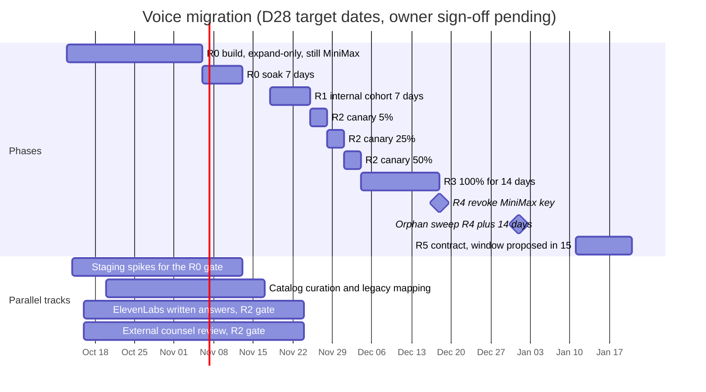

# Voice refactor: MiniMax → ElevenLabs

- **Status review:** 2026-10-14, America/Mexico_City.
- **Current product status: WIP.** Implemented ElevenLabs-only speech, native V2 voices and schema; Voice Studio/calls default to disabled in `.env.example` and are locally opted in. Source/config evidence does not certify deployment. Local provider smoke is recorded with optional moderation; required moderation and deployment acceptance remain open.

Read [00 — Current status and roadmap](00_current_status_and_roadmap.md) first. It distinguishes implemented code, local opt-in, dated test/provider evidence, release gaps and TBD decisions. [15 §§11–13](15_implementation_plan_and_acceptance.md#11-minimax-voice-purge-2026-10-14) preserve the purge, test-database migration and native-catalog/smoke history. [03 §5.16](03_target_architecture_and_decisions.md#516-r0-implementation-decisions-2026-10-12) records the later owner instructions.

## Scope and document precedence

This suite covers narration, calls, catalog, Studio/presets, root voice curation, billing and operational/policy dependencies. The 2026-10-12 MiniMax inventories, target design, cost model and R0–R5 schedules remain dated historical planning. The later I-68–I-73/native cutover supersedes cohorts, dual-provider routing, legacy maps/V1 readers, the ≥40-voice target and the original timeline. Current code routes speech to ElevenLabs; when unavailable it degrades to text. Theme songs and MiniMax LLM support are outside this speech refactor.

The owner/test-database migrations and paid provider smoke **have been recorded**, so the old statements that no migration/provider call occurred are no longer applicable. This documentation refresh itself made no runtime change or provider call.

**Workspace R1 alignment (2026-10-12).** After the research, Workspace R1 (personal app workspaces, collections, copy to workspace) was committed in both repositories (backend `f37eefd`, frontend `c7307c6`, content schema `2026_10_workspace_r1`). It is migrated only on the owner's dev database and is **not deployed to production**. The plan was re-read against those commits. The result is decision **D39** and the scope matrix in [03 §5.15](03_target_architecture_and_decisions.md), with the evidence in [research 15](research/15_workspace_r1_impact.md); documents 04–10, 13, 15 and 16 were updated to match. "Workspace" alone in these documents usually means the **ElevenLabs** account workspace. The app's own workspaces are called "app workspaces" or "Workspace R1".

**Related:**
- [03 Target architecture and decisions](03_target_architecture_and_decisions.md) is the decision record: later §5.16 owner instructions take precedence over the original D01–D39 plan. Use 00 for current status and 15 §§11–13 for dated implementation evidence.
- [15 Implementation plan and acceptance](15_implementation_plan_and_acceptance.md): the work breakdown and the owner sign-off checklist.
- [16 Risks and open questions](16_risks_and_open_questions.md): the risk register, every open question and the gate sign-offs.
- [research/](research/): the 16 evidence notes behind the decisions (§6.3).

**Conventions.** Decisions are cited as (D11), staging spikes as (S-3) and written confirmations from ElevenLabs as (L-2), all defined in [03 §3 and §6](03_target_architecture_and_decisions.md#3-decision-index). Prices, plan limits and model facts are **as of 2026-10-12**, at list price; the `eleven_v4` launch promo ended that day and is never used for sizing. Anything that depends on a spike or a legal answer is labelled that way.

---

## 1. Original executive summary (2026-10-12; superseded where noted)

The following records the original proposal, not current rollout status. Read 00 for the six-voice native catalog, removed cohorts/legacy maps and required-moderation gap. The original dates, staffing estimate, spike counts, vendor prices and sign-off list are retained as historical planning; they are not current commitments.

1. **End state.** ElevenLabs is the only speech provider. The BFF reaches it through provider-neutral seams (`SpeechSynthesisProvider`, `StreamingSpeechProvider`, `VoiceCatalogProvider`, a capability registry and a `VoiceResolver`). No MiniMax key, URL, literal or data shape remains in live code; legacy MiniMax rows stay readable. The SPA never names a provider and never calls ElevenLabs (D01, D03, D23; [03 §2.1](03_target_architecture_and_decisions.md#21-component-view-and-provider-neutral-seams)).
2. **Out of scope.** The fal-hosted `minimax/music-3` theme-song model shares no key, contract or data with MiniMax speech, so it stays. Eleven Music is a later option that needs legal review first (D01, D29).
3. **Plan and account.** ElevenLabs **Scale** (about $299/month as of 2026-10-12), held by a legal entity, plus a separate Creator or Pro staging workspace. Production uses one service account with six scoped, quota-capped, IP-allowlisted keys, one per surface (D02, D04). Launch to real users depends on ElevenLabs confirming in writing that the app is ordinary commercial use and not "Making Available" (**L-1, pending**).
4. **Narration.** Still one job per segment, on `POST /v1/text-to-speech`, so each character keeps its own voice. There are two tiers: **Standard** on `eleven_flash_v2_5` for everyone, and **Expressive** on `eleven_v4` (opt-in for Plus and Pro, at twice the credit weight, falling back to Standard). Text to Dialogue is not used for narration (D05). That `eleven_v4` works on this endpoint on our account is **pending S-2**.
5. **Calls.** One ElevenLabs multi-context TTS WebSocket per call on `eleven_flash_v2_5`; Groq Whisper stays for STT. Barge-in cancels by dropping frames by `context_id`, and the output format is `mp3_44100_64` over the existing MSE player (D06–D08). The target is first audio p50 ≤ 250 ms, moderation included, which is **pending S-8**. `eleven_v4_turbo` over the Text to Dialogue socket is a flagged upgrade (**S-18**). The Agents platform and Speech Engine are not adopted.
6. **Catalog.** Our own synced `voice_catalog` table is the source of truth; users never browse the provider (D10). At launch it holds owned designed and remixed voices. Curated Voice Library voices become public only after **L-2**. **Default (premade) voices are banned** because they expire on 2026-12-31. Every published voice must pass acceptance and be call-eligible, and **≥ 40 published voices with en/es coverage** are an R0 exit condition (D09, D19, D31).
7. **Voice identity.** One canonical object, `CharacterVoice` v2: `voice_key` indirection to the catalog, nested `settings`, no model id, and a neutral 7-value `emotion` enum. Presets move to the matching v2 schema (D11, D12; [03 §5.1](03_target_architecture_and_decisions.md#51-charactervoice-v2)).
8. **Voice Studio and picker.** The Studio, picker and presets are driven by the BFF: voices come from `GET /voices/catalog` and controls from `GET /voices/capabilities` (D13, D35). Speed is limited to 0.7–1.2. MiniMax pitch and volume are dropped, and affected voices get a one-time review notice (D15). Emotion becomes a server-emitted, allow-listed audio tag on v4 and a stability offset on Flash. Every `[…]` coming from the LLM or the user is stripped (D14, tag wording **pending S-6**). Catalog auditions are free; "hear my recipe" uses fixed texts and is metered by a new `voice_preview` op (D18).
9. **Root admin console.** It is redesigned around curation: a catalog manager with an impact view, an Acceptance runner, a Library browser, Design, Remix, IVC with a consent record, a synth lab, global presets, defaults and a limits widget. PVC is out. **Users never create provider voices** in this program (D20). MiniMax custom voices are retired (D22).
10. **Data migration is hybrid.** The system never rewrites frozen session snapshots; it translates them at read time through `voice_legacy_mapping`, keeping a cast's speakers distinct. Live cards, drafts, versions and presets are rewritten once at R5, with 100% coverage. From R1 users see the *effective* voice they actually hear, and can opt in to "use the card's current voice" per chat (D21, D32–D36).
11. **Billing.** Narration is billed by characters: Standard costs 1 credit per 400 characters and Expressive 1 per 200, reserved and rounded **once per turn** after the reuse check, with failed segments refunded at settlement. Daily caps are hard: 2,500, 8,000 and 20,000 characters for Free, Plus and Pro. Calls keep 1 credit per 10 s. This fixes today's "only segment 0 is metered, nothing is refunded" leak (D24, D37; [03 §5.9](03_target_architecture_and_decisions.md#59-membership-numbers-d18-d24-d37)).
12. **Cost.** At 10k MAU, base usage and list price, the recommended stack costs about **$9,111/month against $10,421 for MiniMax today (−13%)**. That excludes the moderation classifier, whose cost is unverified. At list price +25% it costs more than MiniMax. Narration is about 93% of ElevenLabs spend ([11 §0](11_cost_plans_and_operations.md), [research 14 §5.5, §9](research/14_cost_model.md)).
13. **Safety and privacy.** Voice launches under the existing no-NSFW policy. A **fail-closed** moderation gate checks every narration segment and call sentence before any ElevenLabs request; whether it is fast enough is **pending S-29**. A server-recorded 18+ and ToS attestation is enforced with HTTP 428 (or a WebSocket error frame). The training opt-out is on, a history-deletion sweep runs with a "< 48 h" SLO, and the consent version for ElevenLabs calls is `voice-v2`. ZRM is deferred to Enterprise (D25, D26).
14. **Rollout.** R0 prepare (2026-11-06) → R1 internal cohort (2026-11-18) → R2 canary 5/25/50% (2026-11-25 → 2026-12-04) → R3 100% (2026-12-04) → R4 MiniMax key revoked (2026-12-18) → R5 contract (January 2027). Switches live in the database, and the dual-provider window is ≤ 30 days. **After R4, rollback means text-only** (D28). The dates still need owner sign-off.
15. **Biggest risks** ([16 §0](16_risks_and_open_questions.md)):
    - ElevenLabs enforcement against mature roleplay text would hit the whole workspace (VEN-06).
    - Every existing user will hear a different voice (PRD-01).
    - R0 is about 265 engineer-days with zero slack on the critical path, so the dates hold only with about 14 engineers in parallel (ROL-05, [15 §1.5](15_implementation_plan_and_acceptance.md)).
    - ElevenLabs may read the app as "Making Available" (LGL-01).
    - After R4 there is no provider fallback (VEN-07, ROL-02).
16. **Needs owner sign-off before the R0 build.**
    - The 18 decisions marked "Needs owner sign-off" (§4). **D02 comes first, by about 2026-10-16**, because no ElevenLabs work can start without the account.
    - The D28 dates, or a re-dating under the [15 §1.5](15_implementation_plan_and_acceptance.md) rule.
    - The full checklist is [16 §5.2](16_risks_and_open_questions.md).
17. **Legal path.** One written request to ElevenLabs covers all L-items; it is proposed for 2026-10-19 ([13 §1.4](13_policy_privacy_and_compliance.md)).
    - **R0 exit** needs L-1 *sent* (with L-9), and L-3 answered or its safe default applied (own preview samples only).
    - **R2 entry** needs **L-1, L-4 and L-8 answered** and external counsel sign-off.
    - L-2 gates public Library voices only.
    - ElevenLabs gives no response-time commitment, so this is on the critical path.
18. **App workspaces (Workspace R1, D39).** Narration jobs, turn charges, session voice settings, refresh and calls belong to the session's app workspace. They need an active workspace for fresh work, and settlement and persistence still complete after an archive. The catalog, Studio, presets, attestation, preferences, caps, budget guards and cohort routing stay account-level. The voice migrations chain after `2026_10_workspace_r1`, so **Workspace R1 must reach production before R0's first schema step** (ROL-08, Q-33). They also never change the workspace capability value the SPA checks (TEC-13).
19. **What is still open.** All 29 staging spikes (S-1…S-29) and all 15 written confirmations (L-1…L-16; there is no L-11) are still open. 14 of the spikes are in the R0 exit gate (§5.2, §6.4).

---

## 2. Document index

| Doc | Purpose | Primary audience |
|---|---|---|
| [00 Current status and roadmap](00_current_status_and_roadmap.md) | Actual implementation, flags, evidence limits, release gaps and TBD roadmap | Everyone |
| [README](README.md) | This entry point: summary, index, reading paths, decisions at a glance, timeline, evidence status, glossary | Everyone |
| [01 Current state](01_current_state.md) | The "before" picture: the three MiniMax speech paths, the integration surface, the voice data model and where it is copied, billing today, 19 known bugs, what must disappear | Everyone new to the program; engineers |
| [02 ElevenLabs capabilities](02_elevenlabs_capabilities.md) | Capability reference: models, TTS HTTP and WebSocket APIs, expressiveness, voices, Scribe, Agents, other products, platform rules, the fit table and gotchas against MiniMax. It decides nothing | Architect, engineers, product |
| [03 Target architecture and decisions](03_target_architecture_and_decisions.md) | **Source of truth.** Target architecture, decisions D01–D39, canonical schemas and enums (§5), spikes, legal items and per-phase gates (§6), review log | Everyone; the owner signs it |
| [04 Voice catalog and Library](04_voice_catalog_and_library.md) | Sourcing policy, `voice_key` identity, catalog DDL, sync jobs A/B/C, previews and samples, lifecycle, defaults and fallbacks, acceptance protocol, user catalog API, readiness checklist | Backend, voice curator, product |
| [05 Voice Studio and admin console](05_voice_studio_and_admin_console.md) | User Voice Studio, presets v2, the voice picker, the root admin console redesign, MiniMax → ElevenLabs parameter mapping, preview UX, en/es copy, accessibility, screen acceptance | Frontend, product, voice curator |
| [06 Chat narration](06_chat_narration_migration.md) | One narrated turn end to end: segments, tiers, voice resolution, `SpeechTextPipeline`, reuse, per-turn billing, errors and retries, job lifecycle, `TurnNarration`, narration bug fixes | Backend (tts_generation), frontend (interaction) |
| [07 Realtime calls](07_realtime_calls_migration.md) | Multi-context WebSocket protocol, barge-in and persistence, output format and playback, call voice resolution, latency budget, STT, billing and consent, resilience | Backend (voice_orchestration), frontend (calls) |
| [08 Backend plan](08_backend_refactor_plan.md) | magic-worlds-api: package layout, file-by-file disposition, config and probes, DB migrations, routes and frames, pydantic changes, error mapping, observability, tests, sequencing | Backend |
| [09 Frontend plan](09_frontend_refactor_plan.md) | SPA: types, API layer, shared voice module and grep gate, feature-by-feature disposition, i18n, Storybook and tests, client-visible switches, PR breakdown | Frontend |
| [10 Data migration and rollout](10_data_migration_and_rollout.md) | Production inventory, legacy and reverse mapping, per-storage migration mechanics, R0–R5 phases, rollback, monitoring and alerts, user communication, cleanup, runbook checklists | Data owner, operator, backend |
| [11 Cost, plans and operations](11_cost_plans_and_operations.md) | Plan and accounts, cost model, app credit re-pricing, key topology and secrets, concurrency, budget guards, runbooks RB-1…RB-9, dashboards, vendor management | Ops, finance, billing owner, product owner |
| [12 Best practices and improvements](12_best_practices_and_improvements.md) | ElevenLabs best practices per surface, engineering practices, every known bug with its fix and where it lands (D30), opportunity backlog (D29), UX improvements, anti-patterns | Engineers, product |
| [13 Policy, privacy and compliance](13_policy_privacy_and_compliance.md) | Licensing, content policy, age gate and ToS, cloning consent, privacy, security, compliance checklist per gate, counsel tasks CN-1…CN-11 | Legal and privacy, external counsel, product owner |
| [14 Staging spike and contract tests](14_staging_spike_and_contract_tests.md) | Staging setup and safety rules, an exact test plan with pass/fail for S-1…S-29 (plus X-1…X-11), results template, permanent contract-test suite, listening-test protocol | QA, backend, voice curator |
| [15 Implementation plan and acceptance](15_implementation_plan_and_acceptance.md) | Work breakdown R0–R5 with task ids, critical path, acceptance criteria and SLOs, test plan, definition of done, owner sign-off checklist, first 10 PRs | Engineering leads, product owner |
| [16 Risks and open questions](16_risks_and_open_questions.md) | 53 risks, every open question (owner, L, CN, S, Q, PA), assumptions, sign-off checklist and record | Product owner, architect, all leads |
| [research/](research/) | The evidence base: 16 notes (00–15), see §6.3 | Anyone checking a claim |

---

## 3. Reading paths by role

Everyone starts with §1 of this README and [03 §1](03_target_architecture_and_decisions.md#1-executive-summary-the-end-state-after-minimax-is-removed) (one page each).

### 3.1 Product owner

1. [03 §3 decision index](03_target_architecture_and_decisions.md#3-decision-index), then the 18 "Needs owner sign-off" entries in [03 §4](03_target_architecture_and_decisions.md#4-decision-records). Start with D02, D05, D09, D24, D26 and D28.
2. [16 §0 and §3.2](16_risks_and_open_questions.md): top risks, what each pending decision needs and the default if unanswered.
3. [15 §1 and §7](15_implementation_plan_and_acceptance.md): phases, the capacity check that puts the dates at risk, and the sign-off checklist.
4. [11 §0 and §3](11_cost_plans_and_operations.md): plan, cost and membership re-pricing.
5. [05 §1 and §9](05_voice_studio_and_admin_console.md) and [10 §8](10_data_migration_and_rollout.md): what users will see and be told.
6. [13 §0](13_policy_privacy_and_compliance.md): the launch policy posture.

### 3.2 Backend engineer (magic-worlds-api)

1. [01 §2–§4](01_current_state.md): today's three paths and the voice data model.
2. [03 §2](03_target_architecture_and_decisions.md#2-target-architecture) and [§5](03_target_architecture_and_decisions.md#5-canonical-shared-definitions): target seams and canonical schemas. Copy these; do not reinvent them.
3. [08](08_backend_refactor_plan.md) in full, with [06](06_chat_narration_migration.md) (narration) and [07](07_realtime_calls_migration.md) (calls) for the two runtime paths.
4. [04 §5–§9 and §12](04_voice_catalog_and_library.md): catalog tables, sync jobs, lifecycle, defaults, user API.
5. [10 §3–§4](10_data_migration_and_rollout.md): mapping and migration mechanics.
6. [14 §2 and §4](14_staging_spike_and_contract_tests.md): the spikes your code depends on and the permanent contract tests.
7. Evidence: [research 06](research/06_backend_minimax_inventory.md), [08](research/08_voice_data_model_migration_surface.md), [12](research/12_gap_model_protocol_facts.md), [13](research/13_gap_codebase_checks.md).

### 3.3 Frontend engineer (this SPA)

1. [01 §1 and §4](01_current_state.md): features and the V1 voice object.
2. [03 §5.1](03_target_architecture_and_decisions.md#51-charactervoice-v2), [§5.10](03_target_architecture_and_decisions.md#510-voice-write-validation-and-resolver-matrix-d32) and [§5.12](03_target_architecture_and_decisions.md#512-user-catalog-api-effective-voice-badges-and-copy-d35): the TS shape, write rules, catalog DTO, badges and copy.
3. [09](09_frontend_refactor_plan.md) in full.
4. [05](05_voice_studio_and_admin_console.md): Studio, picker and console screens, copy and accessibility.
5. [06 §9](06_chat_narration_migration.md) (`TurnNarration`) and [07 §4](07_realtime_calls_migration.md) (call playback).
6. Evidence: [research 07](research/07_frontend_minimax_inventory.md). Before touching UI, read the project skills `ui-design-system`, `ui-components` and `ui-storybook`.

### 3.4 Ops and finance

1. [11](11_cost_plans_and_operations.md) in full: plan, cost model, keys, concurrency, budget guards, runbooks, dashboards.
2. [03 §5.4.3](03_target_architecture_and_decisions.md#54-enumerations) (keys and caps), [§5.9](03_target_architecture_and_decisions.md#59-membership-numbers-d18-d24-d37) (membership numbers) and [§5.13](03_target_architecture_and_decisions.md#513-budget-guards-d37) (budget guards).
3. [10 §5–§7 and §10](10_data_migration_and_rollout.md): phases, rollback, alerts and runbook checklists.
4. [16 §2.5 and §2.7](16_risks_and_open_questions.md): cost and rollout risks.
5. Evidence: [research 14](research/14_cost_model.md) and [research 05](research/05_elevenlabs_platform_pricing_limits_policy.md).

### 3.5 Legal and privacy

1. [13](13_policy_privacy_and_compliance.md) in full, including the counsel tasks CN-1…CN-11 and the per-gate compliance checklist.
2. [03 §6.2](03_target_architecture_and_decisions.md#62-pending-written-confirmations-elevenlabs-sales-or-legal-items-from-research10-9) (the L-items and their safe defaults) and [§6.3](03_target_architecture_and_decisions.md#63-per-phase-gates-replaces-s-1s-17-before-r1) (which answers block which gate).
3. [03 D02](03_target_architecture_and_decisions.md#d02-elevenlabs-plan-and-account), [D09](03_target_architecture_and_decisions.md#d09-catalog-sourcing-policy), [D20](03_target_architecture_and_decisions.md#d20-root-admin-console-scope-can-users-ever-create-voices), [D23](03_target_architecture_and_decisions.md#d23-legacy-minimax-assets-and-history-rows), [D25](03_target_architecture_and_decisions.md#d25-privacy-posture-consent-copy-and-version-bump) and [D26](03_target_architecture_and_decisions.md#d26-content-policy-and-age-gate).
4. [16 §2.6, §3.4 and §3.5](16_risks_and_open_questions.md): legal risks, L-items and CN tasks with deadlines.
5. Evidence: [research 10](research/10_gap_policy_licensing.md) and [research 05 §5–§6](research/05_elevenlabs_platform_pricing_limits_policy.md).

### 3.6 Also useful: QA and voice curator

- **QA:** [14](14_staging_spike_and_contract_tests.md) → [15 §4–§5](15_implementation_plan_and_acceptance.md) → [03 §6](03_target_architecture_and_decisions.md#6-assumptions-pending-staging-spike-and-written-confirmation).
- **Voice curator (root):** [04 §3, §8–§11, §14](04_voice_catalog_and_library.md) → [05 §8](05_voice_studio_and_admin_console.md) → [14 §5](14_staging_spike_and_contract_tests.md) (listening tests).

### 3.7 Current source orientation

Use the [current source map](00_current_status_and_roadmap.md#source-and-schema-authority): speech adapters are under `services/speech/providers/elevenlabs/`, call TTS under `call_tts_elevenlabs.py`, and narration under `tts_generation/` plus `speech/narration.py`. Historical MiniMax inventories [research 06](research/06_backend_minimax_inventory.md) and [research 07](research/07_frontend_minimax_inventory.md) identify the retired surface; links to removed adapters there are historical references.

---

## 4. Original decisions at a glance (2026-10-12)

The status values come from [03 §3](03_target_architecture_and_decisions.md#3-decision-index):
- **Recommended**: the architect's call, which stands unless someone objects at sign-off.
- **Owner sign-off**: a product, money or legal choice; the recommendation is the default.
- **Blocked on S-n**: the design is fixed, but a parameter depends on that spike.

Spikes and legal items named next to a status are the open dependencies.

| ID | Topic | Decision in one line | Status |
|---|---|---|---|
| [D01](03_target_architecture_and_decisions.md#d01-scope-of-remove-minimax) | Scope of "remove MiniMax" | Remove all MiniMax **speech** usage and `MINIMAX_*` config; fal `minimax/music-3` theme songs are out of scope | Owner sign-off |
| [D02](03_target_architecture_and_decisions.md#d02-elevenlabs-plan-and-account) | Plan and account | Scale held by a legal entity; Creator/Pro staging with user keys; written "ordinary use" confirmation before launch; Enterprise/ZRM talks at ~$3k/month or R3 | Owner sign-off; L-1…L-3, L-14; S-1 |
| [D03](03_target_architecture_and_decisions.md#d03-integration-style) | Integration style | Raw `httpx` + `websockets` adapters; the official SDK is a contract oracle, not a dependency | Recommended |
| [D04](03_target_architecture_and_decisions.md#d04-api-key-topology) | API key topology | One production service account; one scoped, capped, IP-allowlisted key per surface (narration, calls, preview, catalog, admin, ops) | Recommended; S-28 |
| [D05](03_target_architecture_and_decisions.md#d05-narration-architecture-and-models) | Narration | Per-segment `POST /v1/text-to-speech`; Standard = `eleven_flash_v2_5`, Expressive = `eleven_v4` (Plus/Pro opt-in), falling back to Standard; no Text to Dialogue | Owner sign-off; S-2, S-3 |
| [D06](03_target_architecture_and_decisions.md#d06-call-architecture-model-latency-target-and-voice-consistency) | Calls | Flash v2.5 on one multi-context WS per call; cancel = drop frames by `context_id`; ≤ 4 live contexts; truncated barge-in text; v4 Turbo on the TTD WS is a flagged upgrade | Owner sign-off; S-7, S-8, S-15, S-18 |
| [D07](03_target_architecture_and_decisions.md#d07-stt-and-dictation) | STT and dictation | Keep Groq Whisper for calls; Scribe v2 Realtime only after a spike; dictation is P1 | Recommended; S-19 |
| [D08](03_target_architecture_and_decisions.md#d08-call-output-format) | Call output format | `mp3_44100_64` over the existing MSE player; sample rate data-driven; PCM + AudioWorklet deferred | Recommended; S-9 |
| [D09](03_target_architecture_and_decisions.md#d09-catalog-sourcing-policy) | Catalog sourcing | Owned designed voices + curated Library voices (public after L-2) + root-only IVC; Default voices banned; ≥ 40 public voices with en/es; publish requires `call_eligible` | Owner sign-off; L-2; S-14, S-27 |
| [D10](03_target_architecture_and_decisions.md#d10-catalog-source-of-truth-and-preview-hosting) | Catalog source of truth, previews | Synced DB `voice_catalog` (Jobs A/B/C, mass-miss guard, optional webhook); own pre-rendered samples until L-3; never hotlinked | Recommended; S-11, S-12, S-13 |
| [D11](03_target_architecture_and_decisions.md#d11-voice-identity-model-charactervoice-v2) | Voice identity | `CharacterVoice` v2: `voice_key`, nested `settings`, no `model_id`, neutral `emotion` enum, `provider` + `schema_version` | Recommended |
| [D12](03_target_architecture_and_decisions.md#d12-preset-v2-schema) | Preset v2 | `voice_preset` gains `schema_version`, `provider`, `voice_key`, `settings`, `language_code`; legacy columns nullable, then dropped; root-only global presets | Recommended |
| [D13](03_target_architecture_and_decisions.md#d13-per-model-capability-handling-and-speed-range) | Capability handling | Capability registry + `GET /voices/capabilities`; reject out-of-range at write, strip unsupported at request; speed 0.7–1.2 | Blocked on S-3 |
| [D14](03_target_architecture_and_decisions.md#d14-emotion--audio-tag-mapping-tag-allow-list-and-bracket-sanitizer) | Emotion tags, sanitizer | One emotion → tag table; tags emitted only by the server; every other `[…]` stripped; OOC dropped | Blocked on S-6 |
| [D15](03_target_architecture_and_decisions.md#d15-pitch-and-volume-migration-policy) | Pitch and volume | Dropped; outliers flagged in `voice_review_flag` with a one-time, dismissible notice; originals kept in the audit | Owner sign-off |
| [D16](03_target_architecture_and_decisions.md#d16-thought-delivery-and-loudness-normalisation) | Thoughts and loudness | Character's own voice; `[whispers]` on Expressive; −3 dB client gain; per-voice attenuation-only `gain_db` | Recommended; S-16 |
| [D17](03_target_architecture_and_decisions.md#d17-language_code-policy) | `language_code` | Turn language → voice language → user preferred language → omit; per-model allow-list; part of the reuse hash | Recommended; S-4 |
| [D18](03_target_architecture_and_decisions.md#d18-preview-policy) | Previews | Catalog auditions free (own samples); recipe preview = fixed texts, shared cache, new `voice_preview` op (3 free a day, then 1 credit; up to 3/10/20) | Owner sign-off |
| [D19](03_target_architecture_and_decisions.md#d19-library-voice-lifecycle) | Library lifecycle | Always add, store both ids, track references, soft retire (`status=hidden`), never delete referenced or Library copies, replacement per published voice | Recommended; S-11, S-12 |
| [D20](03_target_architecture_and_decisions.md#d20-root-admin-console-scope-can-users-ever-create-voices) | Root console; user voices | Console = catalog manager, acceptance, Library, Design, Remix, IVC + consent, synth lab, global presets, defaults, limits; no PVC; users never create provider voices | Owner sign-off |
| [D21](03_target_architecture_and_decisions.md#d21-snapshot-migration-strategy-and-unmapped-voices) | Snapshot migration | Read-time translation of frozen snapshots; one-shot rewrite of live documents at R5 (100% coverage, unmapped → language default + flag); MiniMax picker restricted from R0; reverse mapping | Recommended |
| [D22](03_target_architecture_and_decisions.md#d22-fate-of-minimax-custom-voices-and-global-presets) | MiniMax custom voices, global presets | Retire custom voices; re-create only with operator audio and fresh consent; re-seed curated ElevenLabs global presets | Owner sign-off |
| [D23](03_target_architecture_and_decisions.md#d23-legacy-minimax-assets-and-history-rows) | Legacy assets and rows | Keep referenced MP3s and rows readable (widened validators); reviewed orphan sweep; markers stripped at display | Owner sign-off (MiniMax retention terms) |
| [D24](03_target_architecture_and_decisions.md#d24-billing-unit-and-membership-re-pricing) | Billing | Character-based credits; reuse first, one reservation per turn; refunds at settlement; hard per-turn and daily caps; per-plan call minutes | Owner sign-off |
| [D25](03_target_architecture_and_decisions.md#d25-privacy-posture-consent-copy-and-version-bump) | Privacy and consent | No ZRM at launch; training opt-out; history-deletion sweep with lag SLO; copy names both providers during the window; consent `voice-v2`; counsel signs off | Owner sign-off |
| [D26](03_target_architecture_and_decisions.md#d26-content-policy-and-age-gate) | Content policy, age gate | No-NSFW voice; fail-closed pre-TTS moderation; `user_attestation` (18+, ToS) enforced with 428 / WS frame; minor-report path; abuse thresholds | Owner sign-off |
| [D27](03_target_architecture_and_decisions.md#d27-callbot-pause-and-markup-conventions-sanitizer-changes) | Markup and sanitizer | Keep neutral markup v1 in stored text and translate per model after validation; interjections off on Flash; numbers normalized upstream | Recommended; S-5, S-26 |
| [D28](03_target_architecture_and_decisions.md#d28-rollout) | Rollout | R0 → R1 (2026-11-18) → R2 canary 5/25/50% → R3 100% → R4 key revocation → R5 contract; ≤ 30-day dual window; DB-backed switches; no build rollback below R0 after R1 | Owner sign-off (dates) |
| [D29](03_target_architecture_and_decisions.md#d29-new-elevenlabs-features-and-timing) | New features | P0 ops hygiene only; P1 pronunciation dictionaries, dictation, audio export; P2 SFX, word highlight, audiobook, Eleven Music (legal-gated); P3 Studio API | Owner sign-off |
| [D30](03_target_architecture_and_decisions.md#d30-known-bugs-fixed-in-the-migration-vs-separately) | Known bugs | Fix #1, #3, #5, #6, #7, #8, #10, #11, #12, #16, #17 and the listed extras in the migration; #2, #4, #9 (except the orphan sweep), #13–#15, #18, #19 separately | Recommended |
| [D31](03_target_architecture_and_decisions.md#d31-default-and-fallback-voices-voiceless-characters) | Default and fallback voices | `voice_default` rows per (role, language); `VOICE_LAST_RESORT_VOICE_KEY` is the only env value; voiceless characters share the narrator default | Owner sign-off (voiceless rule) |
| [D32](03_target_architecture_and_decisions.md#d32-voice-write-validation-and-resolver-behaviour) | Write validation, resolver | Shape-only checks for unchanged voices; eligibility and plan checks only when a voice is set or changed; `plan_gated` limits picking, never hearing | Recommended |
| [D33](03_target_architecture_and_decisions.md#d33-cast-distinct-voice-rule) | Cast distinct voices | Speakers with different stored voices never resolve to the same provider voice in one session; deterministic alternates | Recommended |
| [D34](03_target_architecture_and_decisions.md#d34-language-scope-beyond-english-and-spanish) | Languages beyond en/es | Curated en/es launch catalog; other languages via multilingual voices with light acceptance; an untested language is allowed with a badge, never substituted | Owner sign-off |
| [D35](03_target_architecture_and_decisions.md#d35-user-facing-catalog-contract-effective-voice-badges-and-copy) | Catalog contract, effective voice | Canonical catalog DTO, filters, batch lookup; effective-voice projection from R1; en/es badge and copy inventory; shared FE helpers | Recommended |
| [D36](03_target_architecture_and_decisions.md#d36-user-initiated-voice-refresh-for-existing-chats-and-adventures) | Voice refresh in existing chats | "Use the card's current voice" per chat and per adventure cast entry; writes only voice paths as V2; substitutions surfaced | Recommended |
| [D37](03_target_architecture_and_decisions.md#d37-budget-guards-exposure-and-abuse-controls) | Budget guards, abuse | App-side global spend circuit, per-user token buckets, daily reconciliation; caps hard for PAYG; Free voice needs a verified, attested account | Owner sign-off; S-28 |
| [D38](03_target_architecture_and_decisions.md#d38-persona-card-voices) | Persona cards | Picker hidden for persona cards; stored values kept and mapped silently; excluded from badges and coverage gates | Recommended |
| [D39](03_target_architecture_and_decisions.md#d39-workspace-scope-of-voice-surfaces) | App workspace scope (Workspace R1) | Content-bound voice work inherits the session's app workspace and needs it active for fresh work; catalog, Studio, presets, attestation, caps and routing stay account-level; migrations chain after `2026_10_workspace_r1` without changing the workspace capability; copies are shape-only (03 §5.15) | Recommended |

**Tally:** 18 need owner sign-off (D01, D02, D05, D06, D09, D15, D18, D20, D22–D26, D28, D29, D31, D34, D37), 19 are Recommended, and 2 are blocked on a spike (D13, D14). How the contradictions C1–C18 and the research owner decisions 1–23 map to these is in [03 §3.1–§3.2](03_target_architecture_and_decisions.md#31-contradictions-c1c18-where-each-is-resolved).

---

## 5. Original phase timeline and gates (superseded rollout)

Cohort/dual-provider milestones below were waived by the later owner instructions. Current remaining acceptance work is in 00; dates are TBD.

### 5.1 Timeline

These are the D28 target dates, and the owner has not signed them yet. The R0 split into four sub-releases and the R5 window are proposals from [15 §1.3–§1.4](15_implementation_plan_and_acceptance.md).

### 5.2 Phases and gates

This is a summary. The binding gate table is [03 §6.3](03_target_architecture_and_decisions.md#63-per-phase-gates-replaces-s-1s-17-before-r1), the runbooks are in [10 §10](10_data_migration_and_rollout.md) and the sign-off steps are in [16 §5.3](16_risks_and_open_questions.md).

| Phase | Target | What happens | Gate to pass |
|---|---|---|---|
| **Before the R0 build** | about 2026-10-16 | Owner signs the pending decisions; D02 executed (Scale contracted); L-request drafted; counsel briefed. Workspace R1 scheduled for production before R0's first schema step (Q-33) | [16 §5.2](16_risks_and_open_questions.md) checklist |
| **R0 Prepare** (still MiniMax) | 2026-11-06, plus a 7-day soak | Expand-only releases: - V1/V2 readers and the validator widening; - capability registry, `SpeechTextPipeline` with moderation, attestation; - per-turn billing and `voice_preview`; - catalog tables, Jobs A/B/C, Acceptance module, `voice_default`; - restricted MiniMax picker, `ProviderRouter` at `rollout_mode=off`, budget guards. | **R0 exit**, before any real user text reaches ElevenLabs: - spikes S-1…S-6, S-11, S-13, S-14, S-16, S-20, S-27, S-28, S-29; - L-1 sent with L-9; L-3 answered or its safe default applied; - training opt-out screenshots; dashboard seats recorded; - ≥ 40 published voices; `voice_default` rows; - legacy and reverse mapping at 100%; probes green. |
| **R1 Internal** | 2026-11-18, for 7 days | Root and admin users plus an allow-list; `voice-v2` consent; effective voice and first-exposure notice; reverse mapping live | **R1 exit:** - S-7, S-9, S-10, S-15, S-17, S-23, S-25; - 7 days within the rollback thresholds; - coverage re-run green. |
| **R2 Canary** | 2026-11-25 → 2026-12-04 | `hash(user_hash) % 100 < canary_percent` at 5 → 25 → 50%, at least 3 days per step | **R2 entry**, before any non-staff user text reaches ElevenLabs: - S-8 measured in the production region; S-21; - **L-1, L-4, L-8 answered**; counsel sign-off; - ToS, click-wrap, attestation and 428 live; privacy copy for all users; - budget guards live; history sweep within its SLO. |
| **R3 100%** | 2026-12-04, for 14 days | All users on ElevenLabs; MiniMax global presets hidden (reversible) | **R3 entry:** every canary step within thresholds; coverage green; PAYG cap re-sized from telemetry |
| **R4 Revoke** | 2026-12-18 | Revoke `MINIMAX_AUDIO_API_KEY`; delete MiniMax runtime paths; remove MiniMax from the copy. **From here, rollback means text-only** | 14 days at R3 with no rollback |
| **Orphan sweep** | 2027-01-01 | Reviewed sweep of unreferenced MiniMax assets (D23) | CN-6 answered |
| **R5 Contract** | January 2027 | One-shot rewrite of live cards, drafts, versions and presets; V1 accepted on writes only when unchanged; legacy preset columns dropped | `--check` reports 0 V1 presets |

Feature gates are independent of the phases:
- **Public Library voices:** L-2 (plus L-12 for perpetual voices and L-16 for remixes), with S-11 and S-12.
- **Optional features:** v4 Turbo calls (S-18), Scribe (S-19), `<break>` on the WebSocket (S-26), the webhook (S-12), and IVC (S-22, plus L-13 for a third-party speaker).

**Rollback.** While the MiniMax key is live, the cohort is routed back to MiniMax if any [D28 trigger](03_target_architecture_and_decisions.md#d28-rollout) fires over 1 h, for example:
- narration `tts_failed` above 2%;
- call first-audio p50 above 400 ms;
- `moderation_unavailable` above 1%;
- any key disable or enforcement email.

The kill switches `tts_engine_enabled`, `voice_mode_enabled` and `rollout_mode=off` are database rows, so rollback needs no restart.

**Schedule risk.** R0 is about 265 engineer-days, and the serial chain (seams → adapter → catalog sync → console → acceptance → mapping → soak) has zero slack against these dates. [15 §1.5](15_implementation_plan_and_acceptance.md) gives a re-dating rule that keeps every relative duration and moves only the anchor date. It also proposes no canary or 100% switch between 2026-12-22 and 2027-01-04.

---

## 6. What is verified and what is pending

### 6.1 How the research was done

```mermaid
flowchart LR
    A["00 Baseline review<br/>MiniMax stack + 19 bugs<br/>(second-pass re-checks)"] --> B["01–08 Parallel research<br/>5 ElevenLabs topics<br/>3 code inventories"]
    B --> C["Adversarial fact-check<br/>re-fetch official pages,<br/>try to refute each claim<br/>(verification logs)"]
    C --> D["09 Completeness critic<br/>gaps G1–G17, contradictions C1–C18,<br/>owner decisions 1–23"]
    D --> E["10–14 Gap closure<br/>policy, catalog API, protocol facts,<br/>codebase checks, cost model"]
    E --> F["03 Decision record<br/>D01–D39, §5 canon, §6 spikes/legal"]
    F --> G["3 adversarial reviews<br/>product · engineering · cost/legal/privacy<br/>(Review log)"]
    G --> H["Plan docs 01–02, 04–16<br/>derived from 03"]
    H --> I["README"]
```

1. **Baseline.** [Research 00](research/00_current_tts_review.md) reviewed the current MiniMax stack in both repositories, read-only. Findings were re-checked in the source by a second pass.
2. **Multi-agent research.** Notes [01](research/01_elevenlabs_tts_models_and_api.md)–[05](research/05_elevenlabs_platform_pricing_limits_policy.md) covered ElevenLabs: models and API, streaming and realtime, voices, other products, platform and policy. Notes [06](research/06_backend_minimax_inventory.md)–[08](research/08_voice_data_model_migration_surface.md) inventoried the code: backend, frontend, and the voice data model and migration surface. The code was read at backend HEAD `f77e60f` and frontend HEAD `f0f5769`, both with uncommitted changes. External claims carry `[verified: url]` only when they were read on an official ElevenLabs page (docs, API reference, help center, pricing, legal, changelog, official SDK or GitHub) on 2026-10-12. Otherwise they are tagged `[secondary: url]` or `[unverified]`.
3. **Adversarial fact-check.** Each note then had a pass whose aim was to *refute* its load-bearing claims. For the ElevenLabs notes this meant re-fetching the live official pages; for the inventories, re-reading both working trees. Examples: 38 claims re-tested in research 01 and 36 in research 04. Corrections were made in place, and each note ends with a verification log.
4. **Critic.** [Research 09](research/09_research_critic_gaps.md) read notes 00–08 and listed 17 gaps (G1–G17), 18 contradictions (C1–C18) and 23 owner decisions.
5. **Gap closure.** Notes [10](research/10_gap_policy_licensing.md)–[14](research/14_cost_model.md) closed the gaps, or narrowed each one to a named staging test. Note 12 also defined the contract tests CT-01…CT-20.
6. **Workspace R1 re-read.** After Workspace R1 was committed, [research 15](research/15_workspace_r1_impact.md) re-read every speech and voice path at backend `f37eefd` and frontend `c7307c6`. It records the schema scope, admission intents, capability coupling, migration chain, frontend gaps and line drift. Line numbers in notes 00–14 refer to the older commits; re-read them before the change they support.
7. **Decision record.** [03](03_target_architecture_and_decisions.md) resolved every contradiction and owner question. It was then attacked by three adversarial reviews (product and catalog; engineering feasibility and rollout safety; cost, licensing, privacy and policy), and every finding was dispositioned in its Review log.
8. **Plan documents** 01–02 and 04–16 were derived from 03. They copy its canonical definitions verbatim, and any amendments they propose are collected in [16 §3.8](16_risks_and_open_questions.md) (PA-1…PA-21). None of those take effect until 03 is edited.

The whole process stayed read-only: no API key was used, no paid API was called, no database was queried and no code was changed.

### 6.2 Evidence levels

| Kind of fact | Status as of 2026-10-12 | Still pending |
|---|---|---|
| Codebase facts (paths, literals, validators, DDL) | Read in both working trees; cited with absolute paths and line numbers | Line drift; production row counts (Q-01, read-only inventory in [10 §2](10_data_migration_and_rollout.md)) |
| ElevenLabs documented behaviour (models, endpoints, settings, prices, plans) | `[verified]` against live official pages; list prices only | Behaviour **on our account** (S-1…S-29); third-party observations are "expected (unconfirmed)" in [14](14_staging_spike_and_contract_tests.md) |
| Licensing, policy and terms | Official terms read (ToS, PUP, VLA, OEM terms, Music Terms); readings are engineering interpretations, not legal advice | Written confirmations L-1…L-16; counsel tasks CN-1…CN-11 |
| Cost | Modelled at 1k, 10k and 50k MAU from list prices ([research 14](research/14_cost_model.md)) | Real usage drivers; moderation classifier cost `[unverified]`; per-key cap semantics (S-28) |
| Product choices | Recommended by 03 | 18 owner sign-offs |

### 6.3 Research notes index

| Note | One line |
|---|---|
| [00 Current TTS review](research/00_current_tts_review.md) | MiniMax baseline across both repos and the known bugs #1–#19 plus a "Lower" list |
| [01 TTS models and API](research/01_elevenlabs_tts_models_and_api.md) | Model lineup, limits, prices, `voice_settings`, output formats, audio tags, pauses, pronunciation, language, errors; MiniMax → ElevenLabs parameter mapping |
| [02 Streaming, dialogue, realtime, agents](research/02_elevenlabs_streaming_dialogue_realtime_agents.md) | HTTP streaming, the TTS and multi-context WebSockets, Text to Dialogue, Scribe realtime, the Agents platform and Speech Engine, against our two paths |
| [03 Voices, catalog, cloning, design](research/03_elevenlabs_voices_catalog_cloning_design.md) | Voice types, listing and search APIs, Voice Library, IVC/PVC, Design, Remix, previews, safety rules; a first catalog design |
| [04 Other products](research/04_elevenlabs_other_products.md) | Studio, SFX, Eleven Music (against fal theme songs), Scribe batch, Voice Changer, Dubbing, history, usage and subscription endpoints |
| [05 Platform, pricing, limits, policy](research/05_elevenlabs_platform_pricing_limits_policy.md) | Plans and billing, concurrency and 429s, keys and service accounts, data handling (ZRM, history, training), policy, SDKs, reliability |
| [06 Backend MiniMax inventory](research/06_backend_minimax_inventory.md) | Every MiniMax touchpoint in magic-worlds-api, with the semantics that break if only the client is swapped, and a removal checklist |
| [07 Frontend MiniMax inventory](research/07_frontend_minimax_inventory.md) | Every MiniMax and voice touchpoint in the SPA, each with an action: delete, rewrite, rename neutral or keep |
| [08 Voice data model and migration surface](research/08_voice_data_model_migration_surface.md) | Every place a voice object is persisted, copied, hashed or validated; live vs frozen copies; migration traps |
| [09 Research critic](research/09_research_critic_gaps.md) | Completeness critic of 00–08: gaps G1–G17, contradictions C1–C18, owner decisions 1–23 |
| [10 Policy and licensing](research/10_gap_policy_licensing.md) | Library licensing for a B2C app, OEM "Making Available", content policy, age rules, cloning consent; the drafts for the L-request |
| [11 Catalog API semantics](research/11_gap_catalog_api_semantics.md) | Default-voice expiry, Library add and notice-period semantics, previews, disappearing voices, webhooks; test scripts T1–T13 |
| [12 Model and protocol facts](research/12_gap_model_protocol_facts.md) | Endpoint × model matrix, per-model settings behaviour, language handling, WebSocket protocol facts, contract tests CT-01…CT-20 |
| [13 Codebase checks](research/13_gap_codebase_checks.md) | Age gate, clone audio, presets, membership ops, ingress, loudness, canary mechanics, language, brackets: what exists and where new behaviour hooks in |
| [14 Cost model](research/14_cost_model.md) | One monthly cost model (narration, calls, previews, console) for MiniMax vs ElevenLabs options at 1k, 10k and 50k MAU; plan fit; re-pricing |
| [15 Workspace R1 impact](research/15_workspace_r1_impact.md) | Workspace R1 against every voice path: what is workspace-scoped, admission intents for narration and calls, account-level surfaces, copies, account wipe, migration chain and capability coupling, frontend gaps, line drift |

### 6.4 Original open-item inventory (2026-10-12)

These counts are the original review inventory, not a current open-count claim. Native cutover, local smoke and owner dispositions in 15 §§11–13 supersede some items. Track current remaining work in 00.

| Kind | Count | Defined in | Procedure or tracking |
|---|---|---|---|
| Staging spikes S-1…S-29 | 29: 14 in the R0 exit gate, 8 in the R1 exit gate (including S-24), 2 at R2 entry, the rest feature-gated or tied to Library voices | [03 §6.1](03_target_architecture_and_decisions.md#61-staging-spike-paid-staging-workspace-synthetic-policy-safe-text-only) | [14 §2](14_staging_spike_and_contract_tests.md); estimated spend under $10, synthetic policy-safe text only |
| Extra unverified items X-1…X-11 | 11 | [14 Scope](14_staging_spike_and_contract_tests.md) | [14 §2](14_staging_spike_and_contract_tests.md) |
| Written confirmations from ElevenLabs L-1…L-16 | 15 (there is no L-11; it was folded into L-3) | [03 §6.2](03_target_architecture_and_decisions.md#62-pending-written-confirmations-elevenlabs-sales-or-legal-items-from-research10-9) | [13 §1.4](13_policy_privacy_and_compliance.md), [16 §3.4](16_risks_and_open_questions.md) |
| External counsel tasks CN-1…CN-11 | 11 | [13 §1.5](13_policy_privacy_and_compliance.md) | [16 §3.5](16_risks_and_open_questions.md) |
| Owner decisions | 18 | [03 §3](03_target_architecture_and_decisions.md#3-decision-index) | [16 §3.2](16_risks_and_open_questions.md), [15 §7](15_implementation_plan_and_acceptance.md) |
| Engineering, data and ops questions Q-01…Q-35 | 35 | [16 §3.7](16_risks_and_open_questions.md) | [16 §5.3](16_risks_and_open_questions.md) gate sign-offs |
| Proposed amendments to 03 PA-1…PA-21 | 21 (PA-21, the Workspace R1 alignment, already applied) | [16 §3.8](16_risks_and_open_questions.md) | Architect accepts or rejects each before the R0 build |
| Risks | 53 (3 Critical, 19 High, 23 Medium, 8 Low) | [16 §2](16_risks_and_open_questions.md) | Weekly review until R5 |

---

## 7. Glossary

### 7.1 Identifiers

| Prefix | Meaning | Defined in |
|---|---|---|
| D01…D39 | Decisions | [03 §4](03_target_architecture_and_decisions.md#4-decision-records) |
| S-1…S-29 | Staging spikes: assumptions to test on a paid staging workspace | [03 §6.1](03_target_architecture_and_decisions.md#61-staging-spike-paid-staging-workspace-synthetic-policy-safe-text-only), [14](14_staging_spike_and_contract_tests.md) |
| L-1…L-16 | Written confirmations requested from ElevenLabs sales or legal | [03 §6.2](03_target_architecture_and_decisions.md#62-pending-written-confirmations-elevenlabs-sales-or-legal-items-from-research10-9) |
| CN-n | Tasks for external counsel | [13 §1.5](13_policy_privacy_and_compliance.md) |
| CT-01…CT-20 | Contract tests | [research 12 §13](research/12_gap_model_protocol_facts.md), [14 §4](14_staging_spike_and_contract_tests.md) |
| T1…T13 | Catalog test scripts | [research 11 §9](research/11_gap_catalog_api_semantics.md) |
| X-n, Q-n, PA-n | Extra unverified items; engineering questions; proposed amendments to 03 | [14](14_staging_spike_and_contract_tests.md), [16 §3.7–§3.8](16_risks_and_open_questions.md) |
| VEN-, TEC-, PRD-, CST-, LGL-, ROL- | Risks by category: vendor, technical, product, cost, legal and privacy, rollout | [16 §2](16_risks_and_open_questions.md) |
| RB-1…RB-9 | Operations runbooks | [11 §7](11_cost_plans_and_operations.md) |
| G1–G17, C1–C18 | Research gaps and contradictions | [research 09](research/09_research_critic_gaps.md), [03 §3.1](03_target_architecture_and_decisions.md#31-contradictions-c1c18-where-each-is-resolved) |
| #1…#19 | Known bugs in the MiniMax baseline | [research 00 §3](research/00_current_tts_review.md), [12 §4](12_best_practices_and_improvements.md) |
| R0…R5 | Rollout phases: prepare, internal, canary, 100%, revoke, contract | D28 |

### 7.2 Terms

| Term | Meaning |
|---|---|
| **BFF** | `magic-worlds-api`, the only backend the SPA calls. It owns every provider call and key. |
| **App workspace (Workspace R1)** | A user's personal workspace in magic-worlds that holds cards, sessions and media. Private routes select it with `X-Workspace-Id` (sockets: `?workspace_id=`); an archived one is read-only. Not the ElevenLabs workspace (D39, [03 §5.15](03_target_architecture_and_decisions.md)). |
| **Standard tier** | Narration on `eleven_flash_v2_5`, available on every plan; 1 credit per 400 characters (D05, D24). |
| **Expressive tier** | Narration on `eleven_v4` with audio tags, opt-in for Plus and Pro; 1 credit per 200 characters; falls back to Standard (D05). |
| **Flash v2.5, v4, v4 Turbo** | `eleven_flash_v2_5`: low-latency model used for Standard narration and calls ($0.04/1K characters). `eleven_v4`: expressive model; it cannot use the TTS WebSockets, so it is used over HTTP ($0.08/1K). `eleven_v4_turbo`: faster v4, a flagged call upgrade via the Text to Dialogue socket ($0.04/1K). All prices as of 2026-10-12. |
| **Surface** | Where speech is produced: `narration`, `call`, `preview` or `admin_lab`. With the tier, it selects a `ModelProfile` ([03 §5.4.1](03_target_architecture_and_decisions.md#54-enumerations)). |
| **Capability registry / `ModelProfile`** | Server table that maps (surface, tier) to model, transport, allowed settings and ranges, tag and SSML support, language allow-list, limits and output format. Exposed to the SPA as `GET /voices/capabilities` (D13, [03 §5.6](03_target_architecture_and_decisions.md#56-capability-matrix-used-by-the-resolver)). |
| **`CharacterVoice` v1 / v2** | v1 is today's MiniMax-shaped recipe (`voice_id`, `speed`, `vol`, `pitch`, `emotion`, `language_boost`…). v2 is the canonical provider-neutral object with `schema_version: 2` (D11, [03 §5.1](03_target_architecture_and_decisions.md#51-charactervoice-v2)). |
| **`voice_key`** | Opaque, stable key of a `voice_catalog` row. Stored voices reference it; provider voice ids live only in the catalog, so a re-add or replacement changes one row (D11). |
| **`voice_catalog`** | Our synced MySQL catalog of every voice we may use, with source, status, visibility, languages, acceptance results, `gain_db` and replacement. Users browse only this (D10, [03 §5.2](03_target_architecture_and_decisions.md#52-voice_catalog-and-related-tables-ddl-sketch)). |
| **Jobs A/B/C** | Catalog sync jobs: A = nightly inventory, B = health (daily, on webhook, on runtime 404/403), C = hourly subscription limits (D10). |
| **Acceptance protocol** | Fixed-script renders of a voice on Flash and v4 per language, a listening rubric and a loudness measurement, run in the console's Acceptance module before a voice is published, mapped or made a default ([04 §10](04_voice_catalog_and_library.md), [14 §5](14_staging_spike_and_contract_tests.md)). |
| **`call_eligible`** | Catalog flag: the voice passed acceptance on the call model. Publishing requires it (D06, D09). |
| **`voice_default`** | Catalog rows that give the default narrator and character-fallback voice per language. They replace the `TTS_DEFAULT_VOICE_ID` env value (D31, [03 §5.11](03_target_architecture_and_decisions.md#511-default-and-fallback-voices-d31)). |
| **`voice_legacy_mapping` / reverse mapping** | MiniMax voice id → `voice_key` with ordered alternates, used to translate legacy voices at read time (D21, D33). The reverse (`voice_legacy_fallback`, `voice_key` → MiniMax id) lets non-cohort users and rollbacks play V2 voices during R1–R4. |
| **Effective voice** | The resolver's projection of the voice a user actually hears, after mapping, substitution and defaults. The SPA shows it from R1 (D35). |
| **Frozen snapshot** | A voice copied by value into session or execution records (for example `template_snapshot`). Never rewritten by the system; translated at read time (D21). |
| **Markup v1** | "App speech markup v1": the `<#x#>` pause and the interjections `(laughs) (sighs) (gasps) (inhale) (exhale) (humming)`. The only markup allowed in stored text, translated per model at the provider edge (D27). |
| **Audio tags / tag allow-list** | Bracketed delivery cues such as `[whispers]` that v3/v4 models act on. Only the server emits them, from the [03 §5.5](03_target_architecture_and_decisions.md#55-emotion--audio-tag-mapping-tag-allow-list-and-sanitizer) allow-list; every other `[…]` is stripped (D14). |
| **`SpeechTextPipeline`** | The shared text path for narration, calls and previews: sanitize → moderate (fail-closed) → translate markup for the model (D14, D26, D27). |
| **Fail-closed moderation** | Every narration segment and call sentence is classified synchronously before any ElevenLabs request. A block or a classifier timeout means the text is not sent and nothing is charged (D26; speed pending S-29). |
| **`user_attestation` / HTTP 428** | Server-recorded 18+ and ToS acceptance. Voice requests without it get 428 (Precondition Required) or the matching WebSocket error frame (D26). |
| **Multi-context WebSocket** | ElevenLabs TTS socket that carries several independent generation contexts, each with a `context_id`. Calls open one per call and use one context per turn (`t_<turn>`), at most 4 live (D06). |
| **`flush` / `close_context`** | `flush` forces generation of buffered text. `close_context` frees a context slot but does **not** cancel text already flushed; the cancel is dropping that context's frames (D06, C8). |
| **Barge-in** | The user speaks over the character. The BFF drops the turn's frames, truncates the stored text at the last sentence whose audio started before `played_ms`, and bills delivered audio only (D06). |
| **TTD** | Text to Dialogue: ElevenLabs' multi-speaker endpoint and socket. Not used for narration (D05); its socket is the `eleven_v4_turbo` call upgrade path (S-18). |
| **Voice Library** | ElevenLabs' marketplace of community-shared voices. We always add a voice to our account before use and store both ids (D19). Public use is pending L-2. |
| **Default (premade) voices** | ElevenLabs' stock voices. They expire on 2026-12-31, so they are banned everywhere (D09). |
| **Notice period** | How long accounts that added a Library voice keep access after its owner withdraws it (owners can lengthen it, never shorten it). D09 requires at least 365 days. A 4015-day period counts as "perpetual" (`library_perpetual`) ([research 11](research/11_gap_catalog_api_semantics.md)). |
| **IVC / PVC** | Instant Voice Clone (from a short sample) and Professional Voice Clone (trained on longer audio). IVC is root-only and needs a consent record; PVC creation is out of scope (D20). |
| **Voice Design / Remix** | Design creates a new voice from a text description. Remix derives a new voice from an existing one: owned voices are allowed, Library voices only after L-2, L-12 and L-16 (D09, D20). |
| **Making Available** | OEM-terms concept: offering ElevenLabs services to third parties. Self-serve plans up to Pro are barred from it. We read the app as ordinary use ("Reading A"), pending written confirmation (L-1). |
| **PUP / VLA / OEM terms** | ElevenLabs' Prohibited Use Policy, Voice Library Addendum and OEM Terms ([research 10](research/10_gap_policy_licensing.md)). |
| **Scale plan** | The lowest ElevenLabs tier that counts as a "Business Entity" under the OEM terms and has service accounts; the chosen production plan (D02). |
| **Service account / scoped key** | A non-human workspace member that owns API keys. Each key is limited to the scopes and a `character_limit` for its surface ([03 §5.4.3](03_target_architecture_and_decisions.md#54-enumerations)); what a 0 or empty limit means is pending S-28. |
| **ZRM** | Zero Retention Mode (`enable_logging=false`): ElevenLabs keeps no request history. Enterprise-only, so deferred; a history-deletion sweep is used instead (D25). |
| **History sweep** | Scheduled deletion of ElevenLabs speech-history items, with the SLO "oldest undeleted item < 48 h" (D25; throughput pending S-23). |
| **Training opt-out** | Workspace setting that keeps our audio and text out of ElevenLabs model training; on in production and staging from day one (D25). |
| **`ProviderRouter` / cohort** | Picks MiniMax or ElevenLabs per narration job and per call during the dual-provider window. It reads the DB-backed `voice_runtime_setting` (`rollout_mode` = `off`, `internal`, `canary` or `all`, plus `canary_percent`) with a TTL of 60 s or less (D28). |
| **Dual-provider window** | R1 to R4, at most 30 days, when both providers are live (D28). |
| **Turn charge / settlement** | One credit reservation per narrated turn (`tts_turn_charge`), made after the reuse check; failed segments are refunded when the turn settles (D24). |
| **PAYG** | Two meanings. The app's pay-as-you-go wallet credits pay for usage inside the caps but can never buy past them (D24). ElevenLabs usage-based overage above the plan is capped by a monthly PAYG spend cap (D02). |
| **`gain_db` / LUFS** | Per-voice, attenuation-only playback gain stored in the catalog to even out loudness, measured in LUFS at acceptance (D16; spread pending S-16). |
| **`request-id` / `character-cost`** | ElevenLabs response headers we persist for support and metering; their presence on `eleven_v4` is pending S-2 and S-17. |
| **Groq Whisper / Scribe** | Groq `whisper-large-v3` is today's call STT and stays. Scribe v2 Realtime is ElevenLabs' STT, adopted only if S-19 passes (D07). |
| **Agents platform / Speech Engine** | ElevenLabs' hosted conversational options. Not adopted for calls: they bill wall-clock minutes, which breaks our credit model. Speech Engine also costs 3.2–4.3× the do-it-yourself pipeline and needs public ingress (D06, C18, [07 §8](07_realtime_calls_migration.md)). |

---

## Sources

- Decision record: [03](03_target_architecture_and_decisions.md): §1 summary, §3 index, §4 D01–D39, §5 canonical definitions, §6 spikes, legal items and gates, Review log.
- Plan documents [01](01_current_state.md), [02](02_elevenlabs_capabilities.md) and [04](04_voice_catalog_and_library.md)–[16](16_risks_and_open_questions.md): scope, summary and "at a glance" sections; [15 §1](15_implementation_plan_and_acceptance.md) (timeline, capacity) and [16 §0, §3.2, §5](16_risks_and_open_questions.md) (risks, owner decisions, sign-off).
- Research notes [00–14](research/) and their verification logs.
- Code entry points in §3.7 were re-read in both working trees on 2026-10-12.
