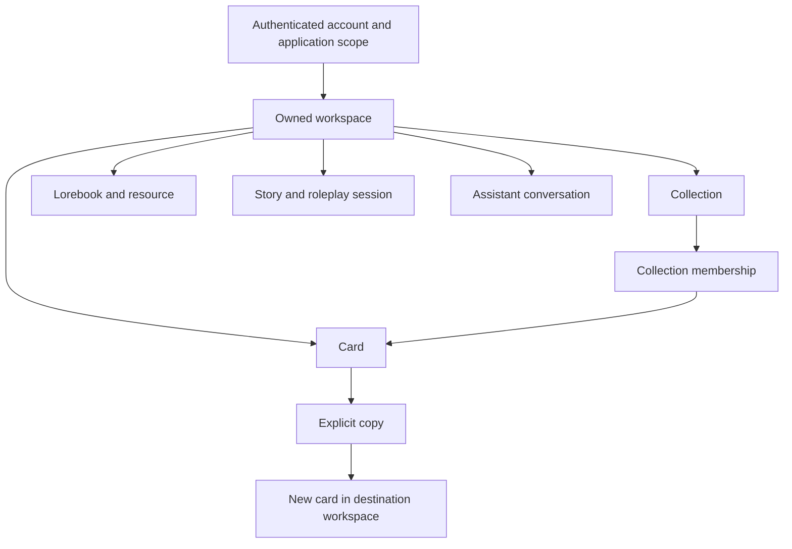

# ADR-001: Personal workspaces and card collections

> **Scope / status (reviewed 2026-10-14):** R1 design/coverage contract and dated implementation evidence. Source is implemented; default product UI rollout remains **WIP**, locally opted in. [02](02_current_status_and_findings.md) owns current status and schema compatibility; [04](04_gaps_and_priorities.md) owns remaining gaps/TBD. Historical test totals, branch state and migration notes below apply to their stated dates, not deployment availability.

**Status:** Selected R1 architecture is implemented in source; deployment acceptance remains WIP.\
**Refreshed:** 2026-10-12.\
**Decision basis:** User-requested documentation readiness and current project constraints. These are implementation-plan decisions, not evidence of deployed behavior.

## Context

The app currently has an owner/application-scoped library. The user needs separate experimental and mature content, collections for related cards, and intentional reuse across workspaces. Existing stories and sessions preserve selected content through snapshots.

The frontend calls only the BFF. The BFF owns content SQL and context assembly; it delegates authentication and AI execution. The implementation must preserve these service boundaries.

## Selected decision

1. Introduce personal workspaces inside existing account/application scope.
2. Give each content root one home workspace.
3. Use flat, many-to-many card collections within a workspace.
4. Copy across workspaces using new identities and explicit dependency handling.
5. Preserve existing snapshot behavior and keep collection membership outside AI context.
6. Capture workspace destinations as BFF-owned operation context.
7. Keep billing, credentials, system profiles, and account preferences at their current scope.
8. Apply the full R1 boundary to cards, lorebooks/resources, stories, sessions, and unified assistant conversations.
9. Present that content through the approved single library browser: collection folders and mixed existing cards together, persistent search, and New leading to the existing creators/assistant. Private type galleries become library filters/legacy adapters rather than separate sidebar destinations.

`WorkspaceContext` is the planned companion to `AppScope`, not a replacement authentication context. Some code requires `type(scope) is AppScope`; assuming a subclass will work is unsafe. Validate workspace ownership once at the boundary and thread it through content repositories and operation admission.

## Domain relationships

Collections can mix card types. Personas remain character cards. Stories and collections have independent identities; there is no required one-to-one relationship between them.

## Options considered

| Option | Complexity | Benefit | Limitation |
|---|---|---|---|
| Tags/collections only | Low to medium | Improves grouping quickly | Does not isolate mature and experimental content |
| One home workspace plus independent copies | Medium to high | Clear ownership, deliberate reuse, independent editing | Requires copy dependencies and operation context |
| Global cards linked into several workspaces | High | One canonical card can appear everywhere | Shared edits undermine sandbox isolation; overrides add complexity |
| Series/novel as the primary container | Medium to high | Fits book-oriented organization | Makes roleplay/testing feel secondary and ties organization to the editor |

The second option best matches the user's stated needs. A reusable Reference library can be an ordinary workspace rather than another ownership layer.

## Repository map

| Repository | Required impact | Main areas | Boundary |
|---|---|---|---|
| `magic-worlds` | High | Context providers, router/sidebar, galleries, types/API client, imports, creators, pickers, assistants, task navigation | Owns interaction and transient state |
| `magic-worlds-api` | High | Schema/migration, SQL repositories, content routes, cloning, operation admission, workers, cleanup, tests | Owns persisted organization and validation |
| `api.auth` | No workspace-domain change expected | Regression-check existing identity/app access | Do not create auth projects/groups for personal workspaces |
| `api.magic_llm` | No workspace-domain change expected | Regression-check existing execution transport | Receives selected context; does not own the content library |
| `magic-agents` | No change expected | Existing graph execution | No workspace permission or card-management logic |
| `magic-llm` | No change expected | Existing provider abstraction | No content database or organization logic |

These are qualitative assessments, not estimates of days or affected lines. Runtime load and data volume have not been measured.

## Integration constraints

The upstream agents API already uses `workspace_id` as an agent draft-preview selector in [completion models](/home/andres/PycharmProjects/api.magic_llm/src/models/completion.py). Do not forward the personal content workspace through that selector or change upstream graph-source semantics.

Workspace names, collection membership, and preferred use need not enter generated-card schemas or prompts. Selected card/lorebook content continues through the existing context-building paths.

WebSocket sessions can retain their frame protocol and session URL structure if the BFF validates the session root's workspace and the frontend owns events by origin. A new frame format is not automatically required.

## Concrete R1 choices

| Concern | Selected design |
|---|---|
| Ownership and scope | AppScope plus a separate validated WorkspaceContext; full content/activity roots |
| Default initialization | tb_workspace_scope with one protected default workspace per owner/application tuple |
| Default persona | Existing published is_default_persona flag, scoped/serialized by workspace; no parallel preference pointer |
| Operation context | BFF tb_content_operation_context inserted atomically at admission; no upstream effective-config changes |
| Copy operations | One all-or-nothing transaction with bounded batches and in-transaction ID maps; success-only receipt against double submits; no pending state, lease, or resume |
| Resources | Clone linked independent resources and embedded snapshots; remap live destination identities and retain historical provenance |
| Media | Current account/application ownership plus validated workspace associations; TTS scope through its job |
| API metadata | Explicit organization field in private read/result DTOs; generated/persisted content stays unchanged |
| Navigation | One Library sidebar entry and folder/card browser; existing creator/activity hashes plus canonical library hash and workspace query; central async switch coordinator and guarded history |
| Calls and notices | End call before committed switch; active call blocks archive; global quota/supersede and mixed inbox retained |
| Deployment | Coordinated cutover from exact 2026_10_image_profiles schema to planned 2026_10_workspace_r1; frontend deployed with workspace UI flagged off, then enabled (08, 11) |

[Document 15](15_execution_contracts.md) fixes detailed contracts and [document 16](16_scope_inventory.md) fixes current-path coverage. These choices replace the earlier unresolved alternatives.

## Consequences

Private reads/writes gain a workspace predicate. Copying becomes an explicit cross-boundary command. Frontend asynchronous ownership includes the workspace. Snapshot preservation and immutable-media reuse remain useful.

The feature does not require replacing React contexts, the router, TipTap, or graph libraries. Future human collaboration would require its own permissions and concurrency design.

## Action items

- [x] Select full root isolation and the existing scoped default-persona flag.
- [x] Define workspace/collection contracts and companion operation-context storage in document 15.
- [x] Define migration starting at the current image-profile schema; tooling and rehearsal remain implementation work.
- [ ] Implement the phases in [the delivery plan](/home/andres/WebstormProjects/magic-worlds/docs/workspace_r1/12_implementation_plan_and_acceptance.md).
